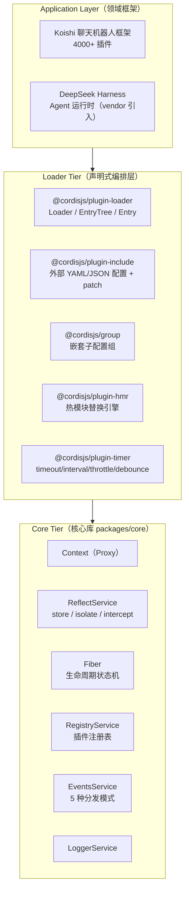
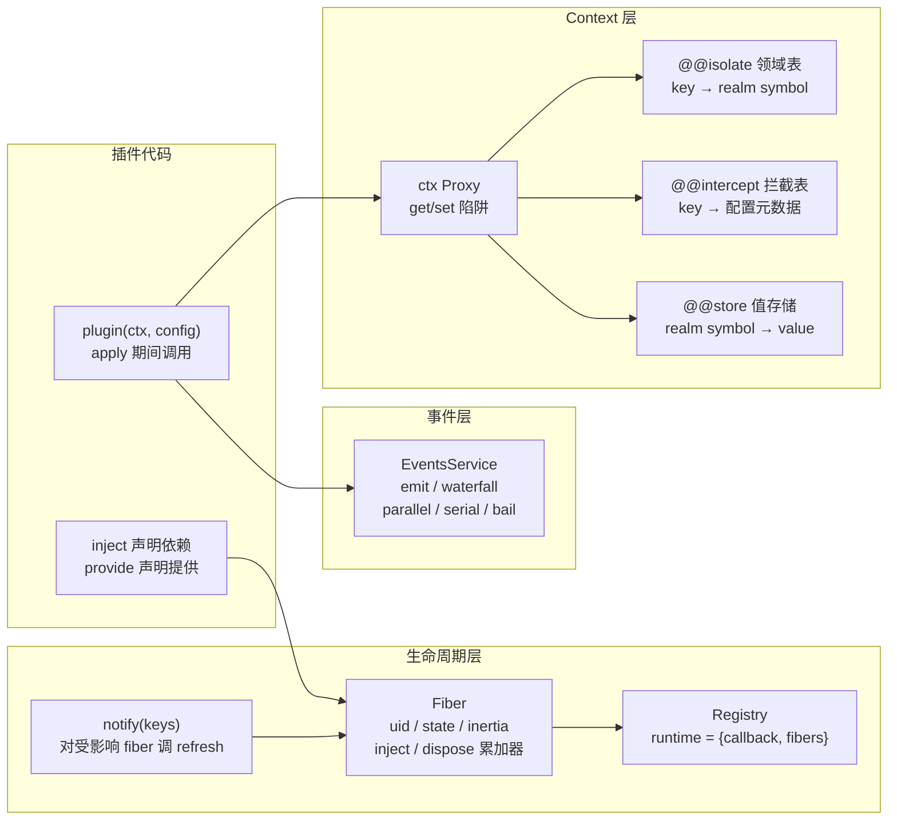
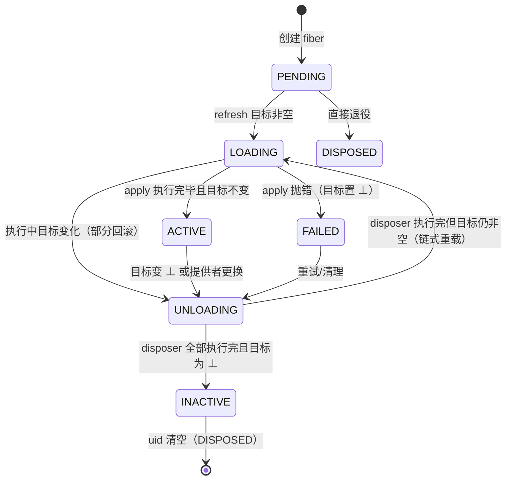

# Cordis Project Research — 时空可组合性元框架（Meta-Framework of Spatiotemporal Composability）

> 研究时间：2026-08（基于上游仓库最新 commit 8cc9e33, 2026-08-13；core 版本 4.0.0-rc.8）
> 论文：《A Programming Paradigm for Spatiotemporal Composability》(Draft of August 13, 2026)，作者 Yifan Shi、Wei Zhang（北京大学）、Tianyi Cui（DeepSeek-AI），88 页 preprint。https://github.com/cordiverse/paper

---

## 1. What it is

**Cordis** 是一个开源的、基于 Node.js/TypeScript 的**元框架（meta-framework）**，官方定位为 "Meta-Framework of Spatiotemporal Composability"（时空可组合性元框架）。它不面向任何具体领域（不是 Web 框架、ORM 或 UI 框架），唯一职责是提供**通用、可形式化保证的动态组合（dynamic composition）语义**：让组件（插件）可以在运行时被加载、卸载、重新配置，且——

- **时间维度（Temporal composability）**：卸载一个组件时，它对该环境做的所有修改（注册的事件、分配的资源、安装的服务）被**完整且有序地撤销**；
- **空间维度（Spatial composability）**：组件之间可以**声明式地表达依赖**，当依赖出现、消失或更换实现时，系统**响应式地**激活/停用相关组件。

### 项目关键事实

| 项 | 值 |
|---|---|
| 仓库 | `https://github.com/cordiverse/cordis` |
| 作者 | Shigma（Koishi 聊天机器人框架作者） |
| 核心包 | `cordis`（packages/core，v4.0.0-rc.8，~2000 行 TS） |
| 许可证 | MIT |
| 运行时 | Node.js >= 22，TypeScript，纯 ESM，yarn 4 workspaces + yakumo 构建 |
| 论文 | 《A Programming Paradigm for Spatiotemporal Composability》（cordiverse/paper，88 页，含操作语义与元理论证明） |
| 文档 | cordis-primer（DeepSeek Harness 文档站点引用） |

### 主要使用方

1. **DeepSeek Harness**：DeepSeek 的 Agent Harness（50+ 包的 monorepo）将 Cordis **vendor 进仓库**（`vendor/cordis`），rescope 发布为 `@deepseek-ai/cordis`（latest 4.0.1，npm），并做了 18 项本地修改（生命周期加固、事务性配置加载、懒配置求值等）。Cordis 是整套 Agent 运行时（tools、llm 适配器、session、workflow、subagent 等全部子系统）的插件内核。
2. **Koishi**：开源聊天机器人框架（QQ/Discord/Telegram），是 Cordis 最早的实战平台，拥有 4000+ 社区插件；论文 5.3 节以 Koishi 作为案例研究（Koishi 目前用 Cordis v3，论文呈现的是 v4）。

### 设计哲学（一句话）

> 传统 DI/IoC 容器回答"谁创建谁"；Cordis 回答"**谁在什么时候活着**、谁死的时候**如何把现场还原**"。它把经典 PL 理论中的 **effect（副作用）与 coeffect（上下文需求）** 从编译期静态标注"提升"为运行时机制（revertible effects + reactive coeffects），从而让动态组合的保证成为结构性保证而非作者自觉。

### 与普通插件框架/DI 的关键差异

- 传统 DI（InversifyJS/tsyringe/NestJS）：`bind` 之后 service 默认一直存在，无自动 dispose、无依赖驱动重载、配置启动时一次性。
- VSCode 式插件系统：只有 `deactivate` 优雅退出钩子（进程退出时），无法**在运行时单独卸载**某个插件的代码与效果；扩展点固定、扩展间依赖结构缺失。
- Cordis：`ctx.effect()` 注册即返回 disposer（逆），卸载即自动逆序执行；`inject` 声明依赖，依赖消失→组件自动停用，依赖恢复→自动重新激活；配置（cordis.yml）一行一个插件实例，改动触发局部热替换（HMR）。

---

## 2. Terminology and Core Concepts

### 2.1 框架概念

| 术语 | 定义 |
|---|---|
| **Context（上下文）** | 一切交互的载体，是一个 Proxy 化的对象。服务占据稳定的 `ctx.<key>`（如 `ctx.tools`、`ctx.llm`）。所有 effect 与 coeffect 操作都通过它进行。 |
| **Service（服务）** | 由 `Service` 基类扩展的具名对象，通过 `ctx.reflect.provide(name, value)` 安装到某个 key；其他插件通过 `ctx[key]` 或 `ctx.get(key)` 消费。 |
| **Plugin / Component（插件/组件）** | 具有可选 `inject`、`provide` 与 `apply(ctx, config)` 的函数、类（构造函数）或对象；经 `ctx.plugin()` / `ctx.use()` 实例化。 |
| **Fiber（纤程）** | 组件的**一次实例化**，携带自己的生命周期状态机（PENDING → LOADING → ACTIVE → FAILED → UNLOADING → DISPOSED）。每个 fiber 有唯一 `uid`，拥有独立子上下文 `fiber.ctx`。 |
| **Effect（副作用）** | `ctx.effect(callback)`：callback 返回 disposer（清理函数）/生成器 yield disposer。运行时自动跟踪并 LIFO 逆序回收；`ctx.on()`、`ctx.provide()`、`ctx.plugin()` 等全部归约为 effect。 |
| **Disposable / Disposer** | 撤销某 effect 的函数；每个注册（事件监听、定时器、服务提供、插件实例化）都对应一个 disposer。 |
| **inject** | 插件的 coeffect 声明：`['tools']` 或 `{ tools: {...config} }`。声明后插件**等待**该服务 ACTIVE 才执行 apply。 |
| **provide** | 组件向环境提供的关键字集合；同一时间同一 realm 内一个 key 只能有一个提供者。 |
| **Events（事件）** | 类型化事件系统，5 种分发模式：`emit`（按序观察）、`parallel`（并行）、`serial`（按序、遇真值短路）、`bail`（同步短路）、`waterfall`（around-middleware，`(...args, next)`）。 |
| **isolate（隔离/领域）** | `ctx.isolate(name, realm)`：同一个逻辑 key 在不同 realm 下解析到独立绑定（符号 `Symbol(name)` 作 realm 标识）。 |
| **intercept（拦截）** | `ctx.intercept(name, metadata)`：不改变解析结果，只改变"如何使用"（配置叠加，子层优先）。 |
| **Registry（注册表）** | 记录插件 runtime（`plugin → { fibers, callback, Config }`），枚举所有 fiber。 |
| **Loader（加载器）** | 声明式配置层：Entry 树 ↔ Fiber 的同步器。Entry 字段：`id, url(name), config, disabled, inject, isolate, intercept`。 |
| **EntryTree / EntryGroup / Entry** | 配置树结构；group 把子配置列表作为一组加载；叶子 entry 对应单个 fiber。 |
| **Include** | `@cordisjs/plugin-include`：把外部 YAML/JSON 配置文件（支持 `!!js` 表达式）嫁接为子树；支持 patch 机制。 |
| **HMR** | `@cordisjs/plugin-hmr`：热模块替换引擎（accepted/declined/externals/stashed 四类模块集合 + 事务性重载）。 |
| **Config schema** | 插件配置用 `StandardSchemaV1`（@standard-schema/spec）声明，实例化时校验；失败抛 `ValidationError`。 |
| **cosmokit** | Cordis 的底层工具库（`Dict`、`Awaitable`、`defineProperty`、`Promisify` 等）。 |

### 2.2 理论概念（论文术语）

| 术语 | 定义 | 对应实现 |
|---|---|---|
| **Revertible effect（可逆副作用）** | 每个上下文变换携带显式逆；`Γ → Γ × (Γ → Γ)` | `ctx.effect(callback)` |
| **Effect context `∂Γ`** | `∂Γ ≔ Γ × (Γ → Γ)`：当前状态 + **accumulator（累加器）**（迄今所有 effect 逆的复合，恢复函数） | fiber 的 disposer 链 |
| **Twisted composition monoid `𝔗Γ`** | `(f₁,g₁)∘(f₂,g₂) ≔ (f₁∘f₂, g₂∘g₁)`——逆按相反顺序累积 | LIFO 回收 |
| **Effect function `𝔈Γ` / 见证版 `𝔈∗Γ`** | 输入侧在应用点给出逆（`Γ → Γ × (Γ→Γ)`）；见证约束 `g(δ)=γ` | effect callback + 作者义务 |
| **Effect composition `⋄`** | `𝔈Γ` 上的幺半群组合（继承 𝔗Γ 结构） | 嵌套 effect |
| **Reactive coeffect（响应式共效应）** | 组件声明依赖规范，上下文每次变化按规范分类为 activating / deactivating / neutral | `inject` + `notify` + fiber `refresh` |
| **Coeffect context `Σ`** | 依赖表：`(k:K) ⇀ V k` 的有限偏函数 | `ctx[@@store]`（realm symbol → value） |
| **Satisfaction `σ ⊧ d`** | `∀k∈d. k∈dom(σ)`：声明的依赖是否全部满足 | `fiber.inject` 全部解析成功 |
| **notify_d(σ,σ′)** | 变化分类：不满足→满足为 activating；满足→不满足为 deactivating；否则 neutral | `ReflectService.notify` |
| **Isolation / Interception** | 让同一 key 在不同 context 解析到不同绑定 / 调整绑定使用方式 | `ctx.isolate` / `ctx.intercept` |
| **Context type `Γ∞`** | `μΓ. Γ × (Γ→Γ) × Σ`：统一 effect 上下文与 coeffect 上下文，递归结构支撑层次化组合 | `Context` + Proxy |
| **Component `ℭΓ`** | 三元组 `(d, p, e)`：coeffect 需求、provision、见证 effect 函数 | plugin 的 `inject/provide/apply` |
| **Fiber（论文 Definition 44）** | `⟨d, p, e, π, σ, τ, θ⟩`：父指针、自有 coeffect 表、退役标志、生命周期态（含 accumulator `g` 与 committed view `ω`） | `Fiber` 类 |
| **Target view / Committed view** | 目标：按当前状态每个声明 key 该由哪个 fiber 提供；已提交：激活时解析到的提供者集合 | `fiber.target` / 内部比对 |
| **Quiescent（静息）** | 每个 fiber 都达到其 target view 的状态 | loader `await()` |
| **Inertial transition（惯性迁移）** | 一旦进入 reload/unload，必须跑完才能响应新的目标变化；中途可链式接续（unload→reload 等） | `fiber.inertia` + `_reload`/`_unload` 互递归 |

### 2.3 分发模式（事件公开约定）

| 模式 | 是否 await | 顺序 | 返回值 | 语义 |
|---|---|---|---|---|
| `emit` | 否 | 按注册序 | 无 | 观察 |
| `waterfall` | 否 | 按注册序 | 下游返回值 | around-middleware（`next()` 委托，短路即不调） |
| `parallel` | 是 | 并行 | 无（AggregateError 汇总） | 并行扇出 |
| `serial` | 是 | 按注册序 | 首个真值 | 遇真值短路 |

---

## 3. Overall Architecture

### 3.1 三层结构（论文 5 节）



### 3.2 核心运行时架构



### 3.3 Fiber 生命周期状态机（源码 fiber.ts `FiberState`）



状态说明（与论文 Table 2 对应）：`LOADING ≈ 𝖱𝖾𝗅𝗈𝖺𝖽𝗂𝗇𝗀`，`FAILED ≈ 𝖨𝗇𝖺𝖼𝗍𝗂𝗏𝖾(𝜉)`；`fiber.dispose` 即累加器 recover；`fiber.inertia` 是在途迁移的句柄。

### 3.4 关键解析路径：`ctx.<service>` 的属性访问（reflect.ts Proxy get 陷阱）

1. 特殊属性（symbol、`prototype`/`then`、数字、`_` 开头）直接走 `Reflect.get`。
2. 目标对象自有属性 → 返回 traceable 包装。
3. 否则查 `reflect.props`（accessor 或 service）；service 走 `internal/get` waterfall → 从**当前 fiber 开始向上**沿 fiber 链在 `fiber.store` 中找 impl：命中即返回；若 `key ∈ fiber.inject` 则抛 "cannot get required service in inactive context"；到 root 未声明则抛 "cannot get property without inject"。

---

## 4. Core Algorithm / Approach

核心方法一句话：**把所有上下文变更收敛到唯一的可逆原语 `ctx.effect`，所有依赖变更收敛到唯一的响应式分类 `notify`，再用一个"惯性状态机"把两者编成组件生命周期。** 以下伪代码对应论文 Algorithm 1–6 与源码实现。

### 4.1 Effect 跟踪（ctx.effect 执行模型，fiber.ts / 论文 Algorithm 1）

```text
// execute: 驱动 effect callback（普通函数或生成器），把每个 yield 出的逆折叠成复合逆
function execute(callback, guard):
    iter ← callback()                       // 可为 () => dispose 或 () => yield disposer 的迭代器
    inverse ← id                            // 恒等作为初始累加器
    while guard():                          // 每步边界检查 guard（惰性中断点）
        (value, done) ← await iter.next()
        if value is disposer:
            inverse ← value ∘ inverse       // LIFO：新逆前置
        if done: break
    return inverse                          // 复合逆 = 恢复函数

function effect(ctx, callback):
    armed ← true
    task ← execute(callback, () → armed)
    function dispose():
        if not armed: return
        armed ← false                       // 幂等：只回收一次；同时中断在途迭代
        recover ← await task
        recover()                           // 应用复合逆
        ctx.dispose ← dispose ∘ ctx.dispose // 提升到父上下文累加器（∂²Γ 递归结构）
    return dispose
```

要点：guard 在**每次迭代边界**检查（论文 4.3.2 的 step-boundary interruption），因此 effect 中途目标变化可部分回滚；`armed` 标志保证自释放与父级组合。

### 4.2 组件生命周期：惯性状态机（fiber.ts `_refresh/_reload/_unload` / 论文 Algorithm 5）

```text
// refresh：重算目标视图；若不在迁移中则启动 reload 或 unload
function refresh(fiber):
    target ← computeTarget(fiber)          // 每个声明 key → 提供者 fiber 的 uid（⊥ = 不该运行）
    if target = fiber.target: return       // 幂等：neutral 变化无害
    fiber.target ← target
    if fiber.inertia: return               // 惯性：已有迁移在途，仅记录新目标
    if target ≠ ⊥:
        fiber.state ← LOADING
        fiber.inertia ← spawn(reload(fiber))
    else:
        fiber.state ← UNLOADING            // 先出服务，再排逆（L-Leave）
        fiber.inertia ← spawn(unload(fiber))

// reload：执行组件 apply，其效果被跟踪；结束后比对目标决定 ACTIVE 或链入 unload
async function reload(fiber):
    target0 ← fiber.target
    fiber.committed ← resolve(fiber.inject)        // 提交视图：读取时固定的依赖快照
    recover ← await execute(fiber.apply, () → fiber.target = target0)
    fiber.dispose ← recover ∘ fiber.dispose
    if fiber.target = target0:
        fiber.state ← ACTIVE
        notify(fiber.ctx, provided(fiber))         // 通知依赖者（提供者已 ACTIVE）
        fiber.inertia ← null
    else:
        fiber.state ← UNLOADING
        fiber.inertia ← spawn(unload(fiber))

// unload：先排水依赖者，再 LIFO 回收全部逆；结束后按目标决定 INACTIVE 或链入 reload
async function unload(fiber):
    await all(notify(fiber.ctx, provided(fiber)).map(f → f.await()))   // 等依赖者退到 INACTIVE
    await fiber.dispose()                       // 执行累加器（逆序回收全部效果）
    fiber.dispose ← id
    fiber.committed ← ⊥
    if fiber.target = ⊥:
        fiber.state ← INACTIVE
        fiber.inertia ← null
    else:
        fiber.state ← LOADING
        fiber.inertia ← spawn(reload(fiber))
```

三个支撑 coeffect 排序（论文 Theorem 63）的关键行：**reload 先提交视图**（依赖在卸载期间仍可读）；**refresh 在排逆前标记 UNLOADING**（提供者先行停止，依赖者先重算目标）；**unload 在回收前 await 依赖者**（提供者图按需遍历，无需预先分析，终止性由 Theorem 66 保证）。

### 4.3 响应式通知（reflect.ts notify / 论文 Algorithm 3）

```text
function notify(ctx, keys):
    affected ← ∅
    for fiber in allFibers:
        for key in keys:
            if key ∈ fiber.inject 且 fiber.ctx[@@isolate][key] = ctx[@@isolate][key]:
                refresh(fiber)                 // 按规范重新分类：activating/deactivating/neutral
                affected ← affected ∪ {fiber}
                break
    return affected                            // 调用方可 await 这些 fiber
```

绑定仅在提供者 fiber **ACTIVE** 时对依赖者可见（`_getImpl` strict 模式），因此提供者进入 UNLOADING 的一瞬间依赖者就开始自身 teardown——这是论文强调的"撤出提前一个步骤可见"。

### 4.4 代理式上下文访问（reflect.ts 解析 / 论文 Algorithm 6）

```text
function resolve(ctx, key):
    fiber ← ctx.fiber
    repeat:
        if key ∈ fiber.committed:  return fiber.committed[key]   // 已提交视图，直接授权
        if key ∈ fiber.inject:     throw INACTIVE_ACCESS         // 声明了但未加载
        if fiber = root:           throw UNDECLARED_ACCESS       // 未声明
        fiber ← fiber.parent.fiber                                // 沿 fiber 链向上
```

与裸 `ctx.get(key)`（查 store，不失败）不同：属性访问**针对访问者自己的视图**解析并在使用点强制 coeffect 规范——这就是"声明了依赖的组件在未激活时读 ctx.key 会报错"的机制。

### 4.5 HMR 三阶段（hmr/src/index.ts / 论文 Algorithm 8–10）

```text
// Phase 1: 模块分类（不动点）
classify(stashed, externals):
    accepted ← stashed;  declined ← externals;  pending ← ∪imports(stashed)
    repeat until 无进展:
        url ∈ pending 且 imports(url) ∩ accepted ≠ ∅ → accepted ∪= {url}
        url ∈ pending 且 imports(url) ⊆ declined    → declined ∪= {url}
        否则把新 import 加入 pending
    declined ∪= pending（含环路的兜底）

// Phase 2: 陈旧 entry 检测
detect(entries, accepted, declined):
    for entry: tree ← 沿 declined 边界的传递 import 闭包(entry.url)
        if tree ∩ accepted ≠ ∅: stale_entries ∪= {entry}; accepted ∪= tree

// Phase 3: 事务性重载（失败回滚）
reload(ctx, accepted, stale_entries):
    backup ← 清除 accepted 各模块的 ESM loadCache 与 CJS require.cache（并备份）
    try:
        for entry in stale_entries:
            entry.fiber.dispose()                        // 旧的整个效果树回收
            entry.fiber ← ctx.use(import(entry.url), entry.config)  // 新 fiber 重装
    catch error:
        restore_caches(backup)                           // 回滚缓存
        for entry: dispose 新 fiber，用 backup 重新 use
        throw error
```

关键工程点：Node 22–24 内部 `ModuleLoader` 兼容（`--expose-internals` 或 `node-addon-require-builtin` 获取 `internal/modules/esm/loader`），Node 24 的 loadCache 是 `Map<url, {type: ModuleJob}>` 且 `delete()` 只置空——须用 `Map.prototype.delete` 直接操作；CJS/ESM 双缓存都要清（Node 24 中经 import() 加载的 CJS 出现在两个缓存）；externals（主入口可达的框架模块）变化触发完整重启而非 HMR。

---

## 5. Deep Dive

### 5.1 论文理论核心（cordiverse/paper）

**5.1.1 可逆副作用（3.1 节）**

- 把副作用建模为上下文变换上的幺半群（closure/associativity/identity 对应 effect 的语义性质）。
- **trackΓ**：`(f,g) ↦ (γ,φ) ↦ (f(γ), φ∘g)` —— 应用 effect 时把逆压进累加器。Theorem 4：`pr1 ∘ track = f ∘ pr1`（跟踪不改变原语义）；Theorem 5：track 是 𝔗Γ → (∂Γ→∂Γ) 的幺半群同态（复合保结构）。
- **recoverΓ**：`(γ,φ) ↦ (φ(γ), idΓ)` —— 应用累加器恢复初始状态。Theorem 7：若 `g(f(γ)) = γ` 则 `recover ∘ track = recover`（恢复与跟踪先后无关，即完全可逆保证）。**soundness invariant**：`φ(γ) = γ₀`。
- 从"预先给定逆"（track）升级到"应用点给出逆"（effect function 𝔈Γ ≔ Γ → Γ×(Γ→Γ)）与"选择性撤销单步"（∂Γ → ∂²Γ），得到见证版 𝔈∗Γ（约束 `g(δ)=γ`）；effect composition `⋄` 把 𝔗Γ 的幺半群结构带上来（Theorem 10、11、13）。
- 关键不变量：**undoing an effect is itself an effect**（`effectΓ(e)` 返回的逆本身是 track 了对偶对 `(g, pr1∘e)` 的效果函数）——递归可逆，这正是 `ctx.effect` 中 disposer 可嵌套、可被父级再次包装的数学依据。

**5.1.2 响应式共效应（3.2 节）**

- coeffect context Σ ≔ 依赖表（类型族 𝒱: K→Type 保证静态类型安全）；`get`/`set` 两原语，其中 **`set(k,v)` 的类型恰是 𝔈∗Σ**——"coeffect 操作是 effect，effect 可逆"这一协同是整套理论的关键桥梁。
- 满足谓词 `σ ⊧ d` 可判定；因所有 Σ 突变都经 effect 函数，**每次满足度变化在 effect 边界必然可观测**——这是反应性的代数基础。
- `notify_d` 把转移分类为 activating/deactivating/neutral；activating 触发执行组件 effect，deactivating 触发 apply accumulator。
- 3.2.3 引入 **isolation（realm）** 与 **interception**：in-place vs derived 两种 realization——隔离/拦截不改表本身，而是"派生子上下文调整解析方式"，因此恢复是隐式的（丢弃子上下文即可，无需显式逆）。
- 3.3：统一上下文 **Γ∞ = μΓ. Γ × (Γ→Γ) × Σ**：递归自相似结构支持层次化组合（父上下文聚合子级效果，"plug-in"字面化：加载=插，卸载=拔且不影响其他组件）；观测等价 ≃ 由各 key 的操作集生成（coarsest relation operations respect），把 Theorem 7 的 `=` 弱化为 `≃`（如 free 不会还原堆布局——物理状态不可能逐字节恢复，可观测等价才是现实目标）；跨 key 操作天然独立（Theorem 40）。

**5.1.3 动态组合演算（4 节）**

- 组件 ℭΓ = (d, p, e)；provision 两两不相交（无 realm 时每个 key 提供者唯一）。fiber 是携带生命周期态的一次实例化（Definition 44，含 committed view ω）。registry 使 coeffect 上下文成为**派生值**：`σγ ≔ ⋃{σm | m ACTIVE}`。
- 两态基演算：目标视图 `target_n(γ)`（⊥ 或 每个声明 key 的提供者）；quiescent 当所有 fiber 到达目标。规则 O-Insert/O-Retire（注册原语，对应 ctx.use）、L-Begin/L-Iter/L-Finish（执行迭代）、L-Divert（迭代边界目标变化→部分回滚）、L-Leave（先出服务再排逆）、L-Unload（等依赖者退完再回收）、L-Raise（错误记录，目标置 ⊥）。
- 4.3 引入**在途迁移**：一旦进入 reload/unload，必须跑完（inertial），期间目标变化通过链式接续（unload→reload / reload→unload）响应。
- 元理论（4.4，约 15 个定理）：不动点、唯一性（Theorem 73：静息状态是最终配置的**函数**，与迁移顺序无关——增量 reconciliation 正确性基础）、有序性（Theorem 63：coeffect 排序）、终止性（Theorem 66：提供者图按需遍历）、正确性（Theorem 64/65/69/70/71 等：惯性、观测等价、支持集与 ACTIVE fibers 的对应）。

### 5.2 代码深潜（packages/core）

| 文件 | 职责与亮点 |
|---|---|
| `context.ts`（78 行） | Context 构造时自建 Proxy（`ReflectService.handler`）；`extend(meta)` 原型链派生子上下文（shadow 机制）；`isolate`/`intercept` 通过原型链对象记录差异。 |
| `reflect.ts`（281 行） | Proxy get/set/has 陷阱（3.4 节解析路径）；`provide` 返回 effect（effect 内注册 impl + notify，清理时先 notify 再 await 依赖者再删自身 store 项）；`mixin` 把服务方法嫁接到 ctx（如 `ctx.on/emit/...`）；`trace/bind` 上下文追踪包装（确保回调里 `this.ctx` 指向正确上下文）。 |
| `fiber.ts`（486 行） | 状态机 + 惯性迁移（4.2 节）；`effect()` 的幂等 disposer 包装（`wrapper.then` 让 fiber 可 await）；`update(config)` 走 `internal/update` waterfall（loader 借此把新配置写回文件）；`getEffects()` 导出 effect 树（HMR/调试用）。 |
| `registry.ts`（214 行） | 插件函数解析（函数 / `{apply}` 对象 / 类）；runtime 去重（同一 callback 一个 runtime，多 fibers）；`plugin()` 返回 fiber + thenable；`@Inject` 装饰器（class 或 method）声明依赖并把 config 注入。 |
| `events.ts`（178 行） | 5 种分发；`internal/*` 内建事件（`internal/update` 用 DisposableList 叠加钩子形成"内部 waterfall"——`ctx.fiber.update()` 的完整链路）；`once` 自卸载包装。 |
| `service.ts`（80 行） | Service 基类：构造时 `ctx.reflect.provide(name, self)`；`[resolveConfig]` 沿 intercept 原型链合并配置；可调用服务（`invoke` 时 createCallable 生成带追踪的 callable）；`[Symbol.hasInstance]` 对 Proxy 实例的 instanceof 修正。 |
| `logger.ts`（246 行） | 分级日志 + 格式化（`%C` 插件名、`%o` 对象等）+ Exporter 体系（logger-console 包实现控制台输出）。 |

### 5.3 Loader / Include / HMR 深潜

- **Entry 双向绑定**（entry.ts）：loader 改 entry → 调整 fiber（`refresh`/`update` 的 diff 检测 + `loader/patch-context` waterfall）；组件自改配置（`ctx.fiber.update()`）→ `internal/update` 钩子把 config 写回 entry（`noSave` 防回环）；自卸载（`ctx.fiber.dispose()`）→ `internal/plugin` 钩子把 entry 标记 disabled 并写回配置文件。
- **realm 交换**（config/isolate.ts）：`loader/patch-context` 中生成新 isolate 映射 → 计算旧/新 symbol 的 diff → 交换原型 → next()（重载 fiber）→ 迁移 store 项 → notify 用 delim 符号做过滤（只通知真正跨越 realm 边界的依赖者）→ 清理 delims；realm 垃圾回收（无 entry 引用即删除）。
- **Include**（include/src/index.ts）：支持 YAML/JSON/JS 三类配置文件；`!!js` 自定义 YAML type 解析为表达式节点（`{__jsExpr}`），**loader 在声明注入激活后**基于插件上下文插值 entry config、基于 loader 上下文插值 disabled（懒求值——DeepSeek Harness 的 18 项修改之一）；`patches` 按 id/name 匹配覆盖（后 patch 覆盖前 patch 插入的行）；写回用 `writeFile(.tmp) + rename` 原子替换 + debounce。
- **HMR**（hmr/src/index.ts）：文件变化 → externals 命中则 `loader.exit()`（完整重启）；loadCache 命中则 stash + debounce 触发 `partialReload()`；loader 配置文件（Include 的 filename）命中则 `include.refresh()`。`partialReload` 中 classify（固定点）→ 按配置树 URL 建 name map、解析每个插件入口 URL 判定 stale → 清缓存（备份 ESM+CJS）→ 重 import → 成功则 dispose 旧 fiber、用 `oldFiber.config` 建新 fiber（保留 entry 引用）；任一失败则回滚（恢复缓存 + 重装旧插件）。

### 5.4 DeepSeek Harness 集成（为什么选它）

依据 [为什么用 Cordis 做 AI Agent 运行时：从 QQ 机器人框架到 DeepSeek Harness](https://damodev.csdn.net/6a7e568b662f9a54cb9c7e72.html) 与 [cordis-primer](https://deepseek-harness.github.io/deepseek-harness/reference/cordis-primer)：

- **vendor 方式**：`vendor/cordis` 进入 deepseek-harness 仓库，发布为 `@deepseek-ai/cordis`（4.0.1），18 项本地修改：Fiber lifecycle hardening（修复 3 个 reentrant disposal race）、事务性配置 reload（失败回滚）、懒配置求值、Include patch 语义等；收益=完全可审计、可 patch、版本锁定、热路径调优。
- **Agent 特有场景**：service 可以运行时消失（MCP server 崩溃 → tools 注销；LLM provider rate limit；watcher 被杀）——传统 DI 假设 bind 后一直存在，Cordis 假设 service 随时出现/消失，`inject` 依赖方自动停用、恢复后自动重新 apply（框架级保证，无需手写重连）。
- **Waterfall 事件即决策链**：`tools/pre-execute → tools/execute → tools/post-execute`、`agent/pre-step`、`agent/request`、`llm/stream` 全部是 around-middleware 事件，多个独立插件组成决策链（权限→审批→超时→执行），可短路可包装。
- **配置即组合**：Profile/Bundle 分层（base bundle → plugin bundles → profile patch → home patch → CLI overlay）直接复用 Include 的 patch 机制。
- **Effect-scoped 资源管理**：MCP 连接、PTY session、file watcher、background job 统一 `ctx.effect(() => { acquire(); return () => release() })`。
- cordis-primer 的实践规则：行为封装为插件；拦截/策略优先用事件、直接能力调用优先用服务方法；每个注册都有对应 disposer；teardown 顺序敏感的工作放同一 effect。

### 5.5 与相关工作的对比（论文 7 节）

| 维度 | Cordis | 传统 DI（InversifyJS/NestJS） | VSCode 插件 | webpack/vite HMR | DSU |
|---|---|---|---|---|---|
| 卸载单个组件 | 运行时完整逆序回收 | 无自动 dispose | 需重启 extension host | 需开发者声明 accept 边界 | 需手写迁移函数 |
| 依赖响应式 | inject + notify 自动激活/停用 | 无 | 无结构契约（exports 无类型） | — | — |
| 形式化基础 | 演算 + 元理论证明 | 无 | 无 | 无 | 部分 |
| 粒度 | 组件级（共享地址空间，函数调用） | 对象级 | 进程级重启 | 模块级 | 模块级 |

论文 6 节讨论的开放问题：系统边界（哪些效果无法真正逆——I/O 与外部世界）、服务多路复用（同一 key 多实现）、访问控制与沙箱（coeffect 规范在编译期的检测）、语言独立性（核心概念与宿主语言无关，论文明确给出 Python/Rust 移植的调度差异——eager vs lazy scheduling 下 create_task 的显式/隐式）、互相依赖与组件粒度、依赖类型化与版本化。

### 5.6 仓库结构速览

```
packages/core         cordis（核心：context/events/fiber/logger/reflect/registry/service/utils）
packages/loader       @cordisjs/plugin-loader（Loader、EntryTree、Entry、EntryGroup、isolate 插件）
packages/hmr          @cordisjs/plugin-hmr（热替换引擎 + locales）
packages/include      @cordisjs/plugin-include（YAML/JSON 配置文件 + patch）
packages/group        @cordisjs/group（EntryGroup 导出）
packages/timer        @cordisjs/plugin-timer（timeout/interval/throttle/debounce，effect 化）
packages/utils        @cordisjs/utils（effect 化 List）
packages/logger-console @cordisjs/logger-console（控制台 Exporter）
packages/create       create-cordis（脚手架 CLI，模板 @cordisjs/boilerplate）
```

核心包依赖极简：仅 `@standard-schema/spec`（配置 schema）+ `cosmokit`（工具库）。peerDependencies 可选 `@cordisjs/plugin-loader`、`@cordisjs/plugin-include`（核心可独立运行，loader 是增强层）。

### 5.7 快速上手心智模型

```typescript
const root = new Context()          // 1. 创建根上下文
root.plugin(timer)                  // 2. 装服务插件（provides ctx.timer）

// 3. 写一个依赖服务、产出可逆副作用的插件
function myPlugin(ctx: Context, config: { greeting: string }) {
  // 依赖声明：ctx.logger 必须 ACTIVE 才执行本插件
  ctx.on('some/event', (payload) => { ... })            // effect：事件监听，自动卸载
  ctx.setInterval(() => { ... }, 1000)                  // effect：定时器，自动清理
  ctx.provide('my-service', new MyService(ctx))         // effect：安装服务，供下游 inject
  return () => { /* 可选的额外清理 */ }                  // 显式逆（返回 disposer）
}
myPlugin.inject = ['logger']                            // coeffect 声明
myPlugin.Config = z.object({ greeting: z.string() })    // 配置 schema（Standard Schema）

await root.plugin(myPlugin, { greeting: 'hi' })         // 4. 实例化
await ctx.fiber.update({ greeting: 'hello' })           // 5. 热更新配置（不重启）
// 卸载：fiber.dispose() → 定时器/监听/服务全部逆序回收
```

---

## 附：参考资料

- 仓库：https://github.com/cordiverse/cordis（core v4.0.0-rc.8，commit 8cc9e33）
- 论文：https://github.com/cordiverse/paper（《A Programming Paradigm for Spatiotemporal Composability》，88 页）
- DeepSeek Harness 文档：cordis-primer（https://deepseek-harness.github.io/deepseek-harness/reference/cordis-primer）
- npm：`cordis`、`@deepseek-ai/cordis`（vendor 版本 4.0.1）
- 背景文章：《为什么用 Cordis 做 AI Agent 运行时：从 QQ 机器人框架到 DeepSeek Harness》（https://damodev.csdn.net/6a7e568b662f9a54cb9c7e72.html）
