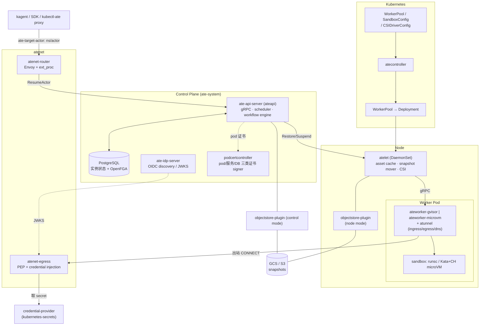
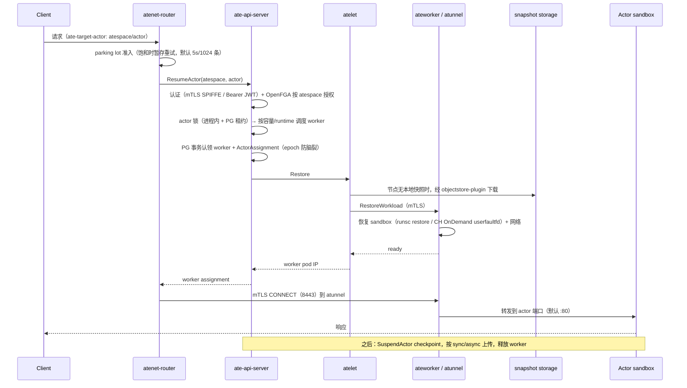

# Agent Substrate: 高密度 Agent 沙箱 Runtime

> **页面基线（2026-11-17 追更）**：本地仓库 `/home/lubingtan/go/src/github.com/agent-substrate/substrate` 已追到 `main@d283af4eb`（2026-11-17，1718 commits），**v1.0.0 "Fully armed and operational" 已于 2026-11-05 发布**。旧页面的内容基线约为 2026-07-31（`cbdeb7dbe`，425 commits），距今已有 **1293 个提交**。旧页面中的 Redis、`ateom`、单 actor/worker、Pause、FULL/DATA 快照等描述已被 1.0 架构淘汰，本页按 HEAD 重写，并在文末附「与 2026-07 版页面的差异」对照表。

## TL;DR：这次追更发现了什么

1. **GA 了**：v0.1.0（09-09）→ v0.6.0（10-22）约每周一个 minor 之后，v1.0.0（11-05）发布；README 从 "VERY early development / 不做兼容承诺" 改为 "committed to compatibility"，并给出 API/CLI/配置/数据/回滚四类兼容规则。
2. **状态存储换底座**：ValKey/Redis 被 **PostgreSQL** 彻底替换（`atepg`，`#640`/`#940`），授权模型内嵌 **OpenFGA**；Redis 分布式锁改为进程内 actor 锁 + PG 租约/outbox。
3. **组件改名 + 扩张**：`ateom-gvisor/microvm` → `ateworker-gvisor/microvm`；新增 `ate-idp-server`、`ate-setup`、`objectstore-plugin`、`credential-provider`、`envoy-dataplane`；`cmd/` 从 9 个目录变为 14 个。
4. **一个 worker 跑多个 actor**：Worker 从"同时只承载 1 个 actor"变为可承载多个（受容量与 `--max-actors` 默认 1000 限制）；Actor 开始声明 CPU/内存 limits，调度器按容量记账。
5. **快照模型重做**：FULL/DATA 作用域 → `VOLUMES < ROOTFS < MEMORY` 三级 fidelity；suspend 默认**异步**（先写节点本地快照、后台上传）；新增 `RevertActor`、`Tag`（不可变快照别名/保留）、节点本地快照缓存。
6. **安全从零补到 zero-trust**：per-actor 1h SPIFFE 证书 + actor JWT（OIDC IDP）、出口网关 `atenet-egress` + 凭证注入（secret 不进 sandbox）、EgressPolicy 默认拒绝、OpenFGA ReBAC、ate-system 默认拒绝 NetworkPolicy、worker 权限收紧（gVisor 9 caps / microVM 11 caps，均 `privileged:false`）。
7. **入口路由换了**：不再用 DNS/Host 选 actor，改为 `ate-target-actor: <atespace>/<actor>` header + mTLS CONNECT 到 worker 内 `atunnel`（默认 8443）；`atenet dns` 删除，改为每 sandbox 一个 DNS relay。
8. **安装/CLI/可观测性成熟**：`hack/install-ate*.sh` → `go run ./cmd/ate-setup deploy ...`；`kubectl ate proxy actor`；Hugo 文档站 [ate.dev](https://ate.dev)；OTel Weaver 指标注册表 + 首份 SLO/告警规范。
9. **生态**：2026-11 捐赠 **CNCF Sandbox**；kagent 1.0 起每个 agent 跑在 Substrate 上；README 主演示 8 个 Pod 承载 ~250 个有状态 actor（10x–30x oversubscription）。
10. **指标双口径**：架构文档的 north star 仍是 100ms p95 / 10 亿 actor / 1000 wakeups/s（**目标**），对外 GA 口径是 resume < 500ms、> 500 activations/s（**承诺/演示口径**），仓库内没有 p95 实测数字。

## What is Agent Substrate

[Agent Substrate](https://github.com/agent-substrate/substrate) 是 Google 发起、2026-11 已捐赠 CNCF（Sandbox）的高密度 Agent 沙箱运行时。1.0 的对外定位是 **"zero-trust sandboxing for millions of agents on Kubernetes"**：在标准 K8s 之上，把大量有状态 **actor**（agent 应用实例）多路复用到少量预热的 **worker** Pod，空闲 agent 被 checkpoint 出内存、请求到达时快速 restore 回来。

核心叙事没变：agent 大部分时间在等模型、等工具、等输入；把空闲 actor 快照到对象存储并释放 worker，用时间维度换密度。变的是 1.0 补齐了 v0.0.0 时仅有"愿景"的安全、身份、网络、存储和运维层：

- **始终沙箱化**：每个 actor 跑在独立 gVisor（`runsc`）或 Cloud Hypervisor microVM 里，纯 Linux 容器不被支持
- **per-actor 身份**：默认签发短生命周期 SPIFFE X.509；出口网关可按策略铸造 per-actor JWT，均可与外部身份系统联邦
- **sandbox 内零凭证**：actor 不持有 API key、云 token 或身份证书，出站凭证由 `atenet-egress` 在沙箱外注入
- **默认拒绝网络**：入站只走 `atenet-router`，横向与出站受 egress 策略约束
- **可插拔策略边界**：egress 网关是可替换的 PEP（策略执行点），可接自研授权/DLP/prompt 注入扫描

**规模指标**（两套口径，注意区分）：

| 口径 | 内容 |
|---|---|
| 内部 north star（`docs/concepts/architecture.md`） | 激活延迟 100ms p95；单集群 10 亿 actor；1000 wakeups/s（均为**目标**，非实测） |
| 对外 GA 口径（README / overview） | resume **< 500ms**；**> 500 activations/s**；10x+ 密度；演示 8 Pod / ~250 actor（10x–30x oversubscription） |

**项目元数据**：

- Go **1.27.0**（`toolchain go1.27.4`），module 改为 **`go.ate.dev/substrate`**（vanity import），Apache 2.0
- 2026-11-17 `main` 共 **1718** commits；v1.0.0 之后 main 仍有后续提交（本页按 HEAD 描述）
- 沙箱后端：gVisor（默认）+ Kata Containers on Cloud Hypervisor microVM
- 文档站：[ate.dev](https://ate.dev)（Hugo docsite，`docs/` 与 `site/` 同仓）

## 版本演进（2026-07 → 2026-11）

| Tag | 日期 | 备注 |
|---|---|---|
| v0.0.0 | 2026-05-19 | 初始开源快照，旧 wiki 页面的研究对象 |
| v0.1.0 | 2026-09-09 | 第一个 minor；此时 Postgres、atunnel、多 actor worker API 已合入 |
| v0.2.0 | 2026-09-25 | |
| v0.3.0 | 2026-09-30 | |
| v0.4.0 | 2026-10-07 | |
| v0.5.0 | 2026-10-14 | |
| v0.6.0 | 2026-10-22 | 1.0 前最后一版；`ateom → ateworker`、vanity import 均在此前后落地 |
| v1.0.0 | **2026-11-05** | "Fully armed and operational"；GA + 兼容性承诺；另有 `v1.0.0-rc.1/2/3` |

阶段特征：

- **2026-07~08（基建补齐）**：Postgres 替代 Redis（`#640`/`#940`）、`atunnel` 引入（7-27）、egress 网关与凭证注入（9 月中）、actor 身份 SPIFFE/JWT（8 月）、多 actor worker API（9-03）
- **2026-09（0.1~0.2）**：多 actor worker 实现落地（`#1836`）、API 风格统一起步、OpenFGA 逐 RPC 授权
- **2026-10（0.3~0.6）**：`ateom → ateworker` 改名、Go vanity import、sandbox asset cache、objectstore-plugin、`Tag`/`Revert`/异步 suspend、Hugo 文档站、SLO/OTel 指标
- **2026-11（1.0）**：GA、version-skew/升级策略、DCO 取代 Google CLA、CNCF 捐赠、Egress 凭证注入转正

## 状态模型（v1.0 版：三层）

旧页面的"双层模型（CRD + Redis）"已过时。1.0 是 **K8s CRD（低频基础设施）+ 控制面 PostgreSQL（高频实例状态，含 OpenFGA 授权数据）+ 对象存储（快照）** 三层：

| 层 | 存储 | 资源 | 更新频率 |
|---|---|---|---|
| **K8s 基础设施** | K8s API Server / etcd | `WorkerPool`、`SandboxConfig`、`CSIDriverConfig`（3 个 CRD） | 低频（infra 变更） |
| **控制面实例状态** | **PostgreSQL**（`atepg`，owner/read-write 双角色，goose 迁移） | `Atespace`、`ActorTemplate`、`Actor`、`Worker`、`ActorAssignment`、`Tag`、`EgressPolicy`、`AccessPolicy`；OpenFGA 关系元组同库 | 高频（数千次/秒） |
| **快照** | GCS / S3（经 `objectstore-plugin` sidecar） | Golden / Last / Tag 快照 | 每次 suspend/restore |

**为什么换 Postgres**：etcd 不适合百万级离散资源与高频写；Postgres 提供事务、租约（lease）、outbox 和成熟的运维（Cloud SQL/BYO DB）。Redis 时代的 per-actor 分布式锁改为"进程内 `actorlock` + PG 租约"，worker 舰队镜像仍由 `ateapi` 内存持有，但改为 PG watch 轮询同步。

## 核心概念

| 概念 | 说明 |
|---|---|
| **Actor** | agent 实例（派生自 ActorTemplate），地址 `(atespace, name)`。可 suspend/resume，在 worker 间迁移 |
| **Atespace** | Actor 的隔离边界（类似 namespace，但全局作用域，非 K8s namespace）。ActorTemplate/Actor/Tag 都归属 atespace |
| **Worker** | 一个 worker Pod 的控制面记录。状态 `ACTIVE / UNAVAILABLE / DRAINING`；**可同时承载多个 actor**（`ActorAssignment` 子资源，受容量与 actor 上限约束） |
| **WorkerPool** | CRD——声明预热算力；`spec.template.resources.limits` 定义每个 worker 的**容量**，由 `atecontroller` reconcile 成 Deployment |
| **SandboxConfig** | 集群级 CRD——按 sandbox class 固定沙箱二进制/资产（`runsc`、microVM kernel/firmware 等）；沙箱二进制不再烘进 worker 镜像 |
| **ActorTemplate** | actor 的不变定义（镜像、资源、env、快照配置）。**已是 ate API 资源，不再是 K8s CRD**，存控制面 Postgres；创建时默认生成 Golden Snapshot |
| **Golden Snapshot** | ActorTemplate 创建时一次性产生的初始 checkpoint（version 0）；可配置 `mode=DISABLED` 关闭 |
| **Last Snapshot** | 每个 actor 最近一次 suspend 产生的快照，下次 resume 使用 |
| **Tag** | atespace 级、不可变、可跨 atespace 发布的快照别名/保留（`TagScope=ATESPACE|PUBLISHED`） |
| **Suspend** | 休眠 actor：checkpoint → 本地快照 → （默认异步）上传对象存储 → 释放 worker；支持 `mode=SYNCHRONOUS|ASYNCHRONOUS` |
| **Resume** | 激活 actor：从本地或对象存储快照恢复到可用 worker，非冷启动 |
| **Revert** | 把 RUNNING/CRASHED（或带本地快照）的 actor 回退到最近一次 durable 快照并置为 SUSPENDED |
| **EgressPolicy** | Actor 的子资源（每 actor 一个 `default`，**非 K8s CRD**）：出站 allowlist + 凭证注入效果 |
| **AccessPolicy** | Global / atespace 级单例授权策略（OpenFGA ReBAC） |

> 已移除：旧页面的 **Pause**（快照留节点本地）独立操作与 `PAUSING/PAUSED` 状态。`PauseActor` RPC 已删除（`#2813`），语义由异步 suspend + 节点本地快照（locality）承接。

## 架构



**API 规模**：proto 移到 `api/ateapi/v1/ateapi.proto`（`package substrate.ateapi.v1`）。控制面 `Control` 服务 **42 个 RPC**（旧版 14 个），另有 `WorkerService` **8 个 RPC**（worker 注册/心跳/epoch/上报/证书铸造）。风格统一为 `ResourceMetadata` 固定 field 1、`ListOptions{page_size,page_token}`、`DeleteOptions`、`delete_time`，并用 K8s declarative validation 注解表达作用域。

## 组件与 Binary

`cmd/` 下共 **14 个组件目录**；v1.0 发布镜像白名单为 10 个 + `envoy-dataplane`，另发布 `kubectl-ate` 静态二进制，`ate-setup` 为安装工具（`go run`），`benchmarking` 为开发工具。

| Binary | 部署方式 | 功能 |
|---|---|---|
| **ateapi** | Deployment（HA） | 控制面 gRPC：actor 生命周期、调度、快照编排、workflow、OpenFGA 授权 |
| **atecontroller** | Deployment | K8s CRD reconciler（WorkerPool→Deployment、NetworkPolicy 等） |
| **atelet** | DaemonSet | 节点 supervisor：镜像/沙箱资产缓存、快照搬运、CSI、device plugin、worker 同步 |
| **ateworker-gvisor** | worker Pod 主容器 | gVisor sandbox 宿主 + `atunnel`（ingress/egress/DNS relay），驱动 `runsc` |
| **ateworker-microvm** | worker Pod 主容器 | microVM 宿主（Kata + Cloud Hypervisor），驱动快照/恢复 |
| **atenet** | Deployment/DaemonSet | `router`（Envoy ext_proc 触发 resume）+ `sdsmint`（mTLS SDS） |
| **atenet-egress** | Deployment | 出站策略执行 + 凭证注入（同一 `atenet` 二进制的 egress 模式） |
| **ate-idp-server** | Deployment | actor JWT 的 OIDC discovery / JWKS 发布 |
| **podcertcontroller** | Deployment | 签发短生命周期 Pod 证书：pod identity、服务 DNS、**Postgres 客户端**三类 signer |
| **objectstore-plugin** | sidecar | `objectstore.v1`（Unix socket）：node 模式给 atelet、control 模式给 ateapi，backed by GCS/S3 |
| **credential-provider (kubernetes-secrets)** | Deployment | 把 `ate-secret://` 解析为 K8s Secret；egress 凭证注入链中唯一有 Secret 读权限的组件 |
| **dataplane/envoy** | 镜像 | `envoy-dataplane`：Envoy v1.39.5 + Rust dynamic module（egress policy 去重/共享） |
| **kubectl-ate** | 本地 CLI | kubectl 插件：actor/template/atespace/tag/worker/egress-policy/access-policy/proxy/admin |
| **ate-setup** | 本地工具 | 安装/卸载/发布：`deploy ate-system|demo ...`、`setup csi`、`publish release-*`（替代旧 `hack/*.sh`） |

## 核心机制

### 激活（Resume）流程



要点：

- **入口不靠 Host/DNS**：调用方（kagent、SDK、`kubectl ate proxy actor`）在请求里带 `ate-target-actor: <atespace>/<actor>`；`Host` 只作为应用 authority
- **任意端口**：默认端口 80 之外，用 HTTP `CONNECT <actor-dns>:<port>` 访问（目前仅 HTTP(S)；裸 TCP 未支持）
- **parking lot**：池子饱和时不直接 503，而是有界暂存并重试 ResumeActor（默认预算 5s、容量 1024），并发请求用 singleflight 去重
- **快照 runtime 绑定**：MEMORY restore 优先挑"仍提供快照 runtime 版本"的 worker；无兼容 worker 时降级为 ROOTFS 冷启动
- **本地优先**：suspend 后节点保留本地快照（locality），同节点 resume 不走对象存储；`--snapshot-detach-delay` 后删除本地副本

### 休眠（Suspend）、Revert 与快照

Actor 状态机：`SUSPENDED → RESUMING → RUNNING → SUSPENDING → SUSPENDED`，另有 `CRASHED`。

**同步 vs 异步 suspend**：

| 模式 | 行为 |
|---|---|
| **异步（默认）** | 写完节点本地 checkpoint 即返回（`durableSnapshot=PENDING`）；`atelet` 后台按 `--snapshot-upload-delay` 上传并上报，置 `COMPLETED` |
| **同步** | 上传完成后 `SuspendActor` 才返回，`durableSnapshot` 直接 `COMPLETED` |

**RevertActor**：RUNNING/CRASHED（或带本地快照的 SUSPENDED）actor 可回退到最近一次 durable 快照，终止当前 sandbox、丢弃本地 checkpoint，下次 resume 从该快照恢复。

**快照内容（fidelity 阶梯）**：

| `preferredFidelity` | 包含内容 | 说明 |
|---|---|---|
| **VOLUMES** | `DurableDir` 卷 | 只保数据，恢复时从 OCI 镜像冷启动 |
| **ROOTFS** | VOLUMES + 容器可写 rootfs overlay | 冷启动但保留文件系统变更 |
| **MEMORY**（默认） | ROOTFS + 进程内存/进程树 | 从挂起点原样恢复；与 `sandboxRuntime` 版本绑定 |

**Golden / Last / Tag**：Golden 来自 ActorTemplate 创建；Last 来自每次 suspend；`Tag` 是不可变别名 + 保留 pin，可从其他 atespace 引用（发布 scope）。快照存 `<location>/atespaces/<ns>/actors/<uid>/snapshots/<uuid>`，Tag/Golden 在 `<location>/atespaces/<ns>/tags/<uid>`。

**存储管道**：

- `atelet`/`ateapi` 自身**没有对象存储凭据**：分别通过本地 `objectstore-plugin` sidecar 的 node/control 模式搬运快照；GCS 上 node 侧还会用 atelet 的 JWT 换"仅限该 actor 快照前缀"的短时 token（S3 per-actor 限定尚在计划）
- 格式仍是稀疏 zstd（magic `ATESPRSE`，format v2），新增并行 zstd 帧、ranged/composite 对象读、上传内存预算
- 节点本地 `internal/snapshotcache` 缓存最近快照，供同节点快速 resume；node reboot 用 boot-id 清理

### Worker 故障与 Actor 恢复

**一句话**：已 SUSPENDED 的 actor 基本不受影响；**RUNNING 的 actor 会随 worker 一起丢状态、被标记 CRASHED**，但能回退到最近一次完成的外部快照再 resume——丢的是"上次快照之后"的状态。

Worker Pod 消失的常见原因：WorkerPool 滚动升级/缩容、节点 drain、Spot VM 回收、Pod/节点故障。控制面逻辑在 `cmd/ateapi/internal/controlapi/workflow_worker_delete.go`：一旦确认 worker Pod 没了，`DeleteWorker` 工作流会 drain 该 worker、把它承载的每个 actor 置为 `CRASHED`、清空 assignment，并尽力回收节点上的 actor 运行目录；语义见 `docs/reference/api-guide.md#eviction`。

| 故障时 actor 状态 | 结果 | 数据损失 |
|---|---|---|
| **SUSPENDED**（不在 worker 上） | 不受影响；可从对象存储（或节点本地副本）resume 到任意 worker | 无 |
| **RUNNING**（被立即杀掉，如节点断电/OOM/强制删除） | sandbox 随 Pod 消失，actor → `CRASHED`；需 `revert` → `resume` | 上次 completed 外部快照之后的状态全部丢失 |
| **RUNNING + SIGTERM 优雅驱逐** | 有 30min 窗口，窗口内完成 suspend 就能在别的 worker 恢复 | 窗口内完成 **同步** suspend：无损失；否则同上一行 |
| **SUSPENDING / 异步 suspend 上传未完成** | 本地快照随节点消失；resume 若仍找到上传可恢复，否则 `CRASHED` → 回退到更早的 completed 快照 | 可能丢最新一次快照 |

**驱逐（Eviction）细节**：

- Pod 收到 `SIGTERM` 后 worker 停止接新 actor，并向其承载的每个 actor **主进程**转发 `SIGTERM`；每个 actor 有 **30 分钟**（`workloadGracePeriod`，固定且短于 Pod 1h terminationGrace）完成 suspend
- Substrate **不会替 actor 自动 suspend**：必须由 harness/应用在窗口内调用 `SuspendActor`，并建议用**同步模式**（`kubectl ate suspend actor --mode=sync`）——异步 suspend 默认要等 `--snapshot-upload-delay`（默认 5min）才后台上传，节点提前消失则快照一起丢
- Spot VM 回收可能只给 15s–2min（GKE Spot 默认 15s），远小于 30min 窗口；没 suspend 完就是 `CRASHED`
- 一个 worker 承载多个 actor 时，它们会一起 `CRASHED`，各自独立 revert + resume

**恢复步骤**（`CRASHED` 不能直接 resume，会返回 `FAILED_PRECONDITION`）：

```shell
kubectl ate get actor <name> -a <atespace> -o yaml   # 看 state=ACTOR_STATE_CRASHED 与 status.snapshots
kubectl ate revert actor <name> -a <atespace>        # 回到 last completed external snapshot，状态变 SUSPENDED
kubectl ate resume actor <name> -a <atespace>        # 或等下一次请求经 router 触发 resume
```

注意事项：

- revert 回退到 `status.snapshots` 中最近一次**已完成**的外部快照（首次运行则是 Golden Snapshot）；节点本地 checkpoint 与半成品快照会被清理
- **CSI 外部卷不随快照回退**：external volume 的内容不在快照里，revert 后卷仍是崩溃前内容；`DurableDir` 卷在快照内，会一起回退
- 恢复粒度是"最近一次快照"，不是"崩溃瞬间"；对状态敏感的场景应配合 30min 窗口内的同步 suspend，或主动 `Tag` 保留关键快照

### 沙箱后端

沙箱 class 由 `WorkerPool.spec.sandboxClasses[].name`（`gvisor|microvm`）决定；`ActorTemplate` 通过 `workerSelector` 选池，**不再直接带 `sandboxClass`**。沙箱二进制/资产来自 `SandboxConfig`，运行时下发到节点 content-addressed **asset cache**（hardlink 复用 + 按字节预算淘汰），而不是烘进 worker 镜像。

| 项目 | gVisor（默认） | microVM |
|---|---|---|
| **实现** | `ateworker-gvisor` 驱动 `runsc` | `ateworker-microvm` 驱动 Kata guest + Cloud Hypervisor |
| **Suspend** | `runsc checkpoint`；`fs/`、`rootfs/` 由 `runsc fscheckpoint` 分开产出（VOLUMES/ROOTFS 可单独快照） | CH 原生内存快照（config/state/sparse memory ranges）；rootfs upper 另打包 tar |
| **Resume** | `runsc restore` 恢复进程树 | OnDemand（userfaultfd 按需分页）；CH 新版本无条件 prefault 时回退 Copy |
| **rootfs 写层** | overlay delta 单独保存 | **host 侧 overlay**（只读 OCI lower + per-actor 可写 upper），经单一 virtio-fs share 进 guest，占宿主 page cache 而非 guest RAM |
| **DurableDir** | 1 个（历史限制仍在） | 多个（virtio-fs share 下子目录，快照打成 tar） |
| **CPU/内存** | limits 进 OCI spec；CPU 配额换算 `--cpu-num-from-quota` | limits 设 CH vCPU 数与 guest RAM；最低 128 MiB |
| **隔离** | 用户态内核（syscall 拦截） | 硬件虚拟化（VM 边界）+ device plugin 注入 `/dev/kvm` |
| **权限** | 9 caps，`privileged:false` | 11 caps，`privileged:false`（详见下文 Worker 权限） |
| **超限** | 超内存只杀该 actor，不连累同 worker | 同上（PSI 感知时） |

**一个 worker 多个 actor**：`ateworker --max-actors` 默认 1000；每个 actor 有独立 cgroup、netns、sandbox；Worker 记录 `capacity/allocated`。旧页面"同持仅承载一个 actor"已作废。

> 这里两种沙箱后端（gVisor 用户态内核 vs Kata + Cloud Hypervisor microVM）的隔离原理、启动/内存开销与选型依据，见 [沙箱与虚拟化技术全景](../../Virtualization/沙箱与虚拟化技术全景.md)。

**绕过 K8s 容器栈（设计未变）**：worker Pod 本身是标准 K8s Pod（runc/containerd 启动，无 `runtimeClassName`）；`ateworker` 在 Pod 内直接 exec `runsc`/Cloud Hypervisor，沙箱完全绕过 kubelet→CRI→containerd→runc 链条。区别是二进制与资产改为运行时从 `SandboxConfig` + objectstore 获取并缓存。

### 网络栈

**Ingress（atenet-router）**：

- `atenet` 只剩 `router` + `sdsmint`；旧 `atenet dns` 已删除
- Envoy `ext_proc` 读 `ate-target-actor` → ResumeActor → 得到 worker assignment → 向 worker `atunnel` 建 **mTLS CONNECT（8443）**，转发到 actor 端口
- `--upstream-connect=false` 时退回 HTTPS:443；worker Pod 的 80 端口不是 actor 的直达入口
- **per-sandbox DNS relay**：每个 actor 独立 netns，DNS 由 `atunnel` 的 relay 处理；hostname 只有命中该 actor 的 egress 策略才解析，否则 NXDOMAIN（策略变更约 5s 生效）
- router 下游 mTLS + `--ingress-allowed-spiffe-ids` 精确白名单；未配置时 router 不服务任何流量

**Egress（atenet-egress）**：

- actor 出站 TCP 被 nftables REDIRECT，经 `atunnel` 收进 mTLS CONNECT 隧道 → `atenet-egress` 验证 actor 证书链/ActorIdentity 扩展 → 向 ate-api-server 复核 actor 存在/UID/已放置 → 按 `EgressPolicy` 放行或拒绝
- **失败关闭**：PEP 未配置/失败即 drop；非 TCP 与 UDP 53 之外全丢；link-local 地址被 ateworker 拒绝
- `EgressPolicy`：`http` / `https`（MITM）/ `tls_passthrough` 三类规则，只做 allowlist（≤256 条，未匹配即拒绝）；ActorTemplate 级 golden policy 有 preview gate
- **凭证注入**：`effects.replaceHeaders` + `credentialUri`（`ate-secret://<provider>/<path>`）或 `actorJwt`；secret 永不进入 sandbox；provider 侧按 atespace→namespace 授权，注入失败 403/500/503 全 fail-closed
- **MITM trust bundle**：`systemInfo` volume 的 `trustBundle` 数据源（`egress-mitm.ate.dev` + `system-roots.ate.dev`）注入 actor 文件系统
- 默认数据面 Envoy v1.39.5 + Rust dynamic module（EgressPolicy 去重、H2 多路复用）；`agentgateway` 是可选实验 overlay，不是默认路径

### 资源管理与调度

- **Actor 现在必须声明资源**：`ActorTemplate.resources.limits` 必填（`cpuMillicores` + `memoryBytes`），per-container limits 可选
- **Worker 容量**：`WorkerPool.spec.template.resources.limits` 定义容量；调度要求 worker 剩余容量 ≥ actor limits + runtime overhead；容量缺失时该维度视为"无约束"
- **runtime overhead 记账**：microVM 的 VMM/virtiofsd 等宿主开销由 worker 上报并计入容量
- **调度器**（`cmd/ateapi/internal/scheduling/`）：workerCache 内存舰队镜像 + 约束匹配（sandbox class、runtime 版本、worker/template selector、必需节点、limits）；**power of two choices** 优先负载较低的 worker；无抢占/优先级；无容量时返回 `ErrNoCapacity` → router parking lot
- 与 K8s Scheduler 对比：调度对象是 actor（临时分配、suspend 即释放）、频率高、约束简单、状态在 PG + 内存镜像

### Workflow Engine

所有多步 actor 操作仍是**幂等步骤序列**（`workflow_*.go`），每步从持久化状态派生 `IsComplete()`，客户端重试同一 RPC 即可跳过已完成步骤（client-driven forward recovery）。1.0 的变更：状态持久化到 PG、新增 revert/delete/suspend-async/assignment reconcile 等工作流。

## 安全模型（1.0 的重点）

安全边界：**sandbox / gateways / control plane / storage** 四层（见 `docs/security/security.md` 与 `security-boundaries.svg`）。核心原则用 Met / In Progress / Future / Out of Scope 状态表逐条声明。

### 身份（三层）

1. **组件 SPIFFE mTLS**：控制面/数据面全部 mTLS，仅放行本地健康检查；`podcertcontroller` 有 3 个 signer（pod identity、服务 DNS、Postgres 客户端证书）
2. **per-actor 短生命周期 X.509（1h）**：证书含 ActorIdentity 扩展（OID `1.3.6.1.4.1.11129.2.12.2`）、`purpose=atunnel`、绑定 atespace/name/UID，只发给 actor 当前所在 worker；`atunnel` 经 node-local `atelet` 向 ate-api-server 换取
3. **actor JWT**：`MintActorJwt` RPC + `ate-idp-server` 提供 OIDC discovery/JWKS；`sub=actor/<atespace>/<name>`；签名池 `actor-id-jwt-pool`，`kubectl ate admin add/activate/remove-jwt-key` 手动轮换；支持联邦与 key rotation 文档

API 调用方认证：TLS 客户端证书（第一个 URI SAN 作为 SPIFFE principal）或 Bearer JWT（`jwtProviders` 配置 K8s SA / Google / CI OIDC）；命名空间需 `ate.dev/api-access=true`。

### 授权（OpenFGA）

- 内嵌 OpenFGA ReBAC，模型 `cmd/ateapi/internal/authz/model.fga`，**逐 RPC 检查，无规则即拒**
- `AccessPolicy` global / atespace 单例：角色 global owner/viewer，atespace owner/editor/viewer；系统角色 `controller`/`egress_gateway`/`ingress_router`/`atelet`/`api_server_sidecar`（凭 pod 证书获得）
- 只有 `egress_gateway` 能 `MintActorJwt`
- `--authz-bootstrap-owners` 必填（否则 ate-api-server 不启动）；默认 `ate-client` 有显式安全警告
- 网络侧：`ate-system` 默认拒绝 ingress + 组件级 NetworkPolicy

### Worker Pod 权限（updated）

| | gVisor worker | microVM worker |
|---|---|---|
| **privileged** | `false` | `false` |
| **allowPrivilegeEscalation** | `false` | `false` |
| **runAs** | UID/GID 0 | UID/GID 0 |
| **capabilities** | drop ALL + **9 个**：`NET_ADMIN, SYS_ADMIN, SETUID, SETGID, DAC_OVERRIDE, FOWNER, CHOWN, NET_RAW, SETFCAP` | drop ALL + **11 个**：上面去掉 `NET_RAW`，加 `MKNOD, FSETID, SETPCAP` |
| **seccomp/AppArmor** | Unconfined（runsc 需要 mount/pivot_root） | Unconfined（virtiofsd 需要） |

`atelet` 也从 `privileged:true` 收紧为 drop ALL + 4 个 caps（CHOWN/DAC_OVERRIDE/FOWNER/FSETID）；`/dev/kvm` 改由 atelet 的 device plugin 注入。**仍然开放**：worker 以 root 运行且保留 `SYS_ADMIN`/`NET_ADMIN`、无 user namespace、seccomp/AppArmor Unconfined——security.md 标为 In Progress。

### 威胁模型

- `docs/security/threat-model.md`：7 个场景章节、**42 条带 ID 威胁（T-01..T-43，缺 T-12）**，不再写实现状态，由 CI 的 security-status-report skill 对代码动态评估
- `docs/threats.json`：同 42 条机器可读清单（priority / mitigating_invariants / suggested mitigations），供 CI 消费

### 已知限制

atespace 名不可复用；无 per-actor/per-template 授权；所有 atelet 共享身份；无 groups；actor→actor 内建授权仍是 Future；worker 可观察/修改其承载的 actor；snapshot tainting 仍 Future。

## 部署、CLI 与运维

### 安装（ate-setup）

```shell
# 创建 kind 集群 + 本地 registry
hack/create-kind-cluster.sh

export ATE_INSTALL_KIND=true
# 安装 Substrate（credential provider 与 ingress SPIFFE 白名单为必填）
go run ./cmd/ate-setup deploy ate-system --credential-provider='{"name":"k8s.io"}' \
  --ingress-allowed-spiffe-ids=spiffe://cluster.local/ns/ate-system/sa/atenet-client

# 安装 demo（counter）
go run ./cmd/ate-setup deploy demo counter

# 本地代理访问 actor（mTLS，替代 port-forward + Host 头）
kubectl ate proxy actor my-counter-1 -a ate-demo-counter
curl -X POST -i http://localhost:8000/
```

- 子命令：`deploy ate-system|atelet|apiserver|ate-controller|atenet|podcertificate-controller|sandboxconfig|postgres`、`deploy demo NAME`、`setup csi`、`publish release-images|release-binaries` 等
- 配置文档 `install.ate.dev/v1alpha1`（`--config`/`ATE_CONFIG`），每次 deploy 把解析结果写入 `installs/`（默认 `~/.cache/ate-setup`），供升级/回滚重放
- 主要 flag：`--kind`、`--image-repo/--image-tag`（预构建镜像）、`--atenet-dataplane envoy|agentgateway`、`--cordon-system-infra-components`、`--sandbox-classes gvisor,microvm`、`--preview`、`--cluster-size size0|size10`
- 旧 `hack/install-ate.sh`、`hack/install-ate-kind.sh` 已删除

### kubectl-ate

verb 化：`create/get/update/delete/resume/suspend/revert/logs/top/proxy/admin` × `actor/actor-template/atespace/tag/worker/egress-policy/access-policy`。

- `proxy actor`（本地 mTLS 代理）、`revert actor`、`tag`（快照别名/跨 atespace 发布）、`egress-policy`、`access-policy`、`top workers`、`admin *-jwt-key`（JWT 密钥轮换）、`logs actor --source=containers|lifecycle`
- 移除 `pause`（随 PauseActor RPC 删除）、`admin debug-flush-redis`（Redis 后端消失）；认证默认从 mTLS 改为 ServiceAccount token/JWT（`--token-file`）
- `--preview` 启用 preview 能力；`--trace` 传 trace ID 给服务端

### 升级与版本策略（1.0 起生效）

`docs/reference/version-skew-policy.md`：patch/minor 兼容、不支持跳 minor、新 major 需重装；组件升级顺序 `podcertificate-controller → atelet → workers → ate-api-server → ate-controller → atenet → clients`；CRD 兼容期只加可选字段；DB schema 只前滚；快照 manifest 未知字段忽略。preview 功能用 `--preview` 门控（`docs/dev/preview-gates.md` 定义 preview/GA 两态）。

### 可观测性

- OTel 属性 `ate.*`（`internal/ateattr`）：actor/atespace/uid/template/container 等；actor 自身同名 key 被丢弃
- **OTel Weaver 指标注册表** `docs/metrics/registry/`（29 个 metric group，CI 校验）；新增 30+ `ate.*` 指标（lifecycle、scheduler assignment、restore/checkpoint duration、snapshot、imagecache/filecache、workerpool）
- actor lifecycle / usage events over OTLP；`OTEL_METRICS_EXPORTER=otlp|prometheus|none`；kind 集群自带 Prometheus + OTel Collector + Jaeger
- 首份 SLO/告警规范 `docs/guides/slos-and-alerts.md`（SLI/SLO + error budget + PromQL + GMP 告警规则）

## Demo

`demos/` 下 7 个 demo 目录，`ate-setup deploy demo` 注册 9 个（含 `counter-microvm`、`egress-microvm`），全部带 Hugo 文档与 YouTube 讲解。

| Demo | 展示能力 |
|---|---|
| **counter** | 内存计数 + 容器 rootfs + DurableDir 三层状态跨 suspend/resume 保留（README 主演示） |
| **sandbox** | 有状态交互式 shell（Alpine）：命令间 cd/变量重置，但文件跨快照保留 |
| **jupyter** | 未改动的 `quay.io/jupyter/base-notebook` 当 actor，浏览器访问即恢复（验证 WebSocket ingress） |
| **multi-template** | 两个不同 ActorTemplate/不同 atespace 共用一个 WorkerPool（`workerSelector` 集群级匹配） |
| **parking** | 2 worker 池过载时 router 暂存并重试 resume，而非 503 |
| **egress** | actor 出站经 egress gateway 透明隧道 + actor 身份认证（Envoy / agentgateway 两套数据面） |
| **claude-code-multiplex** | 3 个 Claude Code agent 复用 2 个 worker（150s walkthrough），旧页面详解对应的 demo 仍在 |

README 主演示视频：8 个 Pod 承载 ~250 个有状态 actor，卖点 Actor Teleport / Full-State Persistence / 10x–30x oversubscription。旧页面的 claude-code-multiplex 生命周期走读仍成立，1.0 的差异是：ateworker（原 ateom）、`ate-target-actor` header + CONNECT 8443、默认异步 suspend、worker 可多 actor。

## 与 kagent、Agent Sandbox、Agent Executor 的关系

```
┌─────────────────────────────────────────────────────────┐
│ kagent / Agent Executor（Agent 框架与编排）              │  ← 声明式 agent / 分布式 runtime
├─────────────────────────────────────────────────────────┤
│ Agent Substrate（Actor/Worker 多路复用 + 快照 + 安全边界）│  ← 高密度沙箱 Runtime
├─────────────────────────────────────────────────────────┤
│ Kubernetes（Pod / 自动扩缩 / NetworkPolicy / CSI）        │  ← 基础设施
└─────────────────────────────────────────────────────────┘
```

| | [kagent](./kagent.md) | [Agent Sandbox](./agent-sandbox.md) | Agent Substrate |
|---|---|---|---|
| **层级** | Agent 框架（CNCF Sandbox） | K8s 原生沙箱执行 | 沙箱 Runtime（底层） |
| **核心抽象** | Agent, ModelConfig, A2A | Sandbox, WarmPool, Claim | Actor, Worker, ActorTemplate, Tag |
| **Pod 模型** | 1 Agent 1 Deployment（1.0 起可走 Substrate） | 1 Sandbox = 1 Pod + PVC | N Actors → M Workers |
| **启动延迟** | K8s 冷启动 | WarmPool 预热 | 快照 resume（对外 <500ms） |
| **状态管理** | K8s CRD + PostgreSQL | K8s CRD + 内存队列 | K8s CRD + PostgreSQL + 对象存储 |
| **安全边界** | MCP/A2A、K8s RBAC | gVisor/Kata、NetworkPolicy | zero-trust：SPIFFE/JWT、egress 网关、OpenFGA |

- **kagent**：CNCF Sandbox 项目；README 明确其用 Substrate 跑"沙箱化、有状态"的 agent 负载，kagent 1.0（与 Substrate 1.0 同期）宣布 **每个 agent 都跑在 Agent Substrate 上**（[公告](https://kagent.dev/blog/kagent-v1-0-release)）；`kagent install` 可一次装 Substrate + PostgreSQL
- **Agent Executor（google/ax）**：分布式 agent runtime，用 Substrate 做底层执行，README 保留为生态示例
- 集成仓库政策：非平凡端到端集成放 `agent-substrate/<repo>`（如 `execution-sandbox`、`always-on-agent`）；GCP Secret Manager credential provider 已移出核心仓到 `agent-substrate-plugins/`

## 与 2026-07 版页面的差异

| 旧页面（~2026-07-31） | 现状（HEAD / v1.0.0） |
|---|---|
| "早期开发阶段（v0.0.0）""425 commits" | v1.0.0（2026-11-05）GA，1718 commits，兼容性承诺生效 |
| Go 1.26.3，module `github.com/agent-substrate/substrate` | Go 1.27.0（toolchain 1.27.4），module `go.ate.dev/substrate` |
| 8 个 binary（含 `ateom-gvisor/microvm`） | 14 个 `cmd/` 目录；`ateom-*` → `ateworker-*`；新增 ate-setup/ate-idp-server/objectstore-plugin/credential-provider/envoy-dataplane |
| 动态状态存 ValKey/Redis | PostgreSQL（atepg + goose，owner/read-write 双角色）；锁改 actorlock + PG 租约 |
| ActorTemplate 是 CRD | ActorTemplate 是 ate gRPC 资源（存 Postgres）；K8s CRD 只剩 WorkerPool/SandboxConfig/CSIDriverConfig |
| Worker 同时只承载 1 个 actor，状态 IDLE/BUSY | Worker 可承载多个 actor（capacity/allocated + ActorAssignment），状态 ACTIVE/UNAVAILABLE/DRAINING |
| Actor 不设 CPU/内存 requests/limits | `ActorTemplate.resources.limits` 必填，调度按容量 + runtime overhead 记账 |
| 调度器随机选空闲 worker | 容量感知 + power of two choices + runtime 兼容匹配 |
| Pause 是核心操作（PAUSING/PAUSED） | PauseActor RPC 删除；suspend 分同步/异步；新增 RevertActor |
| 快照 FULL / DATA 作用域 | VOLUMES / ROOTFS / MEMORY 三级 fidelity + preferredFidelity；新增 Tag |
| gVisor 整体 checkpoint；microVM rootfs 在 guest tmpfs | gVisor `fscheckpoint` 拆分；microVM rootfs 改 host-backed overlay 经 virtio-fs；新增 sandbox asset cache |
| 入口用 DNS + `Host: <actor>.<atespace>...` | 入口用 `ate-target-actor` header + mTLS CONNECT 到 atunnel（8443）；atenet dns 删除，改 per-sandbox DNS relay |
| （无出口网关） | atenet-egress + EgressPolicy + 凭证注入 + MITM trust bundle，默认拒绝、fail-closed |
| （无身份/授权实现） | SPIFFE mTLS + per-actor X.509 + actor JWT（ate-idp-server）+ OpenFGA ReBAC + AccessPolicy |
| gVisor 13 caps / microVM privileged | 均 privileged:false；gVisor 9 caps / microVM 11 caps（seccomp/AppArmor 仍 Unconfined） |
| `hack/install-ate-kind.sh` + port-forward + Host 头 | `ate-setup` + `kubectl ate proxy actor` + 安装配置文档 + installs 记录 |
| 指标：100ms p95 / 10 亿 actor（目标） | north star 目标未变；对外 GA 口径 resume <500ms、>500 activations/s、10x–30x |
| 扁平 docs/ 与 Google 内部项目叙事 | Hugo 文档站 ate.dev；2026-11 捐赠 CNCF Sandbox；kagent 1.0 深度集成 |

## 参考

- 仓库（本地基线）：`/home/lubingtan/go/src/github.com/agent-substrate/substrate` @ `d283af4eb`（2026-11-17）
- [Agent Substrate GitHub](https://github.com/agent-substrate/substrate) / [文档站 ate.dev](https://ate.dev)
- [Architecture](https://github.com/agent-substrate/substrate/blob/main/docs/concepts/architecture.md)｜[Resource Model](https://github.com/agent-substrate/substrate/blob/main/docs/reference/resource-model.md)｜[Quickstart](https://github.com/agent-substrate/substrate/blob/main/docs/get-started/quickstart.md)
- [Security Overview](https://github.com/agent-substrate/substrate/blob/main/docs/security/security.md)｜[Threat Model](https://github.com/agent-substrate/substrate/blob/main/docs/security/threat-model.md)｜[Authorization (OpenFGA)](https://github.com/agent-substrate/substrate/blob/main/docs/guides/authorization.md)
- [Egress Traffic](https://github.com/agent-substrate/substrate/blob/main/docs/guides/egress-traffic.md)｜[Egress Credential Injection](https://github.com/agent-substrate/substrate/blob/main/docs/guides/egress-credential-injection.md)｜[Actor JWTs](https://github.com/agent-substrate/substrate/blob/main/docs/guides/actor-jwts.md)
- [API Guide](https://github.com/agent-substrate/substrate/blob/main/docs/reference/api-guide.md)｜[kubectl-ate](https://github.com/agent-substrate/substrate/blob/main/docs/reference/kubectl-ate.md)｜[Version Skew Policy](https://github.com/agent-substrate/substrate/blob/main/docs/reference/version-skew-policy.md)
- [v1.0.0 Release](https://github.com/agent-substrate/substrate/releases/tag/v1.0.0)｜[kagent 1.0 公告](https://kagent.dev/blog/kagent-v1-0-release)｜[Agent Executor](https://github.com/google/ax)

## 附注：旧页面基线修正

旧页面记录的 ingest 日期是 2026-07-09（当时仓库 HEAD 为 `86cd169b7`，273 commits），但页面内容（425 commits、13 caps、atunnel、微 VM 权限等）实际对应 **2026-07-31 的 `cbdeb7dbe`（425 commits）**；页面文件本身提交于 2026-08-01/08-04。这说明旧 wiki 写入时混用了两个时间点。本页的差异区间按 **`cbdeb7dbe`（~07-31）→ `d283af4eb`（11-17）= 1293 commits** 计算；正文的关键变更均已用 commit hash 或文档路径交叉核对。
