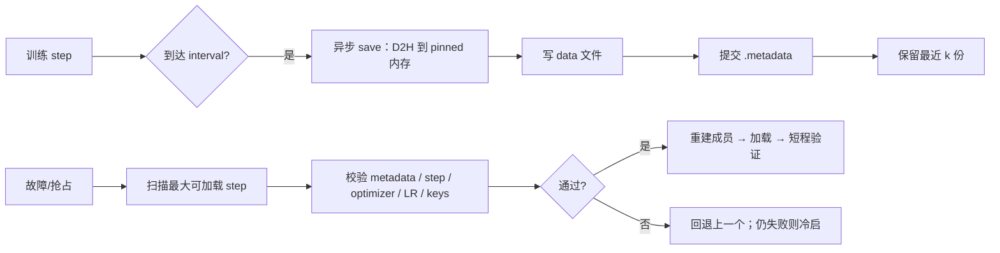

# Checkpoint 与抢占恢复：状态、恢复点与成员重建

> **结论先行**：Checkpoint 不是「把模型权重存下来」，而是**跨 membership 的状态契约**。
> 一次可恢复的训练状态至少是六元组：`global_step` + 全局样本/token 偏移 + optimizer state（含 Adam `step`）+
> LR scheduler 进度 + 数据游标 + RNG。少任何一项，恢复后都会出现 loss 跳变、数据重复/跳过或不可复现。
> 云原生侧还有两个独立问题：**成员重建**（world size/rank0 变了怎么办）和**抢占宽限期**（SIGTERM 只有几十秒，
> 不够写一份大 checkpoint）。把这两件事混进「checkpoint 逻辑」里，是恢复失败的主要来源。

本页以 PyTorch DCP、FSDP 与 torchtitan 的实现为主，给出状态清单、原子性语义、恢复点与进度损失公式、成员重建边界、
加载验证清单和抢占 runbook。torchtitan 是一个参考实现，不是唯一做法；文中会明确哪些是「框架能力」、哪些是
「这个项目的选择」。

> 专题导航：[总纲](./overview.md) · [工作负载建模](./workload-modeling.md) · [启动通信](../../../Machine_Learning/Distributed_Training/startup-communication.md) · [故障自愈](./failure-self-healing.md) · [Checkpoint](./checkpoint-preemption.md) · [RL](./rl-post-training.md)

## 一、必须保留什么

| 状态 | 是否必须 | 不保存的后果 |
|---|---|---|
| 模型参数 + 持久 buffer | 是 | 权重回退；BN running stats / RoPE cache 等不可重算的 buffer 会精度偏移 |
| optimizer state（Adam `exp_avg`/`exp_avg_sq`/`step`） | 是 | 一/二阶矩归零 → 恢复后数十~数百步 loss 尖峰与 grad-norm 抖动；Adafactor/KFAC 等有额外统计量时更严重 |
| `param_groups`（lr/wd/betas/eps） | 是 | 恢复到初始超参，可能覆盖 scheduler 已推进的 lr |
| LR scheduler | 是 | 若调度是 `(last_epoch, base_lr)` 的纯函数则只存 `last_epoch` 即可；`ReduceLROnPlateau` 等有状态调度会回退 |
| grad scaler（AMP fp16） | 视精度 | `scale`/`growth_tracker`/`found_inf` 从初值重来 → 溢出重试期 loss 抖动 |
| EMA 权重 | 视算法 | EMA 从当前权重冷启动 → 评估指标退化 |
| RNG（CPU / CUDA / cuDNN） | 视可复现要求 | dropout / 随机 mask / 数据增强与「未中断轨迹」分叉，**不可逐位复现** |
| data sampler / epoch / step / token 计数 | 是 | 数据重复或跳过；token 计数驱动的 lr/课程错位 |
| dataloader worker 预取队列 | 尽量 | 在途样本丢失，最多重复一个 `prefetch_buffer_size` 窗口 |
| curriculum / 数据混合权重 | 视算法 | 阶段回退，混合比例跳变 |
| MoE router 统计 / expert bias | 视算法 | aux-loss-free 的偏置若未持久化，恢复后路由平衡会「归零」 |
| metrics（loss/grad_norm/MFU/计时器） | 否 | 曲线断点、告警误判；不影响正确性 |

几个容易忽略的点：

- **checkpoint 只能发生在 optimizer step 之后**。torchtitan 用 `num_completed_steps` 作为保存触发条件，避免
  「参数是旧值、step 计数已前进」的静默错位；梯度累积的中间态不需要存。
- **EMA 需要单独适配**。offload 时要在 DCP 读取前等 D2H 落地，否则会读到还没写完的 EMA 权重。
- **RNG 是否恢复是设计选择**。torchtitan 刻意不保存 RNG，只在启动时按 `debug.seed` 重新播种；这意味着恢复后
  loss 曲线不可能与未中断轨迹逐位一致，验证只能做「窗口/分布」判据。若业务要求 bitwise 复现，必须自己保存
  CPU/CUDA/cuDNN generator state、sampler state 和 dataloader worker seed。
- **MoE 的持久化边界**：计数器可以 `persistent=False` 不进 state_dict，但影响路由的 `expert_bias` 若也不进，
  恢复后路由会偏；是否持久化要按模型实现确认，不能假设。

## 二、格式与实现

### 2.1 `torch.distributed.checkpoint`（DCP）

DCP 的官方定义：每个 checkpoint 产生多个文件、每 rank 至少一个；load 时做 **resharding**，支持「在一个拓扑存、
在另一个拓扑读」；**就地写**（模型必须先分配好存储）。

```python
import torch.distributed.checkpoint as dcp
from torch.distributed.checkpoint import FileSystemWriter

sd = {"model": model, "optim": optim, "lr_scheduler": sched, "train_state": state}

# 同步：写完才返回；thread_count / per_thread_copy_ahead 是主要并行度旋钮
dcp.save(sd, storage_writer=FileSystemWriter(f"{ckpt}/step-100", thread_count=8))

# 异步：先把显存拷到 CPU（pinned），再由线程/进程写盘；PG 必须带 CPU backend
fut = dcp.async_save(sd, checkpoint_id=f"{ckpt}/step-200", process_group=gloo_pg)

# 恢复：就地写，模型/优化器必须先分配在目标设备上；之后还要自己调 load_state_dict()
dcp.load(live_states, checkpoint_id=f"{ckpt}/step-100")
```

关键语义：

- `Stateful` 对象（有 `state_dict`/`load_state_dict`）在 load 时先调 `state_dict()` 拿目标结构 → 反序列化 →
  再调 `load_state_dict()`；非 `Stateful` 对象直接被替换。这是 torchtitan 要用 `ModelWrapper`/`OptimizersContainer`
  包一层的原因。
- **`async_save` 的前置条件**：进程组必须带 CPU backend，否则直接 assert 失败
  （`A CPU backend must be enabled for async save; try initializing process group with 'cpu:gloo,cuda:nccl'`）。
  torchtitan 为此单独建了一个 gloo 组专供 save。
- **`FileSystemWriter` 默认值**：目录必须为空或不存在、文件创建原子、一个 write request 一个文件 + 一个
  `.metadata`；`sync_files=True`（逐文件 fsync）、`thread_count=1`、`per_thread_copy_ahead=10MB`。
  这三个默认值基本决定了「同步 checkpoint 为什么慢」和「该调哪几个旋钮」。
- **提交点**：`finish()` 把 metadata 写成 `.metadata.tmp` → `flush` → `os.fsync` → `rm` 旧文件 → `rename`。
  **数据文件先落、metadata 最后提交**，因此「有 `.metadata`」≈「这次 save 完成了」。注意 fsync 失败
  （对象存储常见）只 warn 不报错。
- **planner**：默认 `DefaultSavePlanner`/`DefaultLoadPlanner`；load 侧的 resharding 就是「对每个本地 chunk 向存储
  发多个读请求」；DTensor 只在本地属于该 mesh 时才发读请求。
- **严格性没有独立开关**：`load(..., strict=...)` 不存在，实际由 planner 的 `allow_partial_load` 反向决定；
  缺 key 时抛 `RuntimeError: Missing key in checkpoint state_dict`，shape 不符抛
  `Size mismatch between saved ... and current: ...`。
- **load 的两条硬约束**：所有 rank 的 state_dict key 必须一致（否则可能 hang）；tensor 必须已在目标设备上分配，
  `load` 是就地写，所以 `map_location` 对它无效。

### 2.2 FSDP 的 state dict

- 三种 `StateDictType`：`FULL_STATE_DICT`（不分片、语义同 DDP）、`LOCAL_STATE_DICT`（FSDP 内部 flat param，
  仅 FSDP 自己能读）、`SHARDED_STATE_DICT`（分片但未展平，可被其它并行方案消费，「可能还需要 reshard」）。
- `FULL_STATE_DICT` 的代价是显式的：`FullStateDictConfig(offload_to_cpu=True, rank0_only=True)` 才不让 rank0
  爆内存；非 rank0 得到空 dict，加载时靠 `sync_module_states` 广播。
- `set_state_dict_type` / `FSDP.optim_state_dict` 这一套**已被官方标记 deprecated**，推荐
  `torch.distributed.checkpoint.state_dict.get_state_dict`/`set_state_dict`。新 API 的 `StateDictOptions` 提供
  `full_state_dict`/`cpu_offload`/`strict`/`broadcast_from_rank0`/`flatten_optimizer_state_dict`。
- `set_optimizer_state_dict` 有一个容易踩的时序约束：**只能在 `backward()` 之前或 `step()` 之后调用**，
  否则 optimizer state 初始化不正确。
- **world size 变化的真实边界**：FSDP1 的 `SHARDED_STATE_DICT` 是「按 rank 在 dim0 切一刀」的 `ShardedTensor`，
  加载时断言每 rank 最多 1 个 shard，否则 `AssertionError: Expects 0 or 1 shard per rank`。所以「跨 world size
  恢复」在 DTensor/FSDP2 路径上是常规能力，在 FSDP1 ShardedTensor 路径上受这条断言与 flat-param 边界约束。

### 2.3 `torch.save` / safetensors / DCP

| 维度 | `torch.save` 单文件 | safetensors | DCP |
|---|---|---|---|
| 安全 | pickle，可执行任意代码；2.6 起 `torch.load` 默认 `weights_only=True` 才收窄到张量/原生类型 | 无 pickle，官方描述「存张量安全（相对 pickle）且快（zero-copy）」 | 张量文件是 torch.save 格式，但 **`.metadata` 是 pickle**，`read_metadata` 直接 `pickle.load` |
| 加载方式 | 整文件反序列化；`mmap=True` 可懒加载 | 头 + 偏移，`get_slice` 部分读、mmap 零拷贝 | 就地写、每 rank 只读本地 shard |
| 分片 | 无（除非自己切文件） | 单文件；HF 用 `model.safetensors.index.json` 组织多文件 | 每 rank 至少一个文件 + 全局 `.metadata` |
| 元数据 | pickle 图（结构随意） | JSON header（dtype/shape/offset），有大小上限 | 强类型 `Metadata`：每个 FQN 的全局 shape/chunk 偏移 |
| 适用 | 快速迭代、非分布式 | 发布/推理、跨框架 | 大规模训练、跨拓扑恢复 |

`weights_only` 的边界要写清：它拦的是 pickle 里的**任意全局对象**，不是「文件可信」。DCP 检查点的 `.metadata`
仍是独立 `pickle.load`，**`weights_only=True` 保护不了它**——多租户集群里「只读挂载别人的 checkpoint」要按
不可信输入处理。

### 2.4 torchtitan 的实现（参考）

文件：`torchtitan/components/checkpointer/{base.py,dcp.py,torch_checkpointing.py}`；默认 manager 是 DCP 版。

- **interval 与触发**：`last_step or curr_step % interval == 0`，`interval` 默认 500；另有
  `enable_first_step_checkpoint`。按「已完成的 optimizer step」计数，不会在梯度累积中途落盘。
- **默认值**：`folder="checkpoint"`、`interval=500`、`last_save_model_only=True`、`keep_latest_k=10`、
  `load_step=-1`、`async_mode="disabled"`。
- **`keep_latest_k` 不允许 =1**，理由直白：「the last one may be in the process of being saved」。
  这就是「为什么至少要留两份」的权威出处。
- **目录布局与 last_step**：常规写 `checkpoint/step-N`；最后一步若 `last_save_model_only` 则写 `exports/step-N`，
  **自动加载只看 `step-N`**。这解决了「用 export 覆盖了可恢复 checkpoint」的常见事故。
- **自动选点**：`_find_load_step` 扫描目录、取「能加载的最大 step」，判定标准是该目录里有 `.metadata`；
  注释还承认这在远端（fsspec）上是「每步一次 listdir + 一次 metadata 探测」的网络往返。
  **torchtitan 没有 `latest` 指针文件**——恢复点定义 = 「目录扫描 + 最大可加载 step」。
- **dump/load 语义**：`load(step=-1)` 自动选点；只要 `checkpointer.folder` 里有可恢复 checkpoint，就**优先于**
  `initial_load_path`（fault-tolerance restart），否则才用 initial/HF 种子。加载前显式检查「没有 `.metadata`
  就是没写完」，抛 `ValueError: ... is not a complete checkpoint`。
- **异步三态**：`disabled` / `async`（`dcp.async_save` 线程写）/ `async_with_pinned_mem`
  （`DefaultStager` 固定内存 + `AsyncCheckpointerType.PROCESS` 子进程写）。pinned 模式必须让 staging stream 等
  当前计算流，否则会拷到「还没被 optimizer 写完」的权重。
- **下一个 step 前只等 staging，不等磁盘**：`optim_step` 里调 `maybe_wait_for_staging()`。这就是「异步把 I/O
  移出关键路径」的实现形态：关键路径上只剩 D2H。
- **失败处理**：`save` 开头先 `maybe_wait_for_saving()` 等上一次异步写（等价于最多一个 in-flight），再清理
  陈旧/半成品，再写。`_wait_for_saving` 先清空 future 再 `.result()`，避免 close/`__del__` 重试一个已失败的 save。
- **保留策略**：rank0 上的 purge 线程异步删；`keep_latest_k - 1` 的槽位预留给本次 save；**没有 `.metadata`
  的「abandoned」目录也一并删**。这既是清理也是「损坏检测」的替代品。

### 2.5 原子性、manifest、保留与损坏检测

- **DCP 原生的原子性只到「metadata 提交」这一层**：没有目录级 tmp→rename。崩溃留下的目录「有数据文件、
  没 `.metadata`」是常态，所以加载器必须以 `.metadata` 为唯一判据（torchtitan 就是这么做的）。
- **目录 rename 才是 POSIX 上的真原子发布**：若要更硬的保证，写 `step-N.tmp/` → `fsync` 文件 →
  `rename(step-N.tmp, step-N)` → **`fsync` 父目录**（DCP 只 fsync 文件，不 fsync 目录——断电后 rename 可能丢）。
- **`latest` 指针**：写一个小对象（内容 = step 号 + manifest 的 sha256），加载时先读它、再校验、再打开 `step-N`。
  比「扫目录取最大」更适合对象存储（省 O(N) 次 LIST/RTT）。
- **manifest**：DCP 的 `.metadata` 里**没有任何 checksum 字段**，所以「逐文件 sha256 + size」必须由外部维护；
  坏块/截断只能靠它发现。
- **保留策略**：至少 2 份（torchtitan 强制），并让「最近一份」与「上一个可用」落在不同故障域
  （不同 PVC / 本地+对象存储双写）。`keep_latest_k` 的删除是异步的——刚删掉的 step 也可能正在被别人读，
  跨集群共享时不要用激进保留。

## 三、恢复点与进度损失

### 3.1 恢复点的定义

一个可恢复的 checkpoint 必须能回答六个问题：

1. `global_step`（已完成的 optimizer step 数）；
2. 全局样本/token 偏移（`ntokens_seen`，用于 lr/课程/数据配比）；
3. optimizer 的 `state[p]["step"]`（与 global_step 对齐，用于 bias correction）；
4. LR scheduler 的 `last_epoch`/`_step_count`；
5. 数据游标（epoch + 文件内 offset + 预取队列状态）；
6. RNG（CPU/CUDA/cuDNN）+ 采样器 RNG。

**只恢复权重会损失什么**：Adam 的矩估计归零 → 恢复初期更新方向与幅度都错（典型表现是 loss 先降后跳、
grad-norm 尖峰）；scheduler 若不存则 lr 回到 warmup 起点；数据游标不存则从 epoch 头重来（数据重复）或直接
跳到下一个分片（数据跳过）；RNG 不存则 dropout/mask 序列改变，**与未中断轨迹不可比**。

### 3.2 进度损失公式

| 记号 | 含义 | 典型来源 |
|---|---|---|
| `T_step` | 单步墙钟时间 | 实测 |
| `I` | checkpoint 间隔（步） | 配置 |
| `C` | checkpoint 阻塞**关键路径**的时间 | 同步≈写盘；异步≈D2H 拷贝 |
| `M` | MTBF | 由硬件故障率 + 抢占率估计 |
| `R` | 单次恢复停机（重建 + 加载） | 实测，通常远大于 `T_step·I` |

- 均匀故障下的期望损失：`E[loss] ≈ T_step · I / 2`
- 最坏情况（故障正好发生在下次 checkpoint 前）：`loss_max = T_step · I`
- 若最近一次异步 checkpoint 还在飞行中、崩溃后只能回退到上一个已提交点：**最坏 `2·I`**——这正是
  `keep_latest_k ≥ 2` 的物理原因。
- 期望浪费（checkpoint 开销 + 重算）近似：`waste ≈ C/I + I/(2M)`；对 `I` 求导得 Young/Daly 经典最优周期
  `I* = sqrt(2·M·C)`，对应 `waste* = sqrt(2C/M)`。

**算例（假设值，仅示数量级）**：`T_step=1.5s`、`I=50` → 平均丢 37.5s、最坏 75s。若同步写 `C=8s`、
`M=20h=72000s`：`I=50` 时 `waste≈8/75 + 75/144000 ≈ 10.7%`；按公式的 `I*≈1073s` 才降到 `1.49%`，
但那意味着 1073s 才存一次、最坏丢 1600s。**异步把 `C` 压到 2s（只有 D2H）后，同样 `I=50` 的 `waste≈2.7%`**
——所以「异步」不是优化项，而是让高频 checkpoint 可行的前提。

> Young 公式里 `(D+R)/M`（停机 + 重启）是与 `I` 无关的常数项，所以「重建慢」不会改变一阶最优间隔 `I*`，
> 只会整体抬高 waste——把它算进容量规划，而不是指望调 `I` 来抵消。

另一个常被忽略的成本：`I` 太小会让 D2H 拷贝与计算抢带宽/抢流，且每次 save 前的 `maybe_wait_for_staging()`
都是同步点；异步不是免费的，只是把成本从「秒级 I/O」换成「毫秒~秒级拷贝 + 周期性 stall」。

### 3.3 抢占场景的期望损失

- 抢占到达若近似泊松（速率 `λ_p`，`M = 1/λ_p`），期望损失仍是 `T_step·I/2`；但 spot 回收常常**成批发生**：
  同一波抢占会让多个作业同时恢复，争抢调度配额与存储带宽，实际损失高于单作业模型。保守按最坏
  `T_step·I` 做容量规划。
- 无论 `I` 多小，**当前正在算的那一步一定丢**（未 commit），所以单次抢占的下界是 `T_step`。
- 端到端还要加上「重建时间」：调度排队 + 镜像拉取 + 加载 checkpoint + 重建 NCCL——这部分往往比丢的步数更贵。

### 3.4 checkpoint 写到哪

| 介质 | 带宽/延迟 | 持久性 | 适用 |
|---|---|---|---|
| 本地 NVMe | 高带宽、fsync 便宜、`thread_count` 可并行 | **Pod/节点重建即丢** | 只做「最后一级缓存」：本地快存 + 后台异步上传对象存储 |
| 共享 PVC（RWX / 并行文件系统） | 多 rank 直写；元数据操作（rename/listdir）偏慢 | 跨 Pod 保留（取决于 reclaim policy 与 `whenDeleted`） | 中频 checkpoint 的默认选择；注意「共享」会把网络变成瓶颈 |
| 对象存储（S3/GCS） | 无 fsync 语义（DCP 只 warn）、RTT 高、LIST 计费 | 最持久、可跨集群 | 低频同步兜底 + 归档；不适合 `I` 很小的高频写 |

主要旋钮是三个：`FileSystemWriter(thread_count=..., per_thread_copy_ahead=..., sync_files=...)`。
torchtitan 的远端路径走 fsspec，且**远端只支持原生 DCP 格式**，HF safetensors 读写不支持远端。

## 四、成员重建

### 4.1 world size 变了会发生什么

- **模型/优化器：可以重分片。** DCP 的 load 按「当前 state_dict 的本地 chunk」向存储发读请求，读取范围由全局
  metadata 的 chunk 偏移决定，所以 DP 度变化是被支持的；FSDP2/DTensor 路径是官方推荐。
- **数据管道：不行。** torchtitan 的 dataloader state 里写死了 `dp_world_size`，加载时不等就直接抛
  `cannot resume after changing the effective data-parallel degree`；state 还按 `rank_id` 存，rank 换了就
  `checkpoint is missing dataloader state for <rank>`。**结论：跨 DP 度恢复必须 `exclude_from_loading=["dataloader"]`，
  并接受数据重复/跳过**；torchtitan 文档也把「保持 DP 度不变」写成前提。
- **PP 度变化**：模型侧 key 是全局 FQN（`layers.N...`），chunk 只是「哪个 rank 持有哪些层」，所以 key 集合不变、
  DCP 能重分片；但 `dp_degree = world/(tp·pp·cp)` 会变，于是又回到上一条；同时 PP 需要重新满足 microbatch 数量约束。
  **能加载 ≠ 能等价续训。**
- **TP 度变化**：DTensor placement 变了，理论上 DCP 可重分片；但 torchtitan 的 SPMD 布局、`state_dict_adapter` 的
  HF 映射、以及 FSDP1 的「0/1 shard per rank」断言都可能踩到。生产上建议「TP 度固定」，把它当作已知边界。
- **rank 重新分配**：checkpoint 文件名里带 rank 编号（`__{rank}_*.distcp`）是 DCP 内部约定，业务代码不应依赖；
  恢复时 shard 归属由 mesh coordinate 重新计算。**因此 checkpoint 目录/文件名里绝不能出现 pod 名或 rank 号。**

### 4.2 rendezvous 与「rank0 换人」

`init_process_group()` 不带参数时走 `env://`，即 `MASTER_ADDR`/`MASTER_PORT`/`RANK`/`WORLD_SIZE`，而
`MASTER_ADDR` 定义为「运行 rank 0 worker 的主机 FQDN」。推论：

- **rank0 的 Pod 名/地址变了，`MASTER_ADDR` 必须跟着变**，否则新 rank0 起来后其它 rank 连的是旧地址
  （旧 Pod 已删）→ 全体卡在 store 连接直到超时。
- 正确做法是「从平台注入的稳定名字推导」：LWS 注入 `LWS_LEADER_ADDRESS`；JobSet 的 Pod 名/子域是稳定的
  `{jobset}-{rjob}-{idx}-{pod}.{subdomain}`；TrainJob 的 Torch runtime 注入 `PET_MASTER_ADDR`。
- **反例**：LWS 的 hash 模式（`groupReplacementPolicy`）下「重建的 group 会拿到新 key，leader DNS 名随之改变，
  不要把 leader 地址跨替换缓存」。默认 ordinal 模式下 leader 是 StatefulSet 的 `<lws>-<index>`，名字稳定。

### 4.3 各种编排器重建 Pod 时，卷还在不在

| 编排器 | 重建行为 | 卷/数据 |
|---|---|---|
| **LWS** | 默认 `restartPolicy=RecreateGroupOnPodRestart`：**任一 Pod 重建/任一容器重启 → 整组重建**，保证同组同时启动 | `volumeClaimTemplates` 的 PVC 走 StatefulSet 语义，**默认 `whenDeleted/whenScaled=Retain`**：Pod 删了卷还在，但**卷跟着节点走**（local-path 类存储换节点就悬空） |
| **JobSet** | `Recreate`（默认）/`BlockingRecreate`/`InPlaceRestart`（健康 Pod 原地重启、失败 Pod 重建，barrier 等全部 ready） | `volumeClaimPolicies` 创建的共享 PVC **`whenDeleted` 默认 `Delete`**——**删 JobSet 会删掉 checkpoint 卷**，必须显式 `Retain` |
| **Kueue** | 抢占 = 给 Job 打 `spec.suspend=true`（+ `StoppingAnnotation`），Job controller 删 Pod；重新 admit 后 unsuspend、**重建 Pod**，不是原地恢复 | 不管卷；Job 模板里的 PVC 语义由 Job/StatefulSet 决定 |
| **Volcano** | 只删被选中的 Pod（先写 `DisruptionTarget=True`/`PreemptionByScheduler`，再 `Delete`），**不动整个 PodGroup**；是否整组重启取决于上层 job controller 与 gang 插件 | 不管卷 |
| **Training Operator** | 生成 JobSet/Job，`spec.suspend` 控制启停 | 由 JobSet/用户 PVC 决定 |

**实践含义**：对训练来说，「卷是否保留」和「Pod 是否重建」是两个独立决策。LWS 的「整组重建」意味着
**任何单点故障都会让所有 rank 的 NCCL 通信域作废**，恢复只能整体重来；而 JobSet 的 `InPlaceRestart` 想避免的
正是这一点（但它要求 `backoffLimit` 拉满）。

## 五、加载验证

### 5.1 校验清单（按顺序）

1. **提交完整性**：目录里有 `.metadata`；没有 `*.tmp`；文件数与 metadata 里的 `storage_data` 条目数对齐。
2. **step 一致性**：`train_state.step` == 期望恢复的 step，且 `ntokens_seen` 与该 step 的理论 token 数一致
   （可检出「加载到旧目录」）。
3. **optimizer step**：Adam `state[p]["step"]` == `global_step`（不等说明存的是「梯度累积中途」或半成品）。
4. **LR**：用 scheduler 重算 step 处的 lr，与 `param_groups[0]["lr"]` 比对；不一致说明 scheduler state 存错位。
5. **shard 完整性**：逐 rank 校验每个参数的本地 shard shape/dtype；DCP 的 `Size mismatch`/`Missing key` 会抛错，
   但这些检查依赖本地 state_dict 正确构造。
6. **content checksum**：DCP 无内建 checksum，必须靠外部 manifest 的逐文件 sha256。
7. **key 集合**：**这一条最容易漏**——torchtitan 的模型加载用 `model.load_state_dict(state_dict, strict=False)`，
   原因是扁平 dict 里混了 optimizer/lr_scheduler 的 key。**`strict=False` 意味着少一个参数不会报错，只会保持
   初始化值**。因此必须自己 diff `checkpoint keys` 与 `model.state_dict().keys()`。
8. **loss 连续性**：恢复后跑 50~100 step，与「未中断轨迹」的窗口比对；同时看 grad-norm。RNG 不恢复时只能做
   「分布/窗口」判据，不能要求逐位相等。
9. **数据偏移**：同一 tokenizer/seed 下抽样比对前几个 batch 的 token id 哈希，确认没有重复/跳过。
10. **设备一致性**：DCP 就地写，模型必须先 `to(device)` 再 load；`map_location` 不适用于 DCP。

### 5.2 安全边界

- `weights_only=True`（2.6 起默认）只保护 `torch.load` 的 unpickler；DCP 的 `.metadata` 是独立 `pickle.load`，
  **不受保护**。
- `strict=True` 只是 `load_state_dict` 的 key 检查；DCP 层的等价物是 `allow_partial_load=False`。
- 跨集群/跨租户恢复时，应把 checkpoint 当作不可信输入：先在隔离环境校验 manifest + 反序列化 metadata，
  再挂给训练。

### 5.3 加载失败的回退策略

1. 目标 step 失败 → 降级到 `step - I`（上一个），最多重试 2 次；
2. 全部失败 → 用 `initial_load_path`（种子/公开权重）冷启动，并**把 step/token 计数归零**，否则 lr 与数据配比
   会错位；
3. 任何降级都要打事件/指标（`checkpoint_load_fallbacks_total`），否则「悄悄从旧点恢复」会污染实验结论；
4. 加载超时要有上限（远端 `listdir` + metadata 探测是网络往返），否则会卡住整个 gang。

## 六、抢占与优雅终止

### 6.1 K8s 的三条终止路径，宽限期完全不同

| 路径 | 谁发起 | 宽限期 | PDB 生效？ |
|---|---|---|---|
| **调度器抢占**（PriorityClass） | scheduler | **默认 30s**，「victims 获得请求的优雅终止期，默认 30 秒，超时才强杀」 | 否 |
| **API eviction**（`kubectl drain` / 驱逐子资源） | 运维/自动化 | 遵守 `terminationGracePeriodSeconds` | **是**（PDB 只在 eviction 子资源里被检查） |
| **节点压力驱逐**（内存/磁盘） | kubelet | **硬阈值只给 1 秒**（`immediateEvictionGracePeriodSeconds = 1`） | 否 |

补充事实：`terminationGracePeriodSeconds` 默认 30；**preStop 会先吃掉宽限期**，且最小只保证 2s；CRI 只承诺
「到期后强制 kill」。

**PDB 对 Job 的局限**：PDB 只在 eviction 子资源上做准入，且文档明说「并非所有自愿中断都受 PDB 约束，例如直接删
deployment/pod 会绕过 PDB」。而训练作业的 Pod 恰恰最常死于**非 eviction 路径**（抢占、节点压力、Job suspend、
控制器删除）——所以 PDB 基本救不了训练 gang。

### 6.2 Kueue / Volcano 的抢占行为

- **Kueue**：抢占后在被抢占的 Workload 上打 `Evicted`（reason `Preempted`）与 `Preempted`
  （reason `InClusterQueue`/`InCohort*`）两个 condition；控制器据此 `stopJob`（suspend），等 `!job.IsActive()`
  后再清 admission。**语义是「整作业让位并重建」，不是「缩容几个 rank」**；Kueue 还有 alpha 的 partial preemption
  （`PartiallyPreempted`）用于部分缩容，训练场景要谨慎。
- **Volcano**：默认 evictor 先给 Pod 打 `DisruptionTarget=True`（reason `PreemptionByScheduler`）再 `Delete`，
  **用默认 DeleteOptions，即走 Pod 自己的宽限期**；eviction 放在 goroutine 里异步做。

### 6.3 为什么「收到 SIGTERM 就存 checkpoint」不可靠

1. **时间预算不够**：默认 30s；节点压力驱逐 1s；preStop 还会先扣掉一部分。
2. **save 不是单机操作**：DCP 默认 `use_collectives=True`，save 需要 rank 间协调。抢占通常只挑一部分 Pod，
   剩下的 rank 在 allreduce 里等超时；SIGTERM handler 里再发起集合通信，**极可能 hang 到被 SIGKILL**。
3. **信号到不了训练进程**：SIGTERM 发给容器 PID 1（往往是 torchrun/launcher），要自己转发给 worker；
   不转发就只有 launcher 优雅退出。
4. **带宽不允许**：70B 级模型一个完整 checkpoint 是数百 GB（参数 + Adam m/v），30s 内要落地需要多 GB/s 的
   持续写——共享 PVC 和对象存储都做不到。
5. **会与正在飞的异步写打架**：同一线程/进程里再发起一次同步 save，要么排队要么与 staging buffer 竞争。

### 6.4 推荐形态

- **高频异步**（`interval` 由 `sqrt(2MC)` 定，通常 10~50 step）+ **低频同步兜底**（每 `10×interval` 或每 N 分钟
  一次同步 save，确保「至少有一份不依赖异步成功」）。
- **抢占信号只做「止损」**：监听 SIGTERM → 停止启动新 step、放弃当前 micro-batch、尽力把最后一次已完成的异步写
  等完（`maybe_wait_for_saving`），**不承诺新写一份**。
- **宽限期按「最后一次异步写 + 上传」给足**：`terminationGracePeriodSeconds: 120~300`，并把 preStop 用于
  「停止接收新任务/等 in-flight 写完」，而不是「发起新 checkpoint」。
- **抢占可识别**：给 Pod 打 `DisruptionTarget` 后，Job 的 `podFailurePolicy` 可以用
  `onPodConditions: [{type: DisruptionTarget, status: "True"}]` + `action: Ignore`，**不把被驱逐计入
  `backoffLimit`**，否则反复抢占会把 Job 直接判失败。高优先级训练作业若要「只被抢占、不抢占别人」，用
  `preemptionPolicy: Never`。

## 七、恢复 Runbook



> 目标：从「集群把 Pod 杀了」到「确认可以继续训练」，每一步都有明确的失败处理。

**Step 0｜冻结现场（30 秒内）**
把 Job/JobSet 的 `spec.suspend` 置 true（Kueue 场景已经是 suspend）；LWS 没有 suspend 语义，只能把 `replicas`
缩到 0 或删 group（PVC 默认 Retain）。目的是避免控制器在你检查时又拉起新 Pod；记录 `kubectl get pods -o wide`、
节点、`DisruptionTarget` 条件。
失败处理：控制器仍在重建 → 先 scale 到 0 或删 workload 前先确认 PVC 保留策略（JobSet 默认 `Delete`）。

**Step 1｜确认最新 checkpoint 完整性**
列出 `<ckpt>/step-*`，选最大的、且**目录里有 `.metadata`** 的；对每个候选检查 manifest 的 sha256/大小；
确认没有 `*.tmp`。
失败处理：缺 `.metadata` → 视为半成品，直接排除（不要手工补 metadata）；checksum 不符 → 排除并告警磁盘/对象存储问题。

**Step 2｜选择恢复点**
优先「最新完整」；若该 step 的 `train_state`/optimizer step 不自洽（§5.1 第 2、3 条），退到上一个；连续两个都坏
则退到 `initial_load_path` 冷启（并把 step/token 归零）。
失败处理：远端目录扫描超时 → 直接用已知 step 号 `load_step` 指定，跳过 `listdir`。

**Step 3｜确认拓扑与数据管道**
记录本次 world size / DP / TP / PP；与 checkpoint 的产出拓扑对比。**只要 DP 度变了，就必须
`exclude_from_loading=["dataloader"]`**，并在训练日志里标注「数据可能重复/跳过一段」。
失败处理：不确定拓扑 → 先做 Step 5 的 dry-run 验证（只加载、不训练，`load_only=True`）。

**Step 4｜重建成员与 rendezvous**
确认 `MASTER_ADDR` 指向当前 rank0（LWS 用 `LWS_LEADER_ADDRESS`，JobSet 用稳定 DNS）；确认 NCCL 环境（IB/拓扑）
与上次一致；确认 PVC 已挂载到新 Pod（`kubectl get pvc` 为 Bound）。
失败处理：Pod 卡 `ContainerCreating` → 检查 PVC 的 volume node affinity（local-path 换节点会悬空）；rank0 起来但
其它 rank 连不上 → 检查 `MASTER_PORT` 与 NetworkPolicy。

**Step 5｜加载并做「只读验证」**
`load_only=True` 跑一次：打印 `step`/`ntokens_seen`/`lr`/optimizer step；diff model keys（§5.1 第 7 条）；
抽样前几个 batch 的 token 哈希。
失败处理：key diff 非空 → 改架构/加 adapter/显式设 `strict`，不要直接开训；lr 不符 → 检查 scheduler state 与
`param_groups` 谁覆盖了谁。

**Step 6｜短程续训验证（50~100 step）**
比对 loss 窗口与 grad-norm，观察有无尖峰；确认 checkpoint 计时器（`checkpoint_write` 延迟）回到基线。
失败处理：loss 跳变 → 大概率是 optimizer state 或 lr 错位，回 Step 2 换点；loss 完全对不上 → 检查数据游标是否
被 exclude 后从 epoch 头重来。

**Step 7｜恢复正常调度并复位保护**
解除 suspend；确认 `podFailurePolicy` 已把 `DisruptionTarget` 标为 `Ignore`；确认保留策略（JobSet
`whenDeleted: Retain`、LWS PVC Retain）；把本次事故的「丢失步数 / 恢复耗时」写进实验记录（这是调 `interval` 的依据）。

## 八、证据

### DCP / FSDP / 安全

- [DCP save/load/async_save 入口](https://github.com/pytorch/pytorch/blob/02e06c707ee33f8bbad64652dc8f695729a92766/torch/distributed/checkpoint/state_dict_saver.py#L207-L217)
- [async_save 需要 CPU backend](https://github.com/pytorch/pytorch/blob/02e06c707ee33f8bbad64652dc8f695729a92766/torch/distributed/checkpoint/state_dict_saver.py#L301-L305)
- [FileSystemWriter 默认值与 fsync 策略](https://github.com/pytorch/pytorch/blob/02e06c707ee33f8bbad64652dc8f695729a92766/torch/distributed/checkpoint/filesystem.py#L586-L621)
- [metadata 的提交点（tmp→fsync→rename）](https://github.com/pytorch/pytorch/blob/02e06c707ee33f8bbad64652dc8f695729a92766/torch/distributed/checkpoint/filesystem.py#L765-L800)
- [metadata 是 pickle（weights_only 保护不了）](https://github.com/pytorch/pytorch/blob/02e06c707ee33f8bbad64652dc8f695729a92766/torch/distributed/checkpoint/filesystem.py#L950-L958)
- [DefaultLoadPlanner 的 reshard 逻辑](https://github.com/pytorch/pytorch/blob/02e06c707ee33f8bbad64652dc8f695729a92766/torch/distributed/checkpoint/default_planner.py#L494-L537)
- [DCP load 的就地写与 key 一致性](https://github.com/pytorch/pytorch/blob/02e06c707ee33f8bbad64652dc8f695729a92766/torch/distributed/checkpoint/state_dict_loader.py#L66-L90)
- [FSDP StateDictType 三种类型](https://github.com/pytorch/pytorch/blob/02e06c707ee33f8bbad64652dc8f695729a92766/torch/distributed/fsdp/api.py#L245-L274)
- [FSDP state_dict API deprecated](https://github.com/pytorch/pytorch/blob/02e06c707ee33f8bbad64652dc8f695729a92766/torch/distributed/fsdp/fully_sharded_data_parallel.py#L627-L645)
- [FSDP1 ShardedTensor 的 0/1 shard 断言](https://github.com/pytorch/pytorch/blob/02e06c707ee33f8bbad64652dc8f695729a92766/torch/distributed/fsdp/_state_dict_utils.py#L624-L633)
- [set_optimizer_state_dict 的时序约束](https://github.com/pytorch/pytorch/blob/02e06c707ee33f8bbad64652dc8f695729a92766/torch/distributed/checkpoint/state_dict.py#L1446-L1478)
- [torch.load 的 weights_only 默认值与风险](https://github.com/pytorch/pytorch/blob/02e06c707ee33f8bbad64652dc8f695729a92766/torch/serialization.py#L76-L81)
- [DCP 官方文档](https://docs.pytorch.org/docs/stable/distributed.checkpoint.html)

### torchtitan

- [CheckpointManager 的状态集合](https://github.com/pytorch/torchtitan/blob/692c9bb5b26f606e5fb739acd55effb6f8850bc9/torchtitan/components/checkpointer/dcp.py#L155-L168)
- [训练进度只有 step/ntokens_seen](https://github.com/pytorch/torchtitan/blob/692c9bb5b26f606e5fb739acd55effb6f8850bc9/torchtitan/training_engine.py#L934-L939)
- [interval/keep_latest_k/async 默认值](https://github.com/pytorch/torchtitan/blob/692c9bb5b26f606e5fb739acd55effb6f8850bc9/torchtitan/components/checkpointer/base.py#L626-L678)
- [keep_latest_k 不允许 1](https://github.com/pytorch/torchtitan/blob/692c9bb5b26f606e5fb739acd55effb6f8850bc9/torchtitan/components/checkpointer/base.py#L692-L696)
- [自动选点：最大可加载 step](https://github.com/pytorch/torchtitan/blob/692c9bb5b26f606e5fb739acd55effb6f8850bc9/torchtitan/components/checkpointer/base.py#L538-L567)
- [没有 .metadata 即不完整](https://github.com/pytorch/torchtitan/blob/692c9bb5b26f606e5fb739acd55effb6f8850bc9/torchtitan/components/checkpointer/base.py#L374-L383)
- [strict=False 的模型加载](https://github.com/pytorch/torchtitan/blob/692c9bb5b26f606e5fb739acd55effb6f8850bc9/torchtitan/components/checkpointer/base.py#L151-L157)
- [dataloader 的 dp_world_size 硬约束](https://github.com/pytorch/torchtitan/blob/692c9bb5b26f606e5fb739acd55effb6f8850bc9/torchtitan/components/data/loader.py#L188-L210)
- [RNG 只在启动时播种](https://github.com/pytorch/torchtitan/blob/692c9bb5b26f606e5fb739acd55effb6f8850bc9/torchtitan/distributed/utils.py#L250-L263)

### 抢占与卷

- [JobSet volumeClaimPolicies 默认 Delete](https://github.com/kubernetes-sigs/jobset/blob/32c9ea3144095df1fbc778433505c35a53e5acfe/api/jobset/v1alpha2/jobset_types.go#L776-L795)
- [StatefulSet PVC 默认 Retain](https://github.com/kubernetes/kubernetes/blob/c50e5395f1ae2d4a2c05f28fdcc38c0916cc1a32/pkg/apis/apps/v1/defaults.go#L127-L135)
- [LWS 整组重建](https://github.com/kubernetes-sigs/lws/blob/51d7d5ad84f7badeee1466e4a7b846cacfdbc961/api/leaderworkerset/v1/leaderworkerset_types.go#L719-L726)
- [K8s 抢占的 30s 宽限期](https://kubernetes.io/docs/concepts/scheduling-eviction/pod-priority-preemption/)
- [K8s Pod disruption 与 PDB 边界](https://kubernetes.io/docs/concepts/workloads/pods/disruptions/)
- [kubelet 硬阈值驱逐 1s](https://github.com/kubernetes/kubernetes/blob/c50e5395f1ae2d4a2c05f28fdcc38c0916cc1a32/pkg/kubelet/eviction/eviction_manager.go#L60-L62)
- [preStop 吃掉宽限期](https://github.com/kubernetes/kubernetes/blob/c50e5395f1ae2d4a2c05f28fdcc38c0916cc1a32/pkg/kubelet/kuberuntime/kuberuntime_container.go#L895-L910)
- [Kueue 抢占条件](https://github.com/kubernetes-sigs/kueue/blob/be7dc9d31470258dd324e5bd6d84f7eaf90f5f69/apis/kueue/v1beta2/workload_types.go#L1129-L1144)
- [Volcano 抢占：DisruptionTarget + Delete](https://github.com/volcano-sh/volcano/blob/2006640ed881e632119eedb9d3fac82819402301/pkg/scheduler/cache/cache.go#L284-L327)

## 相关页面

- [专题总纲](./overview.md)
- [工作负载建模](./workload-modeling.md)
- [训练启动与通信](../../../Machine_Learning/Distributed_Training/startup-communication.md)
- [训练失败与自愈](./failure-self-healing.md)
- [RL 后训练与业务接入](./rl-post-training.md)
- [Kubernetes 控制面灾备与恢复](../../Kubernetes/Control_Plane/控制面灾备与恢复.md)
- [训推混部与协同放置](../Heterogeneous_Resources/training-inference-mix.md)
