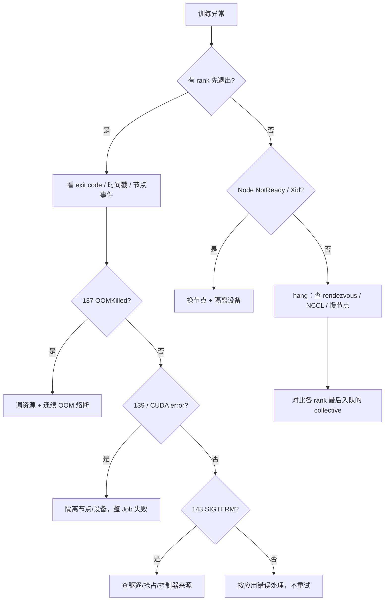

# 训练失败与自愈：首发原因、恢复单元与失败预算

> **结论先行**：训练失败排查的第一步不是「看 NCCL」，而是**确定哪一层先坏、谁是首发**。
> 分布式训练里，一个 rank 的退出会让其余 rank 在 collective 上超时，于是所有 rank 都打印同一句
> `NCCL timeout`；这句话是**症状**，不是原因。恢复单元也不是「重启失败的 Pod」——它由 membership 的粒度决定：
> 一个 DDP/FSDP 组通常必须整组重建，LWS 的 group、Volcano 的 Job、MPIJob 的 launcher 各有自己的边界。
> 最后，失败预算必须同时覆盖「会计数的失败」和「不计数的不前进」（hang、慢节点、节点失联）。

本页先给故障分层与可观测信号，再给首发归因方法，然后逐框架对照恢复语义，最后落到可执行的预算模型与决策表。

> 专题导航：[总纲](./overview.md) · [工作负载建模](./workload-modeling.md) · [启动通信](../../../Machine_Learning/Distributed_Training/startup-communication.md) · [故障自愈](./failure-self-healing.md) · [Checkpoint](./checkpoint-preemption.md) · [RL](./rl-post-training.md)

## 一、故障分层与可观测信号

| 层 | 典型故障 | 强信号（先看） | 弱/易误判信号 |
|---|---|---|---|
| 调度 | 配额不足、亲和/拓扑不满足、gang 不齐 | Pod `Pending` + `FailedScheduling`；PodGroup `Pending` | 「容器起不来」 |
| 容器启动 | 镜像拉取、RBAC/PSA、配置、端口、DNS | `ErrImagePull`/`ImagePullBackOff`、`CreateContainerConfigError`、秒级 exit 1/2 | 「训练脚本 bug」 |
| 成员加入 | rendezvous 超时、TCPStore 不可达、rank 缺失 | 全体 rank 同时卡在同一行 init；join 600s 到期 | 「NCCL 挂了」 |
| 计算/通信 | collective mismatch、单 rank 卡死、慢节点、watchdog | 有 rank 已退出、其余 rank 报 timeout；DDP 静态图不匹配 | 「网络抖动」 |
| 进程退出 | OOMKilled 137、CUDA assert 1、SIGSEGV 139、SIGTERM 143 | `lastState.terminated.exitCode/reason`、torchrun 的 `exitcode :` 行 | 只看最后一个 rank 的栈 |
| 节点 | NotReady、kubelet 失联、磁盘满、驱逐 | Node conditions + taint、`Evicted` | 「Pod 被删了」 |
| 设备 | Xid、ECC、掉卡、NVLink/IB 降级、MIG 异常 | `dmesg` 的 `NVRM: Xid`、`nvidia-smi -q`、`rdma statistic` | 「NCCL 超时」 |

### 1.1 启动失败

- **调度失败**：`Pod.status.phase=Pending` + `FailedScheduling` 事件。Volcano 在成员不齐时给出
  `Not enough valid tasks for gang-scheduling, valid: %d, min: %d`。LWS 的 `RecreateGroupAfterStart` 对无法放置的组
  不重建，而是报 `GroupUnschedulable` warning，并把 `Progressing` 置为 `False`。
- **镜像/权限/配置**：kubelet 侧留 `ErrImagePull`/`ImagePullBackOff`；容器秒退但 `restartCount` 快速增长，
  `reason=Error`、`exitCode=1/2`。这类故障适合用 `podFailurePolicy` 的 `Ignore` 或直接 `FailJob` 区分，
  避免和「训练真的跑了一会儿才崩」共用同一预算。
- **端口冲突**：torchrun 的 c10d rendezvous 在 `--rdzv-endpoint` 指定的 `host:port` 上起 TCPStore，
  未写端口时默认 29400。多租户共用节点/共用 headless Service 时端口冲突表现为「master 起不来、worker 连不上」，
  先看谁先报。
- **DNS**：rendezvous 依赖 Pod 可解析。JobSet 默认 `publishNotReadyAddresses=true`，即不待 Ready 就发布 DNS，
  这正是为了让成员能互相找到；若被显式关掉，会表现为「rendezvous 时好时坏」。
- **NCCL/IB 初始化失败**：打开 `NCCL_DEBUG=INFO NCCL_DEBUG_SUBSYS=INIT,BOOTSTRAP,NET`。初始化期卡住看
  BOOTSTRAP/NET，计算期卡住看 WARN 与 watchdog；两者是不同问题。

### 1.2 成员加入超时

- **rendezvous 超时**：`RendezvousTimeout` 四个维度默认值是 join=600s、last_call=30s、close=30s、heartbeat=5s；
  到期抛 `RendezvousTimeoutError`。它是「整组一起超时」，日志里 N 个 rank 几乎同时失败——这是**症状不是原因**。
- **TCPStore 不可达**：master 端口不通、Pod 网络不通、master 自己被重启；表现为 worker 在 init 阶段重试后超时。
- **rank 缺失 / Pod Pending**：`--nnodes=MIN:MAX` 下 rendezvous 只等 `MIN`，剩余节点进入 wait list；
  已在运行的 agent 每次 monitor 都能看到 `num_nodes_waiting()`，但这**不会**触发重启。
- **慢启动**：镜像大、JIT 编译、数据预热导致某些 rank 迟迟不来；rendezvous 层面只能等。平台侧可用
  Kueue 的 `waitForPodsReady.timeout` 把「迟迟不就绪」变成一个可计费事件。
- **LWS/MPI 的启动顺序**：LWS `StartupPolicy` 有 `LeaderReady`（leader Ready 后才建 worker）与 `LeaderCreated`
  （leader 创建即建 worker）；MPI 侧有 `LauncherCreationPolicy=WaitForWorkersReady`，让 launcher 在所有 worker
  Ready 后才创建。选错策略的典型症状是「launcher 先起、mpirun 连不上、然后整组被 activeDeadline 杀掉」。

### 1.3 Hang

- **collective mismatch**：DDP 在第二次迭代发现上一轮 reduce 没完成，直接报
  `Expected to have finished reduction in the prior iteration before starting a new one`，并提示是未使用参数导致。
  这类「逻辑层 mismatch」通常伴随 `find_unused_parameters` 相关栈，而不是 NCCL 错误。
- **NCCL watchdog**：只有「已经入队的 collective」才有超时计时；超时文本在本快照为
  `Watchdog caught collective operation timeout: NCCL operation timed out`。
  torchrun 默认给 worker 注入 `TORCH_NCCL_ASYNC_ERROR_HANDLING=1`，所以「异步错误 → 进程主动 abort」这条链路是开着的。
- **某 rank 卡住 / 慢节点**：没有任何内核级信号。torchrun 的监控只看**本地子进程是否退出**；进程活着就返回
  `HEALTHY`，因此「训练不动但不报错」不会被 torchrun 发现。
- **CPU 侧 hang / D 状态**：唯一内建的兜底是 Linux 不可中断睡眠（D-state）检测，需显式开
  `TORCHELASTIC_UNINTERRUPTIBLE_STATE_TIMEOUT`；一旦判定就报
  `stuck in uninterruptible sleep (D-state) ... marking worker group UNHEALTHY and disabling restarts`。
  注意它是「禁用重启」而不是「重启」——卡住的进程还占着 GPU/NIC 内核资源。
- **死锁**：应用层（NCCL 集合顺序不一致）通常表现为部分 rank 卡在某个 collective、部分 rank 已经到下一个；
  需要 `NCCL_DEBUG=INFO` 看每个 rank 最后入队的 op 序号。

### 1.4 单 rank 退出

| 退出码 | 语义 | 关键字段 | 恢复含义 |
|---|---|---|---|
| 137 | `OOMKilled`（SIGKILL） | `reason: OOMKilled`（kubelet 判定） | 可重试，但必须同时下调 batch/加内存，否则进入 OOM 循环 |
| 139 | SIGSEGV | torchrun 写成 `exitcode : -11 (SIGSEGV)` | 多半不可重试（坏指针/驱动 bug） |
| 143 | SIGTERM | `exitcode : -15 (SIGTERM)` | 通常是**别人杀它**（控制器驱逐、agent 停机），不是首发 |
| 1 / 2 | 应用异常 / 用法错误 | 栈在 stderr | 需按错误内容判断 |

Kubeflow legacy v1 的 `ExitCode` 重启策略把这套经验固化成了规则：永久错误 `139/128/127/126/2/1`，
可重试错误 `143/137/130/138`。torchrun 的失败报告同时给 `exitcode` 与信号名，且区分「进程自己退出」和
「被信号杀」；这是区分首发与连锁的第一手材料。

### 1.5 节点故障

- **Node conditions**：`Ready/MemoryPressure/DiskPressure/PIDPressure`；`Ready=False/Unknown` 会打
  `node.kubernetes.io/not-ready` taint。
- **判定时延**：node controller 依赖 NodeStatus 与 NodeLease 两种心跳，超时先置 `NodeReady=ConditionUnknown`；
  默认 `NodeMonitorGracePeriod` 在本版本是 **50s**。所以「节点挂了」到「Pod 变成 Failed/被删」通常有数分钟延迟，
  训练侧应先表现为 hang/超时。
- **Pod 驱逐时延**：默认 toleration 对 `not-ready:NoExecute`/`unreachable:NoExecute` 各给 300s。
- **驱逐**：`Evicted` 的 Pod 处于 `Failed`，默认**会计入** Job 的失败计数；要把它排除，只能用
  `podFailurePolicy` 匹配 `DisruptionTarget` 条件后 `Ignore`。
- **磁盘满**：`DiskPressure` → kubelet 驱逐；同时 checkpoint 写入失败会先以应用错误出现，别只看 K8s 侧。

### 1.6 设备故障

NVIDIA 的 Xid 是驱动打到内核日志的错误码，格式（官方文档示例）：
`NVRM: GPU at 0000:03:00: GPU-...` 后跟 `NVRM: Xid (0000:03:00): 14, Channel 00000001`。

| Xid | 含义 | 处理方向 |
|---|---|---|
| 48 | DBE（双位）ECC 错误 | 该卡不可信，drain + reset/RMA |
| 63/64 | ECC page retirement / row remapping | 记录并观察；容量/带宽可能已降级 |
| 74 | NVLink 错误 | 整机（含 NVSwitch）排查，非单 Pod |
| 79 | GPU has fallen off the bus | 节点级故障，必须换节点 |
| 94 / 95 | contained / uncontained ECC error | 94 可能只需重启进程；95 需整卡复位 |
| 119/120 | GSP RPC timeout / GSP error | 常见为掉卡前兆 |

采集方式：`dmesg -T | grep -i xid`、`nvidia-smi -q`（ECC 模式、retired pages、remapped rows）、
`rdma statistic`（`rnr_nak_retry_err`、`local_ack_timeout_err` 等增长即链路劣化）、
`mlxlink -d <mst_device>` 看链路宽度/速率/误码。设备故障的第一手证据永远在节点上，不在 Pod 事件里；
Pod 侧只会看到 `CUDA error` 或 NCCL `remote process exited`。

## 二、首发 vs 连锁

**为什么「所有 rank 都报 NCCL timeout」不等于 NCCL 有问题**：NCCL 自己就把这条错误定义成二义性的。
`ncclGetErrorString(ncclRemoteError)` 返回的字面量是 `remote process exited or there was a network error`，
`ncclUnhandledCudaError` 返回 `unhandled cuda error (run with NCCL_DEBUG=INFO for details)`。
也就是说：**对端进程先死**与**网络先坏**在 NCCL 看来是同一个错误。剩下 N-1 个 rank 的「timeout」是
「有人在集合通信里缺席」的必然结果，属于连锁症状。

三条独立的「谁先」证据链，按可靠性排序：

1. **退出码与信号**：`exitcode : 137/139/1` 是进程自己死；`-15 (SIGTERM)`/`-9` 是被别人杀
   （torchrun 停机、控制器删除）。有 `137/139` 的那个 rank 才是首发候选。
2. **时间戳**：torchrun 的 `ChildFailedError` 报告按 `timestamp` 取最早失败者，并明确标注
   `Root Cause (first observed failure)`。容器场景下这个 timestamp 精度有限，需配
   `kubectl logs --timestamps` 或日志采集的纳秒时间。
3. **节点侧**：`kubectl describe pod` 的 `Last State`、`Events`，`kubectl get events --sort-by=.lastTimestamp`，
   `kubectl describe node` 的 conditions/taints，`dmesg` 的 Xid。Xid 79/48 出现时，前面所有 NCCL 报错都不重要。

**诊断顺序（建议固化成 runbook）**：

1. 定「谁先退出」：按 `(exitCode 非 0 且非 -15/-9) ∧ 最早 timestamp` 找候选；没有候选说明是 hang。
2. 定「谁先丢心跳」：`kubectl get pods -o wide` 看 `restartCount`、phase 变化时间；Node conditions/lease。
3. 定「是不是同一个进程反复死」：`restartCount` 与 `TORCHELASTIC_RESTART_COUNT` 对照，
   区分「组重启 N 次」与「同一 rank 死 N 次」。
4. 只有前三步都指向通信层，才看 NCCL：`NCCL_DEBUG=INFO` + 各 rank 最后入队的 op/seq，
   比较各 rank 的 collective 序列是否一致（不一致 → 应用层 mismatch；一致但缺人 → 有人退出）。
5. 若 NCCL 报的是 IB 完成错误，按 NCCL 自带的 HINT 分流：
   `IBV_WC_RETRY_EXC_ERR` → `NCCL_IB_TIMEOUT` 过短；
   `IBV_WC_LOC_PROT_ERR` → ACS 打开破坏 GPUDirect RDMA；
   `IBV_WC_WR_FLUSH_ERR` → 同机 NIC 互不通。
6. 最后才怀疑「是不是 NCCL 版本/参数」——这一步的证据强度最低。

> **关键判断**：「所有 rank 同时报同一句 timeout」几乎总是单点退出的连锁反应；
> 「各 rank 报不同 op/不同阶段」才更像配置或 mismatch。



## 三、框架/编排的恢复语义

### 3.1 torchrun elastic

- **恢复单元 = worker group（本机全部 local worker）**。`SimpleElasticAgent._invoke_run` 的循环：
  `UNHEALTHY`/`FAILED` → 若 `_remaining_restarts > 0` 则 `_restart_workers`（整组重建），否则停机返回。
- **成员变化也会整组重启，但不消耗重试预算**：`HEALTHY` 时若 `num_nodes_waiting() > 0` 就重启，
  代码注释明确写 `membership changes do not count as retries`。这也解释了跨节点传播：某台机器重启后重新
  rendezvous，其它 agent 在下一个 monitor tick 看到 waiting node，随即重启本地 worker。
- **预算是 `--max-restarts`，且 CLI 默认 0**；以代码方式构造 `WorkerSpec` 时默认是 3。
  「用 torchrun 起、以为有 3 次重试」是非常常见的误判。
- **可观测**：worker 环境里注入 `TORCHELASTIC_RESTART_COUNT`/`TORCHELASTIC_MAX_RESTARTS`/`TORCHELASTIC_RUN_ID`
  以及 `TORCHELASTIC_RESTART_COUNT`（已用次数）。agent 日志里有
  `Worker group FAILED. N/M attempts left; will restart worker group`。
- **没有心跳/进度检测**：进程活着就是 `HEALTHY`，所以容器级 liveness 与 torchrun 都发现不了 hang；
  必须外部 watchdog（应用自报 step、或 `TORCHELASTIC_UNINTERRUPTIBLE_STATE_TIMEOUT` 覆盖 D 状态）。

### 3.2 JobSet

- **失败判定来自子 Job 的 `JobFailed` condition 的 reason/message**，规则按顺序匹配 `onJobFailureReasons`
  （如 `BackoffLimitExceeded`、`DeadlineExceeded`）与 `onJobFailureMessagePatterns`（RE2 正则），
  可再按 `targetReplicatedJobs` 限定。
- **五个动作**：`FailJobSet`、`RestartJobSet`、`RestartJobSetAndIgnoreMaxRestarts`、`RestartJob`、
  `RestartJobAndIgnoreMaxRestarts`。`RestartJob` 是「只重建失败的那个 Job」，其余 Job 不动——这是**子组恢复**
  在 JobSet 里的落点。
- **默认行为容易踩坑**：没写 `failurePolicy` → 直接 `Failed`，不重启；写了 `failurePolicy` 但没有规则命中 →
  默认 `RestartJobSet`。
- **预算是 `maxRestarts`**，比对的是 `restartsCountTowardsMax + Σ jobRestartsCountTowardsMax`。
  `maxRestarts: 0` 等价于「第一条命中规则即失败」。超限时 reason 为 `ReachedMaxRestarts`，
  message 为 `jobset failed due to reaching max number of restarts`。
- **重启策略** `restartStrategy`：`Recreate`（默认，边删边建）、`BlockingRecreate`（全删再建）、
  `InPlaceRestart`（原地重启健康 Pod、只在 Job 真失败时回退到 Recreate）。
- **SuccessPolicy**：`All`/`Any` + `targetReplicatedJobs`，用于「launcher 成功即整组成功」这类拓扑。
- **deadline 会被全局重启重置**：`resetStartTimeOnGlobalRestart` 会让 `activeDeadlineSeconds` 变成「每次尝试」的
  上限，而不是总预算；要总 deadline 必须在平台层自己记。

### 3.3 LWS

- `restartPolicy` 默认 `RecreateGroupOnPodRestart`：**任意一个 Pod 被重建或任意容器重启，整组重建**；
  `RecreateGroupAfterStart` 是它的「等首轮稳定版」；`None` 退化为 StatefulSet 语义（只重启出问题的 Pod）。
  所以「单 Pod 重启会不会带走整组」的答案取决于这个字段，默认会。
- **预算是可选的**：`maxGroupRestarts` 未设置时**无限重建**；设置后耗尽即终止该组、保留 leader Pod 等人工处理，
  用 `leaderworkerset.sigs.k8s.io/recover=true` 重置预算。
- **退避也是可选的**：`restartBackoff` 语义是「组必须存在至少 `min(base*2^count, cap)` 才允许再重建」，
  base 默认 10s、cap 默认 300s，从 leader 创建时间起算。
- **执行点**：`count >= *maxGroupRestarts` 时 `terminateExhaustedGroup`。「先算预算再退避」的顺序意味着：
  预算耗尽优先于退避，不会无限退避。

### 3.4 Volcano

- **`maxRetry` 在 Job 与 Task 两级**，Job 级默认 3。
- **重试计数发生在状态机的动作里**：`RestartJob/RestartTask/RestartPod/RestartPartition` 都会 `RetryCount++`
  并进入 `Restarting`；`Restarting` 状态下 `RetryCount >= maxRetry` 即 `Failed`。
- **谁来触发重试：`lifecyclePolicy`**。策略可以按 event（`PodFailed`/`PodEvicted`/…）或 **exitCode** 指定 action，
  action 默认 `None`。**不配 policies 时 Volcano 不会因为 Pod Failed 自动重建同名 Pod**——控制器只对
  「不存在的 Pod 名」建 Pod，而失败会累积到 Running 态的终局判定。
- **gang 语义**：Job 的 `minAvailable`（默认等于 tasks 副本和）与 PodGroup 的 `minMember` 共同定义原子性；
  gang 插件在 `valid < minAvailable` 时直接不调度并给出事件文案。**推论**：gang 把「部分失败」放大成
  「整组不可调度」，这既是保护也是故障放大器。
- 重试是**全量重建**：`RestartJob` 会按 `podRetainPhase` 删 Pod，最后一次重试才保留 Failed/Succeeded Pod 供取证。

### 3.5 Training Operator（legacy v1）与 MPIJob

- **replica 级 `restartPolicy`**：`Always/OnFailure/Never/ExitCode`，覆盖 PodTemplate 的设置；
  `ExitCode` 按退出码分流。语义差异决定恢复单元：
  - `ps`（parameter server）建议 `Always`：它本不该退出，重启即可；
  - `chief`/`worker` 建议 `OnFailure`；`chief` 负责编排与 checkpoint，chief 掉 = 整个作业语义上要重启；
  - `Never` 会把任何非零退出当成**永久失败**，等于放弃自愈。
- **`runPolicy`**：`cleanPodPolicy`（默认 `None`）、`ttlSecondsAfterFinished`、`activeDeadlineSeconds`、
  `backoffLimit`。`backoffLimit` 的判定混了两条路：失败 Pod 计数 + 容器 `restartCount` 之和
  （仅 OnFailure/Always/ExitCode），并显式混入 `WorkQueue.NumRequeues` 作为「已重试次数」。
- **Trainer V2 换了恢复单元**：`TrainJob` 只有 `activeDeadlineSeconds`（超时 → `DeadlineExceeded`），
  底层用 JobSet 承载；MPI runtime 用 `successPolicy: targetReplicatedJobs: [launcher]` + `dependsOn: status Ready`
  表达「launcher 成功即成功、node 先 Ready 再起 launcher」。
- **MPIJob 的恢复边界 = launcher 这个 K8s Job**：launcher 以 Job 形式创建，`backoffLimit`/`activeDeadlineSeconds`
  直接取自 `runPolicy`，并设置 `podReplacementPolicy: Failed`。worker 是**裸 Pod**，只在「不存在」时补建；
  **Failed 的 worker Pod 不会被重建**——launcher 的 mpirun 于是等不到对端而挂住，只能靠
  `activeDeadlineSeconds` 收场。失败原因从 launcher Job 的 `JobFailed` condition 反填到 MPIJob。

### 3.6 K8s Job（大多数编排器的底座）

- `backoffLimit` 默认 6；设了 `backoffLimitPerIndex`（仅 Indexed）时默认变成 2147483647。
- `podFailurePolicy` 需要 `restartPolicy: Never`（校验强制）；`Ignore` 不增加 `.status.failed`，
  `Count` 才增加。控制器侧只有 `countFailed` 的 Pod 才进 `uncountedStatus.Failed`。
- `backoffLimitPerIndex` + `maxFailedIndexes`：把「重试」从作业级降到 index 级，失败 index 数超限则整 Job 失败；
  每个 index 的失败次数记在 Pod 注解 `batch.kubernetes.io/job-index-failure-count`。
- `successPolicy` 只对 Indexed Job 生效，满足即终止其余 Pod。
- **哪些故障计一次重试**：Pod 进入 `Failed` 且策略判定 `countFailed` 时 +1；容器内重启（`OnFailure`）**不计**；
  被驱逐（`Evicted`）默认计；`activeDeadlineSeconds` 到期不是「重试」而是直接失败
  （reason `DeadlineExceeded`）。

### 3.7 恢复单元对照

| 编排器 | 默认恢复单元 | 触发条件 | 预算字段 | 成员变化是否计费 |
|---|---|---|---|---|
| torchrun | 本机 worker group（全体 rank 重建 PG） | 本地 worker 失败 / 新节点加入 | `--max-restarts`（默认 0） | 否 |
| JobSet | JobSet 全局 或 单个子 Job | 子 Job `JobFailed` 命中规则 | `failurePolicy.maxRestarts` | 计入同一池 |
| LWS | 整个 group | 任一 Pod/容器重启 | `maxGroupRestarts`（默认无限） | 不适用 |
| Volcano | Job / Task / Pod / Partition | `lifecyclePolicy` 指定的 event/exitCode | `maxRetry`（默认 3） | 不适用 |
| Training Operator v1 | 单 replica | `restartPolicy` | `backoffLimit` | 不适用 |
| MPIJob | launcher Job | launcher 容器失败 | `runPolicy.backoffLimit` | 不适用 |
| K8s Job | 单 Pod / 单 index | Pod `Failed` | `backoffLimit` / `backoffLimitPerIndex` | 默认计入 |

## 四、失败预算：避免无限重试

### 4.1 分层预算模型

把预算按「恢复单元」分层，每层只解决自己那一层的循环：

| 层 | 目的 | 机制 | 对应 API |
|---|---|---|---|
| L0 容器内 | 应对单次瞬时崩溃 | 原地重启 | `restartPolicy: OnFailure/Always`（**不计数**，只应作为最内层兜底） |
| L1 进程/组 | 限制「同一组失败几次」 | 计数 + 整组重建 | torchrun `--max-restarts`；Volcano `maxRetry`；LWS `maxGroupRestarts` |
| L2 作业 | 限制「重建几次」并加退避 | 计数 + 指数退避 | JobSet `maxRestarts` + `restartStrategy`；LWS `restartBackoff` |
| L3 时间 | 给「不失败但也不前进」封顶 | 墙钟 deadline | `activeDeadlineSeconds`（Job/JobSet/TrainJob/MPIJob） |
| L4 队列/平台 | 限制「反复排队」与占坑 | requeue 计数 + 退避 + 停用 | Kueue `requeuingStrategy.backoffLimitCount`、`maximumExecutionTimeSeconds` |
| L5 人 | 熔断后交给人 | 标记/隔离/告警 | Volcano `AbortJob`、LWS `recover` 注解、JobSet `FailJobSet` |

一个可落地的判定式（推荐写进平台默认值）：

```text
允许重启  ⇔  (n_restart < N_max)                     # 单次运行重启次数上限
          ∧ (window_restarts < R_max)                # 滑动窗口内重启率上限（如 1h 内 ≤3 次）
          ∧ (now < deadline)                         # 总 deadline，重启不重置
          ∧ ¬circuit_breaker                         # 熔断：同一 exit code 连续 k 次 / 同节点连续失败 / 出现 Xid
```

- **退避**：直接用 LWS `restartBackoff` 的语义（`min(base*2^count, cap)`，从创建时间起算）或 Kueue 的
  `b*2^(n-1)+Rand`（默认 60s 起、上限 3600s）。
- **熔断**：出现设备类证据（Xid 79/48/95）时立即停，不进重试循环——这类故障重试只会重复烧预算。
- **人工介入阈值**：`maxRestarts` 耗尽、`backoffLimitCount` 耗尽（Kueue 会 `deactivate`）、
  LWS 预算耗尽（保留 leader 等 `recover=true`）。

### 4.2 常见配置漏洞

| 漏洞 | 后果 | 修法 |
|---|---|---|
| 只设 `restartPolicy: Always`/`OnFailure` | kubelet 原地重启容器，`Job.status.failed` 不增长，`backoffLimit` 永不触发；OOM/断言循环可以跑到天荒地老 | 把 `backoffLimit`/`maxRetries` 与 `restartPolicy` 一起设；OOM 连续 N 次熔断 |
| 只设 `backoffLimit` | hang 不产生 Pod 失败，预算不消耗；节点故障/驱逐会吃预算；无退避导致重试风暴 | 加 `activeDeadlineSeconds`、退避、`podFailurePolicy` 排除驱逐 |
| JobSet 的 deadline 会被全局重启重置 | `activeDeadlineSeconds` 是「每次尝试」上限，不是总预算 | 平台层记总 deadline；或限制 `maxRestarts` |
| torchrun 默认不重启 | `--max-restarts` 默认 0，「有 JobSet 就有重试」不成立 | 显式设 `--max-restarts`，并与 Job 层预算对齐 |
| LWS 默认无限重建 + 整组重建 | 单 Pod 抖动带走整组，gang 下放大成 N 卡重新排队 | 设 `maxGroupRestarts` + `restartBackoff` |
| MPIJob 的 worker 失败不计费 | Failed worker 不重建，launcher hang，预算不增长 | 必须配 `activeDeadlineSeconds`，并监控 launcher |
| Volcano 不配 `lifecyclePolicy` | 默认 `None`，Pod 失败不重建，直接走向终态判定 | 显式配 `PodFailed → RestartJob` 等策略 |
| Kueue `backoffLimitCount` 默认 null | 无限 requeue；`maximumExecutionTimeSeconds` 只对 admitted 后计费 | 设 `backoffLimitCount` 与 `maximumExecutionTimeSeconds` |

### 4.3 推荐默认值（按负载调）

| 参数 | 小模型/短任务 | 大模型/长任务 | 说明 |
|---|---|---|---|
| 单组重启上限 | 3–5 | 2–3 | 大模型重启成本高，预算应更小 |
| 时间窗重启率 | 1h ≤ 5 次 | 24h ≤ 3 次 | 防止「重启风暴」 |
| 总 deadline | 数小时 | 数天 | 必须覆盖「训练不前进」 |
| 退避 | 10s→300s | 30s→600s | 与 LWS/Kueue 默认对齐 |
| 熔断条件 | 同 exit code 连续 3 次 | 同节点/同设备连续 2 次 | Xid/ECC 直接熔断 |

## 五、故障决策表

| 故障类型 | 检测信号 | 爆炸半径 | 推荐恢复单元 | 对应 API | 预算注意点 |
|---|---|---|---|---|---|
| 调度失败（配额/亲和/gang 不齐） | Pod `Pending` + `FailedScheduling`；PodGroup `Pending` | 整组（gang 下 0 个启动） | **不恢复**，等容量或改队列 | Kueue 队列/配额；Volcano `minAvailable`/`minMember` | 不计入失败；但需 `waitForPodsReady.timeout` 防永久排队 |
| 镜像拉取失败 | `ErrImagePull`/`ImagePullBackOff` | 该 Pod → 整组 | 换镜像/修 registry（整 Job 重建） | `podFailurePolicy: Ignore/FailJob`；JobSet `onJobFailureReasons` | 应 `FailJobSet` 而非重试，否则空转 |
| 配置/权限错误（秒退 exit 1/2） | `restartCount` 快涨、日志首行即错 | 整组 | **不自动恢复**，直接失败 | `podFailurePolicy` `onExitCodes In [1,2]` → `FailJob` | 不能与 OOM 共用预算 |
| rendezvous/TCPStore 超时 | 全体 rank 同时 init 超时（600s） | 整组 | 整组（重建 PG） | torchrun 重启；JobSet `RestartJobSet` | 先确认是否有 rank 根本没被调度，否则重试无用 |
| 单 rank OOMKilled 137 | `reason: OOMKilled`、exitCode 137 | 单 rank → 整组 | 进程/组（先调资源再重启） | TFJob `ExitCode`（137 可重试）；torchrun `--max-restarts` | 连续 137 必须熔断，否则同一预算反复烧 |
| CUDA assert / illegal access（1/139） | stderr 的 CUDA error、exitCode 1/139 | 单 rank → 整组 | 整 Job，且**先隔离节点** | `podFailurePolicy` `In [139]` → `FailJob` | 视为永久错误，不重试 |
| 被 SIGTERM（143） | exitCode 143、`lastState.reason=Error` | 可能整组 | 先查「谁发的 SIGTERM」 | 视来源：驱逐/抢占/滚动更新 | 驱逐应 `Ignore`（`DisruptionTarget`），不计费 |
| 集合通信 hang（watchdog 超时） | NCCL watchdog timeout、各 rank 最后 op 不同 | 整组 | 整组（重建 PG），保留首个失败证据 | torchrun/JobSet 重启；MPI 靠 `activeDeadlineSeconds` | 没有 deadline 的 hang 永远不计费 → 必须补 L3 |
| 慢节点（无报错、吞吐掉） | step 时间分布、`NCCL_DEBUG=INFO` 时序 | 整组性能 | 换节点（不重启进程） | 平台侧 drain/反亲和；无直接 API | 不在任何失败预算内，需专门检测 |
| Node NotReady / kubelet 失联 | Node conditions + taint；Pod 数分钟后 Failed | 整节点 | 换节点，整组重建 | Pod 反亲和/拓扑分布；`podFailurePolicy` `Ignore` 驱逐 | 默认驱逐计费，坏节点会吃光预算 |
| 设备故障（Xid 79/48/95） | `dmesg` Xid、`nvidia-smi -q`、`rdma statistic` | 单卡 → 整机 → 整组 | 换节点 + 隔离设备 | GPU Operator/设备插件健康检查；节点 drain | 立即熔断，禁止重试；需人工/RMA 流程 |
| 存储/磁盘满 | `DiskPressure`、写 checkpoint 失败 | 整节点 | 换节点；清理 PVC | `emptyDir` sizeLimit、PVC 配额 | 与训练失败分开记账 |

## 六、真实错误签名

以下文本均来自本稿核过的源码/官方文档，未做改写；`%s` 为代码中的格式占位符。

1. **NCCL 远程对端退出/网络错误**：`remote process exited or there was a network error`
   —— `ncclGetErrorString(ncclRemoteError)` 的字面量。
2. **NCCL CUDA 错误（二义）**：`unhandled cuda error (run with NCCL_DEBUG=INFO for details)`
   —— `ncclUnhandledCudaError` 分支。
3. **collective watchdog 超时**：`Watchdog caught collective operation timeout: NCCL operation timed out`
   —— `WorkNCCL.cpp`。
4. **torchrun 首个失败进程**：`failed (exitcode: %s) local_rank: %s (pid: %s) of binary: %s`
   —— `multiprocessing/api.py`。
5. **torchrun 失败报告头**：`Root Cause (first observed failure):`
   —— `errors/__init__.py`。
6. **DDP 集体通信不匹配**：`Expected to have finished reduction in the prior iteration before starting a new one`
   —— `reducer.cpp`。
7. **IB 完成错误的三条 NCCL HINT**：
   `HINT: In many cases this error indicates that NCCL_IB_TIMEOUT is set too short ...` /
   `... ACS is enabled, which breaks the GPU Direct RDMA protocol.` /
   `... NICs on the same node cannot talk to each other.`
   —— `net_ib/common.h`。
8. **Xid 内核日志格式（官方示例）**：`NVRM: GPU at 0000:03:00: GPU-...` 后接
   `NVRM: Xid (0000:03:00): 14, Channel 00000001`；Xid 79 的官方描述为「GPU 已从总线脱落」。
9. **K8s Job 失败原因**：`BackoffLimitExceeded` / `DeadlineExceeded` / `FailedIndexes`
   —— `batch/v1 types.go`。
10. **Volcano gang 不可调度事件**：`Not enough valid tasks for gang-scheduling, valid: %d, min: %d`
    —— `gang.go`。
11. **JobSet 预算耗尽**：`jobset failed due to reaching max number of restarts`
    —— `constants.go`。
12. **Legacy v1 backoff 失败消息**：`Job %s has failed because it has reached the specified backoff limit`
    —— `controller.v1/common/job.go`。
13. **OOMKilled**：kubelet 以 `status.Reason == "OOMKilled"` 识别 OOM 终止，用户侧对应 `exitCode: 137`。

> 注意：本快照的 PyTorch 已把 `ProcessGroupNCCL` 迁到 `c10d/nccl2/`，旧版本常见的
> `Watchdog caught collective operation timeout: WorkNCCL(...) ran for ... milliseconds before timing out`
> 在该目录中已不存在，故正文只引用现存字符串，避免张冠李戴。

## 七、现场诊断 runbook

1. **冻结现场**：把 Job/JobSet `suspend=true`（Kueue 已 suspend）；LWS 没有 suspend，只能 scale 到 0 或删 group。
   先避免控制器在你检查时又拉起新 Pod。
2. **收集三样东西**：`kubectl get pods -o wide`（含 restartCount/节点）、`kubectl get events --sort-by=.lastTimestamp`、
   每个 rank 的最后 200 行日志（带时间戳）。
3. **找首发**：按退出码/时间戳/节点侧证据选出「第一个非 timeout 的失败」；没有就按 hang 处理。
4. **判定层**：调度/Pending → 容器/镜像 → rendezvous → NCCL → 节点/设备；不要跳层。
5. **决定恢复单元**：单 Pod 能否恢复？框架是否要求整组？卷是否保留？预算还剩多少？
6. **恢复并验证**：按 checkpoint runbook 加载、验证、短程续训；把「丢失步数/恢复耗时/首发原因」写进事故记录。

## 八、证据

### 故障信号与首发

- [NCCL 错误字符串（remote error / unhandled cuda error）](https://github.com/NVIDIA/nccl/blob/ad2d192c1f279aefcaf340f67e07880b65a1116b/src/init.cc#L4045-L4064)
- [torchrun 的 Root Cause 与最早失败](https://github.com/pytorch/pytorch/blob/02e06c707ee33f8bbad64652dc8f695729a92766/torch/distributed/elastic/multiprocessing/errors/__init__.py#L193-L250)
- [torchrun 的 exitcode 行](https://github.com/pytorch/pytorch/blob/02e06c707ee33f8bbad64652dc8f695729a92766/torch/distributed/elastic/multiprocessing/api.py#L1002-L1010)
- [NCCL watchdog 超时文本](https://github.com/pytorch/pytorch/blob/02e06c707ee33f8bbad64652dc8f695729a92766/torch/csrc/distributed/c10d/nccl2/WorkNCCL.cpp#L209-L212)
- [DDP 集合通信不匹配](https://github.com/pytorch/pytorch/blob/02e06c707ee33f8bbad64652dc8f695729a92766/torch/csrc/distributed/c10d/reducer.cpp#L2205-L2226)
- [IB 完成错误的 HINT](https://github.com/NVIDIA/nccl/blob/ad2d192c1f279aefcaf340f67e07880b65a1116b/src/transport/net_ib/common.h#L755-L780)
- [Xid 错误说明（NVIDIA）](https://docs.nvidia.com/deploy/xid-errors/index.html)
- [OOMKilled 判定](https://github.com/kubernetes/kubernetes/blob/c50e5395f1ae2d4a2c05f28fdcc38c0916cc1a32/pkg/kubelet/kuberuntime/helpers.go#L172-L176)

### 编排/框架恢复

- [torchrun 重启循环与「membership changes do not count」](https://github.com/pytorch/pytorch/blob/02e06c707ee33f8bbad64652dc8f695729a92766/torch/distributed/elastic/agent/server/api.py#L945-L976)
- [torchrun `--max-restarts` 默认 0](https://github.com/pytorch/pytorch/blob/02e06c707ee33f8bbad64652dc8f695729a92766/torch/distributed/run.py#L552-L558)
- [torchrun 不检测 hang（只监控子进程退出）](https://github.com/pytorch/pytorch/blob/02e06c707ee33f8bbad64652dc8f695729a92766/torch/distributed/elastic/agent/server/local_elastic_agent.py#L624-L670)
- [JobSet failurePolicy 动作](https://github.com/kubernetes-sigs/jobset/blob/32c9ea3144095df1fbc778433505c35a53e5acfe/api/jobset/v1alpha2/jobset_types.go#L458-L544)
- [JobSet 默认无 policy 即 Failed](https://github.com/kubernetes-sigs/jobset/blob/32c9ea3144095df1fbc778433505c35a53e5acfe/pkg/controllers/failure_policy.go#L48-L70)
- [JobSet 全局重启会重置 activeDeadline](https://github.com/kubernetes-sigs/jobset/blob/32c9ea3144095df1fbc778433505c35a53e5acfe/pkg/controllers/active_deadline.go#L61-L76)
- [LWS restartPolicy/maxGroupRestarts/restartBackoff](https://github.com/kubernetes-sigs/lws/blob/51d7d5ad84f7badeee1466e4a7b846cacfdbc961/api/leaderworkerset/v1/leaderworkerset_types.go#L444-L478)
- [LWS 预算耗尽终止组](https://github.com/kubernetes-sigs/lws/blob/51d7d5ad84f7badeee1466e4a7b846cacfdbc961/pkg/controllers/pod_controller.go#L713-L724)
- [Volcano maxRetry 与 lifecyclePolicy 默认 None](https://github.com/volcano-sh/volcano/blob/2006640ed881e632119eedb9d3fac82819402301/staging/src/volcano.sh/apis/pkg/apis/batch/v1alpha1/job.go#L96-L225)
- [Volcano Restarting → Failed](https://github.com/volcano-sh/volcano/blob/2006640ed881e632119eedb9d3fac82819402301/pkg/controllers/job/state/restarting.go#L31-L39)
- [MPIJob worker 不重建、launcher 中心成败](https://github.com/kubeflow/mpi-operator/blob/a057ca529cb7c3b831207d8bbd37f18136057e0f/pkg/controller/mpi_job_controller.go#L1015-L1022)
- [K8s Job podFailurePolicy 与 backoffLimit](https://github.com/kubernetes/kubernetes/blob/c50e5395f1ae2d4a2c05f28fdcc38c0916cc1a32/staging/src/k8s.io/api/batch/v1/types.go#L332-L378)
- [DisruptionTarget 条件（驱逐可被 Ignore）](https://github.com/kubernetes/kubernetes/blob/c50e5395f1ae2d4a2c05f28fdcc38c0916cc1a32/staging/src/k8s.io/api/core/v1/types.go#L3751-L3753)
- [Kueue requeue/execution time](https://github.com/kubernetes-sigs/kueue/blob/be7dc9d31470258dd324e5bd6d84f7eaf90f5f69/apis/config/v1beta2/configuration_types.go#L458-L490)

## 相关页面

- [专题总纲](./overview.md)
- [工作负载建模](./workload-modeling.md)
- [训练启动与通信](../../../Machine_Learning/Distributed_Training/startup-communication.md)
- [Checkpoint 与抢占恢复](./checkpoint-preemption.md)
- [RL 后训练与业务接入](./rl-post-training.md)
- [Kubernetes 控制面事故处理手册](../../Kubernetes/Control_Plane/控制面事故处理手册.md)
- [GPU 运维与故障处置](../Heterogeneous_Resources/gpu-operations.md)
- [训推混部与协同放置](../Heterogeneous_Resources/training-inference-mix.md)
