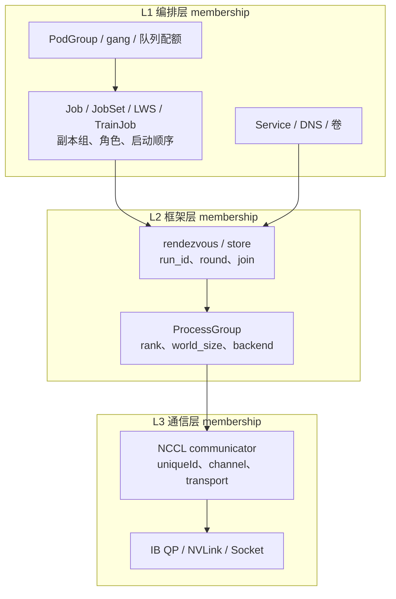
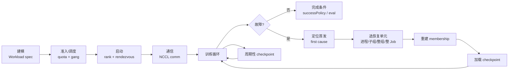
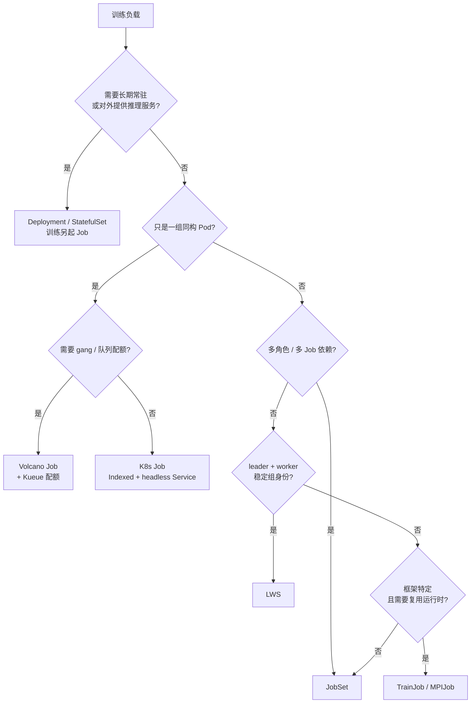

# 云原生分布式训练：编排与稳定性专题

> **结论先行**：把训练作业当成「一组无状态 Pod」是大多数编排与稳定性问题的起点。
> 分布式训练真正要维护的对象是**成员关系（membership）**：哪些进程属于同一个训练组、它们如何发现彼此、
> 何时算「到齐」、谁挂了之后由谁重建。Kubernetes 只保证 Pod 被创建和重启，不保证成员到齐，更不保证
> 集合通信已经建立。于是同一个「训练挂了」在不同层有完全不同的含义和恢复代价。

本专题用**三层 membership** 作为统一框架，把工作负载建模、启动通信、故障自愈、Checkpoint/抢占恢复、
RL 后训练串成一条链。每一篇都尽量落到具体 API 字段、代码路径和可复现的故障信号，而不是停留在概念层。

## 一、三层 membership

| 层 | 谁维护 | 「成员」是什么 | 建立信号 | 典型时间尺度 | 失败表现 | 重建成本 |
|---|---|---|---|---|---|---|
| **L1 编排层** | kubelet、Job/JobSet/LWS/TrainJob 控制器、调度器 | Pod（或 Pod 组） | Pod `Ready`、Job `status.ready`、JobSet `Ready`、`minAvailable` 满足 | 秒–分钟 | Pending、ImagePullBackOff、CrashLoop、组不齐 | 分钟级（重新调度/拉镜像） |
| **L2 框架层** | torchrun agent、TF 运行时、MPI launcher | rank 进程 | `next_rendezvous` 返回、`init_process_group` 完成 | 毫秒–分钟 | join timeout、rank 缺失、`Address already in use` | 秒–分钟（同节点重启进程） |
| **L3 通信层** | NCCL / UCX / 框架 collective | communicator、QP、channel | `ncclCommInitRank` + 首个 collective 成功 | 毫秒–秒 | hang、`NCCL timeout`、`remote process exited` | 秒级（重建 communicator） |

三层的关键差异不是「谁更底层」，而是**故障域不同**：L1 的故障域是 Pod/节点，L2 是进程组，L3 是 communicator。
一次节点故障会同时打断三层，但三层恢复的触发条件、超时和代价完全不同。编排原语的能力边界，本质上就是
**它能把哪一层 membership 写进 API，以及它默认在哪一层做恢复**。

## 二、三个容易混淆的「就绪」与「完成」

### 2.1 三种就绪

| 就绪 | 判定者 | 含义 | 常见误判 |
|---|---|---|---|
| **Pod Ready** | kubelet + readinessProbe | 容器已启动；若配置了 probe，则 probe 通过 | 训练 Pod 往往没有 readinessProbe，容器一启动就 `Ready`，此时 rendezvous 还没开始 |
| **成员就绪** | rendezvous / store / Job 控制器 | 该到的 rank 都加入了同一个 round | `minAvailable` 满足只说明 Pod 被调度，不说明进程已 join |
| **通信就绪** | NCCL / 框架 | communicator 建好，首个 collective 成功 | 没有任何 K8s 信号；只能靠日志、指标或应用层 barrier 观测 |

这解释了一个常见现象：**Gang 调度成功、Pod 全部 `Running`、训练却仍然卡住**。Gang 只保证「资源同时到位」，
不保证「进程同时到齐」，更不保证「通信同时建好」。LWS 的 `LeaderReady`、Volcano 的 `minAvailable`、
JobSet 的 `DependsOn` 都只是在不同粒度上逼近「成员就绪」，没有一个原语能直接表达「通信就绪」。

### 2.2 三种完成

| 完成 | 判定者 | 含义 | 风险 |
|---|---|---|---|
| **进程完成** | 容器运行时 | 主进程 exit 0 | 训练脚本捕获异常后 `exit 0`，会被当成成功 |
| **作业完成** | Job/JobSet/Volcano/TrainJob 的 successPolicy | 满足声明的成功条件 | 默认语义可能是「所有 Pod 成功」或「任一成功」，与业务目标不一定一致 |
| **业务完成** | 训练脚本 / 外部控制器 / eval gate | 达到目标 step、指标或验收门槛 | 不在 K8s API 里，需要显式建模，否则无法审计和自动重试 |

### 2.3 三种角色

同一个「角色」在三层里可能是三个不同的东西：

- **编排角色**：JobSet 的 `ReplicatedJob`、LWS 的 leader/worker、Volcano 的 `TaskSpec`、TrainJob runtime 里的 PodSet。
- **框架角色**：PyTorch 的 rank 0、TF 的 chief/worker/ps/evaluator、MPI 的 rank。
- **失败域角色**：rank 0 / leader / PS / coordinator 往往是单点；它们的故障会放大成整组故障。

建模时必须把这三者对齐，否则会出现「K8s 认为 worker-3 只是一个可替换副本，但框架认为它是 chief」的错位。

## 三、一个统一的生命周期

这条链上，每一段都有独立的「正确性问题」：

1. **建模**：API 是否表达了你真正需要的角色、依赖、就绪和完成语义？
2. **启动**：rank/world size 是谁算的？成员怎么发现彼此？超时设在哪一层？
3. **故障**：你看到的是首发原因，还是其他 rank 的连锁症状？
4. **恢复**：最小可恢复的 membership 单元是什么？重建后如何证明状态一致？
5. **接入**：多个阶段（训练/rollout/eval）如何共享资源、版本和失败域？

## 四、原语选择：先问「成员关系」，再问「功能」

> 这不是互斥的分类，而是**默认承载关系**：TrainJob 内部会生成 JobSet，JobSet 内部生成 Job，Job 生成 Pod；
> LWS 也可以被 TrainJob/JobSet 引用。选择时先确定「谁是 membership 的 owner」，再决定用哪一层表达。

几个判断规则：

- **只需要「跑完就退出」**：K8s Job（Indexed 需要稳定序号时）+ headless Service 足够。
- **需要「同时到位」**：Volcano 的 gang 或 scheduler-plugins 的 coscheduling；Kueue 负责队列/配额，不负责进程组。
- **需要「多角色、多 Job、依赖关系」**：JobSet 的 `ReplicatedJob` + `DependsOn`/`StartupPolicy`。
- **需要「leader + worker 稳定身份、整组重启」**：LWS 的 `replicas × size` + `RestartPolicy`。
- **需要「框架语义 + 可复用运行时」**：TrainJob 的 `ClusterTrainingRuntime` + framework plugin；MPI 用 MPIJob。
- **需要「常驻服务」**：Deployment/StatefulSet；不要用 Job 模拟长期服务。
- **K8s 1.37 起还有一层原生选项**：`scheduling.k8s.io/v1beta1` 的 Workload/PodGroup（`GenericWorkload` beta，默认关闭）
  把 gang、优先级、中断模式收进核心；Job 的 `WorkloadWithJob` 仍是 alpha。它只建模**调度策略模板**，不建模角色
  Pod 模板、成功条件或重启语义，适合作为其他原语的底座，而不是单独承载训练作业。详见
  [工作负载建模 §3.7](./workload-modeling.md#37-k8s-原生-workload--podgroup137-beta默认关闭)。

## 五、六个常见误区

1. **Gang 调度 = 训练就绪**。Gang 只保证资源同时到位；成员是否 join、communicator 是否建好是另外两层。
2. **Pod 重启 = 训练恢复**。DDP/FSDP 的一个 rank 退出会让其余 rank 在 collective 上超时；多数框架要求整组重建，
   而不是只重启一个 Pod（LWS 的 `RecreateGroupOnPodRestart` 就是把这个语义显式化）。
3. **Checkpoint = 保存模型权重**。缺 optimizer state、LR scheduler、RNG、数据偏移，恢复后 loss 会跳变、
   数据会重复或跳过；这些状态必须一起持久化。
4. **所有 rank 都报 NCCL timeout = NCCL 故障**。NCCL 的超时是**本地观察到的症状**，首发原因可能是某个 rank
   OOM、某个节点 Xid、某条链路降级，甚至只是 rendezvous 少了一个成员。
5. **`restartPolicy: Always` 或 `backoffLimit` 足够**。容器内 hang 不触发重启；节点故障不一定计入 Job 重试；
   OOM 循环会把预算烧光。失败预算要覆盖「计数」和「不计数」两类失败。
6. **RL 是一个大 Job**。RL 后训练是 actor、rollout、reward、reference、critic、eval 多个异构角色的流水线，
   各角色的资源周期、版本和失败域都不同；把它塞进一个 Pod 模板通常会在扩展和恢复上付出代价。

## 六、专题页面

| 页面 | 回答的问题 | 关键产出 |
|---|---|---|
| [工作负载建模：从 Pod 到可恢复的成员组](./workload-modeling.md) | 角色、资源、依赖、就绪/完成、服务暴露、卷、放置怎么表达？Volcano Job / JobSet / LWS / TrainJob 怎么选？ | 七维建模表、原语对比、YAML 骨架、选择树 |
| [训练启动与通信：rank、rendezvous 与第一个 collective](../../../Machine_Learning/Distributed_Training/startup-communication.md) | TF/MPI/PyTorch 的角色和成员怎么组织？rank/world size 从哪来？首个 step 前发生了什么？ | 启动时序、PyTorch/TF/MPI 对照、NCCL 初始化、失败窗口 |
| [训练失败与自愈：首发原因、恢复单元与失败预算](./failure-self-healing.md) | 启动失败、join 超时、hang、单 rank 退出、节点/设备故障怎么区分？谁来恢复？如何避免无限重试？ | 故障分层、首发定位法、恢复语义对照、预算模型 |
| [Checkpoint 与抢占恢复：状态、恢复点与成员重建](./checkpoint-preemption.md) | 必须保留哪些状态？恢复点怎么定义？world size 变了怎么办？如何验证加载正确？ | 状态清单、DCP/FSDP/torchtitan 实现、进度损失公式、恢复 runbook |
| [RL 后训练与业务接入：阶段、版本与失败域](./rl-post-training.md) | 训练/rollout/评分/eval/模型同步的数据流是什么？先问清什么再沉淀平台能力？ | 阶段图、verl 结构、版本与 staleness、失败域表、能力沉淀决策表 |

## 七、版本基线

本篇与各子页的证据基于以下代码/文档快照（2026-11-23 拉取）。API 演进很快，引用时请以文中 permalink 的
commit 为准；正文会标注「当前 main」与「最新稳定版」的差异。

| 项目 | 快照 | 说明 |
|---|---|---|
| Kubernetes | `v1.37.2` (`c50e5395f1ae`) | Job/Pod/调度 API |
| Volcano | main `2006640ed881`（tag `v1.17.0-alpha.0`） | Job/PodGroup/gang/plugins |
| JobSet | main `32c9ea314409`（tag `v0.14.0-devel`） | ReplicatedJob/Network/FailurePolicy |
| LWS | `v1.0.0` (`51d7d5ad84f7`) | LeaderWorkerSet/DisaggregatedSet |
| Kubeflow Trainer | `v2.4.0` (`ae27d3faf401`) | TrainJob/TrainingRuntime |
| Training Operator v1 | `v1.9.4` (`4445c12aa62e`) | 旧 TFJob/PyTorchJob/MPIJob |
| MPI Operator | `v0.8.2` (`a057ca529cb7`) | MPIJob |
| Kueue | main `be7dc9d31470`（tag `v0.21.0-rc.1`） | 配额/抢占 |
| PyTorch | main `02e06c707ee3` | elastic/c10d/NCCL |
| NCCL | `v2.32.6-1` (`ad2d192c1f27`) | communicator/bootstrap |
| verl | main `7b6c9cc0e19d` | RL 后训练 |

## 八、参考入口

- [Kubernetes Job](https://kubernetes.io/docs/concepts/workloads/controllers/job/)
- [Volcano Job](https://volcano.sh/en/docs/vcjob/)
- [JobSet](https://jobset.sigs.k8s.io/docs/overview/)
- [LeaderWorkerSet](https://lws.sigs.k8s.io/docs/overview/)
- [Kubeflow Trainer](https://trainer.kubeflow.org/)
- [MPI Operator](https://www.kubeflow.org/docs/components/training/mpi/)
- [PyTorch distributed](https://docs.pytorch.org/docs/stable/distributed.html)
- [PyTorch elastic](https://docs.pytorch.org/docs/stable/elastic/run.html)
- [NCCL](https://docs.nvidia.com/deeplearning/nccl/user-guide/docs/)
- [Kueue](https://kueue.sigs.k8s.io/)

## 相关页面

- [Kueue：Kubernetes 原生作业队列管理器](../../Kubernetes/Scheduling/kueue.md)
- [生产级 Kubernetes Operator](../../Kubernetes/Extensibility/production-operator.md)
- [Slurm](../../../Machine_Learning/High_Performance_Computing/slurm.md)
- [Open MPI 架构](../../../Machine_Learning/High_Performance_Computing/ompi架构介绍.md)
- [GPU 算力/显存池化](../../../Machine_Learning/High_Performance_Computing/gpu-cluster-pooling.md)
- [vLLM Production Stack 实战](../../../Machine_Learning/Inference/vLLM%20Production%20Stack实战.md)
