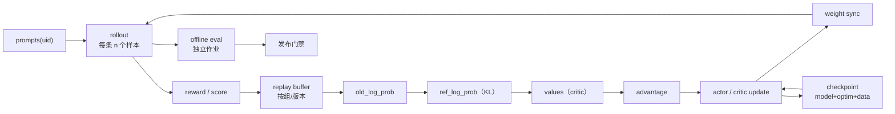

# RL 后训练与业务接入：阶段、版本与失败域

> **结论先行**：RL 后训练不是「一个大训练 Job」，而是**一条带反馈环的数据流水线**：同一份权重被三种程序以三种
> 并行方式消费（训练 / 生成 / 评分），每一圈都要把新权重搬回生成侧。所有编排复杂度都来自这一句。
> 因此决定拓扑的不是算法，而是四个问题：**角色是否同镜像、资源周期是否同频、版本号是否贯穿、失败域是否可分割**。
> 这四个问题的答案，直接决定「用 TrainJob/LWS/JobSet 还是只做 API 与可观测」。

本页先给阶段图与两种拓扑，再以 verl 的一个具体快照展示代码级结构，然后拆解模型同步、版本、失败域与评估，
最后给业务接入的提问顺序和平台能力沉淀决策表。

> 专题导航：[总纲](./overview.md) · [工作负载建模](./workload-modeling.md) · [启动通信](../../../Machine_Learning/Distributed_Training/startup-communication.md) · [故障自愈](./failure-self-healing.md) · [Checkpoint](./checkpoint-preemption.md) · [RL](./rl-post-training.md)

## 一、阶段图与数据流

### 1.1 六种角色

| 角色 | 做什么 | 并行方式 | 是否每 step 参与 | 典型资源 |
|---|---|---|---|---|
| actor / policy | 前向+反向，产出新权重 | FSDP/Megatron TP/PP/EP | 是 | GPU，显存最大 |
| rollout（推理引擎） | 按 prompt 生成 n 条轨迹 | vLLM/SGLang TP/DP | 是 | GPU，KV cache 大 |
| reference model | 算 `ref_log_prob` 供 KL | 同 actor 并行 | 是（若启用 KL） | 可与 actor 共享 |
| critic / value | 算 value，供 GAE | 同 actor 并行 | 仅 GAE 类算法 | 可与 actor 共享 |
| reward model / scorer | 打分：规则、RM、LLM-judge | CPU 或小 GPU 池 | 是 | CPU 或独立 GPU 池 |
| evaluation | 验收门禁，不参与反传 | 批处理 | 否（按 freq） | 独立作业 |

数据流（以 verl 的实现顺序为例）：



关键点：**reward 在 advantage 之前、在 rollout 之后**，所以 reward 服务是「生成侧」的依赖，不是「训练侧」的依赖；
它可以和 rollout 并行（异步打分），也可以被 rollout 的 CPU worker 直接调用。eval 则应当在训练环之外，
用独立作业/独立配额跑，否则会与训练抢 rollout 容量。

### 1.2 两种拓扑

**拓扑 A：同步 + colocated**

```text
┌───────────────────── Trainer 进程（单控制器 driver）──────────────────────┐
│ dataloader → prompts(uid) → TransferQueue(pending/running/finished)       │
│      │                                                                    │
│      ├─ AgentLoopWorker (CPU actor) ──HTTP──► LLM server (vLLM/SGLang)    │
│      │                                          ▲ 与 actor 同卡           │
│      │                                          │ sleep/wake + IPC 搬权重 │
│      ├─ RewardLoopWorker (CPU actor) ──► RM router（或独立 RM 池）        │
│      └─ actor / ref / critic 同一 WorkerGroup（fused worker，同池同卡）   │
└───────────────────────────────────────────────────────────────────────────┘
每个 step：gen → reward → old_log_prob → ref → values → adv → update → update_weights
```

一个 step 内**严格串行**：生成完 → 训练完 → 搬权重 → 再生成。GPU 在「生成」和「训练」之间分时复用；
权重搬运是**进程内**的：rollout 必须已 sleep，actor 直接把张量写进推理进程的权重 buffer。失败域被绑定：
actor/rollout/ref 在同一批 Ray actor 里，任何一方崩溃都会打穿整个 step。

**拓扑 B：异步 + disaggregated**

```text
┌─ Trainer 作业（GPU 池 A）──┐          ┌─ Rollout 作业（GPU 池 B，可常驻）──┐
│ actor / critic / ref       │          │ LLM server replicas (vLLM/SGLang)  │
│ step k 产出 v_k ───────────┼─NCCL/NIXL─► 收 v_k：abort → 放 KV → 装权重   │
│                            │          │ → resume generation                │
└──────────┬─────────────────┘          └───────────────┬────────────────────┘
           │ 采样（轨迹版本 ≤ k）                          │ 产出轨迹
           └──────────► TransferQueue（K/V 分离：meta 在 meta server）◄──────┘
```

- `colocate_async`：两侧仍同池，但 rollout 在训练期间继续跑（partial rollout），step 结束时 abort + sleep +
  搬权重 + resume。
- `separate_async`：rollout 独占 GPU，**必须**用非 `naive` 的 checkpoint engine（代码 assert）。训练侧默认不装
  推理引擎；开了 `hybrid_rollout.enable_switch` 才会在训练卡上再放一份 hybrid replica，空闲时借给生成。
- 异步的代价是**版本不再唯一**：一条轨迹可能跨多个策略版本，于是需要 staleness 控制。

### 1.3 on-policy / off-policy：staleness 与 rollout ratio

- **on-policy**：样本由当前权重生成。同步拓扑天然 on-policy（除非开 DAPO 过滤）。
- **off-policy 程度**在 verl 里用「模型版本数」计量，而不是时间：`max_off_policy_threshold`（默认 8）表示
  「一条轨迹从首次生成到被训练，最多跨多少个 `global_steps`」；超阈值时 `drop`（丢弃整组并补采）或 `wait`
  （阻塞等它跑完）。代码判定是 `global_steps - prompt_global_steps + 1 > threshold`。
- **partial rollout 会制造「轨迹内跨版本」**：中途 abort 时保留已生成 token，用新版本续跑并重建 KV；
  因此监控要同时看 `trajectory_spans`（一条轨迹用了几个版本）和 `trajectory_staleness`（最老/最新版本差）。

**rollout ratio 有三个不同层次，接入时必须问清是哪一个：**

| 层次 | 含义 | 典型旋钮 |
|---|---|---|
| 样本比 | 每个 prompt 生成几条（GRPO 组大小） | `actor_rollout_ref.rollout.n`，默认 1 |
| 批比 | 每次从 dataloader 取多少 prompt、允许多少批在飞 | `data.gen_batch_size`、DAPO 的 `max_inflight_gen_batches` |
| 资源比 | trainer GPU 数 : rollout GPU 数 | `trainer.nnodes` vs `rollout.nnodes`；hybrid 借出由 `switch_threshold_ratio` 控制 |

资源比是唯一需要**跨作业**协商的量：它在 K8s 层是两个 Job 的副本数，在 verl 层只是一个 config 字段。
平台若想「按业务调比例」，要么改 config 重启，要么把两侧拆成可独立伸缩的作业。

## 二、verl 的代码级结构（一个快照）

> 本页基于 `verl-project/verl` 的 `7b6c9cc0e19d`（2026-11-23）。该版本已重构为 V1 trainer
> （`verl/trainer/ppo/v1/`，`RayPPOTrainer` 被 `PPOTrainer` + TensorDict/TransferQueue 取代），
> 与网上大量基于旧版 `ray_trainer.py` 的文章不一致。引用时以本 SHA 为准；其他版本请按实际代码复核。

### 2.1 入口与三种 trainer

`verl/trainer/main_ppo.py` 是唯一入口：Hydra 读 `config/ppo_trainer.yaml`，起 Ray，把 `TaskRunnerV1` 作为远程
actor 跑 `run()`；`run()` 里按 `config.trainer.v1.trainer_mode` 从注册表取 trainer 类
（`sync` / `colocate_async` / `separate_async`）。

`PPOTrainer.init()` 的组件清单：WorkerGroup（actor/critic/ref + model engine）、LLMServerManager（起推理副本）、
CheckpointEngineManager（搬权重）、RewardLoopManager（打分）、可选 teacher 池。

### 2.2 角色 → 资源池

`_init_resource_pool_mgr()` 维护两张表：`role_worker_mapping`（角色→Ray 类）与 `mapping`（角色→池名）：

| 角色 | 何时存在 | 池 |
|---|---|---|
| `ActorRolloutRef` | `hybrid_engine=true` 且需要 ref 且未用 LoRA | `global_pool` |
| `ActorRollout` | 同上但不需要 ref | `global_pool` |
| `Actor` + `RefPolicy` 分离 | `hybrid_engine=false`（only separate_async） | `global_pool`（两个 WorkerGroup） |
| `Critic` | `critic.enable` 或 `adv_estimator=gae` | `global_pool` |
| `RewardModel` | `reward.reward_model.enable` | `reward_pool`（若 `enable_resource_pool`）否则 `global_pool` |
| `TeacherModel` | 开了蒸馏 | `teacher_pool` |

- WorkerGroup / ResourcePool 的分层是 `single_controller` 的核心抽象。`ResourcePoolManager` 把「池名 → 每节点
  GPU 数列表」建为 Ray placement group，并在建池前校验总卡数，不够直接报错。
- 同池多角色靠 `create_colocated_worker_cls()` 融合成一个 fused worker（一个 Ray actor 内多个角色），
  所以「同池」在物理上就是**同一个进程、同一张卡**，不是两个容器。
- **结论**：verl 的资源隔离粒度是 Ray placement group，不是 K8s Pod。想让 reward 用 CPU 节点、eval 用另一批卡，
  必须显式给它单独的池，或干脆拆成独立作业。

### 2.3 一个 step 的数据流

`PPOTrainer.step()` 把 `train_batch_size` 按 `parameter_sync_step` 切成若干 mini-batch；每个 mini-batch 走一次
`_step_once()`：

```text
1 sample          ← replay_buffer.sample(global_steps, "train")   取已生成好的轨迹
2 reward(colocate)← 仅当 reward 不是独立 worker 时，在本地算分
3 balance         ← 跨 DP 组按 seqlen 重排，避免长尾
4 old_log_prob    ← 用当前 actor 算 π_old（异步模式下可能要临时换回旧权重）
5 ref_log_prob    ← 可选，KL 用
6 values          ← 可选，critic
7 advantage       ← GAE / GRPO / RLOO ...
8 update_critic   ← 可选
9 update_actor    ← 真正改权重；之后 on_step_end 触发 update_weights
```

样本来自 TransferQueue 中「已 finished 的组」，而不是本 step 直接调生成函数。同步模式下 `prepare_step()` 在
step 开头把整批 prompt 提交给 AgentLoop，随后采样阻塞等待，所以生成与训练仍是**分时串行**；异步模式下生成
流水线持续运行、trainer 只消费队列，两者才真正并发。这个「生成写出、训练读取」的数据层接口，正是它能同时支持
sync 与 async 的原因。

### 2.4 weight sync 的三条路径

`CheckpointEngineManager` 把设计讲得很清楚：

| 路径 | backend | 机制 | 用于 |
|---|---|---|---|
| 进程内直写 | `naive`（`ColocatedCheckpointEngine`） | actor 调 `rollout.update_weights()`，经 ZMQ 传元数据 + CUDA IPC handle / 共享内存传张量 | sync / colocate |
| 强同步集合通信 | `nccl` / `hccl` / `nixl` / `mooncake` | actor 侧 all-gather → broadcast（NIXL 是 ring p2p） | disaggregated |
| 发布/提交解耦 | `support_publish_weights=True`（如 D2H 快照 + RDMA 读） | trainer 先 publish 快照，rollout 在后台线程 commit | 大规模/弹性 |

- **naive 路径**：`ActorRolloutRefWorker.update_weights(mode="naive")` 先 `resume(tags=["weights"])`，拿
  `get_per_tensor_param()` 的全量 HF 权重逐桶写进推理引擎，然后 `torch.distributed.barrier()` 等所有 rank 卸载完，
  再 `resume(tags=["kv_cache"])`。vLLM 侧走 `update_weights_from_ipc`，传输层是「ZMQ + IPC，shm 兜底」。
- **NCCL 路径**：`submit_update()` 里先 abort 生成、释放 KV、`build_process_group()` 重建通信域，再 trainer publish +
  rollout commit，最后双方 `finalize()` 并 resume。
- **一致性保证**：manager 只允许**一个未提交版本**，每次新 update 先等上一次 commit，防止版本乱序安装。
  这是「weight sync 原子性」在代码里的真实含义——不是分布式事务，而是**单飞 + 等提交**。

checkpoint engine 的能力矩阵：naive 性能最高但只能在同卡；nccl 快但弹性差（要重建通信组）；NIXL 支持弹性与
异构；另有 `delta_sharded` 只传变化的 ~1–3% 参数。

### 2.5 异步、partial rollout、多轮 agent loop

- **partial rollout 不是开关，而是异步 client 的固有行为**：请求被 abort 时保留已生成 token 与 logprob，
  经 load balancer 重试，用新版本续跑并重建 KV。
- **多轮 agent loop 真实存在**：`verl/experimental/agent_loop/` 下有 `single_turn_agent_loop.py`、
  `tool_agent_loop.py`，`AgentLoopManager` 把 batch 切块分发给 CPU actor（`rollout.agent.num_workers`），
  round-robin 绑到有 CPU 的节点。工具调用在 agent loop 里完成，reward 可以在同一 worker 里顺带算。
- **online/offline 的边界**：`verl/trainer/main_eval.py` 是纯离线评分器——读 parquet、对每条 response 调 reward
  fn、按 data_source 求均值。它不启动推理引擎，也不碰 Trainer。

## 三、rollout 引擎与模型同步

### 3.1 vLLM / SGLang 的接口

- vLLM 侧 verl 用的是 `update_weights_from_ipc`（worker extension）：先 `resume(tags=["weights"])` 把权重 buffer
  恢复，再通过 ZMQ 传 `(name, shape, dtype, handle)`，rollout 进程用 `rebuild_ipc()` 把 CUDA IPC handle 还原成
  tensor 并原地写。vLLM 官方把这类能力归为「Weight Updates / Weight Transfer」，列出 IPC（同卡）、NCCL
  （跨节点广播）、sparse NCCL 等后端。
- SGLang 侧是 `update_weights(weights_generator)`，按 `update_weights_bucket_megabytes` 分桶，官方文档对应
  「Update Weights from Tensor / from Disk」。
- **sleep / wake**：vLLM 的 sleep mode 可以把权重和 KV cache 释放但不退出进程，`wake_up(tags=["weights"])`
  只恢复权重、`tags=["kv_cache"]` 只恢复 KV——这正是 colocate RL 的关键 API。verl 的调用顺序严格遵循：
  先 resume weights → 写权重 → 再 resume kv_cache。

### 3.2 colocate 的显存与算力复用

- 复用是**分时**不是分享：生成阶段推理引擎占满显存，训练阶段它必须 sleep 把显存让出来；反之训练完要 wake
  才能生成。
- CUDA graph 是这块最容易被忽略的成本：verl 文档明确写「cudagraph memory 不能 offload 到 CPU，训练时仍占着
  显存」，所以 colocate 场景要用 `cudagraph_capture_sizes` 限制捕获的 batch 形状。
- 权重原地更新（in-place refit）可以让已捕获的 CUDA graph 继续有效，因为地址没变；但 vLLM 的 sleep 会 unmap
  权重，恢复后是否需要重捕获**取决于引擎版本与分配器行为**，需实测。
- 算力复用的收益有上限：官方 benchmark 里，同预算下 sync → colocate_async 约 -35% 训练时间，但这是
  35B MoE + 长输出的特定负载，不能当通用系数。

### 3.3 版本一致性

需要三样东西同时成立：

1. **版本号单一来源**：`global_steps` 由 trainer 分配，随 `update_weights(global_steps)` 传到 rollout，
   vLLM 侧还会 `set_global_steps` 记录。
2. **样本带版本**：TransferQueue 的 prompt tag 记录 `global_steps`；replay buffer 用它算 staleness。
3. **切换有屏障**：naive 路径靠 `torch.distributed.barrier()` + `resume(kv_cache)`；NCCL 路径靠「等上一次 commit」
   与 `finalize()`；生成侧在搬运前必须 `abort` 并把 KV 放掉，否则会用旧 KV 配新权重。

**陈旧样本怎么处理**：`drop` 直接丢弃整组并补采（组内任一轨迹 stale，整组丢，因为 GRPO 需要完整组）；
`wait` 则阻塞采样等它跑完。两种策略的取舍是「样本利用率 vs 策略滞后」，没有默认正确答案，只有业务可接受的
滞后上限。

## 四、失败域

前提：本 SHA 全仓 `grep max_restarts` 为空，`RayWorkerGroup` 没有为 worker actor 设置自动重启；Ray 的默认语义是
actor 死亡 → 调用方收到 `RayActorError` → driver 异常退出。所以下表「局部重启」列多数是**代码没有、靠外层编排**。

| 失败点 | 表现 | 丢什么 | 能否局部重启 | 幂等/重放手段 |
|---|---|---|---|---|
| trainer rank 挂 | WorkerGroup RPC 失败，driver 抛错，整个 Ray job 结束 | 当前 step 的梯度与在飞 rollout | 否（同组必须整组） | 最近 ckpt（model+optimizer+extra）+ dataloader state + TransferQueue state；异步模式下重启后 `_reissue_inflight_prompts()` 重发 pending/running 的 prompt |
| rollout engine 挂 | 生成 RPC / 权重提交失败；异步模式下 `update_weights` 卡在等 commit | 该副本上未完成的轨迹 | 代码无自动重建；`add_replicas/remove_replicas` 是为弹性扩缩、会重建通信域，不是故障自愈 | 已 finished 的轨迹在 TransferQueue 里，可继续被采样；需要外层重建整个 rollout 作业 |
| reward 服务挂 | 该 prompt 组 rollouts 标记 `failure` | 这一组样本 | **可以**：异步模式按组 evict + `refill_fn(k)` 补采；同步模式默认不补，失败组会被 pad | 组级幂等：同一 uid 重采即重算；`sync_refill_failed_groups=True` 打开同步补采 |
| weight sync 挂 | NCCL 组已建但 transfer 失败 / 版本未提交 | 新权重没生效，rollout 仍是 v_{k-1} | 否；通信域需重建，代码无重试 | 版本号单调 + 单飞提交：重跑整个 step 不会版本错装 |
| eval 挂 | 训练内 `_validate()` 与训练共享 rollout 池，会拖慢并占用容量；离线 `main_eval` 独立 | 只有评估结果，不影响训练 | **可以**：离线 eval 是独立作业，重跑即可 | 输入是落盘的 parquet + 固定 reward fn 版本，天然可重放 |
| TransferQueue / 存储挂 | 采样阻塞或 ckpt 不可写 | 在飞轨迹、ckpt | 取决于部署 | TQ 支持 checkpoint（V1 异步模式会把 TQ state 存进 `global_step_N/transfer_queue`） |

一条推论：**「能否局部重启」几乎完全由「状态是否外置」决定**。verl 把状态外置到 ckpt + TransferQueue，所以
进程可整组重来；但没有把 rollout 副本做成可替换单元，所以 rollout 挂 = 整作业重来。断点续训的入口在
`verl/utils/checkpoint/checkpoint_manager.py::find_latest_ckpt_path()`：读 `latest_checkpointed_iteration.txt`
再拼出 `global_step_{N}`。

## 五、评估与评分

### 5.1 eval 与 reward 是两种东西

| 维度 | reward（训练信号） | eval（验收门禁） |
|---|---|---|
| 目的 | 给梯度方向 | 决定「能不能发版」 |
| 数据 | 训练集，允许重复、允许噪声 | 固定 holdout，不允许进训练 |
| 稳定性 | 可以每 step 变（DAPO 动态过滤） | 必须跨版本可比 |
| 成本 | 每 step 每样本都要算 | 按需、可批处理 |
| 失败语义 | 算不出来就丢样本/补采 | 算不出来就是「不能发版」 |
| 实现 | RewardLoopWorker / RM 池 / 规则函数 | `main_eval.py` 离线批处理，或训练内 `_validate()` |

verl 里两者**共用同一套 reward function**（`get_custom_reward_fn`），但调用路径、资源与失败域不同。
共用函数是合理的（口径一致），共用运行时是危险的（SLO 相反）。

### 5.2 三类评分器

- **规则评分**：`verl/utils/reward_score/` 下 `gsm8k`、`math_verify`、`math_dapo`、`prime_code`、
  `sandbox_fusion` 等 preset，纯 CPU、可并行、可复现，是最该被平台化的部分。
- **reward model**：判别式（`/classify` pooling）或生成式（genrm）。`full_determinism` 下前者会被强制
  `max_num_seqs=1` 以保证 bitwise 可复现；后者本质是 LLM 调用，成本与延迟都高一个量级。
- **LLM-as-judge**：verl 没有专门的 judge 抽象，judge 就是一个「自定义 reward function + 一个 LLM endpoint」。
  平台若要做，必须自己解决：judge 模型版本固定、prompt 模板版本化、分数校准、以及 judge 与被评模型同源导致的
  自我偏好。

### 5.3 数据污染与可复现性

- **污染**：RL 的 train/eval 同源风险比 SFT 更高——prompt 分布相同、reward 函数相同，eval 集一旦泄漏进训练，
  指标会单调上涨而能力不涨。工程上必须做到：eval 集物理隔离（不同 bucket/dataset id）、训练侧 dataloader 只读
  训练清单、eval 集 hash 进版本元数据。
- **可复现**：verl 提供 `full_determinism`，会设 `VERL_FULL_DETERMINISM=1`、`VLLM_BATCH_INVARIANT=1`、
  `PYTHONHASHSEED`；但 batch invariance 只对生成模型验证过，pooling RM 要单独串行化。即便如此，
  **跨硬件/跨并行度不可复现**是常态，验收只能要求「同配置重跑同结果」，不能要求「换机器同结果」。

### 5.4 eval 的资源与失败域

- 训练内 `_validate()`：走同一个 AgentLoop + rollout 池，会与未完成的训练轨迹抢容量，文档明确说
  `timing_s/testing` 里包含了这部分竞争。所以频繁 validate 会直接吃掉吞吐。
- 离线 `main_eval.py`：Ray 任务级并行，每个 item 一个 remote task，按 data_source 聚合均值。这是正确的形态——
  独立作业、独立配额、失败可重跑、结果落盘。
- 建议：把 eval 做成**独立 Job + 独立配额**，训练只负责在 ckpt 落盘后触发一次 eval（verl 提供
  `CheckpointCallback.on_save` 钩子）。

## 六、业务接入清单

### 6.1 四个必答问题（按顺序问，不要跳）

**Q1 角色**：actor / rollout / ref / critic / reward / eval 是否同镜像、同资源形状、同生命周期？

- 同镜像同卡（FSDP + 小模型）→ `hybrid_engine=true`，一个作业搞定。
- rollout 要独立扩缩或要用不同推理引擎版本 → 必须拆作业，weight sync 必须走 NCCL/NIXL。
- reward 是 CPU 规则 → 放 CPU 池，不要占 GPU 配额；reward 是 RM → 给它 `reward_pool`，否则会和 actor 抢卡。

**Q2 资源周期**：长期常驻 vs 每 step/每 epoch 拉起？

- rollout 常驻的收益是省掉引擎初始化与首次权重同步；代价是空转占卡。verl 文档给的数字：不装 hybrid replica 时，
  每步省掉 engine init、启动权重同步、offload 预留，但 warmup 变慢。
- 训练作业按需拉起、rollout 常驻，是最常见的生产形态；此时**两侧版本必须解耦**（rollout 允许落后 k 个版本）。
- 分时复用（同一批卡白天推理晚上训练）在 K8s 层是两套 Job 抢同一个队列，不要试图在一个 Pod 里做。

**Q3 版本**：policy / rollout / reward / eval 四个版本怎么表示、谁分配、兼容矩阵是什么？

- 最小要求：一个单调递增的 `policy_version` 贯穿「样本、ckpt、eval 报告」。
- 兼容矩阵至少覆盖：训练框架 ↔ 推理引擎（vLLM/SGLang 版本强绑定，verl 对两者都有版本适配层）、
  reward 函数版本 ↔ 数据集版本、eval 集版本 ↔ 报告。
- weight sync 的原子性 = 「单飞 + 等提交 + 版本单调」，不要指望分布式事务。

**Q4 失败域**：哪个角色挂了可以局部重启，哪个必须整组？数据/ckpt 是否可重放？

- 可局部重启的只有：reward worker（组级丢样本补采）、离线 eval（重跑）。
- 必须整组的：trainer WorkerGroup（NCCL 通信域）、rollout 副本组（权重版本一致）。
- 可重放的判据：状态是否外置。ckpt + dataloader state + TransferQueue 三件套齐了，才能「整组重来但不丢进度」。

### 6.2 平台能力沉淀决策表

| 业务形态 | 需要的原语 | 建议承载 | 不要做 |
|---|---|---|---|
| 单团队、固定拓扑、就是跑一条 verl 命令 | gang 启动、失败重启、日志 | **JobSet**：`replicatedJobs` 分 trainer/rollout，`failurePolicy` 按角色决定重启 Job 还是整个 JobSet | 不要写 Operator；不要为「跑一条命令」造 CRD |
| 需要复用训练运行时（镜像/入口/依赖固定） | 运行时模板 + 覆盖 | **TrainJob + TrainingRuntime**：runtime 里放 JobSet 模板，TrainJob 只填参数 | 不要把业务参数塞进 runtime |
| 多团队共享 GPU、要配额/公平/抢占 | 队列、配额、gang | **Kueue**（ClusterQueue/LocalQueue 管配额与准入）+ **Volcano** PodGroup 管 gang；TrainJob 暴露 `suspend`，Kueue 用它做准入/挂起 | 不要自己做队列和抢占 |
| rollout 常驻、要组语义、要热更权重 | leader/worker 组、整组重启 | **LWS**：`restartPolicy=RecreateGroupOnPodRestart` 保证组内同生共死；权重热更走引擎自己的 HTTP/IPC 接口 | 不要用 Deployment（无组语义、无 leader 概念） |
| 训练/rollout/reward 生命周期差异大 | 独立伸缩、独立配额 | 拆成 3 个作业，用对象存储 + TransferQueue 解耦；已在 Ray 上则训练用 Ray Train、常驻推理用 Ray Serve | 不要塞进一个 Pod 用 supervisor 管 |
| 只要「看得见、算得清、限得住」 | label、指标、配额视图 | 只做 **API + 可观测 + 配额**：给作业打 `policy_version/experiment_id/role` 标签，采集 `timing_s/gen`、`timing_s/update_weights`、`off_policy/*` | 不要抽象运行时 |

**「何时沉淀为通用能力」的判据**（按此顺序，四项全同才沉淀运行时）：

1. 同镜像？ 2. 同资源形状（GPU/CPU、卡数、拓扑）？ 3. 同生命周期（常驻/按需/每 step）？ 4. 同失败恢复语义
（可丢/可重放/必须整组）？

- 四项全同 → 沉淀 **Operator/CRD**（例如「RL 训练作业」这种一等公民）。
- 部分相同 → 只沉淀 **契约**：weight-sync API、样本 schema（含 `policy_version`）、指标名、配额模型。
- 都不同 → 只做 **配额与可观测**，把编排留给业务自己的 JobSet。

按这个判据，verl 当前形态最值得沉淀的是「契约层」而不是「运行时层」：weight sync 有清晰的三后端抽象、
样本有稳定的键格式、指标有固定命名——这三样跨业务可复用；而「一个 step 里怎么排 stage」是算法团队的事，
不该被平台固化。

### 6.3 明确不要做的抽象

- **不要把 rollout 抽象成通用 InferenceService**：它的请求可以被 abort、KV 可以被清空、权重可以被替换，
  与在线服务的「请求不可丢、版本不可变」正好相反。共用 LWS 可以，共用 SLO/限流/灰度语义不行。
- **不要把 reward 抽象成通用微服务网关**：规则 reward 是纯函数，RM 是模型，judge 是第三方 API，
  三者的幂等性、成本、超时语义完全不同。只统一「输入样本 schema → 输出 score + extra_info」这一层。
- **不要为「多角色」造统一调度器**：Ray 已经做了 actor 级调度，K8s 已经做了 Pod 级调度；平台真正缺的是
  「跨作业的配额与版本视图」，不是第三个调度器。

## 七、证据

### 阶段图与 verl 结构

- [HybridFlow 论文（3D-HybridEngine、单/多控制器混合）](https://arxiv.org/abs/2409.19256)
- [verl 官方文档：V1 Async Trainer](https://verl.readthedocs.io/en/latest/advance/v1_async_trainer.html)
- [verl 官方文档：HybridFlow Programming Guide](https://verl.readthedocs.io/en/latest/hybrid_flow.html)
- [verl 官方文档：single_controller（WorkerGroup/ResourcePool）](https://verl.readthedocs.io/en/latest/single_controller.html)
- [PPOTrainer.init() 的组件清单](https://github.com/verl-project/verl/blob/7b6c9cc0e19de780ca52c0c35d5157348955a3dc/verl/trainer/ppo/v1/trainer_base.py#L229-L246)
- [角色→资源池映射与 placement group 校验](https://github.com/verl-project/verl/blob/7b6c9cc0e19de780ca52c0c35d5157348955a3dc/verl/trainer/ppo/v1/trainer_base.py#L865-L925)
- [hybrid_engine 的 fused worker（同进程同卡）](https://github.com/verl-project/verl/blob/7b6c9cc0e19de780ca52c0c35d5157348955a3dc/verl/trainer/ppo/v1/trainer_base.py#L330-L370)
- [step() / _step_once() 的九段数据流](https://github.com/verl-project/verl/blob/7b6c9cc0e19de780ca52c0c35d5157348955a3dc/verl/trainer/ppo/v1/trainer_base.py#L591-L680)
- [sync trainer：step 末搬权重、采样后 sleep](https://github.com/verl-project/verl/blob/7b6c9cc0e19de780ca52c0c35d5157348955a3dc/verl/trainer/ppo/v1/trainer_sync.py#L25-L42)
- [colocate_async：abort + sleep + update + resume](https://github.com/verl-project/verl/blob/7b6c9cc0e19de780ca52c0c35d5157348955a3dc/verl/trainer/ppo/v1/trainer_colocate_async.py#L19-L45)
- [separate_async：rollout 独立池、必须非 naive backend](https://github.com/verl-project/verl/blob/7b6c9cc0e19de780ca52c0c35d5157348955a3dc/verl/trainer/ppo/v1/trainer_separate_async.py#L56-L75)

### 模型同步与版本

- [update_weights 的 naive 路径、barrier、resume kv_cache](https://github.com/verl-project/verl/blob/7b6c9cc0e19de780ca52c0c35d5157348955a3dc/verl/workers/engine_workers.py#L790-L890)
- [CheckpointEngineManager：publish/commit、单飞版本、abort/finalize](https://github.com/verl-project/verl/blob/7b6c9cc0e19de780ca52c0c35d5157348955a3dc/verl/checkpoint_engine/base.py#L403-L450)
- [checkpoint engine 后端能力矩阵](https://github.com/verl-project/verl/blob/7b6c9cc0e19de780ca52c0c35d5157348955a3dc/verl/checkpoint_engine/README.md#L13-L25)
- [replay buffer：staleness 判定与 drop/wait](https://github.com/verl-project/verl/blob/7b6c9cc0e19de780ca52c0c35d5157348955a3dc/verl/trainer/ppo/v1/replay_buffer.py#L523-L560)
- [staleness 配置：max_off_policy_threshold=8](https://github.com/verl-project/verl/blob/7b6c9cc0e19de780ca52c0c35d5157348955a3dc/verl/trainer/config/ppo_trainer.yaml#L237-L330)
- [rollout.n（每个 prompt 生成几条）](https://github.com/verl-project/verl/blob/7b6c9cc0e19de780ca52c0c35d5157348955a3dc/verl/trainer/config/rollout/rollout.yaml#L140-L141)
- [vLLM rollout 的 update_weights（ZMQ + IPC/shm）](https://github.com/verl-project/verl/blob/7b6c9cc0e19de780ca52c0c35d5157348955a3dc/verl/workers/rollout/vllm_rollout/vllm_rollout.py#L210-L260)
- [SGLang rollout 的 update_weights（分桶）](https://github.com/verl-project/verl/blob/7b6c9cc0e19de780ca52c0c35d5157348955a3dc/verl/workers/rollout/sglang_rollout/sglang_rollout.py#L305-L330)
- [vLLM：Sleep Mode](https://docs.vllm.ai/en/latest/features/sleep_mode/)
- [vLLM：Weight Updates / Weight Transfer](https://docs.vllm.ai/en/latest/training/weight_updates/)
- [SGLang for RL Systems](https://docs.sglang.io/docs/advanced_features/sglang_for_rl)

### 失败域、评估与平台

- [trainer 的 checkpoint 与 in-flight prompt 重发](https://github.com/verl-project/verl/blob/7b6c9cc0e19de780ca52c0c35d5157348955a3dc/verl/trainer/ppo/v1/trainer_base.py#L927-L1036)
- [离线评估入口：读 parquet、逐条打分](https://github.com/verl-project/verl/blob/7b6c9cc0e19de780ca52c0c35d5157348955a3dc/verl/trainer/main_eval.py#L34-L75)
- [AgentLoopManager 的多 CPU 节点](https://github.com/verl-project/verl/blob/7b6c9cc0e19de780ca52c0c35d5157348955a3dc/verl/experimental/agent_loop/agent_loop.py#L1294-L1345)
- [RewardLoopManager 与 determinism](https://github.com/verl-project/verl/blob/7b6c9cc0e19de780ca52c0c35d5157348955a3dc/verl/experimental/reward_loop/reward_loop.py#L273-L345)
- [Ray Actor 容错语义](https://docs.ray.io/en/latest/ray-core/fault_tolerance/actors.html)
- [LWS 组重启策略](https://github.com/kubernetes-sigs/lws/blob/51d7d5ad84f7badeee1466e4a7b846cacfdbc961/api/leaderworkerset/v1/leaderworkerset_types.go#L719-L735)
- [JobSet FailurePolicy / RestartJob / RestartJobSet](https://github.com/kubernetes-sigs/jobset/blob/32c9ea3144095df1fbc778433505c35a53e5acfe/api/jobset/v1alpha2/jobset_types.go#L460-L530)
- [Kueue LocalQueue / ClusterQueue 配额](https://github.com/kubernetes-sigs/kueue/blob/be7dc9d31470258dd324e5bd6d84f7eaf90f5f69/apis/kueue/v1beta2/localqueue_types.go#L33-L60)

## 相关页面

- [专题总纲](./overview.md)
- [工作负载建模](./workload-modeling.md)
- [训练启动与通信](../../../Machine_Learning/Distributed_Training/startup-communication.md)
- [训练失败与自愈](./failure-self-healing.md)
- [Checkpoint 与抢占恢复](./checkpoint-preemption.md)
- [vLLM Production Stack 实战](../../../Machine_Learning/Inference/vLLM%20Production%20Stack实战.md)
