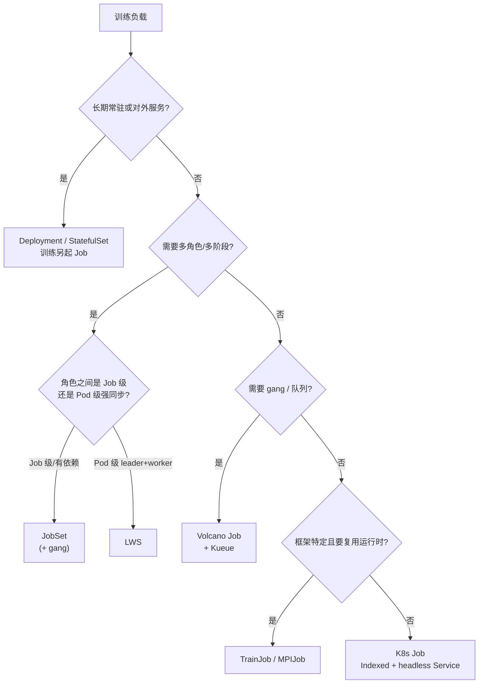

# 工作负载建模：从 Pod 到可恢复的成员组

> **结论先行**：工作负载建模不是「选一个能跑起来的 YAML」，而是把**成员关系、生命周期、失败域**写进 API。
> Kubernetes 原生只建模了「Pod 及其资源」；角色、依赖、训练就绪、作业成功条件、稳定 rank 身份，都要靠上层原语补齐。
> 选择原语时，先问「谁拥有 membership，故障时重建哪一层」，再比较功能列表。

本页把分布式训练负载拆成三类，用七个维度检查表达能力，再逐一对 Volcano Job、JobSet、LWS、Kubeflow TrainJob、
MPIJob 和 K8s 原生 Job / Workload API 做对照。代码引用均指向 2026-11-23 的快照。

> 专题导航：[总纲](./overview.md) · [工作负载建模](./workload-modeling.md) · [启动通信](../../../Machine_Learning/Distributed_Training/startup-communication.md) · [故障自愈](./failure-self-healing.md) · [Checkpoint](./checkpoint-preemption.md) · [RL](./rl-post-training.md)

## 一、先区分三类负载

| 类型 | 生命周期 | 「成功」是什么 | 成员关系 | 典型原语 | 失败处理 |
|---|---|---|---|---|---|
| **常驻服务** | 长期运行，不主动结束 | 一直可用（SLO） | 副本彼此独立，可随时替换 | Deployment、StatefulSet | 原地重启/重新调度，滚动更新 |
| **终态任务** | 跑到完成或失败 | 声明的成功条件 | 一组 Pod 共同完成一个 Job | K8s Job、Volcano Job、JobSet | 重试、重建 Job、`backoffLimit` |
| **强同步进程组** | 组内同生共死 | 所有成员完成同一段计算 | 全组必须同时在场，collective 才能前进 | LWS、Volcano gang、JobSet + gang、MPIJob | 整组重建（或按策略重建子组） |

三者不是互斥的：一个训练作业通常是**终态任务**，内部包含一个**强同步进程组**，同时可能暴露一个**常驻服务**
（TensorBoard、推理 sidecar、参数服务器）。建模时要分别说明每部分的语义，而不是用一个 `restartPolicy` 覆盖全部。

> 参数服务器（PS）是一个特殊角色：它像服务一样长期持有状态，但又是终态任务的一部分。PS 挂掉能否只重启 PS，
> 取决于 worker 是否支持重新连接；collective 训练通常没有这个能力，所以现代训练更多用 all-reduce 而非 PS。

## 二、七个建模维度

### 2.1 角色：不同模板、不同身份、不同 rank

「角色」在三个层面出现，必须对齐：

- **编排角色**：一个 Job 里有几种 Pod 模板（master/worker/ps/launcher/evaluator）。
- **框架角色**：TF 的 chief/worker/ps/evaluator；PyTorch 的 rank 0 与 worker；MPI 的 rank。
- **失败域角色**：rank 0 / leader / chief / PS 是否是单点。

| 原语 | 角色表达方式 | 能否不同镜像/资源/命令 | 是否自动注入 rank |
|---|---|---|---|
| K8s Job | 无；所有 Pod 同一模板 | ❌（Indexed 只变 index/hostname） | ❌（只有 `JOB_COMPLETION_INDEX`） |
| Volcano Job | `spec.tasks[]`，每个 Task 一个 Pod 模板 | ✅ | 插件注入（pytorch/mpi/tf） |
| JobSet | `spec.replicatedJobs[]`，每个 ReplicatedJob 一个 Job 模板 | ✅ | ❌（模板/框架自己算） |
| LWS | `leaderWorkerTemplate.leaderTemplate` + `workerTemplate` | ✅（leader/worker 可不同） | 半自动（`LWS_WORKER_INDEX`、`LWS_GROUP_SIZE`） |
| TrainJob | Runtime 里的 PodSet；`spec.trainer` 覆盖训练节点 | 部分（trainer 覆盖；其他角色在 runtime） | ✅（Torch/MPI 插件注入 `PET_*`/MPI env） |
| MPIJob | `launcher` + `worker` 两种 Replica | ✅ | ✅（MPI 运行时） |

一个常见错位：K8s 把 worker-3 当成可替换副本，但框架把它当成 chief；Pod 重建后名字变了，框架的成员表却没有更新。
LWS 和 JobSet 的稳定 DNS 就是为这类问题服务的。K8s 原生 Indexed Job 其实也提供了稳定 **hostname**
（`<job>-<index>`，见 `job_controller.go`），但 Pod 名仍带随机后缀，且必须自己建 headless Service/设置 `subdomain`
才能把它变成可解析的 DNS；它不提供 rank 0 地址注入或成员发现。

### 2.2 资源：GPU 是不可压缩资源

训练负载的资源建模有几个特殊点：

- **GPU 通常按整卡申请**：`nvidia.com/gpu: 1`，不能部分分配；MIG/HAMi 的切分是另一层能力，不能假设框架无感。
- **CPU/内存/临时盘**：数据加载、checkpoint 暂存、NCCL 共享内存都吃这些；`/dev/shm` 太小会让 PyTorch DataLoader
  或 NCCL 直接失败（容器默认 64MB，训练镜像通常要挂 `emptyDir: medium: Memory`）。
- **RDMA/IB 设备**：需要 `rdma/hca` 等扩展资源或 device plugin；NCCL 的 `NCCL_IB_HCA` 要与实际分配一致。
- **DRA**：K8s 1.34+ 的 Dynamic Resource Allocation 可以把 GPU/NIC/拓扑作为一个 claim 表达；TrainJob 2.4 已支持
  `resourceClaimsPerNode`（alpha），LWS/JobSet 也有 workload-aware scheduling 集成。
- **异构角色**：PS 可能只需要 CPU；rollout 需要推理优化镜像；launcher 只需要轻量客户端。原语若只支持一个模板，
  就只能把这些角色拆成多个 Job，再用 JobSet/Argo 串起来。

> 资源请求与 gang 的关系：gang 保证「要么一起拿到，要么都不拿」，避免 8 个 worker 抢到 7 张卡后互相等待。
> 但 gang 不保证「拿到的卡在拓扑上最优」；拓扑感知是调度器的另一层能力（Volcano network-topology-aware、
> Kueue TAS、LWS placementPolicy、DRA）。

### 2.3 依赖：启动顺序 ≠ 运行期依赖

需要区分三种依赖：

1. **启动顺序**：先起 PS 再起 worker，先拉数据再训练。对应 JobSet `dependsOn`/`StartupPolicy`、Volcano `TaskSpec.DependsOn`、
   TrainJob `Initializer`。
2. **共同调度**：所有成员必须同时被调度。对应 gang/`minAvailable`/PodGroup。
3. **运行期依赖**：worker 要能连通 chief 的端口、要能读到共享存储。对应 Service/DNS、PVC、网络策略。

很多「启动失败」其实是把三者混为一谈：Pod 被调度了（2 满足），但 chief 还没 listen（3 不满足），worker 的
`wait-for-master` init container 超时。Volcano 的 pytorch 插件甚至内建了这个 init container（默认 300s 超时），
说明「成员可达」是一个需要显式建模的依赖。

### 2.4 就绪与完成：K8s 的 `Ready` 不是训练的 `Ready`

三种就绪（详见[专题总纲](./overview.md#二三个容易混淆的就绪与完成)）：

| 就绪 | 典型信号 | 原语能否表达 |
|---|---|---|
| Pod Ready | readinessProbe / 容器启动 | 所有原语都有，但训练 Pod 常不配 probe |
| 成员就绪 | rendezvous 返回、所有 rank join | LWS `LeaderReady`、Volcano `minAvailable`、JobSet `DependsOn` 只能近似 |
| 通信就绪 | 首个 collective 成功 | 没有 K8s 信号；只能应用层 barrier/指标 |

完成语义同样分三层：

- **进程完成**：容器 exit 0。
- **作业完成**：`successPolicy` / `minSuccess` / 所有 Job 完成。
- **业务完成**：达到目标 step、eval gate 通过。

K8s Job 的 `successPolicy` 只在 Indexed Job 上可用，且是「哪些 index 成功即算成功」；Volcano 的 `minSuccess` 是
「至少多少个 Pod 成功」；JobSet 的 `successPolicy` 是「All/Any + 目标 ReplicatedJob」；LWS 没有「完成」概念
（它是服务型集合，只有 `ReadyReplicas`）。这些语义差异会直接决定「训练脚本 exit 0 但模型没训完」会不会被当成成功。

### 2.5 服务暴露：稳定身份 vs 负载均衡

训练需要的是**稳定身份**（rank 0 的地址、每个 worker 的可达 hostname），不是普通的 ClusterIP Service 负载均衡。

| 原语 | 稳定 DNS/身份 | 实现 |
|---|---|---|
| K8s Job | ⚠️ 默认没有；Indexed 有稳定 hostname | Pod 名带随机后缀，但 Indexed 的 hostname=`<job>-<index>`；仍需自建 headless Service + `subdomain` 才能解析 |
| Volcano Job | ✅ `svc` 插件 | 设置 `hostname=pod name`、`subdomain=job name`，创建 headless Service + hosts ConfigMap |
| JobSet | ✅ `spec.network.enableDNSHostnames` | `<jobSet>-<replicatedJob>-<jobIndex>-<podIndex>.<subdomain>` |
| LWS | ✅ 每个 group 一个 headless Service | `LWS_LEADER_ADDRESS`、`LWS_GROUP_SIZE`、`LWS_WORKER_INDEX` |
| TrainJob | ✅ 由 runtime/framework 插件设置 | Torch：`PET_MASTER_ADDR=<trainjob>-node-0-0.<trainjob>` |
| MPIJob | ✅ worker 的 SSH 可达地址 | launcher 生成 hostfile，worker 运行 sshd |

一个细节：JobSet 的 `publishNotReadyAddresses` 默认是 **true**，这样 worker 不必等 leader Ready 就能解析到它；
但这也意味着「DNS 可解析」不等于「进程已 listen」。Volcano 的 `publish-not-ready-addresses` 是可选参数，默认 false。

### 2.6 卷：共享、每 rank、暂存

| 卷类型 | 用途 | 注意点 |
|---|---|---|
| 共享 PVC（RWX） | 数据集、checkpoint、模型输出 | 多 rank 同时写要避免冲突；NFS 延迟会影响 checkpoint |
| 每 rank PVC（RWO） | 本地缓存、分片 checkpoint | 需要动态供应或 StatefulSet volumeClaimTemplates |
| `emptyDir` | scratch、`/dev/shm` | 节点磁盘/内存；Pod 删除即丢 |
| `hostPath`/local NVMe | 高性能 checkpoint 暂存 | 节点绑定；需要 DaemonSet 预热/清理 |
| 对象存储（S3/OSS/GCS） | 长期 checkpoint、数据集 | 通过 CSI/init container/sidecar 挂载；带宽是瓶颈 |

原语差异：Volcano 有 `spec.volumes`（PVC 模板）；JobSet 有 `volumeClaimPolicies`（自动为 Pod 加 claim）；
LWS 有 `volumeClaimTemplates`；TrainJob 的 runtime 模板里直接写 volumes。**卷的生命周期**（Job 删除后是否保留）
比「能不能挂」更常被忽略：checkpoint 卷必须是 `Retain` 或独立 PVC，否则 Job 一删 checkpoint 就没了。

### 2.7 放置：从 nodeSelector 到拓扑域

| 层次 | 手段 | 解决的问题 |
|---|---|---|
| 节点选择 | `nodeSelector`、`affinity`、`tolerations` | GPU 型号、污点、可用区 |
| 副本分布 | `topologySpreadConstraints`、podAntiAffinity | 不要把同一组打散到太多交换机 |
| 组调度 | gang / PodGroup / `minAvailable` | 避免部分成员长期 Pending |
| 拓扑感知 | Volcano network-topology-aware、Kueue TAS、LWS placementPolicy、DRA | 把通信密集的 rank 放到同一 NVLink/leaf 下 |
| 队列/配额 | Kueue ClusterQueue、Volcano queue | 多租户公平与准入 |

放置策略必须与**失败域**一起看：把 8 个 rank 放到同一台机器，吞吐最好，但一次节点故障带走整组；
放到 8 台机器，故障域小，但跨机通信更贵。LWS 的 `placementPolicy`/`subGroupPolicy` 和 Volcano 的
`networkTopology` 都是在表达这个 trade-off。

## 三、逐原语对照

### 3.1 K8s Job：最小可用，但只建模「同构 Pod 的完成」

K8s Job 的核心字段：

- `completions`/`parallelism`：要完成多少个、并发多少个。
- `completionMode: Indexed`：每个 Pod 有稳定的 `batch.kubernetes.io/job-completion-index` 和 `JOB_COMPLETION_INDEX`，
  并且控制器把 Pod **hostname** 设为 `<job>-<index>`；但 Pod **name** 仍是 `<job>-<index>-<random>`，要变成可解析 DNS
  还需要 headless Service + `subdomain`。`successPolicy` 也只对 Indexed 生效。
- `backoffLimit`（默认 6）、`backoffLimitPerIndex`、`maxFailedIndexes`：失败预算。
- `podFailurePolicy`：按 exit code/Pod condition 决定 `FailJob`/`FailIndex`/`Ignore`/`Count`；
  不能与 `restartPolicy: OnFailure` 同时使用。
- `activeDeadlineSeconds`、`ttlSecondsAfterFinished`：时间预算与清理。

**不能表达**：角色、异构模板、默认 gang、rank 0 地址注入、按 rank 的成功条件。1.36+ 的 `.spec.scheduling`
（`WorkloadWithJob` alpha，默认关闭）可以补 gang，但仍是同构模板。所以它适合「单容器/同构 worker 的批处理」，
不适合直接承载多角色训练。Indexed Job + headless Service 可以凑出「稳定 hostname + 可发现地址」，但仍要自己解决
rank 0 选举和框架成员发现。

### 3.2 Volcano Job：任务 + gang + 插件

Volcano 把 Job 建模成多个 `TaskSpec`，每个 Task 有自己的副本数、Pod 模板、`minAvailable`、`maxRetry`、`dependsOn`、
`partitionPolicy`（子组/拓扑）。Job 级字段包括 `minAvailable`（gang 的最小可用数）、`minSuccess`（最小成功数）、
`maxRetry`、`policies`（事件/退出码 → 动作）、`plugins`、`queue`、`volumes`。

> 两个「门槛」不要混淆：`minAvailable` 是**调度/运行门槛**（不够就不启动/不继续），`minSuccess` 是**完成门槛**
> （成功 Pod 数达到它就把 Job 置为 `Completed`）。后者可以允许「训练 task 成功、常驻服务 task 仍 Running」时
> 提前完成并回收服务 Pod。

```yaml
apiVersion: batch.volcano.sh/v1alpha1
kind: Job
metadata:
  name: torch-train
spec:
  minAvailable: 9          # master + 8 workers 必须同时可调度
  queue: training
  maxRetry: 3
  plugins:
    svc: ["--publish-not-ready-addresses=true"]
    pytorch: ["--master=master", "--worker=worker", "--port=23456", "--wait-master-enabled=true"]
  tasks:
    - name: master
      replicas: 1
      template:
        spec:
          containers:
            - name: trainer
              image: example/trainer:latest
              resources: { limits: { nvidia.com/gpu: 1 } }
    - name: worker
      replicas: 8
      template:
        spec:
          containers:
            - name: trainer
              image: example/trainer:latest
              resources: { limits: { nvidia.com/gpu: 1 } }
```

关键机制：

- **gang**：`gang` 插件检查 `ValidTaskNum() < MinAvailable`，不满足就拒绝整个 Job；抢占时也保证不会把 Job 打到
  `MinAvailable` 以下。它只表达「可调度」，不表达「进程已 join」。
- **svc 插件**：给 Pod 设置 `hostname`/`subdomain`，创建 headless Service 和 hosts ConfigMap，可注入每个 task 的
  主机列表环境变量。
- **pytorch 插件**：按 master/worker 计算 rank 和 world size（可按 Pod 数或 GPU 数），可选 `wait-master` init container
  （默认 300s），把「master 可达」变成一个显式启动依赖。
- **policies**：可以按事件（如 `PodFailed`）或退出码触发 `Restart`/`None`，比 K8s Job 的单一 `backoffLimit` 更细。

**不能表达**：跨 Job 的依赖/编排（那是 JobFlow/JobSet 的事）；LWS 那种「leader+worker 整组稳定身份」的内建语义；
框架无关的 rank 抽象（插件是按框架硬编码的）。

### 3.3 JobSet：一组 Job 的声明式编排

JobSet 的核心是 `replicatedJobs[]`：每个 ReplicatedJob 是一个 Job 模板 + 副本数 + `dependsOn`。它把「多个角色/多个阶段」
表达成一组 Job，而不是一组 Pod。

```yaml
apiVersion: jobset.x-k8s.io/v1alpha2
kind: JobSet
metadata:
  name: train-and-eval
spec:
  network:
    enableDNSHostnames: true
    subdomain: train
  replicatedJobs:
    - name: leader
      replicas: 1
      template:
        spec:
          completions: 1
          template:
            spec:
              containers:
                - name: trainer
                  image: example/trainer:latest
    - name: workers
      replicas: 7
      dependsOn:
        - name: leader
          status: Ready
      template:
        spec:
          completions: 1
          template:
            spec:
              containers:
                - name: trainer
                  image: example/trainer:latest
```

关键机制：

- **Network**：开启后 Pod 可用 `<jobSet>-<replicatedJob>-<jobIndex>-<podIndex>.<subdomain>` 访问；`publishNotReadyAddresses`
  默认 true。
- **Coordinator**：把某个 Pod 标记为协调者，向所有 Job/Pod 注入 `jobset.sigs.k8s.io/coordinator=<pod hostname>.<service>`。
  这解决了「rank 0 地址怎么让别人知道」的问题，但不改变框架自己的 rank 计算。
- **成功/失败条件**：`successPolicy` 支持 `All`/`Any` + 目标 ReplicatedJob；默认是 `All`。写成 `Any` 要小心：
  JobSet 一旦判定完成，控制器会删除仍在运行的子 Job——它适合「leader 成功即整体成功、worker 可以陪跑」的场景，
  不适合「所有 worker 都必须跑完」的训练。`failurePolicy` 支持按 Job 失败原因/消息模式匹配，动作有 `FailJobSet`、
  `RestartJobSet`、`RestartJob` 以及忽略 `maxRestarts` 的变体。
- **重启策略**：`Recreate`（默认）、`BlockingRecreate`（等旧 Job 全删完再建）、`InPlaceRestart`（健康 Pod 原地重启，
  失败 Job 回退到 Recreate）。
- **卷**：`volumeClaimPolicies` 可以自动为 Pod 模板加 claim，并支持保留策略。

**不能表达**：Pod 级 rank/稳定身份（它只有 Job 级副本和 Pod 主机名）；gang 需要额外的 `scheduling`（Workload-Aware
Scheduling，alpha）或外部 PodGroup；单个 ReplicatedJob 内部的强同步组重启语义不如 LWS 直接。

### 3.4 LWS：leader + worker 的稳定组

LWS 把「一个 leader + N-1 个 worker」建模成一个 group，`replicas` 个 group。它是为「组内强同步、组间可独立」
的负载设计的（张量并行、推理的多机多卡、PD 分离）。

```yaml
apiVersion: leaderworkerset.x-k8s.io/v1
kind: LeaderWorkerSet
metadata:
  name: tp-inference
spec:
  replicas: 2
  startupPolicy: LeaderReady
  leaderWorkerTemplate:
    size: 4
    restartPolicy: RecreateGroupOnPodRestart
    maxGroupRestarts: 3
    restartBackoff:
      baseSeconds: 10
      capSeconds: 300
    leaderTemplate:
      spec:
        containers:
          - name: leader
            image: example/trainer:latest
    workerTemplate:
      spec:
        containers:
          - name: worker
            image: example/trainer:latest
```

关键机制：

- **组身份**：每个 group 有独立 headless Service，leader 地址通过 `LWS_LEADER_ADDRESS` 注入，组大小通过
  `LWS_GROUP_SIZE`，成员索引通过 `LWS_WORKER_INDEX`。框架用这些变量自己算 rank/world size。
- **启动策略**：`LeaderCreated`（默认，leader 创建后立即起 worker）与 `LeaderReady`（leader Ready 后才起 worker）。
  后者把「leader 可用」变成启动依赖，但 Ready 仍不等于 rendezvous 完成。
- **重启策略**：`RecreateGroupOnPodRestart`（默认，任一 Pod/容器重启 → 整组重建）、`RecreateGroupAfterStart`
  （等所有 Pod 都启动后才整组重建，避免启动期级联）、`None`（只重启失败 Pod）。
- **失败预算**：`maxGroupRestarts` 按 group/revision 计；`restartBackoff` 做指数退避（默认 base 10s/cap 300s）；
  预算耗尽后终止组、保留 Pod 对象并置 `Degraded=True`，可用注解 `leaderworkerset.sigs.k8s.io/recover=true` 恢复。
- **子组**：`subGroupPolicy.subGroupSize` 把 group 再切成子组，适合 TP/PP 分层。
- **DisaggregatedSet**：LWS 1.0 新增的多角色集合（如 prefill/decode），把「角色 + 缩放 + 放置」提升到更高层。

**不能表达**：作业完成条件（它是服务型集合，不终止）；框架特定的 rank 语义；跨 group 的依赖（用 JobSet/上层编排）。

### 3.5 Kubeflow TrainJob：运行时 + 训练节点

TrainJob v2 把「框架运行时」抽成 `ClusterTrainingRuntime`/`TrainingRuntime`，TrainJob 只声明：

- `runtimeRef`：用哪个 runtime（torch-distributed、deepspeed、mpi、jax、xgboost…）。
- `trainer`：镜像/命令/参数/env、`numNodes`、`resourcesPerNode`、`numProcPerNode`、`resourceClaimsPerNode`。
- `initializer`：数据集/模型从 URI 拉取与预处理。
- `activeDeadlineSeconds`、`suspend`、`managedBy`。

```yaml
apiVersion: trainer.kubeflow.org/v1alpha1
kind: TrainJob
metadata:
  name: llama-sft
spec:
  runtimeRef:
    name: torch-distributed
  trainer:
    image: example/trainer:latest
    command: ["torchrun", "train.py"]
    numNodes: 4
    numProcPerNode: 8
    resourcesPerNode:
      limits:
        nvidia.com/gpu: 8
  initializer:
    model:
      storageUri: s3://models/llama-3-8b
```

关键机制：

- TrainJob 在内部生成 **JobSet**（`template` 字段就是 JobSetSpec），所以它继承了 JobSet 的网络、失败策略和调度能力。
- Torch 插件注入 `PET_NNODES`、`PET_NPROC_PER_NODE`、`PET_NODE_RANK`（来自 Job completion index）、
  `PET_MASTER_ADDR=<trainjob>-node-0-0.<trainjob>` 和端口 29500，供入口脚本传给 `torchrun`/torchtune。
- 角色建模以「同构训练节点」为主；异构角色（PS、rollout、reward）要么写进 runtime 的多个 PodSet，要么拆成多个
  TrainJob/JobSet。TrainJob 的强项是**复用运行时**，不是表达任意 DAG。

> 注意：Kubeflow Trainer v2（`trainer.kubeflow.org`）已不再提供旧版 TFJob/PyTorchJob CRD；旧 API 在
> Training Operator v1.9.x。很多「TrainJob vs PyTorchJob」的对比文章把两者混在一起，实际是两代 API。

### 3.6 MPIJob：launcher + worker 的静态组

MPIJob 用 `launcher` 跑 `mpirun`，用 `worker` 跑 sshd/MPI 进程；`slotsPerWorker` 决定每个 worker 的 slot 数，
`runLauncherAsWorker` 决定 launcher 是否也参与计算，`launcherCreationPolicy: WaitForWorkersReady` 让 launcher 等
worker Ready 后再启动，避免 `mpirun` 早早失败。

```yaml
apiVersion: kubeflow.org/v2beta1
kind: MPIJob
metadata:
  name: mpi-train
spec:
  slotsPerWorker: 8
  launcherCreationPolicy: WaitForWorkersReady
  runPolicy:
    backoffLimit: 3
    cleanPodPolicy: Running
  mpiReplicaSpecs:
    Launcher:
      replicas: 1
      template:
        spec:
          containers:
            - name: launcher
              image: example/mpi:latest
              command: ["mpirun", "-np", "16", "python", "train.py"]
    Worker:
      replicas: 2
      template:
        spec:
          containers:
            - name: worker
              image: example/mpi:latest
```

MPI 的 membership 是**静态**的：`mpirun` 启动时确定 rank 列表，进程退出后不能像 torchrun 那样重新 rendezvous。
所以 MPIJob 的恢复单元通常是整个 Job，`backoffLimit` 只控制 launcher Job 的重试；worker 的单独重启对 MPI 通信组
没有意义。**MPIJob 的成败也以 launcher 为准**：launcher Job Succeeded → MPIJob Succeeded；launcher Job Failed →
MPIJob Failed；worker 不直接决定作业成败。这也是 MPI 与 PyTorch elastic 最大的语义差异。

### 3.7 K8s 原生 Workload / PodGroup（1.37 beta，默认关闭）

Kubernetes 1.35 引入 `scheduling.k8s.io` 的 Workload/PodGroup，1.37 进入 beta（`GenericWorkload` 默认 false）。
它把 gang 从「第三方调度器插件」收进核心 API：

- `Workload` 是静态模板，最多 8 个 `PodGroupTemplate`，每个模板声明 `basic` 或 `gang` 策略；`gang.minCount` 是最小
  同时可调度数。
- `PodGroup` 是运行时实例，由控制器从模板创建，携带策略和调度状态；支持 `priorityClassName`、`disruptionMode`、
  `resourceClaims`（DRA）、拓扑约束（alpha）。
- Job 控制器可以在 `WorkloadWithJob`（1.36 alpha）下为设置了 `.spec.scheduling` 的 Job 创建 Workload/PodGroup。
- LWS/JobSet/TrainJob 也分别有 `WorkloadAwareScheduling`/`scheduling` 集成，但都在 feature gate 后面。

它仍然不是「训练工作负载原语」：Workload 只描述**调度策略模板**，不描述 Pod 模板、角色命令、成功条件或重启语义。
它的价值是把「gang + 拓扑 + 优先级 + 中断模式」变成所有控制器共享的底座，减少 Volcano/scheduler-plugins 的碎片化。
短期内，生产环境仍以 Volcano/JobSet/LWS 的成熟语义为主，但新平台应关注这条演进线。

## 四、横向对比

| 维度 | K8s Job | Volcano Job | JobSet | LWS | TrainJob | MPIJob |
|---|---|---|---|---|---|---|
| 负载单元 | 同构 Pod | 多 Task | 多 Job | leader+worker 组 | 运行时 + 节点 | launcher+worker |
| 角色/异构模板 | ❌ | ✅ Task | ✅ ReplicatedJob | ✅ leader/worker | 部分（runtime） | ✅ Launcher/Worker |
| 主副本/组 | `completions` | `tasks[].replicas` | `replicatedJobs[].replicas` | `replicas × size` | `numNodes` | worker replicas |
| 启动依赖 | 无（initContainer 自己写） | `dependsOn` | `dependsOn`/`StartupPolicy` | `startupPolicy` | Initializer + runtime | `launcherCreationPolicy` |
| gang | ❌（1.36+ alpha `.spec.scheduling`） | ✅ `minAvailable` | 需 `scheduling`/外部 | 需 `scheduling`/外部 | runtime 的 PodGroupPolicy | `schedulingPolicy` |
| 成员就绪 | Pod Ready | minAvailable + 插件 | Job Ready | LeaderReady | JobSet 条件 | Worker Ready |
| 成功条件 | `successPolicy`（Indexed） | `minSuccess` | `successPolicy` All/Any | 无（服务型） | TrainJob 条件 | launcher 成功 |
| 失败/重试 | `backoffLimit`/PodFailurePolicy | `maxRetry` + policies | `failurePolicy` + `maxRestarts` | `restartPolicy` + `maxGroupRestarts` | 继承 JobSet | `backoffLimit` |
| 稳定 DNS | 需自建（hostname 稳定） | ✅ svc 插件 | ✅ Network | ✅ 每组 headless | ✅ runtime 注入 | ✅ hostfile |
| 卷 | Pod 模板 | `spec.volumes` | `volumeClaimPolicies` | `volumeClaimTemplates` | runtime 模板 | Pod 模板 |
| 放置/拓扑 | 原生 affinity | network-topology-aware | Workload-Aware（alpha） | placementPolicy/subGroup | runtime scheduling | gang policy |
| 最适合 | 简单批处理 | 异构 + gang + 队列 | 多阶段/多角色 Job | 强同步稳定组 | 框架运行时复用 | MPI/HPC |

## 五、选择决策树



> 同一套负载可以叠加多层：Kueue 管配额 → Volcano/JobSet/LWS 管成员与恢复 → TrainJob 管框架运行时。
> 不要把「调度器」「工作负载控制器」「训练框架」混成一个选型问题。

## 六、建模检查清单

在提交 YAML 前，逐条回答：

1. **角色**：有几种 Pod 模板？它们的镜像/资源/命令/重启策略是否不同？谁是 leader/rank 0/chief？
2. **资源**：GPU 是整卡还是切分？`/dev/shm` 够不够？RDMA/IB 设备怎么声明？checkpoint 暂存盘在哪？
3. **依赖**：哪些角色必须按顺序启动？哪些只是运行期可达？有没有 wait-for-master/initContainer？
4. **就绪**：怎么判断「成员到齐」？框架的 rendezvous 超时设多少？K8s 能看到吗？
5. **完成**：成功条件是「所有 Pod exit 0」还是「达到 step/eval」？谁来判定？失败时是否会被误判成功？
6. **服务**：rank 0 地址怎么传播？DNS 是否稳定？`publishNotReadyAddresses` 要不要开？
7. **卷**：checkpoint/数据集/scratch 分别放哪？Job 删除后是否保留？
8. **放置**：拓扑约束是什么？故障域多大？队列/配额/优先级怎么设？
9. **恢复**：最小恢复单元是进程、子组、整组还是整 Job？对应哪个 API 字段？
10. **预算**：重试上限、时间上限、退避、人工介入阈值分别是什么？

## 七、证据

### Volcano

- [JobSpec：minAvailable/minSuccess/maxRetry/policies/plugins/queue](https://github.com/volcano-sh/volcano/blob/2006640ed881e632119eedb9d3fac82819402301/staging/src/volcano.sh/apis/pkg/apis/batch/v1alpha1/job.go#L55-L125)
- [TaskSpec：replicas/minAvailable/policies/maxRetry/dependsOn/partitionPolicy](https://github.com/volcano-sh/volcano/blob/2006640ed881e632119eedb9d3fac82819402301/staging/src/volcano.sh/apis/pkg/apis/batch/v1alpha1/job.go#L239-L283)
- [JobPhase 状态机](https://github.com/volcano-sh/volcano/blob/2006640ed881e632119eedb9d3fac82819402301/staging/src/volcano.sh/apis/pkg/apis/batch/v1alpha1/job.go#L307-L330)
- [gang 插件：ValidTaskNum < MinAvailable 拒绝](https://github.com/volcano-sh/volcano/blob/2006640ed881e632119eedb9d3fac82819402301/pkg/scheduler/plugins/gang/gang.go#L60-L85)
- [svc 插件：hostname/subdomain/headless Service/hosts ConfigMap](https://github.com/volcano-sh/volcano/blob/2006640ed881e632119eedb9d3fac82819402301/pkg/controllers/job/plugins/svc/svc.go#L75-L155)
- [pytorch 插件：rank/world size/wait-for-master](https://github.com/volcano-sh/volcano/blob/2006640ed881e632119eedb9d3fac82819402301/pkg/controllers/job/plugins/distributed-framework/pytorch/pytorch.go#L100-L200)

### JobSet

- [JobSetSpec：replicatedJobs/network/success/failure/coordinator/volumeClaimPolicies](https://github.com/kubernetes-sigs/jobset/blob/32c9ea3144095df1fbc778433505c35a53e5acfe/api/jobset/v1alpha2/jobset_types.go#L123-L230)
- [Network：DNS 格式与 publishNotReadyAddresses](https://github.com/kubernetes-sigs/jobset/blob/32c9ea3144095df1fbc778433505c35a53e5acfe/api/jobset/v1alpha2/jobset_types.go#L428-L450)
- [FailurePolicy：动作与 maxRestarts](https://github.com/kubernetes-sigs/jobset/blob/32c9ea3144095df1fbc778433505c35a53e5acfe/api/jobset/v1alpha2/jobset_types.go#L460-L570)
- [SuccessPolicy：All/Any + target](https://github.com/kubernetes-sigs/jobset/blob/32c9ea3144095df1fbc778433505c35a53e5acfe/api/jobset/v1alpha2/jobset_types.go#L573-L606)
- [Failure Policy 文档（含 host maintenance 例子）](https://github.com/kubernetes-sigs/jobset/blob/32c9ea3144095df1fbc778433505c35a53e5acfe/site/content/en/docs/tasks/failure_policy.md)

### LWS

- [LeaderWorkerSetSpec：replicas/template/startupPolicy/placementPolicy](https://github.com/kubernetes-sigs/lws/blob/51d7d5ad84f7badeee1466e4a7b846cacfdbc961/api/leaderworkerset/v1/leaderworkerset_types.go#L205-L260)
- [LeaderWorkerTemplate：size/restartPolicy/maxGroupRestarts/restartBackoff/subGroup/volumes](https://github.com/kubernetes-sigs/lws/blob/51d7d5ad84f7badeee1466e4a7b846cacfdbc961/api/leaderworkerset/v1/leaderworkerset_types.go#L428-L500)
- [RestartPolicy 常量](https://github.com/kubernetes-sigs/lws/blob/51d7d5ad84f7badeee1466e4a7b846cacfdbc961/api/leaderworkerset/v1/leaderworkerset_types.go#L719-L757)
- [Failure Handling 文档](https://github.com/kubernetes-sigs/lws/blob/51d7d5ad84f7badeee1466e4a7b846cacfdbc961/site/content/en/docs/concepts/leaderworkerset/failure-handling/_index.md)

### Kubeflow Trainer / MPIJob

- [TrainJobSpec：runtimeRef/trainer/initializer/activeDeadline](https://github.com/kubeflow/trainer/blob/ae27d3faf401f627af88d451cab7092458083420/pkg/apis/trainer/v1alpha1/trainjob_types.go#L102-L150)
- [Trainer：numNodes/resourcesPerNode/numProcPerNode](https://github.com/kubeflow/trainer/blob/ae27d3faf401f627af88d451cab7092458083420/pkg/apis/trainer/v1alpha1/trainjob_types.go#L247-L307)
- [Torch 插件：PET_* 环境注入](https://github.com/kubeflow/trainer/blob/ae27d3faf401f627af88d451cab7092458083420/pkg/runtime/framework/plugins/torch/torch.go#L150-L245)
- [torch-distributed runtime](https://github.com/kubeflow/trainer/blob/ae27d3faf401f627af88d451cab7092458083420/manifests/base/runtimes/torch_distributed.yaml)
- [MPIJobSpec：slotsPerWorker/launcherCreationPolicy](https://github.com/kubeflow/mpi-operator/blob/a057ca529cb7c3b831207d8bbd37f18136057e0f/pkg/apis/kubeflow/v2beta1/types.go#L168-L200)
- [MPIJob 以 launcher Job 的成败为准](https://github.com/kubeflow/mpi-operator/blob/a057ca529cb7c3b831207d8bbd37f18136057e0f/pkg/controller/mpi_job_controller.go#L1121-L1130)

### Kubernetes

- [JobSpec：completions/parallelism/successPolicy/podFailurePolicy/backoffLimit](https://github.com/kubernetes/kubernetes/blob/c50e5395f1ae2d4a2c05f28fdcc38c0916cc1a32/pkg/apis/batch/types.go#L307-L380)
- [Indexed Job 的 completion index 与 hostname 语义](https://github.com/kubernetes/kubernetes/blob/c50e5395f1ae2d4a2c05f28fdcc38c0916cc1a32/staging/src/k8s.io/api/batch/v1/types.go#L420-L442)
- [Indexed Job 设置 Pod hostname=`<job>-<index>`](https://github.com/kubernetes/kubernetes/blob/c50e5395f1ae2d4a2c05f28fdcc38c0916cc1a32/pkg/controller/job/job_controller.go#L1912-L1922)
- [K8s Job 的 alpha gang：`.spec.scheduling` 与 `WorkloadWithJob`](https://github.com/kubernetes/kubernetes/blob/c50e5395f1ae2d4a2c05f28fdcc38c0916cc1a32/pkg/features/kube_features.go#L2308-L2310)
- [Workload API v1beta1 类型](https://github.com/kubernetes/kubernetes/blob/c50e5395f1ae2d4a2c05f28fdcc38c0916cc1a32/staging/src/k8s.io/api/scheduling/v1beta1/types.go#L93-L230)
- [PodGroup v1beta1 类型](https://github.com/kubernetes/kubernetes/blob/c50e5395f1ae2d4a2c05f28fdcc38c0916cc1a32/staging/src/k8s.io/api/scheduling/v1beta1/types.go#L567-L660)
- [GenericWorkload feature gate（1.37 beta，默认 false）](https://github.com/kubernetes/kubernetes/blob/c50e5395f1ae2d4a2c05f28fdcc38c0916cc1a32/pkg/features/kube_features.go#L1622-L1625)
- [Workload API 官方文档](https://kubernetes.io/docs/concepts/workloads/workload-api/)
- [PodGroup 调度策略](https://kubernetes.io/docs/concepts/workloads/workload-api/policies/)

## 相关页面

- [专题总纲](./overview.md)
- [训练启动与通信](../../../Machine_Learning/Distributed_Training/startup-communication.md)
- [训练失败与自愈](./failure-self-healing.md)
- [Checkpoint 与抢占恢复](./checkpoint-preemption.md)
- [RL 后训练与业务接入](./rl-post-training.md)
- [Kueue：作业队列与配额](../../Kubernetes/Scheduling/kueue.md)
- [Slurm](../../../Machine_Learning/High_Performance_Computing/slurm.md)
