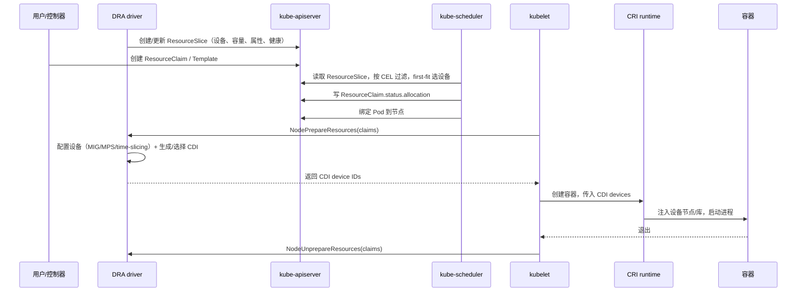

# GPU 软件栈与接入链路

> **结论先行**：一张 GPU 从「插在 PCIe 槽上」到「容器里的 CUDA 进程能用」，要穿过
> **内核驱动 → 设备节点 → NVML → 编排层（device plugin / DRA）→ kubelet → CRI runtime →
> CDI/OCI hook → 容器 cgroup**。任何一层断了，表现都可能是「Pod Running 但看不到卡」。
>
> DRA 并没有取代这条链路，它改变的是**「谁来决定分配、谁来描述设备、谁来准备节点」**：
> device plugin 用整数 extended resource + kubelet checkpoint；DRA 用 ResourceSlice +
> ResourceClaim + 调度器结构化分配 + 节点侧 `NodePrepareResources` + CDI。
> 无论哪种，**「已上报」「已分配」「已注入」「真可用」仍然是四个独立状态**。

## 一、全链路

```mermaid
flowchart LR
    PCI["PCIe 设备<br/>lspci / sysfs"] --> KMD["NVIDIA 内核模块<br/>nvidia / nvidia_uvm / nvidia_modeset"]
    KMD --> DEV["设备节点<br/>/dev/nvidia* /dev/nvidia-caps"]
    DEV --> NVML["用户态驱动 + NVML<br/>libnvidia-ml.so.1"]
    NVML --> DISC["设备发现<br/>device plugin ListAndWatch / DRA ResourceSlice"]
    DISC --> SCHED["调度<br/>extended resource / ResourceClaim"]
    SCHED --> KUBELET["kubelet<br/>device manager / DRA manager"]
    KUBELET --> PREP["准备<br/>Allocate / NodePrepareResources"]
    PREP --> RUNTIME["CRI runtime<br/>containerd / CRI-O"]
    RUNTIME --> INJECT["注入<br/>NVIDIA runtime hook 或 CDI"]
    INJECT --> CGROUP["device cgroup + 容器进程"]
    CGROUP --> APP["CUDA 应用<br/>nvidia-smi / cuInit / NCCL"]
```



每一层都有独立的「健康」和「版本」：

| 层 | 关键版本 | 失配的典型后果 |
|---|---|---|
| 内核模块 | `nvidia.ko` 版本 | 与用户态 NVML 不匹配：`Failed to initialize NVML: Driver/library version mismatch` |
| 用户态驱动/NVML | `libnvidia-ml.so.1` | `nvidia-smi` 失败；device plugin 起不来 |
| CUDA runtime | 容器内 `libcudart` | `CUDA driver version is insufficient for CUDA runtime version` |
| container toolkit | `nvidia-container-toolkit` / `libnvidia-container` | 注入失败、CDI spec 过期、`nvidia-container-cli` 报错 |
| CRI runtime | containerd/CRI-O | CDI 未启用、RuntimeClass 配错、device cgroup 拒绝 |
| 编排层 | kubelet/device plugin/DRA driver | 资源上报为 0、Allocate 失败、claim 不分配 |

## 二、GPU 在 Linux 里的表示

### 2.1 PCIe 设备与 BDF

GPU 首先是一个 PCIe 设备。常用枚举：

```bash
lspci -Dnn | grep -i -E 'nvidia|3d controller|vga'
# 0000:3b:00.0 3D controller [0302]: NVIDIA Corporation H100 PCIe [10de:2331] (rev a1)
lspci -tv | grep -i nvidia
ls -l /sys/bus/pci/devices/0000:3b:00.0/
cat /sys/bus/pci/devices/0000:3b:00.0/numa_node
```

- `10de` 是 NVIDIA 的 PCI vendor ID；
- class `0300` 是 VGA，`0302` 是 3D controller（很多 datacenter GPU 是后者）；
- BDF（`domain:bus:device.function`）是和 `nvidia-smi` 的 PCI Bus ID、DCGM、dmesg 关联的关键；
- `numa_node` 是 GPU 的 NUMA 亲和，`-1` 表示没有亲和信息。

> **BDF 是跨工具关联的主键**。GPU UUID 在驱动/NVML 层更常用；BDF 在内核/PCIe/DCGM/NIC
> 拓扑层更常用。排障时两个都要抓。

### 2.2 内核模块与设备节点

NVIDIA 驱动加载后通常有：

| 模块/节点 | 作用 | 缺失/异常的表现 |
|---|---|---|
| `nvidia` | 核心 GPU 驱动 | 没有 `/dev/nvidiactl`、`/dev/nvidia0`；`nvidia-smi` 失败 |
| `nvidia_uvm` | Unified Virtual Memory | CUDA 进程创建 context 失败；`/dev/nvidia-uvm` 缺失 |
| `nvidia_modeset` / `nvidia_drm` | 显示/DRM（部分场景） | 图形/EGL 相关失败；计算通常不依赖 |
| `/dev/nvidiactl` | 控制设备 | 容器内无法初始化驱动 |
| `/dev/nvidia0…N` | 每张 GPU 的字符设备 | 容器内看不到对应卡 |
| `/dev/nvidia-uvm`、`/dev/nvidia-uvm-tools` | UVM | CUDA context/UVM 失败 |
| `/dev/nvidia-caps/` | MIG capability 设备 | MIG 实例可见但无法使用 |
| `/proc/driver/nvidia/version` | 内核模块版本 | 与用户态版本对比 |
| `/proc/driver/nvidia/gpus/<BDF>/information` | GPU 信息 | 确认驱动认到卡 |

```bash
lsmod | grep nvidia
cat /proc/driver/nvidia/version
nvidia-smi -q | head -40
nvidia-smi -L
```

`nvidia-smi -L` 会列出 GPU 的 UUID 和 MIG 实例；`nvidia-smi -q` 里的 `Driver Version`、
`CUDA Version`、`GPU UUID`、`PCI Bus ID` 是排障四件套。

### 2.3 NVML 与 CUDA 的版本关系

- **NVML**（`libnvidia-ml.so.1`）是管理/监控接口，`nvidia-smi`、DCGM、device plugin 都用它；
- **CUDA Driver API**（`libcuda.so.1`）是计算接口；
- **CUDA Runtime**（容器内的 `libcudart.so`）构建在 Driver API 上。

版本兼容的粗略规则：

- CUDA runtime 需要 **至少**某个版本的 driver（minor version compatibility 允许一定范围内的低版本 driver）；
- driver 通常向后兼容旧 CUDA runtime，但不保证所有新特性；
- 容器镜像里的 CUDA compat 包可以在较旧 driver 上提供部分新 runtime 支持，但**不能替代驱动升级**；
- 驱动升级后，**用户态 NVML 与内核模块必须一起更新**，否则就是经典的
  `Driver/library version mismatch`。

> 容器里 `nvidia-smi` 报 `Driver/library version mismatch`，通常不是容器问题，而是宿主机
> 内核模块和用户态库版本不一致（常见于 apt/yum 升级后没重启或没 reload 模块）。这时重启
> device plugin 也没用，必须修宿主机驱动。

## 三、容器 runtime：两种注入方式

### 3.1 方式 A：NVIDIA runtime hook（传统路径）

`nvidia-container-runtime` 是一个 runc 的包装器：它在 OCI prestart 阶段调用
`nvidia-container-runtime-hook`，后者再调用 `nvidia-container-cli`，根据环境变量
（`NVIDIA_VISIBLE_DEVICES`、`NVIDIA_DRIVER_CAPABILITIES` 等）修改 OCI spec：

- 挂载 `/dev/nvidia*` 设备节点；
- 挂载 driver 库（`libcuda`、`libnvidia-ml` 等）；
- 设置 `LD_LIBRARY_PATH`；
- 可能的 hooks（`update-ldcache`、`create-symlinks`、`chmod` 等）。

containerd 配置大致是：

```toml
# containerd 2.x（2.4 的配置版本为 3）
version = 3
[plugins.'io.containerd.cri.v1.runtime'.containerd.runtimes.nvidia]
  runtime_type = "io.containerd.runc.v2"
  [plugins.'io.containerd.cri.v1.runtime'.containerd.runtimes.nvidia.options]
    BinaryName = "/usr/bin/nvidia-container-runtime"
```

containerd 2.x 的配置版本是 3，插件路径是 `io.containerd.cri.v1.runtime`；1.x 的
`io.containerd.grpc.v1.cri` 在 2.4 中不会注册 runtime。见
[containerd CRI 配置](https://github.com/containerd/containerd/blob/b7a25261e029d68978bbf290df0a62fc819b3c51/docs/cri/config.md#L30-L45)。

然后 Pod 指定：

```yaml
spec:
  runtimeClassName: nvidia
  containers:
  - name: cuda
    image: nvidia/cuda:12.4.0-base-ubuntu22.04
    resources:
      limits:
        nvidia.com/gpu: 1
```

**常见坑**：只设了 `NVIDIA_VISIBLE_DEVICES` 环境变量，但 Pod 没有走 `nvidia` RuntimeClass，
runtime 仍是默认 runc。环境变量在容器里可见，但没有任何 hook 去挂设备节点，于是
`nvidia-smi` 报 `No devices were found` / `CUDA_ERROR_NO_DEVICE`。

### 3.2 方式 B：CDI（Container Device Interface）

CDI 把「设备需要哪些节点、库、hook」写成一个 YAML spec，由 runtime 在创建容器时解析。
NVIDIA 的 spec 由 `nvidia-ctk cdi generate` 生成：

```bash
sudo nvidia-ctk cdi generate --output=/etc/cdi/nvidia.yaml
```

生成的 device 名称包括：

- `nvidia.com/gpu=gpu0`、`nvidia.com/gpu=gpu1` …（整卡，按 index）；
- `nvidia.com/gpu=mig<GPU_INDEX>:<MIG_INDEX>`（MIG 实例）；
- `nvidia.com/gpu=all`（所有设备）。

Pod 里可以显式请求：

```yaml
resources:
  limits:
    nvidia.com/gpu: 1
```

device plugin 在 `Allocate` 时返回 fully-qualified CDI device name（`cdi-cri` 策略）或
CDI annotation（`cdi-annotations` 策略），kubelet 把它交给 CRI runtime。containerd 2.x 默认启用
CDI，2.4 起 `enable_cdi` 选项被移除、始终启用；spec 目录默认 `/etc/cdi`、`/var/run/cdi`。见
[containerd RELEASES](https://github.com/containerd/containerd/blob/b7a25261e029d68978bbf290df0a62fc819b3c51/RELEASES.md#L641)
和 [containerd CRI 配置](https://github.com/containerd/containerd/blob/b7a25261e029d68978bbf290df0a62fc819b3c51/docs/cri/config.md#L448-L451)。

CDI 的好处：

- 不再要求 NVIDIA runtime 作为默认 runtime，只要 runtime 支持 CDI；
- 设备注入的「内容」和「选择」解耦，便于审计和复现；
- 解决容器更新后丢失设备（`NVML: Unknown error`）这类问题。

**CDI 的坑**：

- spec 是**生成物**。驱动升级后，旧 spec 里的库路径/版本可能过期，必须重新生成；
  GPU Operator 会自动做，手工安装的不会。
- runtime 必须启用 CDI；老版本 containerd 需要显式 `enable_cdi = true`。
- CDI 只负责「注入什么」，不负责「设备是否健康」「MIG 配置是否匹配」。

### 3.3 `NVIDIA_VISIBLE_DEVICES` 与 capabilities

| 值 | 含义 |
|---|---|
| 未设置 / 空 | 传统镜像默认 `all`；非传统镜像可能不注入 |
| `all` | 注入所有 GPU |
| `none` | 注入空集合（不报错） |
| `void` | 特殊值：跳过设备注入，通常用于「这个容器不需要 GPU」的 sidecar/validator |
| `GPU-<uuid>` / index | 注入指定 GPU |
| `MIG-GPU-<uuid>/<gi>/<ci>` | 注入指定 MIG 实例 |

`NVIDIA_DRIVER_CAPABILITIES` 控制注入哪些驱动库，默认 `utility,compute`：

- `utility`：`nvidia-smi`、NVML；
- `compute`：`libcuda`、CUDA；
- `video`、`graphics`、`display`、`compat32`、`ngx`：按需。

如果镜像里覆盖成 `utility` 而漏了 `compute`，会出现「`nvidia-smi` 能跑，但 CUDA 初始化失败」。
源码定义见
[`capabilities.go`](https://github.com/NVIDIA/nvidia-container-toolkit/blob/adbd28c39b60f8eb7e03115b5ac61e58703f0ce7/internal/config/image/capabilities.go#L30-L48)。

### 3.4 device cgroup：最后一厘米

即使 CDI/hook 把 `/dev/nvidia0` 挂进容器，**device cgroup 仍可能拒绝访问**。runc 会根据
OCI spec 的 `linux.resources.devices` 允许/拒绝设备；如果设备节点存在但 cgroup 规则不允许，
`open("/dev/nvidia0")` 会得到 `Operation not permitted`。

排查：

```bash
crictl inspect <container-id> | jq '.info.runtimeSpec.linux.resources.devices'
crictl inspect <container-id> | jq '.info.runtimeSpec.mounts[] | select(.destination|test("nvidia"))'
kubectl exec <pod> -- ls -l /dev/nvidia*
kubectl exec <pod> -- nvidia-smi -L
```

这类问题的典型特征是：`ls` 能看到设备节点，但一打开就失败；或者 `nvidia-smi` 报
`Failed to initialize NVML: Insufficient Permissions`。

## 四、device plugin：整数资源的经典路径

### 4.1 注册与上报

device plugin 是一个 DaemonSet，通过 Unix socket 向 kubelet 注册：

- kubelet 注册 socket：`/var/lib/kubelet/device-plugins/kubelet.sock`（路径硬编码）；
- 插件自己监听：`/var/lib/kubelet/device-plugins/nvidia-<resource>.sock`；
- `RegisterRequest` 包含 version、endpoint、resource name、options。

注册成功后：

- `ListAndWatch` 持续推送设备列表（ID、health、TopologyInfo）；
- kubelet 把 resource name 作为 **extended resource** 放进 Node 的 capacity/allocatable；
- 调度器只看到整数数量，不做设备级选择。

协议定义见
[`api.proto`](https://github.com/kubernetes/kubernetes/blob/c50e5395f1ae2d4a2c05f28fdcc38c0916cc1a32/staging/src/k8s.io/kubelet/pkg/apis/deviceplugin/v1beta1/api.proto#L20-L110)。

### 4.2 Allocate：真正把设备交给容器

`Allocate` 在容器创建时被调用，插件返回：

- 环境变量（如 `NVIDIA_VISIBLE_DEVICES`）；
- mounts；
- annotations；
- device specs；
- fully-qualified CDI device names。

kubelet 把这些合入 CRI 的 `ContainerConfig`。源码见
[`allocateContainerResources`](https://github.com/kubernetes/kubernetes/blob/c50e5395f1ae2d4a2c05f28fdcc38c0916cc1a32/pkg/kubelet/cm/devicemanager/manager.go#L861-L955)。

### 4.3 checkpoint：分配账本

kubelet 把「哪个 Pod 的哪个容器用了哪些 device ID」写进：

```text
/var/lib/kubelet/device-plugins/kubelet_internal_checkpoint
```

结构包含 `PodUID`、`ContainerName`、`ResourceName`、`DeviceIDs`（按 NUMA 分组）、`AllocResp`。
见
[`checkpoint.go`](https://github.com/kubernetes/kubernetes/blob/c50e5395f1ae2d4a2c05f28fdcc38c0916cc1a32/pkg/kubelet/cm/devicemanager/checkpoint/checkpoint.go#L35-L55)。

这个文件是排障「kubelet 到底把哪张卡分给了哪个容器」的第一手证据（注意：device plugin 路径下，设备是 kubelet 的 device manager 选的，不是 kube-scheduler 选的）：

```bash
sudo cat /var/lib/kubelet/device-plugins/kubelet_internal_checkpoint | jq .
```

### 4.4 健康：只降 allocatable，不迁移 Pod

device plugin 的 `ListAndWatch` 可以推送 `Unhealthy`。kubelet 的处理：

- 从 **allocatable** 中扣除该设备；
- **capacity 不变**；
- 已经分配到该设备的 Pod **不会被迁移**，继续留在故障卡上；
- 新 Pod 不会再调度到该设备。

文档与源码：

- [Device plugin and unhealthy devices](https://kubernetes.io/docs/concepts/extend-kubernetes/compute-storage-net/device-plugins/#device-plugin-and-unhealthy-devices)
- [`manager.go` 的 `GetCapacity`](https://github.com/kubernetes/kubernetes/blob/c50e5395f1ae2d4a2c05f28fdcc38c0916cc1a32/pkg/kubelet/cm/devicemanager/manager.go#L472-L510)

NVIDIA device plugin 还有一个实现细节：健康事件是**单向**的。源码里明确写着
`FIXME: there is no way to recover from the Unhealthy state`——设备一旦被标记 unhealthy，
插件进程不重启就不会重新变 healthy。见
[`server.go`](https://github.com/NVIDIA/k8s-device-plugin/blob/17ab9a55d400ecc8d5a6c781a35f2744907fdd60/internal/plugin/server.go#L266-L281)。

> 这意味着「卡恢复了」不等于「Kubernetes 会重新用它」。很多「节点上明明有卡，但 allocatable 一直是 0
> （capacity 仍是卡数）」的场景，需要重启 device plugin（或 GPU Operator 对应组件）才会重新上报。

### 4.5 TopologyInfo：只有 NUMA

device plugin 的 `Device.TopologyInfo` 只有 `NUMANode.ID`。kubelet 用它给 Topology Manager
生成 hint，但**没有 NVLink/PCIe 距离**。所以 device plugin 路径下，Topology Manager 只能做
NUMA 对齐，不能做「优先选同一 NVLink 域」的放置。

源码见
[`topology_hints.go`](https://github.com/kubernetes/kubernetes/blob/c50e5395f1ae2d4a2c05f28fdcc38c0916cc1a32/pkg/kubelet/cm/devicemanager/topology_hints.go#L30-L90)。

### 4.6 节点标签与发现：NFD / GFD / GPU Operator

设备发现不只有 device plugin 的 `ListAndWatch`，还有节点标签这条线：

- **NFD**（Node Feature Discovery）从 sysfs 读取 PCI 信息，默认按 `class` + `vendor` 生成标签，
  例如 `feature.node.kubernetes.io/pci-0302_10de.present=true`（NVIDIA 3D controller）；
  配置 `deviceLabelFields` 可加入 `device`，变成
  `feature.node.kubernetes.io/pci-0302_10de_2331.present=true`。见
  [NFD worker 配置](https://github.com/kubernetes-sigs/node-feature-discovery/blob/848df700cb6438122b0ede644b4ca6bf2ac4234f/docs/reference/worker-configuration-reference.md#L450-L480)。
- **GFD**（GPU Feature Discovery）在 device plugin 仓库里，补充 GPU 语义标签：
  `nvidia.com/gpu.product`、`nvidia.com/gpu.memory`、`nvidia.com/gpu.present`、
  `nvidia.com/mig.capable`、`nvidia.com/mig.strategy`、`nvidia.com/cuda.driver-version.full` 等。
  完整列表见 [GFD 标签说明](https://github.com/NVIDIA/k8s-device-plugin/blob/17ab9a55d400ecc8d5a6c781a35f2744907fdd60/docs/gpu-feature-discovery/README.md#L200-L235)。
- **GPU Operator** 用 `nvidia.com/gpu.deploy.*` 标签决定在哪些节点部署 driver/toolkit/device plugin/
  DCGM/validator 等组件；这些标签是**组件编排标签**，不是资源分配结果。组件清单见
  [`ClusterPolicySpec`](https://github.com/NVIDIA/gpu-operator/blob/dd9e4347feefa8e46622c78b8bd799820710bf10/api/nvidia/v1/clusterpolicy_types.go#L42-L100)。

节点标签适合做「节点池/机型选择」，不适合做「设备级分配」：标签是节点级的，无法表达
「这张卡是 MIG 1g.5gb、那张是整卡」。设备级选择仍然要靠 device plugin 资源名或 DRA 属性。

## 五、DRA：把「设备描述」和「设备分配」变成 API 对象

### 5.1 四个核心对象

| 对象 | 作用 | 谁创建 |
|---|---|---|
| **DeviceClass** | 设备类别 + 可选配置 schema（如 `gpu.nvidia.com`） | 驱动或管理员 |
| **ResourceSlice** | 驱动发布的一批设备：pool、node、attributes、capacity、taints | DRA driver |
| **ResourceClaim** | 工作负载的一次设备请求；调度后写入 `status.allocation` | 用户/控制器 |
| **ResourceClaimTemplate** | 为每个 Pod 生成 ResourceClaim 的模板 | 用户 |

Kubernetes 1.34 DRA GA，1.35 锁定 feature gate；1.37 的 DRA 还包含 DeviceTaintRules、
partitionable devices 等。见
[Dynamic Resource Allocation](https://kubernetes.io/docs/concepts/resource-management/dynamic-resource-allocation/)。

### 5.2 一次 DRA 分配的全流程



关键点：

- **调度器做分配**（structured parameters），不是驱动做分配；驱动只发布设备和配置。
- **驱动做节点准备**：`NodePrepareResources` 可以创建 MIG 实例、启动 MPS daemon、设置
  time-slicing、生成 CDI spec。
- **kubelet 把 CDI device IDs 传给 runtime**；runtime 负责实际注入。
- 驱动可以在 `ResourceSlice.spec.skipNodeOperations` 里声明跳过 `NodePrepareResources` /
  `NodeUnprepareResources`（1.37 中该字段是 alpha，`DRAOptionalNodeOperations` 默认关闭，
  且依赖 `NodeDeclaredFeatures`）；`SkipNodeOperationNodePrepareResources` 只是对应的内部常量。
  不需要节点侧准备的设备可以跳过 gRPC，但不代表设备不需要 CDI/驱动配置。

Kubernetes 文档把驱动职责写得很清楚：创建/更新 ResourceSlice、按 claim 配置设备并通过 CDI
挂载、可选地创建 DeviceClass。见
[How DRA Works](https://kubernetes.io/docs/concepts/resource-management/dynamic-resource-allocation/how-dra-works/)。

### 5.3 DRA 设备侧到底负责什么

| 职责 | 具体内容 | 不负责 |
|---|---|---|
| **描述** | ResourceSlice 的 pool/node、attributes（UUID、型号、PCI BDF、MIG profile、驱动版本）、capacity（memory、SM、copy engine…） | 不负责调度决策 |
| **配置** | 按 claim 的 `config`（如 NVIDIA `GpuConfig`）设置 MPS/time-slicing/MIG | 不负责安装驱动/toolkit |
| **准备** | `NodePrepareResources` 创建实例、生成 CDI、返回 device IDs | 不负责容器内应用能否初始化 CUDA |
| **健康** | 更新 ResourceSlice（移除/taint）、实现 `DRAResourceHealth` | 不负责自动修复硬件 |
| **清理** | `NodeUnprepareResources` 释放实例/daemon | 不负责 Pod 重启策略 |

### 5.4 NVIDIA DRA Driver 的现状

截至 `v25.12.0`：

- **ComputeDomain**（MNNVL/IMEX）是正式支持的；
- **GPU allocation** 还是实验性，Helm 默认**不启用** GPU kubelet plugin；
- GPU 设备属性包括 `type`、`uuid`、`productName`、`brand`、`architecture`、
  `cudaComputeCapability`、`driverVersion`、`cudaDriverVersion`、`pciBusID`；
- MIG 设备额外有 `parentUUID`、`profile`、`multiprocessors`、`copyEngines`、`memory` 等 capacity；
- 支持 per-claim 的 `GpuConfig`：`TimeSlicing` / `MPS`，MPS 可设
  `defaultActiveThreadPercentage`、`defaultPinnedDeviceMemoryLimit`；
- **没有 NVLink 拓扑属性**，也没有 `numa` 属性（整卡），所以 DRA 目前不能直接表达
  「优先同一 NVLink 域」；需要靠 `pciBusID`、自定义 DeviceClass/驱动扩展或上层调度器。

证据：

- [README](https://github.com/NVIDIA/k8s-dra-driver-gpu/blob/0882da8720c28763137e0987778ec476ec4cf8df/README.md)
- [GPU device 属性](https://github.com/NVIDIA/k8s-dra-driver-gpu/blob/0882da8720c28763137e0987778ec476ec4cf8df/cmd/gpu-kubelet-plugin/partitions.go#L35-L66)
- [MIG device 属性/容量](https://github.com/NVIDIA/k8s-dra-driver-gpu/blob/0882da8720c28763137e0987778ec476ec4cf8df/cmd/gpu-kubelet-plugin/deviceinfo.go#L174-L260)
- [GpuConfig](https://github.com/NVIDIA/k8s-dra-driver-gpu/blob/0882da8720c28763137e0987778ec476ec4cf8df/api/nvidia.com/resource/v1beta1/gpuconfig.go#L28-L70)
- [MpsConfig](https://github.com/NVIDIA/k8s-dra-driver-gpu/blob/0882da8720c28763137e0987778ec476ec4cf8df/api/nvidia.com/resource/v1beta1/sharing.go#L62-L89)

### 5.5 DRA 的健康与设备 taint

DRA driver 可以在 ResourceSlice 里给设备加 taint；管理员也可以用 `DeviceTaintRule` 直接给
匹配的设备加 taint，不需要驱动配合：

- `NoSchedule`：阻止新 Pod 调度到该设备；
- `NoExecute`：还会驱逐已经使用该设备的 Pod（由 kube-controller-manager 的 device taint
  eviction controller 删除 Pod）；
- `None`：仅信息。

Device taints 在 1.37 GA。见
[Device Taints and Tolerations](https://kubernetes.io/docs/concepts/resource-management/dynamic-resource-allocation/device-taints/)。

NVIDIA DRA driver 当前的实现是：检测到 unhealthy 后，**从 ResourceSlice 中移除该设备**，
而不是加 taint；注释里明确说「没有修复循环，驱动需要重启才能重新发布」。见
[`driver.go`](https://github.com/NVIDIA/k8s-dra-driver-gpu/blob/0882da8720c28763137e0987778ec476ec4cf8df/cmd/gpu-kubelet-plugin/driver.go#L430-L500)。
这比 device plugin 的「标记 unhealthy」更彻底（新 Pod 看不到设备），但同样不会自动恢复。

### 5.6 DRA 的边界

- **不安装驱动/toolkit**：那是 GPU Operator 或节点镜像的职责。
- **不做抢占**：Kubernetes 文档明确写「scheduler doesn't support preemption for DRA resources」；
  高优先级 Pod 只能等设备释放。要回收，用 Kueue 等上层机制。
- **不保证隔离**：DRA 分配的是设备；time-slicing/MPS/MIG 的隔离语义由设备配置决定。
- **不是所有资源都能表达**：NVLink 域、NUMA 距离、NIC 亲和需要驱动把它建模成属性，
  否则调度器看不见。

## 六、四段状态的观测手册

### 6.1 reported（已上报）

```bash
kubectl get node <node> -o json | jq '.status.capacity, .status.allocatable'
kubectl describe node <node> | grep -A20 'Allocatable'
kubectl get resourceslices -o wide
kubectl get resourceslice <name> -o yaml
kubectl get node <node> --show-labels | tr ',' '\n' | grep nvidia
```

- device plugin：capacity/allocatable 里出现 `nvidia.com/gpu: 8`；
- DRA：`ResourceSlice` 里出现设备；Node capacity 里**不一定**有 `nvidia.com/gpu`
  （DRA 资源不走 extended resource，除非启用 DRAExtendedResource 兼容）；
- GPU Operator：节点有 `nvidia.com/gpu.present=true`、`nvidia.com/gpu.product=...`。

### 6.2 allocated（已分配）

```bash
# device plugin
sudo cat /var/lib/kubelet/device-plugins/kubelet_internal_checkpoint | jq .
kubectl get pod <pod> -o jsonpath='{.spec.nodeName}{"\n"}'

# DRA
kubectl get resourceclaim <claim> -o yaml | yq '.status.allocation'
kubectl get pod <pod> -o yaml | yq '.spec.resourceClaims'
```

- device plugin：checkpoint 里有 Pod UID、容器名、device IDs；
- DRA：`status.allocation.devices.results[]` 有 driver/pool/device/request；
- 如果 Pod `Pending`，看 scheduler events 和 ResourceClaim 是否 `Unallocated`。

### 6.3 prepared（已准备/可见）

```bash
kubectl exec <pod> -- nvidia-smi -L
kubectl exec <pod> -- ls -l /dev/nvidia* /dev/nvidia-caps 2>/dev/null
kubectl exec <pod> -- env | grep -E 'NVIDIA|CUDA'
crictl inspect <container-id> | jq '.info.runtimeSpec.mounts, .info.runtimeSpec.linux.resources.devices'
crictl inspect <container-id> | jq '.info.runtimeSpec.annotations'
```

- 容器里应看到与分配一致的 UUID/BDF/MIG；
- `NVIDIA_VISIBLE_DEVICES` 应该只包含分配的卡，不是 `all`；
- CDI 模式下，`crictl inspect` 的 annotations 或 `CDI_devices` 字段应包含 device name；
- `nvidia-smi -L` 看到 8 张卡但只分配了 1 张，说明注入范围错了（常见于镜像自带
  `NVIDIA_VISIBLE_DEVICES=all` 覆盖）。

### 6.4 usable（真可用/健康）

```bash
kubectl exec <pod> -- nvidia-smi -q -d ECC,ROW_REMAPPER
kubectl exec <pod> -- nvidia-smi --query-gpu=uuid,name,memory.total,memory.used --format=csv
kubectl get pod <pod> -o yaml | yq '.status.containerStatuses[].allocatedResourcesStatus'
dcgmi health -c  # 宿主机，需 DCGM
```

- `allocatedResourcesStatus` 是 1.36 Beta / 1.37 默认开启的字段，报告每个设备的健康；
- DRA 的 `DRAResourceHealth` 服务会上报设备健康，kubelet 汇总到 Pod status；
- device plugin 的 health 只反映插件检测到的事件，不等于完整硬件诊断。

## 七、状态迁移失败矩阵

| 迁移 | 失败表现 | 常见原因 | 首查 |
|---|---|---|---|
| reported → allocated | Pod Pending，事件 `Insufficient nvidia.com/gpu` | 插件没注册；allocatable=0；MIG 策略不匹配；ResourceSlice 缺失 | Node allocatable、插件日志、ResourceSlice |
| allocated → prepared | 容器 `Running`，`nvidia-smi` 失败 | 没走 nvidia RuntimeClass；CDI 未启用；注入环境变量被覆盖；device cgroup 拒绝 | `crictl inspect`、runtime 配置、`/dev/nvidia*` |
| prepared → usable | `nvidia-smi` 能跑，CUDA 初始化失败 | driver/library mismatch；CUDA compat 缺失；MIG cap 缺失；GPU 被 Xid 打挂 | `nvidia-smi -q`、dmesg、DCGM |
| usable → healthy | 训练 hang/性能塌陷 | ECC、NVLink 降级、Xid 74/79、MPS server FAULT、time-slicing 争用 | dmesg、`nvidia-smi nvlink`、DCGM |

## 八、最小可用示例

### 8.1 device plugin + RuntimeClass

```yaml
apiVersion: v1
kind: Pod
metadata:
  name: gpu-smoke
spec:
  runtimeClassName: nvidia
  restartPolicy: Never
  containers:
  - name: cuda
    image: nvidia/cuda:12.4.0-base-ubuntu22.04
    command: ["bash", "-lc", "nvidia-smi -L && sleep 3600"]
    resources:
      limits:
        nvidia.com/gpu: 1
```

### 8.2 DRA claim

```yaml
apiVersion: resource.k8s.io/v1
kind: ResourceClaimTemplate
metadata:
  name: gpu-claim
spec:
  spec:
    devices:
      requests:
      - name: gpu
        exactly:
          deviceClassName: gpu.nvidia.com
---
apiVersion: v1
kind: Pod
metadata:
  name: gpu-dra-smoke
spec:
  resourceClaims:
  - name: gpu
    resourceClaimTemplateName: gpu-claim
  containers:
  - name: cuda
    image: nvidia/cuda:12.4.0-base-ubuntu22.04
    command: ["bash", "-lc", "nvidia-smi -L && sleep 3600"]
    resources:
      claims:
      - name: gpu
```

### 8.3 DRA per-claim MPS 配置（节选）

```yaml
kind: ResourceClaimTemplate
spec:
  spec:
    devices:
      requests:
      - name: mps-gpu
        exactly:
          deviceClassName: gpu.nvidia.com
      config:
      - requests: ["mps-gpu"]
        opaque:
          driver: gpu.nvidia.com
          parameters:
            apiVersion: resource.nvidia.com/v1beta1
            kind: GpuConfig
            sharing:
              strategy: MPS
              mpsConfig:
                defaultActiveThreadPercentage: 50
                defaultPinnedDeviceMemoryLimit: 10Gi
```

完整示例见
[`gpu-test5.yaml`](https://github.com/NVIDIA/k8s-dra-driver-gpu/blob/0882da8720c28763137e0987778ec476ec4cf8df/demo/specs/quickstart/v1/gpu-test5.yaml#L24-L50)。

## 九、检查清单

- [ ] 节点上 `lspci`、`nvidia-smi -L`、`/dev/nvidia*` 是否一致？
- [ ] 内核模块版本与用户态 NVML 版本是否一致？
- [ ] Pod 是否指定了正确的 RuntimeClass（hook 模式）或 runtime 是否启用 CDI？
- [ ] CDI spec 是否在驱动升级后重新生成？
- [ ] `NVIDIA_VISIBLE_DEVICES` 是否只包含分配的卡？是否被镜像默认值覆盖？
- [ ] `NVIDIA_DRIVER_CAPABILITIES` 是否包含 `compute`（CUDA）和 `utility`（NVML）？
- [ ] device cgroup 是否允许 `/dev/nvidia*`？
- [ ] device plugin 的 checkpoint / DRA 的 claim 是否与容器里看到的一致？
- [ ] 设备健康是否被单独验证（ECC、Xid、MIG cap、DCGM）？

## 参考与证据

**Kubernetes 文档**

- [Device Plugins](https://kubernetes.io/docs/concepts/extend-kubernetes/compute-storage-net/device-plugins/)
- [Dynamic Resource Allocation](https://kubernetes.io/docs/concepts/resource-management/dynamic-resource-allocation/)
- [How DRA Works](https://kubernetes.io/docs/concepts/resource-management/dynamic-resource-allocation/how-dra-works/)
- [DRA Observability](https://kubernetes.io/docs/concepts/resource-management/dynamic-resource-allocation/dra-observability/)
- [Device Taints and Tolerations](https://kubernetes.io/docs/concepts/resource-management/dynamic-resource-allocation/device-taints/)

**Kubernetes 源码（v1.37.2，c50e5395）**

- [device plugin API](https://github.com/kubernetes/kubernetes/blob/c50e5395f1ae2d4a2c05f28fdcc38c0916cc1a32/staging/src/k8s.io/kubelet/pkg/apis/deviceplugin/v1beta1/api.proto#L20-L110)
- [device manager Allocate](https://github.com/kubernetes/kubernetes/blob/c50e5395f1ae2d4a2c05f28fdcc38c0916cc1a32/pkg/kubelet/cm/devicemanager/manager.go#L861-L955)
- [device manager health/capacity](https://github.com/kubernetes/kubernetes/blob/c50e5395f1ae2d4a2c05f28fdcc38c0916cc1a32/pkg/kubelet/cm/devicemanager/manager.go#L472-L510)
- [device plugin checkpoint](https://github.com/kubernetes/kubernetes/blob/c50e5395f1ae2d4a2c05f28fdcc38c0916cc1a32/pkg/kubelet/cm/devicemanager/checkpoint/checkpoint.go#L35-L55)
- [DRA NodePrepareResources](https://github.com/kubernetes/kubernetes/blob/c50e5395f1ae2d4a2c05f28fdcc38c0916cc1a32/pkg/kubelet/cm/dra/manager.go#L236-L470)
- [DRA CDI devices](https://github.com/kubernetes/kubernetes/blob/c50e5395f1ae2d4a2c05f28fdcc38c0916cc1a32/pkg/kubelet/cm/dra/manager.go#L522-L602)
- [ResourceSlice/Device API](https://github.com/kubernetes/kubernetes/blob/c50e5395f1ae2d4a2c05f28fdcc38c0916cc1a32/staging/src/k8s.io/api/resource/v1/types.go#L95-L180)
- [Device taint effects](https://github.com/kubernetes/kubernetes/blob/c50e5395f1ae2d4a2c05f28fdcc38c0916cc1a32/staging/src/k8s.io/api/resource/v1/types.go#L945-L1019)
- [ResourceSlice.spec.skipNodeOperations](https://github.com/kubernetes/kubernetes/blob/c50e5395f1ae2d4a2c05f28fdcc38c0916cc1a32/staging/src/k8s.io/api/resource/v1/types.go#L232-L266)
- [CRI CDI devices](https://github.com/kubernetes/kubernetes/blob/c50e5395f1ae2d4a2c05f28fdcc38c0916cc1a32/staging/src/k8s.io/cri-api/pkg/apis/runtime/v1/api.proto#L1247-L1320)

**NVIDIA 源码/文档**

- [device plugin server](https://github.com/NVIDIA/k8s-device-plugin/blob/17ab9a55d400ecc8d5a6c781a35f2744907fdd60/internal/plugin/server.go#L266-L380)
- [device plugin health](https://github.com/NVIDIA/k8s-device-plugin/blob/17ab9a55d400ecc8d5a6c781a35f2744907fdd60/internal/rm/health.go#L30-L180)
- [device plugin sharing config](https://github.com/NVIDIA/k8s-device-plugin/blob/17ab9a55d400ecc8d5a6c781a35f2744907fdd60/api/config/v1/sharing.go#L20-L50)
- [CDI 使用说明](https://github.com/NVIDIA/k8s-device-plugin/blob/17ab9a55d400ecc8d5a6c781a35f2744907fdd60/docs/cdi.md)
- [NVIDIA Container Toolkit CDI](https://docs.nvidia.com/datacenter/cloud-native/container-toolkit/latest/cdi-support.html)
- [GPU Operator 组件](https://github.com/NVIDIA/gpu-operator/blob/dd9e4347feefa8e46622c78b8bd799820710bf10/api/nvidia/v1/clusterpolicy_types.go#L42-L100)
- [NVIDIA DRA Driver](https://github.com/NVIDIA/k8s-dra-driver-gpu/blob/0882da8720c28763137e0987778ec476ec4cf8df/README.md)
- [nvidia-smi 文档](https://docs.nvidia.com/deploy/nvidia-smi/index.html)
