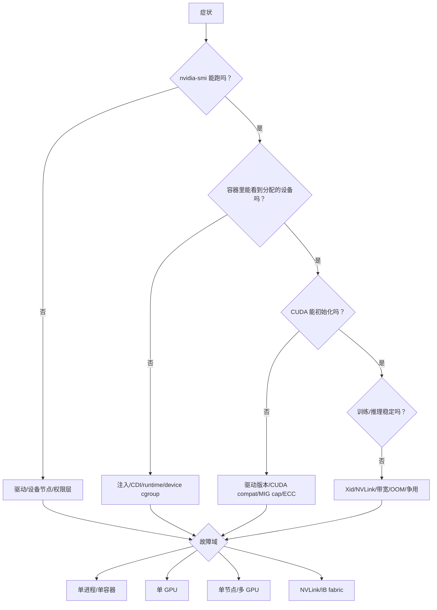

# GPU 运维与故障处置

> **结论先行**：GPU 故障处置的第一原则是**先定故障域，再决定动作**。同一个 `nvidia-smi` 失败，
> 可能是驱动没加载、容器没注入、MIG cap 缺失、Xid 79 掉总线，也可能是节点 OOM。
> 第二原则是**不要把某个错误码直接等同硬件报废**：Xid 13/31 常是应用越界，Xid 63/64 是行重映射
> 过程，Xid 94 是「已遏制」错误，只有 Xid 95/140 等才要求重置/进一步 RMA 评估。
>
> 第三原则是**停止新分配 ≠ 驱逐已有 Pod**。device plugin 标记 unhealthy 只降低 allocatable，
> 已分配 Pod 仍留在故障卡上；真正的隔离要靠 cordon/drain、device taint、Kueue stopPolicy
> 或直接删除工作负载。

## 一、事故模型：症状 → 层 → 故障域



| 故障域 | 典型证据 | 处置粒度 |
|---|---|---|
| 单进程/单容器 | 只有某个 rank 报错；其他 rank 正常 | 重启进程/容器；修应用 |
| 单 GPU | 同一 UUID/BDF 反复出错；同节点其他卡正常 | 隔离该卡；评估 reset/RMA |
| 单节点/多 GPU | 同节点多卡同时异常；PCIe/NVLink 共同上游 | 隔离节点；检查 PCIe/电源/主板 |
| Fabric | 多节点同时 Xid 74/79；NVSwitch/IB 异常 | 停整个 fabric 的新分配；厂商支持 |

## 二、掉卡与设备不可见

### 2.1 症状

- `nvidia-smi`：`No devices were found`、`Failed to initialize NVML`；
- `lspci` 能看到 NVIDIA 设备，但 `/dev/nvidia*` 不存在；
- Node 上 GPU capacity 变为 0，或 device plugin CrashLoop；
- Pod 卡在 `ContainerCreating`，事件里有 `Allocate failed` / `failed to get allocate response`；
- 容器 `Running`，但 `nvidia-smi -L` 报 `No devices were found`。

### 2.2 分层排查

```bash
# 1) PCIe 层：设备还在不在？
lspci -Dnn | grep -i nvidia
lspci -tv | grep -i nvidia
dmesg -T | grep -i -E 'nvrm|nvidia|pcie|aer' | tail -100

# 2) 驱动层：模块/设备节点/版本
lsmod | grep nvidia
cat /proc/driver/nvidia/version
ls -l /dev/nvidia*
nvidia-smi -L

# 3) 插件层
kubectl -n kube-system logs <nvidia-device-plugin-pod> --tail=200
kubectl get node <node> -o json | jq '.status.capacity, .status.allocatable'
kubectl get node <node> --show-labels | tr ',' '\n' | grep nvidia

# 4) 容器层
kubectl exec <pod> -- ls -l /dev/nvidia* 2>&1
kubectl exec <pod> -- nvidia-smi -L 2>&1
crictl inspect <container-id> | jq '.info.runtimeSpec.mounts, .info.runtimeSpec.linux.resources.devices'
```

### 2.3 常见原因

| 现象 | 原因 | 处置 |
|---|---|---|
| `lspci` 无设备 | 卡未插好、PCIe 链路掉、BIOS/电源问题 | 关机 reseat；查 BMC/系统日志；RMA |
| `lspci` 有设备，`/dev/nvidia*` 无 | 驱动未加载/加载失败 | `modprobe nvidia`；查 dmesg；重装驱动 |
| `nvidia-smi` 报 `Driver/library version mismatch` | 内核模块与用户态库版本不一致 | reload 模块/重启；统一驱动版本 |
| `nvidia-smi` 报 `GPU access blocked by the operating system` | WSL/虚拟化/IOMMU/权限限制 | 查虚拟化配置；不是 K8s 问题 |
| device plugin 没注册 | 插件 CrashLoop、socket 不存在、资源名冲突 | 看插件日志；修驱动/toolkit；重启插件 |
| Pod 里无设备 | 没走 nvidia RuntimeClass / CDI 未启用 / env 被覆盖 | 修 RuntimeClass/CDI；检查 `NVIDIA_VISIBLE_DEVICES` |
| Pod 里设备节点存在但打不开 | device cgroup 拒绝 / 权限不足 | 检查 OCI devices 规则；CDI hook 的 chmod |
| MIG 资源为 0 | `migStrategy` 不匹配；MIG 未配置；GI/CI 未创建 | `nvidia-smi mig -lgi`；对齐插件策略 |

### 2.4 Xid 79：掉总线

Xid 79 的定义是：驱动尝试通过 PCIe 访问 GPU，但 GPU 不可访问。NVIDIA 文档说通常由 PCIe
链路硬件故障导致，也可能是 GPU 硬件故障或其他驱动问题。

处置：

1. **不要反复 reset**。如果是 PCIe 链路问题，reset 不会恢复，反而可能丢证据；
2. 抓 `lspci -vv`、`dmesg`（AER/PCIe）、BMC SEL、GPU BDF/UUID；
3. cordon/drain 节点，停止新分配；
4. 尝试一次冷重启（不是热 reset）；如果仍不出现，走硬件诊断/RMA；
5. 如果是 NVSwitch/整机，检查同 NVLink 域的 peer GPU 和 switch。

## 三、Xid：先分组，再决定动作

Xid 是 NVIDIA 驱动报告的错误码，不是「硬件坏了」的同义词。NVIDIA 官方把常见 Xid 分成了
应用错误、ECC、NVLink、GSP、掉总线等类别。下面只列高频且处置差异大的。

| Xid | 含义 | 常见归因 | 建议动作 | 是否等同报废 |
|---|---|---|---|---|
| **13** | GR：SW 通知错误（越界/非法指令等） | 应用 bug；硬件罕见 | `compute-sanitizer`/`cuda-gdb` 定位；修应用 | ❌ |
| **31** | FIFO：MMU 错误（非法地址） | 应用 bug；驱动/硬件罕见 | 同上 | ❌ |
| **43** | Reset Channel Verification Error（部分工具标签为 `GPU stopped processing`）；GPU 仍健康 | 应用软件故障 | 修应用；GPU 无需处置 | ❌ |
| **45** | Preemptive cleanup, due to previous errors（常见于 Ctrl-C/SIGKILL 终止 CUDA 进程） | 用户/系统操作 | 正常清理；无需处置 | ❌ |
| **48** | DBE（双位 ECC，不可纠正） | 显存硬件/瞬态 | GPU reset 或节点重启；查 ECC 计数 | ◐ |
| **63/64** | ECC 行重映射成功/失败 | 显存退化 | 查 `ROW_REMAPPER`；64 + 失败标志 → 现场诊断/RMA | ◐ |
| **74** | NVLink 错误 | 链路、peer GPU、NVSwitch | reset 两端；查 `nvidia-smi nvlink -e`；反复出现找厂商 | ◐ |
| **79** | GPU 从总线脱落 | PCIe 链路/GPU 硬件 | 冷重启/reseat/RMA；不要热 reset 循环 | ◐ |
| **94** | 受控（contained）ECC 错误 | 单应用 | 重启该应用；方便时 reset；其他应用不受影响 | ❌ |
| **95** | 未受控（uncontained）ECC 错误 | 多应用 | **先 reset GPU**，再重启应用 | ◐ |
| **119/120** | GSP RPC 超时/GSP 错误 | 固件/驱动/硬件 | reset/断电重启；反复出现按调试指南 | ◐ |
| **140** | 不可恢复 ECC，无法行重映射/页面下线 | 显存硬件 | reset；仍复现 → RMA | ◐ |
| **121** | C2C 链路已纠正错误（Grace） | 可纠正 | 无操作影响；维护窗口 reset 重新训练链路 | ❌ |
| **137** | NVLink FLA 权限错误 | 应用非法 P2P 访问；驱动/硬件罕见 | `compute-sanitizer`；检查 P2P 使用 | ❌ |

> 「◐」表示「可能是硬件，但需要进一步诊断，不能仅凭这个码报废」。NVIDIA 文档对 79 也明确说
> 可能是 GPU 硬件故障**或其他驱动问题**；对 74 说可能是链路本身，也可能是链路远端设备。

### 3.1 处置原则

1. **先看是否 contained**：94 通常只影响一个应用；95 影响多个应用，必须先 reset。
2. **区分「应用错误」和「硬件错误」**：13/31/43/45/109/137 优先查应用；不要直接换卡。
3. **区分「过程」和「结果」**：63/64 是行重映射过程；64 失败才是 RMA 评估信号。
4. **不要用单一 Xid 做自动化报废**：至少结合 ECC、ROW_REMAPPER、`dcgmi diag`、复现次数、
   同卡/同节点相关性。

### 3.2 device plugin 默认忽略哪些 Xid

NVIDIA device plugin 默认把以下 Xid 视为「应用错误，GPU 仍健康」，不标记 unhealthy：

```text
13, 31, 43, 45, 68, 109
```

见
[`health.go`](https://github.com/NVIDIA/k8s-device-plugin/blob/17ab9a55d400ecc8d5a6c781a35f2744907fdd60/internal/rm/health.go#L230-L270)。

可以通过环境变量调整：

- `DP_DISABLE_HEALTHCHECKS=all` 或逗号分隔的 Xid 列表：禁用/忽略；
- `DP_ENABLE_HEALTHCHECKS=<xid>`：显式启用某些 Xid；
- 注意：这是**节点级**配置，改错会让整批卡的健康检测失效。

## 四、ECC 与行重映射：不要看到一个计数就报废

### 4.1 基本概念

| 概念 | 含义 | 影响 |
|---|---|---|
| **SBE**（single-bit ECC） | 可纠正单位错误 | 通常不影响运行；持续增长要关注 |
| **DBE**（double-bit ECC） | 不可纠正双位错误 | 可能触发 Xid 48/94/95/140；需要 reset/评估 |
| **volatile** | 自上次驱动加载以来的计数 | 重启后清零 |
| **aggregate** | 生命周期累计计数 | 用于长期趋势/RMA |
| **page retirement** | 动态页面下线（Ampere 之前/部分场景） | 有问题的页不再分配；可能有软件可见空洞 |
| **row remapping** | Ampere+ 用备用行替换退化行 | 需要 reset 生效；不产生地址空洞 |

NVIDIA 文档强调：动态页面下线让大多数不可纠正 ECC 错误无需 GPU reset 即可恢复；
行重映射需要 reset 才生效，并且是持久的。见
[GPU Memory Error Management](https://docs.nvidia.com/deploy/a100-gpu-mem-error-mgmt/index.html)。

### 4.2 查什么

```bash
nvidia-smi -q -d ECC
nvidia-smi -q -d ROW_REMAPPER
nvidia-smi -q -d PAGE_RETIREMENT
nvidia-smi --query-gpu=uuid,ecc.errors.uncorrected.volatile.total,ecc.errors.uncorrected.aggregate.total --format=csv
```

DCGM 对应字段：

| 字段 | ID | 含义 |
|---|---|---|
| `DCGM_FI_DEV_ECC_SBE_VOL_TOTAL` | 310 | 易失性 SBE 总数 |
| `DCGM_FI_DEV_ECC_DBE_VOL_TOTAL` | 311 | 易失性 DBE 总数 |
| `DCGM_FI_DEV_ECC_SBE_AGG_TOTAL` | 312 | 累计 SBE |
| `DCGM_FI_DEV_ECC_DBE_AGG_TOTAL` | 313 | 累计 DBE |
| `DCGM_FI_DEV_ROW_REMAP_UNCORRECTABLE_TOTAL` | 393 | 因不可纠正错误重映射的行数 |
| `DCGM_FI_DEV_ROW_REMAP_CORRECTABLE_TOTAL` | 394 | 因可纠正错误重映射的行数 |
| `DCGM_FI_DEV_ROW_REMAP_FAILED` | 395 | 行重映射失败标志 |
| `DCGM_FI_DEV_ROW_REMAP_PENDING` | 396 | 行重映射待生效 |

见 [`dcgm_fields.h`](https://github.com/NVIDIA/DCGM/blob/9fae2867e6e5264fa0fca22a07dc898d591baa21/dcgmlib/dcgm_fields.h#L944-L975)
与 [`dcgm_fields.h` 的 row remap 段](https://github.com/NVIDIA/DCGM/blob/9fae2867e6e5264fa0fca22a07dc898d591baa21/dcgmlib/dcgm_fields.h#L1278-L1309)。

### 4.3 RMA 判断

NVIDIA 的 RMA 策略阈值不是「出现一个 DBE 就换卡」，而是：

- 行重映射失败标志被设置，并经现场诊断验证；
- 例如同一 bank 上已经重映射了 8 个不可纠正错误行，再尝试重映射会触发失败标志；
- 具体阈值和诊断流程以 NVIDIA 现场诊断工具/文档为准。

见 [Row Remapping 的 RMA 策略阈值](https://docs.nvidia.com/deploy/a100-gpu-mem-error-mgmt/index.html#rma-policy-thresholds-for-row-remapping)。

实务建议：

1. 记录 **volatile 与 aggregate** 两个维度，不要只看一个；
2. 记录错误发生在哪个 bank/row/页（如果工具提供）；
3. 做一次 `dcgmi diag -r 2`（需要独占 GPU）或厂商现场诊断；
4. 如果 `ROW_REMAP_FAILED=1` 或 Xid 95/140 反复出现，再走 RMA；
5. 单次 SBE、单次 63/64 不应直接报废。

## 五、驱动 / runtime / CUDA 版本不匹配

### 5.1 典型错误

| 错误 | 层 | 原因 |
|---|---|---|
| `NVRM: API mismatch: the client has the version X, but this kernel module has the version Y` | 内核日志 | 用户态驱动与内核模块版本不一致 |
| `Failed to initialize NVML: Driver/library version mismatch` | NVML | 同上；常见于升级后未重启 |
| `CUDA driver version is insufficient for CUDA runtime version` | CUDA | 容器内 CUDA runtime 比宿主机 driver 新 |
| `nvidia-container-cli: initialization error: nvml error: driver not loaded` | toolkit | 宿主机驱动未加载/容器没挂到驱动 |
| `unsupported CUDA version` / `CUDA_ERROR_UNSUPPORTED_DRIVER_VERSION` | CUDA | 版本组合不支持 |
| `No devices were found` | CUDA/NVML | 设备未注入/驱动未加载/MIG 不可见 |
| device plugin `Failed to initialize NVML` | 插件 | 驱动/toolkit 不匹配；插件 CrashLoop |

### 5.2 排查顺序

```bash
# 宿主机
cat /proc/driver/nvidia/version
nvidia-smi --query-gpu=driver_version --format=csv,noheader
nvidia-container-cli --version 2>/dev/null || nvidia-ctk --version
nvidia-ctk info 2>/dev/null | head -50

# 容器内
kubectl exec <pod> -- nvidia-smi --query-gpu=driver_version --format=csv,noheader
kubectl exec <pod> -- ldconfig -p | grep -E 'libcuda|libnvidia-ml'
kubectl exec <pod> -- env | grep -E 'CUDA|NVIDIA'

# CDI spec 是否过期
ls -l /etc/cdi /var/run/cdi
grep -E 'driver|version|libnvidia' /etc/cdi/nvidia.yaml | head
```

### 5.3 处置

- **内核模块 vs 用户态**：统一驱动版本；reload 模块或重启节点。不要只重启 device plugin。
- **CUDA runtime vs driver**：升级 driver，或在镜像里用匹配的 CUDA 版本/forward compatibility 包；
  注意 forward compatibility 包不是万能的，生产要验证。
- **toolkit/CDI 版本**：升级 toolkit 后重新生成 CDI spec；GPU Operator 会自动做，手工安装要手动做。
- **MIG 模式**：切换 MIG 后 device plugin 的 `migStrategy` 要匹配；否则资源名对不上，
  Pod 会 Pending 或拿到错误 profile。
- **RuntimeClass**：hook 模式必须有 nvidia runtime；CDI 模式 runtime 必须启用 CDI。
- **容器镜像**：不要覆盖 `NVIDIA_VISIBLE_DEVICES=all`；不要把 `NVIDIA_DRIVER_CAPABILITIES`
  裁到只剩 `utility`。

## 六、GPU 显存 OOM vs 容器 OOM vs 节点 OOM

| 维度 | GPU 显存 OOM | 容器 cgroup OOM | 节点 OOM |
|---|---|---|---|
| 触发者 | CUDA/NVML 驱动 | 内核 memcg（`memory.max`） | 内核全局 OOM killer |
| 典型错误 | `CUDA out of memory`、`torch.OutOfMemoryError` | `OOMKilled`、exit 137 | `dmesg: Out of memory: Killed process` |
| Pod 状态 | 可能仍 `Running`，进程崩/重启 | 容器重启，`Last State: OOMKilled` | 多个 Pod/进程受影响 |
| 证据 | 应用日志、`nvidia-smi` memory.used | `memory.events` 的 `oom_kill`、`memory.max` | 节点 `MemoryPressure`、dmesg |
| 常见原因 | batch 太大、KV cache 太大、泄漏、time-slicing 超卖 | limit 太小、泄漏、page cache | reserved/eviction 不足、节点超卖 |
| 处置 | 调 batch/`max_num_seqs`/KV cache；加卡/切分；查泄漏 | 调 limit/request；加 headroom；查泄漏 | 修 reserved/eviction；迁移；加内存 |

### 6.1 GPU 显存 OOM

```bash
kubectl logs <pod> --tail=200 | grep -i -E 'out of memory|oom'
kubectl exec <pod> -- nvidia-smi --query-gpu=memory.total,memory.used,memory.free --format=csv
```

常见误区：

- 以为 K8s 的 `memory` limit 能限制 GPU 显存——不能；
- 以为 time-slicing 的 replica 有独立显存——没有；
- 以为 `gpu_memory_utilization` 是硬限制——它是应用自己的预算，不是内核/cgroup 强制；
- 以为 MIG 一定不会 OOM——MIG 只保证实例的显存容量，模型超过该容量照样 OOM。

### 6.2 容器 OOM

```bash
kubectl describe pod <pod> | grep -A5 'Last State'
kubectl get pod <pod> -o jsonpath='{.status.containerStatuses[*].lastState.terminated}'
cat /sys/fs/cgroup/<path>/memory.events
cat /sys/fs/cgroup/<path>/memory.max
```

`OOMKilled` + exit 137 是容器 cgroup OOM 的强信号；但要和「进程自己 `exit(137)`」区分，
后者不一定是 OOM。

### 6.3 节点 OOM

```bash
dmesg -T | grep -i -E 'out of memory|oom-kill|killed process'
kubectl describe node <node> | grep -A10 'Conditions'
```

节点 OOM 的重点不是「哪个容器被杀」，而是「为什么 kubelet 没提前驱逐」：

- `memory.available` 阈值是否太低；
- `kubeReserved`/`systemReserved` 是否不足；
- 是否有短时间暴涨，kubelet 10s 轮询来不及；
- 是否开了 `kernelMemcgNotification`。

## 七、健康工具：按环境选，不要迷信单一信号

| 工具 | 能看到什么 | 看不到什么 | 适用 |
|---|---|---|---|
| **device plugin health** | NVML Xid critical/DBE/SBE 事件；标记 unhealthy | 不做完整诊断；单向不可恢复；不迁移已分配 Pod | 所有 device plugin 环境 |
| **DRA health** | `DRAResourceHealth`、Pod `allocatedResourcesStatus`、设备 taint | 需要驱动实现；NVIDIA GPU DRA 仍实验性 | DRA 环境 |
| **DCGM health** | PCIe/NVLink/PMU/MCU/MEM/SM/Inforom/thermal/power/driver 等 watch | 需要 DCGM 运行；某些 watch 需要数据积累；不是所有字段默认导出 | 有 DCGM 的节点 |
| **DCGM exporter** | Prometheus 指标；XID 默认导出，ECC/health 需自定义 counters | 默认 counters 不含 ECC/health；指标滞后 | 监控/告警 |
| **GPU Operator validator** | driver/toolkit/plugin/CUDA 的部署验证 | 不是持续健康检查；不替代诊断 | GPU Operator 环境 |
| **NPD（Node Problem Detector）** | 自定义脚本/日志检查，可上报 Node condition | 需要自己写 GPU 检查；容易误报 | 有 NPD 的集群 |
| **厂商现场诊断** | 深度硬件诊断、RMA 依据 | 需要停机/独占 | 疑似硬件故障 |

### 7.1 device plugin health 的实现细节

NVIDIA device plugin 注册 NVML 事件：

```text
EventTypeXidCriticalError | EventTypeDoubleBitEccError | EventTypeSingleBitEccError
```

收到 Xid critical 后，把设备标为 unhealthy；但默认忽略 13/31/43/45/68/109。
源码见 [`health.go`](https://github.com/NVIDIA/k8s-device-plugin/blob/17ab9a55d400ecc8d5a6c781a35f2744907fdd60/internal/rm/health.go#L30-L180)。

注意：

- 健康事件是**单向**的；恢复要重启插件；
- unhealthy 只降 allocatable，不驱逐已分配 Pod；
- MIG 设备会按 GI/CI 匹配事件，避免把父卡事件误判到所有实例。

### 7.2 DCGM health watch

DCGM 的健康 watch 覆盖：

```text
PCIE, NVLINK, PMU, MCU, MEM, SM, INFOROM, THERMAL, POWER, DRIVER,
NVSWITCH_NONFATAL, NVSWITCH_FATAL, CONNECTX, IMEX
```

见 [`dcgm_structs.h`](https://github.com/NVIDIA/DCGM/blob/9fae2867e6e5264fa0fca22a07dc898d591baa21/dcgmlib/dcgm_structs.h#L2429-L2445)。

```bash
dcgmi health -c          # 检查当前健康
dcgmi health -g 0 -c     # 指定 group
dcgmi diag -r 1          # 短诊断
dcgmi diag -r 2          # 中等诊断（需要独占）
dcgmi dmon -e 230,310,311,393,394,395,396
```

DCGM 内部默认只把 **Xid 119** 当作 fatal Xid（可通过 `__DCGM_FATAL_XIDS__` 环境变量扩展）。
这说明 DCGM 自己也不把「所有 Xid」等同 fatal。见
[`DcgmCacheManager.cpp`](https://github.com/NVIDIA/DCGM/blob/9fae2867e6e5264fa0fca22a07dc898d591baa21/dcgmlib/src/DcgmCacheManager.cpp#L8991-L8995)。

### 7.3 DCGM exporter 的默认 counters

`dcgm-exporter` 默认 counters 里：

- `DCGM_FI_DEV_XID_ERROR`、row remap 393–395、NVLink throughput、PCIe throughput 以及部分
  profiling 指标是默认导出的；
- ECC（310–313）、page retirement、NVLink **错误**计数、row remap pending（396）、health status
  默认是注释或缺失的；
- 需要自定义 `dcgm-metrics.csv` / ConfigMap 才能导出这些字段。

见 [`default-counters.csv`](https://github.com/NVIDIA/dcgm-exporter/blob/4e663a526c4624ad0e18ad816f09b7be2c5348a7/etc/default-counters.csv#L80-L145)。

> 这意味着：只看默认 dashboard，你可能根本看不到 ECC/row remap。不要因为「监控没报错」
> 就认为卡健康；要确认关键字段是否被导出。

### 7.4 GPU Operator validator / node status exporter

GPU Operator 的组件（driver、toolkit、device plugin、DCGM、DCGM exporter、GFD、NFD、MIG manager、
validator、node status exporter）通过 `nvidia.com/gpu.deploy.*` 标签编排。validator 负责验证
driver/toolkit/plugin/CUDA 是否就绪；node status exporter 暴露节点状态。

注意：

- validator 是**部署验证**，不是持续硬件健康；
- node status exporter 使用的 `nvidia-validator` 也不是完整 DCGM 诊断；
- GPU Operator 的组件版本要与 driver/CUDA 匹配，升级顺序错误会导致整节点不可用。

## 八、关联 node / GPU / Pod / rank

### 8.1 关联键

| 对象 | 关键字段 | 从哪里拿 |
|---|---|---|
| Node | node name、`nvidia.com/gpu.product`、`nvidia.com/mig.strategy`、zone | `kubectl get node --show-labels` |
| GPU | UUID、PCI BDF、MIG GI/CI、serial | `nvidia-smi -q`、`lspci`、DCGM labels |
| Pod | namespace/name、UID、container、claim | `kubectl get pod -o yaml` |
| device plugin 分配 | Pod UID、container、device IDs | kubelet checkpoint |
| DRA 分配 | claim name/UID、driver/pool/device | ResourceClaim `status.allocation` |
| rank | `RANK`、`LOCAL_RANK`、`WORLD_SIZE`、`LWS_WORKER_INDEX`、`JOB_COMPLETION_INDEX`、hostname | Pod env、框架日志 |

### 8.2 一条命令把链拉起来

```bash
NODE=<node>; NS=<ns>; POD=<pod>

# Node → GPU
kubectl get node $NODE -o json | jq '{capacity:.status.capacity,allocatable:.status.allocatable,labels:.metadata.labels}'
nvidia-smi -L
nvidia-smi --query-gpu=index,uuid,pci.bus_id,name,memory.total --format=csv

# Pod → device
kubectl get pod -n $NS $POD -o yaml | yq '{node:.spec.nodeName,uid:.metadata.uid,claims:.spec.resourceClaims,containers:[.spec.containers[]|{name,resources}]}'
sudo cat /var/lib/kubelet/device-plugins/kubelet_internal_checkpoint | jq --arg uid "<pod-uid>" '.Data.PodDeviceEntries[] | select(.PodUID==$uid)'

# DRA
kubectl get resourceclaim -n $NS -o yaml | yq '.items[] | select(.status.allocation != null) | {name:.metadata.name,alloc:.status.allocation}'

# 容器内
kubectl exec -n $NS $POD -- nvidia-smi -L
kubectl exec -n $NS $POD -- nvidia-smi --query-gpu=uuid,pci.bus_id --format=csv
```

### 8.3 日志源

| 源 | 命令 | 用途 |
|---|---|---|
| 内核 | `dmesg -T`、`journalctl -k` | NVRM、Xid、PCIe AER、OOM |
| kubelet | `journalctl -u kubelet` | device plugin 注册、Allocate、eviction、DRA prepare |
| device plugin | `kubectl -n kube-system logs <pod>` | ListAndWatch、Xid、NVML 初始化 |
| containerd | `journalctl -u containerd` | CDI、runtime、device cgroup |
| DCGM exporter | `kubectl -n gpu-operator logs <pod>` | 指标采集、字段错误 |
| 应用 | `kubectl logs <pod>` | CUDA OOM、NCCL、rank 退出 |
| 训练框架 | torchrun/elastic 日志 | rank/rendezvous/checkpoint |

## 九、处置 runbook：停止新分配 → 隔离 → 重试 → 升级

### 9.1 停止新分配

| 手段 | 命令/对象 | 影响 |
|---|---|---|
| cordon | `kubectl cordon <node>` | 阻止新 Pod 调度；不驱逐已有 |
| 自定义 taint | `kubectl taint node <node> nvidia.com/gpu.maintenance=true:NoSchedule` | 需要 Pod 容忍；适合计划维护 |
| DRA DeviceTaintRule | `DeviceTaintRule` + `NoSchedule`/`NoExecute` | 精确到设备/池；NoExecute 会驱逐 |
| Kueue stopPolicy | `Hold` / `HoldAndDrain` | 停止新 admission；drain 会驱逐已准入 |
| 缩容/删除 | `kubectl scale` / `delete pod` | 直接减少负载 |
| 关队列 | Kueue `ClusterQueue` 停用/配额置 0 | 影响整个队列 |

> cordon 只影响调度，不影响已经在跑的 Pod；如果卡已经故障，必须配合 drain/delete 才能把
> 工作负载移走。device plugin 的 unhealthy **不会**替你驱逐。

### 9.2 隔离

```bash
# 节点级
kubectl cordon <node>
kubectl drain <node> --ignore-daemonsets --delete-emptydir-data --force

# DRA 设备级
kubectl apply -f - <<'EOF'
apiVersion: resource.k8s.io/v1
kind: DeviceTaintRule
metadata:
  name: isolate-gpu
spec:
  deviceSelector:
    driver: gpu.nvidia.com
    pool: <node-name>
    device: gpu-3
  taint:
    key: gpu.nvidia.com/unhealthy
    value: "true"
    effect: NoExecute
EOF
```

注意：

- `NoExecute` 会删除使用该设备的 Pod；对训练作业要确认 checkpoint 已保存；
- 不要在有运行中进程时 `nvidia-smi -r` 或切换 MIG 模式；
- NVSwitch/整机故障时，隔离单卡可能不够，要停整个 NVLink 域/fabric；
- 如果是 IB/RoCE 问题，先隔离网络端口/交换机，不要只重启 GPU。

### 9.3 重试

| 场景 | 动作 | 注意 |
|---|---|---|
| Xid 94（contained） | 重启应用/容器；方便时 reset | 其他应用可能不受影响 |
| Xid 95/140（uncontained） | **先 reset GPU**，再重启应用 | 不 reset 直接重试可能再次失败 |
| Xid 48（DBE） | reset GPU 或节点重启 | 查 ECC/row remap |
| Xid 74（NVLink） | reset 两端 GPU；查 peer/switch | 可能是远端 GPU 故障 |
| Xid 79（掉总线） | 冷重启/reseat；不要热 reset 循环 | 抓 PCIe/BMC 日志 |
| Xid 119/120（GSP） | reset/断电重启 | 反复出现按调试指南 |
| 驱动不匹配 | 统一驱动/重启节点 | 不要只重启插件 |
| Pod OOM | 调 limit/request、batch、KV cache | 区分容器/GPU/节点 OOM |

训练作业的重试要和 checkpoint 结合：

- 先确认 checkpoint 已落盘/可加载；
- 再删 Pod/重启 Job；
- 避免调度回同一张故障卡（taint/cordon/device taint）；
- 记录失败 rank、GPU UUID、Xid、时间，供后续归因。

### 9.4 升级

升级到厂商/RMA 的信号：

- 同一 GPU 反复 Xid 79/95/140；
- `ROW_REMAP_FAILED=1` 且现场诊断确认；
- ECC DBE 持续增长，reset 后仍复现；
- NVLink 错误反复出现，reset 两端/更换 switch 端口后仍复现；
- PCIe AER 持续报错，reseat/换槽位后仍复现；
- 多张卡/多节点同时出现，怀疑主板/电源/背板。

升级前准备：

- GPU UUID、BDF、serial、driver/firmware 版本；
- `nvidia-smi -q`、`dcgmi diag`、dmesg、BMC SEL；
- 复现步骤/频率/影响范围；
- 是否已尝试 reset/reboot/reseat；
- 同节点其他卡是否正常。

## 十、证据保留清单

故障现场最容易丢的是证据。至少保存：

- [ ] `nvidia-smi -q`（完整输出，含 ECC、PCI、NVLink、MIG）；
- [ ] `nvidia-smi -L`、`nvidia-smi topo -m`；
- [ ] `dmesg -T`（NVRM、Xid、PCIe AER、OOM）；
- [ ] `lspci -vv`（BDF、LnkCap/LnkSta、AER）；
- [ ] `dcgmi diag -r 2`（如果条件允许）；
- [ ] DCGM/exporter 指标（Xid、ECC、row remap、温度、功耗、NVLink）；
- [ ] Pod YAML、container status、`allocatedResourcesStatus`；
- [ ] device plugin checkpoint / ResourceClaim allocation；
- [ ] 训练 rank 日志、checkpoint 时间点；
- [ ] 变更记录（驱动升级、MIG 切换、节点维护）。

## 十一、检查清单

- [ ] 故障域是单进程、单卡、单节点还是 fabric？
- [ ] 是 reported / allocated / prepared / usable 哪一层？
- [ ] `nvidia-smi` 是否能看到卡？容器里看到的是不是分配的那张？
- [ ] 是否区分了 Xid 的应用错误/contained/uncontained/ECC/fabric？
- [ ] 是否查了 ECC 的 volatile 与 aggregate、row remap pending/failed？
- [ ] 是否确认驱动/内核模块/toolkit/CDI/CUDA 版本一致？
- [ ] 是 GPU 显存 OOM、容器 OOM 还是节点 OOM？
- [ ] 停止新分配后，是否真的隔离了已分配 Pod？
- [ ] 重试前是否 reset 了需要 reset 的 GPU？是否保存了 checkpoint？
- [ ] 是否保留了足够的证据再升级/RMA？

## 参考与证据

**NVIDIA 文档**

- [Xid Errors](https://docs.nvidia.com/deploy/xid-errors/index.html)
- [GPU Memory Error Management](https://docs.nvidia.com/deploy/a100-gpu-mem-error-mgmt/index.html)
- [MIG User Guide](https://docs.nvidia.com/datacenter/tesla/mig-user-guide/index.html)
- [DCGM User Guide](https://docs.nvidia.com/datacenter/dcgm/latest/user-guide/index.html)
- [nvidia-smi Documentation](https://docs.nvidia.com/deploy/nvidia-smi/index.html)
- [GPU Operator Documentation](https://docs.nvidia.com/datacenter/cloud-native/gpu-operator/latest/index.html)

**Kubernetes 文档**

- [Device plugin and unhealthy devices](https://kubernetes.io/docs/concepts/extend-kubernetes/compute-storage-net/device-plugins/#device-plugin-and-unhealthy-devices)
- [Node-pressure Eviction](https://kubernetes.io/docs/concepts/scheduling-eviction/node-pressure-eviction/)
- [Device Taints and Tolerations](https://kubernetes.io/docs/concepts/resource-management/dynamic-resource-allocation/device-taints/)

**源码**

- [device plugin health](https://github.com/NVIDIA/k8s-device-plugin/blob/17ab9a55d400ecc8d5a6c781a35f2744907fdd60/internal/rm/health.go#L30-L270)
- [device plugin ListAndWatch](https://github.com/NVIDIA/k8s-device-plugin/blob/17ab9a55d400ecc8d5a6c781a35f2744907fdd60/internal/plugin/server.go#L266-L281)
- [DCGM Xid/ECC 字段](https://github.com/NVIDIA/DCGM/blob/9fae2867e6e5264fa0fca22a07dc898d591baa21/dcgmlib/dcgm_fields.h#L823)
- [DCGM health watch](https://github.com/NVIDIA/DCGM/blob/9fae2867e6e5264fa0fca22a07dc898d591baa21/dcgmlib/dcgm_structs.h#L2429-L2445)
- [DCGM fatal Xid 默认值](https://github.com/NVIDIA/DCGM/blob/9fae2867e6e5264fa0fca22a07dc898d591baa21/dcgmlib/src/DcgmCacheManager.cpp#L8991-L8995)
- [dcgm-exporter 默认 counters](https://github.com/NVIDIA/dcgm-exporter/blob/4e663a526c4624ad0e18ad816f09b7be2c5348a7/etc/default-counters.csv#L80-L110)
- [device plugin checkpoint](https://github.com/kubernetes/kubernetes/blob/c50e5395f1ae2d4a2c05f28fdcc38c0916cc1a32/pkg/kubelet/cm/devicemanager/checkpoint/checkpoint.go#L35-L55)
- [DRA health/taints](https://github.com/kubernetes/kubernetes/blob/c50e5395f1ae2d4a2c05f28fdcc38c0916cc1a32/staging/src/k8s.io/api/resource/v1/types.go#L945-L1019)
