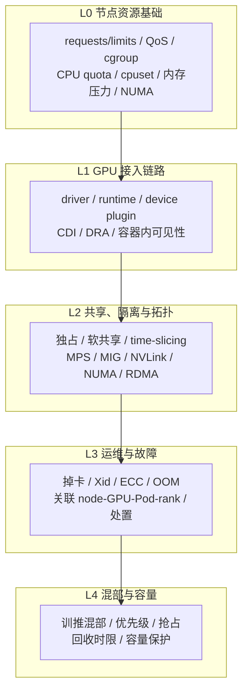

# CPU / GPU 异构资源管理与设备运维：专题总览

> **结论先行**：异构资源管理真正的难点不是「把 GPU 数量写进 Node 的 capacity」，而是保证
> **资源被看见 → 被正确分配 → 在容器里真的可见 → 硬件真的可用且健康** 这四段状态一致。
> 绝大多数线上事故发生在后两段：调度器认为卡已经分配，容器也 `Running`，但进程看不到设备、
> 看到的是错误的 MIG 实例，或者卡已经掉总线而 kubelet 仍把旧 Pod 留在上面。
>
> 另一个贯穿全专题的结论是：**「分配份额」不等于「隔离保证」**。time-slicing 的 replica、
> MPS 的线程百分比、HAMi 的显存/算力配额，都是调度或限流语义；只有 MIG 这类硬件分区才同时
> 提供容量、带宽和故障域隔离。把份额当隔离，是训推混部里尾延迟和 OOM 反复出现的根因之一。

本专题按五层组织，每一层都尽量落到具体 API 字段、源码路径、可复现的观测点和故障信号：

| 层 | 回答的问题 | 主要对象 | 本专题页面 |
|---|---|---|---|
| **L0 节点资源基础** | request 与 limit 分别由谁执行？CPU 为什么会被 throttle？内存压力从哪里来？ | cgroup、QoS、eviction、CPU/Memory/Topology Manager | [CPU、内存与节点资源基础](./cpu-memory-node.md) |
| **L1 接入链路** | GPU 从 PCIe 设备到容器内 `nvidia-smi` 要经过哪些软件层？DRA 负责哪一段？ | driver、runtime、device plugin、CDI、DRA | [GPU 软件栈与接入链路](./gpu-access-chain.md) |
| **L2 共享与拓扑** | 几种「共享 GPU」到底隔离了什么？GPU/PCIe/NUMA/NIC/NVLink/RDMA 怎么测？ | 独占、time-slicing、MPS、MIG、HAMi | [共享、隔离与拓扑](./sharing-isolation-topology.md) |
| **L3 运维与故障** | 掉卡、Xid、ECC、驱动不匹配、OOM 怎么定位？先停什么、隔离什么、何时升级？ | Xid/ECC、DCGM、device plugin 健康、节点处置 | [GPU 运维与故障处置](./gpu-operations.md) |
| **L4 混部与容量** | 推理尾延迟和训练吞吐如何共存？谁可抢占？回收时限和容量余量怎么定？ | PriorityClass、Kueue、PDB、HPA、拓扑放置 | [训推混部与协同放置](./training-inference-mix.md) |

## 一、四段状态：reported → allocated → usable

把「GPU 可用」拆成四段，是本专题后面所有排障和设计的共同语言。不同实现（device plugin / DRA）
写状态的地方不同，但状态本身没有变。

| 状态 | 谁写入 | 典型载体 | 怎么观测 | 这一层失败的表现 |
|---|---|---|---|---|
| **1. reported（已上报）** | device plugin 的 `ListAndWatch`；DRA driver 的 `ResourceSlice` | Node `status.capacity/allocatable`；`ResourceSlice` 对象 | `kubectl describe node`；`kubectl get resourceslices` | Node 上卡数正确但资源名为 0；ResourceSlice 缺失/过期 |
| **2. allocated（已分配）** | kube-scheduler + kubelet device manager；DRA 的 `ResourceClaim.status.allocation` | device plugin checkpoint；ResourceClaim | `/var/lib/kubelet/device-plugins/kubelet_internal_checkpoint`；`kubectl get resourceclaim -o yaml` | Pod `Pending`；claim 未分配；分配到的设备与预期不符 |
| **3. prepared（已准备/可见）** | kubelet 调 `Allocate` / `NodePrepareResources`；runtime 应用 CDI | OCI spec、`NVIDIA_VISIBLE_DEVICES`、CDI device、device nodes、mounts | `crictl inspect`；`kubectl exec -- nvidia-smi -L` | 容器 `Running` 但 `nvidia-smi` 失败；`/dev/nvidia*` 缺失；`CUDA_ERROR_NO_DEVICE` |
| **4. usable（真可用/健康）** | 驱动/NVML、DCGM、device plugin/DRA 健康上报 | NVML 初始化成功；CUDA context 可建；`allocatedResourcesStatus`/设备状态 | `nvidia-smi -q`；`dcgmi health`；Pod `allocatedResourcesStatus` | 卡可见但初始化失败、ECC/Xid 异常、MIG cap 缺失、性能塌陷 |

关键点：

1. **reported 只代表「驱动/插件声称有」**。device plugin 的 `ListAndWatch` 可以上报 8 张卡，
   但节点可能因为驱动没加载、`/dev/nvidia*` 权限不对、MIG 配置不一致而一张都用不了。
2. **allocated 只代表「调度账本上记了」**。device plugin 的分配记录在 kubelet checkpoint 里；
   它不等于容器里已经挂上了设备。DRA 的 `status.allocation` 同样只是调度结果。
3. **prepared 只代表「运行时做了注入动作」**。CDI 注入了 device node，但 device cgroup 仍可能拒绝；
   `NVIDIA_VISIBLE_DEVICES` 设了，但 runtime 不是 NVIDIA runtime，容器里照样没有设备。
4. **usable 才是应用视角的真相**。CUDA context 能否创建、MIG 实例是否匹配、ECC 是否把页面退休、
   Xid 是否把 GPU 打进不可恢复状态，都要单独验证。

> device plugin 文档明确写了两件容易反直觉的事：设备被标记 unhealthy 后，kubelet 只降低
> **allocatable**，**capacity 不变**；已经分配到该设备的 Pod **不会被迁移**，会继续留在故障设备上。
> 见 [Device Plugins: Device plugin and unhealthy devices](https://kubernetes.io/docs/concepts/extend-kubernetes/compute-storage-net/device-plugins/#device-plugin-and-unhealthy-devices)
> 与 kubelet 源码 [`manager.go`](https://github.com/kubernetes/kubernetes/blob/c50e5395f1ae2d4a2c05f28fdcc38c0916cc1a32/pkg/kubelet/cm/devicemanager/manager.go#L472-L510)。

## 二、三个平面，别混在一起排障

| 平面 | 组件 | 典型问题 | 先看什么 |
|---|---|---|---|
| **控制面** | kube-scheduler、ResourceClaim controller、Kueue、Node 对象 | Pending、配额不足、DRA claim 没分配、抢占没发生 | scheduler events、Pod conditions、ClusterQueue/Workload status |
| **节点面** | kubelet、CRI runtime、device plugin、CDI、cgroup | 设备不可见、Allocate 失败、OOMKilled、CPU throttle | kubelet 日志、`crictl inspect`、cgroup 文件、checkpoint |
| **硬件/驱动面** | NVIDIA driver、GPU、NVLink/NVSwitch、PCIe、NIC、DCGM | Xid、ECC、掉卡、NVLink 降级、RDMA 不通 | `nvidia-smi`、`dcgmi`、dmesg、DCGM exporter |

同一个症状可能跨三个平面。例如「训练 hang」：控制面看到 Pod 全 `Running`，节点面看到 NCCL
进程都在，硬件面才发现某张卡 Xid 74 导致 NVLink 链路降级。排障顺序应该是
**先确认应用是否真的拿到设备（节点面），再确认设备是否健康（硬件面），最后才怀疑调度（控制面）**，
而不是一上来就重新调调度器。

## 三、版本基线（本专题的证据基线）

本专题的源码链接都固定在下列 commit/tag 上，避免「master 已变」导致论据漂移。Kubernetes 文档与
NVIDIA 文档则以 2026-11 的 latest 为准；涉及版本行为的结论会显式标注基线。

| 组件 | 本专题基线 | 说明 |
|---|---|---|
| Kubernetes | `v1.37.2`（[c50e5395](https://github.com/kubernetes/kubernetes/tree/c50e5395f1ae2d4a2c05f28fdcc38c0916cc1a32)） | DRA 自 1.34 GA、1.35 锁定；DeviceTaints 1.37 GA；MemoryQoS 1.37 Beta |
| containerd | `v2.4.2`（[b7a2526](https://github.com/containerd/containerd/tree/b7a25261e029d68978bbf290df0a62fc819b3c51)） | CDI 在 2.x 默认启用；2.4 起 `enable_cdi` 移除、始终启用 |
| NVIDIA k8s-device-plugin | `v0.20.2`（[17ab9a5](https://github.com/NVIDIA/k8s-device-plugin/tree/17ab9a55d400ecc8d5a6c781a35f2744907fdd60)） | time-slicing、MPS、CDI、MIG single/mixed |
| NVIDIA GPU Operator | `v26.7.3`（[dd9e434](https://github.com/NVIDIA/gpu-operator/tree/dd9e4347feefa8e46622c78b8bd799820710bf10)） | driver/toolkit/plugin/DCGM/NFD/GFD/validator 编排 |
| NVIDIA DCGM | `v4.7.0`（[9fae286](https://github.com/NVIDIA/DCGM/tree/9fae2867e6e5264fa0fca22a07dc898d591baa21)） | 健康 watch、Xid/ECC/row remap 字段 |
| NVIDIA Container Toolkit | `v1.20.2`（[adbd28c](https://github.com/NVIDIA/nvidia-container-toolkit/tree/adbd28c39b60f8eb7e03115b5ac61e58703f0ce7)） | CDI 生成、`apply-cuda-memory-limits` hook |
| NVIDIA DRA Driver | `v25.12.0`（[0882da8](https://github.com/NVIDIA/k8s-dra-driver-gpu/tree/0882da8720c28763137e0987778ec476ec4cf8df)） | GPU DRA plugin（实验性）、ComputeDomain（正式支持） |
| Kueue | `v1beta2`（[be7dc9d](https://github.com/kubernetes-sigs/kueue/tree/be7dc9d31470258dd324e5bd6d84f7eaf90f5f69)） | Cohort/borrowing/lending、stopPolicy、reclaimablePods |

> 版本提示：Kubernetes 1.37 中 `MemoryQoS` 已是 Beta 且默认开启，但
> **`memoryThrottlingFactor` 默认是 nil、`memoryReservationPolicy` 默认 `None`**。
> 所以「MemoryQoS 默认开启」不等于「默认会 throttle 或保护内存」。这是最常见的误读之一。

## 四、十个高频误区

| # | 误区 | 更准确的说法 | 详见 |
|---|---|---|---|
| 1 | Node 显示 8 张 GPU，就能跑 8 个 GPU Pod | 还要看 allocatable、插件健康、MIG 策略、device plugin 是否注册 | [接入链路](./gpu-access-chain.md) |
| 2 | Pod 是 `Running`，GPU 就一定可用 | `Running` 只说明容器进程起来了；设备注入、NVML、CUDA context 都可能失败 | [接入链路](./gpu-access-chain.md) |
| 3 | time-slicing `replicas: 4` 就是把一张卡切成 4 份 | 只是把 4 个调度槽位映射到同一张物理卡；没有内存/故障隔离 | [共享与隔离](./sharing-isolation-topology.md) |
| 4 | MIG 可以随便用于分布式训练 | MIG 实例之间不支持 GPU-GPU P2P（PCIe/NVLink），NCCL 拓扑会退化 | [共享与隔离](./sharing-isolation-topology.md) |
| 5 | 开了 Topology Manager 就会按 NVLink 放置 | device plugin 只提供 NUMA node ID；Topology Manager 不感知 NVLink/PCIe 距离 | [共享与拓扑](./sharing-isolation-topology.md) |
| 6 | 出现 Xid 就是显卡坏了 | Xid 13/31/43/45 等常是应用错误；63/64 是行重映射过程；只有部分 Xid 指向硬件 | [GPU 运维](./gpu-operations.md) |
| 7 | `CUDA out of memory` 就是容器 OOMKilled | GPU 显存 OOM 是 CUDA/NVML 层错误，不会让 kernel OOM killer 杀容器 | [GPU 运维](./gpu-operations.md) |
| 8 | device plugin 标记 unhealthy 会把故障卡上的 Pod 赶走 | 不会；只降低 allocatable，已分配 Pod 继续留在故障设备上 | [GPU 运维](./gpu-operations.md) |
| 9 | DRA 可以像普通资源一样被高优先级 Pod 抢占 | 调度器目前不支持对 DRA 资源做抢占；要靠 Kueue 等上层回收 | [训推混部](./training-inference-mix.md) |
| 10 | MPS 是硬多租户隔离 | MPS 限制 SM 百分比/内存上限，但错误不隔离，一个客户端致命错误会影响同服务器客户端 | [共享与隔离](./sharing-isolation-topology.md) |

## 五、阅读路径

| 角色 | 建议顺序 | 关注点 |
|---|---|---|
| **平台/集群管理员** | 总览 → 接入链路 → 共享与隔离 → 运维 | 节点池、RuntimeClass、device plugin/DRA、MIG 策略、升级 |
| **SRE / on-call** | 总览 → 运维 → 接入链路 → 节点基础 | 症状分流、停新分配、隔离、恢复、升级、证据保留 |
| **训练/推理工程师** | 总览 → 节点基础 → 共享与隔离 → 训推混部 | request/limit、NUMA/拓扑、抢占与 checkpoint、尾延迟 |
| **容量/成本** | 总览 → 共享与隔离 → 训推混部 | 隔离语义、超卖边界、配额/借用、回收时限 |

## 六、与站内其它专题的关系

- **HAMi / HAMi-core**：HAMi 是「用软件把整卡虚拟成显存+算力配额」的代表实现。本专题的
  [共享、隔离与拓扑](./sharing-isolation-topology.md) 只把它作为「软共享」一类来比较，
  CUDA 劫持的实现细节见 [HAMi](../Accelerators/hami.md) 与 [HAMi-core](../Accelerators/hami-core.md)。
- **GPU 算力/显存池化**：那篇讲的是「应用视角单卡」的透明性光谱（UVM、MNNVL、API remoting、
  显存池化等），本专题讲的是「编排与设备生命周期」；两者在 NVLink/fabric 处交汇，见
  [GPU 算力/显存池化](../../../Machine_Learning/High_Performance_Computing/gpu-cluster-pooling.md)。
- **云原生分布式训练**：本专题的 [训推混部](./training-inference-mix.md) 依赖那边的
  membership、故障自愈和 checkpoint 语义；训练故障分层见
  [训练失败与自愈](../Distributed_Training/failure-self-healing.md) 与
  [Checkpoint 与抢占恢复](../Distributed_Training/checkpoint-preemption.md)。
- **容器运行时**：OCI、CRI、containerd、shim 与 RuntimeClass 的完整链路见
  [容器运行时全链路](../../Kubernetes/Node_Runtime/容器运行时.md)。

## 七、一页纸检查清单

排障前先问自己：

- [ ] 这是 **reported / allocated / prepared / usable** 哪一层的问题？
- [ ] 看的是 Node capacity 还是 allocatable？两者差在哪里（reserved、eviction、unhealthy）？
- [ ] Pod 的 QoS 是什么？CPU 是共享还是 exclusive？内存有没有 limit？
- [ ] GPU 是整卡、MIG、MPS 还是 time-slicing？对应资源的**隔离语义**是什么？
- [ ] 容器里 `nvidia-smi -L` 看到的是不是调度器分配的那张卡（UUID/BDF/MIG）？
- [ ] 故障是单卡、单节点、单 Pod、单 rank，还是整个 NVLink/IB fabric？
- [ ] 现在的动作是「停止新分配」「隔离」「重试」还是「升级」？有没有可能把故障域扩大？
- [ ] 证据是否保留：dmesg、`nvidia-smi -q`、DCGM 指标、checkpoint、ResourceClaim、Pod status？
