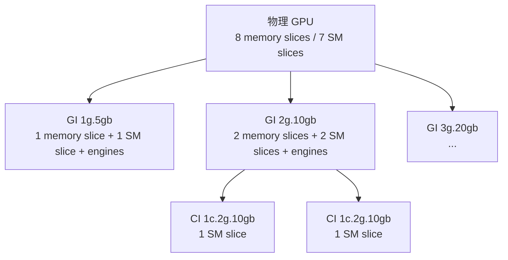
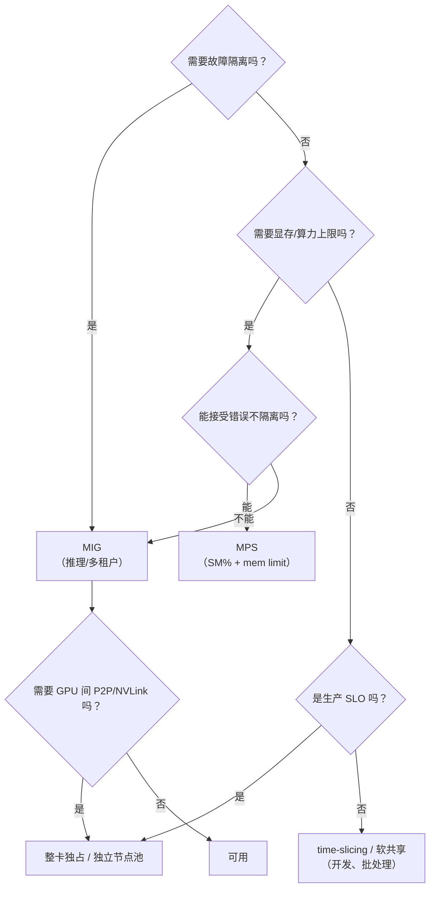

# 共享、隔离与拓扑

> **结论先行**：讨论「GPU 共享」时，必须同时问三个问题：
> **共享的是什么资源？隔离的是哪个维度？故障域是否仍然共享？**
> 只回答「一张卡分给了几个 Pod」是不够的。
>
> 按隔离强度排序：**MIG（硬件分区）> MPS（SM/内存限制，但错误不隔离）≈ 整卡独占（单租户）
> time-slicing（时间复用，无内存/故障隔离）> 约定式软共享（完全靠应用自律）**。
> HAMi 这类显存/算力配额属于「调度 + 限流」的软共享，不是硬件隔离。
> 把 replica 数或显存配额当作「隔离保证」，是训推混部尾延迟和 OOM 反复出现的根因。

## 一、先把「隔离」拆成维度

「隔离」不是一个布尔值。至少要看下面这些维度：

| 维度 | 含义 | 谁最容易破坏它 |
|---|---|---|
| **显存容量** | 一个租户最多能分配多少 HBM | time-slicing/软共享：没有硬上限 |
| **显存带宽** | 租户能否互相抢 DRAM 带宽 | 除 MIG 外基本都共享 |
| **SM/算力** | 租户能否互相抢 SM、Tensor Core | time-slicing 共享；MPS 按百分比限；MIG 硬分区 |
| **L2/缓存** | L2 slice、TLB、copy engine 是否独占 | MIG 独占 L2/部分引擎；MPS/time-slicing 共享 |
| **故障域** | 一个租户的非法访问/崩溃是否影响别人 | 只有 MIG 提供硬件故障隔离 |
| **P2P/NVLink** | 租户之间能否 P2P；MIG 实例能否用 NVLink | MIG 不支持 GPU-GPU P2P |
| **地址空间** | 进程能否读写别人的显存 | Volta+ MPS 有独立地址空间；CUDA stream 没有 |
| **调度可表达性** | 调度器能否知道「这张卡被切成了什么」 | device plugin 只知道整数；DRA 可以表达属性 |

后面的比较表都按这些维度打分：✅ 有保证，◐ 部分/尽力，❌ 不保证。

## 二、整卡独占

### 2.1 语义

`nvidia.com/gpu: 1` 在 device plugin 路径下就是「一整张物理 GPU」。调度器按整数计数，
kubelet checkpoint 记录 UUID，容器里 `NVIDIA_VISIBLE_DEVICES` 只包含这张卡。

隔离效果：

- 显存容量、显存带宽、SM、L2、copy engine 都归一个容器（只要没有别的容器绕过调度器挤进来）；
- 故障域基本独立：一个容器的 CUDA 错误通常不会影响另一个容器；
- 但**同一张卡上仍可能有多个进程**（容器内多进程、sidecar、监控 agent），它们共享同一张卡；
- **不提供 QoS**：一个进程把 SM 打满，同容器内其他进程仍然受影响。

### 2.2 边界

- **独占是编排层语义，不是硬件分区**。如果有人在节点上手动 `docker run --gpus all`，
  或者用 `NVIDIA_VISIBLE_DEVICES=all` 绕过调度器，独占就被打破。
- **整卡独占不保证 NUMA/NVLink 最优**。调度器只按整数选节点；NUMA 对齐要靠 Topology Manager
  （只到 NUMA），NVLink 域要靠 DRA 属性/自定义调度/应用自己选。
- **整卡独占不保证健康**。卡被 Xid 打挂、ECC 行重映射、NVLink 降级，仍然可能发生在「独占」的卡上。

适用：训练、单模型推理、需要完整 NVLink 带宽的 TP/EP、对故障隔离要求高的多租户。

## 三、历史约定式软共享

在 time-slicing/MIG 普及之前，常见做法是：

1. 多个 Pod 的 `NVIDIA_VISIBLE_DEVICES` 指向同一张 GPU；
2. 调度器只按 `nvidia.com/gpu` 计数，或者干脆不申请 GPU；
3. 团队之间靠「约定」谁用哪张卡、用多少显存；
4. 应用自己设 `gpu_memory_utilization` / batch size，避免把卡打爆。

这套做法的问题是**没有任何强制**：

- 没有显存上限：一个进程可以吃掉整张卡，其他进程 `CUDA out of memory`；
- 没有算力上限：一个训练进程可以把 SM 打满，推理 p99 直接崩；
- 没有故障隔离：一个进程的非法访问可能触发 Xid，影响同卡所有进程；
- 没有调度账本：平台不知道谁用了多少，无法计费/容量规划。

今天的 time-slicing replica、MPS、HAMi 都是对这套「约定」的不同程度的制度化，但只有 MIG
把隔离做进了硬件。**「约定式共享」不是贬义，它在开发/测试/批处理场景仍然合理；问题是不能
把它当成生产多租户隔离。**

## 四、time-slicing：把一张卡变成 N 个调度槽

### 4.1 机制

NVIDIA device plugin 的 `sharing.timeSlicing` 配置：

```yaml
version: v1
sharing:
  timeSlicing:
    renameByDefault: false
    failRequestsGreaterThanOne: true
    resources:
    - name: nvidia.com/gpu
      replicas: 4
```

效果：

- 节点上每张物理 GPU 被复制成 4 个「虚拟设备」，Node 的 `nvidia.com/gpu` capacity 变成
  `物理卡数 × 4`；
- 调度器把这 4 个槽位当作独立资源分配；
- 容器启动时，多个容器被注入同一个物理 GPU；
- CUDA 在时间上复用 GPU：一个进程的 kernel 执行完，另一个进程的 kernel 再上。

配置解析见
[`sharing.go`](https://github.com/NVIDIA/k8s-device-plugin/blob/17ab9a55d400ecc8d5a6c781a35f2744907fdd60/api/config/v1/sharing.go#L20-L50)，
replica 展开见
[`device_map.go`](https://github.com/NVIDIA/k8s-device-plugin/blob/17ab9a55d400ecc8d5a6c781a35f2744907fdd60/internal/rm/device_map.go#L284-L345)。

### 4.2 隔离语义

NVIDIA 文档写得很直接：

> time-slicing 下，**nothing special is done to isolate workloads**；每个 workload 都可以访问
> GPU 内存，并且和所有其他 workload 在同一个 fault-domain 里（一个崩溃，全部受影响）。

见 [k8s-device-plugin: Shared Access to GPUs](https://github.com/NVIDIA/k8s-device-plugin/blob/17ab9a55d400ecc8d5a6c781a35f2744907fdd60/README.md#L358-L372)
与 [GPU Operator: GPU Sharing](https://docs.nvidia.com/datacenter/cloud-native/gpu-operator/latest/gpu-sharing.html)。

| 维度 | time-slicing |
|---|---|
| 显存容量 | ❌ 无上限；所有容器共享整张卡的 HBM |
| 显存带宽 | ❌ 共享 |
| SM/算力 | ❌ 时间复用，没有配额 |
| 故障域 | ❌ 共享；一个进程崩可能带走同卡其他进程 |
| 调度可表达性 | ✅ replica 数可被调度器看到 |
| 适用 | 开发、测试、批处理、低优先级任务；**不适合**有 SLO 的多租户推理 |

### 4.3 什么时候可以接受

- 开发/调试：一个人一张卡太浪费，time-slicing 2–4 路足够；
- 离线批处理：任务可以重试，OOM/崩溃可接受；
- 推理的「低优先级溢出」：有独立的高优先级池，time-slicing 只接 best-effort 流量；
- **不接受**：在线推理的 p99 SLO、训练的关键路径、需要故障隔离的多租户。

### 4.4 两个实用开关

- `renameByDefault: true`：把资源名改成 `nvidia.com/gpu.shared`，避免应用误以为拿到独占卡；
- `failRequestsGreaterThanOne: true`：容器请求超过 1 个 shared 资源时直接失败，避免
  「我申请了 4 个 replica，就应该有 4 倍算力」的误解。

## 五、MPS：SM 百分比 + 内存上限，但不是故障隔离

### 5.1 架构

MPS（Multi-Process Service）由三部分组成：

- `nvidia-cuda-mps-control`：控制守护进程；
- `nvidia-cuda-mps-server`：每张 GPU 一个 server，持有 GPU 调度资源；
- `libcuda.so` 内的 client runtime：应用透明使用。

多个 client 连接到同一个 server，共享 GPU 上下文/调度资源，但各自有独立的地址空间（Volta+）。

### 5.2 能限制什么

| 维度 | MPS |
|---|---|
| SM/算力 | ◐ 可按 `CUDA_MPS_ACTIVE_THREAD_PERCENTAGE` 限制每个 client 的 SM 百分比；不是硬分区 |
| 显存容量 | ◐ Volta+ 支持 per-client device memory limit；超过返回 CUDA OOM |
| 显存带宽 | ❌ 共享，没有 QoS |
| L2/缓存 | ❌ 共享 |
| 地址空间 | ✅ Volta+ client 有独立地址空间 |
| 故障域 | ❌ 不隔离；一个 client 的致命错误会报告给同 GPU 上所有 client，server 进入 FAULT |
| P2P/NVLink | ❌ 不改变 GPU 间的 P2P 语义 |

NVIDIA MIG 文档对 MPS 的总结很准确：

> MPS 目前不提供客户端之间的错误隔离；虽然每个 MPS 客户端使用的 SM 可以有选择地限制为
> 所有 SM 的百分比，但调度硬件仍然是共享的；内存带宽、缓存和容量在 MPS 客户端之间都是共享的。

见 [MIG User Guide: CUDA 并发机制](https://docs.nvidia.com/datacenter/tesla/mig-user-guide/index.html#cuda-concurrency-mechanisms)
与 [MPS 文档](https://docs.nvidia.com/deploy/mps/index.html)。

### 5.3 设备插件/DRA 里的 MPS

device plugin 的 MPS 支持是**实验性**的：

```yaml
version: v1
sharing:
  mps:
    resources:
    - name: nvidia.com/gpu
      replicas: 10
```

- 只支持整卡 `nvidia.com/gpu`；
- **不支持 MIG 设备**（插件代码里显式报错）；
- 每个 MPS server 由 `mps-control-daemon` 管理；插件 mount pipe/shm 目录；
- daemon 会设 `set_default_active_thread_percentage = 100 / replicas`，
  并设 `set_default_device_pinned_mem_limit = total_memory / replicas`；
- 这是**节点级**配置：同一节点所有 GPU 用同一种共享策略，不能按 Pod 配。

关键源码：

- [`internal/plugin/mps.go`](https://github.com/NVIDIA/k8s-device-plugin/blob/17ab9a55d400ecc8d5a6c781a35f2744907fdd60/internal/plugin/mps.go#L40-L91)
- [`mps/daemon.go`](https://github.com/NVIDIA/k8s-device-plugin/blob/17ab9a55d400ecc8d5a6c781a35f2744907fdd60/cmd/mps-control-daemon/mps/daemon.go#L240-L280)

DRA 则可以把 MPS 配置放进 **per-claim** 的 `GpuConfig`：

```yaml
sharing:
  strategy: MPS
  mpsConfig:
    defaultActiveThreadPercentage: 50
    defaultPinnedDeviceMemoryLimit: 10Gi
```

这是 DRA 相对 device plugin 的一个实际优势：**共享策略可以按工作负载配置，而不是按节点配置**。
见 [`gpu-test5.yaml`](https://github.com/NVIDIA/k8s-dra-driver-gpu/blob/0882da8720c28763137e0987778ec476ec4cf8df/demo/specs/quickstart/v1/gpu-test5.yaml#L24-L50)。

### 5.4 MPS 的故障模式

- **server FAULT**：一个 client 触发致命错误，server 状态变 FAULT，新 client 收到
  `CUDA_ERROR_MPS_SERVER_NOT_READY`；要等所有 client 退出后 server 重建。
- **client 提前终止**：未同步就 Ctrl-C/segfault 可能让 server 进入未定义状态，导致挂起。
- **内存上限不是带宽 QoS**：即使每个 client 限了 10GiB，它们仍然抢同一个 HBM 带宽。
- **MPS + MIG**：NVIDIA 文档说 MIG 之上支持 MPS，最大 client 数按 CI 大小缩放；但
  device plugin 的 MPS 实现不支持 MIG，二者不要混用。

> MPS v3（2026 文档）引入了 namespaces、SM partitions、memory partitioning 等新接口。
> 选型时要确认你的工具链（device plugin / DRA driver / GPU Operator）实际用的是 v2 还是 v3
> 控制接口；不要把 v2 的「共享内存带宽」结论直接套到 v3 的新特性上，也不要把 v3 的新能力
> 当成所有环境都有。

## 六、MIG：唯一提供硬件故障隔离的方案

### 6.1 GI/CI 与资源切片

MIG 把一张 GPU 切成多个 **GPU Instance（GI）**，每个 GI 包含：

- 若干 memory slice（每片约 1/8 显存，含对应的 memory controller/L2/DRAM 带宽）；
- 若干 SM slice（每片约 1/7 SM）；
- 若干 GPU engine（DMA/copy engine、NVDEC/NVENC 等）。

GI 还可以继续切成 **Compute Instance（CI）**：CI 共享父 GI 的显存和引擎，但有独立的 SM 子集。
GI 提供内存 QoS；CI 不提供额外的内存隔离。



### 6.2 隔离语义

| 维度 | MIG |
|---|---|
| 显存容量 | ✅ 每个 GI 有专用 memory slice |
| 显存带宽 | ✅ 专用 memory controller/L2/DRAM 路径，提供 QoS |
| SM/算力 | ✅ 专用 SM slice |
| L2/缓存 | ✅ 专用 L2 slice |
| 故障域 | ✅ 硬件级故障隔离 |
| P2P/NVLink | ❌ **不支持 GPU-GPU P2P（PCIe 或 NVLink）** |
| 跨 GI IPC | ❌ 不支持跨 GI 的 CUDA IPC；支持跨 CI 的 IPC |
| 动态重配 | ◐ 创建/销毁 GI/CI 是动态的，但切换 MIG 模式需要 GPU reset |
| 调度可表达性 | ✅ device plugin `mixed` 策略暴露 `nvidia.com/mig-*`；DRA 可发布 profile/容量 |

NVIDIA 文档明确写：

- 每个实例有独立且隔离的片上交叉开关端口、L2 cache bank、memory controller、DRAM 地址总线；
- 不支持 GPU 到 GPU 的 P2P（PCIe 或 NVLink）；
- 不支持跨 GPU Instance 的 CUDA IPC；支持跨 Compute Instance 的 CUDA IPC；
- 支持 GPUDirect RDMA（从 GPU Instance 使用）。

见 [MIG User Guide](https://docs.nvidia.com/datacenter/tesla/mig-user-guide/index.html)。

### 6.3 为什么 MIG 不适合分布式训练

分布式训练依赖 NCCL 的 collective。NCCL 会优先用 NVLink/P2P，其次 PCIe P2P，最后 host
memory。MIG 实例之间**没有 P2P**，所以：

- 同一张物理 GPU 上的两个 MIG 实例不能用 NVLink P2P 通信；
- NCCL 可能退化为通过 host memory/网络，带宽和延迟显著变差；
- 跨节点的 MIG 训练更复杂：每个 MIG 实例的 RDMA 能力、拓扑都不同。

MIG 更适合：

- 多租户推理（每个租户一个 GI，显存/带宽/故障隔离）；
- 小模型/开发环境（1g.5gb 之类的切片）；
- 推理 + 轻量微调（需要确认框架是否支持 MIG 和 P2P 退化）。

不适合：需要 TP/EP/FSDP 跨 GPU 高带宽通信的训练主路径。

### 6.4 MIG 的调度表达

device plugin 的 `migStrategy`：

| 策略 | 资源名 | 适用 |
|---|---|---|
| `none` | `nvidia.com/gpu` 只暴露整卡 | 不用 MIG |
| `single` | 所有 MIG 实例统一暴露为 `nvidia.com/gpu` | 整卡和 MIG 不混用；简单 |
| `mixed` | 整卡 `nvidia.com/gpu` + `nvidia.com/mig-<profile>` | 需要按 profile 精确申请 |

`mixed` 下的资源名形如 `nvidia.com/mig-1g.5gb`、`nvidia.com/mig-3g.20gb`。
配置与 label 逻辑见
[`mig-strategy.go`](https://github.com/NVIDIA/k8s-device-plugin/blob/17ab9a55d400ecc8d5a6c781a35f2744907fdd60/internal/lm/mig-strategy.go#L60-L130)。

DRA 路径下，NVIDIA driver 可以把 MIG 设备作为独立 Device 发布，带 `profile`、
`parentUUID`、`memory`、`multiprocessors` 等属性；还支持 Dynamic MIG（按 claim 创建）。
但 GPU DRA plugin 目前仍是实验性，生产要评估成熟度。

### 6.5 MIG 的运维注意

- **切换 MIG 模式需要 GPU reset/root**；A100/A30 上 MIG 模式持久化到重启，直到显式切换；
- 切换前要停止持有驱动句柄的进程（DCGM、nvsm、监控）；
- profile 组合受放置约束，创建/销毁会产生碎片；`nvidia-smi mig -lgip` 看可用 profile，
  `-lgi` 看已建实例；
- MIG 实例的 `nvidia-smi -L` 名称与 `nvidia.com/mig-*` 资源名要能对上；
- **MIG + time-slicing** 可以组合（在 MIG 实例上再时间分片），但隔离进一步减弱；
- **MIG + MPS** 理论支持，但 device plugin 的 MPS 实现不支持 MIG；用 DRA 或手工配置时要验证。

## 七、CUDA 显存上限：新的「容量隔离」工具

NVIDIA 驱动较新版本提供了 per-cgroup 的 GPU 显存限制接口：
`nvmlDeviceSetMemoryLimits_v1(namespace, requests, limits)`。NVIDIA Container Toolkit 通过
CDI hook `apply-cuda-memory-limits` 使用它：

- 读取容器环境变量 `NVIDIA_GPU_MEMORY_REQUEST` / `NVIDIA_GPU_MEMORY_LIMIT`（单位 MiB）；
- 只支持 cgroup v2；
- 通过 `libnvidia-ml.so.1` 调 `SetMemoryLimits_v1`；
- 限制的是**显存容量**，不是带宽/SM/故障域。

源码见
[`apply-cuda-memory-limits.go`](https://github.com/NVIDIA/nvidia-container-toolkit/blob/adbd28c39b60f8eb7e03115b5ac61e58703f0ce7/cmd/nvidia-cdi-hook/apply-cuda-memory-limits/apply-cuda-memory-limits.go#L36-L70)。

适用场景：

- 在 time-slicing/软共享环境里，给每个容器一个**显存硬上限**，避免一个容器吃掉整卡；
- 作为 HAMi 之类的替代/补充（但 HAMi 还有算力限流）。

边界：

- 需要驱动支持；老驱动/老 GPU 可能不支持；
- 只限容量，不限带宽；多个容器仍然抢 HBM 带宽；
- 不是 Kubernetes 原生资源，调度器不知道这个上限；
- 与 MIG 的容量隔离不是一回事（MIG 是硬件分区，这是驱动层配额）。

## 八、横向比较

| 方案 | 显存容量 | 显存带宽 | SM/算力 | 故障域 | P2P/NVLink | 调度表达 | 动态重配 | 典型用途 |
|---|---|---|---|---|---|---|---|---|
| **整卡独占** | ✅ | ✅ | ✅ | ✅（单租户） | ✅ | 整数 GPU | 中 | 训练、单模型推理 |
| **约定式软共享** | ❌ | ❌ | ❌ | ❌ | ✅ | 无/手工 | 高 | 开发、临时 |
| **time-slicing** | ❌ | ❌ | ❌（时间复用） | ❌ | ✅ | replica 数 | 高 | 开发、批处理 |
| **MPS** | ◐（Volta+ 可限） | ❌ | ◐（百分比） | ❌（错误不隔离） | ✅ | replica/配置 | 中 | 协作式 MPI、多个小推理 |
| **MIG** | ✅ | ✅ | ✅ | ✅ | ❌ | `mig-*`/DRA | 中（需 reset） | 多租户推理、切片 |
| **HAMi** | ◐（CUDA 拦截） | ❌ | ◐（令牌桶） | ❌ | ✅ | 自定义资源 | 高 | 软共享、成本优化 |
| **CUDA 显存上限** | ✅（容量） | ❌ | ❌ | ❌ | ✅ | 无（hook） | 中 | 防止单容器吃满 |

> 符号说明：✅ 有明确保证；◐ 部分/尽力/可配置；❌ 不保证。
> 「整卡独占」的故障域隔离是相对其他容器而言；同一容器内多进程仍然共享。

### 8.1 一个具体的反例

假设一张 80GB GPU，time-slicing `replicas: 4`，四个推理容器各收到一个「1 GPU」的槽位：

- 每个容器都认为自己有 80GB；
- 容器 A 的 `gpu_memory_utilization=0.9`，先吃掉 72GB；
- 容器 B 加载模型时 `CUDA out of memory`；
- 容器 C 的 kernel 和 A 的 kernel 时间片交错，p99 从 50ms 涨到 300ms；
- 容器 D 触发 Xid 13，A/B/C 的 CUDA context 也可能被影响。

调度器看到的是「4 个 GPU 槽位已分配」，监控看到的是「GPU 利用率 100%」，但没有任何一个
租户得到了它以为的隔离。**这就是「分配份额」与「隔离保证」的差距。**

## 九、GPU / PCIe / NUMA / NIC / NVLink / RDMA 的关系

### 9.1 互联层次

| 介质 | 作用域 | 典型带宽 | 是否可被 GPU load/store | 备注 |
|---|---|---|---|---|
| HBM | 单卡 | 数 TB/s | ✅ | 显存本体 |
| NVLink | 单机/机架 GPU 间 | 数百 GB/s 到 TB/s 级 | ✅（P2P） | NVSwitch 提供全互联 |
| PCIe | 单机 CPU/GPU/NIC 间 | Gen4 x16 ~32GB/s，Gen5 ~64GB/s | ✅（P2P，需 ACS/IOMMU 配合） | 拓扑层级决定带宽 |
| NUMA/UPI | 多 socket CPU | 数十到数百 GB/s | 间接 | 跨 socket 访存延迟更高 |
| InfiniBand/RoCE | 集群节点间 | 100–800 Gb/s | ❌（需 RDMA/GPUDirect） | 训练/推理 KV 传输 |
| NVLink-C2C | Grace CPU↔GPU | 数百 GB/s | ✅ | 硬件一致 |

### 9.2 `nvidia-smi topo` 的图例

`nvidia-smi topo -m` 输出 GPU、NIC、CPU 亲和矩阵，图例：

| 符号 | 含义 |
|---|---|
| `X` | 自身 |
| `SYS` | 跨 PCIe + NUMA 节点之间的 SMP 互连（如 UPI/QPI） |
| `NODE` | 同一 NUMA 节点内，跨 PCIe 主桥 |
| `PHB` | 经过 PCIe 主桥（通常是 CPU） |
| `PXB` | 经过多个 PCIe switch，但不经过主桥 |
| `PIX` | 经过单个 PCIe switch |
| `NV#` | 经过 # 个 NVLink bond |

`nvidia-smi topo -mp` 只看 PCIe 连接（排除 NVLink），适合判断 GPU-NIC 是否在同一 PCIe 树。
`nvidia-smi topo -p2p r/w/n/a/p` 查看 GPU 间 P2P 读/写/NVLink/原子/PCIe 能力。
见 [nvidia-smi 文档](https://docs.nvidia.com/deploy/nvidia-smi/index.html)。

### 9.3 怎么测

```bash
# 拓扑矩阵与 NUMA
nvidia-smi topo -m
nvidia-smi topo -mp
nvidia-smi topo -C -i 0      # GPU 0 最近的 CPU NUMA
nvidia-smi topo -M -i 0      # GPU 0 最近的 memory NUMA
nvidia-smi topo -gnid -i 0   # GPU 0 的 NUMA ID
nvidia-smi topo -p2p r       # P2P 读能力
nvidia-smi topo -p2p n       # NVLink 能力

# NVLink 状态/能力/错误
nvidia-smi nvlink -s
nvidia-smi nvlink -c
nvidia-smi nvlink -e

# PCIe 链路
lspci -tv
lspci -vv -s 0000:3b:00.0 | grep -E 'LnkCap|LnkSta'
cat /sys/bus/pci/devices/0000:3b:00.0/current_link_speed
cat /sys/bus/pci/devices/0000:3b:00.0/current_link_width

# NUMA / 拓扑
numactl -H
lstopo --of txt
cat /sys/bus/pci/devices/0000:3b:00.0/numa_node

# 带宽/延迟
nvbandwidth
all_reduce_perf -b 8 -e 8G -f 2 -g 8
ib_write_bw -d mlx5_0
dcgmi diag -r 2
```

### 9.4 几个容易误判的关系

- **NUMA 对齐 ≠ NVLink 对齐**。GPU 0 和 GPU 1 可能在同一 NUMA，但中间隔着 PCIe switch；
  也可能跨 NUMA 但 NVLink 全互联。`nvidia-smi topo -m` 同时看 NVLink 和 PCIe。
- **NVLink 存在 ≠ NCCL 一定走 NVLink**。NCCL 会根据拓扑、P2P 能力、MIG、环境变量选择路径；
  看 `NCCL_DEBUG=INFO` 的拓扑日志，而不是猜。
- **MIG 实例没有 P2P**。即使父 GPU 有 NVLink，MIG 实例之间也不能 P2P；跨 MIG 的 NCCL
  会退化。
- **GPUDirect RDMA 需要 NIC 和 GPU 在同一 PCIe 树**，并且加载 `nvidia_peermem`、IOMMU 配置正确；
  `nvidia-smi topo -m` 里的 NIC 列只是拓扑提示，不代表 RDMA 已经可用。
- **PCIe 链路宽度/代数会降级**。`lspci -vv` 的 `LnkSta` 可能显示 x8 或 Gen3，而 GPU 标称 x16 Gen5；
  这会直接限制 P2P/RDMA，但 `nvidia-smi` 不一定告警。

### 9.5 Topology Manager 能做什么、不能做什么

| 能做 | 不能做 |
|---|---|
| 把 CPU、memory、device 的 NUMA hint 合并 | 不知道 NVLink/PCIe 距离 |
| 用 `restricted`/`single-numa-node` 拒绝跨 NUMA Pod | 不会选择「同一 NVLink 域」的 GPU |
| `prefer-closest-numa-nodes` 优先近邻 NUMA | 不保证内存带宽/延迟 |
| pod scope 让整个 Pod 对齐 | 不会迁移已运行的 Pod |

如果业务需要「同一 NVLink 域」「GPU 与 NIC 同 PCIe switch」，需要：

1. DRA driver 把这些拓扑建模成 device attributes，用 CEL 选择；
2. 或自定义 scheduler plugin / topology-aware scheduler（如 Kueue TAS、Volcano）；
3. 或在节点池/节点标签层面预先分组，让调度器只选「拓扑正确」的节点；
4. 应用层（NCCL `NCCL_TOPO_FILE`、`NCCL_IB_HCA`）做最后确认。

## 十、选型决策树



补充：

- 训练主路径：优先整卡独占 + 独立节点池；MIG 只用于推理/开发。
- 推理多租户：MIG 优先；MPS 次之；time-slicing 只做溢出。
- 开发/批处理：time-slicing 或 HAMi，接受 OOM/重试。
- 需要显存硬上限但不想 MIG：CUDA memory limit hook（需驱动支持）或 HAMi。

## 十一、检查清单

- [ ] 你说的「共享」是调度槽位、时间片、SM 百分比，还是硬件分区？
- [ ] 显存容量有没有硬上限？谁执行？
- [ ] 显存带宽/SM 有没有 QoS？谁来保证？
- [ ] 一个租户崩溃会不会影响同卡其他租户？
- [ ] MIG 实例是否需要 P2P？NCCL 是否验证过？
- [ ] 是否把 `nvidia-smi topo -m` 的 `NV#` 当成「NCCL 一定走 NVLink」？
- [ ] GPU 与 NIC 是否在同一 PCIe 树？GPUDirect RDMA 是否实测？
- [ ] 是否用 Topology Manager 做 NVLink 放置？如果是，改成 DRA 属性/自定义调度。
- [ ] 是否在生产用 time-slicing 承载 p99 SLO？

## 参考与证据

**NVIDIA 文档**

- [MIG User Guide](https://docs.nvidia.com/datacenter/tesla/mig-user-guide/index.html)
- [MPS Documentation](https://docs.nvidia.com/deploy/mps/index.html)
- [GPU Operator: GPU Sharing](https://docs.nvidia.com/datacenter/cloud-native/gpu-operator/latest/gpu-sharing.html)
- [nvidia-smi Documentation](https://docs.nvidia.com/deploy/nvidia-smi/index.html)
- [GPUDirect RDMA](https://docs.nvidia.com/cuda/gpudirect-rdma/index.html)
- [NCCL User Guide](https://docs.nvidia.com/deeplearning/nccl/user-guide/docs/)

**NVIDIA 源码**

- [device plugin sharing 配置](https://github.com/NVIDIA/k8s-device-plugin/blob/17ab9a55d400ecc8d5a6c781a35f2744907fdd60/api/config/v1/sharing.go#L20-L50)
- [device plugin replica 展开](https://github.com/NVIDIA/k8s-device-plugin/blob/17ab9a55d400ecc8d5a6c781a35f2744907fdd60/internal/rm/device_map.go#L284-L345)
- [device plugin MPS](https://github.com/NVIDIA/k8s-device-plugin/blob/17ab9a55d400ecc8d5a6c781a35f2744907fdd60/internal/plugin/mps.go#L40-L91)
- [MPS daemon 线程/内存限制](https://github.com/NVIDIA/k8s-device-plugin/blob/17ab9a55d400ecc8d5a6c781a35f2744907fdd60/cmd/mps-control-daemon/mps/daemon.go#L240-L280)
- [MIG strategy](https://github.com/NVIDIA/k8s-device-plugin/blob/17ab9a55d400ecc8d5a6c781a35f2744907fdd60/internal/lm/mig-strategy.go#L60-L130)
- [CUDA memory limit hook](https://github.com/NVIDIA/nvidia-container-toolkit/blob/adbd28c39b60f8eb7e03115b5ac61e58703f0ce7/cmd/nvidia-cdi-hook/apply-cuda-memory-limits/apply-cuda-memory-limits.go#L36-L70)
- [DRA GpuConfig](https://github.com/NVIDIA/k8s-dra-driver-gpu/blob/0882da8720c28763137e0987778ec476ec4cf8df/api/nvidia.com/resource/v1beta1/gpuconfig.go#L28-L70)

**站内**

- [HAMi](../Accelerators/hami.md)
- [HAMi-core](../Accelerators/hami-core.md)
- [GPU 算力/显存池化](../../../Machine_Learning/High_Performance_Computing/gpu-cluster-pooling.md)
- [GPU 软件栈与接入链路](./gpu-access-chain.md)
