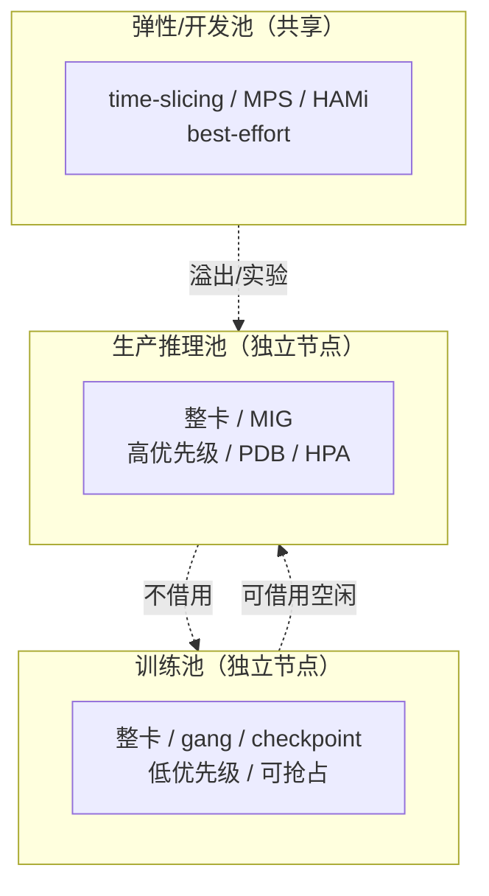
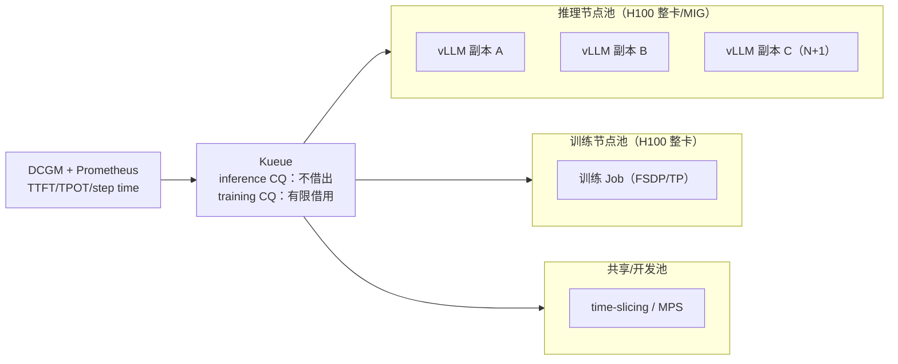

# 训推混部与协同放置

> **结论先行**：训推混部不是「把训练和推理放到同一个集群」这么简单，它是一份**容量合同**：
> 推理需要尾延迟和最小副本，训练需要吞吐和可抢占；平台要在**隔离、优先级、回收时限、容量余量**
> 四件事上同时给出保证。只做调度不做合同，结果通常是推理 p99 被训练拖垮，或者训练永远抢不到卡。
>
> 另一个关键约束是：**DRA 资源目前不支持调度器抢占**。如果 GPU 通过 DRA 分配，高优先级推理
> 不能靠 kube-scheduler 抢占训练；必须用 Kueue 之类的上层回收，或把推理放到独立节点池。

## 一、两类工作负载的画像

| 维度 | 在线推理 | 训练 |
|---|---|---|
| 目标 | TTFT/TPOT、p95/p99、可用性 | tokens/s、step time、MFU、完成时间 |
| 运行时长 | 长驻，按请求波动 | 小时–天，阶段性 |
| 资源形态 | 固定副本 + HPA；GPU 显存要留 KV cache | gang/多卡同步；显存/带宽尽量吃满 |
| 对延迟敏感 | 极高；尾延迟决定 SLO | 中等；step time 决定成本 |
| 可抢占性 | 低（除非有副本冗余/快速重启） | 高（有 checkpoint 时） |
| 故障代价 | 请求失败/超时；可重试 | 训练中断；丢失自上次 checkpoint 的进度 |
| 典型干扰源 | 同卡训练 kernel、CPU tokenizer、PCIe/NVLink 争用 | 同卡推理抢占 SM/显存带宽、CPU dataloader、checkpoint I/O |

### 1.1 推理的关键指标

- **TTFT**（Time To First Token）：prefill + 排队；受 prompt 长度、batch、KV cache 影响；
- **TPOT/ITL**（Time Per Output Token / Inter-Token Latency）：decode 阶段；受 batch、显存带宽影响；
- **p95/p99**：比平均值更重要；排队论下，利用率接近 1 时尾延迟非线性上升；
- **goodput**：满足 SLO 的 token/s，而不是裸吞吐；
- **cold start**：模型加载、CUDA graph capture、权重从存储读取。

### 1.2 训练的关键指标

- **step time** / **tokens per second**；
- **MFU**（Model FLOPs Utilization）：实际算力/峰值算力；
- **checkpoint 时间与大小**：决定抢占损失和恢复时间；
- **NCCL 带宽/延迟**：受 NVLink/PCIe/IB 拓扑影响；
- **dataloader CPU/IO**：常见瓶颈，GPU 利用率高但 step time 不降。

## 二、干扰矩阵：混部到底在争什么

| 资源 | 推理受训练的影响 | 训练受推理的影响 | 观测 |
|---|---|---|---|
| **GPU 显存容量** | KV cache 被挤占 → OOM/降 batch | 训练 OOM | `nvidia-smi` memory、DCGM FB used |
| **HBM 带宽** | decode 变慢、TPOT 上升 | 训练 step time 上升 | DCGM DRAM util、`ncu` |
| **SM/Tensor Core** | TTFT/TPOT 抖动 | MFU 下降 | DCGM SM/tensor active、`ncu` |
| **L2/缓存** | 命中率下降 | 吞吐下降 | `ncu`、DCGM |
| **copy engine** | 数据拷贝变慢 | checkpoint/H2D 变慢 | DCGM copy util |
| **PCIe** | 权重加载、KV 传输变慢 | H2D/D2H、checkpoint 变慢 | DCGM PCIe TX/RX、`nvidia-smi topo` |
| **NVLink** | TP 通信变慢 | all-reduce 变慢 | `nvidia-smi nvlink -e`、NCCL 日志 |
| **CPU** | tokenizer/调度线程被抢 | dataloader 饿死 | cgroup `cpu.stat`、PSI |
| **主机内存** | page cache 被挤、OOM | dataloader/checkpoint 抖动 | `memory.events`、PSI |
| **本地 I/O** | 模型加载/日志变慢 | checkpoint 写放大 | `iostat`、PSI io |
| **网络** | KV 传输/请求排队 | NCCL/参数同步变慢 | IB counters、NCCL |
| **功耗/温度** | 降频 → 尾延迟 | 降频 → step time | DCGM power/thermal throttle |

> 同一张 GPU 上混训推，最危险的不是「平均利用率」，而是**尾延迟**：训练的一次大 kernel 或
> all-reduce 可能让推理的 decode 停顿几十毫秒，p99 直接超 SLO。time-slicing/MPS 都无法消除
> 这种抖动；MIG 可以，但 MIG 又不适合训练。

## 三、放置模式：从最安全到最激进

| 模式 | 隔离 | 资源利用率 | 适用 | 风险 |
|---|---|---|---|---|
| **独立节点池** | 强（物理隔离） | 中 | 生产推理、关键训练 | 成本高；需要容量规划 |
| **同节点不同 GPU** | 中（GPU 独立，CPU/NIC/PCIe 共享） | 较高 | 中小规模混部 | NUMA/PCIe/NIC 争用；故障域同节点 |
| **MIG 切片** | 强（显存/带宽/故障隔离） | 高（推理） | 多租户推理、小模型 | 不适合 TP/EP/P2P 训练（无 P2P）；单卡/DP 可跑；profile 碎片 |
| **MPS** | 中（SM/内存限制，错误不隔离） | 高 | 协作式多进程、多个小推理 | server FAULT 会带走同 GPU 客户端 |
| **time-slicing** | 弱（无内存/故障隔离） | 最高 | 开发、批处理、溢出 | p99 不稳定；OOM/崩溃互相影响 |
| **HAMi/软共享** | 弱（CUDA 拦截） | 高 | 成本优化、非关键 | 绕过/越界风险；不适合 SLO |

### 3.1 推荐的分层



原则：

1. **生产推理和关键训练物理隔离**；至少不同节点池。
2. **训练可以借用推理池的空闲容量**，但要有上限和回收时限；推理不能反过来被训练挤占。
3. **开发和批处理放在共享池**，用 time-slicing/MPS/HAMi，不承诺 SLO。
4. **MIG 只用于推理/小模型**；训练主路径不要用 MIG。

## 四、容量模型：先算清楚，再谈混部

### 4.1 推理显存

```text
GPU 显存 = 权重
         + KV cache
         + 激活/workspace
         + CUDA context / 通信 buffer
         + 碎片/预留
```

权重：

```text
weights_bytes = params × bytes_per_param
# FP16/BF16: 2 bytes; FP8: 1 byte; FP32: 4 bytes
```

KV cache（简化，MHA）：

```text
kv_per_token = 2 × layers × kv_heads × head_dim × bytes_per_element
kv_total = kv_per_token × seq_len × batch × concurrent_requests
```

GQA/MQA 用 `kv_heads` 而不是 `heads`；具体实现还要看 block size、prefix cache、PagedAttention。

vLLM 的 `--gpu-memory-utilization` 是**每个实例的预算**，不是内核强制；它不会阻止同一张卡上的
其他进程分配显存。`--kv-cache-memory-bytes` 可以更精细地控制 KV cache。见
[vLLM Engine Arguments](https://docs.vllm.ai/en/latest/configuration/engine_args.html)。

**headroom 建议**：

- 至少留 5–10% 显存给碎片/workspace/通信；
- 生产推理不要把 `gpu_memory_utilization` 设到 1.0；除非你确认没有其他进程、且框架支持
  extensible KV cache；
- 同卡混部时，给每个实例设独立的显存上限（CUDA memory limit hook/MIG/MPS），否则
  「预算」只是君子协定。

### 4.2 训练显存

混合精度 + Adam 的粗略估算：

```text
per-param bytes ≈ 2 (FP16 weights)
                + 2 (FP16 grads)
                + 4 (FP32 master)
                + 4 (Adam m)
                + 4 (Adam v)
                = 16 bytes/param
```

再加激活、临时 buffer、通信 bucket。7B 模型仅参数/优化器就约 112GB，必须用 FSDP/ZeRO/TP
切分；不能简单「一张 80GB 卡放一个 7B 训练」。

训练侧的关键不是「能不能放下」，而是「放下后 step time 是否可接受」。如果为了塞进显存把
batch 降到很小，GPU 利用率/MFU 会很难看。

### 4.3 抢占损失

```text
平均丢失进度 ≈ checkpoint_interval / 2
抢占总成本 ≈ 平均丢失进度 + checkpoint 写入时间 + 重启/加载时间 + 重新建通信时间
```

如果 checkpoint 每 30 分钟一次，平均丢 15 分钟；再加 2 分钟写 checkpoint、3 分钟重启，
一次抢占成本约 20 分钟。**回收时限**必须大于这个成本，否则抢占比不抢更亏。

### 4.4 回收时限

```text
reclaim_budget ≥ drain_time + checkpoint_time + restart_time + safety_margin
```

- `drain_time`：停止接新请求/通知训练进程的时间；
- `checkpoint_time`：写 checkpoint 的时间（受存储带宽限制）；
- `restart_time`：重新调度、拉镜像、加载模型/checkpoint、建 NCCL 的时间；
- `safety_margin`：20–30%。

如果 `reclaim_budget` 小于 checkpoint 时间，就不要承诺「可抢占」；应该把训练放到独立池，
或者用更频繁的小 checkpoint/增量 checkpoint。

## 五、可抢占性与回收机制

### 5.1 Kubernetes 原生

| 机制 | 作用 | 边界 |
|---|---|---|
| `PriorityClass` | 定义优先级；高优先级 Pod 可抢占低优先级 | 只影响调度；不保证 checkpoint |
| `preemptionPolicy: PreemptLowerPriority` | 允许抢占 | 被抢占 Pod 收到 SIGTERM（有 grace period） |
| `preemptionPolicy: Never` | 不抢占别人 | 高优先级推理可以保护自己，但可能 Pending |
| `terminationGracePeriodSeconds` | 给 Pod 清理时间 | 要大于 checkpoint + drain |
| `PodDisruptionBudget` | 保护自愿驱逐（drain/eviction） | 不保证所有抢占/删除都遵守 |
| `topologySpreadConstraints` | 打散副本 | 需要节点标签 |
| HPA | 推理副本伸缩 | 冷启动可能拖慢扩容 |

DRA 的例外：**调度器不支持对 DRA 资源做抢占**。高优先级 Pod 需要 DRA 设备时，只能等设备释放；
不会把正在使用 DRA 设备的低优先级 Pod 抢走。见
[DRA Limitations](https://kubernetes.io/docs/concepts/resource-management/dynamic-resource-allocation/#limitations)。

### 5.2 Kueue

Kueue 把「队列/配额/抢占」做成了 API：

| 能力 | 字段/对象 | 用途 |
|---|---|---|
| 配额 | `ClusterQueue.spec.resourceGroups[].flavors[].resources[].nominalQuota` | 队列的保证配额 |
| 借用 | `borrowingLimit` + `cohortName` | 允许借用同 cohort 的空闲配额 |
| 出借上限 | `lendingLimit` | 保护自己的配额不被别人借光 |
| 队列内抢占 | `preemption.withinClusterQueue` | 高优先级 Workload 抢低优先级 |
| 队列间回收 | `preemption.reclaimWithinCohort` | 回收别的 CQ 超额借用的配额 |
| 停止准入 | `stopPolicy: Hold` / `HoldAndDrain` | 事故/维护时停止新 Workload |
| 最大运行时长 | `Workload.spec.maximumExecutionTimeSeconds` | 防止跑飞 |
| 释放不再需要的配额 | `status.reclaimablePods` | 例如部分 rank 完成后释放资源 |

源码/字段见
[`clusterqueue_types.go`](https://github.com/kubernetes-sigs/kueue/blob/be7dc9d31470258dd324e5bd6d84f7eaf90f5f69/apis/kueue/v1beta2/clusterqueue_types.go#L86-L194)
与 [`workload_types.go`](https://github.com/kubernetes-sigs/kueue/blob/be7dc9d31470258dd324e5bd6d84f7eaf90f5f69/apis/kueue/v1beta2/workload_types.go#L80-L100)。

> `reclaimablePods` 是「这些 Pod 的资源我已经不需要了，可以释放配额」，不是「抢占这些 Pod」。
> 不要把它当抢占机制用。

### 5.3 SIGTERM 与 checkpoint

训练进程要正确处理 SIGTERM：

```python
import signal, sys, threading

stop = threading.Event()

def on_term(signum, frame):
    stop.set()

signal.signal(signal.SIGTERM, on_term)

# 训练循环里检查 stop，保存 checkpoint 后退出
```

Pod 侧：

```yaml
spec:
  terminationGracePeriodSeconds: 600   # 要覆盖 checkpoint 时间
  containers:
  - name: trainer
    lifecycle:
      preStop:
        exec:
          command: ["/bin/sh", "-c", "sleep 5"]  # 给负载均衡/rank 通知留时间
```

注意：

- `terminationGracePeriodSeconds` 不够，kubelet 会 SIGKILL，checkpoint 可能损坏；
- checkpoint 要原子写（临时文件 + rename），避免 SIGKILL 留下半截文件；
- 训练框架的 elastic/rendezvous 要能从 checkpoint 恢复；
- 推理的 `preStop` 要先从 Service Endpoint 摘除，再等待 in-flight 请求完成。

## 六、容量保护：把「推理优先」写进配置

### 6.1 独立推理池 + 资源 flavor

```yaml
apiVersion: kueue.x-k8s.io/v1beta2
kind: ResourceFlavor
metadata:
  name: h100-inference
spec:
  nodeLabels:
    nvidia.com/gpu.product: NVIDIA-H100-80GB-HBM3
    pool: inference
  tolerations:
  - key: nvidia.com/gpu
    operator: Exists
    effect: NoSchedule
---
apiVersion: kueue.x-k8s.io/v1beta2
kind: ClusterQueue
metadata:
  name: inference
spec:
  cohortName: gpu-pool
  resourceGroups:
  - coveredResources: ["cpu", "memory", "nvidia.com/gpu"]
    flavors:
    - name: h100-inference
      resources:
      - name: cpu
        nominalQuota: 128
      - name: memory
        nominalQuota: 1Ti
      - name: nvidia.com/gpu
        nominalQuota: 16
        borrowingLimit: 0     # 推理不借训练配额
        lendingLimit: 0       # 推理也不借给训练
  preemption:
    withinClusterQueue: LowerPriority
    reclaimWithinCohort: Never
```

训练队列可以设 `borrowingLimit`，但上限要明确：

```yaml
apiVersion: kueue.x-k8s.io/v1beta2
kind: ResourceFlavor
metadata:
  name: h100-training
spec:
  nodeLabels:
    nvidia.com/gpu.product: NVIDIA-H100-80GB-HBM3
    pool: training
  tolerations:
  - key: nvidia.com/gpu
    operator: Exists
    effect: NoSchedule
---
apiVersion: kueue.x-k8s.io/v1beta2
kind: ClusterQueue
metadata:
  name: training
spec:
  cohortName: gpu-pool
  resourceGroups:
  - coveredResources: ["nvidia.com/gpu"]
    flavors:
    - name: h100-training
      resources:
      - name: nvidia.com/gpu
        nominalQuota: 32
        borrowingLimit: 8    # 最多借 8 张；不能把推理池吃光
        lendingLimit: 16     # 最多借出 16 张给推理
  preemption:
    withinClusterQueue: LowerPriority
    reclaimWithinCohort: LowerPriority
```

> 上面的数字是示例。关键是：**推理 CQ 的 `lendingLimit: 0` + `borrowingLimit: 0`**，
> 让推理配额不会被训练借走；训练的 `borrowingLimit` 设上限，防止它把整个 cohort 吃满。

### 6.2 PriorityClass

```yaml
apiVersion: scheduling.k8s.io/v1
kind: PriorityClass
metadata:
  name: inference-critical
value: 100000
globalDefault: false
preemptionPolicy: PreemptLowerPriority
---
apiVersion: scheduling.k8s.io/v1
kind: PriorityClass
metadata:
  name: training-batch
value: 1000
globalDefault: false
preemptionPolicy: PreemptLowerPriority
```

- 推理 Pod 用 `inference-critical`，训练用 `training-batch`；
- 如果推理不希望抢占训练（例如训练有严格完成时间），可以把推理设为 `preemptionPolicy: Never`，
  但这样推理可能 Pending；通常更合理的是「推理高优先级 + 独立池」；
- 训练被抢占时要能 checkpoint。

### 6.3 PDB、HPA、拓扑打散

```yaml
apiVersion: policy/v1
kind: PodDisruptionBudget
metadata:
  name: inference-pdb
spec:
  minAvailable: 1
  selector:
    matchLabels:
      app: inference
---
apiVersion: apps/v1
kind: Deployment
metadata:
  name: inference
spec:
  replicas: 4
  template:
    spec:
      topologySpreadConstraints:
      - maxSkew: 1
        topologyKey: kubernetes.io/hostname
        whenUnsatisfiable: DoNotSchedule
        labelSelector:
          matchLabels:
            app: inference
      containers:
      - name: server
        image: vllm/vllm-openai:latest
        args:
        - --model=/models/llama
        - --gpu-memory-utilization=0.85
        - --max-num-seqs=64
        resources:
          limits:
            nvidia.com/gpu: 1
```

注意：

- PDB 保护的是**自愿驱逐**（drain/eviction），不是所有故障/删除；训练抢占可能不遵守 PDB；
- HPA 的 `minReplicas` 要能覆盖基线流量；扩容冷启动可能几十秒到几分钟；
- 拓扑打散要确保节点有足够 GPU，否则 `DoNotSchedule` 会让副本 Pending。

### 6.4 N+1 与容量余量

- **推理 N+1**：至少留一个副本/一张卡的 failover 余量；如果 MIG，留一个同 profile 的切片；
- **显存余量**：不要把 `gpu_memory_utilization` 设到 1.0；留 10–15% 给 KV cache 增长/碎片；
- **节点余量**：不要把所有 GPU 都分给训练；保留可被推理借用的空闲池；
- **网络余量**：训练 all-reduce 和推理 KV 传输共享 IB/NVLink 时，要留带宽余量；
- **CPU 余量**：tokenizer/dataloader 是常见瓶颈，给推理/训练留 CPU request。

## 七、预热与冷启动

推理的冷启动包括：

1. 镜像拉取/解压（可能几分钟）；
2. 模型权重从对象存储/NAS 加载；
3. CUDA context/驱动初始化；
4. CUDA graph capture（vLLM/TensorRT-LLM）；
5. KV cache 预分配/健康检查。

优化：

- **预热池**：保持少量 warm replica，HPA 扩容时先接流量；
- **startupProbe**：给足 `failureThreshold × periodSeconds`，不要用 livenessProbe 误杀慢启动；
- **本地缓存**：模型权重放本地 NVMe/高频缓存，避免每次拉取；
- **镜像预拉取**：DaemonSet/ImagePreloader；
- **CUDA graph 缓存**：固定 shape 集合，减少 capture 时间；
- **分批扩容**：避免一次拉起大量副本把存储/网络打满。

```yaml
startupProbe:
  httpGet:
    path: /health
    port: 8000
  periodSeconds: 10
  failureThreshold: 60   # 最多等 10 分钟
livenessProbe:
  httpGet:
    path: /health
    port: 8000
  periodSeconds: 10
  failureThreshold: 3
```

> 训练不需要「预热副本」的语义，但需要 **warmup step**（避免首个 step 的 JIT/通信初始化被当成
> 性能回归）和 **checkpoint 预热**（定期验证能加载）。

## 八、测量与控制回路

### 8.1 指标

| 层 | 指标 | 工具 |
|---|---|---|
| GPU 利用率 | `DCGM_FI_DEV_GPU_UTIL_RATIO` | DCGM exporter |
| SM/tensor 实际使用 | `DCGM_FI_PROF_SM_OCCUPANCY_RATIO`、`DCGM_FI_PROF_TENSOR_UTIL_RATIO` | DCGM exporter（profiling） |
| 显存 | `DCGM_FI_DEV_FB_USED_BYTES`、`FB_FREE_BYTES` | DCGM exporter |
| 显存带宽 | `DCGM_FI_PROF_DRAM_UTIL_RATIO` | DCGM exporter |
| PCIe/NVLink | `DCGM_FI_PROF_PCIE_*`、`DCGM_FI_PROF_NVLINK_*` | DCGM exporter |
| 推理 | TTFT、TPOT/ITL、p99、queue、KV cache hit | vLLM/Prometheus |
| 训练 | step time、tokens/s、MFU、NCCL 带宽 | 框架日志、NCCL |
| CPU | `cpu.stat` 的 `nr_throttled`、`cpu.pressure` | cgroup/PSI |
| 内存 | `memory.events`、`memory.pressure` | cgroup/PSI |
| I/O | `io.pressure`、`iostat` | PSI/节点 |

### 8.2 不要用「GPU 利用率」判断隔离

`DCGM_FI_DEV_GPU_UTIL_RATIO` 是「有 kernel 在跑的时间比例」，不是 SM 占用率，也不是吞吐。
一个 GPU 利用率 100% 的卡，可能大部分时间在等内存；一个利用率 40% 的卡，可能 p99 已经崩了。
要结合：

- `SM_OCCUPANCY`/`TENSOR_UTIL` 看算力；
- `DRAM_UTIL` 看带宽；
- `FB_USED` 看显存；
- 应用层 TTFT/TPOT/step time 看真实体验。

### 8.3 控制回路

```text
观测 p99 / queue / GPU 显存余量
  → 判断是容量不足、干扰、还是冷启动
  → 调整 admission（Kueue 配额/队列）、HPA、放置（MIG/独立池）
  → 回归测试（70%/80%/90% 负载下的 p99）
```

建议：

- 在 70%、80%、90% 目标负载下做压测，找到「p99 拐点」；
- 不要等利用率 100% 才扩容；留 20–30% headroom；
- 对训练做 step time 基线，混部后对比；如果 step time 上升 >10%，查干扰；
- 记录每次抢占/回收的损失，反推 checkpoint 间隔和回收预算。

## 九、参考架构



关键配置：

- 推理池：`ResourceFlavor` + 节点 taint + 高 PriorityClass + PDB + HPA；
- 训练池：低 PriorityClass + checkpoint + `terminationGracePeriodSeconds`；
- Kueue：推理 CQ `lendingLimit: 0`，训练 CQ 有 `borrowingLimit`；
- 监控：DCGM + 应用指标 + cgroup/PSI；
- 事故：`stopPolicy: Hold` 停止新训练，`HoldAndDrain` 在维护时驱逐。

## 十、案例：8×H100 节点上的 2 个推理副本 + 1 个训练 Job

> 下面的数字仅用于演示算法，不是 benchmark。

假设：

- 节点 8×H100 80GB，双路 CPU，4 NUMA，2×IB NIC；
- 推理：2 个副本 × TP=2，共 4 卡；模型 13B FP16；
- 训练：1 个 Job × 4 卡 FSDP；
- 预留 0 卡？不，建议留 2 卡作为 N+1/训练弹性。

### 10.1 显存

13B FP16 权重 ≈ 26GB；TP=2 每卡 13GB。KV cache（示意）：

```text
kv_per_token = 2 × 40 layers × 8 kv_heads × 128 head_dim × 2 bytes
             = 163,840 bytes/token ≈ 160KiB/token
8k seq × 32 concurrent ≈ 40GiB
```

每卡 13GB 权重 + 20GB KV + workspace/碎片 ≈ 35–40GB，80GB 卡有余量。两个 TP=2 副本
占 4 卡；训练 4 卡 FSDP 需要放权重/梯度/优化器/激活，13B × 16 bytes/param ≈ 208GB，
4 卡平均 52GB/卡 + 激活，80GB 卡比较紧，可能需要 8 卡或 ZeRO/offload。

结论：这个例子更适合「推理 4 卡 + 训练 4 卡但训练模型更小/更省显存」，或者
「推理 4 卡 + 训练 2 卡 + 2 卡 N+1」。具体要按模型和框架算，不要拍脑袋。

### 10.2 放置

- 推理 TP=2 的两个 rank 要放在同一 NVLink 域，且尽量同一 NUMA/NIC；
- 训练 4 卡要放在同一 NVLink 域；不要用 MIG（无 P2P）；
- 推理和训练共享 NVLink switch 时，all-reduce 和 TP 通信会互相影响；如果 p99 敏感，
  最好独立节点池；
- 如果必须同节点，至少让推理和训练使用不同的 GPU，避免同卡争用；CPU/NIC 用 NUMA 绑定隔离。

### 10.3 配置要点

```yaml
# 推理：高优先级 + PDB + 拓扑打散
priorityClassName: inference-critical
terminationGracePeriodSeconds: 120
---
# 训练：低优先级 + 长 grace period + checkpoint
priorityClassName: training-batch
terminationGracePeriodSeconds: 900
```

Kueue：

- 推理 CQ：`nominalQuota: 4`，`lendingLimit: 0`；
- 训练 CQ：`nominalQuota: 2`，`borrowingLimit: 2`；
- 训练 Job 标注 `kueue.x-k8s.io/queue-name`；
- 事故时 `stopPolicy: Hold` 停止新训练。

## 十一、反模式

| 反模式 | 问题 | 替代 |
|---|---|---|
| 用 time-slicing 跑生产推理 | p99 抖动、OOM 互相影响 | MIG/独立池 |
| 用 MIG 跑分布式训练 | 无 P2P，NCCL 退化 | 整卡/独立池 |
| 把 `gpu_memory_utilization` 当硬限制 | 其他进程仍可抢显存 | MIG/MPS/CUDA memory limit |
| 只设 PriorityClass，不做配额 | 训练可能饿死推理 | Kueue CQ/cohort + 独立池 |
| 训练抢占不 checkpoint | 每次都白跑 | SIGTERM + 原子 checkpoint |
| 推理 `terminationGracePeriodSeconds` 太短 | in-flight 请求失败 | 先摘流量再退出 |
| 100% 利用率才扩容 | p99 已经崩了 | 70–80% 水位扩容 |
| 忽略 CPU tokenizer/dataloader | GPU 等 CPU，利用率虚高 | CPU request/PSI/并行加载 |
| 不看 ECC/Xid 就混部 | 故障卡拖垮整组 | 健康检查 + 隔离 |

## 十二、检查清单

- [ ] 推理和训练是否在不同节点池？如果同节点，是否不同 GPU？
- [ ] 推理是否有独立配额（Kueue `lendingLimit: 0`）和高优先级？
- [ ] 训练是否可抢占？checkpoint 间隔和回收预算是否匹配？
- [ ] `terminationGracePeriodSeconds` 是否覆盖 checkpoint + drain？
- [ ] 推理是否有 PDB、HPA、N+1、拓扑打散？
- [ ] GPU 显存是否留了 headroom？`gpu_memory_utilization` 是否 < 1.0？
- [ ] 是否用 MIG 跑训练？如果是，验证过 NCCL/P2P 吗？
- [ ] 是否监控 TTFT/TPOT/p99 和 step time，而不只是 GPU 利用率？
- [ ] 是否有 `stopPolicy`/cordon/device taint 的应急预案？
- [ ] 是否在 70%/80%/90% 负载下压测过尾延迟？

## 参考与证据

**Kubernetes / Kueue 文档**

- [Pod Priority and Preemption](https://kubernetes.io/docs/concepts/scheduling-eviction/pod-priority-preemption/)
- [Pod Disruption Budgets](https://kubernetes.io/docs/concepts/workloads/pods/disruptions/)
- [Topology Spread Constraints](https://kubernetes.io/docs/concepts/scheduling-eviction/topology-spread-constraints/)
- [DRA Limitations（不支持抢占）](https://kubernetes.io/docs/concepts/resource-management/dynamic-resource-allocation/#limitations)
- [Kueue](https://kueue.sigs.k8s.io/)

**Kueue 源码（v1beta2，be7dc9d）**

- [ClusterQueue：quota/cohort/borrowing/lending/stopPolicy/preemption](https://github.com/kubernetes-sigs/kueue/blob/be7dc9d31470258dd324e5bd6d84f7eaf90f5f69/apis/kueue/v1beta2/clusterqueue_types.go#L86-L194)
- [ResourceQuota：nominalQuota/borrowingLimit/lendingLimit](https://github.com/kubernetes-sigs/kueue/blob/be7dc9d31470258dd324e5bd6d84f7eaf90f5f69/apis/kueue/v1beta2/clusterqueue_types.go#L332-L375)
- [Preemption 策略](https://github.com/kubernetes-sigs/kueue/blob/be7dc9d31470258dd324e5bd6d84f7eaf90f5f69/apis/kueue/v1beta2/clusterqueue_types.go#L614-L658)
- [ResourceFlavor](https://github.com/kubernetes-sigs/kueue/blob/be7dc9d31470258dd324e5bd6d84f7eaf90f5f69/apis/kueue/v1beta2/resourceflavor_types.go#L50-L110)
- [Workload maximumExecutionTimeSeconds](https://github.com/kubernetes-sigs/kueue/blob/be7dc9d31470258dd324e5bd6d84f7eaf90f5f69/apis/kueue/v1beta2/workload_types.go#L80-L100)
- [ReclaimablePods](https://github.com/kubernetes-sigs/kueue/blob/be7dc9d31470258dd324e5bd6d84f7eaf90f5f69/apis/kueue/v1beta2/workload_types.go#L740-L760)

**指标/框架**

- [DCGM Fields](https://github.com/NVIDIA/DCGM/blob/9fae2867e6e5264fa0fca22a07dc898d591baa21/dcgmlib/dcgm_fields.h)
- [dcgm-exporter 默认 counters](https://github.com/NVIDIA/dcgm-exporter/blob/4e663a526c4624ad0e18ad816f09b7be2c5348a7/etc/default-counters.csv)
- [vLLM Engine Arguments](https://docs.vllm.ai/en/latest/configuration/engine_args.html)
- [NCCL User Guide](https://docs.nvidia.com/deeplearning/nccl/user-guide/docs/)

**站内**

- [训练失败与自愈](../Distributed_Training/failure-self-healing.md)
- [Checkpoint 与抢占恢复](../Distributed_Training/checkpoint-preemption.md)
- [工作负载建模](../Distributed_Training/workload-modeling.md)
- [共享、隔离与拓扑](./sharing-isolation-topology.md)
- [GPU 运维与故障处置](./gpu-operations.md)
