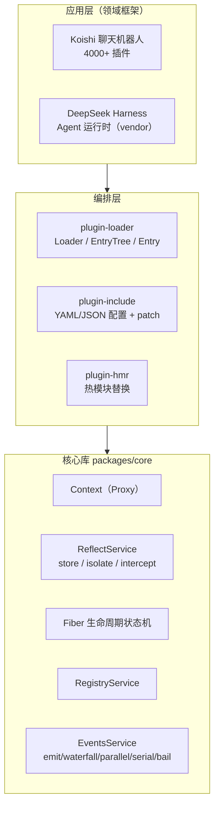
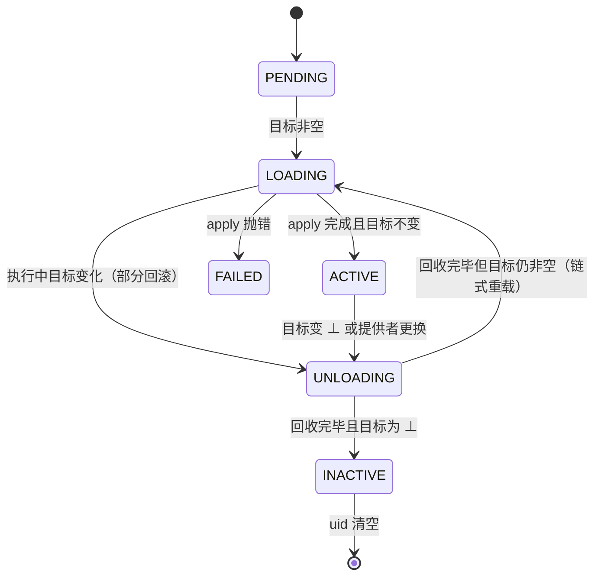

# Cordis：时空可组合性元框架

> 论文背景：[*A Programming Paradigm for Spatiotemporal Composability*](https://github.com/cordiverse/paper)（北大 × DeepSeek-AI，88 页 preprint）
> 上游：[cordiverse/cordis](https://github.com/cordiverse/cordis)（MIT，作者 Shigma；本文基线 core v4.0.0-rc.9，较 2026-08 研究快照 8cc9e33/rc.8 又前进 20 commits）
> 主要使用方：**DeepSeek Harness**（vendor 引入，发布为 `@deepseek-ai/cordis`）、**Koishi** 聊天机器人框架（4000+ 插件）
> 想亲手跑一遍上面的语义？→ [Cordis Hello World：跑通可逆副作用与响应式依赖](./cordis-hello-world.md)（~70 行可运行 demo）

## 这是什么

Cordis 是一个 **Node.js/TypeScript 元框架**——不面向任何具体领域，唯一职责是提供**动态组合（dynamic composition）**语义：组件可在运行时被加载、卸载、重配，且保证——

- **时间可组合（Temporal composability）**：卸载组件时，它做过的所有修改（事件、资源、服务）被**完整有序撤销**；
- **空间可组合（Spatial composability）**：组件**声明式表达依赖**，依赖出现/消失/更换实现时，系统**响应式**激活/停用相关组件。

它把经典 PL 理论中的 **effect / coeffect** 从编译期静态标注"提升"为运行时机制（revertible effects + reactive coeffects），使动态组合的保证成为**结构性保证**，而非依赖插件作者自觉。配套论文给出了完整演算与元理论证明。

核心只有约 2000 行 TypeScript，依赖仅 `@standard-schema/spec` + `cosmokit`。

## 五个核心概念

| 概念 | 说明 |
|---|---|
| **Context** | 一切交互的载体（Proxy 化对象）。服务占据稳定的 `ctx.<key>`；所有 effect/coeffect 操作都通过它进行。 |
| **Service** | 具名服务，通过 `ctx.provide()` 安装；其他插件经 `ctx[key]` 或 `inject` 消费，而不是 import 具体实现。 |
| **Plugin / Component** | 带可选 `inject`/`provide` 与 `apply(ctx, config)` 的函数、类或对象；`ctx.plugin()` 实例化。 |
| **Fiber** | 组件的**一次实例化**，携带生命周期状态机（PENDING → LOADING → ACTIVE → FAILED → UNLOADING → DISPOSED）与唯一 `uid`。 |
| **Effect** | `ctx.effect(callback)`：注册即返回 disposer（逆）；运行时自动跟踪、卸载时 **LIFO 逆序回收**。`ctx.on()`、`ctx.provide()`、`ctx.plugin()` 全部归约为 effect。 |
| **Events** | 类型化事件，5 种分发：`emit`（观察）、`waterfall`（around-middleware）、`parallel`、`serial`、`bail`（短路）。 |

补充：**inject** = 依赖声明（coeffect）；**isolate** = 同一 key 在不同 realm 解析到独立绑定；**intercept** = 不改变解析结果、只调整使用方式的配置叠加。

## 架构

三层结构：核心库（effect/coeffect 系统）→ 声明式加载器（配置调和 + HMR）→ 应用框架（Koishi / DeepSeek Harness）。



Fiber 生命周期（惯性状态机，`fiber.inertia` 保证"一次迁移必须跑完"）：



## 核心机制

### 1. 可逆副作用：一切归约到 `ctx.effect`

```text
execute(callback, guard):
    iter ← callback()                    // 函数或 yield disposer 的生成器
    inverse ← id
    while guard():                       // 迭代边界检查（惰性中断点）
        (value, done) ← await iter.next()
        if value: inverse ← value ∘ inverse   // LIFO 累积逆
        if done: break
    return inverse

effect(ctx, callback):
    armed ← true
    task ← execute(callback, () → armed)
    dispose():                            // 幂等；中断在途迭代；一次性回收
        if not armed: return
        armed ← false
        recover ← await task; recover()
        ctx.dispose ← dispose ∘ ctx.dispose  // 提升到父上下文（递归可逆）
    return dispose
```

论文对应：effect context `∂Γ = Γ × (Γ→Γ)`（状态 + 累加器）、twisted composition monoid `(f₁,g₁)∘(f₂,g₂)=(f₁∘f₂, g₂∘g₁)`、`recover(γ,φ)=(φ(γ), id)`。**撤销一个 effect 本身也是 effect**——disposer 可嵌套、可被父级再包装。

### 2. 响应式依赖：inject + notify + 惯性迁移

```text
refresh(fiber):
    target ← computeTarget(fiber)          // 每个声明 key → 提供者 uid（⊥=不该运行）
    if target = fiber.target: return       // 幂等
    fiber.target ← target
    if fiber.inertia: return               // 迁移在途，仅记录目标
    target ≠ ⊥ ? 启动 reload : 标记 UNLOADING 并启动 unload

reload: 提交视图 → execute(apply, guard) → dispose ← recover ∘ dispose
        → 目标不变则 ACTIVE + notify；否则链入 unload
unload: 先 await 全部受影响依赖者 → await dispose()（LIFO 回收）
        → 目标为 ⊥ 则 INACTIVE，否则链入 reload
```

三点支撑依赖排序（论文 Theorem 63）：**先提交视图再执行**（卸载期间依赖仍可读）；**先标记 UNLOADING 再排逆**（提供者先停，依赖者先重算）；**回收前 await 依赖者**（提供者图按需遍历，终止性由 Theorem 66 保证）。

### 3. 属性访问即 coeffect 强制

`ctx.<service>` 的 Proxy 解析：沿 fiber 链向上找 `committed`（已提交视图）→ 命中即返回；若 `key ∈ fiber.inject` 而未激活则抛 `INACTIVE_ACCESS`；到 root 未声明抛 `UNDECLARED_ACCESS`。与裸 `ctx.get()`（查 store、不失败）不同，属性访问在使用点强制规范。

### 4. HMR 三阶段（无开发者标注的 accept 边界）

1. **模块分类**：stashed ∪ imports 的不动点——imports 有 accepted 则 accepted，imports 全 declined 则 declined，环路兜底 declined；
2. **陈旧 entry 检测**：沿 declined 边界的传递 import 闭包与 accepted 相交的 entry；
3. **事务性重载**：清 ESM loadCache + CJS require.cache（备份）→ 重 import → dispose 旧 fiber、建新 fiber；任一失败则恢复缓存、重装旧插件（绝不进入半重载状态）。

工程细节：兼容 Node 22–24 内部 `ModuleLoader`（`--expose-internals` / `node-addon-require-builtin`）；Node 24 的 loadCache 须用 `Map.prototype.delete` 直操；externals（框架模块）变化触发完整重启。

## 为什么 DeepSeek Harness 选它

- **Service 可运行时消失**：MCP server 崩溃、LLM provider 限流、watcher 被杀——传统 DI 假设 bind 后一直存在，Cordis 假设 service 随时出现/消失。`inject` 依赖方自动停用、恢复后自动重新 apply，**框架级保证，无需手写重连**。
- **配置即组合**：cordis.yml 一行一个插件实例，改配置触发局部 HMR（不重启、不丢 session 状态）；Profile/Bundle 分层 patch 直接复用 Include 机制。
- **Waterfall 事件 = 决策链**：`tools/pre-execute → execute → post-execute`、`agent/request`、`llm/stream` 等均为 around-middleware，多个独立插件组成有序决策链（权限→审批→超时→执行），可短路可包装。
- **Effect-scoped 资源管理**：MCP 连接、PTY session、file watcher、background job 统一 `ctx.effect(() => { acquire(); return () => release() })`。
- vendor 进仓库（`vendor/cordis`，`@deepseek-ai/cordis` 4.0.2）+ 18 项本地修改（reentrant disposal race 修复、事务性配置 reload、懒配置求值等），换取完全可审计、可 patch、版本锁定。

## 与同类方案的对比

| 维度 | Cordis | 传统 DI（InversifyJS/NestJS） | VSCode 插件 | webpack/vite HMR |
|---|---|---|---|---|
| 运行时卸载单个组件 | 逆序回收全部 effect | 无自动 dispose | 需重启 extension host | 需开发者声明 accept |
| 依赖响应式激活/停用 | inject + notify | 无 | 无结构契约 | — |
| 形式化基础 | 演算 + 元理论证明 | 无 | 无 | 无 |
| 粒度 | 组件级（共享地址空间） | 对象级 | 进程级 | 模块级 |

## 相关页面

- [Cordis Hello World](./cordis-hello-world.md) — 可运行的 ~70 行最小 demo（effect/inject/provide 全部跑一遍，含「函数插件要用箭头函数」等实测踩坑）
- [kagent](./kagent.md) — K8s 原生 Agent 框架（CNCF），用 CRD/Controller 编排 agent；Cordis 走的是"进程内插件编排 + 事件决策链"的另一条路线，两者对比可看 agent 运行时选型
- [Agent Substrate](./agent-substrate.md) / [Agent Sandbox](./agent-sandbox.md) — 沙箱执行环境，与 Cordis 的 effect 化资源管理互补

## 延伸阅读

- 论文：[A Programming Paradigm for Spatiotemporal Composability](https://github.com/cordiverse/paper)
- 上游仓库：[cordiverse/cordis](https://github.com/cordiverse/cordis)
- cordis-primer：[DeepSeek Harness 文档](https://deepseek-harness.github.io/deepseek-harness/reference/cordis-primer)
- 背景：[为什么用 Cordis 做 AI Agent 运行时：从 QQ 机器人框架到 DeepSeek Harness](https://damodev.csdn.net/6a7e568b662f9a54cb9c7e72.html)
