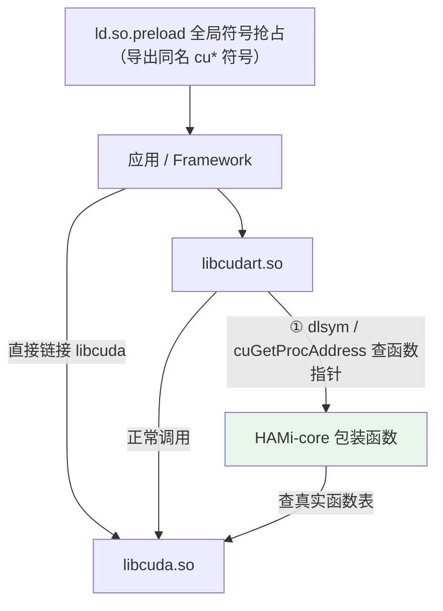

# HAMi-core：容器内 CUDA 劫持与资源隔离

> HAMi-core（仓库名 `HAMi-core`，产物 `libvgpu.so`）是 HAMi 的**容器内运行时**。它不改 `libcudart.so`、不改 `libcuda.so`、不改驱动，而是在进程的**符号解析路径**上做手脚，把 CUDA 调用接管到自己的包装函数里，从而落实显存配额和算力配额。
>
> 对应 HAMi 侧的使用方式见 [HAMi：Kubernetes 异构 AI 算力虚拟化与调度](./hami.md)。

## 一、它怎么进入容器

device plugin 在 `Allocate()` 返回的 `Mounts` 里（`pkg/device-plugin/nvidiadevice/nvinternal/plugin/server.go:1555`）：

```go
Mount{ContainerPath: "/usr/local/vgpu/libvgpu.so", HostPath: GetLibPath(), ReadOnly: true},
Mount{ContainerPath: "/etc/ld.so.preload", HostPath: hostHookPath + "/vgpu/ld.so.preload", ReadOnly: true},
```

`ld.so.preload` 文件只有一行：

```
/usr/local/vgpu/libvgpu.so
```

所以容器里**每个动态链接的进程**启动时，`libvgpu.so` 会先于 `libcuda.so` 被加载进全局符号作用域。

| 场景 | 注入方式 |
|---|---|
| 默认 `hami-core` 模式 | 挂载 `libvgpu.so` + `/etc/ld.so.preload` |
| 整卡分配 | device plugin 自动注入 `CUDA_DISABLE_CONTROL=true`，跳过 preload 挂载 |
| remote GPU（Lupine） | 改用 `LD_PRELOAD` 环境变量（`pkg/device/remotegpu/device.go`） |
| MIG / MPS 模式 | 不走 libvgpu，由 MIG/MPS 自身机制隔离 |

device plugin 还会注入配额与上下文：

| 环境变量 / 文件 | 作用 |
|---|---|
| `CUDA_DEVICE_MEMORY_LIMIT_<i>` | 第 i 张卡的显存上限，如 `3000m`（支持 k/m/g 后缀） |
| `CUDA_DEVICE_SM_LIMIT` | 算力上限百分比（0–100） |
| `CUDA_DEVICE_MEMORY_SHARED_CACHE` | 每容器共享记账文件路径（如 `/usr/local/vgpu/usage.cache`） |
| `CUDA_DEVICE_MEMORY_LIMIT` / `CUDA_DEVICE_SM_LIMIT`（无下标） | 兜底值，作用于所有卡 |
| `/overrideEnv`（`limit-delivery=file`） | 等价的 KEY=VALUE 文件，进程启动时读取后 `setenv` |
| `CUDA_DISABLE_CONTROL` | `true` 时整体关闭注入 |
| `CUDA_OVERSUBSCRIBE` | `true` 时允许显存超卖 |
| `CUDA_TASK_PRIORITY` | 任务优先级（0 高 / 1 低） |
| `LIBCUDA_LOG_LEVEL` | libvgpu 日志级别 |

## 二、核心思路：不改库，改“符号解析”

`libcudart` 并不把 driver API 静态链接进来，而是**运行期按名字取函数指针**：老版本用 `dlsym`，CUDA 11.3+/12 用 `cuGetProcAddress`。HAMi-core 同时接管这两个入口，再加上 ELF 的全局符号抢占，形成三条路径：



### 路径 A：`ld.so.preload` 全局符号抢占

`libvgpu.so` 导出了所有同名的 `cuXxx` 函数（例如 `cuMemAlloc_v2`）。ELF 全局符号查找顺序是「可执行文件 → preload 库 → 依赖库」，因此**直接链接 `libcuda` 的程序**，其 PLT 会绑定到包装函数而不是驱动函数。

> 细节：仓库的生产构建走 `build.sh`，固定 `CMAKE_BUILD_TYPE=Debug`，不加 `-fvisibility=hidden`，所以这些包装符号默认可见——全局抢占才成立。

### 路径 B：劫持 `dlsym`

`libvgpu` 的 `dlsym` 用**汇编**实现（`src/dlsym_entry.S`）。原因很关键：`dlsym(RTLD_NEXT, ...)` 的语义取决于**调用者的返回地址**，用 C 函数包装会破坏它。x86-64 版本的核心逻辑：

```asm
dlsym:
    cmpq $-1, %rdi            # handle == RTLD_NEXT ?
    jne .Ldispatch
    pushq %rdi; pushq %rsi    # 保留原始参数
    call libvgpu_get_real_dlsym
    popq %rsi; popq %rdi
    jmp *%rax                 # 尾跳，调用者返回地址仍在栈上
.Ldispatch:
    jmp libvgpu_dlsym_dispatch
```

普通查询进入 `libvgpu_dlsym_dispatch()`（`src/libvgpu.c:97`）：

```c
if (symbol[0]=='c' && symbol[1]=='u') {            // 所有 cu* 符号
    if (strcmp(symbol,"cuGetExportTable") != 0)
        pthread_once(&pre_cuinit_flag, (void(*)(void))preInit);
    void *f = real_dlsym(vgpulib, symbol);          // 在 libvgpu 自身里找同名符号
    if (f != NULL) return f;                        // 返回包装函数
}
```

`vgpulib` 是 `dlopen("/usr/local/vgpu/libvgpu.so")` 的句柄。谁查 `cuMemAlloc_v2`，就返回 libvgpu 自己的 `cuMemAlloc_v2`。`RTLD_NEXT` 查询被原样转发给 libc，语义不变。

### 路径 C：劫持 `cuGetProcAddress`

CUDA 11.3+/12 的 driver API 走 lazy 查表：`cuGetProcAddress(symbol, &pfn, cudaVersion, flags)`。只拦 `dlsym` 会漏掉主路径，所以 libvgpu 导出并实现了 `cuGetProcAddress` / `cuGetProcAddress_v2`（`src/cuda/hook.c:361`、`:398`）：

```c
*pfn = find_symbols_in_table_by_cudaversion(symbol, cudaVersion);  // 先给包装函数
if (strcmp(symbol, "cuGetProcAddress") == 0) {                     // 自己查自己
    ... *pfn = _cuGetProcAddress;                                  // 返回 trampoline
}
if (*pfn == NULL) {                                                // 不认识的符号
    return CUDA_OVERRIDE_CALL(cuda_library_entry, cuGetProcAddress, symbol, pfn, ...);
}
```

- 查询 `cuGetProcAddress` 本身时返回 trampoline，保证后续所有 lazy 查询仍被接管；
- 查表按 `_v3` → `_v2` → 原名逐级回退，兼容不同 CUDA 版本；
- 不认识的符号回落到真实驱动。

### 真实函数表与初始化时序

所有包装函数最终要调用真正的驱动函数，这张表在 `preInit()` 中一次性建好（`src/cuda/hook.c:250`）：

```c
table = dlopen("libcuda.so.1", RTLD_NOW | RTLD_NODELETE);  // NODELETE 保证句柄一直有效
for (i = 0; i < CUDA_ENTRY_END; i++)
    cuda_library_entry[i].fn_ptr = real_dlsym(table, cuda_library_entry[i].name);
```

找不到就回退 `RTLD_NEXT`，再找不到就用 `prior_function()` 去掉 `_v2`/降版本号继续找（兼容老驱动）。NVML 同理 `dlopen("libnvidia-ml.so.1")`。

初始化是懒加载的：

1. 第一次 `dlsym` 一个 `cu*` 符号 → `preInit()`：建表、注册 `pthread_atfork`；
2. 第一次 `cuInit()` → `preInit()` + 真实 `cuInit()` + `postInit()`：初始化分配器、解析 `CUDA_VISIBLE_DEVICES` 映射、用 NVML 反查宿主 PID、启动算力 watcher；
3. `fork()` 后子进程重置 post-init 状态，但复用同一份共享内存记账区域。

## 三、显存隔离

### 配额来源

```c
// multiprocess_memory_limit.c: get_limit_from_env / do_init_device_memory_limits
CUDA_DEVICE_MEMORY_LIMIT_<i>  →  第 i 张卡的 limit[i]
CUDA_DEVICE_MEMORY_LIMIT      →  所有卡的兜底
/overrideEnv                  →  进程启动时加载，setenv 后走同一套逻辑
```

解析支持 `3000m`、`3g`、`1024m` 等写法；`0` 表示不限制。

### 分配路径

```c
CUresult cuMemAlloc_v2(CUdeviceptr* dptr, size_t bytesize) {
    ENSURE_RUNNING();                 // 初始化 + 等待调度状态
    return allocate_raw(dptr, bytesize);
}
```

`allocate_raw → add_chunk`（`src/allocator/allocator.c`）：

```c
if (reserve_device_memory(dev, size) != 0)          // ① 锁内预占额度
    return CUDA_ERROR_OUT_OF_MEMORY;
res = CUDA_OVERRIDE_CALL(cuda_library_entry, cuMemAlloc_v2, address, size);  // ② 真实分配
if (res != CUDA_SUCCESS) { release_device_memory(dev, size); return res; }
LIST_ADD(device_overallocated, e);                   // ③ 记录 地址→大小→设备
```

`reserve_device_memory` 内部就是 `oom_check_impl`（`allocator.c:37`）：

```c
size_t new_allocated = usage + addon;
if (new_allocated > limit) {
    clear_proc_slot_nolock(1);      // 先清理已退出进程占用的槽位
    return CUDA_ERROR_OUT_OF_MEMORY;
}
```

释放路径 `cuMemFree_v2 → free_raw → remove_chunk` 反向扣减。除 `cuMemAlloc_v2` 外，`cuMemAllocManaged`、`cuMemAllocPitch`、`cuMemCreate`（VMM）、`cuMemAllocAsync` / `cuMemAllocFromPoolAsync`（cudaMallocAsync 池）、array/mipmap 等也都有对应记账，避免绕过。

### 多进程共享记账

一个容器里往往有多个进程（DataLoader worker、多进程推理、fork 出来的子进程），配额必须按**容器**而不是按进程算。做法是：

- 记账放在 `mmap` 的共享内存文件里，路径来自 `CUDA_DEVICE_MEMORY_SHARED_CACHE`（默认 `/usr/local/vgpu/usage.cache`）；没有该变量时用 `POD_UID` + `CONTAINER_NAME` 拼出 `/usr/local/vgpu/containers/<pod>_<ctr>/usage.cache`；
- region 里每个进程一个 slot，每个 slot 按设备记录 `total / context / module / data` 四类用量；
- 读写用 **seqlock**（奇数表示写入中）做无锁一致性读，分配/释放前先用文件锁 `lock_shrreg()` 串行化“检查+预占”；
- 进程退出注册 `atexit` 清理槽位；OOM 时如果发现死进程槽位，会先清理再重试；
- CUDA context 创建时把 `context_size`（约 100 MiB 的估算值）计入用量，避免“空 context 不占显存”的漏洞（`src/cuda/context.c`）。

### 让框架“看到”配额

仅拒绝超额分配还不够：PyTorch 等框架启动时会查询显存总量来决定 caching allocator 池大小。所以这些查询被改写成虚拟视图：

```c
// cuDeviceTotalMem_v2
*bytes = limit;

// cuMemGetInfo_v2
out_total = min(limit, drv_total);
out_free  = limit - usage;      // 已用部分对应用不可见

// nvmlDeviceGetMemoryInfo / _v2
used  = usage;
total = min(limit, physical_total);
free  = total - used;
```

这样容器内 `nvidia-smi`、`pynvml`、`torch.cuda.mem_get_info()` 看到的都是被切分后的小卡。设备数量/可见性则由容器运行时按 `CUDA_VISIBLE_DEVICES` 与挂载决定，libvgpu 只维护 `cuda_to_nvml` 的下标映射。

## 四、算力隔离

算力限制不是硬件分区，而是**基于反馈的时间片调度**：

```c
// cuLaunchKernel / cuLaunchKernelEx / cuLaunchCooperativeKernel
ENSURE_RUNNING();
ensure_post_init();
pre_launch_kernel();
if (pidfound == 1)
    rate_limiter(gridDimX*gridDimY*gridDimZ, blockDimX*blockDimY*blockDimZ);
// 然后才调真实 cuLaunchKernel
```

`rate_limiter()`（`multiprocess_utilization_watcher.c:39`）维护每卡的令牌桶 `g_cur_cuda_cores`：

```c
kernel_size = grids;                 // 用 grid 乘积近似本次 kernel 的“算力量”
do {
    before = g_cur_cuda_cores[dev];
    if (before < 0) { nanosleep(&g_cycle /*10ms*/); goto CHECK; }
    after = before - kernel_size;
} while (!CAS(&g_cur_cuda_cores[dev], before, after));
```

令牌为负时阻塞 kernel 下发，从而降低单位时间内的 kernel 吞吐。令牌总量由 watcher 线程（默认 120 ms 一轮）动态调整：

1. 通过 NVML 读取**本容器进程**的真实 SM 利用率（需要先反查到宿主 PID）；
2. 用比例反馈 `delta()` 比较目标 `CUDA_DEVICE_SM_LIMIT` 与实测值，决定加/减令牌；
3. 写入共享变量，影响所有进程的下一次 kernel 启动。

相关开关：

- `CUDA_DEVICE_SM_LIMIT=100` 或未设置 → 不限速；
- `CUDA_TASK_PRIORITY`：v1.1 起的两级优先级（高优先级任务独享时不受限）；
- `CUDA_OVERSUBSCRIBE=true`：允许超卖；
- `CUDA_DISABLE_CONTROL=true`：整体关闭；
- 反查宿主 PID 失败（`pidfound=0`）时，**算力限制自动降级**，只保留显存限制。

## 五、失效场景（软隔离的代价）

| 场景 | 结果 |
|---|---|
| 静态链接 / musl（Alpine）/ 非 glibc | `ld.so.preload` 不生效，hook 失效 |
| setuid 程序 | 动态链接器忽略 preload |
| DinD、直接 ioctl `/dev/nvidia*`、绕过 CUDA 库访问显存 | 记账与限制都拦不住 |
| 容器内 `/etc/ld.so.preload` 被覆盖 | 注入失效 |
| `CUDA_DISABLE_CONTROL=true` | 主动关闭 |
| MIG / MPS 模式 | 不走 libvgpu |
| CUDA 版本 / 驱动不匹配 | 符号表缺失时回退失败，功能降级或报错 |
| 宿主 PID 反查失败 | 算力限制关闭，仅显存生效 |
| 多租户争用 | 显存是账本式限制、算力是反馈式限速，无法提供硬 SLA |

结论：**hami-core 适合“提高利用率、做弹性共享”，不适合“合规硬隔离”**——后者应该用 MIG。

## 六、源码导读

| 文件 | 内容 |
|---|---|
| `src/libvgpu.c` | `dlsym` 分发、`preInit`/`postInit`、trampoline、NVML/CUDA hook 分派 |
| `src/dlsym_entry.S` | x86-64 / aarch64 的 `dlsym` 汇编入口，处理 `RTLD_NEXT` |
| `src/cuda/hook.c` | 真实函数表加载、`cuGetProcAddress` 劫持、符号版本回退 |
| `src/cuda/memory.c` | 显存分配/释放、`cuMemGetInfo`、kernel 启动包装 |
| `src/cuda/context.c` | context 生命周期与 context 大小记账 |
| `src/cuda/device.c` | `cuDeviceTotalMem` 等设备查询改写 |
| `src/allocator/allocator.c` | `oom_check`、预占/释放、分配列表、async/pool 记账 |
| `src/multiprocess/multiprocess_memory_limit.c` | 配额解析、共享内存 region、进程 slot、seqlock |
| `src/multiprocess/multiprocess_utilization_watcher.c` | 令牌桶、`rate_limiter`、利用率反馈闭环 |
| `src/nvml/hook.c` / `nvml_entry.c` | NVML 包装与显存视图伪造 |
| `src/include/libcuda_hook.h` | `CUDA_OVERRIDE_CALL` 宏与 hook 表结构 |

## 参考

- [HAMi-core 仓库](https://github.com/Project-HAMi/HAMi-core)（本地 `.repos/hami/libvgpu`）· [README](https://github.com/Project-HAMi/HAMi-core/blob/main/README.md)
- [官方文档：GPU 虚拟化原理](https://project-hami.io/docs/core-concepts/gpu-virtualization)
- 相关：[HAMi 项目总览](./hami.md) · [kube-scheduler 源码分析](../Kubernetes/4_kube-scheduler源码分析.md)
