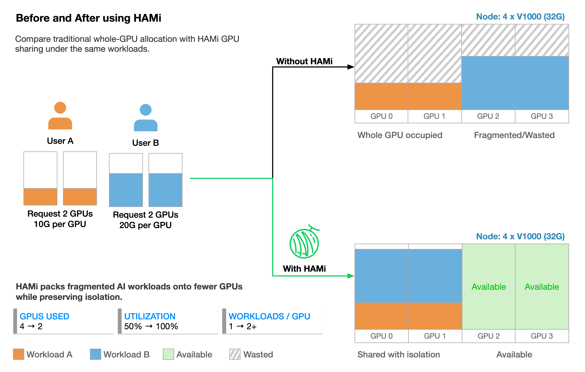
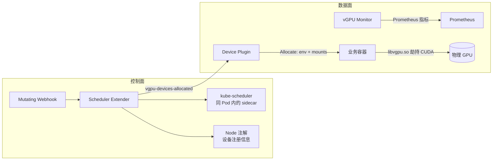
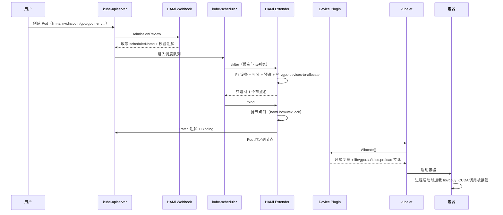

# HAMi：Kubernetes 异构 AI 算力虚拟化与调度

> HAMi（Heterogeneous AI Computing Virtualization Middleware）是 CNCF 孵化项目，给 Kubernetes 加一层「GPU/NPU 切分 + 设备感知调度」：一张卡按显存 MiB 和算力百分比分给多个 Pod，应用不改代码、驱动不改，继续用标准 `resources.limits`。

## 项目档案

| 项 | 值 |
|---|---|
| 仓库 | <https://github.com/Project-HAMi/HAMi> |
| 前身 | `k8s-vGPU-scheduler`（2021 年） |
| 许可证 / 语言 | Apache-2.0 / Go（约 12.5 万行）+ C/CUDA（HAMi-core） |
| CNCF 阶段 | Sandbox（2024-08）→ **Incubating**（2026-07） |
| 最新 release | v2.10.0（2026-08-21）；master 已领先 tag 280 个提交 |
| 社区 | 约 5,000 stars / 875 forks（2026-10），2026 年 786 次提交 |
| 文档 | <https://project-hami.io/docs/>（中英日，版本化） |
| 支持的加速器 | NVIDIA、AMD、昇腾、寒武纪、海光、天数、昆仑芯、沐曦、摩尔线程、燧原、壁仞、AWS Neuron、VastAI、远程 GPU（Lupine） |

## 为什么需要它

把整张 GPU 分配给 Pod 会带来三个结构性问题：

1. **碎片化**：小模型/推理任务占满一整张卡，显存利用率长期低于 20%。
2. **调度盲区**：默认调度器只看到 `nvidia.com/gpu: 1` 这个整数，不知道显存、算力、GPU 间拓扑，无法做设备级放置。
3. **异构难统一**：不同厂商的 device plugin 和资源名各不相同，平台团队要维护多套工作负载配置。

HAMi 的回答是：在 device plugin 层把设备「虚拟化」成可切分资源，在调度器扩展点做设备感知放置，在容器内用运行时 hook 落实显存/算力上限。



## 整体架构


> 上图来自 HAMi 官方仓库（Apache-2.0）。



| 组件 | 位置 | 职责 |
|---|---|---|
| Scheduler Extender | `cmd/scheduler`、`pkg/scheduler` | `/filter` 选节点 + 设备、`/bind` 加锁分配；同时提供 webhook 与 `/refit`（NUMA refit） |
| kube-scheduler sidecar | chart `scheduler.kubeScheduler` | 标准调度器，配置为 HAMi extender 的调用方；默认开启，也可换成外部调度器 |
| Device Plugin | `cmd/device-plugin/nvidia` | 注册 vGPU 资源、写节点设备注解、`Allocate()` 注入 `libvgpu.so` 与 limits 环境变量 |
| vGPU Monitor | `cmd/vGPUmonitor` | 容器级显存/利用率采集，暴露 Prometheus 指标并做反馈 |
| Mutating Webhook | `pkg/scheduler/webhook.go` | 校验 Pod，改 `schedulerName`，拦截伪造分配注解、privileged + GPU 等危险组合 |

关键端口：extender `127.0.0.1:9444`（仅同 Pod 的 kube-scheduler 调用）、HTTP/webhook `0.0.0.0:9443`、scheduler metrics `:9395`、monitor metrics `:9394`。

一个值得注意的设计是：**HAMi 的 `/filter` 不是纯过滤**。它在 Filter 内部完成设备可用性判断（`Fit`）和节点/设备打分，直接挑出唯一最优节点并返回，相当于把选点决策提前到 Filter，而不是走 extender 的 prioritize 协议。这样做的代价是必须自己实现完整打分，好处是能把「设备级」信息纳入决策——标准调度器只认识整数卡数。

## 一次 GPU Pod 的完整链路



分配结果写在 Pod 注解里（`hami.io/vgpu-devices-allocated`），device plugin 的 `Allocate()` 读注解、拼出 `CUDA_DEVICE_MEMORY_LIMIT_<i>`、`CUDA_DEVICE_SM_LIMIT` 等环境变量，并把 `libvgpu.so` 与 `/etc/ld.so.preload` 挂进容器。容器里 CUDA 进程一启动就被劫持，具体机制见 [HAMi-core：容器内 CUDA 劫持与资源隔离](./hami-core.md)。

## 资源模型

以 NVIDIA 为例：

```yaml
resources:
  limits:
    nvidia.com/gpu: 1          # 申请 1 张物理卡
    nvidia.com/gpumem: 3000    # 显存 3000 MiB
    nvidia.com/gpucores: 30    # 算力 30%
# 或者 nvidia.com/gpumem-percentage: 25（与 gpumem 二选一）
```

| 资源/注解 | 含义 |
|---|---|
| `nvidia.com/gpu` | 物理 GPU 张数；节点上注册的值是「每卡 `deviceSplitCount`（默认 10）个虚拟槽位」 |
| `nvidia.com/gpumem` | 显存上限（MiB） |
| `nvidia.com/gpumem-percentage` | 显存上限（物理卡百分比），与 gpumem 互斥 |
| `nvidia.com/gpucores` | 算力上限（0–100） |
| `nvidia.com/use-gputype` / `nouse-gputype` | 指定/排除 GPU 型号 |
| `nvidia.com/use-gpuuuid` / `nouse-gpuuuid` | 指定/排除 GPU UUID |
| `nvidia.com/numa-bind` | 要求 GPU 落在同一 NUMA 节点 |

其它厂商的资源名由 chart `devices.<vendor>` 配置（如 `metax-tech.com/sgpu`、`huawei.com/Ascend910`），语义各不相同：有的只支持整卡或固定切分（如壁仞 SVI 2/4 分区），有的支持显存+算力双配额。

## 调度策略

| 层级 | 策略 | 含义 |
|---|---|---|
| 节点 | `binpack`（默认） | 优先填满已用节点，减少碎片 |
| 节点 | `spread` | 优先空闲节点，降低争用 |
| 设备 | `binpack` / `spread` | 节点内挑卡方向 |
| 设备 | `topology-aware` | 按 GPU 间拓扑（NVLink/PCIe/NUMA）挑选组合 |
| 设备 | `mutex` | 只选完全空闲的 GPU（独占语义） |
| 设备 | `numa` | 以 NUMA 节点作为排序键，可与 binpack/spread 组合 |

- 集群默认值在 chart 的 `scheduler.defaultSchedulerPolicy`（默认节点 binpack、设备 spread）。
- Pod 用 `hami.io/node-scheduler-policy`、`hami.io/gpu-scheduler-policy` 覆盖。
- v2.10 起 GPU 策略支持**逗号分隔的策略链**，如 `mutex,binpack,numa`：过滤型策略先筛，排序型策略按书写顺序逐级比较。
- 并发安全靠**节点级分布式锁**（`hami.io/mutex.lock` 注解 + 重试）；同一 PodGroup 的成员抢锁失败会重试（`--node-lock-retry-timeout`，默认 28s），避免 gang 调度被锁竞争打断。
- 设备打分权重可用 `hami.io/device-scoring-weights` 按 Pod 调整。

## 设备抽象与异构后端

所有厂商实现同一个接口（`pkg/device/devices.go`）：

```go
type Devices interface {
    CommonWord() string
    MutateAdmission(ctr *corev1.Container, pod *corev1.Pod) (bool, error)
    GenerateResourceRequests(ctr *corev1.Container) (ContainerDeviceRequest, error)
    Fit(devices []*DeviceUsage, request ContainerDeviceRequest, pod *corev1.Pod,
        nodeInfo *NodeInfo, allocated *PodDevices) (bool, map[string]ContainerDevices, string)
    ScoreNode(node *corev1.Node, podDevices PodSingleDevice,
        previous []*DeviceUsage, policy string) float32
    AddResourceUsage(pod *corev1.Pod, n *DeviceUsage, ctr *ContainerDevice) error
    PatchAnnotations(pod *corev1.Pod, annoinput *map[string]string, pd PodDevices) map[string]string
    GetNodeDevices(n corev1.Node) ([]*DeviceInfo, error)
    // ...
}
```

调度器启动时由 `pkg/scheduler/config` 把各后端注册进全局 `device.DevicesMap`。NVIDIA 节点有四种运行模式：

| 模式 | 隔离方式 | 特点 |
|---|---|---|
| `hami-core`（默认） | 容器内 `libvgpu.so` 劫持 CUDA | 任意 NVIDIA 卡，MiB/1% 粒度，软隔离 |
| `mig` | NVIDIA MIG 实例 | 硬件隔离；v2.10 起支持 Flexible MIG，按需建删、免 drain |
| `mps` | CUDA MPS | 并发执行，按进程隔离算力 |
| `remote` | Lupine 远程 GPU | 本节点只作 GPU 服务端，跨节点分配 |

## 部署与运维

前置条件（NVIDIA 路径）：驱动 ≥ 440、NVIDIA Container Toolkit、containerd/Docker/CRI-O 默认 runtime、Kubernetes ≥ 1.23、glibc ≥ 2.17、kernel ≥ 3.10。

```bash
kubectl label nodes <node> gpu=on
helm repo add hami-charts https://project-hami.github.io/HAMi/
helm install hami hami-charts/hami -n kube-system
kubectl apply -f examples/nvidia/default_use.yaml
```

运维要点：

- **chart 结构**：scheduler Deployment（含 kube-scheduler sidecar）、device plugin DaemonSet（含 monitor 容器）、webhook 证书 patch Job、RBAC、ServiceMonitor（可选）；厂商配置集中在 `devices.<vendor>`。
- **高可用**：`scheduler.leaderElect=true` + `replicas>1`，自动创建 PDB。
- **与 GPU Operator 共存**：必须设 `devicePlugin.enabled=false`，否则 `nvidia.com/gpu` 重复注册；节点上只能有一个 GPU 管理插件。
- **OpenShift / SELinux**：`platform.openshift=true`、`selinux.enabled=true` 处理 relabel。
- **可观测性**：scheduler 指标在 `:9395`，monitor 在 `:9394`，均带 Prometheus 格式；官方有 Grafana dashboard 与 HAMi-WebUI。
- **升级注意**：DRA 已拆到独立的 [HAMi-DRA](https://github.com/Project-HAMi/HAMi-dra) chart；AMD 走独立的 `amd-device-plugin`。

## 生态集成

| 项目 | 集成方式 |
|---|---|
| vLLM | 以显存上限运行推理，多个模型共享同一张卡（见 [vLLM Production Stack 实战](../../Machine_Learning/Inference/vLLM%20Production%20Stack实战.md)） |
| Volcano | gang 调度 + 队列/多级优先级；Volcano 也有自己的 vGPU device plugin，二者择一 |
| Kueue | 作业级准入与配额；通过 ResourceTransformation 把 HAMi 资源暴露给 Kueue（见 [Kueue](../../Cloud_Native/Kubernetes/kueue.md)） |
| Prometheus / Grafana | 容器级显存与算力指标、调度器分配指标 |
| NVIDIA GPU Operator | 驱动/Toolkit 由 Operator 管，调度与切分由 HAMi 管 |
| HAMi-DRA | 基于 Kubernetes DRA 的过渡实现，独立 chart 发布 |
| KAI Scheduler | 由 KAI 决策、HAMi-core 执行隔离（KAI Resource Isolator） |

## 与同类方案对比

| 方案 | 隔离强度 | 切分粒度 | 硬件要求 | 调度感知 | 多厂商 |
|---|---|---|---|---|---|
| **HAMi（hami-core）** | 软（API 拦截 + 配额） | MiB / 1% | 任意 NVIDIA（驱动 ≥440） | 设备级 | ✅ 12+ |
| NVIDIA MIG | 硬（硬件分区） | 固定 profile | Ampere+（A100/H100 等） | MIG 拓扑 | ❌ |
| NVIDIA MPS | 软（SM 分区，显存共享） | 算力配额 | Volta+ | 部分 | ❌ |
| time-slicing | 无显存隔离 | 时间片 | 任意 | 无 | ❌ |
| GPU Operator | 不涉及切分 | — | — | 无 | ❌ |
| 阿里 cGPU | 软 | 显存/算力 | 阿里云栈 | 部分 | ❌ |

选择建议：**要硬隔离/SLA 合规选 MIG；要通用卡上的弹性共享与统一异构调度选 HAMi**。两者也能在同一集群按节点混用（`operatingmode` 按节点配置）。

## 已知限制与风险

- **软隔离**：隔离建立在「进程通过 CUDA 库调用驱动」这一假设上，绕过库的路径（DinD、直接 ioctl、静态链接、musl）都会失效；多租户噪声只能 best-effort，不能替代 MIG。
- **平台限制**：仅 Linux（glibc ≥ 2.17）；同一节点只能有一个 GPU 管理插件；容器内已有 `/etc/ld.so.preload` 时可能冲突。
- **版本耦合**：依赖 CUDA 符号版本（`_v2`/`_v3`）与驱动行为，CUDA 大版本升级需要回归；MIG/MPS 模式与 hami-core 行为差异大。
- **账本误差**：显存限制按申请量记账，context、碎片、对齐需要补偿参数（`CONTEXT_SIZE`、`memoryFactor`），实际占用可能略超配额。
- **算力限制依赖宿主 PID**：反查失败时降级为只限显存（日志会出现 `SET_TASK_PID FAILED`）。

## 源码导读

| 路径 | 内容 |
|---|---|
| `cmd/scheduler/main.go` | extender 入口、端口与 flag、leader election |
| `pkg/scheduler/scheduler.go` | Filter/Bind、节点锁、PodManager、配额与指标 |
| `pkg/scheduler/webhook.go` | admission 校验与改写 |
| `pkg/scheduler/policy/` | 节点/设备打分与策略链 |
| `pkg/device/devices.go` | `Devices` 接口、设备模型、序列化 |
| `pkg/device/nvidia/` | NVIDIA 后端（含 MIG、NUMA、拓扑） |
| `cmd/device-plugin/nvidia/` | device plugin 注册与 Allocate |
| `cmd/vGPUmonitor/` | 指标采集与 limits 反馈 |
| `charts/hami/` | Helm chart（values 里能看到全部可配项） |
| `libvgpu/`（子模块） | HAMi-core：CUDA hook 实现 |

## 参考

- [HAMi 仓库](https://github.com/Project-HAMi/HAMi) · [HAMi-core](https://github.com/Project-HAMi/HAMi-core)
- [官方文档](https://project-hami.io/docs/) · [v2.10.0 发布说明](https://project-hami.io/zh/blog/hami-v2-10-0-release)
- [CNCF 晋升公告](https://www.cncf.io/blog/2026/07/15/hami-becomes-a-cncf-incubating-project/)
- 相关：kube-scheduler 的 [Scheduler Extender](../Kubernetes/4_kube-scheduler源码分析.md#scheduler-extender扩展点)、[Kueue](../Kubernetes/kueue.md)、[HAMi-core](./hami-core.md)
