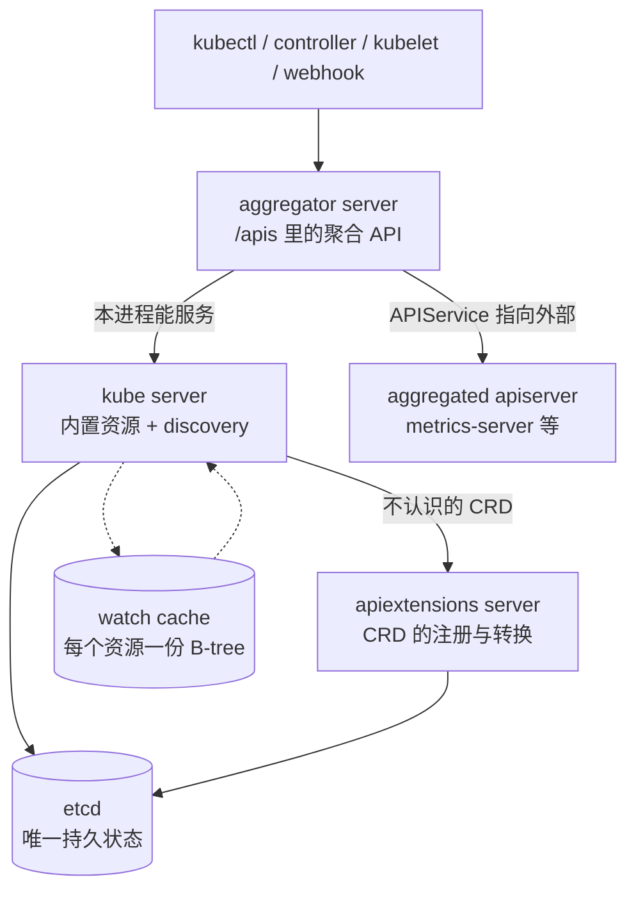
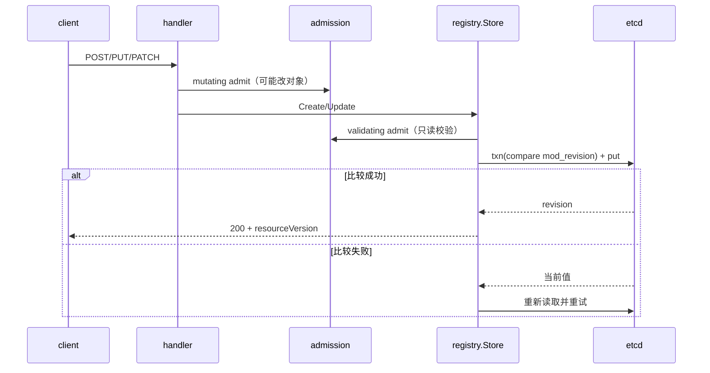

# kube-apiserver：原理、生产故障与参数调优

kube-apiserver 是 Kubernetes 唯一对外暴露的 API 入口，也是**所有控制面组件与节点组件共同的"数据库访问层"**：认证、授权、准入、版本转换、限流、审计都在这里完成，真正的持久化只有 etcd。它的特殊性在于：

- **无状态但吃内存**：不落本地盘，但持有全量 watch cache、长连接和请求缓冲；
- **读写不对称**：写要经过 etcd quorum（写放大 3 倍），读绝大多数由内存 cache 承担；
- **故障会级联**：apiserver 慢会拖垮 controller、kubelet 上报、调度和滚动升级，但"加副本"并不能突破 etcd 的写瓶颈。

本文分四块：**原理（请求怎么走）→ 生产故障模式（为什么会挂）→ 参数调优（apiserver 与 etcd 一起看）→ 1.33–1.37 的重要新特性**。文中默认值、行号都固定在下列版本上：

| 项目 | 版本 | commit |
|---|---|---|
| Kubernetes | v1.37.2 | `c50e5395f1ae2d4a2c05f28fdcc38c0916cc1a32` |
| etcd | v3.7.4（kubeadm 默认 3.7.0） | `2e8a5c99e4982c8d4c521be15364ea4c5c68a489` |

> 引用约定：GitHub 链接一律带 40 位 commit 与行号区间（`.../blob/<commit>/<path>#Lx-Ly`）。行号已用本地 checkout 逐条核对；未特别标注版本的默认值均指 1.37.2，历史行为会单独标注。

---

## 1. 一页结论

| # | 结论 | 关键依据 |
|---|---|---|
| 1 | 一个 kube-apiserver 进程里叠了 **三个 apiserver**：aggregator → kube → apiextensions，请求从外到内逐层降级 | `CreateServerChain`（[server.go#L185-L206](https://github.com/kubernetes/kubernetes/blob/c50e5395f1ae2d4a2c05f28fdcc38c0916cc1a32/cmd/kube-apiserver/app/server.go#L185-L206)） |
| 2 | 请求链路上身份相关顺序是 **认证 → 审计 → 伪装 → APF → 授权**，APF 在授权之前就占名额 | `DefaultBuildHandlerChain`（[config.go#L1036-L1115](https://github.com/kubernetes/kubernetes/blob/c50e5395f1ae2d4a2c05f28fdcc38c0916cc1a32/staging/src/k8s.io/apiserver/pkg/server/config.go#L1036-L1115)） |
| 3 | 写请求的 handler 层有 **34s 硬上限**，即使 `--request-timeout=60s` 也一样；慢 etcd 会先把写打死 | `requestTimeoutUpperBound`（[rest.go#L54](https://github.com/kubernetes/kubernetes/blob/c50e5395f1ae2d4a2c05f28fdcc38c0916cc1a32/staging/src/k8s.io/apiserver/pkg/endpoints/handlers/rest.go#L54)、[create.go#L77-L79](https://github.com/kubernetes/kubernetes/blob/c50e5395f1ae2d4a2c05f28fdcc38c0916cc1a32/staging/src/k8s.io/apiserver/pkg/endpoints/handlers/create.go#L77-L79)） |
| 4 | 1.37 的 watch cache **不再是"100 个对象的环形缓冲"**：B-tree 保存该资源全部对象，只有事件历史按时间窗（默认 75s）保留 | [watch_cache.go#L80-L112](https://github.com/kubernetes/kubernetes/blob/c50e5395f1ae2d4a2c05f28fdcc38c0916cc1a32/staging/src/k8s.io/apiserver/pkg/storage/cacher/watch_cache.go#L80-L112)、[watch_cache_history.go#L32-L52](https://github.com/kubernetes/kubernetes/blob/c50e5395f1ae2d4a2c05f28fdcc38c0916cc1a32/staging/src/k8s.io/apiserver/pkg/storage/cacher/watch_cache_history.go#L32-L52) |
| 5 | `--watch-cache-sizes` 只剩 **"设为 0 关闭该资源缓存"** 一个有效用法，非 0 值都等价；`--default-watch-cache-size` 已是 no-op | [etcd.go#L150-L165](https://github.com/kubernetes/kubernetes/blob/c50e5395f1ae2d4a2c05f28fdcc38c0916cc1a32/staging/src/k8s.io/apiserver/pkg/server/options/etcd.go#L150-L165) |
| 6 | LIST 有四种一致性语义（`RV=""` / `RV=0` / `NotOlderThan` / `Exact`），**只有部分能由 cache 服务**，判断逻辑在 `ShouldDelegateList` | [interface.go#L38-L70](https://github.com/kubernetes/kubernetes/blob/c50e5395f1ae2d4a2c05f28fdcc38c0916cc1a32/staging/src/k8s.io/apiserver/pkg/storage/cacher/delegator/interface.go#L38-L70) |
| 7 | etcd 单请求默认上限 **1.5MiB**，而 apiserver 请求体上限 **3MiB**；超过 1.5MiB 的对象写入会直接失败 | [config.go#L67](https://github.com/etcd-io/etcd/blob/2e8a5c99e4982c8d4c521be15364ea4c5c68a489/server/embed/config.go#L67)、[config.go#L474](https://github.com/kubernetes/kubernetes/blob/c50e5395f1ae2d4a2c05f28fdcc38c0916cc1a32/staging/src/k8s.io/apiserver/pkg/server/config.go#L474) |
| 8 | watch 连接默认会在 **30–60 分钟**内被服务端主动断开（`--min-request-timeout=1800` × U(1,2)），客户端必须能重连 | [get.go#L271-L278](https://github.com/kubernetes/kubernetes/blob/c50e5395f1ae2d4a2c05f28fdcc38c0916cc1a32/staging/src/k8s.io/apiserver/pkg/endpoints/handlers/get.go#L271-L278) |
| 9 | 过载保护 APF 是**每实例**的：加 apiserver 副本会线性放大总限流额度，但也会线性放大对 etcd 的压力 | [config.go#L1043-L1051](https://github.com/kubernetes/kubernetes/blob/c50e5395f1ae2d4a2c05f28fdcc38c0916cc1a32/staging/src/k8s.io/apiserver/pkg/server/config.go#L1043-L1051)，详见 [flowschema.md](./flowschema.md) |
| 10 | 1.37 起 watch cache 初始化默认走 etcd **RangeStream**（单 RPC 流式返回），显著降低大 LIST/重建时的内存峰值，需要 etcd 3.7+ | `shouldStream`（[store.go#L747-L761](https://github.com/kubernetes/kubernetes/blob/c50e5395f1ae2d4a2c05f28fdcc38c0916cc1a32/staging/src/k8s.io/apiserver/pkg/storage/etcd3/store.go#L747-L761)） |

---

## 2. 架构：一个进程，三个 apiserver

### 2.1 三层 server 与降级关系



`CreateServerChain` 的组装顺序是 **apiextensions → kube → aggregator**，每一层把下一层当作 delegate；找不到的请求逐层往下掉，最后落到 `notFoundHandler`（[server.go#L185-L206](https://github.com/kubernetes/kubernetes/blob/c50e5395f1ae2d4a2c05f28fdcc38c0916cc1a32/cmd/kube-apiserver/app/server.go#L185-L206)）。所以：

- CRD 的 discovery/转换归 apiextensions server；
- 内置 API（pods、deployments……）归 kube server；
- `APIService` 注册的（如 `metrics.k8s.io`）由 aggregator 反代到外部服务；
- 请求进哪一层，取决于**路径和 API 注册表**，而不是客户端。

### 2.2 请求处理链（从外到内）

`DefaultBuildHandlerChain` 的注册顺序与执行顺序相反（后注册的在外层）。按实际执行顺序整理：

| 阶段 | 过滤器 | 作用 | 出问题时看什么 |
|---|---|---|---|
| 1 | `WithAuditInit` / `WithPanicRecovery` / `WithMuxAndDiscoveryComplete` | 审计 ID、panic 兜底、在 discovery 未就绪时返回 503 | apiserver 日志、`/readyz` |
| 2 | `WithRequestReceivedTimestamp` / `WithRequestInfo` | 解析 verb、resource、namespace、name | `apiserver_request_total{verb,resource}` |
| 3 | `WithLatencyTrackers` / `WithHTTPLogging` / `WithRetryAfter` / `WithHSTS` / `WithCacheControl` / `WithProbabilisticGoaway` | 延迟埋点、访问日志、退出期 429、缓存/连接治理 | 客户端 5xx、连接分布 |
| 4 | `WithWatchTerminationDuringShutdown` / `WithWaitGroup` / `WithRequestDeadline` / `WithTimeoutForNonLongRunningRequests` | 非长请求的整体 deadline（默认 60s），退出时等待在途请求 | `apiserver_request_total{code="504"}` |
| 5 | `WithWarningRecorder` / `WithCORS` | Warning 头、跨域 | 浏览器客户端报错 |
| 6 | `WithAuthentication`（其后是 `WithTracing`） | x509 / bearer / OIDC / webhook / requestheader | `APIServer` 审计、401 |
| 7 | `WithAudit` | 按 policy 记录审计事件 | 审计日志、磁盘 |
| 8 | `WithImpersonation`（1.36+ 可选 `WithConstrainedImpersonation`） | `Impersonate-*` 头 | 403、审计 `impersonatedUser` |
| 9 | `WithPriorityAndFairness`（或 `WithMaxInFlightLimit`） | APF 分类、排队、429 | `apiserver_flowcontrol_*` |
| 10 | `WithAuthorization` | RBAC / Node / webhook / CEL | 403、`authorizer` 指标 |
| 11 | 路由 handler | 反序列化 → 准入 → registry → storage | `apiserver_request_duration_seconds` |

对应代码见 [config.go#L1036-L1115](https://github.com/kubernetes/kubernetes/blob/c50e5395f1ae2d4a2c05f28fdcc38c0916cc1a32/staging/src/k8s.io/apiserver/pkg/server/config.go#L1036-L1115)。两个容易忽略的点：

1. **APF 在授权之前**：一个没有权限的请求也会先占用 APF seat，再被 403。大量 403 同样会消耗并发额度，并记录在 `apiserver_request_total{code="403"}` 里。
2. **长连接不吃 APF 也不吃 `--request-timeout`**：`exec`、`port-forward`、`logs`、`proxy` 走 `LongRunningFunc` 绕开限流和超时，只受 `--max-connection-bytes-per-sec` 约束（[options.go#L168-L171](https://github.com/kubernetes/kubernetes/blob/c50e5395f1ae2d4a2c05f28fdcc38c0916cc1a32/pkg/controlplane/apiserver/options/options.go#L168-L171)）。这也是"apiserver 没报错，但 goroutine/连接数被打满"的常见来源。

### 2.3 无状态边界与启动顺序

apiserver 不写本地持久状态，但启动时要做三件重活：

1. **连接 etcd**：`blockUntilReady` 最多等 20s，grpc keepalive 30s/10s（[etcd3.go#L60-L70](https://github.com/kubernetes/kubernetes/blob/c50e5395f1ae2d4a2c05f28fdcc38c0916cc1a32/staging/src/k8s.io/apiserver/pkg/storage/storagebackend/factory/etcd3.go#L60-L70)、[#L340-L360](https://github.com/kubernetes/kubernetes/blob/c50e5395f1ae2d4a2c05f28fdcc38c0916cc1a32/staging/src/k8s.io/apiserver/pkg/storage/storagebackend/factory/etcd3.go#L340-L360)）；
2. **初始化 watch cache**：按 `storageWatchListPageSize=10000` 分页 LIST 每个资源（或 1.37 的 RangeStream 一次流式拉完），期间 `/readyz` 不通过；
3. **注册 `storage-readiness` post-start hook**：最多等 `--storage-initialization-timeout`（默认 1m），超时就绪失败（[config.go#L455](https://github.com/kubernetes/kubernetes/blob/c50e5395f1ae2d4a2c05f28fdcc38c0916cc1a32/staging/src/k8s.io/apiserver/pkg/server/config.go#L455)、[server.go#L298-L300](https://github.com/kubernetes/kubernetes/blob/c50e5395f1ae2d4a2c05f28fdcc38c0916cc1a32/pkg/controlplane/apiserver/server.go#L298-L300)）。

所以"apiserver 重启后很慢"通常不是进程启动慢，而是**从 etcd 重建 cache** 慢：对象越多、etcd 越慢、页越大，ready 越晚。这一点在滚动升级时直接决定升级窗口。

---

## 3. 请求生命周期

### 3.1 认证：谁在调用

apiserver 支持多种认证器，按配置串联，**任意一个成功即可**：

| 方式 | 关键参数 | 生产要点 |
|---|---|---|
| 客户端证书 | `--client-ca-file` | CN → user，O → group；证书文件默认每分钟重读一次，可热轮换（[dynamic_cafile_content.go#L39](https://github.com/kubernetes/kubernetes/blob/c50e5395f1ae2d4a2c05f28fdcc38c0916cc1a32/staging/src/k8s.io/apiserver/pkg/server/dynamiccertificates/dynamic_cafile_content.go#L39)） |
| ServiceAccount token | `--service-account-issuer`、`--service-account-key-file`、`--api-audiences` | 投影 token 有 audience/过期时间；轮换 key 时把新旧公钥都放进 `--service-account-key-file` |
| OIDC / 结构化 JWT | `--oidc-*` 或 `--authentication-config` | 结构化配置 GA 1.34，支持多 issuer、CEL 声明映射/校验、JWKS 指标（[authentication.go#L345](https://github.com/kubernetes/kubernetes/blob/c50e5395f1ae2d4a2c05f28fdcc38c0916cc1a32/pkg/kubeapiserver/options/authentication.go#L345)） |
| Webhook token review | `--authentication-token-webhook-config-file` | 每个 token 一次（带缓存）外部调用，慢 webhook 会拖慢所有请求 |
| Front proxy | `--requestheader-*` + `--proxy-client-cert-file` | 聚合层/多集群网关常用；头的信任边界必须锁死 |

两个默认值值得记住：`--anonymous-auth` 默认 **true**（匿名请求进入 `system:unauthenticated`，通常被 RBAC 拒绝，但审计里会看到）；apiserver 自己的 `--authorization-mode` 默认是 **AlwaysAllow**，必须显式配置——kubeadm 会自动补 `Node,RBAC`（[authorization.go#L90-L92](https://github.com/kubernetes/kubernetes/blob/c50e5395f1ae2d4a2c05f28fdcc38c0916cc1a32/pkg/kubeapiserver/options/authorization.go#L90-L92)、[manifests.go#L258-L268](https://github.com/kubernetes/kubernetes/blob/c50e5395f1ae2d4a2c05f28fdcc38c0916cc1a32/cmd/kubeadm/app/phases/controlplane/manifests.go#L258-L268)）。

> 证书实践：serving 证书（`--tls-cert-file`）和 client CA 都是**动态文件**，替换文件后约 1 分钟内生效，不需要重启 apiserver；但 `--service-account-key-file`、`--service-account-signing-key-file` 不是同一套机制，轮换要按"先加新 key、后移除旧 key"的顺序做。证书过期排查见[控制面事故处理手册](./控制面事故处理手册.md) R6。

### 3.2 授权：能做什么

- **RBAC**：绝大多数集群的主授权器；`Role`/`ClusterRole` + `Binding`，鉴权结果是 (allow/deny/no-opinion)。
- **Node**：限制 kubelet 只能读写与自己节点相关的对象；不开 Node authorizer 时，kubelet 凭据一旦泄露影响面是全集群。
- **Webhook**：`--authorization-webhook-config-file`，外部调用带缓存（默认 allow 5m / deny 30s），缓存过期后的突发流量会直接打到授权服务。
- **结构化授权配置**：`--authorization-config`（GA 1.32），支持多 webhook、CEL 匹配条件、`AuthorizeWithSelectors`（1.34 GA）把 label/field selector 传给授权器，便于做"只能看某个 namespace 的部分对象"。

授权发生在 APF 之后、准入之前。**403 不是"没到 apiserver"，而是"已经消耗了一次并发额度"**。

### 3.3 准入：最后一道可编程闸门

内置插件的执行顺序是固定的，mutating 全部跑完才跑 validating（[plugins.go#L71-L122](https://github.com/kubernetes/kubernetes/blob/c50e5395f1ae2d4a2c05f28fdcc38c0916cc1a32/pkg/kubeapiserver/options/plugins.go#L71-L122)）。尾部四个必须按这个顺序：

```text
... 内置默认插件 ...
MutatingAdmissionPolicy      (1.36 GA)
MutatingAdmissionWebhook
ValidatingAdmissionPolicy    (1.30 GA)
ValidatingAdmissionWebhook
```

要点：

- **Webhook 默认超时 10s**（[defaults.go#L48-L50](https://github.com/kubernetes/kubernetes/blob/c50e5395f1ae2d4a2c05f28fdcc38c0916cc1a32/pkg/apis/admissionregistration/v1/defaults.go#L48-L50)），`failurePolicy: Fail` 时一个慢 webhook 就能让所有写请求在 10s 后失败；`matchConditions` 可以把调用量降下来。
- **Mutating webhook 可能被调用多次**（reinvocation），必须幂等；`sideEffects: None` 才能进 dry-run。
- **VAP/MAP 不发网络请求**：CEL 在 apiserver 进程内执行，成本和策略复杂度、对象大小相关；比 webhook 快一个数量级，是替代"简单校验 webhook"的首选。
- **准入失败的错误码**：webhook 拒绝通常 400/403/422，webhook 不可达且 `Fail` 是 500/503；区分这两类能少走很多弯路。

### 3.4 编解码与版本转换

- 存储默认用 **protobuf**：kube-apiserver 把 `--storage-media-type` 默认设为 `application/vnd.kubernetes.protobuf`（[options.go#L137-L138](https://github.com/kubernetes/kubernetes/blob/c50e5395f1ae2d4a2c05f28fdcc38c0916cc1a32/pkg/controlplane/apiserver/options/options.go#L137-L138)），比 JSON 更省 CPU 和 etcd 空间。
- 客户端可以用 JSON/YAML/protobuf 读写，apiserver 负责与存储版本互转；**转换发生在 apiserver 内存里**，大对象 + 高 QPS 时是 CPU 热点。
- **CBOR**（KEP-4222）仍是 alpha（1.32 引入，1.37 未 GA），开启后可以 `Accept: application/cbor`，但目前**没有把 CBOR 暴露为 `--storage-media-type`**，不要把它当成生产选项（[kube_features.go#L354-L356](https://github.com/kubernetes/kubernetes/blob/c50e5395f1ae2d4a2c05f28fdcc38c0916cc1a32/staging/src/k8s.io/apiserver/pkg/features/kube_features.go#L354-L356)、[etcd.go#L88-L92](https://github.com/kubernetes/kubernetes/blob/c50e5395f1ae2d4a2c05f28fdcc38c0916cc1a32/staging/src/k8s.io/apiserver/pkg/server/options/etcd.go#L88-L92)）。

### 3.5 超时：三层 deadline 别混

| 层 | 默认 | 管什么 | 典型症状 |
|---|---|---|---|
| `--request-timeout` | 60s | 非长请求的**整体** deadline（过滤器层） | 504、`context deadline exceeded` |
| handler 上限 | **34s** | create/update/patch/delete 的存储操作 | 慢 etcd 时写先失败，读还能撑到 60s |
| `--min-request-timeout` | 1800s | watch 的**最短**超时；实际是 1800×(1+rand) 即 30–60 分钟 | watch 定期断开、客户端重连 |
| webhook `timeoutSeconds` | 10s | 单次 admission webhook 调用 | 写请求被 webhook 卡死 |

`--request-timeout` 不是"越长越好"：调大只会让慢请求占用 goroutine 和 APF seat 更久。生产上更常见的是把它保持在 60s、把 etcd 延迟和 webhook 延迟打下去。

---

## 4. 存储与缓存

### 4.1 对象在 etcd 里长什么样

默认前缀 `/registry`（[options.go#L32-L33](https://github.com/kubernetes/kubernetes/blob/c50e5395f1ae2d4a2c05f28fdcc38c0916cc1a32/pkg/kubeapiserver/options/options.go#L32-L33)），key 的规则：

```text
/registry/<resource>/<name>                  # 集群级资源，如 nodes、clusterroles
/registry/<resource>/<namespace>/<name>      # 命名空间级资源，如 pods、configmaps
```

value 是**存储版本**对象的 protobuf 字节（默认），并带 etcd 的 `mod_revision` 作为 `resourceVersion`。这意味着：

- 对象一旦写入，`resourceVersion` 就是 etcd 的全局 revision，**跨资源单调递增**；
- 改名不可能（key 变了就是新对象）；
- 大对象直接放大 etcd 的 WAL、快照和 apiserver 的 cache 内存。

### 4.2 写路径：一次 Create/Update 到底做了什么



代码上：

- 入口 `createHandler` 先做 `limitedReadBody`（3MiB 上限）和 mutating admission（[create.go#L94](https://github.com/kubernetes/kubernetes/blob/c50e5395f1ae2d4a2c05f28fdcc38c0916cc1a32/staging/src/k8s.io/apiserver/pkg/endpoints/handlers/create.go#L94)、[#L200-L205](https://github.com/kubernetes/kubernetes/blob/c50e5395f1ae2d4a2c05f28fdcc38c0916cc1a32/staging/src/k8s.io/apiserver/pkg/endpoints/handlers/create.go#L200-L205)）；
- `Store.create` 调 `rest.BeforeCreate`（strategy 的 PrepareForCreate + 校验）和 validating admission，最后 `Storage.Create`（[store.go#L545-L594](https://github.com/kubernetes/kubernetes/blob/c50e5395f1ae2d4a2c05f28fdcc38c0916cc1a32/staging/src/k8s.io/apiserver/pkg/registry/generic/registry/store.go#L545-L594)）；
- etcd3 的 `Create` 用 `OptimisticPut(modRevision=0)` 做"不存在才写"，[store.go#L327](https://github.com/kubernetes/kubernetes/blob/c50e5395f1ae2d4a2c05f28fdcc38c0916cc1a32/staging/src/k8s.io/apiserver/pkg/storage/etcd3/store.go#L327)；
- `Update` 走 `GuaranteedUpdate`：读当前值 → 跑 `tryUpdate` → **compare mod_revision + put**，冲突就重新读再试（[store.go#L473-L520](https://github.com/kubernetes/kubernetes/blob/c50e5395f1ae2d4a2c05f28fdcc38c0916cc1a32/staging/src/k8s.io/apiserver/pkg/storage/etcd3/store.go#L473-L520)、[#L604-L620](https://github.com/kubernetes/kubernetes/blob/c50e5395f1ae2d4a2c05f28fdcc38c0916cc1a32/staging/src/k8s.io/apiserver/pkg/storage/etcd3/store.go#L604-L620)）。

**冲突重试是生产上的隐形写放大器**：热点对象（kube-system 的 ConfigMap、EndpointSlice、大 Deployment 的 status）被多个 controller 并发更新时，每次冲突都要多一次 etcd 读 + 一次写。`409 Conflict` 高不是客户端"写错了"，而是并发写同一对象。

### 4.3 读路径：四种 resourceVersion 语义

| 请求 | 语义 | 谁服务 | 一致性 |
|---|---|---|---|
| `resourceVersion` 不传（`""`） | 最新一致读（quorum read） | 优先 watch cache（需要 etcd 支持 progress notify），否则 etcd | 线性一致 |
| `resourceVersion=0` | 任意版本（Kubernetes 允许返回任意足够新的版本） | watch cache | 可能略旧，但通常够用 |
| `resourceVersion=<rv>` + `NotOlderThan` | 不旧于 rv | cache（能服务就服务，否则 etcd） | 单调 |
| `resourceVersion=<rv>` + `Exact` | 精确 rv | cache 快照（`ListFromCacheSnapshot`）或 etcd | 精确 |

判断逻辑在 [interface.go#L38-L70](https://github.com/kubernetes/kubernetes/blob/c50e5395f1ae2d4a2c05f28fdcc38c0916cc1a32/staging/src/k8s.io/apiserver/pkg/storage/cacher/delegator/interface.go#L38-L70)；`RV=""` 能否走 cache 取决于 etcd 版本——要求 etcd **3.4.31+ 或 3.5.13+**（修复了 progress notify 的 bug），见 [feature_support_checker.go#L193-L206](https://github.com/kubernetes/kubernetes/blob/c50e5395f1ae2d4a2c05f28fdcc38c0916cc1a32/staging/src/k8s.io/apiserver/pkg/storage/feature/feature_support_checker.go#L193-L206)。

单个 GET 的规则略有不同：`RV=""` 直接走 etcd（向后兼容），带 RV 才走 cache（[delegator.go#L110-L129](https://github.com/kubernetes/kubernetes/blob/c50e5395f1ae2d4a2c05f28fdcc38c0916cc1a32/staging/src/k8s.io/apiserver/pkg/storage/cacher/delegator.go#L110-L129)）。

### 4.4 watch cache 的结构（1.37）

```text
watchCache
├── storage  *store.WatchCacheStorage   # B-tree / Indexer：该资源的全部对象
│   ├── store        Indexer            # 按 key 索引，全量
│   └── snapshots    Snapshotter        # KEP-4988：按 revision 的惰性快照
├── history  *watchCacheHistory         # 环形缓冲：只保留 ~75s 的事件
└── resourceVersion                     # 已同步到的 etcd revision
```

- **对象全量驻留**：B-tree 从 1.32 起（`BtreeWatchCache`，1.33 GA）就是全量索引；1.37 移除了旧的事件环形缓冲，把事件历史改成动态容量（下界 100，上界随 `eventFreshDuration` 放大到 100×1024）（[watch_cache.go#L80-L112](https://github.com/kubernetes/kubernetes/blob/c50e5395f1ae2d4a2c05f28fdcc38c0916cc1a32/staging/src/k8s.io/apiserver/pkg/storage/cacher/watch_cache.go#L80-L112)、[watch_cache_history.go#L32-L52](https://github.com/kubernetes/kubernetes/blob/c50e5395f1ae2d4a2c05f28fdcc38c0916cc1a32/staging/src/k8s.io/apiserver/pkg/storage/cacher/watch_cache_history.go#L32-L52)）。
- **默认历史窗口 75s**：`DefaultEventFreshDuration = 1m + 15s`，保证最近的 bookmark 还在窗口内（[cacher.go#L69-L78](https://github.com/kubernetes/kubernetes/blob/c50e5395f1ae2d4a2c05f28fdcc38c0916cc1a32/staging/src/k8s.io/apiserver/pkg/storage/cacher/cacher.go#L69-L78)）。
- **能服务历史 LIST**：快照让 `Exact`/分页 LIST 也能走 cache，不必回 etcd（KEP-4988）。

**内存的直接推论**：每个 apiserver 的 watch cache 内存 ≈ Σ(资源对象数 × 平均序列化大小) + 75s 事件历史 + 快照索引。这和节点数、Pod 数、CRD 对象数线性相关，**不是** `--watch-cache-sizes` 能"调小"的——那个参数现在只能关缓存。

### 4.5 LIST、分页与 continue token

- 不带 `limit` 的 LIST 会把整个资源读进内存并序列化一次；`limit` 分页则每页一个 continue token（[store.go#L763-L800](https://github.com/kubernetes/kubernetes/blob/c50e5395f1ae2d4a2c05f28fdcc38c0916cc1a32/staging/src/k8s.io/apiserver/pkg/storage/etcd3/store.go#L763-L800)）。
- continue token 里编码了 revision 和 key；**如果对应 revision 已被 compact，token 失效**，客户端会收到 410，必须从头重新 LIST。
- `kubectl` 默认 `--chunk-size=500`，但很多 controller 自己写 LIST 时没有分页——这是"APIServer 内存周期性尖刺"的头号原因。
- 1.37 的 `EtcdRangeStream` 让 **etcd 侧的 LIST 也流式返回**（单 RPC、分块），避免 etcd 先把整个结果拼在内存里再回包（[store.go#L747-L761](https://github.com/kubernetes/kubernetes/blob/c50e5395f1ae2d4a2c05f28fdcc38c0916cc1a32/staging/src/k8s.io/apiserver/pkg/storage/etcd3/store.go#L747-L761)）。

### 4.6 watch 的内部机制

1. watch 从某个 `resourceVersion` 开始，cacher 先在历史窗口里找；找不到就回 etcd 重新 watch，并向客户端返回 `410 ResourceExpired`，客户端必须重新 LIST。
2. 每 **1 分钟**发一次 bookmark（`defaultBookmarkFrequency`），客户端据此更新进度、做一致性校验。
3. 客户端长期不消费会导致事件在 cache 里堆积；apiserver 会断开慢客户端，而不是无限缓冲。
4. 当请求的 RV 超过 cache 当前 RV，cacher 会主动向 etcd 请求 progress notify 并最多等 **3s**；还追不上就返回 `Too large resource version`（[watch_cache.go#L45-L49](https://github.com/kubernetes/kubernetes/blob/c50e5395f1ae2d4a2c05f28fdcc38c0916cc1a32/staging/src/k8s.io/apiserver/pkg/storage/cacher/watch_cache.go#L45-L49)、[errors.go#L229-L237](https://github.com/kubernetes/kubernetes/blob/c50e5395f1ae2d4a2c05f28fdcc38c0916cc1a32/staging/src/k8s.io/apiserver/pkg/storage/errors.go#L229-L237)）。

> **1.34+ 的行为变化**：当 `WatchList` 开启（1.34 起默认开）时，一个不带 RV（或 RV=0）的 watch 会被自动补上 `sendInitialEvents=true` + `resourceVersionMatch=NotOlderThan`（[defaults.go#L25-L38](https://github.com/kubernetes/kubernetes/blob/c50e5395f1ae2d4a2c05f28fdcc38c0916cc1a32/staging/src/k8s.io/apimachinery/pkg/apis/meta/internalversion/defaults.go#L25-L38)）。客户端会先收到一批 `ADDED`（初始状态）再加一个 bookmark；**只认"watch 只发增量"的第三方客户端会在这里出错**。

### 4.7 cache 一致性校验

1.34 起 `DetectCacheInconsistency` 默认开启：每个资源每 5 分钟把 cache 与 etcd 的对象 hash 对比一次，不一致就丢弃快照、回退到 etcd 服务 LIST，并累加 `storage_consistency_checks_total`（[delegator.go#L36-L48](https://github.com/kubernetes/kubernetes/blob/c50e5395f1ae2d4a2c05f28fdcc38c0916cc1a32/staging/src/k8s.io/apiserver/pkg/storage/cacher/delegator.go#L36-L48)）。这个机制本身有成本（要读 etcd），对超大集群可以考虑关闭，但要清楚这是用"可能读到不一致数据"换 CPU/带宽。

---

## 5. 生产级故障模式

下面 12 个模式覆盖了绝大多数 apiserver 线上问题。每个都按 **症状 → 机理 → 定位 → 处置** 组织；更偏"事故现场命令"的部分见[控制面事故处理手册](./控制面事故处理手册.md)。

### 5.1 429 Too Many Requests（过载保护）

- **症状**：客户端大量 429；`kubectl` 报 `the server is currently unable to handle the request`；controller 重试放大。
- **机理**：APF 按 FlowSchema 分类，PL 名额 = `ceil(ServerCL × shares / Σshares)`，`ServerCL = max-requests-inflight + max-mutating-requests-inflight`（默认 600）。watch 也占 seat，大 LIST 按对象数/大小估算 seat。
- **定位**：
  ```bash
  kubectl get --raw /debug/api_priority_and_fairness/dump_priority_levels
  kubectl get --raw /debug/api_priority_and_fairness/dump_queues
  # reason=queue-full 还是 time-out
  sum by (priority_level, reason) (rate(apiserver_flowcontrol_rejected_requests_total[5m]))
  ```
- **处置**：先确认是"真过载"（etcd 延迟也高）还是"分类不当"（某个客户端挤占 `workload-low`）。前者要治理客户端/扩容，后者调 FlowSchema。**不要**直接把 `exempt` 给业务流量。

### 5.2 apiserver OOM

- **症状**：容器 `OOMKilled`；RSS 随对象数缓慢上涨；重启后一段时间又 OOM；`kubectl top` 看不出瞬时尖刺。
- **机理**：watch cache 全量对象 + 75s 事件历史 + 大 LIST 的响应缓冲 + protobuf/JSON 编解码临时对象。1.37 去掉环形缓冲后，事件历史上限仍可达 10 万条/资源；**无分页 LIST** 会在一次请求里再复制一份全量数据。
- **定位**：
  ```bash
  kubectl get --raw /metrics | grep -E 'apiserver_storage_objects|apiserver_watch_cache_capacity|process_resident_memory_bytes'
  # 有 profiling 权限时
  kubectl get --raw '/debug/pprof/heap?debug=1' | head
  ```
  重点看哪个 `resource` 的 `apiserver_storage_objects` 大、哪个资源的 cache capacity 在涨。
- **处置**：给 LIST 加分页/selector；对"对象极大但很少 LIST"的资源用 `--watch-cache-sizes=<resource>#0` 关缓存（代价是 LIST 打 etcd）；拆分大对象；最后才是加内存。若设置了容器 limit，给 Go 设置 `GOMEMLIMIT`（略低于 limit）能让 GC 更早介入，减少被内核 OOM kill 的概率。

### 5.3 大对象写不进去（1.5MiB 墙）

- **症状**：`etcdserver: request is too large`；或 apiserver 返回 413 `RequestEntityTooLarge`；重试永远失败。
- **机理**：apiserver 读请求体上限 3MiB（[config.go#L471-L474](https://github.com/kubernetes/kubernetes/blob/c50e5395f1ae2d4a2c05f28fdcc38c0916cc1a32/staging/src/k8s.io/apiserver/pkg/server/config.go#L471-L474)），但 etcd 的 `--max-request-bytes` 默认 **1.5MiB**（[config.go#L64-L67](https://github.com/etcd-io/etcd/blob/2e8a5c99e4982c8d4c521be15364ea4c5c68a489/server/embed/config.go#L64-L67)）。对象编码后超过 1.5MiB 就写不进 etcd。
- **定位**：看对象大小和 `apiserver_request_total{code="413"}`；etcd 日志里的 `request is too large`。
- **处置**：优先拆对象（大 ConfigMap/Secret、CRD status、事件）。确实需要时把 etcd `--max-request-bytes` 提到 4MiB，同时确认 apiserver 的 3MiB 请求体上限不会先拦截；注意调大后每次写占用的内存和网络都会变大。

### 5.4 LIST 风暴

- **症状**：apiserver CPU/内存周期性尖刺；`apiserver_response_sizes` 出现超大响应；etcd `Range` QPS 升高；随后 429。
- **机理**：无分页 LIST + 无 label/field selector + 多个 controller 同时 LIST（如重启后 cache 全量重建）。LIST 的响应在内存里完整构造，APF 只能按估算的 seat 限流，无法按真实内存限流。
- **定位**：
  ```promql
  topk(10, sum by (resource) (rate(apiserver_response_sizes_sum[5m])))
  histogram_quantile(0.99, sum by (resource) (rate(apiserver_request_duration_seconds_bucket{verb="LIST"}[5m])))
  ```
- **处置**：客户端加分页（`limit`/`continue`）；用 selector 缩小范围；对"只需要 watch"的场景改用 watchlist；在 APF 里给这类客户端单独低份额。

### 5.5 410 Gone / Too large resource version

- **症状**：客户端报 `too old resource version` 或 `Too large resource version: X, current: Y`；watch 频繁重连；LIST 从头开始。
- **机理**：
  - **410**：请求的 RV 已经被 etcd compact（apiserver 默认每 5 分钟 compact 一次），cache 历史窗口（75s）也覆盖不到；
  - **Too large**：请求的 RV 大于当前 etcd revision（客户端缓存了旧集群的 RV、或跨集群复制 kubeconfig），cache 等 3s 仍追不上就报错（[watch_cache.go#L45-L49](https://github.com/kubernetes/kubernetes/blob/c50e5395f1ae2d4a2c05f28fdcc38c0916cc1a32/staging/src/k8s.io/apiserver/pkg/storage/cacher/watch_cache.go#L45-L49)）。
- **处置**：客户端必须实现"410 → 重新 LIST"；不要跨集群复用 RV；检查是否有客户端把 RV 持久化后长期使用。

### 5.6 etcd 慢，apiserver 被放大

- **症状**：写请求 p99 突然升高并出现 504；`etcd_request_duration_seconds` 同步升高；watch 延迟变大；leader 频繁切换。
- **机理**：etcd 的每次写都要多数派 fsync；磁盘慢 → apply 慢 → heartbeat 超时 → 重新选主 → 写不可用几十秒。apiserver 侧表现为所有写超时，而读仍可能正常（cache 还在）。**读正常、写全挂**是 etcd 问题的典型指纹。
- **定位**：
  ```promql
  histogram_quantile(0.99, sum by (operation) (rate(etcd_request_duration_seconds_bucket[5m])))
  histogram_quantile(0.99, rate(etcd_disk_wal_fsync_duration_seconds_bucket[5m]))
  rate(etcd_server_leader_changes_seen_total[10m])
  rate(etcd_server_slow_apply_total[5m])
  ```
- **处置**：换本地 SSD/NVMe、给 etcd 专用盘、检查 quota/compaction/defrag、把 leader 迁到健康成员。调参只能缓解，磁盘是根因。

### 5.7 Admission webhook 拖垮写操作

- **症状**：create/update 在 10s 后失败；`apiserver_admission_webhook_admission_duration_seconds` 升高；`apiserver_admission_webhook_rejection_count{error_type="calling_webhook_error"}` 增长；Pod 创建、Deployment 扩容全部变慢。
- **机理**：webhook 在请求路径上同步调用，默认 10s 超时；`failurePolicy: Fail` 时不可达即拒绝；mutating webhook 还可能被重复调用。
- **处置**：非关键 webhook 改 `Ignore`；`timeoutSeconds` 降到 2–5s；用 `matchConditions`/`objectSelector` 减少调用；webhook 自身多副本 + PDB；1.37 的 `WebhookRoundTripLoadBalancing`（beta）修正了"HTTP/2 连接固定到一个后端"的问题，值得开启。

### 5.8 聚合 API 与 CRD 转换 webhook

- **症状**：`kubectl get --raw /apis` 缺组；`metrics.k8s.io` 503；CRD 读写全部失败；discovery 报错但内置资源正常。
- **机理**：aggregator 把请求反代到 `APIService` 指向的 Service，`available=False` 或后端不可达时直接 503（[handler_proxy.go#L107-L131](https://github.com/kubernetes/kubernetes/blob/c50e5395f1ae2d4a2c05f28fdcc38c0916cc1a32/staging/src/k8s.io/kube-aggregator/pkg/apiserver/handler_proxy.go#L107-L131)）；CRD 的 conversion webhook 失败会让该 CRD 的所有版本读写失败。
- **处置**：检查 `APIService` 的 `status.conditions`；聚合后端多副本；`--enable-aggregator-routing` 让 aggregator 直接连 Pod IP（绕过 kube-proxy/ClusterIP，减少一层故障）；conversion webhook 必须高可用且低延迟。

### 5.9 审计把 apiserver 写挂

- **症状**：请求延迟整体上升，磁盘写满，apiserver 日志出现 audit 相关错误；`--audit-log-mode=blocking` 时请求直接卡住。
- **机理**：file 后端默认 **blocking**（[audit.go#L155-L166](https://github.com/kubernetes/kubernetes/blob/c50e5395f1ae2d4a2c05f28fdcc38c0916cc1a32/staging/src/k8s.io/apiserver/pkg/server/options/audit.go#L155-L166)）——每次审计写都要落盘成功才继续；webhook 后端默认 batch + 限流。磁盘慢或写满会直接阻塞请求。
- **处置**：审计日志单独盘；`--audit-log-mode=batch`；限制 `--audit-log-maxsize/maxbackup`；policy 里 drop 掉高频只读请求；不要把审计写到网络文件系统。

### 5.10 证书 / ServiceAccount token

- **症状**：`x509: certificate has expired`、401 Unauthorized、`token audiences` 不匹配；某类客户端集体失败。
- **机理**：serving 证书和 client CA 每分钟重读文件（[dynamic_cafile_content.go#L39](https://github.com/kubernetes/kubernetes/blob/c50e5395f1ae2d4a2c05f28fdcc38c0916cc1a32/staging/src/k8s.io/apiserver/pkg/server/dynamiccertificates/dynamic_cafile_content.go#L39)），但 **CA 轮换不会自动续签叶子证书**；SA token 的 issuer/audience 改了就旧 token 全失效。
- **处置**：监控 `apiserver_client_certificate_expiration_seconds`；轮换 CA 时先信任新旧两个 CA；SA key 轮换采用"公钥列表先加后删"；改 `--service-account-issuer` 视为破坏性变更。

### 5.11 连接层：LB、HTTP/2 与长连接

- **症状**：只有部分客户端 5xx/超时；watch 每分钟断一次；新增 apiserver 副本后流量仍集中；`nf_conntrack` 打满。
- **机理**：HTTP/2 客户端一条 TCP 连接复用到死，L4 LB 无法在连接级别重新分配；watch 是长连接，LB 的 idle timeout 小于 bookmark 间隔（60s）就会周期性掐断；apiserver 的 `--http2-max-streams-per-connection` 默认 1000，单连接并发 watch 超过就被拒。
- **处置**：`--goaway-chance=0.001` 让 HTTP/2 连接周期性重连、重新负载均衡（[server_run_options.go#L367-L376](https://github.com/kubernetes/kubernetes/blob/c50e5395f1ae2d4a2c05f28fdcc38c0916cc1a32/staging/src/k8s.io/apiserver/pkg/server/options/server_run_options.go#L367-L376)）；LB idle timeout > 120s；必要时限制单客户端连接数；exec/logs 用 `--max-connection-bytes-per-sec` 限速。

### 5.12 滚动升级期的 404 / 503

- **症状**：升级控制面过程中，新 API（如某个 beta 资源）在旧 apiserver 上 404；请求被 LB 打到版本落后的实例；CRD storage version 迁移报错。
- **机理**：多副本 apiserver 版本不一致时，各实例支持的 API 集合不同；client 拿到旧实例就 404。Kubernetes 允许 apiserver ±1 minor 的 skew，但 API 可用性取决于**请求落到哪个实例**。
- **处置**：按"先升一个、验证、再升其余"的顺序；1.36+ 的 Mixed Version Proxy（beta）会把本机不支持的请求转发给 peer；或临时用 `--emulated-version` 让新二进制按旧版本行为运行，降低升级风险。

### 5.13 症状 → 层 速查

| 症状 | 最可能的层 | 先看 |
|---|---|---|
| 所有写 504，读正常 | etcd（fsync/选主） | `etcd_disk_wal_fsync_duration_seconds`、leader changes |
| 所有请求 429 | APF / 过载 | `apiserver_flowcontrol_rejected_requests_total` |
| 特定 webhook 资源写入慢 | admission webhook | `apiserver_admission_webhook_admission_duration_seconds` |
| 内存缓慢上涨后 OOM | watch cache / 大对象 | `apiserver_storage_objects`、heap profile |
| 周期性 CPU/内存尖刺 | 无分页 LIST | `apiserver_response_sizes`、LIST p99 |
| 只有部分客户端失败 | LB / HTTP2 / 连接 | LB 后端分布、`goaway`、conntrack |
| discovery 缺组/503 | aggregator / APIService | `kubectl get apiservices` |
| 证书类集体 401 | 证书 / SA token | 证书过期指标、audit |

---

## 6. 参数调优

### 6.1 方法论：先分层，再调参

调参之前先回答三个问题：

1. **瓶颈在 etcd 还是 apiserver？** 看 `etcd_request_duration_seconds` 与 `apiserver_request_duration_seconds` 的差值：前者高是 etcd 慢，后者高而前者正常是 apiserver 内部（APF 排队、admission、序列化、GC）。
2. **是读问题还是写问题？** 读问题优先 cache/分页/selector；写问题优先 etcd 磁盘、冲突重试、webhook。
3. **是容量问题还是配置问题？** 429 不一定是容量不够，可能是 FlowSchema 分类把系统流量挤掉了。

一个重要的容量事实：**apiserver 是水平扩展的，但 etcd 不是**。加 apiserver 副本能提高读吞吐和入口并发，但所有写最终都落到同一组 etcd；写瓶颈下加副本只会让 etcd 更忙。

### 6.2 kube-apiserver 关键参数

#### 并发与超时

| 参数 | 默认 | 说明 | 建议 |
|---|---|---|---|
| `--max-requests-inflight` | 400 | 非变更请求并发上限；APF 开启时作为 ServerCL 的一部分 | 保持默认，优先用 APF 调份额 |
| `--max-mutating-requests-inflight` | 200 | 变更请求并发上限 | 写瓶颈时**不要**调大 |
| `--request-timeout` | 60s | 非长请求整体超时 | 保持 60s；调小可加速失败，但会中断正常慢请求 |
| `--min-request-timeout` | 1800s | watch 最短超时（实际 30–60 分钟） | 大集群可保持；调大减少重连但增加内存 |
| `--goaway-chance` | 0 | 概率性给 HTTP/2 客户端发 GOAWAY | 多副本 + L4 LB 时设 0.001–0.01 |
| `--http2-max-streams-per-connection` | 1000 | 单连接并发流上限 | 客户端多 watch 复用时按需调大；不可信客户端多时调小 |
| `--max-connection-bytes-per-sec` | 0 | 长连接限速 | exec/logs 滥用时设 1–10MB/s |
| `--shutdown-delay-duration` | 0 | 优雅退出等待 | 滚动升级时设 10–30s，配合 LB 摘流 |
| `--shutdown-send-retry-after` | false | 退出时返回 429 + Retry-After | 与上一项一起开 |

#### 缓存与存储

| 参数 | 默认 | 说明 | 建议 |
|---|---|---|---|
| `--watch-cache` | true | 是否启用 watch cache | 保持开启；关闭会让所有读打 etcd |
| `--watch-cache-sizes` | 空 | 仅 `resource#0` 有意义（关闭该资源缓存） | 只对"大而少读"的资源用，且评估 etcd 读放大 |
| `--default-watch-cache-size` | 100 | **已废弃、no-op** | 不要再用 |
| `--etcd-compaction-interval` | 5m | apiserver 发起 etcd compaction 的间隔 | 保持 5m；设 0 则必须让 etcd 自己做 compaction |
| `--etcd-count-metric-poll-period` | 1m | `apiserver_storage_objects` 的采集间隔 | 大集群可放宽到 5m，降低 etcd 读压力 |
| `--etcd-db-metric-poll-interval` | 30s | etcd DB 大小指标采集 | 保持 |
| `--etcd-healthcheck-timeout` | 2s | `/healthz` 里 etcd 检查超时 | 跨 AZ 可适当调大 |
| `--etcd-readycheck-timeout` | 2s | `/readyz` 里 etcd 检查超时 | 同上 |
| `--delete-collection-workers` | 1 | 批量删除并发 | namespace 删除慢时可调到 4–10，但会增加 etcd 压力 |
| `--storage-media-type` | protobuf | etcd 存储编码 | 保持 protobuf |
| `--event-ttl` | 1h | Event 保留时间 | 事件风暴时先治生产者，不要盲目调小 |

#### 其他

| 参数 | 默认 | 说明 |
|---|---|---|
| `--authorization-mode` | AlwaysAllow（kube-apiserver 自身） | 必须显式设 `Node,RBAC`，或改用 `--authorization-config` |
| `--anonymous-auth` | true | 匿名请求进 `system:unauthenticated`；不需要时关掉 |
| `--audit-log-mode` | blocking | 审计文件后端模式；慢盘会阻塞请求 |
| `--audit-webhook-mode` | batch | 审计 webhook 模式，带限流 |
| `--enable-aggregator-routing` | false | aggregator 直连 Pod IP 而非 ClusterIP |
| `--emulated-version` | 二进制版本 | 按旧版本行为运行，最多回退 3 个 minor（[version.go#L43-L46](https://github.com/kubernetes/kubernetes/blob/c50e5395f1ae2d4a2c05f28fdcc38c0916cc1a32/staging/src/k8s.io/apiserver/pkg/util/compatibility/version.go#L43-L46)） |
| `--storage-initialization-timeout` | 1m | 等待 cache 初始化的上限 |

### 6.3 etcd 关键参数

| 参数 | 默认（3.7.4） | 说明 | 建议 |
|---|---|---|---|
| `--quota-backend-bytes` | 0 → 2GiB | DB 大小上限，超过进只读 + NOSPACE alarm | 生产设 8GiB；DB 控制在 8GiB 内，便于 defrag/恢复 |
| `--auto-compaction-mode` | periodic | 自动 compaction 模式 | 与 apiserver 的 5m compaction 至少要开一个 |
| `--auto-compaction-retention` | 0（关闭） | 保留时长/修订数 | 若关掉 apiserver compaction，这里设 `5m` 或 `1000` |
| `--snapshot-count` | 10000 | 多少次事务后打快照 | 保持 10000；调大减少快照但增加 WAL 回放时间 |
| `--heartbeat-interval` | 100ms | leader 心跳间隔 | 同 AZ 保持；跨 AZ 取 RTT 的 0.5–1.5 倍 |
| `--election-timeout` | 1000ms | 选主超时 | 至少 10× RTT，且 ≥5× heartbeat（etcd 校验） |
| `--max-request-bytes` | 1.5MiB | 单请求上限 | 对象确实超限时提到 4MiB，并评估内存 |
| `--max-txn-ops` | 128 | 单事务操作数 | 一般不用改 |
| `--watch-progress-notify-interval` | 0 | 周期性进度通知 | kubeadm 设 5s；K8s 自己会请求 progress，不是必须 |
| `--compact-hash-check-time` | 1m | leader 校验 follower compaction 的间隔 | 保持，用于发现 compaction 不一致 |
| `--warning-apply-duration` | 100ms | apply 超过该值打 warning | 保持，作为慢盘早期信号 |
| `--warning-unary-request-duration` | 300ms | unary 请求超时 warning | 保持 |

etcd 官方硬件建议：**50 顺序 IOPS 起步，重载集群 500 IOPS**；内存通常 8GB 够用，watcher 多/keys 多时 16–64GB；磁盘延迟是最关键因素（[etcd hardware](https://etcd.io/docs/v3.7/op-guide/hardware/)）。心跳/选举的调整原则见 [etcd tuning](https://etcd.io/docs/v3.7/tuning/)：heartbeat ≈ RTT，election ≥ 10×RTT。

#### apiserver ↔ etcd 客户端侧（不可直接调，但要知道）

- 拨号超时 20s、keepalive 30s/10s（[etcd3.go#L60-L70](https://github.com/kubernetes/kubernetes/blob/c50e5395f1ae2d4a2c05f28fdcc38c0916cc1a32/staging/src/k8s.io/apiserver/pkg/storage/storagebackend/factory/etcd3.go#L60-L70)）；
- 每个 CRD 会创建独立的 etcd client，CRD 达到数百个时内存开销可达 apiserver 的 ~20%，这是已知问题（[etcd3.go#L72-L78](https://github.com/kubernetes/kubernetes/blob/c50e5395f1ae2d4a2c05f28fdcc38c0916cc1a32/staging/src/k8s.io/apiserver/pkg/storage/storagebackend/factory/etcd3.go#L72-L78)）；
- apiserver 的 compaction 通过 `compact_rev_key` 协调，多个 apiserver 只有一个真正执行（[compact.go#L35](https://github.com/kubernetes/kubernetes/blob/c50e5395f1ae2d4a2c05f28fdcc38c0916cc1a32/staging/src/k8s.io/apiserver/pkg/storage/etcd3/compact.go#L35)、[#L254](https://github.com/kubernetes/kubernetes/blob/c50e5395f1ae2d4a2c05f28fdcc38c0916cc1a32/staging/src/k8s.io/apiserver/pkg/storage/etcd3/compact.go#L254)）。

### 6.4 OS / 网络 / 部署

- etcd 用**本地 SSD/NVMe**、独立盘、`ionice` 提升磁盘优先级；不要和 apiserver 抢同一块盘。
- 控制面节点间 RTT 尽量 < 10ms；跨 AZ 部署时 etcd 的 heartbeat/election 要按 RTT 调，否则会频繁选主。
- 文件描述符：apiserver 的每个 watch/exec 都是一个连接，`fs.file-max`、`nofile` 要按"连接数 + 1.5 倍余量"配。
- conntrack：大量短连接 + watch 长连接会打满 `nf_conntrack`；监控 `node_nf_conntrack_entries`。
- 时钟：证书、token、Lease 都依赖时间；NTP/chrony 必须正常。
- LB：L4 最稳；idle timeout > 120s；健康检查用 `/readyz`（不要用 `/healthz` 做摘流，`/healthz` 在部分依赖故障时仍可能 200）。

### 6.5 三档参考配置（起点，不是标准答案）

| 规模 | apiserver | etcd | 关键调整 |
|---|---|---|---|
| 小（≤200 节点，≤2 万 Pod） | 3 × 4c/16Gi | 3 × 2c/8Gi，SSD | 默认参数即可；`quota=4GiB` |
| 中（~1000 节点，~10 万 Pod） | 3 × 8c/32Gi | 3 × 4c/16Gi，本地 NVMe | `quota=8GiB`；`goaway-chance=0.001`；APF 给 CI/批处理单独 PL |
| 大（5000 节点，15 万+ Pod） | 5 × 16c/64Gi | 3–5 × 8c/32–64Gi，NVMe，独立盘 | `quota=16GiB`；LIST 全量分页；按资源评估关缓存；APF + 多租户隔离 |

> 这些数字只用于"起步"，真实容量必须用 `apiserver_storage_objects`、对象平均大小、watch 数、etcd fsync p99 做回归校准。

### 6.6 调参禁区

1. **不要用调大 `--max-requests-inflight` 解决 429**：APF 开启时它只是 ServerCL 的基数，真正的问题是分类和容量。
2. **不要把 `--watch-cache-sizes` 当内存旋钮**：非 0 值已无意义，设 0 是"关缓存"，会把读压力转移给 etcd。
3. **不要关掉 compaction**：apiserver 的 `--etcd-compaction-interval=0` 且 etcd 也没开自动 compaction，DB 会一路涨到 quota。
4. **不要把 `--max-request-bytes` 调到 10MiB 以上**：单请求内存和复制成本会线性上升，且 apiserver 只收 3MiB。
5. **不要在 etcd 盘上跑其他 IO**：etcd 对 fsync 延迟极其敏感，一次备份/日志轮转就可能触发选主。
6. **不要用 `--emulated-version` 长期运行**：它用于升级窗口，不是"降级运行"的常规手段。

---

## 7. 社区重要新特性（1.33–1.37）

下表是 1.37.2 代码里仍存在的 gate 及其演进（`genericfeatures` 为准），"默认"指 1.37 的默认值：

| 特性 | Feature Gate | 演进 | 1.37 默认 | 一句话 |
|---|---|---|---|---|
| Streaming LIST（WatchList） | `WatchList` | alpha 1.27 → beta 1.32 → 1.33 关闭 → 1.34 开启 | **on** | LIST+WATCH 原子化，消除 relist 窗口 |
| WatchList 压缩 | `WatchListCompression` | beta 1.37 | **on** | 对初始事件做 gzip，降低大 LIST 的带宽 |
| etcd 流式 LIST | `EtcdRangeStream` | beta 1.37 | **on** | cache 初始化用 RangeStream，需 etcd 3.7+ |
| 快照式 cache LIST | `ListFromCacheSnapshot` | alpha 1.33 → beta 1.34 | **on** | 历史 RV 的 LIST 也走 cache |
| cache 不一致检测 | `DetectCacheInconsistency` | beta 1.34 | **on** | 每 5 分钟对账 cache 与 etcd |
| 一致性 LIST 超时不回退 | `ConsistentListFromCacheSkipTimeoutFallback` | alpha 1.37 | off | 追不上时返回 429 而不是打 etcd |
| 服务端分片 LIST/WATCH | `ShardedListAndWatch` | alpha 1.36 | off | CEL `shardSelector` 按 uid hash 分片 |
| MutatingAdmissionPolicy | `MutatingAdmissionPolicy` | alpha 1.32 → beta 1.34 → GA 1.36 | **on** | 进程内 CEL 变更，替代简单 mutating webhook |
| 声明式校验 | `DeclarativeValidation` | beta 1.33 → GA 1.36 | **on** | 从 Go tag 生成校验，减少手写代码 |
| 清单式准入配置 | `ManifestBasedAdmissionControlConfig` | alpha 1.36 → beta 1.37 | **on** | 准入配置当 manifest 管理 |
| 受限伪装 | `ConstrainedImpersonation` | alpha 1.35 → beta 1.36 | **on** | 伪装不能获得比原身份更大的权限 |
| 混合版本代理 | `UnknownVersionInteroperabilityProxy` | alpha 1.28 → beta 1.36 | **on** | 新 apiserver 把旧 API 请求转给 peer |
| Webhook 负载均衡 | `WebhookRoundTripLoadBalancing` | beta 1.37 | **on** | 按请求解析端点，修复 HTTP/2 粘滞 |
| Webhook 认证 token | `APIServerWebhookAuthenticationToken` | alpha 1.37 | off | apiserver 用 TokenRequest 认证到 webhook |
| cache 初始化并行转换 | `ConcurrentWatchObjectDecode` | beta 1.31 → 1.37 默认开 | **on** | 初始化时最多 10 个对象并行做转换 |
| cache 初始化 post-start hook | `WatchCacheInitializationPostStartHook` | beta 1.31 → GA 1.37 | **on** | cache 初始化纳入 `/readyz` 的 storage-readiness |
| CBOR 编解码 | `CBORServingAndStorage` | alpha 1.32 起，仍 alpha | off | 比 JSON 省 CPU/带宽，尚未 GA |

> 1.37 同时**移除了**一批已 GA 的旧 gate（`BtreeWatchCache`、`ConsistentListFromCache`、`APIServerTracing` 等），见 [CHANGELOG-1.37#L730](https://github.com/kubernetes/kubernetes/blob/c50e5395f1ae2d4a2c05f28fdcc38c0916cc1a32/CHANGELOG/CHANGELOG-1.37.md#L730)。

### 7.1 读路径的进化：从"环形缓冲"到"可快照的全量 cache"

这是 1.33–1.37 对生产影响最大的一条线：

1. **B-tree cache（1.32 beta，1.33 GA）**：LIST 不再只能从 etcd 读，cache 自己就是一个可按 key/label/field 查询的索引。
2. **Snapshottable cache（KEP-4988，1.33 alpha，1.34 beta）**：每个 watch 事件生成一个 B-tree 惰性快照，按 RV 查找"不大于请求 RV 的最近快照"，于是 `Exact`/分页 LIST 也能从 cache 服务（[KEP-4988](https://www.kubernetes.dev/resources/keps/4988/)）。
3. **1.37 去掉事件环形缓冲**：对象由 B-tree 全量持有，事件历史只保留 ~75s，容量动态伸缩（[watch_cache_history.go#L40-L76](https://github.com/kubernetes/kubernetes/blob/c50e5395f1ae2d4a2c05f28fdcc38c0916cc1a32/staging/src/k8s.io/apiserver/pkg/storage/cacher/watch_cache_history.go#L40-L76)）。
4. **RangeStream（1.37 beta）**：cache 初始化从"分页 Range（每页 10000）"变成"单 RPC 流式"，etcd 侧不再拼完整响应；这是大集群 apiserver 重启/重建时的内存救命稻草（[store.go#L747-L761](https://github.com/kubernetes/kubernetes/blob/c50e5395f1ae2d4a2c05f28fdcc38c0916cc1a32/staging/src/k8s.io/apiserver/pkg/storage/etcd3/store.go#L747-L761)）。

**生产含义**：

- 读性能更好、etcd 读更少，但 **apiserver 内存更"实"**：cache 里就是全部对象，别再按"100 个对象"估算内存。
- `--watch-cache-sizes` 的语义已经退化，容量规划要看 `apiserver_storage_objects` 和对象大小。
- etcd 版本要求提高：consistent read from cache 需要 3.4.31+/3.5.13+；RangeStream 需要 3.7+（不支持时自动回退）。

### 7.2 WatchList：一次 LIST + WATCH，消灭 relist 窗口

传统 LIST+WATCH 有两个问题：LIST 与 WATCH 之间可能丢事件；大 LIST 之后紧接 watch，cache 要重新对齐。WatchList 用 `sendInitialEvents=true` + `resourceVersionMatch=NotOlderThan` 把两者合成一个流：

```bash
# 等价于：先发 ADDED 初始事件，再发 bookmark，再持续 watch
curl -k -H "Authorization: Bearer $TOKEN" \
  "https://apiserver:6443/api/v1/pods?watch=1&sendInitialEvents=true&allowWatchBookmarks=true&resourceVersionMatch=NotOlderThan"
```

- 1.34 起默认开启；**不带 RV 的普通 watch 会被自动补上这个语义**，第三方客户端必须能处理初始 `ADDED` 与 bookmark（[defaults.go#L25-L38](https://github.com/kubernetes/kubernetes/blob/c50e5395f1ae2d4a2c05f28fdcc38c0916cc1a32/staging/src/k8s.io/apimachinery/pkg/apis/meta/internalversion/defaults.go#L25-L38)）。
- 1.37 增加 gzip 压缩（`WatchListCompression`），大对象列表的带宽明显下降；社区有客户端反馈：压缩流按事件 flush，部分解压实现只读到第一条事件。升级前务必在客户端侧验证（例如 kube-rs 的相关 issue）。

### 7.3 准入：VAP 与 MAP 把 webhook 赶出热路径

- **ValidatingAdmissionPolicy（1.30 GA）**：用 CEL 写校验，`paramKind` 引用 ConfigMap/CRD 做参数，`validationActions: Deny/Warn/Audit`。没有网络调用、没有 10s 超时，适合"字段必须满足 X"这类规则。
- **MutatingAdmissionPolicy（1.36 GA）**：同样在进程内改写对象，用 CEL 表达 patch；替代简单的 mutating webhook。
- **ManifestBasedAdmissionControlConfig（1.37 beta）**：把准入配置作为 manifest 管理（KEP-5793），便于 GitOps。
- **DeclarativeValidation（1.36 GA）**：校验规则从 Go tag 生成，减少"手写 validation 漏字段"的问题；对使用者主要是错误信息更一致。

**迁移建议**：先统计 webhook 调用量与耗时，把"纯字段校验/默认值"迁到 VAP/MAP，保留真正的外部系统集成（如镜像扫描、外部 quota）在 webhook 里。这一步通常能明显降低写路径 p99（幅度取决于原 webhook 的耗时和调用量）。

### 7.4 认证与授权：结构化配置 + 受限伪装

- **Structured Authentication（1.34 GA）**：`--authentication-config` 支持多个 JWT issuer、CEL 声明映射与校验、JWKS 指标；比一堆 `--oidc-*` 参数更可控。
- **Structured Authorization（1.32 GA）**：`--authorization-config` 支持多个 webhook、CEL 匹配条件、`AuthorizeWithSelectors`（1.34 GA）。
- **ConstrainedImpersonation（1.36 beta）**：限制 `Impersonate-*` 只能"降权"不能"提权"，降低 `system:masters` 级凭据被滥用的影响（[KEP-5284](https://kep.k8s.io/5284)）。
- **APIServerWebhookAuthenticationToken（1.37 alpha）**：apiserver 调用准入 webhook 时用 TokenRequest 获取短期 token，替代长期 client cert（[KEP-6060](https://kep.k8s.io/6060)）。

### 7.5 升级与多版本：Mixed Version Proxy 与 emulation

- **Mixed Version Proxy（`UnknownVersionInteroperabilityProxy`，1.36 beta）**：集群里 apiserver 版本不一致时，把本机不认识的资源请求转发给 peer，避免升级期间 404；依赖 `APIServerIdentity` 的 Lease 里记录的 peer 地址（[server.go#L260-L300](https://github.com/kubernetes/kubernetes/blob/c50e5395f1ae2d4a2c05f28fdcc38c0916cc1a32/pkg/controlplane/apiserver/server.go#L260-L300)、[混合版本代理文档](https://kubernetes.io/docs/concepts/architecture/mixed-version-proxy/)）。
- **`--emulated-version`**：让 1.37 二进制按 1.36/1.35/1.34 的行为运行（最多回退 3 个 minor），用于"先升二进制、再升行为"的两步升级（[version.go#L43-L46](https://github.com/kubernetes/kubernetes/blob/c50e5395f1ae2d4a2c05f28fdcc38c0916cc1a32/staging/src/k8s.io/apiserver/pkg/util/compatibility/version.go#L43-L46)）。
- **CoordinatedLeaderElection（1.33 beta，默认关）**：多个 apiserver 通过 Lease 协调"谁负责 storage version migration"等集群级任务，避免每个实例重复做（[KEP-4355](https://kep.k8s.io/4355)）。

### 7.6 其他值得关注的变化

- **ShardedListAndWatch（1.36 alpha）**：请求侧用 CEL `shardSelector`（`shardRange(object.metadata.uid, '0x0', '0x8000000000000000')`）把 LIST/WATCH 按 uid hash 分片，客户端并行拉取后合并；适合超大集合的水平读取（[types.go#L496-L499](https://github.com/kubernetes/kubernetes/blob/c50e5395f1ae2d4a2c05f28fdcc38c0916cc1a32/staging/src/k8s.io/apimachinery/pkg/apis/meta/v1/types.go#L496-L499)）。
- **WebhookRoundTripLoadBalancing（1.37 beta）**：按请求解析 webhook 端点，避免 HTTP/2 连接把流量固定在一个 Pod（[client.go#L200-L225](https://github.com/kubernetes/kubernetes/blob/c50e5395f1ae2d4a2c05f28fdcc38c0916cc1a32/staging/src/k8s.io/apiserver/pkg/util/webhook/client.go#L200-L225)）。
- **ConcurrentWatchObjectDecode（1.31 beta，1.37 默认开）**：watch cache 初始化时最多 10 个对象并行做版本转换（[watcher.go#L56](https://github.com/kubernetes/kubernetes/blob/c50e5395f1ae2d4a2c05f28fdcc38c0916cc1a32/staging/src/k8s.io/apiserver/pkg/storage/etcd3/watcher.go#L56)），CRD conversion webhook 慢时能显著缩短 cache 重建时间。
- **Aggregated Discovery（1.30 GA）**：`/apis` 一次返回所有组的资源清单，减少 kubectl/客户端启动时的请求数。
- **`/flagz`、`/statusz`（`ComponentFlagz`/`ComponentStatusz`，1.36 beta 默认开）**：直接看运行中 apiserver 的 flag 和组件状态，排障时不用再翻 static pod manifest（[PrepareRun](https://github.com/kubernetes/kubernetes/blob/c50e5395f1ae2d4a2c05f28fdcc38c0916cc1a32/staging/src/k8s.io/apiserver/pkg/server/genericapiserver.go#L470-L479)）。

---

## 8. 观测与排障速查

### 8.1 端点

```bash
# 健康三件套：livez 只看进程是否活着，readyz 才看依赖
curl -k https://127.0.0.1:6443/livez?verbose
curl -k https://127.0.0.1:6443/readyz?verbose
curl -k https://127.0.0.1:6443/healthz?verbose

# 运行中的 flag / 版本 / 配置
kubectl get --raw /flagz | head
kubectl get --raw /statusz
kubectl version

# APF 内部状态
kubectl get --raw /debug/api_priority_and_fairness/dump_priority_levels
kubectl get --raw /debug/api_priority_and_fairness/dump_queues

# 性能剖析（需要 --profiling=true，默认开启）
kubectl get --raw '/debug/pprof/profile?seconds=30' > cpu.pprof
kubectl get --raw '/debug/pprof/heap?debug=1' | head -100
```

### 8.2 指标

| 指标 | 用途 | 异常信号 |
|---|---|---|
| `apiserver_request_total{verb,resource,code}` | 请求量与错误码 | 429/5xx 比例上升 |
| `apiserver_request_duration_seconds` | 请求延迟（排除 WATCH/CONNECT） | p99 分资源看 |
| `apiserver_current_inflight_requests` | 当前并发 | 长期贴上限 → 过载或 etcd 慢 |
| `apiserver_response_sizes` | 响应大小 | 某个 resource 异常大 → LIST 风暴 |
| `apiserver_storage_objects{resource}` | etcd 中对象数 | 用于估算 cache 内存 |
| `apiserver_watch_cache_capacity{resource}` | 事件历史容量（非对象数） | 持续增长 → 事件频率高 |
| `etcd_request_duration_seconds{operation}` | apiserver 视角的 etcd 延迟 | 与 apiserver 延迟对比定位 |
| `etcd_disk_wal_fsync_duration_seconds` | etcd 磁盘 fsync | p99 > 10ms 要警惕 |
| `etcd_server_leader_changes_seen_total` | 选主次数 | 频繁变化 → 网络/磁盘 |
| `apiserver_flowcontrol_rejected_requests_total` | APF 拒绝 | 按 PL 和 reason 看 |
| `apiserver_admission_webhook_admission_duration_seconds` | webhook 延迟 | 某 webhook 拖慢写 |
| `apiserver_longrunning_requests` | 长连接数 | 异常增长 → watch/exec 泄漏 |
| `storage_consistency_checks_total` | cache 一致性检查 | 不一致 → 触发回退 |

常用 PromQL：

```promql
# 5xx 比例（排除长连接）
sum(rate(apiserver_request_total{code=~"5..",verb!~"WATCH|CONNECT"}[5m]))
  / sum(rate(apiserver_request_total{verb!~"WATCH|CONNECT"}[5m]))

# 写延迟 p99，按资源
histogram_quantile(0.99,
  sum by (resource) (rate(apiserver_request_duration_seconds_bucket{verb=~"POST|PUT|PATCH|DELETE"}[5m])))

# APF 拒绝原因
sum by (priority_level, reason) (rate(apiserver_flowcontrol_rejected_requests_total[5m]))

# etcd 提交延迟
histogram_quantile(0.99, sum by (operation) (rate(etcd_request_duration_seconds_bucket[5m])))
```

### 8.3 一页排查顺序

1. **确认影响面**：全部请求 / 只有写 / 只有某类客户端 / 只有某个 namespace。
2. **看 etcd**：`etcd_request_duration_seconds`、fsync、leader changes、quota。etcd 有问题时 apiserver 调参基本无效。
3. **看 APF**：`rejected_requests_total` 的 reason 是 `queue-full` 还是 `time-out`；对应 PL 的 nominal seats 是否被打满。
4. **看准入**：慢资源是否都经过某个 webhook；`apiserver_admission_webhook_rejection_count` 与 duration。
5. **看 LIST**：`apiserver_response_sizes`、LIST p99、哪个客户端。
6. **看 cache**：对象数、内存、`storage_consistency_checks_total`、是否刚重启在重建。
7. **看连接**：LB 后端分布、conntrack、长连接数、HTTP2 GOAWAY。

---

## 9. 常见误区

| 误区 | 事实 |
|---|---|
| "watch cache 是 100 个对象的环形缓冲，内存很小" | 1.32 起就是 B-tree 全量对象；1.37 去掉了环形缓冲，事件历史按 75s 窗口。内存与对象总量成正比。 |
| "`--watch-cache-sizes` 可以把缓存调小" | 现在只有 `resource#0`（关闭）有意义，非 0 值等价；`--default-watch-cache-size` 是 no-op。 |
| "加 apiserver 副本就能扛住写入高峰" | 写最终都到 etcd；写瓶颈下加副本会放大 etcd 压力。 |
| "429 就是容量不够" | 可能是 APF 分类把系统流量挤掉了，也可能是 watch/LIST 占满了 seat。 |
| "`--request-timeout=60s` 所以写最多等 60s" | 写 handler 还有 34s 上限；慢 etcd 时写会先于读失败。 |
| "etcd 默认会自动 compaction" | etcd 的 `--auto-compaction-retention` 默认 0；K8s 靠 apiserver 每 5 分钟发起 compaction。 |
| "apiserver 的 `--authorization-mode` 默认是 RBAC" | apiserver 默认 AlwaysAllow；kubeadm 才补 `Node,RBAC`。 |
| "审计日志默认异步、不会阻塞" | file 后端默认 blocking；磁盘慢会直接拖住请求。 |
| "watch 可以无限期保持" | 服务端默认 30–60 分钟断开；客户端必须能重连并从 bookmark/RV 继续。 |
| "range stream 是 etcd 侧的优化，和 apiserver 无关" | 它改变的是 apiserver 初始化 cache 的方式，直接决定重启时的内存峰值和就绪时间。 |
| "admission webhook 只影响它匹配的资源" | `failurePolicy: Fail` + 全局 `rules` 时，它影响所有经过该 webhook 的写；超时是 10s 级别。 |
| "1.37 的 WatchList 只影响新客户端" | 不带 RV 的普通 watch 会被自动补上 `sendInitialEvents`，老客户端也会受影响。 |

---

## 10. 参考资料

### 官方文档

- [kube-apiserver 命令行参考](https://kubernetes.io/docs/reference/command-line-tools-reference/kube-apiserver/) —— 所有 flag 的权威默认值。
- [API concepts：GET/LIST 语义](https://kubernetes.io/docs/reference/using-api/api-concepts/) —— `resourceVersion`、`resourceVersionMatch`、分页与 410。
- [Feature Gates](https://kubernetes.io/docs/reference/command-line-tools-reference/feature-gates/) —— 各特性的版本与默认值。
- [Admission Control](https://kubernetes.io/docs/reference/access-authn-authz/extensible-admission-controllers/) —— webhook 的超时、失败策略、matchConditions。
- [ValidatingAdmissionPolicy](https://kubernetes.io/docs/reference/access-authn-authz/validating-admission-policy/) / [MutatingAdmissionPolicy](https://kubernetes.io/docs/reference/access-authn-authz/mutating-admission-policy/) —— CEL 策略写法。
- [Authentication](https://kubernetes.io/docs/reference/access-authn-authz/authentication/) / [Authorization](https://kubernetes.io/docs/reference/access-authn-authz/authorization/) —— 结构化配置与授权链。
- [Mixed Version Proxy](https://kubernetes.io/docs/concepts/architecture/mixed-version-proxy/) —— 升级期跨版本转发。
- [etcd 配置](https://etcd.io/docs/v3.7/op-guide/configuration/) / [etcd 调优](https://etcd.io/docs/v3.7/tuning/) / [etcd 硬件建议](https://etcd.io/docs/v3.7/op-guide/hardware/) / [etcd FAQ](https://etcd.io/docs/v3.7/faq/)。

### KEP

- [KEP-3157: WatchList](https://github.com/kubernetes/enhancements/tree/master/keps/sig-api-machinery/3157-watch-list) —— 流式 LIST + WATCH。
- [KEP-2340: Consistent Reads from Cache](https://github.com/kubernetes/enhancements/tree/master/keps/sig-api-machinery/2340-Consistent-reads-from-cache) —— `RV=""` 走 cache 的前提。
- [KEP-4988: Snapshottable API server cache](https://www.kubernetes.dev/resources/keps/4988/) —— B-tree cache、快照与一致性检测。
- [KEP-4222: CBOR](https://kep.k8s.io/4222) —— 二进制编解码。
- [KEP-5284: Constrained Impersonation](https://kep.k8s.io/5284) / [KEP-5866: Sharded List and Watch](https://kep.k8s.io/5866) / [KEP-5793: Manifest-based admission](https://kep.k8s.io/5793) / [KEP-6060: webhook authentication](https://kep.k8s.io/6060) / [KEP-4355: Coordinated Leader Election](https://kep.k8s.io/4355)。

### 源码（pinned）

- [cmd/kube-apiserver/app/server.go](https://github.com/kubernetes/kubernetes/blob/c50e5395f1ae2d4a2c05f28fdcc38c0916cc1a32/cmd/kube-apiserver/app/server.go) —— 三个 server 的组装。
- [staging/src/k8s.io/apiserver/pkg/server/config.go](https://github.com/kubernetes/kubernetes/blob/c50e5395f1ae2d4a2c05f28fdcc38c0916cc1a32/staging/src/k8s.io/apiserver/pkg/server/config.go) —— 默认值与 handler chain。
- [staging/src/k8s.io/apiserver/pkg/storage/cacher/](https://github.com/kubernetes/kubernetes/tree/c50e5395f1ae2d4a2c05f28fdcc38c0916cc1a32/staging/src/k8s.io/apiserver/pkg/storage/cacher) —— watch cache、delegator、snapshot。
- [staging/src/k8s.io/apiserver/pkg/storage/etcd3/](https://github.com/kubernetes/kubernetes/tree/c50e5395f1ae2d4a2c05f28fdcc38c0916cc1a32/staging/src/k8s.io/apiserver/pkg/storage/etcd3) —— etcd 读写、compaction。
- [staging/src/k8s.io/apiserver/pkg/registry/generic/registry/store.go](https://github.com/kubernetes/kubernetes/blob/c50e5395f1ae2d4a2c05f28fdcc38c0916cc1a32/staging/src/k8s.io/apiserver/pkg/registry/generic/registry/store.go) —— registry 层语义。
- [pkg/kubeapiserver/options/plugins.go](https://github.com/kubernetes/kubernetes/blob/c50e5395f1ae2d4a2c05f28fdcc38c0916cc1a32/pkg/kubeapiserver/options/plugins.go) —— 准入插件顺序。
- [CHANGELOG-1.37.md](https://github.com/kubernetes/kubernetes/blob/c50e5395f1ae2d4a2c05f28fdcc38c0916cc1a32/CHANGELOG/CHANGELOG-1.37.md) —— 1.37 的增删项。

---

## 本 wiki 相关页面

- [Kubernetes 控制面高可用方案](./控制面高可用方案.md) —— apiserver 为什么可以 active-active、`/livez` `/readyz` 差异、多副本入口设计。
- [Kubernetes 控制面事故处理手册](./控制面事故处理手册.md) —— 429、webhook、证书、etcd 慢、apiserver 延迟升高的现场 runbook。
- [Kubernetes 控制面灾备与恢复](./控制面灾备与恢复.md) —— etcd 快照/恢复、quorum 丢失，以及 apiserver 重建 cache 的代价。
- [API Priority and Fairness / FlowSchema](./flowschema.md) —— APF 的分类、份额、排队与借还细节。
- [client-go list & watch 原理](<5_client-go list & watch 原理.md>) —— 客户端如何 LIST/WATCH、relist 与 resourceVersion。
- [RBAC](./rbac.md) —— 授权模型与证书签发。
- [大规模多集群 K8s 版本升级](./大规模多集群版本升级.md) —— 升级窗口、版本 skew 与 API 生命周期。
