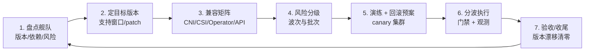
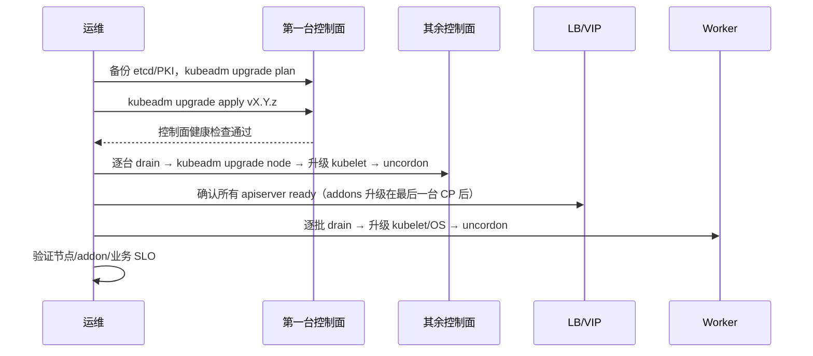

# 大规模多集群 Kubernetes 版本升级：规划、执行与故障处理

当集群数量从几套涨到几十、几百套，K8s 版本升级就不再是"挑个周末跑 `kubeadm upgrade`"的事情，而是一个需要**版本策略、依赖矩阵、分波次编排、回滚预案和观测门禁**的持续工程。本文给出一套可复用的规划框架，以及升级过程中高频问题的定位和处置方法。

版本基线：Kubernetes v1.37.2（2026-11），同时覆盖自建（kubeadm / Cluster API）和托管（EKS / GKE / AKS）两类集群。代码链接固定到 Kubernetes commit `c50e5395f1ae2d4a2c05f28fdcc38c0916cc1a32`、Cluster API commit `4356c154f4a76b8939748ef7ebc2d0793ffe47e8`。

## 1. 先理解约束：为什么不能"一把梭"

### 1.1 发布节奏与支持窗口

Kubernetes 每年约 3 个 minor（约每 4 个月一个），项目维护**最近 3 个 minor** 的发布分支，1.19 之后每个 minor 大约有 **1 年 patch 支持**（[Version Skew Policy](https://kubernetes.io/releases/version-skew-policy/)）。以当前（2026-11）为例（[Releases](https://kubernetes.io/releases/)）：

| Minor | 状态 | EOL |
|---|---|---|
| 1.37 | 最新 | 2027-10-28 |
| 1.36 | 支持中 | 2027-06-28 |
| 1.35 | 支持中 | 2027-02-28 |
| 1.34 | 已 EOL | 2026-10-27 |

这意味着：**版本规划必须倒排到 EOL 之前**。如果集群还在 1.34，现在就已经拿不到安全补丁了，只能走"紧急追赶"而不是正常升级节奏。

### 1.2 组件版本 skew（最容易被忽视的硬约束）

官方允许的 skew（[Version Skew Policy](https://kubernetes.io/releases/version-skew-policy/)）：

| 组件 | 允许的 skew | 例子（apiserver=1.37） |
|---|---|---|
| kube-apiserver（HA 多实例之间） | 新旧最多差 1 个 minor | 1.37 与 1.36 可共存 |
| kubelet | 不能比 apiserver 新；最多老 3 个 minor | 1.37/1.36/1.35/1.34 |
| kube-proxy | 不能比 apiserver 新；最多老 3 个 minor；与同节点 kubelet 最多差 3 个 minor | 1.37–1.34 |
| kube-controller-manager / kube-scheduler / cloud-controller-manager | 不能比 apiserver 新；期望同 minor，最多老 1 个 minor | 1.37/1.36 |
| kubectl | 与 apiserver 相差不超过 1 个 minor | 1.38/1.37/1.36 |

kubeadm 把这个策略写进了代码：`MinimumControlPlaneVersion = current-1`、`MinimumKubeletVersion = current-3`（[constants.go#L485-L492](https://github.com/kubernetes/kubernetes/blob/c50e5395f1ae2d4a2c05f28fdcc38c0916cc1a32/cmd/kubeadm/app/constants/constants.go#L485-L492)），升级时会强制执行 skew 检查（[policy.go#L40-L47](https://github.com/kubernetes/kubernetes/blob/c50e5395f1ae2d4a2c05f28fdcc38c0916cc1a32/cmd/kubeadm/app/phases/upgrade/policy.go#L40-L47)）。

实际含义：

- **kubelet 不能先于 apiserver 升级**；控制面升完之前，worker 的 kubelet 不能越过 apiserver 的版本；
- HA 控制面升级过程中，新旧 apiserver 会短暂共存，但跨度不能超过 1 个 minor；
- 升级跨多个 minor 时，**kubelet 可以落后 3 个 minor**，但这只是"能跑"，不是"推荐"——会让排障和兼容性验证长期处在混合版本状态。

### 1.3 不能跳 minor

kubeadm 明确"skipping MINOR versions is unsupported"（[kubeadm upgrade](https://kubernetes.io/docs/tasks/administer-cluster/kubeadm/kubeadm-upgrade/)），EKS 也只能一次升一个 minor（[EKS update cluster](https://docs.aws.amazon.com/eks/latest/userguide/update-cluster.html)），Cluster API 同样要求逐 minor 升级（[CAPI upgrading clusters](https://github.com/kubernetes-sigs/cluster-api/blob/4356c154f4a76b8939748ef7ebc2d0793ffe47e8/docs/book/src/tasks/upgrading-clusters.md#L5-L16)）。所以"多集群版本规划"本质上是给每个集群安排一条 **N → N+1 → N+2 …** 的时间线。

### 1.4 API 的生命周期

Kubernetes 的 API 废弃策略：**beta API 在引入后最多 9 个月或 3 个 minor（取较长者）后被废弃，废弃后再过 9 个月/3 个 minor 停止 serve**；alpha 版本可以随时移除；GA 版本不会在同一个 major 内移除（[Deprecation Policy](https://kubernetes.io/docs/reference/using-api/deprecation-policy/)）。

现实案例：`flowcontrol.apiserver.k8s.io/v1beta3` 在 v1.32 停止 serve，必须迁移到 v1（[Deprecated API Migration Guide](https://kubernetes.io/docs/reference/using-api/deprecation-guide/)）。对多集群意味着：**每跨一个 minor 都要做一次"废弃 API + CRD + webhook + operator"兼容性扫描**，而不是最后一起扫。

## 2. 规划框架：七步法



### 2.1 盘点舰队（inventory）

至少采集这些字段，落到一个可持续更新的清单/CMDB（不要用 Excel 手工维护）：

- 集群标识：provider、region/AZ、环境（dev/staging/prod）、负责人、SLO 等级；
- 版本：控制面、节点池、kubelet、kube-proxy、kubeadm、运行时（containerd/CRI-O）、OS 镜像、内核；
- 网络与存储：CNI 及其版本、Service 实现（kube-proxy / eBPF）、CSI 驱动、Ingress、Service Mesh；
- 扩展：CRD 数量与版本、admission webhook、aggregated APIService、Operator、Helm chart、client-go 版本；
- 负载特征：节点数、Pod 数、API QPS、etcd DB 大小、大 list/watch 客户端；
- 风险项：单副本组件、无 PDB 的工作负载、本地盘/StatefulSet、Windows 节点、GPU 节点；
- 合规：是否在支持窗口内、证书剩余有效期、备份最近成功时间。

工具/命令示例：

```bash
kubectl version
kubectl get nodes -o wide
kubectl get --raw '/readyz?verbose'
kubectl get pdb -A
kubectl get crd
kubectl get apiservices
kubectl get --raw '/metrics' | grep apiserver_requested_deprecated_apis
```

`apiserver_requested_deprecated_apis` 是 apiserver 暴露的"废弃 API 被调用"指标（[metrics.go#L67](https://github.com/kubernetes/kubernetes/blob/c50e5395f1ae2d4a2c05f28fdcc38c0916cc1a32/staging/src/k8s.io/apiserver/pkg/endpoints/metrics/metrics.go#L67)），配合审计日志可以定位到底是哪个客户端还在调用待移除的 API。外部工具（如 `pluto`、`kubent`）可以做清单扫描，但**以审计日志/指标为准**，因为动态客户端、operator 的调用往往不在 YAML 里。

### 2.2 选目标版本

- 选 **N+1 的最新 patch**，不要选刚发布的 `.0`；patch 版本通常已包含前几个补丁修复；
- 确认目标版本仍在支持窗口内，并为下一次升级留出时间（一般每 3–4 个月一个 minor，升级本身要占用 2–6 周）；
- 托管集群要看厂商的版本可用时间（GKE 的 Rapid/Regular/Stable/Extended 通道、EKS 的版本支持、AKS 的 preview/GA），不要等自动升级替你决定。

### 2.3 建立依赖兼容矩阵

对每个依赖回答三个问题：**是否支持目标 K8s 版本？升级顺序是什么？不兼容时的降级/替代方案是什么？**

| 依赖 | 检查点 | 典型风险 |
|---|---|---|
| CNI（Calico/Cilium/...） | 目标 K8s 版本支持矩阵、kube-proxy 替换模式 | 控制面升级后节点 NotReady、Pod 网络不通 |
| CSI 驱动 / 存储 | K8s API 版本、VolumeSnapshot、迁移特性 | PVC 挂载失败、卷无法 attach |
| Ingress / Service Mesh | admission webhook 的 API 版本、sidecar 注入 | 新 Pod 无法创建、服务中断 |
| Operator / CRD | controller-runtime/client-go 版本、conversion webhook | CR 无法 reconcile、CRD 升级失败 |
| 运行时 | containerd/CRI-O 版本、cgroup v2、systemd driver | kubelet 启动失败、Pod 无法运行 |
| OS / 内核 | cgroup v1 是否仍被支持、内核版本 | 1.37 起 kubelet 默认 `FailCgroupV1=true`，老 OS 镜像会直接不兼容 |
| 云厂商 | 控制面版本、节点池版本、LB/CSI/CNI 插件 | 托管控制面可用但节点无法加入 |
| 升级工具 | kubeadm / Cluster API / kubectl / Helm | CAPI 版本不支持目标 K8s、Helm chart API 版本不兼容 |

Cluster API 的兼容矩阵尤其重要：CAPI 只主动支持最近两个 minor（N、N-1），且 KCP/Bootstrap provider 对目标 Kubernetes 版本有明确支持范围（[CAPI versions](https://github.com/kubernetes-sigs/cluster-api/blob/4356c154f4a76b8939748ef7ebc2d0793ffe47e8/docs/book/src/reference/versions.md#L49-L70)）。**升级 Kubernetes 之前，可能要先升级 CAPI**。

### 2.4 风险分级与波次

把集群按"爆炸半径"分层，而不是按团队偏好：

| 波次 | 集群 | 目的 | soak 时间 |
|---|---|---|---|
| Wave 0 | 开发/测试/共享 sandbox | 验证流程和工具链 | 1–3 天 |
| Wave 1 | 预发/低风险生产 | 验证业务兼容性 | 3–7 天 |
| Wave 2 | 普通生产（按 region/业务分批） | 主力升级 | 1–2 周 |
| Wave 3 | 关键业务/大集群/特殊负载（GPU、StatefulSet、Windows） | 最后处理长尾 | 1–2 周 |

同波次内也要限制并发：**同一 region/AZ、同一依赖（同一 etcd/LB/CNI 版本）、同一团队的关键集群不要同时升级**。批次大小通常按"一次升级 1–5 套集群"起步，再根据告警和人工支持能力放大。

### 2.5 回滚/止损预案

升级前必须写清楚"什么情况下回滚、回滚到什么程度、谁有权决定"：

- **控制面不支持降级**（kubeadm 没有 downgrade；etcd 数据格式升级后旧二进制可能无法读）。所谓回滚通常是"恢复升级前 etcd 快照 + 旧版本二进制 + 重新加入节点"（[控制面灾备与恢复](./控制面灾备与恢复.md)）；
- **节点可以回滚**：重装旧镜像/重新 join，比控制面回滚便宜得多；
- **托管集群**要看厂商能力：EKS 支持把控制面回滚到上一个 minor（[EKS rollback](https://docs.aws.amazon.com/eks/latest/userguide/rollback-cluster.html)），node group 也可以回滚版本；GKE 的两步升级在"emulated version upgrade"之前可以回滚；AKS 可以通过 node surge/维护窗口控制节奏，但控制面版本回退能力取决于产品；
- **回滚预案必须演练**：至少在一次非生产升级里真的执行一遍快照恢复/节点回滚，否则"有备份"只是心理安慰。

### 2.6 容量与 SLO

升级需要额外的容量来承接 drain/eviction：

- 节点升级前确保其他节点有足够资源；用 Cluster Autoscaler 或预留 surge 节点；
- PDB 不能设置成"永远不满足"（例如 `minAvailable: 100%`），否则 drain 永远卡住；
- 托管节点池的 surge 配置（EKS `maxUnavailable`/`maxUnavailablePercentage`、GKE surge/blue-green、AKS node surge）要和 PDB、容量一起算；
- 给升级窗口定义错误预算和**自动熔断条件**：5xx 比例、apiserver p99、Pod 调度失败率、etcd fsync、节点 NotReady 数的阈值。

### 2.7 变更管理与沟通

- 每个波次提前发变更单：范围、时间窗、影响、回滚点、联系人；
- 冻结窗口（季度结算、大促、春节等）写进日历；
- 升级期间冻结无关变更（尤其是 CNI/Ingress/Operator 的版本变更），避免"两个变量一起动"。

## 3. 单集群升级顺序（自建 kubeadm）

官方流程是：**primary control plane → 其他 control plane → worker**（[kubeadm upgrade](https://kubernetes.io/docs/tasks/administer-cluster/kubeadm/kubeadm-upgrade/)）。每一步的"健康门禁"比命令本身更重要。



### 3.1 升级前检查（Pre-flight）

```bash
# 版本与升级路径
kubeadm upgrade plan
kubeadm certs check-expiration

# 控制面健康
kubectl get nodes
kubectl get --raw '/readyz?verbose'
kubectl get pods -n kube-system

# etcd
etcdctl --endpoints=https://127.0.0.1:2379 \
  --cacert=/etc/kubernetes/pki/etcd/ca.crt \
  --cert=/etc/kubernetes/pki/etcd/server.crt \
  --key=/etc/kubernetes/pki/etcd/server.key \
  endpoint health --cluster

# 废弃 API / webhook / CRD
kubectl get --raw '/metrics' | grep apiserver_requested_deprecated_apis
kubectl get validatingwebhookconfigurations,mutatingwebhookconfigurations
kubectl get crd
```

**必须完成**：etcd 快照 + PKI/kubeconfig/manifests 备份（[控制面灾备与恢复](./控制面灾备与恢复.md)）、release notes 阅读、目标版本的 CNI/CSI/Operator 兼容性确认、drain 容量确认。

### 3.2 控制面

- **第一台控制面**：`kubeadm upgrade apply v1.37.x`。它会检查 API 可达、节点 Ready、控制面健康、版本 skew，升级静态 Pod，并在需要时升级 etcd；默认还会续期 kubeadm 管理的证书（[kubeadm upgrade](https://kubernetes.io/docs/tasks/administer-cluster/kubeadm/kubeadm-upgrade/)）。
- **其余控制面**：先 `kubectl drain <node> --ignore-daemonsets`，再 `kubeadm upgrade node`，然后升级 kubelet/kubectl 并重启 kubelet，最后 `uncordon`。
- **绝对不能同时升级两台控制面**（stacked etcd 下会同时丢两个 etcd 成员，quorum 直接丢失）。
- **addons 升级时机**：从 v1.28 起，kubeadm 会等所有控制面实例升完才升级 CoreDNS/kube-proxy；因此**最后一台控制面升级完成之前，addons 可能仍是旧版本**，不要此时去改 addon。
- **stacked etcd 升级**：etcd 升级会重启 etcd 静态 Pod，期间 apiserver 的在途请求会短暂卡住。官方给出的缓解方式是在 `kubeadm upgrade apply` 前先优雅停掉本机 apiserver（`killall -s SIGTERM kube-apiserver`，等 20s 再升级），减少 etcd 不可用窗口（[kubeadm upgrade](https://kubernetes.io/docs/tasks/administer-cluster/kubeadm/kubeadm-upgrade/)）。
- **external etcd**：etcd 的升级/备份/恢复在 etcd 侧单独做，kubeadm 不会动；控制面升级与 etcd 滚动升级可以解耦。

### 3.3 Worker / kubelet

```bash
kubectl drain <node> --ignore-daemonsets --delete-emptydir-data
# 安装目标版本 kubelet/kubectl，重启 kubelet
kubectl uncordon <node>
```

- 一次只升一个或一小批节点，保证 PDB/容量不被击穿；
- 升级节点操作系统镜像时，**先确认 OS 满足目标版本的运行时要求**（例如 1.37 默认只支持 cgroup v2，老镜像可能直接不兼容）；
- 升级完检查节点 Ready、kubelet 版本、Pod 重建、CNI/CSI 正常。

### 3.4 托管集群的差异

| 平台 | 控制面 | 节点 | 特色能力 |
|---|---|---|---|
| EKS | 一次升一个 minor；控制面升级前要求节点版本不高于控制面 | managed node group 滚动更新（`maxUnavailable`/百分比） | upgrade insights、控制面回滚到上一 minor、node group 回滚 |
| GKE | 通道（Rapid/Regular/Stable/Extended）+ 维护窗口；支持两步升级 | surge / blue-green / autoscaled blue-green | 两步升级可在 soak（6h–7d）内回滚；rollout sequencing 控制多集群顺序 |
| AKS | 手动/自动升级、维护窗口 | node surge | Fleet Manager 批量升级；60 天宽限期后平台可能强制升级；预览版可按 API breaking changes 停止升级 |

EKS 的顺序容易踩坑：**节点版本不能高于控制面**，官方建议先把节点升到当前控制面版本，再把控制面升到下一个 minor（[EKS update cluster](https://docs.aws.amazon.com/eks/latest/userguide/update-cluster.html)）。GKE 的"两步升级"则是先升级二进制、保持旧版本 API 行为，在 soak 期间验证，再执行 emulated version upgrade——这是大规模升级时非常值得利用的"灰度窗口"。AKS 要特别注意平台发起的升级：**维护窗口不一定能阻止平台在超出 60 天宽限期后强制升级**。

### 3.5 Cluster API 管理的集群

- 修改 `KubeadmControlPlane.spec.version` 触发控制面滚动升级；KCP 的 `maxSurge` 只允许 0 或 1，滚动过程会保证控制面副本数足够（[update.go#L104-L130](https://github.com/kubernetes-sigs/cluster-api/blob/4356c154f4a76b8939748ef7ebc2d0793ffe47e8/controlplane/kubeadm/reconcilers/kubeadmcontrolplane/update.go#L104-L130)）；
- 控制面升级完成后修改 `MachineDeployment.spec.template`（版本 + 机器镜像）滚 worker；
- 机器镜像里的 kubeadm/kubelet 版本必须与目标 K8s 版本匹配；`spec.rollout.after` 可用于定时触发滚动（例如证书轮换）；
- 先确认 CAPI 版本支持目标 K8s 版本，必要时先升 CAPI（[CAPI upgrading clusters](https://github.com/kubernetes-sigs/cluster-api/blob/4356c154f4a76b8939748ef7ebc2d0793ffe47e8/docs/book/src/tasks/upgrading-clusters.md#L5-L16)）。

## 4. 多集群编排与自动化

### 4.1 版本即代码

- 用 GitOps/IaC 管理"集群版本"这个字段（CAPI 的 KCP/MachineDeployment、Terraform、云厂商 fleet API），升级 = 提 PR；
- 每个波次一个 PR/分支，带上 preflight 结果、变更单链接、回滚点；
- 禁止手工点控制台升级（除了 break-glass），否则事后无法追溯版本状态。

### 4.2 门禁（gates）

在自动化流水线里串行执行：

1. **preflight gate**：版本 skew、etcd 健康、证书、备份、废弃 API、PDB、容量；
2. **canary gate**：Wave 0/1 集群升级后，检查 SLO/错误率/延迟/Pod 调度；
3. **wave gate**：上一波 soak 达标才允许下一波；
4. **abort gate**：指标越界自动暂停后续集群（不要自动回滚控制面，先停）。

### 4.3 舰队工具

- 自建：Cluster API + GitOps（Flux/Argo CD）是主流组合；CAPI 负责机器滚动，GitOps 负责版本/配置；
- GKE：release channels + maintenance windows + rollout sequencing（自定义 stage，按集群顺序升级）；
- Azure：AKS Fleet Manager 的 update run 可以按 stage/group 批量升级；
- EKS：按集群/node group 编排，结合 upgrade insights 做预检。

### 4.4 版本漂移监控

- 仪表盘：每个集群的控制面/节点/addon 版本、与目标版本的差距、EOL 倒计时；
- 告警：集群落后超过 1 个 minor、进入 EOL 前 90 天、升级任务卡住超过阈值；
- 目标：**生产集群版本差距不超过 1 个 minor，所有集群在 EOL 前完成升级**。

## 5. 常见问题与处理

| # | 现象 | 常见原因 | 处置 | 预防 |
|---|---|---|---|---|
| 1 | 升级后 operator/controller 报 `no matches for kind`、CR 不生效 | 客户端还在用已移除的 API 版本（如 flowcontrol v1beta3、旧 CRD 版本） | 回滚控制面（若刚升级）/用兼容 API 重新部署客户端；`kubectl-convert` 迁移 manifest | 每跳做废弃 API 扫描（metric + audit），先升客户端再升控制面 |
| 2 | 控制面升级卡住或失败 | 节点 NotReady、etcd 不健康、镜像拉取失败、manifest 冲突 | 看 `kubeadm upgrade apply` 输出和 static pod 日志；修复后**重跑**（幂等）；必要时 `kubeadm upgrade apply --force`；用 `/etc/kubernetes/tmp/kubeadm-backup-*` 恢复 | preflight 健康检查、镜像预热、预留回滚窗口 |
| 3 | etcd 升级期间 apiserver 大量超时 | etcd 静态 Pod 重启导致在途请求卡住 | 按官方方式先优雅停 apiserver 再升级；控制面逐台升级，不要并发 | 在低峰升级；external etcd 解耦滚动 |
| 4 | 升级后核心组件 CrashLoop / apiserver 起不来 | 新版本移除了旧 flag/feature gate、配置不兼容、证书/审计配置错误 | 看 static pod 日志；回退 manifest（backup 目录）；用 etcd 快照恢复（若已升级 etcd） | 先在 Wave 0 验证；比对 release notes 的 removed flags |
| 5 | `kubectl drain` 卡住 | PDB 不满足、StatefulSet/本地盘、DaemonSet 未加 `--ignore-daemonsets`、eviction 被拒绝 | 检查 `kubectl get pdb -A` 和 eviction 事件；临时调整 PDB（有风险）；对本地盘/StatefulSet 用受控停机；必要时 `--delete-emptydir-data` | 提前算 PDB/容量；GKE 注意 PDB 只被尊重最多 1 小时，之后平台会强制删 Pod |
| 6 | 节点升级后大量 Pod Pending | 容量不足、PDB/反亲和、镜像拉取失败、CNI 未就绪 | 扩容/加 surge、检查调度事件、确认 CNI/CSI ready | 预留容量；按批升级；监控 Pending |
| 7 | 节点 NotReady / 网络异常 | CNI 与目标 K8s 不兼容；kube-proxy 模式/iptables-nft 变化；conntrack 满 | 升级/回滚 CNI 版本；检查 kube-proxy 日志与规则；必要时重启 kube-proxy | 先查 CNI 兼容矩阵；先升 CNI 再升控制面（按厂商建议） |
| 8 | kubelet 起不来 / Pod 无法运行 | cgroup v1 不再支持、containerd 版本过老、systemd driver 不匹配 | 升级 OS/运行时镜像；切 cgroup v2；检查 `journalctl -u kubelet` | 用目标版本支持的基础镜像；把 OS/运行时纳入依赖矩阵 |
| 9 | PVC 无法挂载 / attach 失败 | CSI 驱动不支持新 K8s、存储 API 变化、节点/卷 zone 不匹配 | 升级 CSI 驱动；回滚节点/驱动；检查 volume attachment 事件 | CSI 兼容性检查；升级前做存储 smoke test |
| 10 | 控制面升级后部分客户端 401/证书错误 | 证书过期、SAN 不匹配、kubeconfig 指向旧 endpoint、kubelet 证书未轮换 | `kubeadm certs check-expiration`；续期/重签；分发新 kubeconfig；重启 kubelet | 升级前检查证书；变更 endpoint 时重签 SAN |
| 11 | 托管集群被平台"强行"升级 | 超出厂商支持窗口/宽限期（如 AKS 60 天后平台发起升级） | 提前升级；用维护窗口/停升级开关（如 AKS 预览的 API breaking change 停止）；监控通知 | 跟踪厂商版本日历，不等平台动手 |
| 12 | 想回滚控制面，发现回不去 | 控制面不支持 downgrade；etcd 已升级数据格式 | 用升级前 etcd 快照恢复 + 旧二进制（[控制面灾备与恢复](./控制面灾备与恢复.md)）；或重建集群 | 升级前备份并演练恢复；确认厂商是否支持回滚 |
| 13 | 舰队里部分集群升级完成、部分卡住 | 自动化中断、权限/配额、依赖版本不一致 | 用幂等脚本重跑；按集群状态机修复；不要为了"齐步走"回滚已成功集群 | 每个集群独立状态；批次门禁；断点续跑 |

### 5.1 控制面升级失败的恢复细节

kubeadm 的升级是幂等的：失败后**先修复环境（节点 Ready、etcd 健康、镜像可拉取），再重跑 `kubeadm upgrade apply`**；如果是卡在"版本已写但组件未起"的不一致状态，可以 `kubeadm upgrade apply --force`（不改变目标版本）。升级过程中 kubeadm 会在 `/etc/kubernetes/tmp` 下保留：

- `kubeadm-backup-manifests-<date>-<time>`：本节点控制面静态 Pod manifest 的备份；
- `kubeadm-backup-etcd-<date>-<time>`：本节点 etcd 数据备份（external etcd 时为空）。

自动回滚不生效时可以手工恢复这两个目录（[kubeadm upgrade: Recovering from a failure state](https://kubernetes.io/docs/tasks/administer-cluster/kubeadm/kubeadm-upgrade/)）。

### 5.2 etcd 升级的硬边界

- kubeadm 默认 etcd 版本与 K8s 版本绑定（1.37 默认 3.7.0-0，[constants.go#L329-L330](https://github.com/kubernetes/kubernetes/blob/c50e5395f1ae2d4a2c05f28fdcc38c0916cc1a32/cmd/kubeadm/app/constants/constants.go#L329-L330)），跨 minor 升级时 etcd 也会被升级；**etcd 不支持降级**，升级前必须做快照；
- stacked etcd 下，控制面节点就是 etcd 成员：**一次只能动一台**；两台同时不可用会丢 quorum；
- external etcd 要单独规划 etcd 集群的滚动升级，先确认 etcd 版本与目标 K8s 的兼容矩阵（[constants.go#L494-L516](https://github.com/kubernetes/kubernetes/blob/c50e5395f1ae2d4a2c05f28fdcc38c0916cc1a32/cmd/kubeadm/app/constants/constants.go#L494-L516)）。

### 5.3 PDB、drain 和容量的组合坑

- PDB 只保护**自愿驱逐**，不阻止节点故障；它按 `minAvailable/maxUnavailable` 工作（[ disruptions](https://kubernetes.io/docs/concepts/workloads/pods/disruptions/)）；
- 如果 PDB 设置的可用副本数等于当前副本数，drain 会永久阻塞；升级前必须审查所有 PDB；
- 官方建议给 PDB 配置 `unhealthyPodEvictionPolicy: AlwaysAllow`，让不健康的 Pod 可以被驱逐，否则 drain 会卡在"等应用健康"上；
- GKE 的节点升级对 PDB 的尊重有 **1 小时上限**，超过后即使 `maxUnavailable: 0` 也会删 Pod 推进升级——不要假设 PDB 能无限期阻止平台升级。

### 5.4 版本 skew 违规

- 典型错误：先升了 worker 的 kubelet（比 apiserver 新）→ kubelet 注册失败/行为异常；
- 修复：把 kubelet 回退到 apiserver 同 minor 或更低；或者先把控制面升上去；
- HA 控制面新旧 apiserver 跨了 2 个 minor → 组件间通信/行为不一致，必须按"一次一个 minor"补齐。

### 5.5 托管集群的"平台行为"

- **EKS**：节点不能高于控制面；控制面升级前把节点调到与控制面同版本，再升控制面到下个 minor；升级前用 upgrade insights 检查废弃 API/插件；
- **GKE**：通道决定你什么时候被自动升级；`Rapid` 最早、`Stable` 最晚，`Extended` 拉长支持；两步升级可在 soak 期内回滚；
- **AKS**：60 天宽限期后平台可能强制升级；维护窗口只约束"计划内"升级，不能阻止平台在超期后动作；预览特性可按 API breaking changes 自动停止升级。

### 5.6 回滚的边界

- **控制面**：没有官方 downgrade；只能靠 etcd 快照恢复 + 旧二进制/重建（[控制面灾备与恢复](./控制面灾备与恢复.md)）；
- **节点**：可以重装/重加入，成本最低；
- **托管**：EKS 有控制面回滚（上一 minor）和 node group 回滚；GKE 两步升级在 emulated upgrade 前可回滚；AKS 的回滚能力取决于版本/特性，升级前查文档；
- **数据**：etcd 升级后旧版本可能无法读取新数据格式；PVC/CRD 的 schema 变更也可能不可逆。

## 6. 监控、验收与收尾

每个波次至少盯这些信号：

```promql
# apiserver 5xx/429/延迟
sum(rate(apiserver_request_total{code=~"5.."}[5m])) by (cluster)
sum(rate(apiserver_flowcontrol_rejected_requests_total[5m])) by (cluster, reason)

# etcd 健康与写盘
etcd_server_has_leader
histogram_quantile(0.99, rate(etcd_disk_wal_fsync_duration_seconds_bucket[5m]))

# 节点/调度
sum(kube_node_status_condition{condition="Ready",status="true"}) by (cluster)
sum(kube_pod_status_phase{phase="Pending"}) by (cluster)
```

再加：PDB 违规、eviction 数、CNI/CSI 错误、Ingress 5xx、关键业务 SLI。

**验收清单（每集群）**：

- [ ] `kubectl get nodes` 全部 Ready，版本符合目标；
- [ ] 控制面组件、CoreDNS、kube-proxy、CNI、CSI、Ingress、Operator 全部健康；
- [ ] `kubectl get --raw '/readyz?verbose'` 全绿；
- [ ] 关键业务 smoke test 通过，SLO 在错误预算内；
- [ ] 无持续 Pending/Evicted/PDB 违规；
- [ ] 证书有效期正常，备份任务恢复；
- [ ] 版本清单/CMDB 已更新，升级记录归档。

## 7. 检查清单（浓缩版）

**升级前**：版本/支持窗口、skew、废弃 API、CNI/CSI/Operator 兼容、PDB/容量、etcd+PKI 备份、回滚演练、变更窗口。

**升级中**：控制面逐台、addons 等最后一台 CP、worker 分批、每一步检查 Ready/`readyz`/节点版本、监控 SLO、达到熔断条件立即暂停后续集群。

**升级后**：节点/addon/业务验收、版本清单更新、清理 `/etc/kubernetes/tmp` 备份、复盘（耗时、问题、改进项）、更新 runbook。

## 8. 参考

- Kubernetes：[Version Skew Policy](https://kubernetes.io/releases/version-skew-policy/) / [Releases & EOL](https://kubernetes.io/releases/)
- Kubernetes：[Upgrading kubeadm clusters](https://kubernetes.io/docs/tasks/administer-cluster/kubeadm/kubeadm-upgrade/)（含 etcd 升级注意事项、失败恢复）
- Kubernetes：[Deprecation Policy](https://kubernetes.io/docs/reference/using-api/deprecation-policy/) / [Deprecated API Migration Guide](https://kubernetes.io/docs/reference/using-api/deprecation-guide/)
- Kubernetes：[Disruptions](https://kubernetes.io/docs/concepts/workloads/pods/disruptions/)（PDB/eviction）
- Cluster API：[Upgrading clusters](https://github.com/kubernetes-sigs/cluster-api/blob/4356c154f4a76b8939748ef7ebc2d0793ffe47e8/docs/book/src/tasks/upgrading-clusters.md#L5-L16) / [Version support](https://github.com/kubernetes-sigs/cluster-api/blob/4356c154f4a76b8939748ef7ebc2d0793ffe47e8/docs/book/src/reference/versions.md#L49-L70)
- AWS EKS：[Update cluster](https://docs.aws.amazon.com/eks/latest/userguide/update-cluster.html) / [Update managed node group](https://docs.aws.amazon.com/eks/latest/userguide/update-managed-node-group.html) / [Rollback cluster](https://docs.aws.amazon.com/eks/latest/userguide/rollback-cluster.html)
- GKE：[Upgrade clusters and node pools](https://cloud.google.com/kubernetes-engine/docs/how-to/upgrading-a-cluster) / [Release channels](https://cloud.google.com/kubernetes-engine/docs/concepts/release-channels)
- AKS：[Upgrade an AKS cluster](https://learn.microsoft.com/en-us/azure/aks/upgrade-cluster)

## 本 wiki 相关页面

- [Kubernetes 控制面高可用方案](./控制面高可用方案.md) —— 升级期间 quorum/LB/滚动顺序的失效分析（§10）
- [Kubernetes 控制面灾备与恢复](./控制面灾备与恢复.md) —— etcd 快照、恢复、全集群重建（升级失败的最终兜底）
- [Kubernetes 控制面事故处理手册](./控制面事故处理手册.md) —— 升级失败、证书过期、节点 NotReady 的现场处置（R6/R10/R12）
- [Cluster API](../../Cluster_Lifecycle/cluster-api.md) —— 声明式集群生命周期与滚动升级
- [API Priority and Fairness：FlowSchema 与 PriorityLevelConfiguration](./flowschema.md) —— 升级引发的 list/watch 风暴与 API 过载保护
