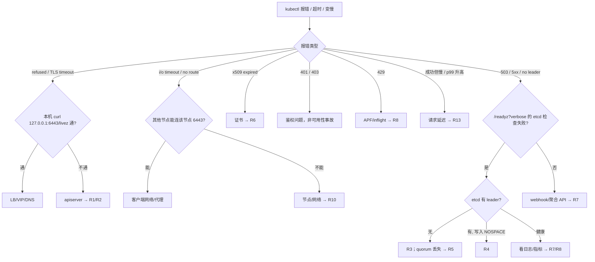

# Kubernetes 控制面事故处理手册

控制面事故发生的第一分钟，值班的人只需要回答三个问题：**坏在哪一层**（客户端/网络/LB、kube-apiserver、etcd、还是控制面节点）、**怎么止血**、**这个动作会不会丢数据**。本文按"检测 → 定位 → 止血 → 恢复 → 复盘"组织，是一份可以直接照着敲命令的值班手册。

范围约定：

- 本文只讲"现在挂了怎么办"，不展开"怎么设计才不容易挂"（见 [控制面高可用方案](./控制面高可用方案.md)）与"数据没了怎么恢复"（见 [控制面灾备与恢复](./控制面灾备与恢复.md)）。
- 命令默认面向 **kubeadm v1.37 + stacked etcd** 集群：控制面组件是 static pod（manifest 在 `/etc/kubernetes/manifests`）、容器运行时是 containerd（用 `crictl`）、kubelet 用 `journalctl -u kubelet`。托管集群（EKS/GKE/AKS 等）不能登控制面节点、拿不到 etcd，通用差异见 1.3，个别 runbook 末尾单独标注。
- 证据约定：Kubernetes 代码链接固定到 `c50e5395f1ae2d4a2c05f28fdcc38c0916cc1a32`（v1.37.2），etcd 固定到 `2e8a5c99e4982c8d4c521be15364ea4c5c68a489`（v3.7.4）。kubeadm v1.37 默认 etcd 版本是 3.7.0（[`DefaultEtcdVersion`](https://github.com/kubernetes/kubernetes/blob/c50e5395f1ae2d4a2c05f28fdcc38c0916cc1a32/cmd/kubeadm/app/constants/constants.go#L329-L330)），与本文 etcd 证据线匹配。
- ⚠️ 表示可能造成数据丢失、可用性进一步下降或不可逆的动作；`> [!WARNING]` 给出额外解释。

---

## 1. 事故分级与处理原则

### 1.1 分级

| 级别 | 判据 | 典型场景 | 首要目标 |
|---|---|---|---|
| **P0 控制面全不可用** | 所有 `kubectl` 超时/拒绝；各 apiserver 的 `/readyz` 全红；无新调度、无 reconcile | etcd quorum 丢失、全部 apiserver CrashLoop、LB/VIP 全挂、控制面节点批量宕机 | 15 分钟内恢复 API 读写路径；不追求根因 |
| **P1 控制面部分降级** | 单个 apiserver 异常；某类写操作全失败；持续 429；请求 p99 持续高于 SLO；controller-manager/scheduler 停摆；etcd 频繁选主但仍有 leader | 证书过期、webhook 后端挂、APF 过载、静态 pod 反复重启 | 1 小时内止血，保住剩余冗余 |
| **P2 容量/性能劣化与单点风险** | etcd `fsync` p99 升高、DB 接近 quota、证书剩余 < 30 天、控制面节点磁盘 > 85%、单节点 NotReady 但冗余足够 | 慢盘、事件堆积、日志占满盘、证书临期 | 当日处理，避免升级为 P0/P1 |
| **P3 隐患** | 不影响当前可用性 | 单副本部署、备份未验证、告警缺失 | 排期修复 |

**数据面在控制面全挂时的行为**：存量 Pod 继续运行，kubelet 继续维持容器；但无新调度、无 Deployment/ReplicaSet reconcile、Service/Endpoints 不再更新（依赖已有 iptables/IPVS 规则与 DNS 缓存）。这是"控制面 P0 不等于业务 P0"的原因，止血时不要为了恢复控制面而误伤数据面。

### 1.2 处理原则

1. **先止血、后根因**：先把"坏的副本/后端/配置"摘掉，让服务恢复，再找根因。止血动作应当是**可逆且单点**的。
2. **保留现场**：重启、删除、`--force-new-cluster` 之前，先留证据：`kubectl cluster-info dump`、`/readyz?verbose` 输出、容器日志、etcd 快照、时间线（见第 5 节）。
3. **变更冻结 + 单变量**：事故期间只做必要变更；每次只改一个变量，记下时间和操作人。禁止顺手"清理"不相关资源。
4. **先算数据风险**：任何涉及 etcd 成员删除、快照恢复、`--force-new-cluster`、强制删除 Namespace/CRD 的动作，先确认 quorum 状态与最近可用快照，按 [控制面灾备与恢复](./控制面灾备与恢复.md) 的流程走。
5. **用官方流程**：证书续期、升级、恢复都走 kubeadm/etcdctl 官方入口，不手拼 manifest、不改 etcd 数据目录。

### 1.3 环境前提与端口

| 事实 | 值 | 证据 |
|---|---|---|
| 配置目录 / manifest 目录 / PKI 目录 | `/etc/kubernetes`、`/etc/kubernetes/manifests`、`/etc/kubernetes/pki` | [constants.go#L37-L53](https://github.com/kubernetes/kubernetes/blob/c50e5395f1ae2d4a2c05f28fdcc38c0916cc1a32/cmd/kubeadm/app/constants/constants.go#L37-L53)、[GetStaticPodDirectory](https://github.com/kubernetes/kubernetes/blob/c50e5395f1ae2d4a2c05f28fdcc38c0916cc1a32/cmd/kubeadm/app/constants/constants.go#L593-L596) |
| kubelet 证书默认有效期 / CA 默认有效期 | 1 年 / 10 年 | [constants.go#L45-L50](https://github.com/kubernetes/kubernetes/blob/c50e5395f1ae2d4a2c05f28fdcc38c0916cc1a32/cmd/kubeadm/app/constants/constants.go#L45-L50) |
| etcd client / peer / metrics-health 端口 | 2379 / 2380 / 2381 | [constants.go#L94-L107](https://github.com/kubernetes/kubernetes/blob/c50e5395f1ae2d4a2c05f28fdcc38c0916cc1a32/cmd/kubeadm/app/constants/constants.go#L94-L107) |
| kubelet 健康端口（只读） | 10248 | [constants.go#L323-L324](https://github.com/kubernetes/kubernetes/blob/c50e5395f1ae2d4a2c05f28fdcc38c0916cc1a32/cmd/kubeadm/app/constants/constants.go#L323-L324) |
| static pod 优先级 | `system-node-critical`（kubelet 不会驱逐） | [staticpod/utils.go#L62-L85](https://github.com/kubernetes/kubernetes/blob/c50e5395f1ae2d4a2c05f28fdcc38c0916cc1a32/cmd/kubeadm/app/util/staticpod/utils.go#L62-L85)、[eviction_manager.go#L633-L640](https://github.com/kubernetes/kubernetes/blob/c50e5395f1ae2d4a2c05f28fdcc38c0916cc1a32/pkg/kubelet/eviction/eviction_manager.go#L633-L640) |

`crictl` 需要指向正确的运行时（kubeadm + containerd 默认 socket）：
```bash
export CONTAINER_RUNTIME_ENDPOINT=unix:///run/containerd/containerd.sock
# 或者每条命令都加： crictl -r unix:///run/containerd/containerd.sock ...
```

**托管集群差异**：没有控制面节点、没有 manifest、没有 etcd 端口；`crictl`/`journalctl` 不可用。可用的只有 API（`kubectl get --raw`）、云监控指标、云厂商状态页与 support case。下文凡是需要登控制面节点的步骤，托管集群一律替换为"提工单 + 云监控 + 业务侧降级"。

## 2. 观测与告警基线

### 2.1 三个健康检查端点先分清

| 端点 | 语义 | kubeadm 下的组成 |
|---|---|---|
| `/livez` | 该不该重启进程（死锁等不可恢复状态）；启动期有 `--livez-grace-period` 宽限 | `ping`、`log`、`etcd` + 启动阶段 post-start hooks（宽限期内视为健康） |
| `/readyz` | 现在能不能接流量（初始化未完成、etcd 不可用、watch cache 未同步都会失败） | `ping`、`log`、`etcd` + `etcd-readiness` + post-start hooks |
| `/healthz` | 已废弃（v1.16 起），只做兼容 | `ping`、`log`、`etcd`（不含 readyz-only 检查） |

证据：`/readyz`、`/livez` 的注册见 [healthz.go#L176-L188](https://github.com/kubernetes/kubernetes/blob/c50e5395f1ae2d4a2c05f28fdcc38c0916cc1a32/staging/src/k8s.io/apiserver/pkg/server/healthz/healthz.go#L176-L188)；默认检查集合是 `PingHealthz + LogHealthz`（[config.go#L404-L406](https://github.com/kubernetes/kubernetes/blob/c50e5395f1ae2d4a2c05f28fdcc38c0916cc1a32/staging/src/k8s.io/apiserver/pkg/server/config.go#L404-L406)）；kube-apiserver 额外注册 `etcd`（经 `AddHealthChecks` 同时进入 healthz/livez/readyz）与 `etcd-readiness`（`AddReadyzChecks`，只进 readyz）两个分组（[options/etcd.go#L421-L436](https://github.com/kubernetes/kubernetes/blob/c50e5395f1ae2d4a2c05f28fdcc38c0916cc1a32/staging/src/k8s.io/apiserver/pkg/server/options/etcd.go#L421-L436)、[healthz.go#L79-L110](https://github.com/kubernetes/kubernetes/blob/c50e5395f1ae2d4a2c05f28fdcc38c0916cc1a32/staging/src/k8s.io/apiserver/pkg/server/healthz.go#L79-L110)）。官方文档的 `/livez?verbose` 示例同样能看到 `[+]etcd ok`（[API health endpoints](https://kubernetes.io/docs/reference/using-api/health-checks/)）。

这个 etcd 检查的实现不是"TCP 通就算好"，而是对 etcd 发一次 `Get`（key 为 `<prefix>/health`），拿到响应才算健康（[factory/etcd3.go#L257-L269](https://github.com/kubernetes/kubernetes/blob/c50e5395f1ae2d4a2c05f28fdcc38c0916cc1a32/staging/src/k8s.io/apiserver/pkg/storage/storagebackend/factory/etcd3.go#L257-L269)）；health 与 readiness 的默认超时都是 **2s**（[storagebackend/config.go#L38-L42](https://github.com/kubernetes/kubernetes/blob/c50e5395f1ae2d4a2c05f28fdcc38c0916cc1a32/staging/src/k8s.io/apiserver/pkg/storage/storagebackend/config.go#L38-L42)、[factory/etcd3.go#L113-L126](https://github.com/kubernetes/kubernetes/blob/c50e5395f1ae2d4a2c05f28fdcc38c0916cc1a32/staging/src/k8s.io/apiserver/pkg/storage/storagebackend/factory/etcd3.go#L113-L126)）。所以 **`/readyz` 红 + `/livez` 绿，第一嫌疑是 etcd**。

`?verbose` 会逐项打印；失败项对外只显示 `reason withheld`，真正原因在 apiserver 日志里（[healthz.go#L269-L334](https://github.com/kubernetes/kubernetes/blob/c50e5395f1ae2d4a2c05f28fdcc38c0916cc1a32/staging/src/k8s.io/apiserver/pkg/server/healthz/healthz.go#L269-L334)）。
```bash
# 在控制面节点本机直连，绕过 LB/VIP（kubeadm 默认 secure-port 6443）
curl -sk 'https://127.0.0.1:6443/readyz?verbose'
curl -sk 'https://127.0.0.1:6443/livez?verbose'

# 通过 kubeconfig（只要 API 还能连上）
kubectl get --raw='/readyz?verbose'
kubectl get --raw='/livez?verbose'
```

### 2.2 关键指标清单

| 层面 | 指标 | 含义 / 告警建议 | 证据 |
|---|---|---|---|
| apiserver | `apiserver_request_total` | 按 verb/code 的请求计数；5xx 比例与 429 比例的核心来源 | [metrics.go#L76-L84](https://github.com/kubernetes/kubernetes/blob/c50e5395f1ae2d4a2c05f28fdcc38c0916cc1a32/staging/src/k8s.io/apiserver/pkg/endpoints/metrics/metrics.go#L76-L84) |
| apiserver | `apiserver_request_duration_seconds` | 延迟直方图（bucket 到 60s）；p99 告警 | [metrics.go#L94-L104](https://github.com/kubernetes/kubernetes/blob/c50e5395f1ae2d4a2c05f28fdcc38c0916cc1a32/staging/src/k8s.io/apiserver/pkg/endpoints/metrics/metrics.go#L94-L104) |
| 延迟分解 | `apiserver_request_sli_duration_seconds`（不含 webhook 与 APF 排队）/ `etcd_request_duration_seconds` / `apiserver_admission_webhook_admission_duration_seconds` | 把 p99 拆成"排队 / webhook / 存储 / 其余"四块定位（R13） | [metrics.go#L108-L124](https://github.com/kubernetes/kubernetes/blob/c50e5395f1ae2d4a2c05f28fdcc38c0916cc1a32/staging/src/k8s.io/apiserver/pkg/endpoints/metrics/metrics.go#L108-L124)、[etcd3/metrics.go#L44-L60](https://github.com/kubernetes/kubernetes/blob/c50e5395f1ae2d4a2c05f28fdcc38c0916cc1a32/staging/src/k8s.io/apiserver/pkg/storage/etcd3/metrics/metrics.go#L44-L60)、[admission/metrics.go#L179-L193](https://github.com/kubernetes/kubernetes/blob/c50e5395f1ae2d4a2c05f28fdcc38c0916cc1a32/staging/src/k8s.io/apiserver/pkg/admission/metrics/metrics.go#L179-L193) |
| apiserver | `apiserver_current_inflight_requests` | 每秒采样的并发上限使用量；接近 `--max-requests-inflight` 说明饱和 | [metrics.go#L176-L184](https://github.com/kubernetes/kubernetes/blob/c50e5395f1ae2d4a2c05f28fdcc38c0916cc1a32/staging/src/k8s.io/apiserver/pkg/endpoints/metrics/metrics.go#L176-L184)、[config.go#L451-L457](https://github.com/kubernetes/kubernetes/blob/c50e5395f1ae2d4a2c05f28fdcc38c0916cc1a32/staging/src/k8s.io/apiserver/pkg/server/config.go#L451-L457) |
| APF | `apiserver_flowcontrol_rejected_requests_total` | 按 `priority_level`/`flow_schema`/`reason` 统计被拒；reason 为 `queue-full` 或 `time-out` | [metrics.go#L90-L100](https://github.com/kubernetes/kubernetes/blob/c50e5395f1ae2d4a2c05f28fdcc38c0916cc1a32/staging/src/k8s.io/apiserver/pkg/util/flowcontrol/metrics/metrics.go#L90-L100)、[queueset.go#L337-L342](https://github.com/kubernetes/kubernetes/blob/c50e5395f1ae2d4a2c05f28fdcc38c0916cc1a32/staging/src/k8s.io/apiserver/pkg/util/flowcontrol/fairqueuing/queueset/queueset.go#L337-L342)、[queueset.go#L429-L435](https://github.com/kubernetes/kubernetes/blob/c50e5395f1ae2d4a2c05f28fdcc38c0916cc1a32/staging/src/k8s.io/apiserver/pkg/util/flowcontrol/fairqueuing/queueset/queueset.go#L429-L435) |
| APF | `apiserver_flowcontrol_current_inqueue_requests` / `..._current_executing_requests` / `..._request_wait_duration_seconds` | 排队深度、执行中数量、等待时长；判断是"限流"还是"后端慢" | [metrics.go#L203-L262](https://github.com/kubernetes/kubernetes/blob/c50e5395f1ae2d4a2c05f28fdcc38c0916cc1a32/staging/src/k8s.io/apiserver/pkg/util/flowcontrol/metrics/metrics.go#L203-L262) |
| 证书 | `apiserver_client_certificate_expiration_seconds` | 客户端证书剩余有效期分布；提前 30/7/1 天告警 | [x509.go#L50-L74](https://github.com/kubernetes/kubernetes/blob/c50e5395f1ae2d4a2c05f28fdcc38c0916cc1a32/staging/src/k8s.io/apiserver/pkg/authentication/request/x509/x509.go#L50-L74)、[x509.go#L192-L193](https://github.com/kubernetes/kubernetes/blob/c50e5395f1ae2d4a2c05f28fdcc38c0916cc1a32/staging/src/k8s.io/apiserver/pkg/authentication/request/x509/x509.go#L192-L193) |
| webhook | `apiserver_admission_webhook_rejection_count{error_type}` / `..._fail_open_count` | `calling_webhook_error` 增长 = 后端不可用/超时；fail_open 增长 = 放行了本该拦截的请求 | [metrics.go#L195-L213](https://github.com/kubernetes/kubernetes/blob/c50e5395f1ae2d4a2c05f28fdcc38c0916cc1a32/staging/src/k8s.io/apiserver/pkg/admission/metrics/metrics.go#L195-L213) |
| etcd | `etcd_server_has_leader` / `etcd_server_is_leader` | 1 有 leader / 0 无；`has_leader=0` 持续 >10s 直接 P0 告警 | [metrics.go#L28-L40](https://github.com/etcd-io/etcd/blob/2e8a5c99e4982c8d4c521be15364ea4c5c68a489/server/etcdserver/metrics.go#L28-L40) |
| etcd | `etcd_server_leader_changes_seen_total` | leader 变更计数；5 分钟增量 > 2 视为选主震荡 | [metrics.go#L41-L46](https://github.com/etcd-io/etcd/blob/2e8a5c99e4982c8d4c521be15364ea4c5c68a489/server/etcdserver/metrics.go#L41-L46) |
| etcd | `etcd_server_slow_apply_total` | apply 慢（通常慢盘/过载）计数 | [txn/metrics.go#L25-L30](https://github.com/etcd-io/etcd/blob/2e8a5c99e4982c8d4c521be15364ea4c5c68a489/server/etcdserver/txn/metrics.go#L25-L30) |
| etcd | `etcd_disk_wal_fsync_duration_seconds` / `etcd_disk_backend_commit_duration_seconds` | 写盘延迟；p99 fsync > 100ms 说明磁盘跟不上 | [wal/metrics.go#L20-L29](https://github.com/etcd-io/etcd/blob/2e8a5c99e4982c8d4c521be15364ea4c5c68a489/server/storage/wal/metrics.go#L20-L29)、[backend/metrics.go#L20-L29](https://github.com/etcd-io/etcd/blob/2e8a5c99e4982c8d4c521be15364ea4c5c68a489/server/storage/backend/metrics.go#L20-L29) |
| etcd | `etcd_mvcc_db_total_size_in_bytes` / `..._in_use_in_bytes` | DB 物理大小 / 逻辑在用；对 quota 的占比是 NOSPACE 预测指标 | [mvcc/metrics.go#L171-L199](https://github.com/etcd-io/etcd/blob/2e8a5c99e4982c8d4c521be15364ea4c5c68a489/server/storage/mvcc/metrics.go#L171-L199)、[quota.go#L28-L33](https://github.com/etcd-io/etcd/blob/2e8a5c99e4982c8d4c521be15364ea4c5c68a489/server/storage/quota.go#L28-L33) |
| 选主 | `kube-controller-manager` / `kube-scheduler` Lease 的 holder 变化 | 频繁切换 = 选主震荡（R9） | [KCM options#L246-L248](https://github.com/kubernetes/kubernetes/blob/c50e5395f1ae2d4a2c05f28fdcc38c0916cc1a32/cmd/kube-controller-manager/app/options/options.go#L246-L248)、[scheduler options#L112-L120](https://github.com/kubernetes/kubernetes/blob/c50e5395f1ae2d4a2c05f28fdcc38c0916cc1a32/cmd/kube-scheduler/app/options/options.go#L112-L120) |
| 节点 | Node 状态与 Lease | kubelet 每 10s 上报状态、Lease 40s；kubelet 失联约 50s 后 Node 变 NotReady | [kubelet defaults#L146-L150](https://github.com/kubernetes/kubernetes/blob/c50e5395f1ae2d4a2c05f28fdcc38c0916cc1a32/pkg/kubelet/apis/config/v1beta1/defaults.go#L146-L150)、[nodelifecycle defaults#L45-L53](https://github.com/kubernetes/kubernetes/blob/c50e5395f1ae2d4a2c05f28fdcc38c0916cc1a32/pkg/controller/nodelifecycle/config/v1alpha1/defaults.go#L45-L53) |

etcd 指标怎么拿到：kubeadm 给 etcd 加了本地 metrics 监听 `http://127.0.0.1:2381`（[local.go#L263-L267](https://github.com/kubernetes/kubernetes/blob/c50e5395f1ae2d4a2c05f28fdcc38c0916cc1a32/cmd/kubeadm/app/phases/etcd/local.go#L263-L267)），Prometheus 需从控制面节点抓取或走 node-exporter/代理；不要在公网暴露 etcd 端口。

### 2.3 日志在哪

| 来源 | 位置 / 命令 |
|---|---|
| static pod 容器日志（apiserver/etcd/KCM/scheduler） | `crictl ps -a` 找容器 ID，再 `crictl logs <id>`；落盘在 `/var/log/pods/kube-system_<pod>_<uid>/<container>/0.log` |
| kubelet | `journalctl -u kubelet --since "30 min ago"` |
| 事件 / 审计 | `kubectl get events -A --sort-by=.lastTimestamp`；审计日志 kubeadm 默认**不开启**，只有 manifest 配了 `--audit-log-path` 才有 |
```bash
# static pod 日志（按名字查最近重启的容器）
crictl ps -a --name kube-apiserver
crictl logs --tail 200 $(crictl ps -a --name kube-apiserver -q | head -1)
crictl logs --tail 200 $(crictl ps -a --name etcd -q | head -1)
```

### 2.4 建议告警规则（PromQL 骨架）
```promql
# 1) API 5xx 比例（5m）
sum(rate(apiserver_request_total{code=~"5.."}[5m])) by (cluster)
  / sum(rate(apiserver_request_total[5m])) by (cluster) > 0.01
# 2) 429（APF 拒绝）
sum(rate(apiserver_flowcontrol_rejected_requests_total[5m])) by (priority_level, reason) > 0
# 3) 并发水位
max by (instance) (apiserver_current_inflight_requests{request_kind="mutating"}) > 150
# 4) etcd 无 leader（最急）
etcd_server_has_leader == 0
# 5) leader 变更（5m 增量）
increase(etcd_server_leader_changes_seen_total[5m]) > 2
# 6) etcd 写盘 p99
histogram_quantile(0.99, rate(etcd_disk_wal_fsync_duration_seconds_bucket[5m])) > 0.1
# 7) DB 接近 quota（默认 2GiB）
etcd_mvcc_db_total_size_in_bytes / on(instance) etcd_server_quota_backend_bytes > 0.7
# 8) 客户端证书临期（30 天）
histogram_quantile(0.01, rate(apiserver_client_certificate_expiration_seconds_bucket[1h])) < 2592000
# 9) apiserver p99（排除 watch/connect 长连接）
histogram_quantile(0.99, sum by (verb) (rate(apiserver_request_duration_seconds_bucket{verb!~"WATCH|CONNECT"}[5m]))) > 1
# 10) apiserver 视角的 etcd 调用 p99（区分"apiserver 慢"还是"etcd 慢"）
histogram_quantile(0.99, sum by (operation) (rate(etcd_request_duration_seconds_bucket[5m]))) > 0.5
```
## 3. 症状 → 层决策树


| 症状 | 最可能的层 | 第一条确认命令 | 跳转 |
|---|---|---|---|
| 所有请求 `connection refused` | apiserver 未监听 / LB 无后端 | 控制面节点 `ss -lntp \| grep 6443` | R1、R2 |
| 请求时好时坏、偶发超时 | 单个 apiserver 异常（LB 轮询到坏副本） | 逐台 `curl -sk https://<node-ip>:6443/readyz` | R2 |
| 能成功但明显变慢、p99 升高、偶发 504 | apiserver 排队 / webhook / etcd / 资源 | `apiserver_request_duration_seconds` p99；`etcd_request_duration_seconds` | R13 |
| 报 `etcdserver: no leader` / `request timed out` | etcd | `etcdctl endpoint status -w table` | R3 |
| 写入报 `etcdserver: mvcc: database space exceeded` | etcd NOSPACE | `etcdctl alarm list` | R4 |
| `x509: certificate has expired` | 证书 | `kubeadm certs check-expiration` | R6 |
| `failed calling webhook ... context deadline exceeded` / 聚合 API 503 | webhook 或 APIService 后端 | `kubectl get validatingwebhookconfigurations`；`kubectl get apiservices` | R7 |
| `429 Too many requests` | apiserver 限流 | `apiserver_flowcontrol_rejected_requests_total` | R8 |
| 无新 Pod 调度 / 无新 ReplicaSet | KCM/scheduler 选主 | `kubectl -n kube-system get lease` | R9 |
| 控制面节点 NotReady | 节点/kubelet | `kubectl describe node <n>` | R10 |

## 4. 分场景 Runbook

每个 runbook 固定六段：**症状 → 确认 → 原因 → 止血 → 恢复 → 验证**。etcd 命令统一用 kubeadm 的 PKI 路径：
```bash
# 在控制面节点本机（或 crictl exec 进 etcd 容器）执行
ETCD="etcdctl --endpoints=https://127.0.0.1:2379 --cacert=/etc/kubernetes/pki/etcd/ca.crt \
  --cert=/etc/kubernetes/pki/etcd/server.crt --key=/etc/kubernetes/pki/etcd/server.key"
$ETCD endpoint status --write-out=table; $ETCD endpoint health --cluster
$ETCD member list --write-out=table
```

### R1 kubectl 全超时 / apiserver 全不可用
**症状**：所有 `kubectl` 命令超时或 `connection refused`；监控上所有 apiserver `/readyz` 失败；节点陆续 NotReady（kubelet 无法续租 node Lease）。

**确认**（并行在每台控制面节点执行）：
```bash
crictl ps -a | grep -E 'kube-apiserver|etcd'
ss -lntp | grep -E '6443|2379'
curl -sk -m 3 'https://127.0.0.1:6443/livez?verbose' || echo LIVEZ_FAIL
journalctl -u kubelet --since "10 min ago" | tail -100
```

**原因**：etcd quorum 丢失导致所有 apiserver `readyz` 红（但进程可能还活着）；apiserver 全部 CrashLoop；证书过期；LB/VIP 整体故障；控制面节点批量宕机；kubelet 停止导致 static pod 不再被拉起。

**止血**：按"etcd → apiserver → 入口"顺序，先判断哪一层坏。
```bash
# 1) etcd 是否还健康（有 etcdctl 的节点上）
$ETCD endpoint health --cluster
# 2) 若 etcd 无 leader：转 R3/R5，不要在多个成员上同时执行 force-new-cluster
# 3) 若 etcd 正常，但 apiserver 容器不在：先看 kubelet，必要时重启 kubelet 让 static pod 重建
systemctl restart kubelet          # ⚠️ 会造成本节点 static pod 短暂重启
# 4) 若只是某台 apiserver 坏：从 LB 摘除该后端（见 R2）
# 5) 若 LB/VIP 坏：临时把 kubeconfig 直连某个健康 apiserver
kubectl --server=https://<cp-node-ip>:6443 --insecure-skip-tls-verify get nodes
```

> [!WARNING]
> 控制面全挂时**不要**先做 `--force-new-cluster`、不要删除 `/var/lib/etcd`、不要批量重启所有 kubelet。这些操作会把"可恢复的故障"变成"数据丢失事故"。

**恢复**：etcd 恢复 leader（R3）；apiserver 起来后确认 Lease/Endpoints 正常（kube-apiserver 默认用 lease reconciler 维护 apiserver 的 Endpoints/Lease，[reconcilers.go#L56-L63](https://github.com/kubernetes/kubernetes/blob/c50e5395f1ae2d4a2c05f28fdcc38c0916cc1a32/pkg/controlplane/reconcilers/reconcilers.go#L56-L63)、[options.go#L70-L74](https://github.com/kubernetes/kubernetes/blob/c50e5395f1ae2d4a2c05f28fdcc38c0916cc1a32/cmd/kube-apiserver/app/options/options.go#L70-L74)）。

**验证**：控制面节点 `curl` 三个端点全绿；`kubectl get --raw='/readyz?verbose'`；`kubectl get nodes` 全部 Ready；KCM/scheduler Lease 有 holder。

**托管集群**：只能确认 API 不可达 → 查看云厂商状态页 → 提 P0 工单；客户端侧准备切换 region/集群的预案。

### R2 单个 apiserver 异常 / CrashLoop
**症状**：通过 LB 访问"时好时坏"；某台控制面节点的 6443 拒绝连接或超时；该节点上 kube-apiserver 容器 restart 次数持续增长；`kubectl` 偶发 `TLS handshake timeout`。

**确认**：
```bash
# 快速找出坏节点
for ip in <cp1> <cp2> <cp3>; do
  echo -n "$ip: "; curl -sk -m 3 -o /dev/null -w '%{http_code}\n' "https://$ip:6443/readyz" || echo FAIL
done

# 该节点上看 apiserver
crictl ps -a --name kube-apiserver
crictl logs --tail 300 $(crictl ps -a --name kube-apiserver -q | head -1)
openssl x509 -in /etc/kubernetes/pki/apiserver.crt -noout -dates
grep -E 'etcd-servers|audit-log-path|secure-port' /etc/kubernetes/manifests/kube-apiserver.yaml
```

**原因**：证书过期或文件缺失；`--etcd-servers` 指向错误；etcd 不通；`secure-port` 冲突；manifest 被升级/手工改坏；OOM/磁盘满；审计日志写入失败；静态 pod 被 kubelet 反复杀掉。

**止血**：先从 LB 摘除该节点（保留冗余），再修本机。若 manifest 损坏，用 kubeadm 重新生成该节点控制面静态 pod：
```bash
# 重新下发本节点控制面 manifest（会覆盖手工修改，先备份 ⚠️）
cp /etc/kubernetes/manifests/kube-apiserver.yaml /root/kube-apiserver.yaml.bak
kubeadm upgrade node phase control-plane   # 见 R12 的升级前提
```

> [!WARNING]
> 不要在没有 LB 摘流的情况下直接重启唯一健康的 apiserver；不要用 `docker`/`crictl` 手工改容器内文件，改动会在重建时丢失。

**恢复**：等 kubelet 拉起新容器；确认 `/readyz` 全绿；确认 LB 健康检查使用 `/readyz`（而不是只看 TCP 端口——协议通不代表能服务）。

**验证**：分别对每台控制面 `curl -sk https://<ip>:6443/readyz?verbose`；`kubectl get --raw='/readyz?verbose'`；观察 10 分钟无重启。

### R3 etcd 无 leader / 频繁选主
**症状**：apiserver 日志出现 `etcdserver: no leader`、`etcdserver: request timed out`；`/readyz` 的 `etcd` 检查失败；`etcd_server_has_leader=0` 或 `leader_changes_seen_total` 快速上涨；写入大面积超时。

**确认**：
```bash
$ETCD endpoint status --write-out=table     # 看 Leader / Errors / Raft term / DB size
$ETCD endpoint health --cluster
$ETCD member list --write-out=table
# etcd 容器日志里找选举/心跳/慢盘
crictl logs --tail 300 $(crictl ps -a --name etcd -q | head -1) | grep -iE 'election|leader|heartbeat|slow|took too long'
```

**原因**：网络分区或跨 AZ RTT 抖动；磁盘 fsync 慢导致心跳超时（`etcd_disk_wal_fsync_duration_seconds` 升高）；CPU 饥饿/节点过载；时钟漂移；单个成员 down（quorum 仍够时 leader 会重选）；raft 消息被限流。

**止血**：先恢复"环境"而不是改 etcd 参数：

1. 恢复网络/停止跨 AZ 大流量；2. 降低写入压力（暂停大批量 CI/Operator 循环）；3. 若确认 leader 所在节点磁盘慢，可把 leader 迁走：

```bash
# 把 leader 迁到健康成员（需在 leader 上执行，参数为当前 leader 的 member ID）
$ETCD move-leader <target-member-id>
```

> [!WARNING]
> 在线修改 `--heartbeat-interval` / `--election-timeout` 需要重启 etcd 成员，会短暂降低 quorum 余量；只有在确认是网络 RTT 问题时才做，且一次只重启一个成员（external etcd 逐成员滚动，stacked 下等同重启控制面节点）。

**恢复**：等待自动选主；宕机成员恢复后会自动追上（`member list` 从 unstarted 变 started）；若成员永久损坏 → 删成员 + 加新成员（R5/灾备篇）。

**验证**：`has_leader=1` 稳定 10 分钟；`leader_changes` 不再增长；`endpoint health --cluster` 全 true；apiserver `/readyz` 全绿。

### R4 etcd NOSPACE 告警
**症状**：写入返回 `etcdserver: mvcc: database space exceeded`（[rpctypes/error.go#L34](https://github.com/etcd-io/etcd/blob/2e8a5c99e4982c8d4c521be15364ea4c5c68a489/api/v3rpc/rpctypes/error.go#L34)）；`etcdctl endpoint health` 报 `Active Alarm(s): NOSPACE`（[ep_command.go#L127-L158](https://github.com/etcd-io/etcd/blob/2e8a5c99e4982c8d4c521be15364ea4c5c68a489/etcdctl/ctlv3/command/ep_command.go#L127-L158)）；apiserver 5xx 增多；`etcd_mvcc_db_total_size_in_bytes` 接近 quota。

**确认**：
```bash
$ETCD alarm list
$ETCD endpoint status --write-out=table    # Db size vs Db size quota（默认 2GiB）
# 看是谁把 DB 撑大：事件/大对象/CRD
kubectl get events -A --sort-by=.lastTimestamp | tail
```

**原因**：etcd 后端默认 quota 是 **2GiB**（[quota.go#L28-L33](https://github.com/etcd-io/etcd/blob/2e8a5c99e4982c8d4c521be15364ea4c5c68a489/server/storage/quota.go#L28-L33)）；kubeadm 不覆盖该值，etcd 自身默认**不自动 compaction**（[embed/config.go#L72-L74](https://github.com/etcd-io/etcd/blob/2e8a5c99e4982c8d4c521be15364ea4c5c68a489/server/embed/config.go#L72-L74)），但 kube-apiserver 每 **5 分钟**发起一次 compaction（[storagebackend/config.go#L38-L42](https://github.com/kubernetes/kubernetes/blob/c50e5395f1ae2d4a2c05f28fdcc38c0916cc1a32/staging/src/k8s.io/apiserver/pkg/storage/storagebackend/config.go#L38-L42)）。compaction 只释放**逻辑**空间，物理文件回收要靠 defrag。DB 大通常是事件堆积、CRD 写放大、大对象、或长期未 defrag。

**止血**：释放空间并解除 alarm（顺序很重要）：
```bash
# 1) 组合使用：先 compaction（拿到当前 revision）
REV=$($ETCD endpoint status --write-out=json | head -1 | grep -o '"revision":[0-9]*' | head -1 | cut -d: -f2)
$ETCD compaction "$REV" --physical     # ⚠️ 会阻塞写入，且不可逆
# 2) 逐成员 defrag（--cluster 会串行处理所有成员）
$ETCD defrag --cluster                 # ⚠️ 单成员 defrag 期间该成员不可用/写入变慢
# 3) 空间确实释放后再解除 alarm
$ETCD alarm disarm                     # ⚠️ 空间未释放就 disarm 会立刻再次触发
```

> [!WARNING]
> 不要用"调大 `--quota-backend-bytes`"当长期方案：它只是延后触发，且 backend 过大时性能下降（etcd 建议上限 8GiB，[quota.go#L31-L33](https://github.com/etcd-io/etcd/blob/2e8a5c99e4982c8d4c521be15364ea4c5c68a489/server/storage/quota.go#L31-L33)）。quota 是基于 backend 大小的，重启 etcd 才能改。
> NOSPACE 的产生路径：写入超过 quota → apply 返回 `ErrNoSpace` → etcd 自动发起 NOSPACE alarm（[server.go#L1981-L2002](https://github.com/etcd-io/etcd/blob/2e8a5c99e4982c8d4c521be15364ea4c5c68a489/server/etcdserver/server.go#L1981-L2002)、[apply/quota.go#L36-L43](https://github.com/etcd-io/etcd/blob/2e8a5c99e4982c8d4c521be15364ea4c5c68a489/server/etcdserver/apply/quota.go#L36-L43)）。

**恢复**：清理大对象来源（事件保留策略、CRD 数据模型），把 DB 稳定在 quota 的 60% 以下；必要时扩容磁盘并调大 quota（需滚动重启 etcd）。

**验证**：`alarm list` 为空；`endpoint health --cluster` 全绿；apiserver 写入恢复；`db_total_size_in_bytes` 明显下降。

### R5 quorum 丢失
**症状**：`etcdserver: no leader` 持续数分钟；`endpoint status` 显示多数成员不可达/无 leader；`kubectl` 全超时。此时控制面 P0。

**确认**：
```bash
$ETCD member list --write-out=table     # 看哪些成员 unstarted
$ETCD endpoint status --write-out=table # 逐个看 Leader / Errors
# 分别直连每个成员判断存活
for ep in https://<cp1>:2379 https://<cp2>:2379 https://<cp3>:2379; do
  $ETCD --endpoints=$ep endpoint status -w json || echo "$ep DOWN"
done
```

**原因**：多数派成员宕机/网络隔离/数据目录损坏；stacked 拓扑下控制面节点宕机同时损失 etcd 成员。

**止血**：**不要急于 `--force-new-cluster`**。先恢复节点/网络，让 quorum 自动回归；只有确认多数派永久损坏且没有更优路径时，才按灾备流程从快照恢复。

> [!WARNING]
> `--force-new-cluster` 会把当前成员变成单节点新集群（[embed/config.go#L768](https://github.com/etcd-io/etcd/blob/2e8a5c99e4982c8d4c521be15364ea4c5c68a489/server/embed/config.go#L768)），与其他仍存活成员形成脑裂，**数据以该成员为准**。执行前必须已有可用快照并接受数据丢失窗口。

**恢复**：完整步骤（停 static pod、恢复每个成员、peer URL、重启、验证）见 [控制面灾备与恢复](./控制面灾备与恢复.md) 的"quorum 丢失恢复"一节；不要在事故现场临时发明流程。

**验证**：恢复后 `member list` 全部 started、`endpoint health --cluster` 全绿、apiserver `/readyz` 全绿、关键对象数量与恢复点一致。

### R6 证书过期（含 CA）
**症状**：`x509: certificate has expired or is not yet valid`；kubelet `Unable to register node`；apiserver 对客户端返回 401/TLS 错误；`kubectl` 报证书错误；`kubeadm certs check-expiration` 显示 `EXPIRED` 或 RESIDUAL TIME 很小。

**确认**：
```bash
kubeadm certs check-expiration        # 列出所有 kubeadm 管理的证书与剩余时间
openssl x509 -in /etc/kubernetes/pki/ca.crt -noout -dates
openssl x509 -in /etc/kubernetes/pki/apiserver.crt -noout -dates
openssl x509 -in /etc/kubernetes/pki/etcd/server.crt -noout -dates
# 提前发现：apiserver_client_certificate_expiration_seconds 直方图
```

kubeadm 生成的叶子证书默认 **1 年**、CA 默认 **10 年**（[constants.go#L45-L50](https://github.com/kubernetes/kubernetes/blob/c50e5395f1ae2d4a2c05f28fdcc38c0916cc1a32/cmd/kubeadm/app/constants/constants.go#L45-L50)）；`kubeadm certs check-expiration` 的实现见 [certs.go#L443-L470](https://github.com/kubernetes/kubernetes/blob/c50e5395f1ae2d4a2c05f28fdcc38c0916cc1a32/cmd/kubeadm/app/cmd/certs.go#L443-L470)。

**原因**：控制面证书到期（最常见）；kubelet 客户端证书未轮换（kubeadm 把 `rotateCertificates` 硬编码为 `true`，[componentconfigs/kubelet.go#L41-L42](https://github.com/kubernetes/kubernetes/blob/c50e5395f1ae2d4a2c05f28fdcc38c0916cc1a32/cmd/kubeadm/app/componentconfigs/kubelet.go#L41-L42)、[#L190-L192](https://github.com/kubernetes/kubernetes/blob/c50e5395f1ae2d4a2c05f28fdcc38c0916cc1a32/cmd/kubeadm/app/componentconfigs/kubelet.go#L190-L192)，但需要 apiserver 可达才能通过 CSR 续期，[certificate/kubelet.go#L199-L215](https://github.com/kubernetes/kubernetes/blob/c50e5395f1ae2d4a2c05f28fdcc38c0916cc1a32/pkg/kubelet/certificate/kubelet.go#L199-L215)）；CA 过期则属于灾难性事件。

**止血**：
```bash
# 1) 续叶子证书（不会续 CA）
kubeadm certs renew all
# 2) 让 static pod 重新读取证书：逐个重启控制面容器（kubelet 会自动重建）
crictl ps --name kube-apiserver -q | xargs -r crictl stop
crictl ps --name kube-controller-manager -q | xargs -r crictl stop
crictl ps --name kube-scheduler -q | xargs -r crictl stop
crictl ps --name etcd -q | xargs -r crictl stop
# 3) 分发/确认 kubeconfig 与 kubelet 使用的证书（worker 的 kubelet.conf 若过期需重新 bootstrap）
```

> [!WARNING]
> `systemctl restart kubelet` 不保证重启已运行的 static pod；用 `crictl stop` 让容器退出、由 kubelet 重建是更可控的方式，但**一次只重启一个组件**，避免 quorum/选主同时受影响。
> kubelet 的客户端证书（`/var/lib/kubelet/pki/kubelet-client-current.pem`）如果已经过期且无法通过 CSR 续期，需要重新 bootstrap（token 或重新 join），**不要直接删除 CA 私钥**。

**恢复**：CA 过期没有"续期"路径——kubeadm 明确不提供 CA 续期（[renewal/manager.go#L112-L114](https://github.com/kubernetes/kubernetes/blob/c50e5395f1ae2d4a2c05f28fdcc38c0916cc1a32/cmd/kubeadm/app/phases/certs/renewal/manager.go#L112-L114)）；只能按灾备流程用原 CA 备份重建或重新签发全集群 PKI（见 [控制面灾备与恢复](./控制面灾备与恢复.md)）。叶子证书续期后确认所有组件重启且无 x509 错误。

**验证**：`kubeadm certs check-expiration` 显示 RENEWED；apiserver `/readyz` 全绿；`journalctl -u kubelet | grep -i x509` 无输出；`kubectl get nodes` 全部 Ready。

**托管集群**：控制面证书由厂商负责；客户端证书（kubeconfig）过期需重新签发 → 云厂商 CLI/控制台。

### R7 webhook / 聚合 API 拖垮写操作
**症状**：`kubectl apply/delete` 大量失败，报 `failed calling webhook "<name>": ... context deadline exceeded` 或 `Internal error occurred: failed calling webhook`；某些资源只读正常、写全失败；聚合 API（如 `metrics.k8s.io`）返回 503 `the server is currently unable to handle the request`。

**确认**：
```bash
kubectl get validatingwebhookconfigurations,mutatingwebhookconfigurations
kubectl get apiservices
kubectl get apiservice v1beta1.metrics.k8s.io -o yaml   # 看 status.conditions
kubectl get endpoints -n <webhook-ns> <webhook-svc>
# 指标：calling_webhook_error 增长、fail_open 增长
kubectl get --raw '/metrics' | grep -E 'apiserver_admission_webhook_(rejection|fail_open)_count'
```

**原因**：webhook 后端 Pod 挂/缩容到 0/超时；webhook 的 `failurePolicy` 默认 `Fail`，`timeoutSeconds` 默认 **10s**（[admissionregistration/v1/defaults.go#L30-L52](https://github.com/kubernetes/kubernetes/blob/c50e5395f1ae2d4a2c05f28fdcc38c0916cc1a32/pkg/apis/admissionregistration/v1/defaults.go#L30-L52)，合法范围 1–30s，[validation.go#L387-L390](https://github.com/kubernetes/kubernetes/blob/c50e5395f1ae2d4a2c05f28fdcc38c0916cc1a32/pkg/apis/admissionregistration/validation/validation.go#L387-L390)）；聚合 API 的 Service 不存在/无 Endpoints 时 APIService 会被标记不可用（[remote_available_controller.go#L197-L210](https://github.com/kubernetes/kubernetes/blob/c50e5395f1ae2d4a2c05f28fdcc38c0916cc1a32/staging/src/k8s.io/kube-aggregator/pkg/controllers/status/remote/remote_available_controller.go#L197-L210)）。

**止血**：

1. 先恢复 webhook 后端（扩副本/修 Service selector/查后端日志）——这是正解。
2. 若后端短时间无法恢复，临时把 `failurePolicy` 改为 `Ignore`（或从 webhook 配置中移除该规则），让写操作恢复；同时缩短 `timeoutSeconds` 到 1–3s 降低放大效应。

```bash
# 先备份配置，再临时改策略（示例：只改指定 webhook 的策略字段）
kubectl get validatingwebhookconfiguration <name> -o yaml > /tmp/vwc-backup.yaml
kubectl edit validatingwebhookconfiguration <name>   # failurePolicy: Ignore ⚠️ 安全影响
```

> [!WARNING]
> 把 `failurePolicy` 改成 `Ignore` 意味着 webhook 的校验/注入被跳过，可能让不合规对象落库。这只应作为事故止血手段，恢复后立刻改回，并评估期间产生的对象。聚合 API 不可用时，依赖它的组件（如 HPA 的 metrics）会降级，但核心 API 不受影响，按"先修后端"处理。

**恢复**：webhook 后端健康、`apiservices` 全部 `AVAILABLE=True`；把策略改回 `Fail`；确认无 `fail_open` 指标增量。

**验证**：`kubectl apply` 一个测试 ConfigMap 成功；`kubectl get apiservices` 全 True；指标 `calling_webhook_error` 归零。

### R8 APF 过载 / 429
**症状**：客户端收到 `429 Too many requests, please try again later.`（[priority-and-fairness.go#L377-L381](https://github.com/kubernetes/kubernetes/blob/c50e5395f1ae2d4a2c05f28fdcc38c0916cc1a32/staging/src/k8s.io/apiserver/pkg/server/filters/priority-and-fairness.go#L377-L381)）；`apiserver_flowcontrol_rejected_requests_total` 增长；`apiserver_current_inflight_requests` 贴近上限；部分控制器开始报错/延迟。

**确认**：
```bash
kubectl get flowschemas
kubectl get prioritylevelconfigurations
kubectl get --raw '/metrics' | grep -E 'apiserver_flowcontrol_(rejected_requests_total|current_inqueue_requests|current_executing_requests)'
# 看当前 apiserver 的并发上限（kubeadm 默认未设置，取内置默认 400/200）
kubectl -n kube-system get pod -l component=kube-apiserver -o yaml | grep -E 'max-(mutating-)?requests-inflight'
```

内置默认：非变更请求 400、变更请求 200（[config.go#L451-L457](https://github.com/kubernetes/kubernetes/blob/c50e5395f1ae2d4a2c05f28fdcc38c0916cc1a32/staging/src/k8s.io/apiserver/pkg/server/config.go#L451-L457)）；APF 默认开启（[feature.go#L41-L61](https://github.com/kubernetes/kubernetes/blob/c50e5395f1ae2d4a2c05f28fdcc38c0916cc1a32/staging/src/k8s.io/apiserver/pkg/server/options/feature.go#L41-L61)），默认 FlowSchema/PriorityLevel 见 [bootstrap/default.go#L45-L80](https://github.com/kubernetes/kubernetes/blob/c50e5395f1ae2d4a2c05f28fdcc38c0916cc1a32/staging/src/k8s.io/apiserver/pkg/apis/flowcontrol/bootstrap/default.go#L45-L80)。

**原因**：客户端热点（控制器重试风暴、CI 大量 create、无分页的 list/watch 重连）；某个 PriorityLevel 被打满；etcd 慢导致请求排队；默认 `global-default` 容量有限，被普通负载挤占。

**止血**：

1. 找到打满的 `flow_schema`/`priority_level`，先治客户端（加退避、限制并发、暂停 CI）。
2. 临时提高该 PriorityLevel 的并发份额，或给关键客户端单独的 FlowSchema：

```bash
kubectl edit prioritylevelconfiguration workload-low   # 调 assuredConcurrencyShares ⚠️ 影响全局分配
# 确认 system / leader-election 未被挤占（它们关系到集群自愈）
```

3. 若 apiserver 本身吞吐不足且 etcd 健康，滚动调大 `--max-requests-inflight`（需改 manifest 并重启 apiserver，⚠️ 会放大 etcd 压力，不能替代根因治理）。

> [!WARNING]
> 不要通过关掉 APF（`--enable-priority-and-fairness=false`）来"解决"429：那会退回粗粒度 max-inflight，更容易被单个客户端拖死；也不要给所有客户端加 `exempt`，`exempt` 意味着无限流，会打穿 apiserver。

**恢复**：429 比例回落；`current_inqueue_requests` 降低；根因客户端被限流/修复。

**验证**：`kubectl get --raw='/readyz?verbose'` 全绿；业务写操作成功率恢复；观察 30 分钟无 429 峰值。

### R9 controller-manager / scheduler 选主震荡
**症状**：`kubectl -n kube-system get lease kube-controller-manager` 的 holder 频繁变化；KCM 容器反复重启，日志出现 `leaderelection lost/stopped`（[controllermanager.go#L412-L416](https://github.com/kubernetes/kubernetes/blob/c50e5395f1ae2d4a2c05f28fdcc38c0916cc1a32/cmd/kube-controller-manager/app/controllermanager.go#L412-L416)）；没有新的 ReplicaSet/Deployment 滚动、GC 变慢、ServiceAccount token 不签发；scheduler 无 leader 时新 Pod 全部 Pending。

**确认**：
```bash
kubectl -n kube-system get lease kube-controller-manager kube-scheduler -o yaml
kubectl -n kube-system get pods -l tier=control-plane
kubectl logs -n kube-system kube-controller-manager-<node> --tail=200 | grep -iE 'lease|leader'
```

默认选主参数：`leaseDuration=15s`、`renewDeadline=10s`、`retryPeriod=2s`（[component-base defaults#L35-L50](https://github.com/kubernetes/kubernetes/blob/c50e5395f1ae2d4a2c05f28fdcc38c0916cc1a32/staging/src/k8s.io/component-base/config/v1alpha1/defaults.go#L35-L50)），KCM 用 `kube-system/kube-controller-manager`（[options.go#L246-L248](https://github.com/kubernetes/kubernetes/blob/c50e5395f1ae2d4a2c05f28fdcc38c0916cc1a32/cmd/kube-controller-manager/app/options/options.go#L246-L248)），scheduler 用 `kube-system/kube-scheduler` 且资源锁是 `leases`（[options.go#L112-L120](https://github.com/kubernetes/kubernetes/blob/c50e5395f1ae2d4a2c05f28fdcc38c0916cc1a32/cmd/kube-scheduler/app/options/options.go#L112-L120)）。

**原因**：apiserver 不可用/高延迟导致 Lease 续约失败（`Failed to renew lease`，[leaderelection.go#L279-L306](https://github.com/kubernetes/kubernetes/blob/c50e5395f1ae2d4a2c05f28fdcc38c0916cc1a32/staging/src/k8s.io/client-go/tools/leaderelection/leaderelection.go#L279-L306)）；APF 把 leader-election 流量限掉；网络抖动/时钟漂移；升级期间新旧版本副本并存抢锁；KCM 进程崩溃。

**止血**：先修 apiserver（R1/R2/R8）。确认只有一个 KCM/scheduler 副本持有锁；删掉卡死或重复的 Pod 让其重建；不要手工编辑 Lease 内容来"指定 leader"（除非确认 holder 是已死节点且集群稳定，才按需清理）。
```bash
kubectl -n kube-system get pods -l component=kube-controller-manager
kubectl -n kube-system delete pod kube-controller-manager-<node>   # 让它重启 ⚠️ 短暂无控制器
```

**恢复**：lease holder 稳定，controller 重新工作（创建测试 Deployment 看 ReplicaSet 是否生成；scheduler 看 Pending Pod 是否被调度）。

**验证**：`kubectl -n kube-system get lease` 观察 10 分钟无切换；`kubectl get events -A` 无大量 `FailedCreate`；新 Pod 能调度。

### R10 控制面节点 NotReady / 磁盘满 / kubelet 故障
**症状**：`kubectl get nodes` 控制面节点 NotReady；`kubectl describe node` 的 Conditions 有 `DiskPressure`/`MemoryPressure`；`journalctl -u kubelet` 报 eviction/disk 错误；etcd 开始 NOSPACE 或 `ENOSPC`；容器运行时镜像/日志写失败。

**确认**：
```bash
kubectl describe node <control-plane-node> | sed -n '/Conditions:/,/Addresses:/p'
df -h /var /var/lib/etcd /var/lib/containerd /var/log
du -sh /var/lib/etcd /var/lib/containerd /var/log/pods 2>/dev/null
systemctl status kubelet --no-pager
journalctl -u kubelet --since "30 min ago" | grep -iE 'disk|pressure|evict|failed'
crictl ps -a | wc -l; crictl images | wc -l
```

时序参考：kubelet 每 10s 上报 NodeStatus、Lease 40s（[kubelet defaults#L146-L150](https://github.com/kubernetes/kubernetes/blob/c50e5395f1ae2d4a2c05f28fdcc38c0916cc1a32/pkg/kubelet/apis/config/v1beta1/defaults.go#L146-L150)），KCM 在 `nodeMonitorGracePeriod=50s` 后把节点标记 NotReady，`nodeMonitorPeriod=5s`（[nodelifecycle defaults#L45-L53](https://github.com/kubernetes/kubernetes/blob/c50e5395f1ae2d4a2c05f28fdcc38c0916cc1a32/pkg/controller/nodelifecycle/config/v1alpha1/defaults.go#L45-L53)）。所以 **NotReady 约 1 分钟内出现，但 static pod 容器可能还在跑**。

**原因**：日志/镜像/etcd WAL 增长占满磁盘或 inode；容器运行时（containerd）故障；kubelet 证书/配置错误；节点宕机/内核问题；内存不足 OOM。

**止血**：
```bash
# 1) 腾空间（先确认哪些能删）
journalctl --vacuum-time=2d                 # ⚠️ 清 journal，影响排障取证
crictl rmi --prune                          # ⚠️ 删未使用镜像
# 2) 重启 kubelet / 运行时（一次一个节点）
systemctl restart kubelet                   # ⚠️ 本节点 static pod 会重启
systemctl restart containerd                # ⚠️ 影响本节点所有容器
# 3) 若 etcd 已 NOSPACE，先按 R4 处理，别直接删 /var/lib/etcd
```

> [!WARNING]
> 控制面 static pod 是 `system-node-critical`，kubelet 的驱逐器**不会**驱逐它们（[eviction_manager.go#L633-L640](https://github.com/kubernetes/kubernetes/blob/c50e5395f1ae2d4a2c05f28fdcc38c0916cc1a32/pkg/kubelet/eviction/eviction_manager.go#L633-L640)）。所以磁盘满不会"自动被清掉"，反而会让 etcd 写 WAL 失败、apiserver 审计写入失败。腾空间要人工做，且优先保证 `/var/lib/etcd` 所在盘可用。
> 节点彻底损坏时，把它从 LB 摘除，用 `kubeadm join --control-plane` 加新控制面节点（需要 `--control-plane-endpoint` 与证书 key，见 HA 篇/官方 HA 文档），不要试图在坏盘上原地恢复数据。

**恢复**：节点 Ready、`kubelet` 无 eviction 报错、etcd/apiserver 正常；如果加/换了控制面节点，更新 LB 后端与 etcd `member list`。

**验证**：`kubectl get nodes` 全 Ready；`kubectl get --raw='/readyz?verbose'`；`df -h` 余量 > 20%；etcd `db_total_size` 正常。

### R11 误删对象 / 误操作
**症状**：误删 Namespace/CRD/Deployment/Secret；`kubectl delete namespace` 卡在 `Terminating`；误删 CRD 导致所有 CR 消失；有人直接在 etcd 上 `del` 了前缀（最危险）。

**确认**：
```bash
kubectl get ns <ns> -o json | jq '.status.conditions'
kubectl get crd | grep <crd>; kubectl api-resources | grep <group>
# 若集群有审计日志
grep -i 'delete' /var/log/kubernetes/audit/audit.log | tail -50
# 只读确认 etcd 里是否还有数据（⚠️ 只读，不要写）
$ETCD get --prefix --keys-only /registry/<resource> | head
```

**原因**：手误 `kubectl delete`、GitOps 同步删除、CRD 被删导致级联 GC、Namespace finalizer 卡住、直接操作 etcd。

**止血**：

1. **立即变更冻结**：暂停 GitOps/CI 的自动同步，避免"删了又同步回来又删"。
2. Namespace 卡 Terminating：先确认是哪个 finalizer 阻塞（`kubectl get ns <ns> -o json`），优先修对应 controller，不建议直接 `--force` 清 finalizer（⚠️ 会留下无法回收的资源）。
3. CRD 误删：先恢复 CRD 定义（从 Git/Helm 重新 apply），**不要**在 controller 未就绪时批量重建 CR；CRD 删除会级联删除所有 CR。
4. etcd 数据被删：如果只是少量 key 且集群正常，可能需要从快照恢复或人工重放（见灾备篇）；**不要**在运行中的 etcd 上继续写测试数据。

**恢复**：优先用 GitOps/IaC 重建对象（来源可信、可审计）；有 etcd 快照时按灾备流程恢复；Velero 等对象级备份工具可恢复命名空间内资源（Restore 入口见 [velero/pkg/restore/restore.go#L179-L190](https://github.com/velero-io/velero/blob/4ee1e79a7aed367fd9b767b8219ec65bd0c96892/pkg/restore/restore.go#L179-L190)），但**不覆盖 etcd 级状态与控制器自身状态**。

**验证**：对象数量/关键业务探针恢复；RBAC 与 Secret 完整；Operator 状态健康；无持续 finalizer 阻塞。

### R12 升级失败 / 版本 skew
**症状**：`kubeadm upgrade apply` 失败并回滚/报错；升级后某个 apiserver CrashLoop（flag 不支持、证书/镜像问题）；`kubectl version` 显示 server 与 client 跨多个 minor；kubelet 版本高于 apiserver；控制面组件版本不一致。

**确认**：
```bash
kubectl version
kubectl get nodes -o wide          # kubelet 版本
kubeadm version
grep -E 'image:' /etc/kubernetes/manifests/*.yaml
kubectl -n kube-system get pods -l tier=control-plane -o wide
kubeadm upgrade plan
```

**原因**：跨 minor 跳级升级（必须逐 minor，见[版本偏斜策略](https://kubernetes.io/releases/version-skew-policy/)）；kubelet 先升/未升导致 skew；etcd 版本不兼容；manifest 被手工改过导致 kubeadm 覆盖后行为变化；镜像拉取失败；证书临期/过期叠加；控制面节点不可用导致升级中断。

**止血**：

1. 把失败节点从 LB 摘除，保住剩余副本。
2. 若 apiserver CrashLoop 是 manifest 问题，用 `kubeadm upgrade node phase control-plane` 重新生成；若是新版本 flag/配置问题，回退到升级前的备份 manifest 并重启。
3. kubelet 版本超前：把 kubelet 包降回 apiserver 支持的版本（⚠️ 需要包管理器降级 + 重启 kubelet）。
4. **升级不可原地降级控制面**：要回退只能恢复升级前的 etcd 快照 + 旧版本二进制，按灾备流程执行，先评估数据丢失窗口。

**恢复**：严格按官方顺序：第一个控制面节点 `kubeadm upgrade apply v1.37.x` → 其余控制面 `kubeadm upgrade node` → 工作节点 `kubeadm upgrade node` + 升级 kubelet/kubectl；每一步之间验证 `/readyz` 与节点状态。

> [!WARNING]
> 升级前必做：etcd 快照 + PKI 备份 + `kubeadm-config` ConfigMap 导出（见灾备篇）；确认所有控制面节点时间同步；确认 LB 健康检查用 `/readyz`。升级期间不要同时做证书续期/网络变更。

**验证**：`kubectl get --raw='/version'`；`kubectl get nodes` 版本符合 skew 策略；`kubectl get pods -A` 无 CrashLoop；跑一遍业务 smoke test。

**托管集群**：控制面升级由厂商完成；客户只需管理 kubelet 版本与工作负载兼容性，注意云厂商的版本支持窗口。

### R13 apiserver 请求延迟升高（可用但慢）
**症状**：`kubectl get/apply`、控制器、外部客户端访问 API 明显变慢；`apiserver_request_duration_seconds` p99 持续升高；偶发 `504 Gateway Timeout` 或客户端超时；KCM/scheduler 续约偶发失败、workqueue 处理变慢。与 R1/R2 的区别是**多数请求仍成功**；与 R8 的区别是**不一定出现 429**（可能只是在排队，还没到拒绝）。

**确认**：按"总耗时 → 排队 → webhook → 存储 → 资源/网络"逐层拆。`apiserver_request_duration_seconds` 包含 webhook 与 APF 排队，而 `apiserver_request_sli_duration_seconds` 明确**不含**这两项（[metrics.go#L108-L124](https://github.com/kubernetes/kubernetes/blob/c50e5395f1ae2d4a2c05f28fdcc38c0916cc1a32/staging/src/k8s.io/apiserver/pkg/endpoints/metrics/metrics.go#L108-L124)），两者差值就是排队 + webhook 的贡献。

```bash
# 0) 是否真的慢：按 verb/resource 看 p99（排除 WATCH/CONNECT 长连接）
kubectl get --raw '/metrics' | grep '^apiserver_request_duration_seconds' | head
# 生产上直接用 PromQL：
# histogram_quantile(0.99, sum by (verb,resource) (rate(apiserver_request_duration_seconds_bucket{verb!~"WATCH|CONNECT"}[5m])))

# 1) 排队：APF wait duration / inqueue 高 = 在 apiserver 内部排队（R8 的前兆）
# histogram_quantile(0.99, sum by (priority_level) (rate(apiserver_flowcontrol_request_wait_duration_seconds_bucket[5m])))

# 2) 存储：从 apiserver 视角看每个 operation 的 etcd 耗时
# histogram_quantile(0.99, sum by (operation) (rate(etcd_request_duration_seconds_bucket[5m])))

# 3) webhook：admission webhook 调用耗时（STABLE 指标，按 name/type）
# histogram_quantile(0.99, sum by (name,type) (rate(apiserver_admission_webhook_admission_duration_seconds_bucket[5m])))

# 4) 504：非长请求超过 --request-timeout（默认 60s）会被超时过滤器终止
# sum(rate(apiserver_request_total{code="504"}[5m])) by (verb,resource)

# 5) etcd 服务端：fsync / backend commit p99、slow_apply、leader 变更
$ETCD endpoint status -w table
$ETCD endpoint health --cluster

# 6) 大 list / 大响应：无分页无 selector 的 LIST 是常见元凶
kubectl get --raw '/metrics' | grep '^apiserver_response_sizes' | head

# 7) apiserver CPU 是否被限流（静态 Pod 无 limit 时看节点压力；有 limit 时看 throttling）
crictl stats $(crictl ps -a --name kube-apiserver -q | head -1)
```

**原因**（按层归类，先定位主导项再动手）：

1. **请求形态（最常见）**：无分页 LIST（`limit=0`）、selector 过宽、informer 重连触发全量 list、大量 watch 同时重建、超大对象（Secret/ConfigMap/CRD）反复读写、大量小写请求。`apiserver_response_sizes` 与按资源/verb 拆开的 p99 能直接暴露。
2. **APF 排队**：`apiserver_flowcontrol_request_wait_duration_seconds` 与 inqueue 升高但还没到 429；默认并发 400/200 被占满时请求开始等待（见 R8）。
3. **admission webhook**：每个写请求在准入链里串行调用 webhook，`timeoutSeconds` 默认 10s；webhook 慢会直接抬高写请求 p99，并体现在 SLI 指标差值里（处理见 R7）。
4. **etcd/存储**：`etcd_request_duration_seconds` p99 高 + etcd `fsync`/`backend_commit` p99 高 = 慢盘、IO 争抢、leader 不稳；compaction/defrag 期间也会变慢（R3/R4）。
5. **apiserver 自身资源**：CPU 被 cgroup 限流、内存压力/GC、与 etcd 抢盘、审计日志后端写慢（阻塞式审计会拖慢所有请求）、CRD conversion webhook 慢。
6. **聚合层/网络**：聚合 API（metrics-server 等）慢会拖慢对应 group；LB/VIP 重试、跨 AZ RTT、conntrack/MTU 问题会让"部分客户端慢"（R1/R10）。

**止血**：

1. 先用上面 1/2/3/4 层判断主导项；**不要**一上来就扩容或重启。
2. 请求形态：暂停 CI/批量 Operator/大规模 list，给客户端加分页与 selector，降低并发与 watch 数量——最安全、见效最快。
3. webhook：`timeoutSeconds` 降到 1–3s、扩后端副本；确需止血再临时 `failurePolicy: Ignore`（安全权衡见 R7）。
4. APF：按 R8 调整被打满的 PriorityLevel / 独立 FlowSchema；不要给全部客户端加 `exempt`。
5. etcd：`move-leader` 迁走慢盘上的 leader，错峰 defrag/compaction，排查 IO 争抢；DB 接近 quota 先按 R4 处理。
6. apiserver：确认 CPU/内存余量；增加副本并挂到 LB（滚动，不要一次全重启）；`--max-requests-inflight` 只能在 etcd 健康时谨慎调大，否则会先把 etcd 打穿。
7. 审计/聚合：审计后端慢先降级或换盘；不可用/慢的 APIService 先摘除（R7）。

> [!WARNING]
> 延迟升高时最常见的错误处置：① 重启所有 apiserver（把"慢"变成"不可用"）；② 关闭 APF 或给所有客户端加 `exempt`（把"慢"放大成雪崩）；③ 高峰期 `defrag`（etcd 更慢）；④ 无脑调大 `--max-requests-inflight`（etcd 先被打穿）。另外 `--request-timeout` 默认 **60s**（[config.go#L451-L453](https://github.com/kubernetes/kubernetes/blob/c50e5395f1ae2d4a2c05f28fdcc38c0916cc1a32/staging/src/k8s.io/apiserver/pkg/server/config.go#L451-L453)），超过它的非长请求由超时过滤器返回 504（[timeout.go#L52-L60](https://github.com/kubernetes/kubernetes/blob/c50e5395f1ae2d4a2c05f28fdcc38c0916cc1a32/staging/src/k8s.io/apiserver/pkg/server/filters/timeout.go#L52-L60)）；调大它只会让慢请求占住并发更久，不是解决方案。

**恢复**：p99 回落到 SLO 基线；504/429 归零；APF wait p99 与 `etcd_request_duration_seconds` p99 正常；`apiserver_current_inflight_requests` 留出水位余量。

**验证**：连续 30 分钟 p99 低于 SLO；`kubectl get nodes` 与 KCM/scheduler Lease 稳定；业务侧 API 成功率与耗时恢复；复盘确认主导项（请求形态/webhook/etcd/资源/网络）并落到容量或配置项。

## 5. 事故响应流程与证据收集

### 5.1 流程


| 阶段 | 关键动作 | 产出 |
|---|---|---|
| 检测 | 告警（2.4）、`kubectl` 报错、外部探针 | 现象描述、首个报错原文 |
| 分级 | 对照 1.1 判据；确认是否 P0 | 级别、影响面（哪些 namespace/业务） |
| 组织 | 指定 IC（Incident Commander）、沟通人；宣布变更冻结 | 沟通群、时间线开始 |
| 止血 | 选最小可逆动作；每次一个变量 | 操作记录（命令、时间、执行人） |
| 恢复 | 验证三个端点、节点、核心业务 | 恢复确认 |
| 复盘 | 时间线、5 Whys、行动项 | 复盘文档（5.4 模板） |

### 5.2 证据收集清单

**原则：先取证、再重启**。`kubectl cluster-info dump` 会把节点、事件、Pod 定义与日志落到目录（默认只 dump 当前 namespace 与 `kube-system`，用 `-A` 全量；输出目录权限为 0700/0600，含敏感信息，注意保管）。实现见 [clusterinfo_dump.go#L74-L89](https://github.com/kubernetes/kubernetes/blob/c50e5395f1ae2d4a2c05f28fdcc38c0916cc1a32/staging/src/k8s.io/kubectl/pkg/cmd/clusterinfo/clusterinfo_dump.go#L74-L89) 与 [dump 内容说明#L94-L102](https://github.com/kubernetes/kubernetes/blob/c50e5395f1ae2d4a2c05f28fdcc38c0916cc1a32/staging/src/k8s.io/kubectl/pkg/cmd/clusterinfo/clusterinfo_dump.go#L94-L102)。
```bash
D=/var/tmp/incident-$(date +%Y%m%d-%H%M); mkdir -p "$D"
# 1) 集群快照（API 可达时）
kubectl cluster-info dump --all-namespaces --output-directory="$D"
# 2) 健康、版本、事件
kubectl get --raw='/readyz?verbose' > "$D/readyz.txt"
kubectl version -o yaml > "$D/version.yaml"; kubectl get nodes -o wide > "$D/nodes.txt"
kubectl get events -A --sort-by=.lastTimestamp > "$D/events.txt"
# 3) 控制面日志（在每台控制面节点上）
crictl ps -a > "$D/crictl-ps-$(hostname).txt"
journalctl -u kubelet --since "2 hours ago" > "$D/kubelet-$(hostname).txt"
for c in kube-apiserver etcd kube-controller-manager kube-scheduler; do
  id=$(crictl ps -a --name "$c" -q | head -1)
  [ -n "$id" ] && crictl logs "$id" > "$D/$c-$(hostname).log" 2>&1
done
# 4) etcd 现场（⚠️ snapshot save 有 IO 开销，事故中评估后再做）
$ETCD endpoint status -w json > "$D/etcd-status.json"
$ETCD alarm list > "$D/etcd-alarms.txt"; $ETCD member list -w table > "$D/etcd-members.txt"
$ETCD snapshot save "$D/etcd-$(date +%Y%m%d-%H%M).db"
```

必须按固定清单收集上述材料；must-gather（OpenShift/云厂商诊断包）只是把同样的材料自动化，kubeadm 自建集群用上面的命令组合即可。

### 5.3 时间线模板

| 时间（UTC+8） | 事件 / 观察 | 证据 | 操作人 |
|---|---|---|---|
| 14:01 | 告警 apiserver 5xx > 5%；分级 P1、变更冻结 | 告警截图 | IC |
| 14:08 | 定位 etcd fsync p99 800ms | Grafana | oncall |
| 14:15 | 摘除慢盘节点、迁 leader | 操作命令 | SRE |
| 14:40 | `/readyz` 全绿，业务恢复；16:00 根因：云盘 IOPS 打满 | readyz/云监控 | oncall |

### 5.4 复盘模板
```markdown
## 事故复盘：<标题>（<日期>）
- 级别 / 影响时长 / 影响面；检测方式（MTTD）；止血/恢复时间（MTTM/MTTR）
- 时间线：见 5.3
- 直接原因 / 根因（5 Whys）
- 做得好的 / 做得不好的
- 行动项：| 动作 | owner | 截止 | 验证方式 |
- 是否需要更新 runbook / 告警阈值 / 容量规划

```

### 5.5 对外沟通模板

> 【状态】控制面 API 不可用，影响：新建/变更资源失败，存量业务运行正常。
> 【已采取措施】已定位到 <层>，正在 <止血动作>。
> 【下一步】预计 <时间> 给出更新；如需紧急变更请走 <通道>；数据风险：<无/有>，详见复盘。

## 6. 预防

| 主题 | 做法 | 关联 |
|---|---|---|
| 容量 | etcd DB 稳定在 quota 60% 以下；`fsync` p99 < 100ms；apiserver 并发水位留 50% 余量；控制面磁盘 > 20% 空闲 | R4/R10 |
| 告警 | 第 2.4 节规则全部落地；`has_leader=0`、`/readyz` 失败、证书 < 30 天为 P0/P1 | 2.4 |
| 健康检查 | LB/VIP 健康检查用 `/readyz`（不要只探 TCP 端口）；外部黑盒探针从多个 AZ 访问 API | R1/R2 |
| 证书 | 监控 `apiserver_client_certificate_expiration_seconds`；每季度 `kubeadm certs check-expiration`；CA 证书单独纳入 10 年生命周期管理 | R6 |
| 备份 | etcd 快照定时 + 异地 + 定期 restore 演练；PKI/加密配置/KMS 密钥单独备份 | 灾备篇 |
| 升级 | 先读 release notes，逐 minor 升级；升级前备份 etcd 与 PKI；canary 控制面；遵守[版本偏斜策略](https://kubernetes.io/releases/version-skew-policy/) | R12 |
| webhook | 生产 webhook 至少 2 副本 + PDB + 独立命名空间；`timeoutSeconds` 1–3s；监控 `calling_webhook_error` | R7 |
| APF | 了解默认 FlowSchema；大客户端使用独立 FlowSchema/限速；监控 429 与排队深度 | R8 |
| 演练 | 定期做"停一个 etcd 成员/断网/杀 apiserver/磁盘满/证书临期"混沌演练 | 灾备篇 |

## 7. 一页速查表

| 目的 | 命令 | 风险 |
|---|---|---|
| 看健康 | `kubectl get --raw='/readyz?verbose'` | 无 |
| 本机直连 apiserver | `curl -sk https://127.0.0.1:6443/readyz?verbose` | 无 |
| 逐台判断 apiserver | `for ip in ...; do curl -sk -m3 https://$ip:6443/readyz; done` | 无 |
| 看 static pod | `crictl ps -a \| grep -E 'kube-apiserver\|etcd'` | 无 |
| 看容器日志 | `crictl logs --tail 200 <id>` | 无 |
| 看 kubelet | `journalctl -u kubelet --since "30 min ago"` | 无 |
| etcd 巡检 | `$ETCD endpoint health --cluster`；`$ETCD endpoint status -w table`；`$ETCD member list -w table`；`$ETCD alarm list` | 无 |
| 解 NOSPACE alarm | `$ETCD alarm disarm` | ⚠️ 空间未释放会立刻复发 |
| etcd compaction/defrag | `$ETCD compaction <rev> --physical`；`$ETCD defrag --cluster` | ⚠️ 阻塞写入、单成员变慢 |
| etcd 快照/恢复 | `$ETCD snapshot save /backup/etcd.db`；`etcdutl snapshot restore ...` | ⚠️ IO 开销；恢复前必须停 etcd/apiserver |
| 强制新集群 | **不要**随意 `--force-new-cluster` | ⚠️ 脑裂/丢数据 |
| 证书检查/续期 | `kubeadm certs check-expiration`；`kubeadm certs renew all` + 重启 static pod | ⚠️ 逐组件重启 |
| 看选主 | `kubectl -n kube-system get lease kube-controller-manager kube-scheduler` | 无 |
| 取证 | `kubectl cluster-info dump --all-namespaces --output-directory=...` | ⚠️ 含敏感信息 |
| 看 APF / 聚合 API | `kubectl get flowschemas,prioritylevelconfigurations`；`kubectl get apiservices` | 无 |
| 看延迟分解 | `apiserver_request_duration_seconds` / `apiserver_request_sli_duration_seconds` / `etcd_request_duration_seconds` / webhook duration（见 R13） | 无 |
| 改 webhook 策略 | `kubectl edit validatingwebhookconfiguration <name>` | ⚠️ 安全影响 |
| 升级 | `kubeadm upgrade apply v1.37.x`（第一个控制面） | ⚠️ 先备份/先读 release notes |

## 8. 参考资料

### 官方文档

- Kubernetes：[API health endpoints](https://kubernetes.io/docs/reference/using-api/health-checks/) / [kube-apiserver 参考](https://kubernetes.io/docs/reference/command-line-tools-reference/kube-apiserver/) / [指标参考](https://kubernetes.io/docs/reference/instrumentation/metrics/)
- Kubernetes 运维：[Operating etcd clusters for Kubernetes](https://kubernetes.io/docs/tasks/administer-cluster/configure-upgrade-etcd/) / [kubeadm 证书管理](https://kubernetes.io/docs/tasks/administer-cluster/kubeadm/kubeadm-certs/) / [kubeadm 升级](https://kubernetes.io/docs/tasks/administer-cluster/kubeadm/kubeadm-upgrade/) / [kubeadm HA 拓扑](https://kubernetes.io/docs/setup/production-environment/tools/kubeadm/high-availability/) / [kubeadm 排障](https://kubernetes.io/docs/setup/production-environment/tools/kubeadm/troubleshooting-kubeadm/)
- Kubernetes 扩展与限流：[API Priority and Fairness](https://kubernetes.io/docs/concepts/cluster-administration/flow-control/) / [动态准入控制](https://kubernetes.io/docs/reference/access-authn-authz/extensible-admission-controllers/) / [Admission webhook 最佳实践](https://kubernetes.io/docs/concepts/cluster-administration/admission-webhooks-good-practices/)
- Kubernetes 节点与证书：[Node 状态与心跳](https://kubernetes.io/docs/concepts/architecture/nodes/) / [Lease](https://kubernetes.io/docs/concepts/architecture/leases/) / [kubelet 证书轮换](https://kubernetes.io/docs/tasks/tls/certificate-rotation/) / [节点压力驱逐](https://kubernetes.io/docs/concepts/scheduling-eviction/node-pressure-eviction/) / [Troubleshooting clusters](https://kubernetes.io/docs/tasks/debug/debug-cluster/) / [调试节点](https://kubernetes.io/docs/tasks/debug/debug-cluster/monitor-node-health/) / [crictl](https://kubernetes.io/docs/tasks/debug/debug-cluster/crictl/) / [版本偏斜策略](https://kubernetes.io/releases/version-skew-policy/)
- etcd v3.7：[Maintenance](https://etcd.io/docs/v3.7/op-guide/maintenance/) / [Disaster recovery](https://etcd.io/docs/v3.7/op-guide/recovery/) / [Monitoring](https://etcd.io/docs/v3.7/op-guide/monitoring/) / [FAQ](https://etcd.io/docs/v3.7/faq/) / [Hardware recommendations](https://etcd.io/docs/v3.7/op-guide/hardware/)

### 源码（pinned SHA）

- Kubernetes v1.37.2 `c50e5395f1ae2d4a2c05f28fdcc38c0916cc1a32`：
  - API 健康检查：[healthz.go](https://github.com/kubernetes/kubernetes/blob/c50e5395f1ae2d4a2c05f28fdcc38c0916cc1a32/staging/src/k8s.io/apiserver/pkg/server/healthz/healthz.go#L176-L188) / [apiserver config 默认值](https://github.com/kubernetes/kubernetes/blob/c50e5395f1ae2d4a2c05f28fdcc38c0916cc1a32/staging/src/k8s.io/apiserver/pkg/server/config.go#L404-L406) / [etcd 健康分组](https://github.com/kubernetes/kubernetes/blob/c50e5395f1ae2d4a2c05f28fdcc38c0916cc1a32/staging/src/k8s.io/apiserver/pkg/server/options/etcd.go#L421-L436) / [etcd probe](https://github.com/kubernetes/kubernetes/blob/c50e5395f1ae2d4a2c05f28fdcc38c0916cc1a32/staging/src/k8s.io/apiserver/pkg/storage/storagebackend/factory/etcd3.go#L257-L269)
  - 指标与限流：[apiserver 请求指标](https://github.com/kubernetes/kubernetes/blob/c50e5395f1ae2d4a2c05f28fdcc38c0916cc1a32/staging/src/k8s.io/apiserver/pkg/endpoints/metrics/metrics.go#L76-L104) / [max-in-flight 429](https://github.com/kubernetes/kubernetes/blob/c50e5395f1ae2d4a2c05f28fdcc38c0916cc1a32/staging/src/k8s.io/apiserver/pkg/server/filters/maxinflight.go#L198-L213) / [APF 429](https://github.com/kubernetes/kubernetes/blob/c50e5395f1ae2d4a2c05f28fdcc38c0916cc1a32/staging/src/k8s.io/apiserver/pkg/server/filters/priority-and-fairness.go#L377-L381) / [504 超时](https://github.com/kubernetes/kubernetes/blob/c50e5395f1ae2d4a2c05f28fdcc38c0916cc1a32/staging/src/k8s.io/apiserver/pkg/server/filters/timeout.go#L52-L59) / [APF 指标](https://github.com/kubernetes/kubernetes/blob/c50e5395f1ae2d4a2c05f28fdcc38c0916cc1a32/staging/src/k8s.io/apiserver/pkg/util/flowcontrol/metrics/metrics.go#L90-L100)
  - 选主与 webhook：[leaderelection renew](https://github.com/kubernetes/kubernetes/blob/c50e5395f1ae2d4a2c05f28fdcc38c0916cc1a32/staging/src/k8s.io/client-go/tools/leaderelection/leaderelection.go#L279-L306) / [默认租约参数](https://github.com/kubernetes/kubernetes/blob/c50e5395f1ae2d4a2c05f28fdcc38c0916cc1a32/staging/src/k8s.io/component-base/config/v1alpha1/defaults.go#L35-L50) / [KCM 退出](https://github.com/kubernetes/kubernetes/blob/c50e5395f1ae2d4a2c05f28fdcc38c0916cc1a32/cmd/kube-controller-manager/app/controllermanager.go#L412-L416) / [webhook 默认值](https://github.com/kubernetes/kubernetes/blob/c50e5395f1ae2d4a2c05f28fdcc38c0916cc1a32/pkg/apis/admissionregistration/v1/defaults.go#L30-L52) / [webhook 指标](https://github.com/kubernetes/kubernetes/blob/c50e5395f1ae2d4a2c05f28fdcc38c0916cc1a32/staging/src/k8s.io/apiserver/pkg/admission/metrics/metrics.go#L195-L213)
  - 证书：[apiserver 客户端证书指标](https://github.com/kubernetes/kubernetes/blob/c50e5395f1ae2d4a2c05f28fdcc38c0916cc1a32/staging/src/k8s.io/apiserver/pkg/authentication/request/x509/x509.go#L50-L74) / [kubelet 证书管理](https://github.com/kubernetes/kubernetes/blob/c50e5395f1ae2d4a2c05f28fdcc38c0916cc1a32/pkg/kubelet/certificate/kubelet.go#L199-L215) / [kubeadm 证书有效期](https://github.com/kubernetes/kubernetes/blob/c50e5395f1ae2d4a2c05f28fdcc38c0916cc1a32/cmd/kubeadm/app/constants/constants.go#L45-L50) / [check-expiration](https://github.com/kubernetes/kubernetes/blob/c50e5395f1ae2d4a2c05f28fdcc38c0916cc1a32/cmd/kubeadm/app/cmd/certs.go#L443-L470)
  - 聚合 API：[APIService 不可用](https://github.com/kubernetes/kubernetes/blob/c50e5395f1ae2d4a2c05f28fdcc38c0916cc1a32/staging/src/k8s.io/kube-aggregator/pkg/controllers/status/remote/remote_available_controller.go#L197-L210)
  - kubeadm 现场：[控制面 static pod 参数](https://github.com/kubernetes/kubernetes/blob/c50e5395f1ae2d4a2c05f28fdcc38c0916cc1a32/cmd/kubeadm/app/phases/controlplane/manifests.go#L184-L206) / [etcd static pod 参数](https://github.com/kubernetes/kubernetes/blob/c50e5395f1ae2d4a2c05f28fdcc38c0916cc1a32/cmd/kubeadm/app/phases/etcd/local.go#L248-L267) / [static pod 优先级](https://github.com/kubernetes/kubernetes/blob/c50e5395f1ae2d4a2c05f28fdcc38c0916cc1a32/cmd/kubeadm/app/util/staticpod/utils.go#L62-L85)
- etcd v3.7.4 `2e8a5c99e4982c8d4c521be15364ea4c5c68a489`：
  - maintenance RPC：[alarm](https://github.com/etcd-io/etcd/blob/2e8a5c99e4982c8d4c521be15364ea4c5c68a489/server/etcdserver/api/v3rpc/maintenance.go#L249-L259) / [status](https://github.com/etcd-io/etcd/blob/2e8a5c99e4982c8d4c521be15364ea4c5c68a489/server/etcdserver/api/v3rpc/maintenance.go#L261-L296) / [defrag](https://github.com/etcd-io/etcd/blob/2e8a5c99e4982c8d4c521be15364ea4c5c68a489/server/etcdserver/api/v3rpc/maintenance.go#L119-L130)
  - NOSPACE：[quota 默认值](https://github.com/etcd-io/etcd/blob/2e8a5c99e4982c8d4c521be15364ea4c5c68a489/server/storage/quota.go#L28-L33) / [触发 alarm](https://github.com/etcd-io/etcd/blob/2e8a5c99e4982c8d4c521be15364ea4c5c68a489/server/etcdserver/server.go#L1981-L2002) / [错误字符串](https://github.com/etcd-io/etcd/blob/2e8a5c99e4982c8d4c521be15364ea4c5c68a489/api/v3rpc/rpctypes/error.go#L34)
  - 健康检查：[/health](https://github.com/etcd-io/etcd/blob/2e8a5c99e4982c8d4c521be15364ea4c5c68a489/server/etcdserver/api/etcdhttp/health.go#L183-L215) / [etcdctl endpoint health](https://github.com/etcd-io/etcd/blob/2e8a5c99e4982c8d4c521be15364ea4c5c68a489/etcdctl/ctlv3/command/ep_command.go#L127-L158)
  - 指标：[server](https://github.com/etcd-io/etcd/blob/2e8a5c99e4982c8d4c521be15364ea4c5c68a489/server/etcdserver/metrics.go#L28-L46) / [slow apply](https://github.com/etcd-io/etcd/blob/2e8a5c99e4982c8d4c521be15364ea4c5c68a489/server/etcdserver/txn/metrics.go#L25-L30) / [WAL fsync](https://github.com/etcd-io/etcd/blob/2e8a5c99e4982c8d4c521be15364ea4c5c68a489/server/storage/wal/metrics.go#L20-L29) / [DB size](https://github.com/etcd-io/etcd/blob/2e8a5c99e4982c8d4c521be15364ea4c5c68a489/server/storage/mvcc/metrics.go#L171-L199)
  - 运维命令：[snapshot save](https://github.com/etcd-io/etcd/blob/2e8a5c99e4982c8d4c521be15364ea4c5c68a489/etcdctl/ctlv3/command/snapshot_command.go#L61-L90) / [snapshot restore](https://github.com/etcd-io/etcd/blob/2e8a5c99e4982c8d4c521be15364ea4c5c68a489/etcdutl/etcdutl/snapshot_command.go#L76-L90) / [member remove](https://github.com/etcd-io/etcd/blob/2e8a5c99e4982c8d4c521be15364ea4c5c68a489/etcdctl/ctlv3/command/member_command.go#L68-L78) / [force-new-cluster](https://github.com/etcd-io/etcd/blob/2e8a5c99e4982c8d4c521be15364ea4c5c68a489/server/embed/config.go#L768)
- Velero v1.18.4 `4ee1e79a7aed367fd9b767b8219ec65bd0c96892`：[restore 入口](https://github.com/velero-io/velero/blob/4ee1e79a7aed367fd9b767b8219ec65bd0c96892/pkg/restore/restore.go#L179-L190)

### 事故复盘与延伸阅读

- etcd 官方复盘：[v3.5 data inconsistency postmortem](https://github.com/etcd-io/etcd/blob/2e8a5c99e4982c8d4c521be15364ea4c5c68a489/Documentation/postmortems/v3.5-data-inconsistency.md#L1-L30)（WAL 与 DB 一致性、崩溃场景的经典案例）
- etcd 维护与恢复：[Maintenance](https://etcd.io/docs/v3.7/op-guide/maintenance/) / [Disaster recovery](https://etcd.io/docs/v3.7/op-guide/recovery/) / [FAQ](https://etcd.io/docs/v3.7/faq/)；Kubernetes [version skew policy](https://kubernetes.io/releases/version-skew-policy/)

## 9. 本 wiki 相关页面

- [Kubernetes 控制面高可用方案](./控制面高可用方案.md)（拓扑、quorum、失效矩阵——理解"为什么会挂"）
- [Kubernetes 控制面灾备与恢复](./控制面灾备与恢复.md)（etcd 快照、quorum 恢复、集群重建——R5/R11/R12 的收尾流程）
- [Kubernetes API Server 原理](./2_kubernetes-api-server.md)
- [client-go List & Watch 原理](../Extensibility/client-go-list-watch.md)（watch 重连、resourceVersion 与 compaction 的关系）
- [API Priority and Fairness / FlowSchema](./flowschema.md)（R8 的配置细节）
- [Kubelet 原理](../Node_Runtime/kubelet原理.md)（R10 的 kubelet 行为）
