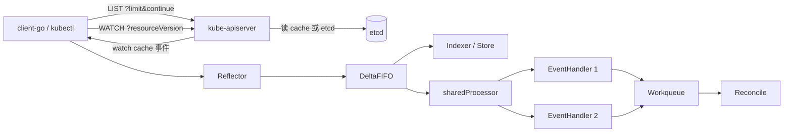

# client-go List/Watch 原理：从 API 语义到 SharedInformer

> **一句话**：List/Watch 不是“先发一个 list、再发一个 watch”这么简单，而是一套由 **API Server 的 `resourceVersion`/一致性语义**、**watch cache 的事件历史**、**Reflector 的重连与重列**、**DeltaFIFO/Informer 的去重与分发**共同保证的协议。只读懂 `WatchServer` 的循环，不足以解释“为什么我的 controller 偶尔会全量 relist”“为什么事件会重复/延迟”“为什么 watch 会 410”。

本文按“协议语义 → 服务端链路 → client-go 分层 → 自定义 watch → 生产坑”组织，代码基线：

| 项目 | 版本 | commit |
|---|---|---|
| Kubernetes | v1.37.2 | `c50e5395f1ae2d4a2c05f28fdcc38c0916cc1a32` |
| client-go | 同 Kubernetes v1.37.2 | 同上 |

> 源码链接固定到上述 commit，行号与本地 `.repos/upstream/kubernetes` 一致；官方文档直接引用 URL。

## 0. 全景：四层协议



四层各自解决不同问题：

| 层 | 负责 | 典型故障 |
|---|---|---|
| **API 语义** | `resourceVersion`、一致性、`410`、bookmark | 用错 RV → 读到旧数据/丢事件 |
| **API Server** | watch cache、etcd watch、超时、限流 | cache 未初始化 429、watch 超时、历史过期 410 |
| **client-go** | Reflector 重连/重列、DeltaFIFO、Informer | relist 风暴、慢 handler、缓存不同步 |
| **消费者** | EventHandler → workqueue → Reconcile | 在 handler 里做重活、事件驱动而非 level-driven |

## 1. API 语义：List/Watch 到底承诺了什么

### 1.1 `resourceVersion`：不是 etcd 的 revision

`resourceVersion`（RV）是 API Server 给对象的版本标识。客户端必须**原样传回**，不能假设它等于 etcd 的 `mod_revision`，也不能跨资源类型比较。1.35+ 的 conformance 要求同一资源类型的 RV 可以按十进制整数比较大小；除此之外只能看相等性。见 [Resource versions](https://kubernetes.io/docs/reference/using-api/api-concepts/#resource-versions)。

```text
List 返回:
  metadata.resourceVersion = "10245"   ← 集合在 10245 这个版本被构造
  items[*].metadata.resourceVersion    ← 每个对象最后一次修改的版本
```

注意：**集合的 RV 和对象的 RV 不是一回事**。list 返回的 `metadata.resourceVersion` 才是 watch 的起点；对象自己的 RV 只表示该对象最后一次变化。

### 1.2 get/list 的语义

对 **get**：

| `resourceVersion` | 语义 | 来源 |
|---|---|---|
| 不设置 | Most Recent | 最新一致读（cache + progress 或 etcd quorum） |
| `"0"` | Any | 任意版本，最新优先；通常由 watch cache 服务，可能较旧 |
| 其他值 | Not older than | 至少和给定 RV 一样新 |

对 **list**，还受 `resourceVersionMatch` 和分页参数影响：

| `resourceVersionMatch` | 分页 | RV 不设置 | `"0"` | 其他 RV |
|---|---|---|---|---|
| 未设置 | 无 `limit` | Most Recent | Any | Not older than |
| 未设置 | 有 `limit`、无 `continue` | Most Recent | Any | **Exact** |
| `Exact` | 任意 | 非法 | 非法 | Exact（不可用则 410） |
| `NotOlderThan` | 任意 | 非法 | Any | Not older than |

完整表格见 [Semantics for get and list](https://kubernetes.io/docs/reference/using-api/api-concepts/#semantics-for-get-and-list)。

> [!WARNING]
> “Most Recent”不是“一定从 etcd 读”。1.31+ 在 etcd 支持 progress notification 时，可以由 watch cache 在追平后服务一致读；具体是否 delegate 由 `ShouldDelegateList` 决定。见 [delegator/interface.go:38-62](https://github.com/kubernetes/kubernetes/blob/c50e5395f1ae2d4a2c05f28fdcc38c0916cc1a32/staging/src/k8s.io/apiserver/pkg/storage/cacher/delegator/interface.go#L38-L62)。

### 1.3 watch 的语义

| `resourceVersion` | 语义 | 初始事件 |
|---|---|---|
| 不设置 | Get State and Start at Most Recent | 先发 synthetic `ADDED` 全量状态 |
| `"0"` | Get State and Start at Any | 先发 synthetic `ADDED`，但起点可能是旧版本，**可能重复/回退** |
| 其他值 | Start at Exact | 不发 synthetic `ADDED`；客户端应已有初始状态 |

见 [Semantics for watch](https://kubernetes.io/docs/reference/using-api/api-concepts/#semantics-for-watch)。

watch 事件类型：

| 类型 | 含义 | `Object` 内容 |
|---|---|---|
| `ADDED` | 对象创建，或初始状态 | 新对象 |
| `MODIFIED` | 对象更新 | 新对象 |
| `DELETED` | 对象删除 | 删除前的最后状态 |
| `BOOKMARK` | 到该 RV 为止的事件已发完 | 只设置 `resourceVersion` |
| `ERROR` | 流内错误（如 410） | `*metav1.Status` |

类型定义见 [watch.go:53-83](https://github.com/kubernetes/kubernetes/blob/c50e5395f1ae2d4a2c05f28fdcc38c0916cc1a32/staging/src/k8s.io/apimachinery/pkg/watch/watch.go#L53-L83)。

> [!WARNING]
> `resourceVersion=0` 的 watch **不能用于正确性**。它允许从任意旧版本开始；如果客户端已经见过更新的状态，会看到“时间倒流”。只有能容忍重复/回退的客户端才可以用。控制器应使用 Reflector 的 list-then-watch。

### 1.4 `410 Gone`、bookmark 与 streaming list

**`410 Gone`**：请求的 RV 太旧，API Server 已经不保留对应历史。客户端必须清空本地缓存、重新 list、拿新 RV、再 watch。见 [410 Gone responses](https://kubernetes.io/docs/reference/using-api/api-concepts/#410-gone-responses)。

**`Too large resource version`**：请求的 RV 比 API Server 已知的还新（多 apiserver 进度差、etcd 恢复等），可能返回 `504`/`Retry-After`，或让 watch 等待。客户端应退避重试或回退到较旧/空 RV。

**Bookmark**：`allowWatchBookmarks=true` 时，服务端可能发 `BOOKMARK`，只带 RV，表示“到这个 RV 为止的事件已经发完”。客户端可用它推进“最后已知 RV”，而不必等真实对象变化。服务端**不保证**发，也不保证频率。见 [Watch bookmarks](https://kubernetes.io/docs/reference/using-api/api-concepts/#watch-bookmarks)。

**Streaming list（WatchList）**：`sendInitialEvents=true` + `resourceVersionMatch=NotOlderThan` + `allowWatchBookmarks=true`，把一个 watch 流当作“初始 list + 后续 watch”：

1. 先发 synthetic `ADDED` 构建全量状态；
2. 再发一个带 `k8s.io/initial-events-end=true` 注解的 `BOOKMARK`；
3. 之后继续正常 watch。

见 [Streaming lists](https://kubernetes.io/docs/reference/using-api/api-concepts/#streaming-lists)。

版本状态（1.37）：

- `WatchList` 服务端 feature gate 是 beta，1.34 起默认开启（[kube_features.go:487-494](https://github.com/kubernetes/kubernetes/blob/c50e5395f1ae2d4a2c05f28fdcc38c0916cc1a32/staging/src/k8s.io/apiserver/pkg/features/kube_features.go#L487-L494)）；
- client-go 的 `WatchListClient` 从 1.35 起默认开启（[known_features.go:141-144](https://github.com/kubernetes/kubernetes/blob/c50e5395f1ae2d4a2c05f28fdcc38c0916cc1a32/staging/src/k8s.io/client-go/features/known_features.go#L141-L144)）。

> [!NOTE]
> API Server 对 `resourceVersion=""`/`"0"` 的普通 watch 也会 default `sendInitialEvents=true`（[defaults.go:25-38](https://github.com/kubernetes/kubernetes/blob/c50e5395f1ae2d4a2c05f28fdcc38c0916cc1a32/staging/src/k8s.io/apimachinery/pkg/apis/meta/internalversion/defaults.go#L25-L38)），以保持“RV=0 的 watch 先发初始状态”的旧语义。只有同时 `allowWatchBookmarks=true`，才会被当作真正的 watch-list 请求（[get.go:329-331](https://github.com/kubernetes/kubernetes/blob/c50e5395f1ae2d4a2c05f28fdcc38c0916cc1a32/staging/src/k8s.io/apiserver/pkg/endpoints/handlers/get.go#L329-L331)）。

### 1.5 分页：`limit` 与 `continue`

list 可以用 `limit` 分页，返回 `continue` token；后续请求带同一个 token 取下一页。服务端保证分页结果与“一次性 list”看到的是同一个快照；`continue` 过期（通常 5–15 分钟）返回 `410`，客户端要么从头 list，要么用 410 里带的新 token 从“最新快照的下一个 key”继续（后者不一致）。字段语义见 [ListOptions: Limit/Continue](https://github.com/kubernetes/kubernetes/blob/c50e5395f1ae2d4a2c05f28fdcc38c0916cc1a32/staging/src/k8s.io/apimachinery/pkg/apis/meta/v1/types.go#L410-L441)。

**不要自己用 `ListWatch` 做分页**：`ListWatch.List` 明确不分页，分页由 `Reflector` 的 pager 负责；见 [listwatch.go:274-294](https://github.com/kubernetes/kubernetes/blob/c50e5395f1ae2d4a2c05f28fdcc38c0916cc1a32/staging/src/k8s.io/client-go/tools/cache/listwatch.go#L274-L294)。

## 2. 服务端链路：一个 watch 请求怎么活下来

### 2.1 `ListResource`：list 和 watch 共用一个 handler

`GET /api/v1/pods?watch=1` 和普通 list 进入同一个 `ListResource`，只是根据 `opts.Watch` 分流：

```go
switch {
case opts.Watch || forceWatch:
    err = handleWatch(ctx, rw, scope, req, w, opts, outputMediaType, minRequestTimeout)
default:
    err = handleList(ctx, r, scope, req, w, opts, outputMediaType)
}
```

见 [get.go:168-200](https://github.com/kubernetes/kubernetes/blob/c50e5395f1ae2d4a2c05f28fdcc38c0916cc1a32/staging/src/k8s.io/apiserver/pkg/endpoints/handlers/get.go#L168-L200)。

`handleWatch` 里有一个很容易被忽略的细节：**watch 的服务端超时是随机的**。

```go
timeout := time.Duration(0)
if opts.TimeoutSeconds != nil {
    timeout = time.Duration(*opts.TimeoutSeconds) * time.Second
}
if timeout == 0 && minRequestTimeout > 0 {
    timeout = time.Duration(float64(minRequestTimeout) * (rand.Float64() + 1.0))
}
```

`minRequestTimeout` 默认 1800s，所以服务端默认会在 **30–60 分钟**内主动断开一个空闲 watch。见 [get.go:271-281](https://github.com/kubernetes/kubernetes/blob/c50e5395f1ae2d4a2c05f28fdcc38c0916cc1a32/staging/src/k8s.io/apiserver/pkg/endpoints/handlers/get.go#L271-L281)。客户端必须能重连，不能把 watch 当成永久连接。

### 2.2 `WatchServer`：WebSocket 或 chunked HTTP

`serveWatchHandler` 创建 `WatchServer`，根据请求是否 WebSocket 选择传输方式：

```go
if wsstream.IsWebSocketRequest(req) {
    w.Header().Set("Content-Type", server.MediaType)
    return websocket.Handler(server.HandleWS), nil
}
return http.HandlerFunc(server.HandleHTTP), nil
```

见 [watch.go:167-190](https://github.com/kubernetes/kubernetes/blob/c50e5395f1ae2d4a2c05f28fdcc38c0916cc1a32/staging/src/k8s.io/apiserver/pkg/endpoints/handlers/watch.go#L167-L190)。

HTTP 分支设置 `Transfer-Encoding: chunked`，然后循环读 `watch.Interface.ResultChan()`，把每个事件编码、flush：

```go
w.delegateRW.Header().Set("Transfer-Encoding", "chunked")
...
ch := s.Watching.ResultChan()
for {
    select {
    case <-done:
        return
    case <-timeoutCh:
        return
    case event, ok := <-ch:
        if !ok { return }
        if err := watchEncoder.Encode(event); err != nil { return }
        if len(ch) == 0 { rw.Flush() }
    }
}
```

见 [watch.go:334-346](https://github.com/kubernetes/kubernetes/blob/c50e5395f1ae2d4a2c05f28fdcc38c0916cc1a32/staging/src/k8s.io/apiserver/pkg/endpoints/handlers/watch.go#L334-L346) 和 [watch.go:423-480](https://github.com/kubernetes/kubernetes/blob/c50e5395f1ae2d4a2c05f28fdcc38c0916cc1a32/staging/src/k8s.io/apiserver/pkg/endpoints/handlers/watch.go#L423-L480)。

WebSocket 分支逻辑类似，只是 framer 换成 WebSocket；见 [watch.go:484-534](https://github.com/kubernetes/kubernetes/blob/c50e5395f1ae2d4a2c05f28fdcc38c0916cc1a32/staging/src/k8s.io/apiserver/pkg/endpoints/handlers/watch.go#L484-L534)。

### 2.3 `Cacher.Watch`：从 watch cache 取事件

`ListResource` 的 `rw.Watch` 通常落到 `Cacher.Watch`。它做几件事：

1. 解析请求 RV；
2. 检查 cache 是否 ready；未 ready 直接返回 429（`Retry-After` 由初始化时间估算），避免打爆 etcd；
3. 等 watch cache 追到所需 RV；
4. 从事件历史里取 `[requiredRV, current]` 区间；
5. 如果是 watch-list，设置 initial-events-end bookmark；
6. 把 watcher 注册到 cache，后续事件实时推送。

关键代码见 [cacher.go:516-645](https://github.com/kubernetes/kubernetes/blob/c50e5395f1ae2d4a2c05f28fdcc38c0916cc1a32/staging/src/k8s.io/apiserver/pkg/storage/cacher/cacher.go#L516-L645)。

watch cache 的结构不是一个固定大小的环形队列：

- 对象本身放在 B-tree（`watchCache.storage`），保存该资源的全量对象；
- 事件历史单独放在 `watchCacheHistory`，默认保留 **75 秒**（`DefaultEventsHistoryWindow = 75s`），容量在 100–102400 事件之间动态调整；
- 请求的 RV 落在历史窗口内才能从 cache 直接服务，否则 `410`。

见 [watch_cache.go:80-97](https://github.com/kubernetes/kubernetes/blob/c50e5395f1ae2d4a2c05f28fdcc38c0916cc1a32/staging/src/k8s.io/apiserver/pkg/storage/cacher/watch_cache.go#L80-L97)、[watch_cache_history.go:31-50](https://github.com/kubernetes/kubernetes/blob/c50e5395f1ae2d4a2c05f28fdcc38c0916cc1a32/staging/src/k8s.io/apiserver/pkg/storage/cacher/watch_cache_history.go#L31-L50)、[config.go:38-41](https://github.com/kubernetes/kubernetes/blob/c50e5395f1ae2d4a2c05f28fdcc38c0916cc1a32/staging/src/k8s.io/apiserver/pkg/storage/storagebackend/config.go#L38-L41)。

> [!NOTE]
> 75 秒是**事件历史**窗口，不是“对象只能活 75 秒”。对象一直都在 B-tree 里；只是如果你拿一个 75 秒之前的 RV 来 watch，历史事件已经被淘汰，只能 410 后重新 list。

### 2.4 `etcd3.watcher`：最终的数据源

Cacher 的底层是 etcd3 watch。`store.Watch` 解析 RV 后调用 watcher：

```go
func (s *store) Watch(ctx context.Context, key string, opts storage.ListOptions) (watch.Interface, error) {
    preparedKey, err := s.prepareKey(key, opts.Recursive)
    ...
    rev, err := s.versioner.ParseResourceVersion(opts.ResourceVersion)
    ...
    return s.watcher.Watch(s.watchContext(ctx), preparedKey, int64(rev), opts)
}
```

见 [store.go:1144-1154](https://github.com/kubernetes/kubernetes/blob/c50e5395f1ae2d4a2c05f28fdcc38c0916cc1a32/staging/src/k8s.io/apiserver/pkg/storage/etcd3/store.go#L1144-L1154)。

`watchChan.startWatching` 做两件事：

1. 如果 `forceInitialEvents`（watch-list/初始同步），先 `sync()` 拿到全量状态；
2. 从 `initialRev+1` 开始 `clientv3.Watch`，带 `WithPrevKV()`、`WithPrefix()`、可选的 `WithProgressNotify()`。

```go
opts := []clientv3.OpOption{clientv3.WithRev(wc.initialRev + 1), clientv3.WithPrevKV()}
if wc.recursive { opts = append(opts, clientv3.WithPrefix()) }
if wc.progressNotify { opts = append(opts, clientv3.WithProgressNotify()) }
wch := wc.watcher.client.Watch(wc.ctx, wc.key, opts...)
```

见 [watcher.go:444-520](https://github.com/kubernetes/kubernetes/blob/c50e5395f1ae2d4a2c05f28fdcc38c0916cc1a32/staging/src/k8s.io/apiserver/pkg/storage/etcd3/watcher.go#L444-L520)。

`sync()` 在 1.37 会优先走 etcd RangeStream（如果 etcd 支持），否则回退分页 Get；见 [watcher.go:295-312](https://github.com/kubernetes/kubernetes/blob/c50e5395f1ae2d4a2c05f28fdcc38c0916cc1a32/staging/src/k8s.io/apiserver/pkg/storage/etcd3/watcher.go#L295-L312)。

### 2.5 list 走 cache 还是 etcd

`Cacher.GetList` 不是无条件从 cache 读。`ShouldDelegateList` 按 RV/RVMatch 决定：

| 条件 | 行为 |
|---|---|
| `resourceVersionMatch=Exact` | cache 能服务则 cache，否则 delegate 到 etcd（不可用则 410） |
| `resourceVersionMatch=NotOlderThan` | cache |
| 未设置 + `continue` token | 按 token 判断，可能 delegate |
| 未设置 + `limit>0` + 非 0 RV | legacy exact，可能 delegate |
| 未设置 + RV 为空 | 一致读：cache 支持 progress notify 则 cache，否则 etcd |
| 其他 | delegate |

见 [delegator/interface.go:38-62](https://github.com/kubernetes/kubernetes/blob/c50e5395f1ae2d4a2c05f28fdcc38c0916cc1a32/staging/src/k8s.io/apiserver/pkg/storage/cacher/delegator/interface.go#L38-L62) 和 [cacher.go:753-792](https://github.com/kubernetes/kubernetes/blob/c50e5395f1ae2d4a2c05f28fdcc38c0916cc1a32/staging/src/k8s.io/apiserver/pkg/storage/cacher/cacher.go#L753-L792)。

> [!WARNING]
> “list 一定走 cache”是常见误解。过滤器、分页、Exact RV、cache 未就绪都可能把请求打到 etcd；大范围 list 可能比 watch 更贵。

## 3. client-go 分层：从 HTTP 到 EventHandler

client-go 把上述协议封装成五层：

```text
RESTClient.Watch
  → StreamWatcher（解码 HTTP 流为 watch.Event）
  → ListWatch（ListFunc + WatchFunc）
  → Reflector（list-then-watch + 重连/重列）
  → DeltaFIFO（按 key 累积 delta）
  → SharedIndexInformer（Indexer + sharedProcessor）
  → EventHandler（入队/业务回调）
```

### 3.1 `ListWatch`：只是两个函数

`ListWatch` 不是“智能同步器”，它只是把 `ListFunc` 和 `WatchFunc` 绑在一起：

```go
type ListWatch struct {
    ListFunc             ListFunc
    WatchFunc            WatchFunc
    ListWithContextFunc  ListWithContextFunc
    WatchFuncWithContext WatchFuncWithContext
    DisableChunking      bool
}
```

见 [listwatch.go:180-204](https://github.com/kubernetes/kubernetes/blob/c50e5395f1ae2d4a2c05f28fdcc38c0916cc1a32/staging/src/k8s.io/client-go/tools/cache/listwatch.go#L180-L204)。

典型构造：

```go
lw := &cache.ListWatch{
    ListWithContextFunc: func(ctx context.Context, opts metav1.ListOptions) (runtime.Object, error) {
        return client.CoreV1().Pods(ns).List(ctx, opts)
    },
    WatchFuncWithContext: func(ctx context.Context, opts metav1.ListOptions) (watch.Interface, error) {
        return client.CoreV1().Pods(ns).Watch(ctx, opts)
    },
}
```

`ListWatch.List` 明确不分页（由 Reflector 的 pager 做）；`Watch` 只是设置 `options.Watch = true` 后调用 RESTClient。见 [listwatch.go:229-312](https://github.com/kubernetes/kubernetes/blob/c50e5395f1ae2d4a2c05f28fdcc38c0916cc1a32/staging/src/k8s.io/client-go/tools/cache/listwatch.go#L229-L312)。

### 3.2 `Reflector`：真正处理“list 失败/ watch 断开/ RV 过期”的地方

`Reflector.Run` 用带退避的循环反复执行 `ListAndWatch`：

```go
_ = r.delayHandler.Until(ctx, true, true, func(ctx context.Context) (bool, error) {
    if err := r.ListAndWatchWithContext(ctx); err != nil {
        r.watchErrorHandler(ctx, r, err)
    }
    return false, nil
})
```

见 [reflector.go:420-435](https://github.com/kubernetes/kubernetes/blob/c50e5395f1ae2d4a2c05f28fdcc38c0916cc1a32/staging/src/k8s.io/client-go/tools/cache/reflector.go#L420-L435)。

`ListAndWatch` 的顺序：

1. 如果启用 WatchList，先尝试 `watchList`；
2. 失败则回退普通 `list`；
3. list 完成后进入 `watch` 循环；
4. watch 断开/超时/410 时，重新进入外层循环（可能 relist）。

见 [reflector.go:467-530](https://github.com/kubernetes/kubernetes/blob/c50e5395f1ae2d4a2c05f28fdcc38c0916cc1a32/staging/src/k8s.io/client-go/tools/cache/reflector.go#L467-L530)。

**list 的 RV 选择**：

- 首次 list：`resourceVersion="0"`，优先由 watch cache 服务；
- 后续 list：用 `lastSyncResourceVersion`，保证不比已观察到的旧；
- 如果上次 list/watch 遇到 410/TooLarge：`relistResourceVersion()` 返回 `""`，强制从 etcd 做一致读，重新建立“可用 RV”。

见 [reflector.go:1111-1132](https://github.com/kubernetes/kubernetes/blob/c50e5395f1ae2d4a2c05f28fdcc38c0916cc1a32/staging/src/k8s.io/client-go/tools/cache/reflector.go#L1111-L1132)。

**list 的 410 回退**：

```go
list, paginatedResult, err = pager.ListWithAlloc(context.Background(), options)
if isExpiredError(err) || isTooLargeResourceVersionError(err) {
    r.setIsLastSyncResourceVersionUnavailable(true)
    list, paginatedResult, err = pager.ListWithAlloc(context.Background(),
        metav1.ListOptions{ResourceVersion: r.relistResourceVersion()})
}
```

见 [reflector.go:719-729](https://github.com/kubernetes/kubernetes/blob/c50e5395f1ae2d4a2c05f28fdcc38c0916cc1a32/staging/src/k8s.io/client-go/tools/cache/reflector.go#L719-L729)。

**watch 的参数**：

```go
options := metav1.ListOptions{
    ResourceVersion:     r.LastSyncResourceVersion(),
    TimeoutSeconds:      &timeoutSeconds,   // 默认 5–10 分钟，随机
    AllowWatchBookmarks: true,
}
```

见 [reflector.go:585-603](https://github.com/kubernetes/kubernetes/blob/c50e5395f1ae2d4a2c05f28fdcc38c0916cc1a32/staging/src/k8s.io/client-go/tools/cache/reflector.go#L585-L603)。Reflector 默认 `minWatchTimeout=5m`、`maxWatchTimeout=10m`（[reflector.go:56-58](https://github.com/kubernetes/kubernetes/blob/c50e5395f1ae2d4a2c05f28fdcc38c0916cc1a32/staging/src/k8s.io/client-go/tools/cache/reflector.go#L56-L58)），比服务端 30–60 分钟更短，所以通常是客户端先断开重连。

**watch 事件处理**：

- `ADDED` → `store.Add`
- `MODIFIED` → `store.Update`
- `DELETED` → `store.Delete`
- `BOOKMARK` → 只推进 RV（如果 store 实现 `ReflectorBookmarkStore`）
- `ERROR` → 转成 error，退出本次 watch，交给外层重试/重列

见 [reflector.go:1036-1078](https://github.com/kubernetes/kubernetes/blob/c50e5395f1ae2d4a2c05f28fdcc38c0916cc1a32/staging/src/k8s.io/client-go/tools/cache/reflector.go#L1036-L1078)。

### 3.3 WatchList：用 watch 流替代初始 list

`Reflector.watchList` 的请求参数：

```go
options := metav1.ListOptions{
    ResourceVersion:      lastKnownRV,
    AllowWatchBookmarks:  true,
    SendInitialEvents:    ptr.To(true),
    ResourceVersionMatch: metav1.ResourceVersionMatchNotOlderThan,
    TimeoutSeconds:       &timeoutSeconds,
}
```

见 [reflector.go:804-860](https://github.com/kubernetes/kubernetes/blob/c50e5395f1ae2d4a2c05f28fdcc38c0916cc1a32/staging/src/k8s.io/client-go/tools/cache/reflector.go#L804-L860)。

流程：

1. 建一个临时 `Store`；
2. 消费 watch 流，把 synthetic `ADDED` 写入临时 Store；
3. 等到带 `initial-events-end` 的 `BOOKMARK`；
4. `store.Replace(temporaryStore.List(), resourceVersion)` 用临时 Store 的结果替换当前 Store；
5. 返回同一个 watch，继续后续事件。

见 [reflector.go:870-907](https://github.com/kubernetes/kubernetes/blob/c50e5395f1ae2d4a2c05f28fdcc38c0916cc1a32/staging/src/k8s.io/client-go/tools/cache/reflector.go#L870-L907)。

它的收益和代价：

| 收益 | 代价 |
|---|---|
| 服务端不必构造完整 `List` 响应，降低大集群初始 list 的峰值内存 | 客户端仍要维护临时 Store，内存仍是 O(n) |
| 初始状态和后续事件在同一个流里，减少 list→watch 的窗口 | 需要正确处理 synthetic ADDED 和 initial-events-end bookmark |
| 支持 `ResourceVersionMatch=NotOlderThan` 的“至少一样新”语义 | 旧服务端/网关不支持时需要回退普通 list |

如果 watch-list 失败，`ListAndWatch` 会回退普通 list；见 [reflector.go:475-505](https://github.com/kubernetes/kubernetes/blob/c50e5395f1ae2d4a2c05f28fdcc38c0916cc1a32/staging/src/k8s.io/client-go/tools/cache/reflector.go#L475-L505)。

### 3.4 DeltaFIFO：按对象累积 delta

Reflector 的 `store` 在 SharedInformer 里就是 `DeltaFIFO`。它的结构：

```go
items map[string]Deltas  // key -> 该对象自上次处理以来的所有变化
queue []string           // 待处理的 key，无重复
```

见 [delta_fifo.go:120-158](https://github.com/kubernetes/kubernetes/blob/c50e5395f1ae2d4a2c05f28fdcc38c0916cc1a32/staging/src/k8s.io/client-go/tools/cache/delta_fifo.go#L120-L158)。

关键语义：

- 同一个 key 的多个事件会 append 成 `Deltas`，而不是排多个队列项；
- `Deleted` 后面再 `Deleted` 会去重（保留最新的 `DeletedFinalStateUnknown`）；
- `Replace`（relist）会为所有对象产生 `Replaced`，并为“已知但新列表中不存在”的对象产生 `Deleted`；
- `Sync` 是周期性 resync 的合成事件；
- `Pop` 在锁内把 key 从 queue 移除，把 `Deltas` 交给 `process`。

见 [delta_fifo.go:75-120](https://github.com/kubernetes/kubernetes/blob/c50e5395f1ae2d4a2c05f28fdcc38c0916cc1a32/staging/src/k8s.io/client-go/tools/cache/delta_fifo.go#L75-L120) 和 [delta_fifo.go:550-590](https://github.com/kubernetes/kubernetes/blob/c50e5395f1ae2d4a2c05f28fdcc38c0916cc1a32/staging/src/k8s.io/client-go/tools/cache/delta_fifo.go#L550-L590)。

> [!NOTE]
> DeltaFIFO 的 `Pop` 注释明确说：`process` 里不要做昂贵 I/O，否则会阻塞 `Add`/`Get`。这也是为什么 EventHandler 只应该入队，不应该在回调里调 API。

### 3.5 Controller + SharedIndexInformer：把 delta 变成事件

`sharedIndexInformer.Run` 创建一个 `Controller`：

```go
cfg := &Config{
    Queue:         fifo,
    ListerWatcher: s.listerWatcher,
    ObjectType:    s.objectType,
    Process: func(obj interface{}, isInInitialList bool) error {
        return s.handleDeltas(logger, obj, isInInitialList)
    },
    ...
}
s.controller = New(cfg)
```

见 [shared_informer.go:837-876](https://github.com/kubernetes/kubernetes/blob/c50e5395f1ae2d4a2c05f28fdcc38c0916cc1a32/staging/src/k8s.io/client-go/tools/cache/shared_informer.go#L837-L876)。

`Controller.Run` 同时启动 Reflector 和 process loop：

- Reflector 把事件写进 DeltaFIFO；
- process loop 反复 `Pop`，调用 `Process`（即 `handleDeltas`）；
- `handleDeltas` 再调 `processDeltas`。

见 [controller.go:171-210](https://github.com/kubernetes/kubernetes/blob/c50e5395f1ae2d4a2c05f28fdcc38c0916cc1a32/staging/src/k8s.io/client-go/tools/cache/controller.go#L171-L210)。

`processDeltas` 的顺序（[controller.go:823-881](https://github.com/kubernetes/kubernetes/blob/c50e5395f1ae2d4a2c05f28fdcc38c0916cc1a32/staging/src/k8s.io/client-go/tools/cache/controller.go#L823-L881)）：

1. 对每个 delta，先更新 `clientState`（Indexer）；
2. 再调用 handler：
   - 已存在 → `OnUpdate(old, new)`
   - 不存在 → `OnAdd(new, isInInitialList)`
   - 删除 → `OnDelete(old)`
   - bookmark → 更新 Store 的 RV

所以 Indexer 里的对象状态**先于** EventHandler 可见；在 handler 里通过 Lister 读到的已经是更新后的缓存。

`HasSynced` 的语义：初始 list 的所有对象都经过 `processDeltas` 后，`initialPopulationCount` 归零，FIFO 关闭 `synced` channel；`informer.HasSynced()` 返回 true。见 [delta_fifo.go:576-583](https://github.com/kubernetes/kubernetes/blob/c50e5395f1ae2d4a2c05f28fdcc38c0916cc1a32/staging/src/k8s.io/client-go/tools/cache/delta_fifo.go#L576-L583)。

### 3.6 sharedProcessor：一个 informer，多个 handler

`sharedIndexInformer` 的 `processor` 把事件分发给多个 `processorListener`：

- 每个 listener 有独立的 `addCh`、ring buffer、`nextCh` 和 goroutine；
- `OnAdd/OnUpdate/OnDelete` 先 `distribute` 到所有 listener；
- listener 的 `run` 再调用用户 handler。

见 [shared_informer.go:1236-1260](https://github.com/kubernetes/kubernetes/blob/c50e5395f1ae2d4a2c05f28fdcc38c0916cc1a32/staging/src/k8s.io/client-go/tools/cache/shared_informer.go#L1236-L1260) 和 [shared_informer.go:1437-1510](https://github.com/kubernetes/kubernetes/blob/c50e5395f1ae2d4a2c05f28fdcc38c0916cc1a32/staging/src/k8s.io/client-go/tools/cache/shared_informer.go#L1437-L1510)。

> [!WARNING]
> 慢 handler 会反压整个 informer。`processorListener.add` 写的是无缓冲 `addCh`；如果 handler 太慢，ring buffer 被填满，`pop` 阻塞在 `nextCh`，`distribute` 就会卡住，其他 listener 也收不到事件。EventHandler 必须快速返回（只做过滤 + 入队）。

### 3.7 从 EventHandler 到 Workqueue

client-go 本身只负责“把事件送到 handler”。controller 通常会在 handler 里把 `namespace/name` 放进 workqueue：

```go
fooInformer.Informer().AddEventHandler(cache.ResourceEventHandlerFuncs{
    AddFunc:    c.enqueueFoo,
    UpdateFunc: func(old, new interface{}) { c.enqueueFoo(new) },
    DeleteFunc: c.enqueueFoo,
})
```

然后 worker 从队列取 key，做 level-based reconcile。workqueue 的去重/限速/重试语义见 [生产级 Operator](./production-operator.md) 的 §5.5–§5.6。

## 4. 自定义 watch：什么时候需要，怎么写

### 4.1 `watch.Interface` 与 `StreamWatcher`

所有 watch 最终都是 `watch.Interface`：

```go
type Interface interface {
    Stop()
    ResultChan() <-chan Event
}
```

见 [watch.go:29-51](https://github.com/kubernetes/kubernetes/blob/c50e5395f1ae2d4a2c05f28fdcc38c0916cc1a32/staging/src/k8s.io/apimachinery/pkg/watch/watch.go#L29-L51)。

`RESTClient.Watch` 在 HTTP 200 后创建 `StreamWatcher`，用 decoder 把流解码成 `watch.Event`。见 [request.go:760-831](https://github.com/kubernetes/kubernetes/blob/c50e5395f1ae2d4a2c05f28fdcc38c0916cc1a32/staging/src/k8s.io/client-go/rest/request.go#L760-L831) 和 [streamwatcher.go:62-87](https://github.com/kubernetes/kubernetes/blob/c50e5395f1ae2d4a2c05f28fdcc38c0916cc1a32/staging/src/k8s.io/apimachinery/pkg/watch/streamwatcher.go#L62-L87)。

注意：`Request.Watch` 明确**不走 rate limiter**：

```go
// We specifically don't want to rate limit watches, so we
// don't use r.rateLimiter here.
```

见 [request.go:765-766](https://github.com/kubernetes/kubernetes/blob/c50e5395f1ae2d4a2c05f28fdcc38c0916cc1a32/staging/src/k8s.io/client-go/rest/request.go#L765-L766)。所以 watch 重连风暴不会被 client-go 的 QPS 限速挡住，必须靠 Reflector 的退避/服务端 APF。

### 4.2 `RetryWatcher`、`Until`、`UntilWithSync`

如果确实需要“等某个对象到达某状态”，不要手写 `for { watch; ... }`，用 `watchtools`：

| 工具 | 行为 | 能处理 410？ | 顺序保证 |
|---|---|---|---|
| `UntilWithoutRetry` | 单次 watch，不重连 | ❌ | 强 |
| `RetryWatcher` / `Until` | 从最后 RV 自动重连 | ❌（会失败） | 强（事件顺序） |
| `UntilWithSync` | 用 informer 做“list + watch”，失败后 relist | ✅ | 仅同一对象内 |

`RetryWatcher` 的注释明确说：它不解决“etcd 已经没有该 RV”的问题，那种情况要用 Informer。见 [retrywatcher.go:43-48](https://github.com/kubernetes/kubernetes/blob/c50e5395f1ae2d4a2c05f28fdcc38c0916cc1a32/staging/src/k8s.io/client-go/tools/watch/retrywatcher.go#L43-L48)。

`UntilWithSync` 则创建一个临时 informer，能处理 API timeout、断连和 `Resource version too old`；代价是可能跳过中间事件，只保证“恢复后能看到变化”。见 [until.go:116-153](https://github.com/kubernetes/kubernetes/blob/c50e5395f1ae2d4a2c05f28fdcc38c0916cc1a32/staging/src/k8s.io/client-go/tools/watch/until.go#L116-L153)。

示例：

```go
_, err := watchtools.UntilWithSync(ctx, lw, &corev1.Pod{}, nil,
    func(e watch.Event) (bool, error) {
        pod, ok := e.Object.(*corev1.Pod)
        if !ok { return false, nil }
        return pod.Status.Phase == corev1.PodRunning, nil
    })
```

> [!NOTE]
> 控制器的主循环不要用自定义 watch；用 SharedInformer + workqueue。自定义 watch 适合 CLI、一次性等待、测试、特殊事件流。

## 5. 生产坑与调优

### 5.1 正确性坑

| 坑 | 现象 | 正确做法 |
|---|---|---|
| 用 `watch?resourceVersion=0` 做业务 | 事件重复/回退、状态跳变 | 用 Reflector/Informer 的 list-then-watch |
| 解析 `resourceVersion` 当 etcd revision | 升级/多 apiserver 后比较错乱 | 当作 opaque，只原样传回；同类型可比较时用官方 helper |
| 忽略 `watch.Error` | 410/权限错误被静默吞掉 | 处理 `Error` 事件，转成 error 重试/重列 |
| 410 后继续用旧 RV | 永久落后 | 清缓存、从 `""`/`0` 重新 list |
| 自己实现分页 | `continue` 410、快照不一致 | 用 Reflector 的 pager |
| 在 EventHandler 里调 API | 反压 informer、事件延迟 | 只入队，Reconcile 里读/写 |

### 5.2 性能/容量坑

| 坑 | 机制 | 对策 |
|---|---|---|
| 每个副本 watch 全量对象 | 每个进程一个 Reflector，N 副本 = N 份 watch | namespace/label/field 选择器、分片、metadata-only |
| 慢 handler | 阻塞 `distribute` | 快速入队；重活放 worker |
| 频繁 relist | 410、watch 频繁断、cache 未就绪 | 增大事件历史窗口、减少高 churn、监控 `apiserver_watch_events_*` |
| watch 重连风暴 | `Request.Watch` 不限速 | Reflector 退避；APF 保护；避免同步重启大量 controller |
| 大对象/大 List | watch cache 内存、初始 list 峰值 | `PartialObjectMetadata`、分页、只 watch 必要字段/类型 |
| 多 informer 重复 watch | 每 GVR 一个 watch | 共享 `SharedInformerFactory`；避免重复创建 factory |

### 5.3 启动/同步坑

- `WaitForCacheSync` 之前不要启动 worker；`HasSynced` 为 true 只代表**初始 list 已处理完**，不代表 watch 已连上。
- CRD 未安装时，informer 的 initial list 会失败；controller 启动会重试/退出。先装 CRD，再启动 controller。
- `SharedInformerFactory.Start` 不阻塞；要配合 `WaitForCacheSync`。见 [factory.go:163-183](https://github.com/kubernetes/kubernetes/blob/c50e5395f1ae2d4a2c05f28fdcc38c0916cc1a32/staging/src/k8s.io/client-go/informers/factory.go#L163-L183) 和 [factory.go:195-220](https://github.com/kubernetes/kubernetes/blob/c50e5395f1ae2d4a2c05f28fdcc38c0916cc1a32/staging/src/k8s.io/client-go/informers/factory.go#L195-L220)。
- resync 不是 relist：resync 发同 RV 的 `Update`，不会重新 list；要轮询外部系统用 `RequeueAfter`。

### 5.4 规模化：从 watch 到分片

大集群里，List/Watch 的主要成本在 API Server 的 watch cache 和网络/反序列化：

- **收窄范围**：namespace 级 informer、label/field selector；
- **只取 metadata**：`metav1.PartialObjectMetadata`，减少对象大小和反序列化成本；
- **分片**：按 namespace/UID 哈希把对象分给不同副本；每个副本自己的 Lease；
- **服务端分片**：1.36+ alpha 的 `ListOptions.ShardSelector`，由 API Server 按 `metadata.uid`/`namespace` 的 FNV-1a 哈希过滤；不支持时客户端要 fallback 全量。见 [Sharded list and watch](https://kubernetes.io/docs/reference/using-api/api-concepts/#sharded-list-and-watch)。

### 5.5 指标与排障

| 指标/现象 | 说明 |
|---|---|
| `apiserver_watch_events_total` | 按 GVR 的 watch 事件量 |
| `apiserver_cache_list_total` / `apiserver_cache_list_returned_objects_total` | list 由 cache 服务的量 |
| `apiserver_watch_cache_events_dispatched_total` | cache 分发事件 |
| `apiserver_terminated_watchers_total` | watcher 终止（超时/错误） |
| `apiserver_request_total{verb="WATCH"}` | watch 请求量/错误码 |
| `workqueue_depth` / `workqueue_adds_total` | 事件是否堆积 |
| 日志 `too old resource version` | 410，需要 relist |
| 日志 `Watch closed` / `unexpected EOF` | 正常重连或网络问题 |

## 6. 代码阅读路线

1. **接口**：[listwatch.go](https://github.com/kubernetes/kubernetes/blob/c50e5395f1ae2d4a2c05f28fdcc38c0916cc1a32/staging/src/k8s.io/client-go/tools/cache/listwatch.go#L30-L204)——先看 `Lister/Watcher/ListWatch`。
2. **Reflector**：[reflector.go](https://github.com/kubernetes/kubernetes/blob/c50e5395f1ae2d4a2c05f28fdcc38c0916cc1a32/staging/src/k8s.io/client-go/tools/cache/reflector.go#L467-L735)——`ListAndWatch`、`list`、`watch`。
3. **队列**：[delta_fifo.go](https://github.com/kubernetes/kubernetes/blob/c50e5395f1ae2d4a2c05f28fdcc38c0916cc1a32/staging/src/k8s.io/client-go/tools/cache/delta_fifo.go#L75-L158)——`Deltas`、`Pop`、`Replace`。
4. **分发**：[shared_informer.go](https://github.com/kubernetes/kubernetes/blob/c50e5395f1ae2d4a2c05f28fdcc38c0916cc1a32/staging/src/k8s.io/client-go/tools/cache/shared_informer.go#L837-L905)——`Run`、`handleDeltas`、`sharedProcessor`。
5. **服务端**：[get.go](https://github.com/kubernetes/kubernetes/blob/c50e5395f1ae2d4a2c05f28fdcc38c0916cc1a32/staging/src/k8s.io/apiserver/pkg/endpoints/handlers/get.go#L168-L311) → [watch.go](https://github.com/kubernetes/kubernetes/blob/c50e5395f1ae2d4a2c05f28fdcc38c0916cc1a32/staging/src/k8s.io/apiserver/pkg/endpoints/handlers/watch.go#L167-L480) → [cacher.go](https://github.com/kubernetes/kubernetes/blob/c50e5395f1ae2d4a2c05f28fdcc38c0916cc1a32/staging/src/k8s.io/apiserver/pkg/storage/cacher/cacher.go#L516-L645) → [etcd3/watcher.go](https://github.com/kubernetes/kubernetes/blob/c50e5395f1ae2d4a2c05f28fdcc38c0916cc1a32/staging/src/k8s.io/apiserver/pkg/storage/etcd3/watcher.go#L444-L520)。
6. **自定义 watch**：[retrywatcher.go](https://github.com/kubernetes/kubernetes/blob/c50e5395f1ae2d4a2c05f28fdcc38c0916cc1a32/staging/src/k8s.io/client-go/tools/watch/retrywatcher.go#L43-L97)、[until.go](https://github.com/kubernetes/kubernetes/blob/c50e5395f1ae2d4a2c05f28fdcc38c0916cc1a32/staging/src/k8s.io/client-go/tools/watch/until.go#L96-L153)。

## 7. 延伸阅读

### 官方文档

- Kubernetes：[API concepts](https://kubernetes.io/docs/reference/using-api/api-concepts/)
- Kubernetes：[Efficient detection of changes](https://kubernetes.io/docs/reference/using-api/api-concepts/#efficient-detection-of-changes)
- Kubernetes：[Resource versions](https://kubernetes.io/docs/reference/using-api/api-concepts/#resource-versions)
- Kubernetes：[Semantics for watch](https://kubernetes.io/docs/reference/using-api/api-concepts/#semantics-for-watch)
- Kubernetes：[Watch bookmarks](https://kubernetes.io/docs/reference/using-api/api-concepts/#watch-bookmarks)
- Kubernetes：[Streaming lists](https://kubernetes.io/docs/reference/using-api/api-concepts/#streaming-lists)
- Kubernetes：[410 Gone responses](https://kubernetes.io/docs/reference/using-api/api-concepts/#410-gone-responses)
- Kubernetes：[Sharded list and watch](https://kubernetes.io/docs/reference/using-api/api-concepts/#sharded-list-and-watch)
- Kubernetes：[Metadata-only fetches](https://kubernetes.io/docs/reference/using-api/api-concepts/#metadata-only-fetches)
- KEP：[KEP-3157 WatchList](https://github.com/kubernetes/enhancements/tree/master/keps/sig-api-machinery/3157-watch-list)

### 本 wiki 相关页面

- [生产级 Kubernetes Operator](./production-operator.md)：从 CRD 到 Reconcile/升级的完整链路，§5 讲 workqueue，§4 讲 List/Watch 的生产语义
- [kube-apiserver：原理、生产故障与参数调优](../Control_Plane/2_kubernetes-api-server.md)：API Server 内部结构、watch cache、etcd 与参数调优
- [API Priority and Fairness：FlowSchema 与 PriorityLevelConfiguration](../Control_Plane/flowschema.md)：watch/list 过载时的限流与隔离
- [Kubernetes 控制面高可用方案](../Control_Plane/控制面高可用方案.md)：多 apiserver、VIP/LB 与选主
- [Kubernetes 控制面事故处理手册](../Control_Plane/控制面事故处理手册.md)：watch/list 重连风暴、429 与 etcd 压力处置
