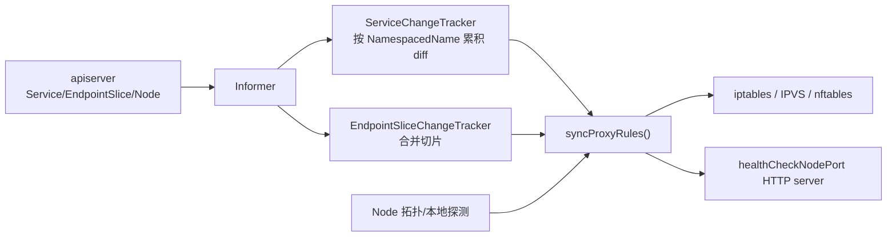

# Service、kube-proxy 与 LoadBalancer：从 VIP 到后端 Pod

Service 是 Kubernetes 里最"看起来简单、实现最绕"的对象：`kubectl expose` 一行就能得到一个 ClusterIP，但真正把它变成可达服务的是 **EndpointSlice 控制器 + kube-proxy（或 eBPF）+ conntrack + CNI** 的协作。本文按"API 语义 → 端点计算 → 规则下发 → 数据包转发 → 外部暴露"展开，重点放在**规则长什么样、为什么这么设计、出错时看哪里**。

完整链路（Pod/DNS/排障）见 [Kubernetes 网络全链路](./k8s-network-path.md)；CNI/IPAM/overlay 见 [CNI 详解](./cni详解.md)；跨集群 Service 见 [多集群网络互联](./multicluster-networking.md)。

**版本基线**：

| 项目 | 版本 | commit |
|---|---|---|
| Kubernetes | v1.37.2 | `c50e5395f1ae2d4a2c05f28fdcc38c0916cc1a32` |
| MetalLB | main | `0db4a44c098f71b6c18e2be34e73e67d8a39c20b` |
| Gateway API | main | `d04e7458ee15351ca54a201c4b1c43412f917b91` |

> 引用约定：源码链接带 40 位 commit 与行号区间，行号已用本地 checkout 核对。1.37 里 iptables 模式的链名与 1.2x 时代有变化（`KUBE-XLB-*` 已不存在），本文以 1.37 代码为准。

---

## 1. Service 的 API 语义

### 1.1 四种类型：层层叠加，不是四选一的平行实现

`ServiceType` 的注释写得很清楚（[types.go L6330-L6345](https://github.com/kubernetes/kubernetes/blob/c50e5395f1ae2d4a2c05f28fdcc38c0916cc1a32/staging/src/k8s.io/api/core/v1/types.go#L6330-L6345)）：

- `ClusterIP`：分配一个集群内虚拟 IP，按 selector/手工 EndpointSlice 找后端；
- `NodePort`：**builds on ClusterIP**，在每个节点上再开一个端口；
- `LoadBalancer`：**builds on NodePort**，再向云/实现申请一个外部 LB；
- `ExternalName`：CNAME 到外部域名，不分配 VIP。

所以"LoadBalancer 类型"实际上同时拥有 ClusterIP 和 NodePort，外部 LB 只是最外面的一层。理解这一点，才能解释为什么 LB 的流量最终仍走 §4 的 DNAT。

### 1.2 关键字段与默认值

| 字段 | 默认 | 语义/坑 |
|---|---|---|
| `spec.type` | `ClusterIP` | 四种类型见上 |
| `spec.selector` | 空 | 为空表示"外部进程自己维护 EndpointSlice"，控制器不碰 |
| `spec.ports[].port` | 必填 | Service 暴露的端口 |
| `spec.ports[].targetPort` | **等于 port** | 字符串形式引用 Pod 的命名端口；headless 下忽略 |
| `spec.ports[].protocol` | `TCP` | UDP/SCTP 也可 |
| `spec.ports[].nodePort` | 自动分配 | 30000–32767；`allocateLoadBalancerNodePorts=false` 可不分配 |
| `spec.clusterIP` | 自动分配 | `None` = headless，不分配 VIP |
| `spec.sessionAffinity` | `None` | `ClientIP` 时默认 3 小时（10800s） |
| `spec.externalTrafficPolicy` | `Cluster` | 仅外部可访问类型；`Local` 保源 IP、只用本地端点 |
| `spec.internalTrafficPolicy` | `Cluster` | `Local` 只用同节点端点 |
| `spec.trafficDistribution` | 空 | 1.37 支持 `PreferSameZone`/`PreferSameNode`/`PreferClose`（后者 deprecated） |
| `spec.publishNotReadyAddresses` | `false` | true 时未 ready 的 Pod 也进 DNS/端点 |
| `spec.ipFamilyPolicy` | `SingleStack` | `PreferDualStack`/`RequireDualStack` |
| `spec.loadBalancerClass` | 空 | 设置后默认云实现忽略该 Service；不可改 |
| `spec.allocateLoadBalancerNodePorts` | `true` | LB 是否同时分配 NodePort |
| `spec.loadBalancerIP` | 空 | 已 deprecated，语义因实现而异 |

默认值落点在 `SetDefaults_Service`（[defaults.go L106-L160](https://github.com/kubernetes/kubernetes/blob/c50e5395f1ae2d4a2c05f28fdcc38c0916cc1a32/pkg/apis/core/v1/defaults.go#L106-L160)）：

- `sessionAffinity` 空 → `None`；`None` 会清空 `sessionAffinityConfig`；`ClientIP` 未给超时 → `10800s`；
- `type` 空 → `ClusterIP`；
- `protocol` 空 → `TCP`；`targetPort` 为 0/空 → `port`；
- 外部可访问 Service 的 ETP 空 → `Cluster`；
- `internalTrafficPolicy` 空 → `Cluster`；
- LB 的 `allocateLoadBalancerNodePorts` 空 → `true`；
- 已有 `status.loadBalancer.ingress[].ip` 但没 `ipMode` → 补 `VIP`。

### 1.3 headless、ExternalName、无 selector

**headless**（`clusterIP: None`）：不分配 VIP，kube-proxy **直接跳过**（`ShouldSkipService` 在 `!IsServiceIPSet` 或 `Type==ExternalName` 时返回 true，[utils.go L56-L70](https://github.com/kubernetes/kubernetes/blob/c50e5395f1ae2d4a2c05f28fdcc38c0916cc1a32/pkg/proxy/util/utils.go#L56-L70)）。DNS 直接返回每个 ready Pod 的 IP，客户端自己做负载均衡。因此：

- 没有 DNAT，没有 conntrack，没有 sessionAffinity；
- `externalTrafficPolicy`/`internalTrafficPolicy` 对 headless 无意义；
- StatefulSet 的稳定网络标识依赖 headless + `publishNotReadyAddresses`。

**ExternalName**：只生成 CNAME，不分配 VIP，也不进 kube-proxy。客户端解析到外部域名后直接连，集群网络不参与。

**无 selector**：Service 仍然有 ClusterIP，但 EndpointSlice 由用户/Operator 手工维护（或由 `EndpointSliceMirroring` 从旧 `Endpoints` 镜像）。kube-proxy 不区分来源，只消费 EndpointSlice。注意：**如果既有 selector 又手工写 EndpointSlice，两个控制器会互相覆盖**；手工切片要避开 `endpointslice-controller.k8s.io` 这个 managed-by。

### 1.4 会话保持

`sessionAffinity: ClientIP` 在 iptables 模式下用 `recent` 模块实现：每个端点一条 `-m recent --rcheck --seconds <timeout> --reap`，命中就跳该端点的 SEP 链，未命中再走概率分发（[proxier.go L1430-L1474](https://github.com/kubernetes/kubernetes/blob/c50e5395f1ae2d4a2c05f28fdcc38c0916cc1a32/pkg/proxy/iptables/proxier.go#L1430-L1474)）。IPVS 模式用 `FlagPersistent` + timeout。注意：

- 它按**客户端 IP**粘，不按 cookie/header；
- NAT 后面大量客户端共享一个源 IP 时，会全部粘到同一个后端；
- 超时默认 3 小时，太长会导致"缩容后旧客户端一直打到已删除 Pod"。

---

## 2. 从 Service 到 EndpointSlice

### 2.1 两个控制器，一个已死

- **EndpointSlice 控制器**：`pkg/controller/endpointslice`，`ControllerName = "endpointslice-controller.k8s.io"`（[endpointslice_controller.go L76-L78](https://github.com/kubernetes/kubernetes/blob/c50e5395f1ae2d4a2c05f28fdcc38c0916cc1a32/pkg/controller/endpointslice/endpointslice_controller.go#L76-L78)），核心 reconcile 在 staging 的 `Reconcile()`。
- **Endpoints 控制器**：仍在跑，用于生成旧 `Endpoints` 对象；`Endpoints` API 在 **1.33 已 deprecated**，新实现应只用 EndpointSlice。
- **EndpointSliceMirroring 控制器**：把**手工维护的 `Endpoints`** 镜像成 EndpointSlice，可用 `endpointslice.kubernetes.io/skip-mirror: "true"` 关闭。这是"老 Operator 只写 Endpoints"仍能被 kube-proxy 看到的桥梁。

### 2.2 EndpointSlice 的结构

`discovery.k8s.io/v1`：

```yaml
addressType: IPv4
endpoints:
- addresses: ["10.244.1.5"]
  conditions: {ready: true, serving: true, terminating: false}
  hostname: web-0
  nodeName: node-1
  zone: us-east-1a
  targetRef: {kind: Pod, name: web-0, namespace: default}
ports:
- name: http
  port: 8080
  protocol: TCP
```

关键点：

- `addressType` 只处理 IPv4/IPv6；FQDN 已 deprecated；
- 每个 endpoint 的 `addresses` 控制器恒为 1 个（语义上最多 100）；
- `conditions.ready/serving/terminating` 三者独立；
- `nodeName`/`zone` 来自 Pod 调度结果和节点拓扑标签；
- `hints.forZones`/`forNodes` 用于拓扑感知路由。

### 2.3 readiness 的精确语义

```go
serving := endpointutil.IsPodReady(pod)
terminating := pod.DeletionTimestamp != nil
ready := service.Spec.PublishNotReadyAddresses || (serving && !terminating)
```

（[utils.go L38-L50](https://github.com/kubernetes/kubernetes/blob/c50e5395f1ae2d4a2c05f28fdcc38c0916cc1a32/staging/src/k8s.io/endpointslice/utils.go#L38-L50)）

- `serving` ← Pod 的 Ready condition；
- `terminating` ← 有 deletionTimestamp；
- `ready` ← serving 且未 terminating，或被 `publishNotReadyAddresses` 强制为 true。

kube-proxy 消费时会 `CategorizeEndpoints`：优先 ready；若 ready 为空，回退到 **serving + terminating**（优雅下线期间仍可接流量）；`internalTrafficPolicy/externalTrafficPolicy=Local` 时再筛本地端点（[topology.go L48-L152](https://github.com/kubernetes/kubernetes/blob/c50e5395f1ae2d4a2c05f28fdcc38c0916cc1a32/pkg/proxy/topology.go#L48-L152)）。

这也解释了两个常见现象：

- **Pod 已经 Terminating，Service 还有流量**：正常，terminating 端点仍可能被选中；
- **新 Pod 刚 Running 但没接流量**：Ready condition 还没 True，端点不在 ready 集合里。

### 2.4 100 个端点/片

默认 `MaxEndpointsPerSlice=100`（[defaults.go L38-L39](https://github.com/kubernetes/kubernetes/blob/c50e5395f1ae2d4a2c05f28fdcc38c0916cc1a32/pkg/controller/endpointslice/config/v1alpha1/defaults.go#L38-L39)），`--max-endpoints-per-slice` 合法范围 1–1000。超过就切成多个切片，kube-proxy 把所有切片合并成 `ServicePortName → EndpointsMap`。**大 Service 的切片数量会影响 kube-proxy 的同步成本**，但不是主要瓶颈（主要成本在 iptables 规则数）。

### 2.5 拓扑感知路由

两条路径：

1. **注解** `service.kubernetes.io/topology-mode: Auto` → EndpointSlice 控制器用 topologyCache 写 `hints.forZones`；
2. **字段** `spec.trafficDistribution` → `trafficdist.ReconcileHints()`，注解存在时不看字段。

kube-proxy 侧 `topologyModeFromHints()` 会检查：如果某节点缺 zone 标签、或任一端点缺 hint，就**整体放弃拓扑偏好**（[topology.go L156-L221](https://github.com/kubernetes/kubernetes/blob/c50e5395f1ae2d4a2c05f28fdcc38c0916cc1a32/pkg/proxy/topology.go#L156-L221)）。所以"配了 topology 但不生效"先看 kube-proxy V(2) 日志里的 `Ignoring same-zone topology hints`，通常是节点缺 `topology.kubernetes.io/zone` 标签。

1.37 的 `trafficDistribution` 取值（[types.go L6133-L6153](https://github.com/kubernetes/kubernetes/blob/c50e5395f1ae2d4a2c05f28fdcc38c0916cc1a32/staging/src/k8s.io/api/core/v1/types.go#L6133-L6153)）：

- `PreferSameZone`（正式值）
- `PreferSameNode`（1.37 新增）
- `PreferClose`（`PreferSameZone` 的旧名，deprecated）

---

## 3. kube-proxy 架构：watch 到规则

### 3.1 一个进程，三块缓存，一次 sync



`Provider` 接口统一了三种实现（[types.go L29-L43](https://github.com/kubernetes/kubernetes/blob/c50e5395f1ae2d4a2c05f28fdcc38c0916cc1a32/pkg/proxy/types.go#L29-L43)）：`EndpointSliceHandler + ServiceHandler + NodeTopologyHandler + ServiceCIDRHandler + Sync() + SyncLoop()`。所有实现共享同一套骨架：

- `ServiceChangeTracker`：按 `NamespacedName` 累积 previous/current 的 `ServicePortMap` diff；
- `EndpointSliceChangeTracker`：把若干切片合并成 `ServicePortName → EndpointsMap`，处理 terminating/replacement IP 冲突（同一 IP 同时出现 terminating 和 replacement 时优先保留非 terminating）；
- `syncProxyRules()`：一次把 diff 写成规则，失败则标记 `needFullSync`，下次全量重来。

### 3.2 同步周期

默认值（[defaults.go L62-L78](https://github.com/kubernetes/kubernetes/blob/c50e5395f1ae2d4a2c05f28fdcc38c0916cc1a32/pkg/proxy/apis/config/v1alpha1/defaults.go#L62-L78)）：

- `syncPeriod=30s`：定期全量对账；
- `minSyncPeriod=1s`：两次 sync 的最小间隔，防止抖动；
- `configSyncPeriod=15m`：配置文件热重载检查。

所以"改了 Service，1 秒内生效"是正常预期；如果几十秒还没生效，先看 kube-proxy 是否卡住，而不是怀疑 apiserver。

### 3.3 大集群模式

端点总数超过 **1000** 时进入 large cluster mode（[proxier.go L86-L88](https://github.com/kubernetes/kubernetes/blob/c50e5395f1ae2d4a2c05f28fdcc38c0916cc1a32/pkg/proxy/iptables/proxier.go#L86-L88)）：减少全量清理/`iptables-save` 的频率，优先保证 sync 延迟。代价是**陈旧链可能保留更久**，排障时会看到一些不再被引用的 `KUBE-SVC-*` 链。

### 3.4 关键指标

| 指标 | 含义 | 异常 |
|---|---|---|
| `kubeproxy_sync_proxy_rules_last_timestamp_seconds` | 最近一次成功 sync | 不推进 = proxier 卡死/权限/内核问题 |
| `kubeproxy_sync_proxy_rules_duration_seconds` | sync 耗时 | 持续升高 = 规则太多/大集群 |
| `kubeproxy_network_programming_duration_seconds` | 变更到规则生效的端到端延迟 | 官方 SLO 指标 |
| `kubeproxy_sync_proxy_rules_no_local_endpoints_total` | ETP/ITP=Local 但无本地端点 | 持续增长 = 会丢流量 |
| `kubeproxy_sync_proxy_rules_endpoint_changes_pending` | 待处理端点变更 | 长期 >0 = informer/sync 卡住 |

### 3.5 先分清：netfilter / iptables / nftables / IPVS

这四个词经常被混着说，但它们不是同一层的东西：

```text
用户态工具：   iptables        nft          ipvsadm
                 │              │              │
内核子系统：   ip_tables      nf_tables       ip_vs
                 └──────┬───────┘              │
                        ▼                      ▼
              netfilter hooks + conntrack   （L4 转发/调度）
                        │
                      网卡
```

| | 是什么 | 谁配置 | 主要用途 | K8s 里的角色 |
|---|---|---|---|---|
| **netfilter** | Linux 内核的包处理框架（PREROUTING/INPUT/FORWARD/OUTPUT/POSTROUTING + conntrack） | 没有直接 CLI，由 iptables/nftables 等配置 | 过滤、NAT、连接跟踪 | 所有 iptables/nftables 规则的底层 |
| **iptables** | 传统用户态工具 + `ip_tables` 内核模块（xtables） | `iptables`、`iptables-save` | 过滤/NAT | kube-proxy 默认模式；CNI/NetworkPolicy 也常用 |
| **nftables** | 新一代内核子系统 `nf_tables` + 用户态 `nft`，取代 `ip_tables/ip6_tables/arptables/ebtables` | `nft` | 过滤/NAT，set/map/单 VM | kube-proxy 的 nftables 模式（1.33 GA） |
| **IPVS** | 内核 L4 负载均衡器（`ip_vs`），有 virtual server/real server 和调度算法 | `ipvsadm` | L4 LB（NAT/DR/TUN） | kube-proxy 的 IPVS 模式（1.37 弃用） |

几个容易踩的点：

- **netfilter 是框架，iptables/nftables 是前端**：iptables 说“加一条规则”，最终落到 netfilter 的 hook；nftables 是 netfilter 项目里的新分类引擎，不是“另一个 netfilter”。
- **`iptables` 命令在较新发行版上可能是 `iptables-nft`**：它把 iptables 语法翻译成 nftables 规则；`iptables-legacy` 才走老的 xtables。`iptables-save` 和 `nft list ruleset` 看到的可能是同一批规则的不同视图。
- **IPVS 不是防火墙**：它只做 L4 转发/负载均衡，SNAT/filter 仍要 iptables/ipset 配合；它也不是 netfilter 的替代品。
- **eBPF 又不在这一层**：Cilium 用 eBPF 在 socket/TC 做 Service LB，可以绕过 iptables/nftables/IPVS。

#### 为什么有了 netfilter 还要 IPVS？

netfilter 提供的是**通用包处理原语**（filter/NAT/conntrack/hook），它本身不是负载均衡器。用 iptables 也能做“DNAT + 概率分发”（kube-proxy 的 iptables 模式正是如此），但：

- 规则是**线性匹配**：Service/Endpoint 越多，规则数和查找成本越大；
- 没有 **virtual server/real server** 抽象，也没有 `rr`/`wlc` 等调度算法；
- 没有 O(1) 的 hash 查找和独立的连接调度表；
- 会话保持只能靠 `recent` 之类的补丁式实现。

IPVS 是**专用的 L4 LB**：virtual server/real server、调度算法、hash 表、连接表、NAT/DR/TUN。它复用 netfilter 的 hook 把包接进来，但“选哪个后端”由 IPVS 自己负责。健康检查/端点变更由 kube-proxy 等外部组件驱动，IPVS 本身不负责探活。

所以两者不是重复实现，而是“**通用包处理框架**”和“**专用负载均衡器**”的关系。K8s 1.37 弃用 IPVS 也不是因为它没价值，而是 nftables map / eBPF 能在更少运维复杂度下覆盖同类规模；IPVS 的 sysctl、ARP、`conn_reuse_mode` 等坑较多。

> **IPVS 与 netfilter 的精确关系**：IPVS 注册 netfilter hook（`NF_INET_LOCAL_IN`/`LOCAL_OUT`/`FORWARD`，见 [ip_vs_core.c L2330-L2370](https://github.com/torvalds/linux/blob/c03c1a14507dfaf8b856c2608f9ac216021fc222/net/netfilter/ipvs/ip_vs_core.c#L2330-L2370)）来截获包，但**不使用 iptables/nftables 的规则表**；它有自己的 virtual server/real server、连接表和调度器。所以 `iptables -F` 不会清掉 IPVS 的 virtual server，`ipvsadm -C` 也不会清掉 iptables 规则。

---

## 4. iptables 模式：链的布局

### 4.1 顶层链

| 链 | 作用 |
|---|---|
| `KUBE-SERVICES` | 总入口：匹配 ClusterIP/externalIP/LB IP，跳 SVC/EXT/FW |
| `KUBE-EXTERNAL-SERVICES` | 外部可访问但无可用外部端点时 REJECT/DROP |
| `KUBE-NODEPORTS` | NodePort 匹配 + `healthCheckNodePort` ACCEPT |
| `KUBE-POSTROUTING` | 按 fwmark 做 SNAT（`MASQUERADE --random-fully`） |
| `KUBE-MARK-MASQ` | `MARK --or-mark <bit>`，被 SVC/EXT/SEP 复用 |
| `KUBE-FORWARD` | 转发链（kube-proxy 自用） |
| `KUBE-PROXY-FIREWALL` | kube-proxy 自己的防火墙链（LB source ranges 兜底 DROP） |
| `KUBE-FIREWALL` | kubelet 的链的副本，仅 anti-martian 规则 |
| `KUBE-PROXY-CANARY` | 规则重载监控探针 |

注意：**1.37 已没有 `KUBE-MARK-DROP` 和 `KUBE-XLB-*`**。无端点/无本地端点改为在 filter 表直接 `REJECT`/`DROP`；外部目的地链叫 `KUBE-EXT-*`，本地端点链叫 `KUBE-SVL-*`。

### 4.2 挂载点

`iptablesJumpChains`（[proxier.go L364-L377](https://github.com/kubernetes/kubernetes/blob/c50e5395f1ae2d4a2c05f28fdcc38c0916cc1a32/pkg/proxy/iptables/proxier.go#L364-L377)）：

```text
filter INPUT/FORWARD   -> KUBE-EXTERNAL-SERVICES（ctstate NEW）
filter INPUT           -> KUBE-NODEPORTS
filter FORWARD/OUTPUT  -> KUBE-SERVICES（ctstate NEW）
filter FORWARD         -> KUBE-FORWARD
filter INPUT/OUTPUT/FORWARD -> KUBE-PROXY-FIREWALL（ctstate NEW）
nat    PREROUTING/OUTPUT -> KUBE-SERVICES
nat    POSTROUTING     -> KUBE-POSTROUTING
filter INPUT/OUTPUT    -> KUBE-FIREWALL（kubelet 链副本）
```

这些 jump 规则只在 **full sync** 时 `EnsureRule(Prepend)`，partial sync 跳过（省掉每次 20 次 iptables 调用）。所以如果 `PREROUTING` 被人手动清空，kube-proxy 不会立刻补，直到下一次 full sync 或检测到表被 flush。

### 4.3 每个 ServicePort 的规则骨架

以 `ClusterIP` + 2 个端点为例：

```text
KUBE-SERVICES
  -d <clusterIP> --dport <port> -j KUBE-SVC-XXXX

KUBE-SVC-XXXX                 # 分发链
  -m statistic --mode random --probability 0.5000000000 -j KUBE-SEP-AAAA
  -j KUBE-SEP-BBBB

KUBE-SEP-AAAA                 # 端点链
  -s <epIP> -j KUBE-MARK-MASQ
  -m recent --name KUBE-SEP-AAAA --set        # 仅 sessionAffinity=ClientIP
  -p tcp -j DNAT --to-destination <epIP>:<targetPort>
```

概率分发是"第 i 条命中概率 `1/(n-i)`，最后一条必中"，所以每个端点精确 `1/n`（[proxier.go L1430-L1474](https://github.com/kubernetes/kubernetes/blob/c50e5395f1ae2d4a2c05f28fdcc38c0916cc1a32/pkg/proxy/iptables/proxier.go#L1430-L1474)）。

### 4.4 外部目的地链：KUBE-EXT 与 KUBE-SVL

`externalTrafficPolicy` 不是"一个开关"，而是换了一套链：

| 场景 | 链 | 行为 |
|---|---|---|
| ETP=Cluster（NodePort/LB） | `KUBE-EXT-XXXX` → `KUBE-SVC-XXXX` | `KUBE-EXT` 整条是 `-j KUBE-MARK-MASQ`，跨节点时 SNAT |
| ETP=Local（NodePort/LB） | `KUBE-EXT-XXXX` → `KUBE-SVL-XXXX` | 只对 `src-type LOCAL` 打 mark；pod 来源短路到 Cluster 链；其余走 `KUBE-SVL`（本地端点） |
| `loadBalancerSourceRanges` | `KUBE-FW-XXXX` | 按源 CIDR 放行，链尾落空由 `KUBE-PROXY-FIREWALL` DROP |
| 无任何端点 / 仅远端无本地 | filter 表 | 无任何端点：REJECT；ETP=Local 且仅远端无本地：DROP |

源码见 [proxier.go L1091-L1200](https://github.com/kubernetes/kubernetes/blob/c50e5395f1ae2d4a2c05f28fdcc38c0916cc1a32/pkg/proxy/iptables/proxier.go#L1091-L1200)。

### 4.5 healthCheckNodePort 的服务端

kube-proxy 自己起一个 HTTP server 监听 HC 端口：

- `/healthz` 返回本地 ready 端点数量：`count != 0 && kubeProxyHealthy` → 200，否则 503；
- 附带 `X-Load-Balancing-Endpoint-Weight` 头和 JSON `localEndpoints`。

（[service_health.go L241-L272](https://github.com/kubernetes/kubernetes/blob/c50e5395f1ae2d4a2c05f28fdcc38c0916cc1a32/pkg/proxy/healthcheck/service_health.go#L241-L272)）

这就是 ETP=Local 的闭环：**LB 通过 HC 端口判断节点是否有资格接流量**，没有本地端点的节点被摘掉。注意 HC 端口在 `KUBE-NODEPORTS` 里是**无条件 ACCEPT** 的，即使本节点没有端点；这是为了让 LB 能拿到 503 而不是超时。

---

## 5. IPVS 模式：O(1) 查找与它的代价

### 5.1 结构

IPVS 把每个 ServicePort 变成一个内核 VirtualServer：

```go
serv := &utilipvs.VirtualServer{
    Address:   svcInfo.ClusterIP(),
    Port:      uint16(svcInfo.Port()),
    Protocol:  string(svcInfo.Protocol()),
    Scheduler: proxier.ipvsScheduler,   // 默认 rr
}
```

（[proxier.go L829-L846](https://github.com/kubernetes/kubernetes/blob/c50e5395f1ae2d4a2c05f28fdcc38c0916cc1a32/pkg/proxy/ipvs/proxier.go#L829-L846)）

- `sessionAffinity=ClientIP` → `FlagPersistent` + `Timeout`；
- 调度器 `mh` → `FlagSourceHash`；
- 默认调度器 `rr`，dummy 设备 `kube-ipvs0`。

**为什么需要 dummy 接口**：IPVS 只处理"目的地址是本机地址"的流量，而 ClusterIP 不属于任何真实网卡，必须把每个 ClusterIP 绑到 `kube-ipvs0` 上（`syncService(..., bindAddr=true, ...)`）。副作用是这些 IP 会响 ARP，需要 `arp_ignore=1`/`arp_announce=2`（StrictARP），否则会抢真实网卡的 ARP。

### 5.2 仍然依赖 iptables/ipset

IPVS 只做 L4 负载均衡，**SNAT/filter 仍然靠 iptables + ipset**。README 列出的 ipset：

| set | 用途 |
|---|---|
| `KUBE-CLUSTER-IP` | `masquerade-all` 或 clusterCIDR 指定的 SNAT |
| `KUBE-LOOP-BACK` | hairpin |
| `KUBE-EXTERNAL-IP` | externalIPs 的 SNAT |
| `KUBE-LOAD-BALANCER` | LB VIP 的 SNAT |
| `KUBE-LOAD-BALANCER-LOCAL` | ETP=Local 的 LB |
| `KUBE-LOAD-BALANCER-FW` | `loadBalancerSourceRanges` 过滤 |
| `KUBE-NODE-PORT-*` | NodePort 的 SNAT/放行 |

（[README.md L44-L60](https://github.com/kubernetes/kubernetes/blob/c50e5395f1ae2d4a2c05f28fdcc38c0916cc1a32/pkg/proxy/ipvs/README.md#L44-L60)）

### 5.3 sysctl 与已知问题

- `net/ipv4/vs/conntrack=1`；
- `conn_reuse_mode`：内核 <4.1 不支持；≥4.19 保持原样；中间版本强制置 0。置 0 会导致端口复用时连接被打散——这是历史上"IPVS 长连接抖动"的根因；
- `expire_nodest_conn=1`、`expire_quiescent_template=1`；
- `arp_ignore=1`/`arp_announce=2`（StrictARP）。

### 5.4 弃用

1.37 启动时会打：

```text
The ipvs proxier has been deprecated and will be disabled by default in
Kubernetes 1.40 and removed in Kubernetes 1.43. Migrate to the 'nftables'
proxier instead.
```

（[server_linux.go L190-L194](https://github.com/kubernetes/kubernetes/blob/c50e5395f1ae2d4a2c05f28fdcc38c0916cc1a32/cmd/kube-proxy/app/server_linux.go#L190-L194)）

所以：**新集群不要选 IPVS**；存量集群规划迁移到 nftables 或 eBPF。迁移时注意 IPVS 的 `kube-ipvs0` 地址、ipset、sysctl 都要清理，不能只是改 `--mode`。

---

## 6. nftables 模式：map 与 set 的世界

### 6.1 状态

`NFTablesProxyMode`：1.29 Alpha → 1.31 Beta（默认开）→ **1.33 GA，LockToDefault**（[kube_features.go L1882-L1886](https://github.com/kubernetes/kubernetes/blob/c50e5395f1ae2d4a2c05f28fdcc38c0916cc1a32/pkg/features/kube_features.go#L1882-L1886)）。但 **kube-proxy 默认模式仍是 iptables**（[server_linux.go L49-L52](https://github.com/kubernetes/kubernetes/blob/c50e5395f1ae2d4a2c05f28fdcc38c0916cc1a32/cmd/kube-proxy/app/server_linux.go#L49-L52)），要用得显式 `--mode=nftables`。

### 6.2 结构

整张表叫 `kube-proxy`（[proxier.go L61-L107](https://github.com/kubernetes/kubernetes/blob/c50e5395f1ae2d4a2c05f28fdcc38c0916cc1a32/pkg/proxy/nftables/proxier.go#L61-L107)）：

- base chain：`filter-prerouting-pre-dnat`、`filter-output-pre-dnat`（DNAT 优先级 -10，用于 source-range 过滤）、`filter-input/forward/output`、`nat-prerouting`、`nat-output`、`nat-postrouting`；
- dispatch：`services`、`service-ips` map、`service-nodeports` map、`nodeport-ips` set、`cluster-ips` set；
- 无端点：`no-endpoint-services`/`no-endpoint-nodeports` map + `service-endpoints-check`/`nodeport-endpoints-check` + `reject-chain`；
- hairpin：`hairpin-connections` set，键是 `ip saddr . ip daddr . proto . dport`，配合 `ct status dnat` 精确判断，不再依赖"源==端点 IP"的近似（[L532-L545](https://github.com/kubernetes/kubernetes/blob/c50e5395f1ae2d4a2c05f28fdcc38c0916cc1a32/pkg/proxy/nftables/proxier.go#L532-L545)）。

与 iptables 的核心差异：

| 维度 | iptables | nftables |
|---|---|---|
| 数据结构 | 每服务一条链，每端点一条链 | 单表 + verdict map/set |
| 规则数增长 | 随 Service/Endpoint 线性 | 基本不随 Service 增长 |
| hairpin 判断 | `-s <epIP>` 近似 | conntrack 状态精确 |
| 未分配 ClusterIP | 无专门处理 | `cluster-ips-check` 拒绝 |
| 可读性 | `iptables-save` 直观 | `nft list ruleset` 需要熟悉 map |

nftables 的 `masquerade fully-random` 与 iptables 的 `--random-fully` 等价。

---

## 7. conntrack：DNAT/SNAT 的状态机

conntrack（`nf_conntrack`）是 **netfilter 的连接跟踪子系统**，不是防火墙、也不是一个“工具”。它维护一张连接表，记录每条流的：

- 原始五元组 + 回复五元组；
- 状态：`NEW`、`ESTABLISHED`、`RELATED`、`INVALID`、`UNTRACKED`；
- NAT 映射：DNAT/SNAT 后的地址/端口；
- 超时、mark、计数器等。

它和前面几个组件的关系：

| 组件 | 关系 |
|---|---|
| **netfilter** | conntrack 是 netfilter 的一部分（`nf_conntrack`） |
| **iptables** | 可 `-m conntrack --ctstate` 匹配；NAT 规则依赖 conntrack 记住映射 |
| **nftables** | 可 `ct state ...` 匹配；NAT 同样依赖 conntrack |
| **IPVS** | 有自己的连接表；可选与 conntrack 同步（`net/ipv4/vs/conntrack=1`） |
| **eBPF/Cilium** | 通常有自己的 BPF conntrack map；不要和内核 conntrack 混为一谈 |

一句话：**NAT 是“首包改写”，conntrack 是“记住改写，让后续包和回包都能还原”。**

### 7.1 一条连接的两段五元组

DNAT 只对首包生效，后续包和回包都靠 conntrack：

```text
客户端看到：  PodA:34567  ->  10.96.0.10:80      （original）
后端看到：    PodA:34567  ->  10.244.2.6:8080   （DNAT 后）
回包（后端）：10.244.2.6:8080 -> PodA:34567
回包（客户端）：10.96.0.10:80   -> PodA:34567     （反向 DNAT）
```

`conntrack -L` 会同时显示 original 和 reply 两段。NAT 只发生在**做 DNAT 的那台节点**；跨节点时，回包必须回到这台节点才能被还原。

### 7.2 hairpin 与 SNAT

- **hairpin**：源 == 端点 IP 时，SEP 链打 mark，POSTROUTING MASQUERADE 成节点 IP，避免端点收到 `src == 自己` 的包。
- **外部来源 + ETP=Cluster**：`KUBE-EXT` 打 mark，POSTROUTING SNAT 成节点 IP，保证回程经过本节点。
- **集群内来源 + ETP=Local**：不打 mark，保源 IP，但只选本地端点。

`--random-fully` 让 MASQUERADE 随机选源端口，降低端口冲突。代价是 conntrack 表更大、排查时源端口不可预测。

### 7.3 陈旧 conntrack 与 UDP

iptables 规则变化**不会清理已建立连接**。kube-proxy 有一个专门的 `CleanStaleEntries`：

- 只针对 **UDP** Service（TCP 有连接状态，影响相对可控）；
- 建立 `serviceIP:port/nodePort → 当前 serving 端点集合` 的映射；
- 删除那些 DNAT 到非 serving 端点的 conntrack 条目。

（[cleanup.go L41-L130](https://github.com/kubernetes/kubernetes/blob/c50e5395f1ae2d4a2c05f28fdcc38c0916cc1a32/pkg/proxy/conntrack/cleanup.go#L41-L130)）

为什么只做 UDP：单向 UDP 流（如 statsd）每个包都会刷新 conntrack 超时，不清理就会**永久**打到已删除的 Pod IP。经典的 DNS 竞态也是这个机制：CoreDNS 滚动更新时，客户端查询被 DNAT 到旧 Pod，旧 Pod 回包前端点被删，回包在 conntrack 里找不到映射被丢弃，客户端等 5s 超时重试。NodeLocal DNSCache 通过"本机 + force_tcp"绕开这个问题。

### 7.4 相关 sysctl

kube-proxy 会按配置设置（[types.go L88-L115](https://github.com/kubernetes/kubernetes/blob/c50e5395f1ae2d4a2c05f28fdcc38c0916cc1a32/pkg/proxy/apis/config/types.go#L88-L115)）：

- `nf_conntrack_max`（按核数计算，有最小值）；
- `nf_conntrack_tcp_timeout_established`、`tcp_timeout_close_wait`；
- `nf_conntrack_udp_timeout`、`udp_timeout_stream`；
- `nf_conntrack_tcp_be_liberal`（避免 INVALID 包被丢导致 RST）。

大规模 NAT/长连接场景要单独评估：`nf_conntrack: table full, dropping packet` 会表现为随机丢包/超时，而不是明确的错误。

---

## 8. 流量策略：ETP、ITP、拓扑、双栈

### 8.0 ETP 与 ITP 是什么

- **ETP = `spec.externalTrafficPolicy`**：管“外部地址”（NodePort / LoadBalancer / ExternalIPs）的流量怎么分。
  - `Cluster`（默认）：可以发到任意节点的端点；通常 SNAT，源 IP 丢失。
  - `Local`：只发到**本节点**端点；不 SNAT，保留源 IP；本节点无本地端点（但集群有远端端点）则 **DROP**；完全无端点则 REJECT；需要 `healthCheckNodePort` 让 LB 判断节点资格（仅 LB + Local）。
- **ITP = `spec.internalTrafficPolicy`**：管 **ClusterIP**（集群内访问）的流量怎么分。
  - `Cluster`（默认）：任意端点。
  - `Local`：只发到**本节点**端点；无本地端点（但集群有远端端点）则 **DROP**；完全无端点则 REJECT；没有 HC 端口。

| | ETP | ITP |
|---|---|---|
| 作用对象 | NodePort / LoadBalancer / ExternalIP | ClusterIP |
| 默认值 | `Cluster` | `Cluster` |
| `Local` 是否保留源 IP | 是（不 SNAT） | 通常不涉及 SNAT（源本来就是 Pod IP） |
| 无本地端点 | 有远端端点则选远端；完全无端点 REJECT | 有远端端点则 DROP；完全无端点 REJECT |
| 健康检查 | `healthCheckNodePort`（LB + Local） | 无 |
| 典型用途 | 保留客户端 IP、审计/限流 | 同节点亲和、边缘/本地缓存 |

一句话：**ETP 决定“外部流量能不能跨节点、源 IP 保不保”；ITP 决定“集群内 ClusterIP 流量能不能跨节点”。**

> **“本节点端点”的准确含义**：指 EndpointSlice 里 `nodeName == 当前节点` 的 endpoint，它的 `addresses` 是 **Pod IP**，`ports` 是解析后的 **targetPort**；不是节点 IP，也不是 ClusterIP。kube-proxy 构建 `EndpointsMap` 时用 `endpoint.NodeName == 本节点名` 标记 `isLocal`（[endpointslicecache.go L209](https://github.com/kubernetes/kubernetes/blob/c50e5395f1ae2d4a2c05f28fdcc38c0916cc1a32/pkg/proxy/endpointslicecache.go#L209-L209)、[L255-L256](https://github.com/kubernetes/kubernetes/blob/c50e5395f1ae2d4a2c05f28fdcc38c0916cc1a32/pkg/proxy/endpointslicecache.go#L255-L256)）。

### 8.1 ETP=Local 的四件事

1. **不 SNAT**，源 IP 保留；
2. **只选本节点端点**；
3. **只有远端端点、没有本地端点**时 filter 表 **DROP**（超时）；如果整个 Service 完全没有端点，则是 **REJECT**。
4. 必须配 `healthCheckNodePort`，kube-proxy 用 200/503 告诉 LB 本节点是否有资格。

> 两个容易误解的点：
>
> - **`Cluster` 不是“把包转发给另一个节点”**：入口节点自己做 DNAT，把目的地址改成某个 Pod IP；如果这个 Pod 在别的节点，包再被路由过去。不是把 VIP 包原样转给另一台节点的 kube-proxy。
> - **`Local` 的 DROP 不是包到达时临时判断**：kube-proxy 根据 EndpointSlice 预先生成规则；只有远端端点、没有本地端点时，filter 表里就是 DROP 规则。

| 本节点情况 | `ETP=Cluster` | `ETP=Local` |
|---|---|---|
| 有本地端点 | 可选本地或远端（概率分发） | 只选本地 |
| 无本地端点，但集群有远端端点 | 选远端，DNAT 后路由过去 | DROP（客户端超时） |
| 集群完全无端点 | REJECT（`connection refused`） | REJECT |

`Local` 不 SNAT 的根本原因：只选本地端点，回包可以直接从本节点 Pod 回客户端，不需要经过入口节点；`Cluster` 选远端端点时必须 SNAT，保证回包回到入口节点，由 conntrack 还原 VIP。

还有一个容易忽略的语义：**从集群内部访问 ExternalIP/LB IP 时总是 Cluster 语义**，不会保留源 IP（[types.go L6391-L6404](https://github.com/kubernetes/kubernetes/blob/c50e5395f1ae2d4a2c05f28fdcc38c0916cc1a32/staging/src/k8s.io/api/core/v1/types.go#L6391-L6404)）。在 Pod 里 `curl` LB VIP 看到节点 IP 是正常的，不代表外部客户端也这样。

### 8.2 ITP=Local

`internalTrafficPolicy: Local` 影响 ClusterIP 路径：kube-proxy 只选同节点端点，无本地端点（但集群有远端端点）则 DROP；完全无端点则 REJECT。它适合"拓扑本地性优先、宁可失败也不跨节点"的场景（如本地缓存、边缘）。注意它与 ETP 独立：可以 ETP=Cluster + ITP=Local。

### 8.3 双栈

- `ipFamilies` 最多两个，顺序即 primary；
- `ipFamilyPolicy`：`SingleStack`/`PreferDualStack`/`RequireDualStack`；
- kube-proxy 为 v4/v6 各起一个独立 proxier，由 metaproxier 分发；每个 proxier 只处理自己族的 ClusterIP；
- Service 的 `clusterIPs` 可能有两个，DNS 返回 A 和 AAAA；
- 双栈集群要确保 CNI、节点路由、LB、CoreDNS 都支持。

---

## 9. LoadBalancer：从云 LB 到 MetalLB

### 9.1 云厂商 Service Controller

`syncLoadBalancerIfNeeded` 的主逻辑（[controller.go L364-L458](https://github.com/kubernetes/kubernetes/blob/c50e5395f1ae2d4a2c05f28fdcc38c0916cc1a32/staging/src/k8s.io/cloud-provider/controllers/service/controller.go#L364-L458)）：

- 不需要 LB 或需要 cleanup → 删；
- 否则 `ensureLoadBalancer`，先过滤节点（排除 `node.kubernetes.io/exclude-from-external-load-balancers`），再调云实现；
- 结果写 `status.loadBalancer.ingress[]`（IP/Hostname/IPMode）；
- `loadBalancerClass != nil` 时默认实现完全放手（[controller.go L862-L865](https://github.com/kubernetes/kubernetes/blob/c50e5395f1ae2d4a2c05f28fdcc38c0916cc1a32/staging/src/k8s.io/cloud-provider/controllers/service/controller.go#L862-L865)）。

`status.loadBalancer.ingress[].ipMode`：

- `VIP`：流量到达节点时目的地址仍是 VIP，kube-proxy 需要装规则；
- `Proxy`：流量到达节点时目的地址已被换成 nodeIP/podIP，kube-proxy **不应**再为该 IP 装 VIP 规则。

### 9.2 MetalLB

**controller**（Deployment）只做 IP 分配 + 写 status：`convergeBalancer()` 校验已有 IP、处理 pool 变更、分配、写 `status.loadBalancer.ingress` 并回写 `metallb.io/ip-allocated-from-pool`（[service.go L120-L222](https://github.com/metallb/metallb/blob/0db4a44c098f71b6c18e2be34e73e67d8a39c20b/controller/service.go#L120-L222)）。

**speaker**（DaemonSet）做数据面宣告：

- **L2**：`ShouldAnnounce` 先排除无 active endpoint、无匹配 advertisement、无候选节点；ETP=Local 时只保留有本地端点的节点；然后用 `sortL2Candidates`（偏好权重 + `sha256(node+"#"+ip)`）选唯一 owner（[layer2_controller.go L88-L134](https://github.com/metallb/metallb/blob/0db4a44c098f71b6c18e2be34e73e67d8a39c20b/speaker/layer2_controller.go#L88-L134)）。数据面用 ARP/NDP 应答 + 免费 ARP 重播。
- **BGP**：多个节点可同时宣告同一 `/32`，上游 ECMP；ETP=Local 时只宣告有本地健康端点的节点（[bgp_controller.go L155-L198](https://github.com/metallb/metallb/blob/0db4a44c098f71b6c18e2be34e73e67d8a39c20b/speaker/bgp_controller.go#L155-L198)）。

CRD：

- `IPAddressPool`：`addresses`、`autoAssign`、`avoidBuggyIPs`、`serviceAllocation`（priority/namespaces/selectors）；
- `L2Advertisement`：`ipAddressPools`、`nodeSelectors`、`interfaces`、`preferredNodeSelectors`；
- `BGPAdvertisement`：`aggregationLength`、`localPref`、`communities`、`peers`、`nodeSelectors`。

L2 是 **per-VIP active-passive**（单节点带宽上限、秒级切换）；BGP 是 **多活**（ECMP、需要网络配合）。选型先看有没有 BGP。

### 9.3 kube-vip 与 DSR

kube-vip 同时做 APIServer VIP 和 Service LB，支持 ARP/BGP 与 **DSR（Direct Server Return）**。DSR 的核心是回程绕过 LB：入向包被送到后端节点，节点把 VIP 配在 lo/网卡上（或打 mark），回包源 IP 直接用 VIP 回客户端。它保留了源 IP、避免了 LB 回程瓶颈，但要求后端能接受"目的地址不是本机"的包（loopback VIP/`route_localnet`/IPVS tunnel 或 direct routing）。

---

## 10. Ingress 与 Gateway API

### 10.1 Ingress 的数据通路

```text
外部 LB (L4) → Ingress Controller Pod（NodePort/LB/hostPort）
  → 按 Host/Path 匹配 → 后端 Service → Pod
```

- Ingress **不实现转发**，只是配置对象；数据面在 controller（nginx/envoy/traefik…）；
- TLS 通常在 controller 终止，`spec.tls[]` 只支持 443 端口，多 host 靠 SNI 复用（[types.go L305-L315](https://github.com/kubernetes/kubernetes/blob/c50e5395f1ae2d4a2c05f28fdcc38c0916cc1a32/staging/src/k8s.io/api/networking/v1/types.go#L305-L315)）；
- `pathType`：`Exact`/`Prefix`/`ImplementationSpecific`；
- `ingressClassName` 是新字段，`kubernetes.io/ingress.class` 注解仍被兼容但已 deprecated；
- **Ingress API 已冻结**：官方明确不再加新特性，新项目应使用 Gateway API。

### 10.2 Gateway API 的角色分离

- `GatewayClass`：谁实现（`controllerName` + `parametersRef`）；
- `Gateway`：监听器（name/hostname/port/protocol/tls/allowedRoutes）、地址、允许的路由；
- `HTTPRoute`/`GRPCRoute`/`TLSRoute`/`TCPRoute`/`UDPRoute`：匹配/过滤/backendRefs；
- `allowedRoutes`：`All`/`Same`/`Selector`/`None` + `kinds`，这是 Ingress 完全不具备的跨 namespace 授权模型（[gateway_types.go L947-L1000](https://github.com/kubernetes-sigs/gateway-api/blob/d04e7458ee15351ca54a201c4b1c43412f917b91/apis/v1/gateway_types.go#L947-L1000)）；
- `status.addresses` 是实际绑定地址，`spec.addresses` 只是请求（[gateway_types.go L1098-L1150](https://github.com/kubernetes-sigs/gateway-api/blob/d04e7458ee15351ca54a201c4b1c43412f917b91/apis/v1/gateway_types.go#L1098-L1150)）。

多集群场景对应的是 **GEP-1748 "Gateway API Interaction with Multi-Cluster Services"**，状态 Experimental，且明确说 MCS API 未 GA 之前无法毕业（[gep-1748 L1-L20](https://github.com/kubernetes-sigs/gateway-api/blob/d04e7458ee15351ca54a201c4b1c43412f917b91/geps/gep-1748/index.md#L1-L20)）。注意不要把 **KEP-1645**（MCS API 的 KEP）误写成 Gateway API 的多集群 GEP。

### 10.3 Ingress vs Gateway API

| 维度 | Ingress | Gateway API |
|---|---|---|
| 角色 | 单一对象 | GatewayClass/Gateway/Route 分层 |
| 跨 namespace | 靠注解/controller 自定义 | `allowedRoutes` 原生 |
| 协议 | HTTP/HTTPS | HTTP/GRPC/TLS/TCP/UDP |
| 扩展 | 注解（实现相关） | filters/policies（标准 + 实现扩展） |
| 状态 | 冻结 | 演进中 |
| 多集群 | 不支持 | GEP-1748 Experimental |

---

## 11. 观测与排障

| 命令 | 看什么 |
|---|---|
| `kubectl get svc,endpointslice -o wide` | `EXTERNAL-IP` 是 pending 还是有值；切片端点/端口 |
| `iptables-save -t nat` | `KUBE-SVC/SVL/EXT/FW/SEP` 链、`statistic --probability`、`recent` |
| `ipvsadm -Ln` | virtual server、real server、scheduler、ActiveConn |
| `nft list ruleset` | `table ip kube-proxy`、`service-ips` map、`hairpin-connections` set |
| `conntrack -L` | 双向五元组、`[UNREPLIED]`、`ASSURED` |
| `kubectl get svc -o yaml` | `status.loadBalancer.ingress[].ip/ipMode`、`healthCheckNodePort` |
| `kubectl -n kube-system logs -l k8s-app=kube-proxy` | `Sync failed`、`Ignoring same-zone topology hints` |
| `kubectl get events --field-selector reason=IPVSDeprecation` | IPVS 弃用告警 |

常见故障：

| 现象 | 根因 | 定位 |
|---|---|---|
| `EXTERNAL-IP: <pending>` | 云 LB 未创建/无可用 IP/controller 未运行 | 云 CCM 日志、MetalLB controller |
| NodePort 本地通、外部不通 | 安全组/防火墙、LB 健康检查、ETP=Local 无本地端点 | `curl nodeIP:nodePort`、`ss -lntp`、HC 200/503 |
| 源 IP 变成节点 IP | ETP=Cluster 的 SNAT | 改 ETP=Local（并配 HC）或 LB 保留源 IP |
| 只有部分客户端能连 | sessionAffinity + NAT 共享源 IP；conntrack 不均衡 | `conntrack -L`、拆 sessionAffinity |
| 缩容后间歇 502 | terminating 端点仍在接流量 | 检查 `publishNotReadyAddresses`、优雅下线时间 |
| 改了 Service 端口不生效 | targetPort 没变/端点未更新/旧 conntrack | EndpointSlice、`conntrack -D`（谨慎） |
| `no local endpoints` 指标增长 | ETP/ITP=Local 但端点不在本节点 | 副本分布、拓扑约束 |

---

## 12. 参考

**官方文档**

- [Service](https://kubernetes.io/docs/concepts/services-networking/service/)
- [EndpointSlice](https://kubernetes.io/docs/concepts/services-networking/endpoint-slices/)
- [Virtual IPs and Service Proxies](https://kubernetes.io/docs/reference/networking/virtual-ips/)
- [Topology Aware Routing](https://kubernetes.io/docs/concepts/services-networking/topology-aware-routing/)
- [Ingress](https://kubernetes.io/docs/concepts/services-networking/ingress/)
- [Gateway API](https://kubernetes.io/docs/concepts/services-networking/gateway/)
- [Debug Services](https://kubernetes.io/docs/tasks/debug/debug-application/debug-service/)
- [MetalLB L2](https://metallb.io/concepts/layer2/) / [MetalLB BGP](https://metallb.io/concepts/bgp/)

**源码（固定到本文基线）**

- Service 类型与 ETP/ITP/trafficDistribution —— [types.go L6061-L6153](https://github.com/kubernetes/kubernetes/blob/c50e5395f1ae2d4a2c05f28fdcc38c0916cc1a32/staging/src/k8s.io/api/core/v1/types.go#L6061-L6153)
- Service 默认值 —— [defaults.go L106-L160](https://github.com/kubernetes/kubernetes/blob/c50e5395f1ae2d4a2c05f28fdcc38c0916cc1a32/pkg/apis/core/v1/defaults.go#L106-L160)
- EndpointSlice 转换 —— [utils.go L38-L72](https://github.com/kubernetes/kubernetes/blob/c50e5395f1ae2d4a2c05f28fdcc38c0916cc1a32/staging/src/k8s.io/endpointslice/utils.go#L38-L72)
- kube-proxy 接口与 tracker —— [types.go L29-L43](https://github.com/kubernetes/kubernetes/blob/c50e5395f1ae2d4a2c05f28fdcc38c0916cc1a32/pkg/proxy/types.go#L29-L43)
- iptables 链与规则 —— [proxier.go](https://github.com/kubernetes/kubernetes/blob/c50e5395f1ae2d4a2c05f28fdcc38c0916cc1a32/pkg/proxy/iptables/proxier.go)
- IPVS —— [proxier.go](https://github.com/kubernetes/kubernetes/blob/c50e5395f1ae2d4a2c05f28fdcc38c0916cc1a32/pkg/proxy/ipvs/proxier.go)、[README.md](https://github.com/kubernetes/kubernetes/blob/c50e5395f1ae2d4a2c05f28fdcc38c0916cc1a32/pkg/proxy/ipvs/README.md)
- nftables —— [proxier.go](https://github.com/kubernetes/kubernetes/blob/c50e5395f1ae2d4a2c05f28fdcc38c0916cc1a32/pkg/proxy/nftables/proxier.go)
- conntrack 清理 —— [cleanup.go L41-L130](https://github.com/kubernetes/kubernetes/blob/c50e5395f1ae2d4a2c05f28fdcc38c0916cc1a32/pkg/proxy/conntrack/cleanup.go#L41-L130)
- healthCheckNodePort —— [service_health.go L241-L272](https://github.com/kubernetes/kubernetes/blob/c50e5395f1ae2d4a2c05f28fdcc38c0916cc1a32/pkg/proxy/healthcheck/service_health.go#L241-L272)
- MetalLB —— [controller/service.go](https://github.com/metallb/metallb/blob/0db4a44c098f71b6c18e2be34e73e67d8a39c20b/controller/service.go)、[speaker/layer2_controller.go](https://github.com/metallb/metallb/blob/0db4a44c098f71b6c18e2be34e73e67d8a39c20b/speaker/layer2_controller.go)、[speaker/bgp_controller.go](https://github.com/metallb/metallb/blob/0db4a44c098f71b6c18e2be34e73e67d8a39c20b/speaker/bgp_controller.go)
- Gateway API —— [gateway_types.go](https://github.com/kubernetes-sigs/gateway-api/blob/d04e7458ee15351ca54a201c4b1c43412f917b91/apis/v1/gateway_types.go)、[GEP-1748](https://github.com/kubernetes-sigs/gateway-api/blob/d04e7458ee15351ca54a201c4b1c43412f917b91/geps/gep-1748/index.md)

**本 wiki 的配套页面**

- [Kubernetes 网络全链路](./k8s-network-path.md)：Pod/DNS/LB 的完整路径与分层排障
- [CNI 详解](./cni详解.md)：netns、veth、bridge、IPAM、overlay
- [多集群网络互联](./multicluster-networking.md)：MCS、Submariner、ClusterMesh

