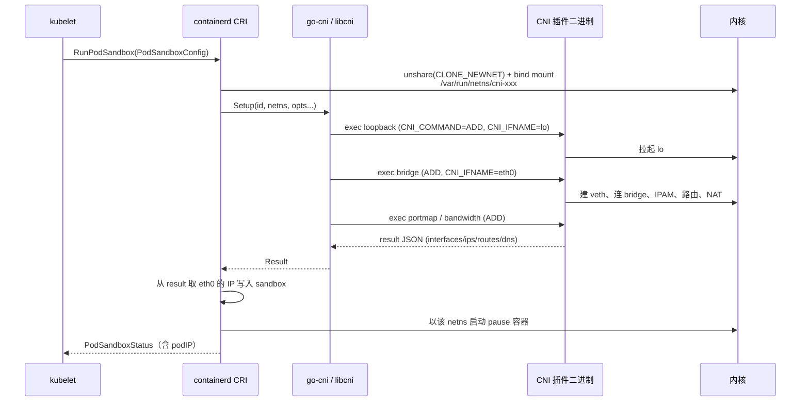

# CNI 详解：从 kubelet 到 veth、bridge 与 overlay

Pod 网络是 Kubernetes 里最容易被"一句话带过"的部分："CNI 给 Pod 分配 IP、插 veth、连 bridge"。这句话不算错，但它掩盖了真正重要的细节：**netns 是谁创建的、CNI 在哪个命名空间执行、IPAM 的状态存在哪、跨节点路由是谁装的、MTU 为什么少 50 字节、NetworkPolicy 到底在哪一层生效**。

本文按"谁调用 → 调用什么 → 插件做什么 → 包怎么走"的顺序拆开。完整链路（Service/DNS/LB）见 [Kubernetes 网络全链路](./k8s-network-path.md)；Service 规则的生成见 [Service、kube-proxy 与 LoadBalancer](./6_service相关.md)；跨集群见 [多集群网络互联](./multicluster-networking.md)。

**版本基线**：

| 项目 | 版本 | commit |
|---|---|---|
| Kubernetes | v1.37.2 | `c50e5395f1ae2d4a2c05f28fdcc38c0916cc1a32` |
| containerd | v2.4.2 | `b7a25261e029d68978bbf290df0a62fc819b3c51` |
| CNI spec | 1.1.0 | `42e11794c073c4a7f3db324a33d266bdd0344e58` |
| CNI plugins | v1.9.x | `0581b4290fe24a283a78195b1f3ec81a9bc26786` |

> 引用约定：源码链接带 40 位 commit 与行号区间；外部项目（flannel/Calico/Cilium）以官方文档链接为主，不伪造行号。行号已用本地 checkout 核对。

---

## 1. CNI 的边界：它只管"把容器接进网络"

CNI（Container Network Interface）是一个**运行时与网络插件之间的契约**，不是 Kubernetes 的一部分，也不是一个具体网络实现。它的职责边界很窄：

- **CNI 负责**：为一个已经存在的 network namespace 配置接口、地址、路由、防火墙/NAT 规则；在删除时清理；把结果（接口、IP、路由、DNS）返回给运行时。
- **CNI 不负责**：创建/销毁 netns（运行时做）、调度 Pod（kubelet/scheduler 做）、分配 Node 的 PodCIDR（kube-controller-manager 做）、Service VIP 的 DNAT（kube-proxy 或 eBPF 做）、跨集群互联（Submariner/ClusterMesh 等做）。

这个边界解释了很多"为什么 CNI 不帮我做 X"的疑问。例如：

- **CNI 不创建 netns**。containerd 在 `RunPodSandbox` 里创建 netns，再以 `CNI_NETNS` 传给插件；插件只往里"塞"接口。
- **CNI 不保证跨节点路由**。它可以让插件自己装（Calico BGP、kindnet 静态路由），也可以只做 overlay 封装；K8s 核心不装路由。
- **CNI 不实现 NetworkPolicy**。API 只定义语义，执行靠插件（Calico Felix、Cilium eBPF、kube-router ipset 等）。
- **CNI 不参与 Service**。ClusterIP 的 DNAT 是 kube-proxy/CNI 的"另一个能力"（很多 CNI 附带 kube-proxy 替代），不在 CNI 规范里。

---

## 2. 一次 Pod 创建：谁在什么时候调用 CNI



### 2.1 kubelet：只装配 CRI 参数

kubelet 不直接调用 CNI，也不操作 netns（dockershim 在 1.24 已移除）。它把 Pod 翻译成 `PodSandboxConfig`，然后调用 CRI 的 `RunPodSandbox`（[kuberuntime_sandbox.go L71-L76](https://github.com/kubernetes/kubernetes/blob/c50e5395f1ae2d4a2c05f28fdcc38c0916cc1a32/pkg/kubelet/kuberuntime/kuberuntime_sandbox.go#L71-L76)）。装配的内容包括：

- **所有 Pod annotations** 原样放进 `Annotations`（[labels.go L92-L94](https://github.com/kubernetes/kubernetes/blob/c50e5395f1ae2d4a2c05f28fdcc38c0916cc1a32/pkg/kubelet/kuberuntime/labels.go#L92-L94)），这是带宽、自定义 CNI 注解的数据源；
- **DNSConfig** 来自 `GetPodDNS()`（[kubelet_network.go L53-L57](https://github.com/kubernetes/kubernetes/blob/c50e5395f1ae2d4a2c05f28fdcc38c0916cc1a32/pkg/kubelet/kubelet_network.go#L53-L57)）；
- **PortMappings** 来自每个容器的 `ports`（hostPort/containerPort/protocol/hostIP，[helpers.go L449-L485](https://github.com/kubernetes/kubernetes/blob/c50e5395f1ae2d4a2c05f28fdcc38c0916cc1a32/pkg/kubelet/container/helpers.go#L449-L485)）；
- **NetworkNamespaceMode**：`hostNetwork: true` → `NODE`，否则 `POD`（[util.go L81-L88](https://github.com/kubernetes/kubernetes/blob/c50e5395f1ae2d4a2c05f28fdcc38c0916cc1a32/pkg/kubelet/kuberuntime/util/util.go#L81-L88)）。

kubelet 的"网络就绪"判断也只信 CRI 的 `NetworkReady` condition：运行时没起来/CNI 配置加载失败时，非 hostNetwork Pod 会直接返回 `network is not ready` 并打 `NetworkNotReady` 事件（[kubelet.go L2137-L2140](https://github.com/kubernetes/kubernetes/blob/c50e5395f1ae2d4a2c05f28fdcc38c0916cc1a32/pkg/kubelet/kubelet.go#L2137-L2140)）。

### 2.2 containerd：创建 netns、启动 pause、再调 CNI

**修正一个常见误解**：netns 不是 CNI 创建的，是 containerd 在 `RunPodSandbox` 里创建的。

- 非 hostNetwork 时，`netns.NewNetNS("/var/run/netns")` 创建 netns，并把路径写进 sandbox metadata（[sandbox_run.go L196-L218](https://github.com/containerd/containerd/blob/b7a25261e029d68978bbf290df0a62fc819b3c51/internal/cri/server/sandbox_run.go#L196-L218)）。
- 创建方式：在一个锁定 OS thread 的 goroutine 里 `unshare(CLONE_NEWNET)`，再把**当前线程的** `/proc/<pid>/task/<tid>/ns/net` bind mount 到 `/var/run/netns/cni-<uuid>`，这样即使线程退出，netns 仍然存在（[netns_linux.go L108-L137](https://github.com/containerd/containerd/blob/b7a25261e029d68978bbf290df0a62fc819b3c51/pkg/netns/netns_linux.go#L108-L137)）。
- 然后 `setupPodNetwork` 调 go-cni 的 `Setup`/`SetupSerially`（[sandbox_run.go L455-L527](https://github.com/containerd/containerd/blob/b7a25261e029d68978bbf290df0a62fc819b3c51/internal/cri/server/sandbox_run.go#L455-L527)）。
- 从结果里找 `eth0` 的 IP 写回 sandbox；找不到就报 `failed to find network info for sandbox`。
- 最后用这个 netns 启动 pause 容器；后续业务容器加入同一个 netns。

**hostNetwork** 在 containerd 侧是 `NamespaceOptions.Network == NamespaceMode_NODE`（[helpers.go L428-L444](https://github.com/containerd/containerd/blob/b7a25261e029d68978bbf290df0a62fc819b3c51/internal/cri/server/helpers.go#L428-L444)）；为 NODE 时整段 netns + CNI 都跳过。

### 2.3 翻译层：kubelet 的字段如何变成 CNI 参数

`cniNamespaceOpts` 是"K8s 语义 → CNI 能力"的关键（[sandbox_run.go L530-L561](https://github.com/containerd/containerd/blob/b7a25261e029d68978bbf290df0a62fc819b3c51/internal/cri/server/sandbox_run.go#L530-L561)）：

```go
opts := []cni.NamespaceOpts{
    cni.WithLabels(toCNILabels(id, config)),
    cni.WithCapability(annotations.PodAnnotations, config.Annotations),
}
if len(portMappings) > 0 { opts = append(opts, cni.WithCapabilityPortMap(portMappings)) }
if bandWidth != nil   { opts = append(opts, cni.WithCapabilityBandWidth(*bandWidth)) }
if dns != nil         { opts = append(opts, cni.WithCapabilityDNS(*dns)) }
if cgroup != ""       { opts = append(opts, cni.WithCapabilityCgroupPath(cgroup)) }
```

| K8s 来源 | CNI 形式 | 谁消费 |
|---|---|---|
| Pod 元数据 | `CNI_ARGS`：`K8S_POD_NAMESPACE/NAME/UID/INFRA_CONTAINER_ID` + `IgnoreUnknown=1` | 大多数插件用于日志/策略 |
| 全部 annotations | capability `io.kubernetes.cri.pod-annotations` | 自定义插件（不是 CNI well-known） |
| `hostPort` | `runtimeConfig.portMappings` | portmap / Cilium 等 |
| 带宽 annotations | `runtimeConfig.bandwidth`（`kubernetes.io/ingress-bandwidth`/`egress-bandwidth`） | bandwidth |
| CRI DNSConfig | `runtimeConfig.dns` | 插件写 resolv.conf 的兜底 |
| CgroupParent | capability `cgroupPath` | 需要 cgroup 关联的插件 |

注意：containerd **不提供 `ipRanges`** 能力；它会把 `config.Annotations` 整体塞进去，所以插件只有声明了同名 capability 才能收到。

### 2.4 配置发现与热加载

默认路径：

- 配置目录 `/etc/cni/net.d`（`cni_conf_dir`）；
- 二进制目录 `/opt/cni/bin`（`cni_bin_dir`）；
- 最多加载 `cni_max_conf_num=1` 个配置。

加载规则（[go-cni opts.go L212-L266](https://github.com/containerd/containerd/blob/b7a25261e029d68978bbf290df0a62fc819b3c51/vendor/github.com/containerd/go-cni/opts.go#L212-L266)）：

1. 只认 `.conf`、`.conflist`、`.json`；
2. **字典序排序后取前 N 个**，不是"第一个失败再试第二个"；first file wins；
3. 第一个网络用 `eth0`，后续 `eth1`、`eth2`；
4. `.conf` 被当成单插件 conflist；`plugins` 为空报错；
5. 目录为空 → `ErrCNINotInitialized`，表现为 `NetworkPluginNotReady`。

热加载由 `cniNetConfSyncer` 用 fsnotify 监听目录，但它**忽略 CHMOD 和 CREATE**，只在 WRITE/RENAME/REMOVE 时重新 `Load()`（[cni_conf_syncer.go L91-L120](https://github.com/containerd/containerd/blob/b7a25261e029d68978bbf290df0a62fc819b3c51/internal/cri/server/cni_conf_syncer.go#L91-L120)）。所以 `touch` 配置文件通常不会触发重载，要用覆盖写或 `mv` 原子替换。

`cni-conf-template` 是另一条路：containerd 用 kubelet 通过 `UpdateRuntimeConfig` 下发的 PodCIDR 渲染模板，适用于"每个节点用同一份模板、CIDR 由 K8s 注入"的部署。

### 2.5 teardown：先停容器，再 DEL

停止 sandbox 的顺序（[sandbox_stop.go L60-L131](https://github.com/containerd/containerd/blob/b7a25261e029d68978bbf290df0a62fc819b3c51/internal/cri/server/sandbox_stop.go#L60-L131)）：

```text
停业务容器 → 停 pause sandbox → NRI 通知 → CNI DEL（逆序）
→ 删除 netns
```

CNI DEL 必须容忍 netns 已经不存在（pause 已停、netns 被判定关闭时 containerd 会把 `NetNSPath` 置空再 DEL），这也是规范要求"DEL 可以重复执行"的原因。`teardownPodNetwork` 只是重新算一遍 `cniNamespaceOpts` 然后 `Remove`（[sandbox_stop.go L154-L178](https://github.com/containerd/containerd/blob/b7a25261e029d68978bbf290df0a62fc819b3c51/internal/cri/server/sandbox_stop.go#L154-L178)）。

---

## 3. CNI 规范：六个动词与三个 JSON

### 3.1 动词与顺序

当前规范版本是 **1.1.0**（[SPEC.md L48](https://github.com/containernetworking/cni/blob/42e11794c073c4a7f3db324a33d266bdd0344e58/SPEC.md#L48-L48)）。实际有 6 个动词（规范正文有一处写"5 operations"的编辑瑕疵，不要据此认为 STATUS 不存在）：

| 动词 | 用途 | 备注 |
|---|---|---|
| `ADD` | 把容器加入网络/追加配置 | 链式按 `plugins` 顺序执行 |
| `DEL` | 移除 | **逆序**执行；必须容忍 netns 已消失 |
| `CHECK` | 按 `prevResult` 核对 | 需要首次 ADD 的最终结果 |
| `GC` | 按"仍有效的 attachment"清理其余资源 | 1.1.0 新增；不能替代 DEL |
| `STATUS` | 插件探活 | 1.1.0 新增；只对 `cniVersion >= 1.1.0` |
| `VERSION` | 查询支持的规范版本 | 兼容性协商 |

链式语义（[SPEC.md L405-L470](https://github.com/containernetworking/cni/blob/42e11794c073c4a7f3db324a33d266bdd0344e58/SPEC.md#L405-L470)）：ADD 顺序执行，DEL 逆序；CHECK 顺序执行且必须带首次 ADD 的**最终** `prevResult`；GC 要求运行时列出所有有效 attachment（`cni.dev/valid-attachments`），插件删除不在列表中的资源，且**必须继续执行并汇总错误**，不能因为一个失败就中止。

### 3.2 调用协议：环境变量 + stdin/stdout

参数全部走环境变量（[SPEC.md L225-L231](https://github.com/containernetworking/cni/blob/42e11794c073c4a7f3db324a33d266bdd0344e58/SPEC.md#L225-L231)）：

| 变量 | 含义 |
|---|---|
| `CNI_COMMAND` | ADD/DEL/CHECK/GC/STATUS/VERSION |
| `CNI_CONTAINERID` | 运行时分派的容器 ID |
| `CNI_NETNS` | netns 路径（如 `/var/run/netns/cni-xxx`） |
| `CNI_IFNAME` | 容器内接口名（如 `eth0`） |
| `CNI_ARGS` | `K=V;K=V` 形式的额外参数 |
| `CNI_PATH` | 插件二进制搜索路径 |

配置 JSON 从 **stdin** 读，结果 JSON 从 **stdout** 写，日志写 stderr；插件在 runtime 的网络命名空间（通常是 host netns）里执行。运行时会在请求配置里填入 `cniVersion`、`name`、`runtimeConfig`、`prevResult`，并**删除** `capabilities`。

### 3.3 结果与错误

ADD 成功的结果包含（[SPEC.md L573-L601](https://github.com/containernetworking/cni/blob/42e11794c073c4a7f3db324a33d266bdd0344e58/SPEC.md#L573-L601)）：

```json
{
  "cniVersion": "1.1.0",
  "interfaces": [
    {"name": "cni0", "mac": "..."},
    {"name": "veth1234", "mac": "..."},
    {"name": "eth0", "mac": "...", "sandbox": "/var/run/netns/cni-xxx"}
  ],
  "ips": [{"address": "10.244.1.5/24", "gateway": "10.244.1.1", "interface": 2}],
  "routes": [{"dst": "0.0.0.0/0", "gw": "10.244.1.1"}],
  "dns": {"nameservers": ["10.96.0.10"]}
}
```

被委托的 IPAM 插件返回"缩写版"：**没有 interfaces，ips 里也没有 interface 索引**（[SPEC.md L602-L605](https://github.com/containernetworking/cni/blob/42e11794c073c4a7f3db324a33d266bdd0344e58/SPEC.md#L602-L605)）。

错误码（[types.go L240-L255](https://github.com/containernetworking/cni/blob/42e11794c073c4a7f3db324a33d266bdd0344e58/pkg/types/types.go#L240-L255)）：

| code | 含义 | 运行时怎么处理 |
|---|---|---|
| 1 | 版本不兼容 | 放弃该插件 |
| 2 | 配置含不支持的字段 | 配置错误 |
| 3 | 容器不存在 | DEL 可直接成功 |
| 4 | 环境变量非法 | 实现错误 |
| 7 | 网络配置非法 | 配置错误 |
| 11 | 稍后重试 | 重试 |
| 50/51 | 插件不可用（51 表示既有容器连通性可能受影响） | 标记 NetworkReady=False |

### 3.4 capabilities：为什么 hostPort 不是所有插件都能处理

`runtimeConfig` 的推导规则是：**运行时提供的能力参数 ∩ 插件声明 `"capabilities": {...true}`** 才会注入（[libcni api.go L191-L212](https://github.com/containernetworking/cni/blob/42e11794c073c4a7f3db324a33d266bdd0344e58/libcni/api.go#L191-L212)）。

常见 well-known capability：`portMappings`、`ipRanges`、`bandwidth`、`dns`、`ips`、`mac`、`infinibandGUID`、`deviceID`、`aliases`。所以：

- 一个只做 L2、没声明 `portMappings` 的插件，**收不到 hostPort**，hostPort 自然不工作；
- 声明了 `portMappings` 但实现有 bug，hostPort 也会静默失效；
- containerd 还传 `io.kubernetes.cri.pod-annotations`、`cgroupPath` 这类非标准 capability，插件要自己声明同名键。

### 3.5 一个现实：containerd 的 CRI 路径不调用 CHECK/GC

规范定义了 CHECK/GC，但 containerd 2.4 的 CRI 生产代码只调用 `Setup`/`Remove`/`Status`（[sandbox_run.go L501-L503](https://github.com/containerd/containerd/blob/b7a25261e029d68978bbf290df0a62fc819b3c51/internal/cri/server/sandbox_run.go#L501-L503)、[sandbox_stop.go L171](https://github.com/containerd/containerd/blob/b7a25261e029d68978bbf290df0a62fc819b3c51/internal/cri/server/sandbox_stop.go#L171-L171)）。这意味着：

- 不要指望 CHECK 帮你发现"veth 被删了/路由被改了"；
- 不要指望 GC 清理孤儿 IP/veth，**DEL 的重试与幂等**才是实际保障；
- 自己写 CNI 时，DEL 必须能处理"netns 不存在、资源已删"的情况。

---

## 4. 一条典型 bridge 链：每个插件到底做了什么

大多数自建/实验集群的 conflist 长这样：

```json
{
  "cniVersion": "1.1.0",
  "name": "mynet",
  "plugins": [
    {"type": "bridge", "bridge": "cni0", "isGateway": true, "isDefaultGateway": true,
     "ipMasq": true, "mtu": 1500,
     "ipam": {"type": "host-local",
              "ranges": [[{"subnet": "10.244.1.0/24"}]],
              "routes": [{"dst": "0.0.0.0/0"}]}},
    {"type": "portmap", "capabilities": {"portMappings": true}},
    {"type": "bandwidth", "capabilities": {"bandwidth": true}}
  ]
}
```

执行顺序是 `loopback`（containerd 额外插入）→ `bridge`（含 IPAM）→ `portmap` → `bandwidth`。DEL 反过来。

### 4.1 loopback

containerd 会合成一个 `cniVersion 0.3.1`、`name=cni-loopback`、`type=loopback` 的配置，在 `lo` 上执行 ADD（[go-cni opts.go L97-L115](https://github.com/containerd/containerd/blob/b7a25261e029d68978bbf290df0a62fc819b3c51/vendor/github.com/containerd/go-cni/opts.go#L97-L115)）。插件只做两件事：把 `lo` 拉起、校验地址是 `127.0.0.0/8`/`::1/128`。`use_internal_loopback=true` 时 containerd 自己 `LinkSetUp(lo)`，不调插件。

### 4.2 bridge：创建网桥、veth、地址和默认路由

`cmdAdd` 的主流程（[bridge.go L559-L605](https://github.com/containernetworking/plugins/blob/0581b4290fe24a283a78195b1f3ec81a9bc26786/plugins/main/bridge/bridge.go#L559-L605)）：

1. `isDefaultGateway` 隐含 `isGateway`；`hairpinMode` 与 `promiscMode` 互斥。
2. `ensureBridge`：`LinkAdd`（EEXIST 容忍）、可选 promisc、`LinkSetUp`，并把 `net/ipv6/conf/<br>/accept_ra` 设为 0（"we want to own the routes"）。
3. `setupVeth`：**在容器 netns 内**创建 veth pair，host 端移入 host netns；host 端 `LinkSetMaster(br)`、`LinkSetHairpin`、`LinkSetIsolated`，可选 VLAN 过滤（[bridge.go L428-L512](https://github.com/containernetworking/plugins/blob/0581b4290fe24a283a78195b1f3ec81a9bc26786/plugins/main/bridge/bridge.go#L428-L512)）。
4. 有 IPAM 时 `ipam.ExecAdd` 拿结果，失败自动 `ExecDel` 回滚。
5. `calcGateways`：`isGateway` 且 IPAM 未给 gateway 时用"子网首地址+1"；`isDefaultGateway` 且没有默认路由时追加 `0.0.0.0/0`/`::/0`。
6. 在容器 netns 内设 `accept_dad`/`arp_notify`，然后 `ipam.ConfigureIface(eth0, result)` 加地址、装路由。
7. `isGateway` 时把 gateway IP 加到 `cni0` 上，并 `enableIPForward`（IPv4 写 `net.ipv4.ip_forward=1`，IPv6 写 `net.ipv6.conf.all.forwarding=1`）。
8. `ipMasq: true` 时按 Pod IP 建 NAT 链（见 §9）。
9. 等待 host veth `OperState=Up`，并**重新读取 bridge MAC**——第一个 veth 加入或设置 IP 后 `cni0` 的 MAC 会变，插件必须重新读，否则返回的 result 里 MAC 是旧的（[bridge.go L745-L775](https://github.com/containernetworking/plugins/blob/0581b4290fe24a283a78195b1f3ec81a9bc26786/plugins/main/bridge/bridge.go#L745-L775)）。

**为什么 Pod 的默认路由能工作**：`ConfigureIface` 对每条没有 `GW` 的路由，用 IPConfig 的 `gateway` 作为下一跳；而 gateway IP 被配在 `cni0` 上，所以 `cni0` 会以自己的 MAC 应答 ARP，Pod 才能把帧发给网关。反过来，如果 `isGateway=false`，`cni0` 没有这个 IP，Pod 的下一跳不可达——表现为"有 IP、能 ping 自己、出不去"。

### 4.3 host-local：IP 分配的状态在磁盘上

host-local 的配置在 `backend/allocator/config.go`：`ranges`（外层=分配几个 IP，内层=每个 IP 的候选子网池）、`subnet/rangeStart/rangeEnd/gateway`、`routes`、`dataDir`、`resolvConf`。分配状态：

- 目录 `/var/lib/cni/networks/<network>/`（`dataDir` 可覆盖）；
- **一个 IP 一个文件**，文件内容 `containerID\r\nifname`，用 `O_EXCL` 原子占位；另有 `last_reserved_ip.<rangeID>` 记录游标，整个目录用 flock 串行化（[disk/backend.go L37-L90](https://github.com/containernetworking/plugins/blob/0581b4290fe24a283a78195b1f3ec81a9bc26786/plugins/ipam/host-local/backend/disk/backend.go#L37-L90)）；
- 从 `last_reserved_ip+1` 开始 round-robin，避免崩溃循环的 Pod 反复拿同一个 IP（[allocator.go L139-L178](https://github.com/containernetworking/plugins/blob/0581b4290fe24a283a78195b1f3ec81a9bc26786/plugins/ipam/host-local/backend/allocator/allocator.go#L139-L178)）；
- 同一 `(containerID, ifname)` 重复分配会被拒绝；IP 耗尽返回 `no IP addresses available in range set`；
- gateway 默认 `subnet+1`；`cmdAdd` 只返回 `ips` 和 `routes`，**自己不装路由**（默认路由要么配置里有 `0.0.0.0/0`，要么由 bridge 的 `isDefaultGateway` 补）；
- `cmdDel` 按所有 ranges 逐个 release，容忍重复删除；`cmdGC` 用 `cni.dev/valid-attachments` 清理不在列表中的预留。

排障含义：**"Pod 拿不到 IP"先看 `/var/lib/cni/networks/<net>/` 的文件数**。如果文件数远大于当前 Pod 数，说明 DEL 失败导致泄漏；删掉对应的孤儿文件（确认 containerID 已不存在）或换一个更大的 range。

### 4.4 portmap：hostPort 的 DNAT

hostPort 不是 CNI 规范的核心，而是 portmap 插件通过 `portMappings` capability 实现的。iptables 结构（[portmap_iptables.go L29-L49](https://github.com/containernetworking/plugins/blob/0581b4290fe24a283a78195b1f3ec81a9bc26786/plugins/meta/portmap/portmap_iptables.go#L29-L49)）：

```text
PREROUTING/OUTPUT -m addrtype --dst-type LOCAL -j CNI-HOSTPORT-DNAT
CNI-HOSTPORT-DNAT: -m multiport --destination-ports 8080 -j CNI-DN-<hash>
CNI-DN-<hash>: -p tcp --dport 8080 -j DNAT --to-destination 10.244.1.5:80
```

hairpin（源地址属于 Pod 网段）和 localhost（`-s 127.0.0.1`）会先跳 `CNI-HOSTPORT-SETMARK` 打 mark，再由 `CNI-HOSTPORT-MASQ` 对带 mark 的包做 MASQUERADE。ADD/DEL 都会 flush 对应 UDP conntrack，避免旧 NAT 状态把新 Pod 黑洞。

两个重要缺陷：

1. **portmap 不预留 hostPort**：同一 hostPort 上最后一个写入者获胜；
2. **它会抢走宿主原本监听该端口的服务**（比如宿主自己的 nginx 监听 80，Pod 也声明 hostPort 80，DNAT 规则会让宿主流量被劫持）。

所以生产上 hostPort 要慎用；能用 Service/Ingress 就不要用 hostPort。

### 4.5 bandwidth / tuning

- **bandwidth**：`ingressRate/Burst` 在 host veth 上建 TBF root qdisc（限制进容器的流量）；`egressRate/Burst` 在 host veth 上建 ingress qdisc + u32 filter，把流量 mirred 重定向到 `bw-<hash>` IFB，再在 IFB 上建 TBF。注意它会把 IFB 加进结果 `interfaces`，所以 `prevResult` 比预期多一个接口。
- **tuning**：只改 sysctl（和可选 `mac`）。`/etc/cni/tuning/allowlist.conf` 存在时会做白名单校验，拒绝非 `net.*` 或不在白名单的 key；支持 CHECK，但不支持 GC/STATUS。

### 4.6 其他拓扑：ptp、ipvlan、macvlan

| 插件 | 结构 | 特点 | 典型使用者 |
|---|---|---|---|
| **bridge** | veth + Linux bridge | 简单、同节点 L2 互通；网关在 bridge 上 | flannel host-gw? 不，flannel 用 bridge；Calico 不用 |
| **ptp** | veth pair，无 bridge | host 端加 `/32` 主机路由，容器内强制所有流量经网关 ARP；kindnet 用它 | kind、部分轻量 CNI |
| **ipvlan** | 父接口上创建 ipvlan 子接口 | 共享父接口 L2，不建 veth/bridge；`l2/l3/l3s` 模式 | 高性能/underlay 场景 |
| **macvlan** | 每个 Pod 独立 MAC 的子接口 | 需要父接口支持混杂/多 MAC；MTU 不能超过父接口 | 传统网络/裸金属 |

**ptp** 的精髓在注释里写得很清楚：veth 不支持 `IFF_POINTOPOINT`，所以先给容器配 `/24`，删掉自动产生的直连路由，再加 `gw/32 dev eth0` 和 `subnet via gw`，**强制所有流量经网关 ARP**（[ptp.go L54-L80](https://github.com/containernetworking/plugins/blob/0581b4290fe24a283a78195b1f3ec81a9bc26786/plugins/main/ptp/ptp.go#L54-L80)）。host 侧需要 forwarding。

**ipvlan/macvlan** 不创建 veth，也不建 bridge；它们直接在父接口上派生接口。优点是路径短、性能好；缺点是对父接口/交换机配置有要求（混杂模式、MAC 数量、VLAN），且很多 overlay/NetworkPolicy 方案不兼容。

### 4.7 kindnet：kind 集群里到底跑了什么

kind 的默认 CNI 是 **kindnetd**（DaemonSet，`kube-system/kindnet`），它不是"什么都没有"，而是一个很薄的实现：

- 用 **ptp + host-local + portmap** 的 conflist（`cniVersion 0.3.1`），`ipMasq: false`，`dataDir=/run/cni-ipam-state`；
- 按 Node 的 `PodCIDRs` 渲染 `ranges` 和默认路由，MTU 取 `eth0` 的 MTU；
- 跨节点由 kindnetd **写静态路由**（watch Node，取 Peer `InternalIP` 与 `PodCIDRs`）；
- NAT 由一个 ipMasqAgent 负责：对 cluster subnet 之外的流量 MASQUERADE；
- 可选启用基于 eBPF 的 `kube-network-policies` 做 NetworkPolicy。

所以 kind 集群里 Pod 出口源 IP 是节点 IP，`kubectl exec` 看到的对端地址也是节点地址；"kind 没有 NetworkPolicy"已经是过去式，能力随 kind 版本变化。源码见 [kindnetd](https://github.com/kubernetes-sigs/kind/tree/main/images/kindnetd)（main 分支，不固定行号）。

---

## 5. 节点路由与 PodCIDR

### 5.1 PodCIDR 从哪来

kube-controller-manager 的 NodeIPAM 控制器：

- 开启 `--allocate-node-cidrs`（默认 false）并提供 `--cluster-cidr`；
- `--node-cidr-mask-size` 决定每节点块大小（IPv4 默认 24、IPv6 默认 64）；
- 每个 clusterCIDR 一个位图 `CidrSet`，`AllocateNext` 线性探测空闲块，耗尽报 `ErrCIDRRangeNoCIDRsRemaining`；
- 节点已有 `PodCIDRs` 时只 `Occupy`，不重新分配；分配后写回 `Node.spec.podCIDRs`，失败重试后可能泄漏。

PodCIDR 只是"地址池声明"，**K8s 核心不装跨节点路由**（云厂商的 `--configure-cloud-routes` 例外，由 cloud provider 写 VPC 路由表）。路由由 CNI 决定：

- **静态路由**：`ip route add <peerPodCIDR> via <peerInternalIP>`，适合小集群/实验；
- **BGP**：Calico/kube-router 每个节点宣告本节点 PodCIDR，节点间 full mesh 或 Route Reflector；
- **overlay**：VXLAN/IPIP/Geneve 封装，节点只需 IP 可达；
- **云路由**：cloud provider 把 PodCIDR 写进 VPC 路由表。

### 5.2 相关 sysctl

| sysctl | 作用 | 谁设置 |
|---|---|---|
| `net.ipv4.ip_forward=1` | 节点转发 Pod 流量 | bridge/ptp 的网关模式由 CNI 设置；kubeadm 只做 preflight 检查 |
| `net.ipv6.conf.all.forwarding=1` | IPv6 转发 | 同上 |
| `net.bridge.bridge-nf-call-iptables=1` | 让 iptables/conntrack 看到桥接流量 | **不由 K8s 代码设置**；由节点准备/发行版/网络插件负责 |
| `net.ipv4.conf.*.rp_filter` | 反向路径校验 | 发行版默认；overlay/多路径常改 2 或 0 |
| `net.ipv4.conf.*.proxy_arp` | 代答 ARP | 参考 bridge/ptp 链不设置；L3 underlay 设计中按需开启 |
| `net.ipv4.conf.all.route_localnet=1` | 允许 127/8 跨路由边界 | kube-proxy（localhost NodePort） |
| `net.ipv6.conf.<if>.accept_ra=0` | 防止 RA 覆盖 CNI 装的路由 | bridge 插件 |

`bridge-nf-call-iptables` 值得单独强调：**它是同节点 Pod→Service 回包能被 conntrack 还原的前提**（见 [网络全链路 §4.3](./k8s-network-path.md)）。关掉它，跨节点访问可能正常，同节点 Service 访问反而坏掉。

---

## 6. Overlay vs Underlay：MTU 是怎么少掉的

| 方案 | 封装 | 每包开销（IPv4） | 1500 underlay 下 Pod MTU | 代表 |
|---|---|---|---|---|
| VXLAN | 外层 IP + UDP + VXLAN + 内层以太 | 50 | 1450 | flannel、Calico VXLAN |
| IPIP | 外层 IP | 20 | 1480 | Calico IPIP |
| Geneve | 外层 IP + UDP + Geneve + TLV | ≥50 | 按实现（常 1450 以下） | OVN-Kubernetes |
| WireGuard | 外层 IP + UDP + WG | 60 | 1440 | flannel/Calico WireGuard |
| BGP/纯路由 | 无 | 0 | 1500 | Calico、kube-router |
| eBPF | 原生或 tunnel | 0 或 50 | 1500 或 1450 | Cilium |

算术：

- **VXLAN 50** = 14（内层以太）+ 20（外层 IPv4）+ 8（UDP）+ 8（VXLAN）；IPv6 外层换成 40，所以 70。
- **WireGuard 60** = 20（IP）+ 8（UDP）+ 32（WG 头/计数器/tag）；IPv6 为 80。
- **IPIP 20** = 外层 IP。
- **1400** 通常来自 underlay 本身只有 1450（如 OpenStack VXLAN），再减 50。
- **AKS 等云环境** 的路径 MTU 可能是 1400，再叠 WireGuard 就是 1340。

MTU 必须"端到端取最小"：Pod veth、`cni0`、隧道设备、underlay 网卡要一致或递减。配大了而 ICMP Fragmentation Needed 又被防火墙丢弃，典型现象是 `curl` 小请求正常、大响应卡死（PMTU 黑洞）。验证方法：

```bash
# 从 Pod 里逐步逼近，-M do 禁止分片
ping -M do -s 1400 <peerPodIP>
ping -M do -s 1450 <peerPodIP>
# 看隧道接口的 MTU
ip -d link show vxlan.calico   # 期望 1450
ip -d link show flannel.1      # 期望 1450
```

---

## 7. IPAM：地址从哪来、状态在哪

| 方案 | 状态存储 | 特点 |
|---|---|---|
| host-local | `/var/lib/cni/networks/<net>/` 文件 | 简单、无依赖；每节点地址池静态配置或模板注入 |
| whereabouts | CRD + etcd（K8s API） | 支持跨节点地址池、动态分配、多网卡；适合大规模/Multus |
| Calico IPAM | Calico datastore（etcd/CRD） | 按 IPPool/节点块分配，支持 affinity、跨 subnet |
| 云厂商 CNI | 云 API（ENI/IP 分配） | 地址是云网卡/IP，受云配额限制 |

host-local 的"一个 IP 一个文件"设计有一个重要副作用：**状态在本地磁盘，节点重装/磁盘丢失会丢分配记录**。恢复时如果 Pod 还在，可能出现"IP 已被占用但文件没了"的冲突；这时需要 `cni` 的 DEL/GC 或手动清理。whereabouts/Calico 把状态放在 API 里，跨节点可见，但引入了对 apiserver/etcd 的依赖。

IP 耗尽是最常见的 CNI 故障：`no IP addresses available in range set`。先看 PodCIDR 是否太小（每节点 `/24` 只有 254 个）、是否有 DEL 泄漏、是否有大量 Completed Job Pod 还占着 IP（Completed Pod 不会自动释放，直到被删除）。

---

## 8. Pod 出口 NAT

Pod → 集群外的 SNAT **不是 kube-proxy 做的**（kube-proxy 只做 Service 流量的 SNAT）：

- **bridge 的 `ipMasq: true`**：每个 Pod IP 建一条独立链，链内先 `-d <podCIDR> -j ACCEPT`（同网段不 NAT），再 `! -d 224.0.0.0/4 -j MASQUERADE`，最后在 `POSTROUTING` 用 `-s <podIP> -j <chain>` 命中（[ipmasq_iptables_linux.go L29-L95](https://github.com/containernetworking/plugins/blob/0581b4290fe24a283a78195b1f3ec81a9bc26786/pkg/ip/ipmasq_iptables_linux.go#L29-L95)）。注意这条 MASQUERADE **没有 `--random-fully`**。
- **Calico**：由 IPPool 的 `natOutgoing` 决定是否 SNAT，Felix 写规则。
- **kindnet**：ipMasqAgent 周期同步 `-s <podSubnet> ! -d <podSubnet> -j MASQUERADE`。
- **云厂商**：通常由云 NAT 网关/节点 SNAT 完成。

`--random-fully` 的作用是随机化源端口，降低大规模 egress 的端口冲突/conntrack 插入失败。kube-proxy 对 Service SNAT 默认开启，CNI 的 ipMasq 链通常不开；大规模 egress 需要单独评估 `nf_conntrack_max`。

Egress gateway（Calico EgressGateway、Cilium Egress Gateway）把特定 Namespace/Pod 的出口导到专用节点再 SNAT 成固定 IP。代价：外部看到的是节点 IP；基于 Pod CIDR 的 `ipBlock`/审计/限流失配；回程必须回到同一台 egress 节点。

IPv6 默认**不做 NAT66**；Pod 的全局 IPv6 直接路由，或由 NPTv6/显式 NAT 处理。

---

## 9. NetworkPolicy 的数据面

NetworkPolicy 的 API 只定义语义，**执行完全靠 CNI**。K8s 文档明确：没有支持的插件时，创建 NetworkPolicy 对象"没有效果"；未隔离的 Pod 默认全通；策略是加法式的。

| 实现 | 数据面 | 特点 |
|---|---|---|
| kube-router | iptables + ipset + conntrack | 每个 Pod 专属链，默认 DROP，白名单用 ipset |
| Calico | Felix 编译 iptables/nftables（也可 eBPF dataplane） | 支持全局/命名空间策略、selector、DNS 策略 |
| Cilium | eBPF（TC/XDP/socket） | 基于 identity 而非纯 IP；L7 策略 |
| kindnet | `kube-network-policies` eBPF | kind 的可选能力 |

三个容易踩的点：

1. **默认 deny egress 会连 DNS 一起断**。必须显式放行 53/udp、53/tcp；NodeLocal DNSCache 模式下还要放行 `169.254.20.10`。
2. **策略对 hostNetwork Pod 行为未定义**，多数实现把它当节点流量。
3. **策略变更对已建立连接是否生效由实现决定**；不要假设改完策略旧连接立刻断。

另外，NAT 发生在 NetworkPolicy 之前还是之后**没有规范定义**，不同插件/云厂商行为不同。任何"按源 Pod IP 放行"的策略，在 egress gateway/NAT 路径上都可能失效。

---

## 10. CNI 生态对比

| 方案 | 数据面 | 跨节点 | NetworkPolicy | 特点/边界 |
|---|---|---|---|---|
| **flannel** | VXLAN / host-gw / WireGuard | 封装或静态路由 | 否（需配合其他） | 简单、成熟；功能少 |
| **Calico** | BGP / IPIP / VXLAN / eBPF | 路由或封装 | 是（Felix） | 功能全、运维复杂；BGP 需要网络配合 |
| **Cilium** | eBPF | native/tunnel，ClusterMesh | 是（eBPF/L7） | 高性能、可替代 kube-proxy；内核/版本要求高 |
| **Antrea** | OVS | Geneve/VXLAN | 是 | 基于 OVS，Windows 支持好 |
| **kube-router** | BGP + IPVS | 纯路由 | 是（ipset） | 轻量、一体化；IPVS 弃用后需重新评估 |
| **kindnet** | ptp + 静态路由 | 静态路由 | 可选（eBPF） | 仅适合 kind/实验 |
| **Multus** | 多 CNI 编排 | 取决于底层 | 取决于底层 | 多网卡/多网络；不是数据面本身 |

选型的核心问题不是"哪个功能多"，而是：**你需要 underlay 路由还是 overlay？需要 NetworkPolicy 吗？需要 eBPF/kube-proxy 替代吗？能接受 BGP/内核版本/运维复杂度吗？** 多集群场景还要看 ClusterMesh/Submariner 的兼容性，见 [多集群网络互联](./multicluster-networking.md)。

---

## 11. 故障模式与排查

| 现象 | 根因 | 看哪里 |
|---|---|---|
| Pod 一直 `ContainerCreating`，事件 `NetworkNotReady` | containerd 的 `NetworkReady=False`：`/etc/cni/net.d` 为空、JSON 非法、`type` 二进制不存在 | `crictl info` 的 conditions；`ls /opt/cni/bin`；`jq . /etc/cni/net.d/*` |
| `failed to setup network for sandbox` | CNI ADD 失败，插件 stderr 在 containerd 日志里 | `journalctl -u containerd`；`crictl inspectp` |
| `no IP addresses available in range set` | host-local 地址池耗尽/泄漏 | `/var/lib/cni/networks/<net>/` 文件数 vs Pod 数 |
| Pod 有 IP 但出不了网 | 网关没配到 `cni0`、`ip_forward=0`、`bridge-nf-call-iptables=0`、MTU 过大 | `ip -d link show cni0`；sysctl；`nsenter` 看路由 |
| 删除 Pod 后残留 veth/iptables | DEL 失败（netns 已消失、插件 panic、配置变更） | `ip link show type veth`、`ip netns list`、`iptables -t nat -L CNI-HOSTPORT-DNAT` |
| 改了 CNI 配置不生效 | syncer 忽略 CHMOD/CREATE | 用覆盖写/`mv` 原子替换；看 containerd 日志 |
| 跨节点不通、同节点通 | 路由缺失/隧道未起/防火墙/rp_filter | `ip route`；`tcpdump` 隧道口；`ip xfrm`/WireGuard 状态 |

常用命令：

```bash
# 运行时视角
crictl info -o json | jq '.status.conditions'
crictl pods --name <pod>; crictl ps -a | grep <pod>
SB=$(crictl pods -q --name <pod>)
crictl inspectp -o json "$SB" | jq '.status.network,.info.pid'

# 进入 Pod netns
PID=$(crictl inspectp -o json "$SB" | jq -r .info.pid)
nsenter -t "$PID" -n ip -br addr
nsenter -t "$PID" -n ip route
nsenter -t "$PID" -n cat /etc/resolv.conf

# 节点侧
ip -d link show cni0
ip link show type veth | head
ip netns list; ls -l /var/run/netns/
sysctl net.ipv4.ip_forward net.bridge.bridge-nf-call-iptables
conntrack -L | grep <podIP> | head
journalctl -u containerd --since '10 min ago' | grep -i -E 'cni|sandbox'
```

日志位置：容器 stdout 在 `/var/log/pods/<namespace>_<pod>_<uid>/<container>/0.log`，`/var/log/containers/*.log` 是兼容旧工具的 symlink。**CNI 插件的 stderr 被 go-cni 接到 containerd 的 stderr**，所以"CNI 插件日志"实际在 containerd 的 journal 里。

---

## 12. 参考

**规范与官方文档**

- [CNI Specification 1.1.0](https://www.cni.dev/docs/spec/)
- [CNI 规范升级历史](https://www.cni.dev/docs/spec-upgrades/)
- [CNI conventions（capabilities 等）](https://www.cni.dev/docs/conventions/)
- [Kubernetes Network Plugins](https://kubernetes.io/docs/concepts/extend-kubernetes/compute-storage-net/network-plugins/)
- [Cluster Networking](https://kubernetes.io/docs/concepts/cluster-administration/networking/)
- [Network Policies](https://kubernetes.io/docs/concepts/services-networking/network-policies/)

**源码（固定到本文基线）**

- containerd netns 创建 —— [netns_linux.go L108-L137](https://github.com/containerd/containerd/blob/b7a25261e029d68978bbf290df0a62fc819b3c51/pkg/netns/netns_linux.go#L108-L137)
- containerd CNI setup/teardown —— [sandbox_run.go L455-L561](https://github.com/containerd/containerd/blob/b7a25261e029d68978bbf290df0a62fc819b3c51/internal/cri/server/sandbox_run.go#L455-L561)、[sandbox_stop.go L154-L178](https://github.com/containerd/containerd/blob/b7a25261e029d68978bbf290df0a62fc819b3c51/internal/cri/server/sandbox_stop.go#L154-L178)
- CNI 配置加载 —— [go-cni opts.go L212-L266](https://github.com/containerd/containerd/blob/b7a25261e029d68978bbf290df0a62fc819b3c51/vendor/github.com/containerd/go-cni/opts.go#L212-L266)
- bridge 插件 —— [bridge.go](https://github.com/containernetworking/plugins/blob/0581b4290fe24a283a78195b1f3ec81a9bc26786/plugins/main/bridge/bridge.go)
- host-local —— [allocator.go L139-L178](https://github.com/containernetworking/plugins/blob/0581b4290fe24a283a78195b1f3ec81a9bc26786/plugins/ipam/host-local/backend/allocator/allocator.go#L139-L178)、[disk/backend.go L37-L90](https://github.com/containernetworking/plugins/blob/0581b4290fe24a283a78195b1f3ec81a9bc26786/plugins/ipam/host-local/backend/disk/backend.go#L37-L90)
- portmap —— [portmap_iptables.go L29-L49](https://github.com/containernetworking/plugins/blob/0581b4290fe24a283a78195b1f3ec81a9bc26786/plugins/meta/portmap/portmap_iptables.go#L29-L49)
- ptp —— [ptp.go L54-L80](https://github.com/containernetworking/plugins/blob/0581b4290fe24a283a78195b1f3ec81a9bc26786/plugins/main/ptp/ptp.go#L54-L80)
- CNI 规范 —— [SPEC.md](https://github.com/containernetworking/cni/blob/42e11794c073c4a7f3db324a33d266bdd0344e58/SPEC.md)
- NodeIPAM —— [cidr_allocator.go L73-L77](https://github.com/kubernetes/kubernetes/blob/c50e5395f1ae2d4a2c05f28fdcc38c0916cc1a32/pkg/controller/nodeipam/ipam/cidr_allocator.go#L73-L77)

**本 wiki 的配套页面**

- [Kubernetes 网络全链路](./k8s-network-path.md)：Service/DNS/LB 与分层排障
- [Service、kube-proxy 与 LoadBalancer](./6_service相关.md)：规则生成与 LB 实现
- [多集群网络互联](./multicluster-networking.md)：跨集群发现与访问

