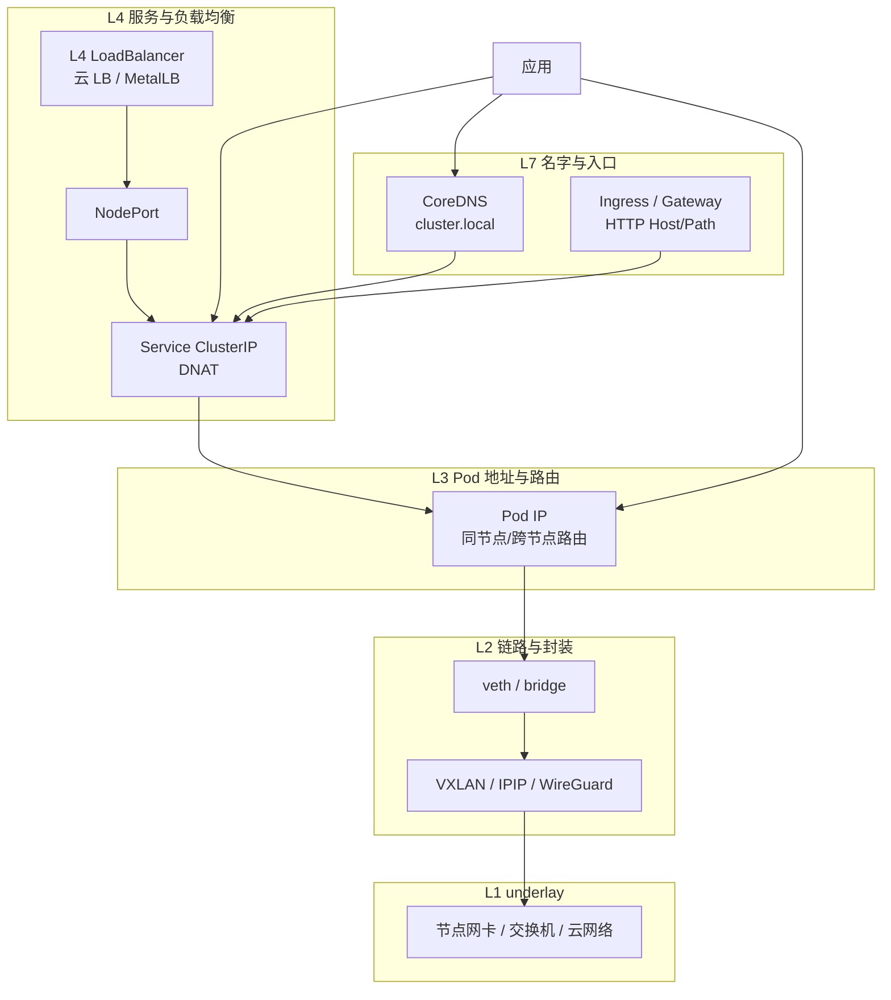
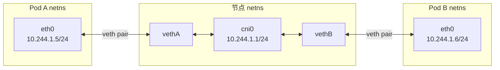
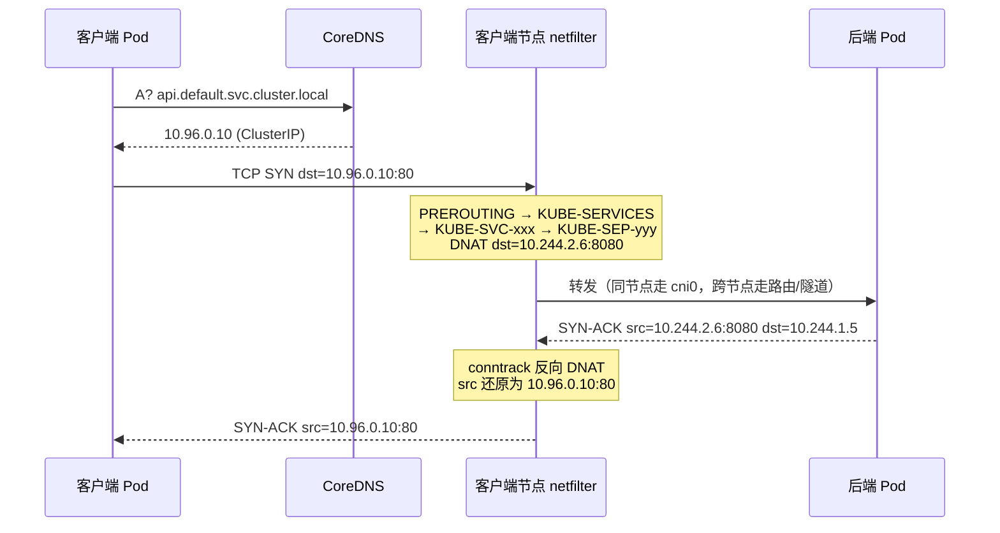
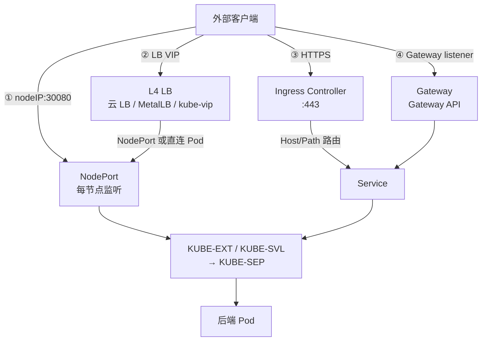
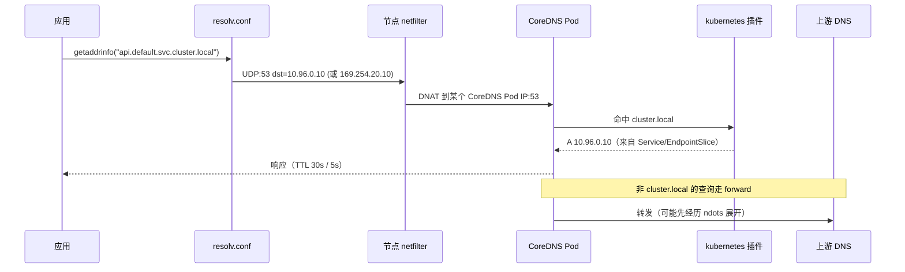
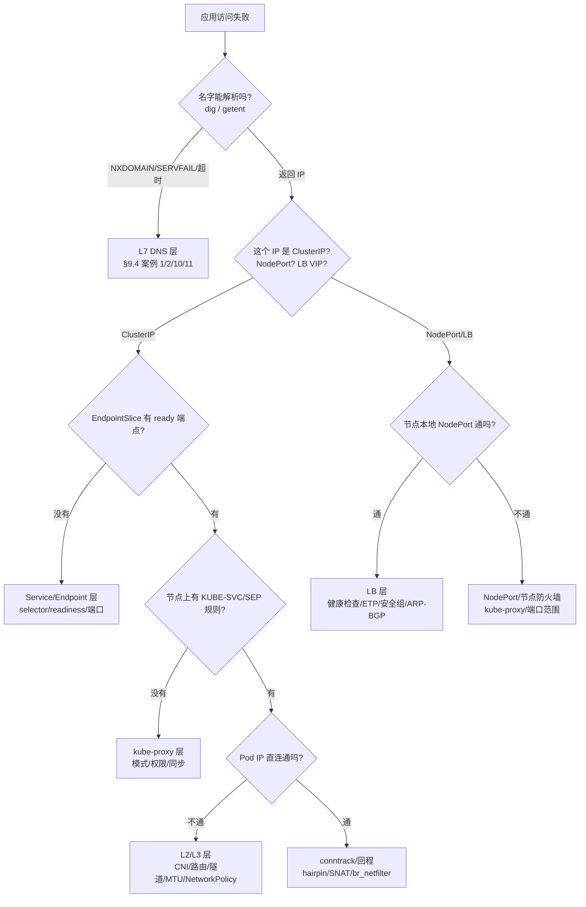

# Kubernetes 网络全链路：Pod、Service、LoadBalancer 与 DNS

一个请求从 Pod 里发出，到被另一个 Pod 处理，中间会经过名字解析、虚拟 IP、DNAT、路由、封装/解封装、可能还有一次 SNAT。**每一跳都由不同的组件编程，也都有独立的失败模式**。本文把这条链路按"四张地址表 + 五层数据面"拆开，逐段说明谁在什么时候改写了什么，最后给出一套按层定位的排障方法。

本文回答"完整路径"和"怎么定位"，不展开某个子系统的全部源码。三篇配套深挖：

- **Pod 网络与 CNI 的实现**（netns、veth、bridge、IPAM、overlay、MTU）→ [CNI 详解](./cni详解.md)
- **Service/kube-proxy/LoadBalancer 的规则生成**（EndpointSlice、iptables/IPVS/nftables、ETP、MetalLB）→ [Service、kube-proxy 与 LoadBalancer](./6_service相关.md)
- **跨集群发现、访问、成员地址与 NAT 穿透**（MCS、Submariner、ClusterMesh）→ [多集群网络互联](./multicluster-networking.md)
- 控制面/数据面故障的处置流程 → [控制面事故处理手册](../Control_Plane/控制面事故处理手册.md)；控制面全挂时数据面还能做什么 → [控制面高可用方案](../Control_Plane/控制面高可用方案.md)

**版本基线**（正文中的行为、默认值、源码行号都固定到这些版本）：

| 项目 | 版本 | commit |
|---|---|---|
| Kubernetes | v1.37.2 | `c50e5395f1ae2d4a2c05f28fdcc38c0916cc1a32` |
| containerd | v2.4.2 | `b7a25261e029d68978bbf290df0a62fc819b3c51` |
| CNI spec | 1.1.0 | `42e11794c073c4a7f3db324a33d266bdd0344e58` |
| CNI plugins | v1.9.x | `0581b4290fe24a283a78195b1f3ec81a9bc26786` |
| CoreDNS（kubeadm 默认镜像 v1.14.6） | 源码 master 1.15.0-dev | `996a30df7f5cca79a3bb34078f8897f673ac74dd` |

> 引用约定：GitHub 链接一律带 40 位 commit 与行号区间（`.../blob/<sha>/<path>#Lx-Ly`），行号已用本地 checkout 核对；官方文档链接为英文原 URL，正文中文。跨集群部分只引用本地已 clone 的 mcs-api / Submariner / Gateway API 仓库与文档，不引用无法核实的二手材料。

---

## 1. 先建立四张地址表

Kubernetes 网络里同时存在四种"地址"，它们的所有者、生命周期和可路由性完全不同。**排障时先问"现在讨论的是哪张地址表"**，能排除一半的误判。

| 地址 | 谁分配 | 持久化在哪 | 谁必须认识它 | 默认可路由？ |
|---|---|---|---|---|
| **Node IP** | 基础设施（DHCP/静态/云网卡） | `Node.status.addresses` | 所有节点、underlay 路由、LB | 是（underlay 内） |
| **Pod IP** | CNI 的 IPAM（地址池来自 Node 的 `PodCIDR`） | `Pod.status.podIP(s)`、EndpointSlice | 本集群节点路由/隧道、CNI、NetworkPolicy | 同集群内是；跨集群取决于互联方案 |
| **ClusterIP（Service VIP）** | kube-apiserver 的 Service IP 分配器，从 `--service-cluster-ip-range` 取 | `Service.spec.clusterIP(s)` | **只有本集群节点的数据面规则** | 否，它是虚拟地址，不存在于任何网卡 |
| **External IP / LB VIP** | 用户（`externalIPs`）、云 LB、MetalLB、kube-vip | `Service.spec.externalIPs`、`Service.status.loadBalancer.ingress` | 集群外客户端、边界路由/ARP/BGP | 是（由外部网络宣告） |
| **DNS 名字** | CoreDNS（数据来自 Service/EndpointSlice） | 无独立存储，`cluster.local` 由 CoreDNS 权威 | 应用、CoreDNS | 不适用（名字→地址） |

几个必须记住的不变量：

1. **Pod IP 的可达性是 CNI 的责任，Service VIP 的可达性是 kube-proxy/CNI 规则的责任**。前者靠路由、BGP 或 overlay；后者靠 DNAT，VIP 本身不需要被路由。
2. **kube-proxy 不转发数据包**。它只 watch Service/EndpointSlice，把"VIP:port → Pod IP:port"写进 iptables/IPVS/nftables；真正的转发是内核 netfilter/IPVS 完成的。eBPF 方案（Cilium）连这套规则都省了，直接在 socket/TC 层做。
3. **同集群 Pod 到 Pod 默认不做 NAT**：源 IP 就是客户端 Pod IP。这是 NetworkPolicy、应用审计和"服务端看到真实客户端"的前提。
4. **ClusterIP 只在"本集群的节点上"有意义**。同一个 `10.96.0.10` 在另一个集群可能也是 kube-dns，但指向完全不同的后端；跨集群必须用独立名字空间（`clusterset.local`）或全局地址（Globalnet），见 [多集群网络互联](./multicluster-networking.md)。
5. **DNS 解析的是 Service 名字，不是 Pod 名字**。普通 Service 返回 ClusterIP；只有 headless（`clusterIP: None`）才返回每个 Pod 的 IP。

地址段的分配者也要分清，否则会去错误的地方找"为什么 Pod 拿不到 IP"：

| 网段 | 分配者 | 配置入口 | 典型值 |
|---|---|---|---|
| Service CIDR | kube-apiserver | `--service-cluster-ip-range` | `10.96.0.0/12` |
| Pod CIDR（每节点一块） | kube-controller-manager 的 NodeIPAM | `--cluster-cidr`、`--allocate-node-cidrs`、`--node-cidr-mask-size` | `10.244.0.0/16`，每节点 `/24` |
| Pod IP（节点内） | CNI 的 IPAM 插件 | CNI 配置文件（`host-local` 的 `ranges` 等） | 来自该节点 PodCIDR |
| ClusterIP | kube-apiserver 的 allocator | 同上 Service CIDR | kubeadm 固定取服务网段第 10 个地址（默认 `10.96.0.10`，[constants.go L675-L689](https://github.com/kubernetes/kubernetes/blob/c50e5395f1ae2d4a2c05f28fdcc38c0916cc1a32/cmd/kubeadm/app/constants/constants.go#L675-L689)） |
| LB VIP | 云控制器/MetalLB/kube-vip | `Service.spec.type=LoadBalancer` + 实现 | 由地址池/云子网决定 |

Service CIDR 的约束在 apiserver 参数注释里写得很清楚：**不得与任何节点或 Pod 网段重叠**（[options.go L123-L125](https://github.com/kubernetes/kubernetes/blob/c50e5395f1ae2d4a2c05f28fdcc38c0916cc1a32/cmd/kube-apiserver/app/options/options.go#L123-L125)）；每个节点的 PodCIDR 由 NodeIPAM 从 `--cluster-cidr` 里切块写回 `Node.spec.podCIDRs`（[cidr_allocator.go L73-L77](https://github.com/kubernetes/kubernetes/blob/c50e5395f1ae2d4a2c05f28fdcc38c0916cc1a32/pkg/controller/nodeipam/ipam/cidr_allocator.go#L73-L77)）。**Kubernetes 核心只负责"声明地址池"，不负责在节点上安装跨节点路由**——路由/隧道是 CNI 的事（例外是云厂商的 `--configure-cloud-routes`）。

---

## 2. 五层模型：每层丢包长得不一样



| 层 | 主要对象 | 典型故障表现 | 第一反应 |
|---|---|---|---|
| L7 | DNS 名字、Ingress/Gateway 路由 | NXDOMAIN、502/504、证书错误、Host 不匹配 | `dig`、Ingress/Gateway 状态与控制器日志 |
| L4 | ClusterIP/NodePort/LB VIP、conntrack | connection refused、超时、只有部分节点通、源 IP 丢失 | EndpointSlice、kube-proxy 规则、LB 健康检查 |
| L3 | Pod IP、节点路由表 | 跨节点不通、同节点通、ping 通但端口不通 | `ip route`、Pod 直连测试、NetworkPolicy |
| L2 | veth/bridge/overlay、MTU | 小包通大包挂、ARP 不通、跨节点丢包 | `ip -d link`、`tcpdump`、`ping -M do` |
| L1 | 网卡、交换机、云网络、安全组 | 全断、单向通、抖动 | `ethtool`、BGP 邻居、云流日志 |

这个分层不是学术分类，而是排障顺序：**先确认"名字解析对不对"，再确认"VIP 有没有 DNAT 到正确的 Pod"，再确认"这个 Pod IP 能不能被到达"，最后才怀疑 underlay**。反过来从下往上查，经常会在一个明明正常的路由表上浪费半小时。

---

## 3. Pod → Pod：第一跳

这是最简单也最容易被忽略的一段：**它没有 Service，也没有 NAT**。

### 3.1 同节点



1. Pod A 的路由表里 `10.244.1.0/24 dev eth0` 是直连，`default via 10.244.1.1` 指向网桥。
2. A 对 `10.244.1.6` 发 ARP；`cni0` 持有 `10.244.1.1`，但目标 IP 不在网桥上，**网桥作为二层设备泛洪 ARP**，Pod B 的 veth 回应自己的 MAC（bridge 的 `isGateway` 让 `cni0` 拥有网关地址，见 [CNI 详解](./cni详解.md)）。
3. 帧从 A 的 veth 进入 host 侧 veth，被 bridge 转发到 B 的 host 侧 veth，再进入 B 的 netns。
4. 反向同理；**源 IP 全程是 `10.244.1.5`**。

关键点：`cni0` 必须持有网关 IP，否则 Pod 的下一跳不可达，表现为"有 IP、能 ping 自己、出不去"。`net.ipv4.ip_forward=1` 和 `net.bridge.bridge-nf-call-iptables=1` 是节点级前置条件：前者由 CNI 的网关模式设置，后者通常由节点准备脚本/发行版设置（K8s 文档要求网络插件负责，但插件实现并不统一）。bridge-nf 关掉时，iptables 看不到桥接流量，hairpin、portmap、部分 NetworkPolicy 会失效。

### 3.2 跨节点：underlay 路由

如果 CNI 选择 native routing（Calico BGP、kube-router、云路由、kindnet 静态路由），节点路由表里会有对端 PodCIDR：

```bash
# 节点 1
ip route
# 10.244.1.0/24 dev cni0 proto kernel scope link src 10.244.1.1
# 10.244.2.0/24 via 172.18.0.3 dev eth0
```

包从 Pod A 出来，经 `cni0` 到节点 1，查表命中 `10.244.2.0/24 via 172.18.0.3`，从 `eth0` 原样发出（**无封装、无 NAT**），节点 2 收到后按 `10.244.2.0/24 dev cni0` 送到 Pod B。整条路径上源/目的 IP 都不变。

BGP 模式下，每个节点把本节点 PodCIDR 宣告给上游/Route Reflector，节点间学到对端路由；Calico 默认就是这套（也可选 VXLAN/IPIP）。静态路由适合小集群/实验环境，节点增减要外部自动化。

### 3.3 跨节点：overlay

如果 CNI 选择 overlay（flannel VXLAN、Calico VXLAN/IPIP、Cilium tunnel），节点之间只需要 IP 可达，Pod 包被封装：

```text
原始:  [Pod A 10.244.1.5] -> [Pod B 10.244.2.6]
VXLAN: [node1 172.18.0.2] -> UDP:8472 -> [node2 172.18.0.3]
       外层 dst 是 node2，内层 dst 仍是 10.244.2.6
```

解封装后节点 2 按内层目的地址把包送到 `cni0`。代价是 **MTU 变小**：VXLAN 在 1500 的 underlay 上通常只能给 Pod 1450（50 字节开销：14 以太 + 20 外层 IP + 8 UDP + 8 VXLAN）。IPIP 是 1480，WireGuard 是 1440（IPv4），具体算法和常见数字见 [CNI 详解](./cni详解.md)。

### 3.4 这一段的抓包点

| 位置 | 命令 | 你应看到 |
|---|---|---|
| Pod A netns | `nsenter -t <pid> -n tcpdump -ni eth0` | src=PodA, dst=PodB，无 NAT |
| 节点 1 host 侧 veth | `tcpdump -ni vethXXXX` | 同上，以太头已换 |
| 节点 1 `cni0` | `tcpdump -ni cni0` | 同节点时能看到双向；跨节点时只看到去程 |
| 节点 1 `eth0` | `tcpdump -ni eth0 host <PodB>` | native：原样；overlay：外层是 node2 |
| 节点 1 隧道口 | `tcpdump -ni flannel.1` / `vxlan.calico` | 内层原始包 |
| 节点 2 `cni0` | `tcpdump -ni cni0` | 解封装后的包 |

如果"Pod A ping 不通 Pod B"，按 A 的 netns → 节点路由 → 对端节点路由 → B 的 netns 四点抓包，比看任何 `kubectl describe` 都快。

---

## 4. Pod → Service：VIP 的魔术

ClusterIP 不是任何网卡上的地址。它之所以能用，是**客户端所在节点的 netfilter 在 PREROUTING/OUTPUT 阶段把目的地址改写成某个 Pod IP**，并由 conntrack 记住这条映射，让回包能反向改写。

### 4.1 一次完整旅程



逐步展开（iptables 模式，源 Pod 与后端在不同节点）：

1. **名字**：应用连的是 `api.default.svc.cluster.local`，不是 IP。DNS 返回 ClusterIP（见 §6）。
2. **发出**：客户端 Pod 的路由表只有 `default via 10.244.1.1 dev eth0`，包（src=PodA，dst=ClusterIP）被送到 `cni0`，进入节点 IP 栈。
3. **PREROUTING**：节点的 `nat` 表 `PREROUTING` 链跳 `KUBE-SERVICES`；其中一条规则匹配 `-d <clusterIP> --dport <port>`，跳到该 ServicePort 的 `KUBE-SVC-<hash>`（服务分发链）。
4. **选端点**：`KUBE-SVC-<hash>` 里每个端点一条规则，前 n-1 条带 `-m statistic --mode random --probability 1/(n-i)`，最后一条保证命中，于是每个端点被选中的概率严格是 `1/n`（[proxier.go L1430-L1474](https://github.com/kubernetes/kubernetes/blob/c50e5395f1ae2d4a2c05f28fdcc38c0916cc1a32/pkg/proxy/iptables/proxier.go#L1430-L1474)）。命中后跳到该端点的 `KUBE-SEP-<hash>`。
5. **DNAT**：`KUBE-SEP-<hash>` 里依次是：
   - `-s <endpointIP> -j KUBE-MARK-MASQ`：**hairpin 保护**，如果源就是端点自己，打上 masquerade mark；
   - `-m recent --name <chain> --set`：会话保持（`sessionAffinity: ClientIP`）；
   - `-m tcp -p tcp -j DNAT --to-destination <podIP>:<targetPort>`（[proxier.go L1212-L1245](https://github.com/kubernetes/kubernetes/blob/c50e5395f1ae2d4a2c05f28fdcc38c0916cc1a32/pkg/proxy/iptables/proxier.go#L1212-L1245)）。
6. **重新路由**：DNAT 发生在 PREROUTING 之后，内核会用新目的地址重新查路由。同节点端点走 `cni0`，跨节点端点走节点路由/隧道。
7. **回包**：端点 Pod 看到的是 `src=客户端 Pod IP`（不是 ClusterIP），回包 `src=PodB, dst=PodA`。回包经过**做 DNAT 的那台节点**的 conntrack，目的/源被反向改写，客户端看到的对端仍然是 `10.96.0.10:80`。
8. **SNAT**：只有需要时才做。`KUBE-POSTROUTING` 里按 fwmark 匹配，`MASQUERADE --random-fully`（[proxier.go L740-L757](https://github.com/kubernetes/kubernetes/blob/c50e5395f1ae2d4a2c05f28fdcc38c0916cc1a32/pkg/proxy/iptables/proxier.go#L740-L757)）。

最终客户端看到的连接是 `PodA:ephemeral → 10.96.0.10:80`，后端看到的是 `PodA:ephemeral → PodB:8080`。**两端看到的是不同的四元组**，这正是 conntrack 存在的意义。

### 4.2 规则长什么样

真实环境里 `iptables-save -t nat` 的关键片段（链名中的 hash 因集群而异，其余结构一致）：

```text
-A PREROUTING -m comment --comment "kubernetes service portals" -j KUBE-SERVICES
-A OUTPUT     -m comment --comment "kubernetes service portals" -j KUBE-SERVICES
-A POSTROUTING -m comment --comment "kubernetes postrouting rules" -j KUBE-POSTROUTING

-A KUBE-SERVICES -d 10.96.0.10/32 -p tcp -m comment --comment "default/kubernetes:https cluster IP" -m tcp --dport 443 -j KUBE-SVC-XXXX
-A KUBE-SVC-XXXX -m comment --comment "default/api:http -> 10.244.2.6:8080" -m statistic --mode random --probability 0.5000000000 -j KUBE-SEP-AAAA
-A KUBE-SVC-XXXX -m comment --comment "default/api:http -> 10.244.2.7:8080" -j KUBE-SEP-BBBB

-A KUBE-SEP-AAAA -s 10.244.2.6/32 -j KUBE-MARK-MASQ
-A KUBE-SEP-AAAA -p tcp -m tcp -j DNAT --to-destination 10.244.2.6:8080

-A KUBE-POSTROUTING -m mark ! --mark 0x4000/0x4000 -j RETURN
-A KUBE-POSTROUTING -j MARK --xor-mark 0x4000
-A KUBE-POSTROUTING -m comment --comment "kubernetes service traffic requiring SNAT" -j MASQUERADE --random-fully
```

`KUBE-SVC-*` 是"分发"，`KUBE-SEP-*` 是"落点"，`KUBE-MARK-MASQ` 只是打标记，真正的 SNAT 在 `KUBE-POSTROUTING`。这个结构让 kube-proxy 可以增量更新单个链，而不必重写整张表。

### 4.3 回包为什么能还原：`bridge-nf-call-iptables` 的隐藏作用

同节点 Pod→Service→Pod 时（**bridge 型 CNI**），请求被 DNAT 后从 `cni0` 送到后端 Pod；后端的回包因为同网段，是**二层桥接**回客户端的，不经过节点 IP 路由。那 conntrack 怎么看到它？

答案是 `net.bridge.bridge-nf-call-iptables=1`：它让桥接的 IPv4 帧也经过 netfilter 的 PREROUTING/FORWARD/POSTROUTING 钩子，conntrack 因而能反向改写回包。**这个 sysctl 关掉时，同节点 Service 访问会出现"SYN 发出去了、对端也回了、客户端就是连不上"**——因为客户端收到的是 `src=PodB` 而不是 `src=ClusterIP`，内核直接丢弃。跨节点访问反而不受影响（回包本来就走路由）；ptp 型 CNI 因为强制所有流量经网关，也不依赖这一条。这类"半通"是分层排障里最值得记住的案例之一。

### 4.4 hairpin：什么时候需要 SNAT

"hairpin"指客户端经过 Service 又回到自己（源 IP == 端点 IP）。此时如果不做 SNAT，端点会收到一个 `src == 自己的 IP` 的包，内核会把它当成 martian/本地回环处理，连接建立失败。`KUBE-SEP-*` 里的 `-s <endpointIP> -j KUBE-MARK-MASQ` 就是为这个场景准备的：把源改成节点 IP，回包先回节点，再由 conntrack 还原成 ClusterIP。

注意区分两种情况：

- **Pod → Service → 另一个同节点 Pod**：源不是端点，不需要这条 hairpin SNAT；bridge 型 CNI 的回包靠 `bridge-nf-call-iptables` 进 conntrack 还原。
- **Pod → Service → 自己**（例如 sidecar 通过 Service 访问同 Pod 的主容器，或应用连自己的 Service）：源 == 端点，必须 SNAT。

另外，节点本机进程访问 ClusterIP（`OUTPUT` 链）也走同一套规则；如果 `masqueradeAll=true`，所有 ClusterIP 访问都会 SNAT，便于"静态路由把 Service 网段指到任意节点"的部署方式。

### 4.5 没有端点、headless、ExternalName

| 情况 | 数据面行为 | 现象 |
|---|---|---|
| Service 无任何 ready 端点 | kube-proxy 在 **filter** 表对 ClusterIP `REJECT`（不是 nat 表 DNAT） | `connection refused`（快速失败），而不是超时 |
| `externalTrafficPolicy: Local` 但本节点无端点 | filter 表 `DROP` | 外部流量超时；集群内访问仍可能走 Cluster 语义 |
| headless（`clusterIP: None`） | `ShouldSkipService` 直接跳过，不生成任何 VIP 规则（[utils.go L56-L70](https://github.com/kubernetes/kubernetes/blob/c50e5395f1ae2d4a2c05f28fdcc38c0916cc1a32/pkg/proxy/util/utils.go#L56-L70)） | DNS 直接返回 Pod IP，客户端自己负载均衡 |
| `ExternalName` | 同样跳过；DNS 返回 CNAME | 客户端解析到外部域名，不经过集群网络 |

"无端点"用 `REJECT` 还是 `DROP` 是有意的：前者让客户端立刻得到 `ECONNREFUSED`，后者用于"这个节点不该接这类流量"的场景（ETP=Local）。排障时看到 `connection refused` 先查 EndpointSlice，看到超时先查 ETP/路由。

### 4.6 IPVS、nftables、eBPF：同一件事的三种实现

| 实现 | 数据结构 | 查找复杂度 | 关键差异 |
|---|---|---|---|
| **iptables** | 每个 ServicePort 一条 `KUBE-SVC` 链 + 每端点一条 `KUBE-SEP` 链 | O(链数)，大集群规则多 | 默认模式；规则可读、可用 `iptables-save` 审计 |
| **IPVS** | 内核 hash 表：VirtualServer + RealServer | O(1) | 需要 `kube-ipvs0` dummy 接口持有 ClusterIP；仍用 iptables 做 SNAT/filter |
| **nftables** | 单表 `kube-proxy` + verdict map/set | O(1) 级 | 1.33 GA；用 map 代替每服务链，hairpin 用 conntrack 状态精确判断 |
| **eBPF（Cilium）** | eBPF map + socket/TC hook | O(1) | 可完全替代 kube-proxy；socket-level LB、DSR；没有 VIP 的 iptables 规则 |

**IPVS**：每个 ServicePort 建一个 `VirtualServer{Address: clusterIP, Port, Scheduler}`，`sessionAffinity=ClientIP` 时加 `FlagPersistent` + timeout（[proxier.go L829-L846](https://github.com/kubernetes/kubernetes/blob/c50e5395f1ae2d4a2c05f28fdcc38c0916cc1a32/pkg/proxy/ipvs/proxier.go#L829-L846)）。因为 IPVS 只处理"目的地址是本机地址"的流量，必须把每个 ClusterIP 绑到 dummy 设备 `kube-ipvs0`（默认名，[proxier.go L95](https://github.com/kubernetes/kubernetes/blob/c50e5395f1ae2d4a2c05f28fdcc38c0916cc1a32/pkg/proxy/ipvs/proxier.go#L95-L95)）。副作用是这些 IP 会响 ARP，需要 `arp_ignore=1`/`arp_announce=2`（StrictARP）。**IPVS 在 1.37 已弃用：1.40 默认关闭，1.43 移除，启动时会打 `IPVSDeprecation` Warning Event**（[server_linux.go L190-L194](https://github.com/kubernetes/kubernetes/blob/c50e5395f1ae2d4a2c05f28fdcc38c0916cc1a32/cmd/kube-proxy/app/server_linux.go#L190-L194)）。

**nftables**：整张表叫 `kube-proxy`，用 `service-ips` map 把 `IP:port` 映射到判定（verdict），用 `hairpin-connections` set 精确识别 hairpin，MASQUERADE 带 `fully-random`（[proxier.go L61-L107](https://github.com/kubernetes/kubernetes/blob/c50e5395f1ae2d4a2c05f28fdcc38c0916cc1a32/pkg/proxy/nftables/proxier.go#L61-L107)、[L532-L545](https://github.com/kubernetes/kubernetes/blob/c50e5395f1ae2d4a2c05f28fdcc38c0916cc1a32/pkg/proxy/nftables/proxier.go#L532-L545)）。`NFTablesProxyMode` 在 1.33 GA 并锁默认，但 **kube-proxy 的默认模式仍是 iptables**（[server_linux.go L49-L52](https://github.com/kubernetes/kubernetes/blob/c50e5395f1ae2d4a2c05f28fdcc38c0916cc1a32/cmd/kube-proxy/app/server_linux.go#L49-L52)），要用 nftables 得显式 `--mode=nftables`。

**eBPF**：Cilium 在 socket `connect()` 时就把 ClusterIP 替换成后端 Pod IP（socket-level LB），或在 TC ingress 做 DNAT；因此节点上根本没有 `KUBE-SVC` 链。它还能做 DSR（回程绕过 LB），但要求网络能接受"目的地址不是本机"的包。选型时要注意：**eBPF 替代的是 kube-proxy 的数据面，不是 Service API**；Service/EndpointSlice 对象仍然存在。

### 4.7 为什么"改了 Service 没生效"

一条 Service 变更到达数据面要经过：

```text
kubectl apply → apiserver/etcd → endpointslice-controller 计算端点
  → kube-proxy watch 到 Service/EndpointSlice → 累积到 tracker
  → syncProxyRules（默认 minSyncPeriod=1s，兜底 syncPeriod=30s）
  → 写入 iptables/IPVS/nftables
```

几个常见的"看起来没生效"：

1. **已有连接不会迁移**。TCP 连接建立时 conntrack 已经记住 DNAT 目标，改 EndpointSlice 只影响新连接；要等连接自然断开或主动断开。UDP 更久（conntrack timeout）。
2. **端点还没 Ready**。EndpointSlice 的 `ready` 由 Pod Ready condition + `publishNotReadyAddresses` 决定；Pod 刚启动时可能 `serving=true, terminating=false, ready=false`，不会被选中（[utils.go L38-L50](https://github.com/kubernetes/kubernetes/blob/c50e5395f1ae2d4a2c05f28fdcc38c0916cc1a32/staging/src/k8s.io/endpointslice/utils.go#L38-L50)）。
3. **旧 conntrack 指向已删除的 Pod**。kube-proxy 对 **UDP** Service 有专门的 `CleanStaleEntries`，因为 UDP 单向流会不断刷新 conntrack 超时，不清理就会永久打到已删除的 IP（[cleanup.go L88-L105](https://github.com/kubernetes/kubernetes/blob/c50e5395f1ae2d4a2c05f28fdcc38c0916cc1a32/pkg/proxy/conntrack/cleanup.go#L88-L105)）。
4. **kube-proxy 卡住**。看 `kubeproxy_sync_proxy_rules_last_timestamp_seconds` 是否推进；不推进就是 proxier 卡死/权限问题，而不是 Service 写错了。

### 4.8 端点从哪来：EndpointSlice 的 ready/serving/terminating

kube-proxy 不直接看 Pod，它看 `discovery.k8s.io/v1` 的 EndpointSlice。EndpointSlice 控制器把 Pod 翻译成端点：

```go
serving := endpointutil.IsPodReady(pod)
terminating := pod.DeletionTimestamp != nil
ready := service.Spec.PublishNotReadyAddresses || (serving && !terminating)
```

（[utils.go L38-L50](https://github.com/kubernetes/kubernetes/blob/c50e5395f1ae2d4a2c05f28fdcc38c0916cc1a32/staging/src/k8s.io/endpointslice/utils.go#L38-L50)）

- `serving`：Pod 的 Ready condition；
- `terminating`：正在删除；
- `ready`：既 serving 又没在删除，或被 `publishNotReadyAddresses` 强制为 true。

kube-proxy 消费时会做一次 `CategorizeEndpoints`：优先 ready；ready 为空时回退到 **serving + terminating**（优雅下线期间仍接流量），并处理 topology hints（[topology.go L48-L70](https://github.com/kubernetes/kubernetes/blob/c50e5395f1ae2d4a2c05f28fdcc38c0916cc1a32/pkg/proxy/topology.go#L48-L70)）。这就是为什么"Pod 已经 Terminating，但 Service 还有流量"是正常的，也是为什么"缩容时新连接可能打到正在退出的 Pod"。

单个 EndpointSlice 默认最多 100 个端点（`MaxEndpointsPerSlice`，[defaults.go L38-L39](https://github.com/kubernetes/kubernetes/blob/c50e5395f1ae2d4a2c05f28fdcc38c0916cc1a32/pkg/controller/endpointslice/config/v1alpha1/defaults.go#L38-L39)），超过就切成多个切片；kube-proxy 把所有切片合并成 `ServicePortName → EndpointsMap`。

---

## 5. 外部 → Service：NodePort、LoadBalancer、Ingress

从集群外进来，入口不止一种。它们的区别不只是"端口"，而是**谁做第一跳 DNAT、源 IP 是否保留、健康检查由谁做**。

### 5.1 四条外部路径



**① NodePort**：每个节点在 `30000-32767` 上接受同一个端口（kube-proxy 只写 DNAT 规则，不真正 bind 这个端口）。包到 `nodeIP:30080` 后，nat PREROUTING 进 `KUBE-SERVICES`，最后一条规则匹配 `--dst-type LOCAL` 跳到 `KUBE-NODEPORTS`，再按 `--dport` 进该服务的 `KUBE-EXT-*`/`KUBE-SVC-*` 链（[proxier.go L1275-L1315](https://github.com/kubernetes/kubernetes/blob/c50e5395f1ae2d4a2c05f28fdcc38c0916cc1a32/pkg/proxy/iptables/proxier.go#L1275-L1315)）。默认 `externalTrafficPolicy: Cluster` 会对来自外部的流量打 masquerade mark，POSTROUTING 做 SNAT 成节点 IP；**源 IP 丢失**。

**② L4 LoadBalancer**：云 LB 或 MetalLB 把 VIP 流量送到节点（通常是 NodePort），再由 kube-proxy 做第二跳 DNAT。`status.loadBalancer.ingress[].ipMode` 区分 `VIP` 与 `Proxy`：`Proxy` 表示流量到达节点时目的地址已经被换成 nodeIP/podIP，kube-proxy 不应再为该 IP 装 VIP 规则（[types.go L8857-L8867](https://github.com/kubernetes/kubernetes/blob/c50e5395f1ae2d4a2c05f28fdcc38c0916cc1a32/staging/src/k8s.io/api/core/v1/types.go#L8857-L8867)）。

**③ Ingress**：外部 LB → Ingress Controller（本身是一个 Deployment/DaemonSet，通过 `type: LoadBalancer` 或 `hostPort`/`hostNetwork` 暴露）→ 按 Host/Path 路由到后端 Service → Pod。**Ingress 不实现转发，只是配置对象**；数据面在 controller（nginx/envoy/traefik…）。TLS 通常在 controller 终止，`X-Forwarded-For` 由 controller 追加。

**④ Gateway API**：`GatewayClass`（谁实现）+ `Gateway`（监听器/地址/允许的路由）+ `HTTPRoute` 等（匹配/过滤/backendRefs）。它是 Ingress 的继任者，角色分离更彻底：基础设施团队管 Gateway，应用团队管 Route。`Gateway.status.addresses` 才是实际绑定的地址，`spec.addresses` 只是请求（[gateway_types.go L1098-L1150](https://github.com/kubernetes-sigs/gateway-api/blob/d04e7458ee15351ca54a201c4b1c43412f917b91/apis/v1/gateway_types.go#L1098-L1150)）。

### 5.2 源 IP 与端点选择：一张表看清

| 路径 | 默认源 IP | 只选本地端点？ | 健康检查 | 无可用端点时 |
|---|---|---|---|---|
| ClusterIP（集群内） | Pod IP | 否（可用 `internalTrafficPolicy: Local`） | 无 | 无任何端点 REJECT；ITP=Local 无本地端点 DROP |
| NodePort（ETP=Cluster） | 节点 IP（SNAT） | 否 | 无 | 无任何端点 REJECT |
| NodePort（ETP=Local） | 客户端 IP（不 SNAT） | 是 | 无 | 无本地端点 DROP |
| LoadBalancer（ETP=Cluster） | 节点 IP | 否 | LB → NodePort | 无任何端点 REJECT |
| LoadBalancer（ETP=Local） | 客户端 IP | 是 | LB → `healthCheckNodePort`（200/503） | 无本地端点 DROP + LB 摘节点 |
| Ingress | 客户端 IP 在 `X-Forwarded-For`；TCP 层是 controller IP | controller 自己决定 | LB → controller | controller 返回 502/503 |
| Gateway | 由实现决定，通常在转发头里 | Route 的 backendRefs | 实现相关 | 实现相关 |

`externalTrafficPolicy: Local` 的四件事必须一起理解：

1. **不 SNAT**，源 IP 保留；
2. **只把流量发给本节点的端点**（`KUBE-SVL-*` 链）；
3. 本节点没有端点时 **filter 表 DROP**（不是 REJECT），所以表现为超时；
4. 必须配合 `healthCheckNodePort`：kube-proxy 自己在那个端口起 HTTP server，`/healthz` 返回本地 ready 端点数量，0 个就 503（[service_health.go L241-L272](https://github.com/kubernetes/kubernetes/blob/c50e5395f1ae2d4a2c05f28fdcc38c0916cc1a32/pkg/proxy/healthcheck/service_health.go#L241-L272)），LB 据此把节点摘掉。

还有一个容易踩的语义：**从集群内部访问 LB IP / ExternalIP 时，总是走 Cluster 语义**（源码注释明确写了这一点，[types.go L6391-L6404](https://github.com/kubernetes/kubernetes/blob/c50e5395f1ae2d4a2c05f28fdcc38c0916cc1a32/staging/src/k8s.io/api/core/v1/types.go#L6391-L6404)）。是否 SNAT 取决于 ETP 和来源（ETP=Cluster 时会 SNAT 成节点 IP；ETP=Local 的 Pod 来源可能保留 Pod IP），所以**不要用 Pod 里的 `curl` 验证外部客户端的源 IP 行为**。

### 5.3 MetalLB：L2 与 BGP 的差别

自建集群没有云 LB，MetalLB 是最常见的实现。它分两个组件：controller 只做 **IP 分配 + 写 `status.loadBalancer.ingress`**（[service.go L120-L222](https://github.com/metallb/metallb/blob/0db4a44c098f71b6c18e2be34e73e67d8a39c20b/controller/service.go#L120-L222)），speaker 在每个节点做 **数据面宣告**。

- **L2 模式（ARP/NDP）**：同一个 VIP 在任意时刻**只有一个节点应答 ARP**。speaker 用 `sha256(node + "#" + ip)` 做确定性排序，第一个节点当选（[layer2_controller.go L88-L134](https://github.com/metallb/metallb/blob/0db4a44c098f71b6c18e2be34e73e67d8a39c20b/speaker/layer2_controller.go#L88-L134)）。所以 L2 是 **per-VIP active-passive**：吞吐上限是单节点网卡，故障切换靠免费 ARP 重新收敛，秒级。
- **BGP 模式**：多个节点可以同时宣告同一个 `/32`，上游路由器做 ECMP，是真正的多活；ETP=Local 时只宣告"有本地健康端点"的节点（[bgp_controller.go L155-L198](https://github.com/metallb/metallb/blob/0db4a44c098f71b6c18e2be34e73e67d8a39c20b/speaker/bgp_controller.go#L155-L198)）。

选型很直接：要源 IP + 高吞吐 + 有 BGP 网络 → BGP；没有 BGP、能接受秒级切换 → L2。DSR（Direct Server Return）是第三条路：回程绕过 LB，但要求后端能接受目的地址非本机的包（kube-vip 等实现提供）。

### 5.4 Ingress 的 502/504 分别是谁的问题

| 状态 | 通常含义 | 先查 |
|---|---|---|
| 502 Bad Gateway | controller 连不上/收到非法响应（后端 Pod 拒绝、端口错、协议错） | `kubectl get endpointslice`、后端 Service 端口、controller 到 Pod 的直连 |
| 503 Service Unavailable | controller 没有可用后端（EndpointSlice 为空） | Service selector、Pod readiness、`publishNotReadyAddresses` |
| 504 Gateway Timeout | controller 连上了但后端超时 | 后端处理时间、NetworkPolicy、MTU、连接池 |
| 404 | Host/Path 没匹配到规则 | Ingress `host`/`pathType`、`ingressClassName` |
| TLS 错误 | 证书/Host/SNI 不匹配 | `spec.tls`、Secret、controller 的默认证书 |

Ingress 这一跳是 L7，意味着**它可以看到 Host/Path，但也意味着它多了一次完整的 TCP/TLS 处理**。不要把"Ingress 能通"当成"Service 一定没问题"：controller 到后端 Service 仍然是 §4 的那条路径。

---

## 6. DNS：名字如何变成地址

DNS 是整条链路的"第 0 跳"。它坏掉时，应用甚至不会发出任何业务包；它慢时，业务会表现为"偶发超时"而不是"连不上"。

### 6.1 `/etc/resolv.conf` 是 kubelet 生成的

kubelet 的 `GetPodDNS` 按 `dnsPolicy` 生成 CRI 的 `DNSConfig`，容器运行时把它写进容器的 `/etc/resolv.conf`（[dns.go L385-L450](https://github.com/kubernetes/kubernetes/blob/c50e5395f1ae2d4a2c05f28fdcc38c0916cc1a32/pkg/kubelet/network/dns/dns.go#L385-L450)）。四种策略：

| dnsPolicy | 行为 | 适用 |
|---|---|---|
| `ClusterFirst`（默认） | nameserver 只放 `--cluster-dns`（kube-dns ClusterIP），search = 集群三域 + 宿主机 search，options = `ndots:5` | 绝大多数 Pod |
| `ClusterFirstWithHostNet` | 同上，即使 `hostNetwork: true` 也用集群 DNS | hostNetwork 且需要解析 Service 的 Pod |
| `Default` | 继承节点 `/etc/resolv.conf`，不注入 `ndots:5` | 需要和节点一致解析的 Pod |
| `None` | 清空基础配置，完全由 `dnsConfig` 指定 | 自定义 DNS |

`hostNetwork: true` + `ClusterFirst` 会**回退成 Default**（[dns.go L304-L323](https://github.com/kubernetes/kubernetes/blob/c50e5395f1ae2d4a2c05f28fdcc38c0916cc1a32/pkg/kubelet/network/dns/dns.go#L304-L323)），这是"hostNetwork Pod 解析不了 Service"的最常见原因。

ClusterFirst 的 search 拼接顺序是：

```text
<namespace>.svc.cluster.local
svc.cluster.local
cluster.local
<宿主机 search 域...>
```

（[dns.go L165-L175](https://github.com/kubernetes/kubernetes/blob/c50e5395f1ae2d4a2c05f28fdcc38c0916cc1a32/pkg/kubelet/network/dns/dns.go#L165-L175)）

并且 **Options 被整体替换为 `ndots:5`**，宿主机 resolv.conf 里的 `timeout`/`attempts`/`rotate` 会丢失，回到 libc 默认（timeout 5s、attempts 2）。这是"DNS 卡 10–30 秒"的隐藏原因之一。

### 6.2 `ndots:5` 的代价

`ndots:n` 的规则是：查询名里的点数 **≥ n** 时先查绝对名，否则先按 search 列表逐个拼接，最后才查绝对名。`ndots:5` + 3 个集群域 + N 个宿主机域，意味着解析一个外部域名 `api.example.com`（2 个点）会先发出：

```text
api.example.com.<ns>.svc.cluster.local     NXDOMAIN
api.example.com.svc.cluster.local          NXDOMAIN
api.example.com.cluster.local              NXDOMAIN
api.example.com.<host-search-1>            NXDOMAIN（可能发到上游！）
api.example.com.<host-search-2>            NXDOMAIN
api.example.com.                           ← 真正成功
```

集群域内的 NXDOMAIN 由 CoreDNS 本地权威回答，代价小；**真正危险的是宿主机 search 域**：它会把内部域名结构泄漏给上游 resolver，上游丢包时 5 次超时叠加 `timeout:5 attempts:2` 可以放大到几十秒。缓解手段：

- 应用使用 **FQDN + 尾点**（`api.example.com.`），完全跳过 search；
- `dnsConfig.options: [{name: ndots, value: "2"}]` 覆盖默认（注意会让 `data.prod` 这类"部分限定名"变慢）；
- 用 NodeLocal DNSCache 降低 RTT；
- 在 CoreDNS 侧用 `cache`/`autopath`（`autopath` 未进默认 Corefile，且要求 `pods verified`，内存/API 压力大）。

复现时注意：`dig` **默认不应用 search list**，`nslookup` 会，`getent hosts` 才走完整 NSS 链路。用 `dig` 测出"很快"不代表应用视角没问题。

### 6.3 一次解析的完整路径



kube-dns 是一个普通的 ClusterIP Service（端口 53/udp、53/tcp、9153/tcp），CoreDNS 是它后面的 Deployment；因此 **DNS 查询本身也要经过 §4 的 Service DNAT 路径**。这带来一个重要的推论：如果 kube-proxy 或 CNI 坏了，DNS 会跟着坏；反过来，DNS 坏不一定说明 Service 坏。

### 6.4 CoreDNS 的默认行为

kubeadm 渲染的 Corefile（[manifests.go L162-L196](https://github.com/kubernetes/kubernetes/blob/c50e5395f1ae2d4a2c05f28fdcc38c0916cc1a32/cmd/kubeadm/app/phases/addons/dns/manifests.go#L162-L196)）：

```text
.:53 {
    errors
    health { lameduck 5s }
    ready
    kubernetes cluster.local in-addr.arpa ip6.arpa {
       pods insecure
       fallthrough in-addr.arpa ip6.arpa
       ttl 30
    }
    prometheus :9153
    forward . /etc/resolv.conf { max_concurrent 1000 }
    cache 30 {
       disable success cluster.local
       disable denial cluster.local
    }
    loop
    reload
    loadbalance
}
```

几个值得注意的点：

- **`cache 30` 对 `cluster.local` 关闭了 success/denial 缓存**：Service 刚创建就查询，不会因为负缓存而持续 NXDOMAIN。很多"Service 建了但 DNS 还不通"的问题，正是自定义 Corefile 时误开了缓存。
- **`kubernetes` 的 `ttl 30`**：默认插件 TTL 是 5s，kubeadm 显式改成 30s；headless 的 per-Pod 记录也跟随这个 TTL。
- **`pods insecure`**：允许 `<pod-ip-dashed>.<ns>.pod.cluster.local` 反查，兼容老应用；`verified` 会校验 Pod 是否存在，但需要 watch Pod，开销更大。
- **`forward . /etc/resolv.conf`**：CoreDNS 自己的 `dnsPolicy: Default`，避免用集群 DNS 解析自己造成环。
- **`loop` 插件**：启动时向自己发 HINFO 探针，发现环就 `log.Fatalf` 退出（[loop.go L33-L58](https://github.com/coredns/coredns/blob/996a30df7f5cca79a3bb34078f8897f673ac74dd/plugin/loop/loop.go#L33-L58)），表现为 CrashLoopBackOff。根因通常是节点 `/etc/resolv.conf` 指向 `127.0.0.53`（systemd-resolved stub）。
- **未同步时返回 SERVFAIL**：kubernetes 插件 5s 内没同步完，先对外服务但集群记录返回 SERVFAIL（[handler.go L69-L72](https://github.com/coredns/coredns/blob/996a30df7f5cca79a3bb34078f8897f673ac74dd/plugin/kubernetes/handler.go#L69-L72)）。

### 6.5 记录类型

| 查询 | 记录 | 说明 |
|---|---|---|
| `api.default.svc.cluster.local` | A/AAAA = ClusterIP | 普通 Service，每个 `clusterIPs` 一条 |
| `headless.default.svc.cluster.local` | A/AAAA = 每个 ready Pod IP | headless；`publishNotReadyAddresses` 决定是否包含未 ready |
| `<pod-hostname>.<svc>.<ns>.svc.cluster.local` | A = 该 Pod IP | 需要 headless + Pod `hostname`/`subdomain`（StatefulSet 自动设置） |
| `_http._tcp.api.default.svc.cluster.local` | SRV | 端口 + 目标名；headless 时目标是各 Pod FQDN |
| `external.default.svc.cluster.local` | CNAME | `ExternalName` |
| `<ip>.in-addr.arpa` | PTR | 反向解析 |

StatefulSet 的 `<pod>.<svc>.<ns>.svc.cluster.local` 来自 controller 把 `spec.hostname` 设为 Pod 名、`spec.subdomain` 设为 `serviceName`（[stateful_set_utils.go L446-L450](https://github.com/kubernetes/kubernetes/blob/c50e5395f1ae2d4a2c05f28fdcc38c0916cc1a32/pkg/controller/statefulset/stateful_set_utils.go#L446-L450)），再由 EndpointSlice 的 `hostname` 字段带到 CoreDNS。

### 6.6 NodeLocal DNSCache 解决的两个问题

NodeLocal DNSCache 在每个节点上跑一个缓存 DNS（hostNetwork + `dnsPolicy: Default`），Pod 的 nameserver 指向链路本地地址 `169.254.20.10`：

1. **消除 DNAT/conntrack 抖动**：Pod 到 169.254.20.10 是本机流量，不出节点；CoreDNS 滚动更新时不会因为 conntrack 里旧的 DNAT 映射丢回包。
2. **降低延迟与 CoreDNS 负载**：节点级缓存命中，不必每个查询都跨节点。

它到上游默认 `force_tcp`：TCP 连接关闭即回收 conntrack，避免 UDP 的 30s 超时尾延迟；同时恢复负缓存（denial TTL 5s）。代价是 **缓存陈旧**：Service 删除重建后，最长约 30s 仍可能拿到旧 ClusterIP（success TTL 30s）。另外，node-cache 容器被 OOMKill 后已下发的 iptables 规则可能残留，造成短暂 DNS 全断，内存 limit 要按节点规模设置，不能照抄小集群的值。

### 6.7 DNS 故障速查

| 现象 | 最可能原因 | 下一步 |
|---|---|---|
| `NXDOMAIN` | 名字写错/namespace 错/headless 无 ready Pod/`ignore empty_service` | 用全名 `<svc>.<ns>.svc.cluster.local` 测；查 EndpointSlice |
| `SERVFAIL` | CoreDNS 未同步、RBAC 缺 `endpointslices`、上游不可达、`max_concurrent` 打满 | 看 CoreDNS 日志、`/ready`、`coredns_forward_max_concurrent_rejects_total` |
| 超时 | 到 ClusterIP 的路径断了（DNAT/conntrack/NetworkPolicy/CoreDNS 全挂） | 节点抓 `port 53`；查 kube-proxy 规则 |
| 解析慢但能通 | `ndots:5` + 宿主机 search 泄漏 | `getent hosts` 复现；用 FQDN 或调 `ndots` |
| 只有 hostNetwork Pod 解析不了 | `ClusterFirst` 回退成了 `Default` | 改 `ClusterFirstWithHostNet` |
| CoreDNS CrashLoop | `loop` 检测到环（节点 resolv.conf 指向 127.0.0.53）或 OOMKilled | 看日志首行、`kubectl describe` 的 Last State |

---

## 7. 出集群：NAT 与 egress

Pod 访问集群外时，源地址必须被改成外部网络认识的地址，否则回包找不到 10.244.x.x。这件事**不是 kube-proxy 做的**：

| 流量 | 谁做 SNAT | 源 IP 变成 |
|---|---|---|
| Pod → 集群外 | CNI 的 ipMasq（bridge 的 `ipMasq: true`、Calico `natOutgoing`、kindnet ipMasqAgent） | 节点 IP |
| Pod → ClusterIP（跨节点/hairpin） | kube-proxy 的 `KUBE-POSTROUTING`（按 fwmark） | 节点 IP |
| Pod → 外部，经云 NAT 网关 | 云网络 | NAT 网关 IP |
| Pod → 外部，经 egress gateway | Cilium/Calico egress gateway | 专用 egress 节点 IP |
| IPv6 Pod → 外部 | 默认不做 NAT66（除非 NPTv6/显式配置） | Pod IPv6 |

conntrack 是这条路径的状态载体：SNAT 只对首包生效，回包靠 conntrack 反向转换。**如果回包没有经过同一台做 SNAT 的节点，连接就建立不起来**——这是非对称路由/多出口场景的经典故障。

`--random-fully` 让 MASQUERADE 随机选择源端口，降低"同一节点大量 Pod 连同一目标"时的端口冲突和 conntrack 插入失败。kube-proxy 的 Service SNAT 默认开启；CNI 的 `ipMasq` 链通常**没有**这个选项，大规模 egress 要单独评估 `nf_conntrack_max` 和源端口范围。

Egress gateway 的代价要提前想清楚：外部看到的是固定节点 IP，不是 Pod IP；任何基于 Pod CIDR 的 `ipBlock`、审计、限流都会失配；返回流量必须回到同一台 egress 节点。需要保留 Pod 源 IP 时，不能用节点级 SNAT，只能走 DSR/TPROXY、应用层代理或支持源 IP 保留的 CNI 特性。

---

## 8. 证据地图：每一跳去哪看

排障的核心不是"背命令"，而是**知道某个现象应该在哪一层留下证据**。

| 层/位置 | 看什么 | 命令 | 正常长什么样 |
|---|---|---|---|
| 应用/Pod netns | 地址、路由、resolv.conf | `nsenter -t <pid> -n ip -br addr; ip route; cat /etc/resolv.conf` | `eth0` 有 Pod IP；default via 网关；nameserver=kube-dns |
| Pod → Pod | 直连是否通 | `kubectl exec <pod> -- ping <peerPodIP>`；`nc -vz` | 通，且对端看到的是 Pod IP |
| 节点 veth/bridge | 链路、MTU、peer | `ip -d link show type veth`；`ip -d link show cni0`；`bridge link` | veth 的 peer 在正确 netns；cni0 有网关 IP |
| 节点路由 | 跨节点 PodCIDR | `ip route`；`ip route get <podIP>` | 有对端 PodCIDR 的 via/隧道；`get` 命中正确接口 |
| 隧道 | 封装/MTU | `ip -d link show vxlan.calico/flannel.1`；`tcpdump -ni <tun>` | MTU 比 underlay 小 50/20/60；内层包正确 |
| Service 规则 | DNAT/概率/SNAT | `iptables-save -t nat`；`ipvsadm -Ln`；`nft list ruleset` | 有 `KUBE-SVC`/`KUBE-SEP` 或 virtual server；概率和端点正确 |
| conntrack | 双向映射、状态 | `conntrack -L`；`conntrack -L -p udp` | 能看到 original/reply 两段；`ESTABLISHED`/`ASSURED` |
| EndpointSlice | 端点与 ready | `kubectl get endpointslice -o wide`；`kubectl get endpointslice -o yaml` | 端点 IP/端口正确；conditions.ready=true |
| kube-proxy | 同步延迟/卡住 | `kubectl -n kube-system logs -l k8s-app=kube-proxy`；metrics `kubeproxy_sync_proxy_rules_last_timestamp_seconds` | 时间戳持续推进；无 `Sync failed` |
| LB/MetalLB | VIP 宣告/健康检查 | `kubectl get svc -o yaml`；`kubectl -n metallb-system logs ds/speaker`；`ip neigh` | `status.loadBalancer.ingress` 有 IP；ARP/BGP 正常 |
| Ingress/Gateway | 路由/证书 | `kubectl describe ingress/gateway/httproute`；controller 日志 | `ADDRESS` 已分配；规则匹配；证书有效 |
| DNS | 解析结果/延迟 | `dig @<clusterDNS> <name> +short`；`getent hosts`；`tcpdump port 53` | A 记录正确；无多余 NXDOMAIN |
| CoreDNS | 错误码/缓存 | `kubectl -n kube-system logs -l k8s-app=kube-dns`；`:9153/metrics` | `coredns_dns_responses_total{rcode="NOERROR"}` 占主导 |
| underlay | 链路/邻居/BGP | `ethtool`；`ip neigh`；`birdc`/`vtysh`；云流日志 | 链路 up；邻居 reachable；路由被宣告 |

---

## 9. 分层排障

### 9.1 四条原则

1. **先确定"哪一跳"，再问"为什么"**。同一个 `timeout` 可能来自 DNS、Service、NetworkPolicy、MTU、LB 健康检查，盲目 `kubectl describe` 只会看到一堆无关事件。
2. **用"两端抓包 + 中间规则"三点定位**。源端看到 SYN 发出、目的端没收到，问题在中间；目的端收到但不回，问题在目的端；回了但源端没收到，问题在回程/NAT/conntrack。
3. **先对比"另一条路径"**。同节点 vs 跨节点、ClusterIP vs Pod IP、NodePort vs LB、IPv4 vs IPv6。差异出现的那一层就是嫌疑层。
4. **优先怀疑"最近改了什么"**：CNI 配置、NetworkPolicy、Service 端口、Node 标签、防火墙、MTU、CoreDNS ConfigMap。**不要先怀疑 Kubernetes 自己**。

### 9.2 症状 → 层：一张决策树



### 9.3 分层检查表

| 层 | 检查项 | 命令 | 判定 |
|---|---|---|---|
| L0 underlay | 链路、MTU、ARP/NDP、BGP、安全组 | `ip -br link`；`ethtool <nic>`；`ping -M do -s 1472 <node>`；`ip neigh` | 链路 up；大包不丢；邻居可达 |
| L1 节点/CNI | CNI 配置、`NetworkReady`、veth/bridge、forwarding | `crictl info`；`ls /etc/cni/net.d`；`ip -d link show cni0`；`sysctl net.ipv4.ip_forward net.bridge.bridge-nf-call-iptables` | `NetworkReady=True`；cni0 有网关 IP；两个 sysctl=1 |
| L2 Pod 地址 | Pod IP、同/跨节点直连 | `kubectl get pod -o wide`；`kubectl exec -- ping <podIP>`；`ip route get <podIP>` | 同节点通；跨节点路由命中正确接口 |
| L3 Service | EndpointSlice、kube-proxy 规则、conntrack | `kubectl get endpointslice`；`iptables-save -t nat`；`conntrack -L` | 端点 ready；规则存在；conntrack 有双向条目 |
| L4 外部 | NodePort、LB 状态、健康检查、ETP | `ss -lntp`（过滤 NodePort）；`kubectl get svc -o yaml`；`curl nodeIP:nodePort`；`ipvsadm -Ln` | NodePort 本地通；`status.loadBalancer.ingress` 有 IP；HC 200 |
| L7 Ingress | class、Host/Path、证书、控制器日志 | `kubectl describe ingress`；`kubectl logs <controller>`；`curl -k -H 'Host: ...'` | `ADDRESS` 已分配；规则匹配；无证书错误 |
| DNS | resolv.conf、search/ndots、CoreDNS、NodeLocal | `cat /etc/resolv.conf`；`dig @<dns> <fqdn>`；`getent hosts`；`kubectl logs -n kube-system -l k8s-app=kube-dns` | nameserver 正确；A 记录正确；无 SERVFAIL |
| 策略 | NetworkPolicy、云安全组、节点防火墙 | `kubectl get networkpolicy -A`；`kubectl describe networkpolicy`；`iptables -L` | 允许 DNS egress；允许目标端口 |

### 9.4 十二个经典案例

**案例 1：Service 存在，DNS 却 NXDOMAIN**

- 先确认查询的是全名：`<svc>.<ns>.svc.cluster.local`。短名 `mysvc` 依赖 search，跨 namespace 时必须 `mysvc.other.svc.cluster.local`。
- headless Service 没有 ready Pod 时，A 记录为空 → NXDOMAIN；`publishNotReadyAddresses: true` 可让未 ready 的 Pod 也出现在 DNS。
- 自定义 Corefile 里 `ignore empty_service` 会让空 Service 直接 NXDOMAIN。
- `pods insecure` 只影响 Pod 反查，不影响 Service 名。

**案例 2：DNS 正常，连接被拒绝**

`dig` 返回 ClusterIP，`curl` 却是 `connection refused`。这是 L3/L4 问题，不是 DNS：

- `kubectl get endpointslice -l kubernetes.io/service-name=<svc>` 是否为空？selector 是否匹配？Pod 是否 Ready？
- `targetPort` 是否写错？Service 的 `port` 和容器实际监听端口是两回事。
- 无端点时 kube-proxy 在 filter 表 **REJECT**，所以是"快速拒绝"而不是"超时"。
- 后端进程只监听 `127.0.0.1` 而不是 `0.0.0.0`，从 Pod 外部连必然拒绝。

**案例 3：同节点通，跨节点不通**

同节点走 bridge，跨节点走路由/隧道，差异几乎总在：

- 节点路由表缺对端 PodCIDR（`ip route get <peerPodIP>` 走到了默认网关）；
- overlay 隧道没起来/端口被防火墙挡（VXLAN 8472/4789、IPIP、WireGuard）；
- `rp_filter=1` 丢了非对称流量；
- MTU 不一致导致大包丢（先 `ping -M do -s 1400` 逐步逼近）。

**案例 4：节点上 NodePort 通，经 LB 不通**

- `kubectl get svc -o yaml` 看 `status.loadBalancer.ingress` 是否为空（云 LB 还没创建好）；
- LB 的健康检查打的是 `healthCheckNodePort` 还是 NodePort？ETP=Local 时必须用 HC 端口；
- 云安全组/网络 ACL 是否放行 LB → 节点、客户端 → LB；
- MetalLB L2 模式看 speaker 日志和 `ip neigh`（VIP 的 MAC 是否指向当前 owner）；BGP 模式看上游是否收到 `/32`；
- `externalTrafficPolicy: Local` 且节点无端点 → 该节点被 LB 摘除或 DROP。

**案例 5：ETP=Local 间歇性 503 / 连接重置**

- 只有"有本地端点"的节点才接流量；副本分布不均时，某些节点会被 HC 判为 503；
- 扩容后新 Pod 还没 Ready，HC 仍返回 503，直到端点就绪；
- 集群内访问 LB IP 时走 Cluster 语义，不受 ETP 影响——不要用 Pod 里的 `curl` 验证外部源 IP。

**案例 6：Pod 访问自己的 Service 失败（hairpin）**

- 源 == 端点 IP 时依赖 `KUBE-SEP` 的 hairpin SNAT；如果 CNI/iptables 规则被裁剪、或用了不完整的 eBPF 替代，可能缺失；
- `bridge-nf-call-iptables=0` 时同节点回包不进 conntrack，也会表现为"SYN 到了、回包也发了、客户端就是不认"。

**案例 7：Ingress 502/504**

- 502：controller 到后端失败（端口错、协议错、Pod 拒绝、Service 无端点）。
- 504：连上了但后端慢（应用超时、NetworkPolicy、MTU、连接池耗尽）。
- 先绕开 Ingress：`kubectl run netshoot --rm -it --image=nicolaka/netshoot -- curl <service>.<ns>:<port>`，能通就是 controller 配置/网络问题，不通就是后端 Service 问题。
- 检查 `ingressClassName`、`pathType`、`host`、TLS Secret 的 namespace（Ingress 的 TLS Secret 必须和 Ingress 同 namespace）。

**案例 8：小包通，大包卡死（MTU 黑洞）**

- `ping -M do -s 1400 <podIP>` 通、`-s 1472` 不通 → 路径 MTU 小于 1500；
- overlay（VXLAN 1450、WireGuard 1440、IPIP 1480）或 underlay 本身是 1450/1400；
- 如果 ICMP Fragmentation Needed 被防火墙丢弃，PMTU 发现失效，表现为"握手成功、传大文件挂起"；
- 修：统一 Pod/隧道/underlay MTU，或启用 TCP MSS clamp。

**案例 9：重新发布后，旧连接还打到已删除的 Pod**

- TCP 连接由 conntrack 固定 DNAT 目标，EndpointSlice 变化不影响已建立连接；
- UDP 更严重：单向流会不断刷新 conntrack 超时；kube-proxy 有 `CleanStaleEntries` 专门清理 UDP；
- 排查：`conntrack -L | grep <oldPodIP>`；必要时 `conntrack -D -d <clusterIP>`（谨慎，会断现有连接）。

**案例 10：DNS 解析慢，业务偶发超时**

- `ndots:5` + 宿主机 search 域导致外部域名多次 NXDOMAIN；上游丢包时放大到数十秒；
- 用 `getent hosts api.example.com` 复现（`dig` 不应用 search）；
- 缓解：FQDN 尾点、`ndots:2`、NodeLocal DNSCache、检查 CoreDNS 的 `forward` 上游。

**案例 11：Service 通了，但 Pod 访问外部 DNS 失败**

- 默认 deny egress 的 NetworkPolicy 通常忘了放行 UDP/TCP 53；
- 只放行 `kube-dns` 的 ClusterIP 不够：NodeLocal DNSCache 模式下 nameserver 是 `169.254.20.10`，策略要覆盖它；
- 云安全组/节点防火墙也可能挡 53。

**案例 12：跨集群 `clusterset.local` 解析失败**

- 先确认本集群 CoreDNS 是否配置了 `clusterset.local` 的 forward/权威（Submariner Lighthouse 或 CoreDNS `multicluster`）；
- `kubectl get serviceexport,serviceimport -A` 是否有对象、`status.conditions` 是否 Ready；
- search list 不含 `clusterset.local`，必须用全名或加 `dnsConfig.searches`；
- 具体见 [多集群网络互联](./multicluster-networking.md)。

### 9.5 性能与规模

| 维度 | 现象 | 关键点 |
|---|---|---|
| iptables 规则量 | 大集群 kube-proxy sync 变慢、规则数万条 | 规则数 ≈ ServicePort 数 + 端点数；端点超过 1000 进入 large cluster mode，减少全量清理频率（[proxier.go L86-L88](https://github.com/kubernetes/kubernetes/blob/c50e5395f1ae2d4a2c05f28fdcc38c0916cc1a32/pkg/proxy/iptables/proxier.go#L86-L88)） |
| 同步延迟 | 改了 Service 几十秒才生效 | 默认 `minSyncPeriod=1s`、`syncPeriod=30s`；看 `kubeproxy_network_programming_duration_seconds` |
| IPVS | 大规模下 O(1) 查找 | 1.37 已弃用，新集群不要选；迁移到 nftables/eBPF |
| nftables | map 查找，规则数不随 Service 线性增长 | 1.33 GA；默认仍是 iptables，需显式开启 |
| eBPF | 最高吞吐、可 DSR | 依赖内核版本与 Cilium 版本；排障工具链不同（`bpftool`/`cilium-dbg`） |
| conntrack | `nf_conntrack: table full`、端口耗尽 | 调 `nf_conntrack_max`、timeout；`--random-fully`；关注 NAT 端口范围 |
| DNS | QPS 高、ndots 放大 | CoreDNS 副本按节点/核数扩；NodeLocal DNSCache；`cache`；避免把 `cluster.local` 缓存关掉后又被上游拖慢 |

### 9.6 一页纸检查清单

```text
[ ] 名字：getent hosts <svc>.<ns>.svc.cluster.local 返回什么？
[ ] 地址：返回的是 ClusterIP / NodePort / LB VIP / Pod IP？
[ ] 端点：kubectl get endpointslice -l kubernetes.io/service-name=<svc> 有 ready 吗？
[ ] 规则：节点 iptables-save -t nat / ipvsadm -Ln / nft list ruleset 有对应 VIP 吗？
[ ] 直连：从客户端 Pod 直接连后端 Pod IP:targetPort 通吗？
[ ] 回程：tcpdump 在两端看到 SYN/SYN-ACK 了吗？源/目的地址是什么？
[ ] 策略：NetworkPolicy / 安全组 / 节点防火墙放行了吗？
[ ] MTU：ping -M do -s 1400 通吗？大响应会挂吗？
[ ] DNS：resolv.conf 的 nameserver/search/options 是什么？CoreDNS 日志有 SERVFAIL 吗？
[ ] 最近改动：CNI 配置、CoreDNS ConfigMap、Service 端口、Node 标签、防火墙？
```

---

## 10. 版本与实现差异

| 能力 | iptables | IPVS | nftables | eBPF（Cilium） |
|---|---|---|---|---|
| 状态（1.37） | 默认 | **已弃用**（1.40 默认关，1.43 移除） | 1.33 GA，默认关 | 外部项目 |
| 数据结构 | 每服务/端点一条链 | 内核 hash 表 + `kube-ipvs0` | 单表 + verdict map/set | eBPF map + socket/TC |
| 查找复杂度 | 随规则数增长 | O(1) | O(1) 级 | O(1) |
| 源 IP 保留 | ETP=Local 可 | ETP=Local 可 | ETP=Local 可 | 可 DSR |
| 典型排障 | `iptables-save` | `ipvsadm -Ln` | `nft list ruleset` | `cilium-dbg`/`bpftool` |
| 适用 | 通用、可审计 | 历史大集群 | 新集群推荐 | 高性能/多集群 |

**默认值要记牢**：Linux 上 kube-proxy 默认 `iptables`（[server_linux.go L49-L52](https://github.com/kubernetes/kubernetes/blob/c50e5395f1ae2d4a2c05f28fdcc38c0916cc1a32/cmd/kube-proxy/app/server_linux.go#L49-L52)）；`NFTablesProxyMode` 已 GA 但不会自动切换；IPVS 需要显式 `--mode=ipvs`，且会打弃用告警。CoreDNS 随 kubeadm 的默认镜像是 v1.14.6（[constants.go L366-L368](https://github.com/kubernetes/kubernetes/blob/c50e5395f1ae2d4a2c05f28fdcc38c0916cc1a32/cmd/kubeadm/app/constants/constants.go#L366-L368)），带 `multicluster` 能力的是 1.12.2+；`zonal` 等新特性在 1.14.6 中不存在，不要把 master 文档当线上行为。

---

## 11. 参考

**Kubernetes 官方文档**

- [Service](https://kubernetes.io/docs/concepts/services-networking/service/)：类型、headless、ETP/ITP、trafficDistribution
- [EndpointSlice](https://kubernetes.io/docs/concepts/services-networking/endpoint-slices/)：结构、100/片、managed-by
- [Virtual IPs and Service Proxies](https://kubernetes.io/docs/reference/networking/virtual-ips/)：kube-proxy 三种模式的权威说明
- [DNS for Services and Pods](https://kubernetes.io/docs/concepts/services-networking/dns-pod-service/)：dnsPolicy、search/ndots、headless、SRV
- [Network Policies](https://kubernetes.io/docs/concepts/services-networking/network-policies/)：语义与"由 CNI 实现"的边界
- [Ingress](https://kubernetes.io/docs/concepts/services-networking/ingress/) / [Gateway API](https://kubernetes.io/docs/concepts/services-networking/gateway/)
- [Debug Services](https://kubernetes.io/docs/tasks/debug/debug-application/debug-service/)：官方排障流程
- [NodeLocal DNSCache](https://kubernetes.io/docs/tasks/administer-cluster/nodelocaldns/)
- [DNS 调试](https://kubernetes.io/docs/tasks/administer-cluster/dns-debugging-resolution/)
- [CNI 规范](https://www.cni.dev/docs/spec/)

**源码（固定到本文基线）**

- iptables proxier：链常量、跳转、DNAT、SNAT、概率与会话保持 —— [proxier.go](https://github.com/kubernetes/kubernetes/blob/c50e5395f1ae2d4a2c05f28fdcc38c0916cc1a32/pkg/proxy/iptables/proxier.go)
- EndpointSlice 转换与 readiness —— [utils.go L38-L72](https://github.com/kubernetes/kubernetes/blob/c50e5395f1ae2d4a2c05f28fdcc38c0916cc1a32/staging/src/k8s.io/endpointslice/utils.go#L38-L72)
- 端点分类与拓扑 hint —— [topology.go L48-L152](https://github.com/kubernetes/kubernetes/blob/c50e5395f1ae2d4a2c05f28fdcc38c0916cc1a32/pkg/proxy/topology.go#L48-L152)
- conntrack 清理 —— [cleanup.go L41-L130](https://github.com/kubernetes/kubernetes/blob/c50e5395f1ae2d4a2c05f28fdcc38c0916cc1a32/pkg/proxy/conntrack/cleanup.go#L41-L130)
- kubelet DNS 生成 —— [dns.go](https://github.com/kubernetes/kubernetes/blob/c50e5395f1ae2d4a2c05f28fdcc38c0916cc1a32/pkg/kubelet/network/dns/dns.go)
- kubeadm CoreDNS manifest —— [manifests.go L162-L196](https://github.com/kubernetes/kubernetes/blob/c50e5395f1ae2d4a2c05f28fdcc38c0916cc1a32/cmd/kubeadm/app/phases/addons/dns/manifests.go#L162-L196)
- CoreDNS kubernetes 插件 —— [README.md](https://github.com/coredns/coredns/blob/996a30df7f5cca79a3bb34078f8897f673ac74dd/plugin/kubernetes/README.md)
- MetalLB L2/BGP —— [layer2_controller.go](https://github.com/metallb/metallb/blob/0db4a44c098f71b6c18e2be34e73e67d8a39c20b/speaker/layer2_controller.go)、[bgp_controller.go](https://github.com/metallb/metallb/blob/0db4a44c098f71b6c18e2be34e73e67d8a39c20b/speaker/bgp_controller.go)

**本 wiki 的配套深挖**

- [CNI 详解](./cni详解.md)：netns、veth、bridge、IPAM、overlay、MTU
- [Service、kube-proxy 与 LoadBalancer](./6_service相关.md)：规则生成、IPVS/nftables、MetalLB、Ingress/Gateway
- [多集群网络互联](./multicluster-networking.md)：MCS、Submariner、ClusterMesh、成员地址


