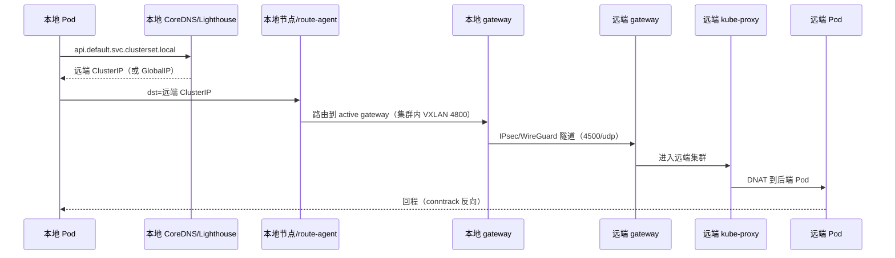

# 多集群网络互联：发现、访问、成员地址与 NAT 穿透

单集群网络有三个默认假设：**一个控制面、一个地址域、一个 DNS 域**。多集群互联的第一性困难，就是这三个假设同时失效：

- 每个集群独立分配 ClusterIP 和 PodCIDR，**地址空间大概率重叠**；
- Service/EndpointSlice 是 namespaced 且不出集群，**没有天然的跨集群服务发现**；
- 每个集群的 `cluster.local` 各自权威，**同名 Service 在不同集群指向不同后端**；
- 集群之间通常隔着 NAT/防火墙，**没有可直达的 underlay**。

本文讨论的是"多个完整 Kubernetes 集群之间如何互相发现和访问"，不是"一个集群多个 namespace"，也不是"多集群调度"（Karmada/MultiKueue 是控制面话题）。单集群全链路见 [Kubernetes 网络全链路](./k8s-network-path.md)，Service 规则见 [Service、kube-proxy 与 LoadBalancer](./6_service相关.md)。

**版本基线**：

| 项目 | 版本/commit | 用途 |
|---|---|---|
| Kubernetes | v1.37.2 `c50e5395f1ae2d4a2c05f28fdcc38c0916cc1a32` | DNS/search、Service CIDR |
| MCS-API | `a3bfd21f6f3e2eadc10c4602ecf5dcfa87d53be5`（v0.5.x，v1beta1 storage） | ServiceExport/ServiceImport |
| Submariner | `a920c26efdccec536e73695356bda94cbda19fb6` | 隧道与 Globalnet |
| Gateway API | `d04e7458ee15351ca54a201c4b1c43412f917b91` | GEP-1748 |
| CoreDNS | `996a30df7f5cca79a3bb34078f8897f673ac74dd`（1.15.0-dev） | multicluster zone |

> 证据分级：**【码】**= 已对照本地 checkout 的源码/CRD，给出 permalink 与行号；**【文档】**= 官方文档明确说明，未在本地源码复核。Cilium/Istio 未 clone 源码，相关结论均为文档级。

---

## 1. 问题空间：四种连通模型

| 模型 | 语义 | 典型实现 | 解决什么 | 不解决什么 |
|---|---|---|---|---|
| **扁平 L3** | 跨集群 Pod IP 可直接路由，无 NAT | Cilium ClusterMesh native routing、云 VPC peering、Istio 单网络 | Pod↔Pod 直达、保源 IP | 要求 PodCIDR 不重叠；跨云难 |
| **网关/隧道** | 每集群选网关，隧道封装，路由注入 | Submariner（IPsec/WireGuard/VXLAN）、Liqo（WireGuard+Geneve）、Istio east-west GW | 私网互通、NAT 穿透 | 多一跳、MTU、网关带宽 |
| **Service export/import** | 只暴露"服务"层，端点跨集群合并 | MCS-API、Cilium Global Service、Lighthouse | 服务发现与 VIP 语义统一 | **自身无数据面** |
| **DNS-only** | 只做名字→地址映射/转发 | CoreDNS `multicluster`、external-dns、Lighthouse | 名字可达 | 不解决可达性；解析到不可路由 IP 等于故障 |

**最重要的认知**：MCS-API 属于第 3 类，它**不是数据面**；Cilium/Submariner 同时提供第 2/3 类。把 MCS 当成"多集群网络方案"是最常见的误解。

---

## 2. 成员集群与成员地址

### 2.1 定义

**成员集群（member cluster）**：加入某个 ClusterSet/Mesh 的一个完整 Kubernetes 集群，具有独立 apiserver、etcd、Service/Pod CIDR 和 DNS 域。判定它"是成员"的最小信息集是：

1. 唯一集群标识（cluster name/ID）；
2. 其他成员可达的 apiserver 端点（用于对象同步/RBAC）；
3. 该集群的 Pod/Service CIDR（用于路由/冲突检测）。

**成员地址（member address）**：不属于某个 Pod/Service，而属于"成员集群本身"的地址集合，用于**建隧道、注入路由、做身份判定**。至少包含：

| 地址/标识 | 作用 | 谁维护 |
|---|---|---|
| 集群名/ID | 隧道命名、DNS label、身份位 | 各方案自己的配置/CR |
| apiserver 端点 | 同步 ServiceImport/EndpointSlice、Broker 访问 | kubeconfig/Cluster CR |
| 节点 InternalIP/ExternalIP | underlay 可达性；隧道端点 | Node 对象/Endpoint CR |
| 网关节点地址 | 隧道端点（可能是 nodeIP/LB VIP/浮动 IP） | Gateway/Endpoint CR |
| 隧道端点 + 端口 | 封装后的实际五元组（可能被 NAT 改写） | 探测后写入 |
| Pod CIDR / Service CIDR | 路由注入、冲突检测 | Cluster CR/配置 |
| Globalnet CIDR | 重叠场景下的二次地址空间 | Globalnet 配置 |

### 2.2 成员信息存在哪

| 信息 | Submariner | Cilium ClusterMesh | MCS-API | Karmada |
|---|---|---|---|---|
| 集群 ID | `Cluster.spec.cluster_id`（≤63）【码】 | `cluster.id` 1–255 + `cluster.name` ≤32【文档】 | EndpointSlice 的 `multicluster.kubernetes.io/source-cluster` 标签【码】 | `Cluster.spec.id`【文档】 |
| apiserver 端点 | Broker apiserver（broker-info/kubeconfig）【文档】 | 各集群 `clustermesh-apiserver`（etcd 2379/mTLS）【文档】 | **不定义** | `spec.apiEndpoint`【文档】 |
| 节点公/私网 IP | `Endpoint.private_ip(s)/public_ip(s)`【码】 | 要求节点 InternalIP 互通【文档】 | **不定义** | 不定义 |
| 网关/隧道端点 | `Endpoint` + `backend_config`（udp-port/natt-discovery-port）【码】 | 无网关，节点直连【文档】 | **不定义** | 不定义 |
| Pod/Service CIDR | `Cluster.cluster_cidr/service_cidr`；路由用 `Endpoint.subnets`【码】 | PodCIDR 必须全局唯一【文档】 | 由实现决定 | 不定义 |
| Globalnet CIDR | `Cluster.global_cidr` + `ClusterGlobalEgressIP`/`GlobalIngressIP`【码】 | 无 | 无 | 无 |

**MCS 的 ClusterSet 是逻辑概念，不是可查询的 CRD**：mcs-api 仓库只有 `serviceexports` 和 `serviceimports` 两个 CRD（[config/crd](https://github.com/kubernetes-sigs/mcs-api/tree/a3bfd21f6f3e2eadc10c4602ecf5dcfa87d53be5/config/crd)）。所以"MCS 不管成员注册和隧道地址"不是缺陷，而是它的定位：**它只定义服务导出/导入的 API 语义**，成员地址由数据面实现自己维护。

### 2.3 Submariner 的字段（最完整的一套"成员地址"模型）

`Cluster` CR（[types.go L34-L48](https://github.com/submariner-io/submariner/blob/a920c26efdccec536e73695356bda94cbda19fb6/pkg/apis/submariner.io/v1/types.go#L34-L48)）：

```go
type ClusterSpec struct {
    ClusterID   string   // ≤63
    ColorCodes  []string
    ServiceCIDR []string
    ClusterCIDR []string
    GlobalCIDR  []string
}
```

`Endpoint` CR（[types.go L68-L96](https://github.com/submariner-io/submariner/blob/a920c26efdccec536e73695356bda94cbda19fb6/pkg/apis/submariner.io/v1/types.go#L68-L96)）：

```go
type EndpointSpec struct {
    ClusterID     string
    CableName     string
    HealthCheckIPs []string
    Hostname      string
    Subnets       []string   // 真正被注入路由的集合
    PrivateIPs    []string
    PublicIPs     []string
    NATEnabled    bool
    Backend       string
    BackendConfig map[string]string
}
```

`Subnets` 的构成（[local_endpoint.go L152-L178](https://github.com/submariner-io/submariner/blob/a920c26efdccec536e73695356bda94cbda19fb6/pkg/endpoint/local_endpoint.go#L152-L178)）：

- 未开 Globalnet：`ServiceCIDR + ClusterCIDR`；
- 开 Globalnet：`GlobalCIDR + ServiceCIDR + ClusterCIDR`（IPv6 会做子网提取）。

`Gateway` CR（**每个集群本地**，不在 Broker）记录 `haStatus`、`localEndpoint`、`connections[].usingIP/usingNAT/latencyRTT`（[types.go L138-L185](https://github.com/submariner-io/submariner/blob/a920c26efdccec536e73695356bda94cbda19fb6/pkg/apis/submariner.io/v1/types.go#L138-L185)）。这就是"当前隧道实际用的是哪个成员地址、有没有走 NAT、RTT 多少"的直接证据。

---

## 3. 地址冲突：最容易被低估的问题

两个集群都用 `10.96.0.0/12`（Service）和 `10.244.0.0/16`（Pod）是常态。一旦互联：

- 远端 Pod IP 可能正好是本地某个 Pod/Service 的 IP；
- 远端 ClusterIP 可能和本地某个 Service 的 VIP 完全相同；
- 路由表无法区分"10.244.1.5 是本地还是远端"。

三种处理策略：

| 策略 | 代表 | 做法 | 代价 |
|---|---|---|---|
| **要求不重叠** | Cilium ClusterMesh、Istio 单网络 | 规划时给每个集群独立 PodCIDR/ServiceCIDR | 跨组织/跨云几乎不可行 |
| **全局地址重写** | Submariner Globalnet | 每集群分配 GlobalCIDR，网关做 1:1 NAT | 网关成为瓶颈；源 IP 变化 |
| **NAT + IPAM 重映射** | Liqo | 跨集群用 WireGuard，集群内 Geneve，nftables 做 NAT | 复杂度高；应用可见地址变化 |

Submariner Globalnet 的两个 CRD：

- **出口** `ClusterGlobalEgressIP`：默认 8 个 IP（缓解端口耗尽），只有名为 `cluster-egress.submariner.io` 的实例被识别；
- **入口** `GlobalIngressIP`：target 支持 `ClusterIPService`/`HeadlessServicePod`/`HeadlessServiceEndpoints`。

所有地址转换发生在 active gateway；IPAM 用 `admiral/pkg/ipam` 的 pool；启动时会检查本地/远端 GlobalCIDR 是否重叠。

**结论**：如果两个集群的 CIDR 已经重叠，又不想改网段，就必须选带地址重写/NAT 的方案（Globalnet、Liqo），或者只做 L7 网关（Skupper/Ingress），不要假装"打通 L3"。

---

## 4. MCS-API：规范层能做什么、不能做什么

### 4.1 两个 CRD

**ServiceExport** 只是"声明同名同 namespace 的 Service 可被消费"，spec 几乎为空（仅可选 exportedLabels/exportedAnnotations），状态由实现填充。

**ServiceImport** 才是"合并后的服务"：

```yaml
apiVersion: multicluster.x-k8s.io/v1beta1
kind: ServiceImport
metadata: {name: api, namespace: default}
spec:
  type: ClusterSetIP          # 或 Headless
  ips: ["10.96.0.10"]          # 最多 2 个（双栈）
  ports: [{name: http, port: 80, protocol: TCP}]
  sessionAffinity: None
status:
  clusters:
  - cluster: cluster-a
  - cluster: cluster-b
  conditions:
  - type: Ready
    status: "True"
```

关键字段（[serviceimport.go L57-L109](https://github.com/kubernetes-sigs/mcs-api/blob/a3bfd21f6f3e2eadc10c4602ecf5dcfa87d53be5/pkg/apis/v1beta1/serviceimport.go#L57-L109)）：

- `type` 只能是 `ClusterSetIP` 或 `Headless`；
- `ips` 最多 2 个；
- 还携带 `ports`、`sessionAffinity`、`internalTrafficPolicy`、`trafficDistribution`、`ipFamilies`；
- `status.endpointSliceObjects`（Present/Absent）、`status.clusters`、`status.conditions`。

`v1beta1` 是 storage 版本；CRD release 标注 v0.5.2。

### 4.2 EndpointSlice 导出约定

- 必须带 `multicluster.kubernetes.io/service-name` 与 `multicluster.kubernetes.io/source-cluster` 两个标签（[well_known_labels.go L19-L25](https://github.com/kubernetes-sigs/mcs-api/blob/a3bfd21f6f3e2eadc10c4602ecf5dcfa87d53be5/pkg/apis/v1beta1/well_known_labels.go#L19-L25)）；
- 由 MCS 控制器创建的 EndpointSlice **不得**标记为 `endpointslice-controller.k8s.io`（K8s 原生 controller），conformance 会检查 `endpointslice.kubernetes.io/managed-by`；
- 参考 controller 的做法是"为 ServiceImport 派生一个 `derived-<hash>` 的普通 Service，再把 EndpointSlice 的 `kubernetes.io/service-name` 改指向派生 Service"，并打 `multicluster.kubernetes.io/derived-service` 注解。

### 4.3 DNS 规范

```text
<service>.<namespace>.svc.clusterset.local
```

- 普通 ServiceImport（ClusterSetIP）：返回 ClusterSet VIP；
- Headless：返回多条 A/AAAA（每个端点）；
- 单 Pod：`<hostname>.<clusterid>.<svc>.<ns>.svc.clusterset.local`，`clusterid` 来自 EndpointSlice 的 `source-cluster` 标签；
- conformance 默认 `--dns-domain=clusterset.local`，实现可覆盖（[conformance_suite.go L84-L85](https://github.com/kubernetes-sigs/mcs-api/blob/a3bfd21f6f3e2eadc10c4602ecf5dcfa87d53be5/conformance/conformance_suite.go#L84-L85)）。

**关键设计**：即使本地存在同名 Service，消费者也必须显式使用 `*.svc.clusterset.local`。这是"opt-in 多集群语义"，不改变现有 `cluster.local` 行为。原因是 `cluster.local` 必须保持本地权威（split-horizon），否则会出现"解析到远端 VIP 但本地不可路由"或"远端 VIP 正好撞上本地 Service"。

### 4.4 冲突处理

冲突维度：port、type（headless vs not）、sessionAffinity、ITP、trafficDistribution、labels、annotations、ipFamilies。

解决规则：**按 `ServiceExport.creationTimestamp` 从旧到新，最老的赢**；冲突状态翻转不影响在用流量；从 True→False 时 ServiceImport 可能保持不变以避免抖动。`ServiceExport` 有三个条件组：

- `Valid`：`Valid`/`NoService`/`InvalidServiceType`；
- `Ready`：`Exported`/`Ready`/`Pending`/`Failed`；
- `Conflict`：多个 reason 可组合。

### 4.5 MCS 不解决什么

- **不是数据面**：不定义隧道、不转发包、不做 NAT；
- **不定义成员注册/ClusterSet 对象**：只有 2 个 CRD；
- **不解决地址重叠**：ClusterSetIP 仍是某个地址域里的 VIP；
- **不提供健康检查/故障转移**：`Ready` 语义留给实现；
- **不规定 apiserver 端点如何暴露**：Broker/etcd 暴露方式是实现细节；
- **不定义跨集群 NetworkPolicy**。

所以选 MCS 时，必须同时选一个数据面（Submariner Lighthouse、Cilium mcsapi、Istio 等），并确认它通过 [MCS conformance suite](https://github.com/kubernetes-sigs/mcs-api/tree/a3bfd21f6f3e2eadc10c4602ecf5dcfa87d53be5/conformance)。conformance 是判断"某实现是否真的 MCS 兼容"的唯一标准工具，不要只看厂商文档。

### 4.6 CoreDNS 原生支持 MCS

CoreDNS 的 `kubernetes` 插件支持 `multicluster` 选项（1.12.2 引入）：

```text
kubernetes cluster.local clusterset.local {
    multicluster clusterset.local
}
```

它 watch `ServiceImport` 与带 `mcs.LabelServiceName` 的 EndpointSlice，记录 Key 里插入 clusterId；插件必须对所列 zone 权威（[README.md L118-L121](https://github.com/coredns/coredns/blob/996a30df7f5cca79a3bb34078f8897f673ac74dd/plugin/kubernetes/README.md#L118-L121)、[setup.go L239-L240](https://github.com/coredns/coredns/blob/996a30df7f5cca79a3bb34078f8897f673ac74dd/plugin/kubernetes/setup.go#L239-L240)）。

这带来一个重要事实：**`clusterset.local` 不一定需要独立的 Lighthouse DNS**。如果数据面已经把 ServiceImport/EndpointSlice 同步到本地集群，CoreDNS 可以直接权威回答。Cilium 的 MCS 实现就可以自动配置这段（`corednsAutoConfigure`）；Submariner Lighthouse 则是独立 DNS + CoreDNS forward。

---

## 5. Submariner：先把 L3 打通，再在上面做服务发现

### 5.1 组件与职责

| 组件 | 位置 | 职责 |
|---|---|---|
| **Broker** | 一个集群的 `submariner-k8s-broker` namespace | 承载 `Cluster`/`Endpoint` 等 CRD + ServiceAccount/RBAC，交换元数据；Broker 挂了不影响已建立的数据面 |
| **Gateway Engine** | 每集群 DaemonSet，仅跑在 `submariner.io/gateway=true` 节点 | 建隧道、leader 选举（active/passive）、上报 Endpoint |
| **Route Agent** | 每节点 DaemonSet | 把跨集群流量从各节点导到本集群 active gateway（集群内 VXLAN 4800 或复用 OVN GENEVE） |
| **Lighthouse** | 每集群 agent + DNS | ServiceImport/EndpointSlice 同步 + `clusterset.local` 权威解析 |
| **Globalnet** | 可选 | 重叠 CIDR 的 1:1 全局地址 + SNAT/DNAT |

Broker 上安装的 CRD 至少包括 `clusters`、`endpoints`、`gateways`、`clusterglobalegressips`、`globalegressips`、`globalingressips`、`gatewayroutes`、`nongatewayroutes`、`routeagents`（[deploy/crds](https://github.com/submariner-io/submariner/tree/a920c26efdccec536e73695356bda94cbda19fb6/deploy/crds)）。哪些放 Broker、哪些只在本集群，由 operator 决定；`Gateway` 语义上是本地的。

### 5.2 Cable driver：IPsec、WireGuard、VXLAN

| driver | 封装 | 加密 | NAT 支持 | 默认端口 |
|---|---|---|---|---|
| **libreswan（默认）** | IPsec ESP（可强制 UDP 封装） | 是（PSK 或 cert） | 是（NAT-T） | **4500/udp**（IKE 也走 4500），ESP 是 IP proto 50 |
| **WireGuard** | UDP | 是 | 是 | 4500/udp（可配） |
| **VXLAN** | UDP + VXLAN | **否**（明文） | **否** | 4500/udp（跨集群） |

**三个常见错误认知，这里一次纠正**：

1. **跨集群 VXLAN 默认不是 4800**。`vxlan.DefaultPort = 4500`（[cable/vxlan/vxlan.go L43-L50](https://github.com/submariner-io/submariner/blob/a920c26efdccec536e73695356bda94cbda19fb6/pkg/cable/vxlan/vxlan.go#L43-L50)）；**4800 是集群内** route-agent → gateway 的 VXLAN（`IntraClusterVxLAN`，[ports.go L21-L25](https://github.com/submariner-io/submariner/blob/a920c26efdccec536e73695356bda94cbda19fb6/pkg/port/ports.go#L21-L25)）。很多博客把两者混为一谈。
2. **IPsec 不依赖 500/udp**。libreswan 用 `--ikeport` 把 IKE 端口显式设为 NATT 端口（默认 4500），所以防火墙只需放行 **4500/udp**（以及 NAT 探测的 4490/udp）。
3. **没有 8080 的 HTTP 健康检查**。当前实现是 ICMP ping 每个远端 gateway（`healthchecker` → `pinger`），RTT 写到 `Gateway.status.connections[].latencyRTT`；探测目标是 gateway 节点上 CNI 接口的 IP（`HealthCheckIP`）。因此**网关节点必须允许 ICMP echo**，否则会出现"隧道 up 但 connection error"。

端口表（默认值）：

| 用途 | 端口/协议 |
|---|---|
| NAT 类型/可达性探测 | **4490/udp**（可 per-node 改） |
| 跨集群隧道 | **4500/udp**（IPsec IKE/ESP-in-UDP、WireGuard、VXLAN） |
| 无 NAT 时的 IPsec ESP | **IP proto 50** |
| 集群内 VXLAN（route-agent → gateway） | **4800/udp** |
| 健康检查 | **ICMP echo**（无 TCP 端口） |
| Broker apiserver | **443/tcp** |
| Lighthouse DNS | **53/udp,tcp** |

常量证据：[ports.go L21-L25](https://github.com/submariner-io/submariner/blob/a920c26efdccec536e73695356bda94cbda19fb6/pkg/port/ports.go#L21-L25)、[libreswan.go L168](https://github.com/submariner-io/submariner/blob/a920c26efdccec536e73695356bda94cbda19fb6/pkg/cable/libreswan/libreswan.go#L168-L168)、[wireguard/driver.go L77](https://github.com/submariner-io/submariner/blob/a920c26efdccec536e73695356bda94cbda19fb6/pkg/cable/wireguard/driver.go#L77-L77)。

### 5.3 NAT 穿透

每个 gateway 对远端 **public 与 private IP 都发起探测**，决定最终使用的 IP/NAT 组合，**优先 private**；探测协议默认 4490/udp。`PublicIP` 解析支持五种 resolver：

```text
api:api.ipify.org          # 通过外部 API 查公网 IP
lb:external-gw-lb          # 通过 LoadBalancer
ipv4:1.2.3.4               # 直接指定
ipv6:FD00::/...            # IPv6
dns:mygateway.example.com  # DNS 解析
```

（[types.go L108-L115](https://github.com/submariner-io/submariner/blob/a920c26efdccec536e73695356bda94cbda19fb6/pkg/apis/submariner.io/v1/types.go#L108-L115)）

探测失败时回退到 join 时的 `--natt` 设置；单侧可直连时用 `--preferred-server` 形成 client/server 模型（比较 cable name 字典序决定谁当 server）。云上没有公网 IP 时用 `--load-balancer`，LB 后端只选 `gateway.submariner.io/status=active` 的 Pod。HA 场景下每个 gateway 必须用独立 UDP 端口并做端口映射。

### 5.4 Globalnet

- 给每个集群分配一段 `GlobalCIDR`（文档示例 `242.0.0.0/8`，不是"默认值"）；
- 出口用 `ClusterGlobalEgressIP`（默认 8 个 IP，缓解端口耗尽；只有 `cluster-egress.submariner.io` 实例被识别）；
- 入口用 `GlobalIngressIP`（target 支持 ClusterIPService/HeadlessServicePod/HeadlessServiceEndpoints）；
- 所有地址转换发生在 active gateway；启动时检查本地/远端 GlobalCIDR 是否重叠；
- 依赖 `externalIPs` 的 Service 创建，需要绕开 `DenyServiceExternalIPs`。

### 5.5 数据路径

**Pod → 远端 Pod（无 Globalnet）**：

```text
源 Pod
  → 本节点路由表（route agent 为远端 Endpoint.subnets 注入）
  → 本集群 active gateway 节点（集群内 VXLAN 4800 或 OVN GENEVE）
  → IPsec/WireGuard/VXLAN 隧道（4500/udp）
  → 远端 gateway
  → 远端节点
  → 目标 Pod
```

**Pod → 远端 Service**：

1. Lighthouse 把导出服务的 ClusterIP 写进 ServiceImport；
2. 本地 DNS 返回远端 ClusterIP（或 GlobalIP）；
3. 该 ClusterIP 属于远端 ServiceCIDR，通过隧道到达远端 gateway；
4. 远端节点上的 kube-proxy 再做 DNAT 到后端 Pod（或在 gateway 完成 Globalnet DNAT/SNAT）。

文档明确 libreswan 会建 **4 条隧道**（Pod↔Pod、Pod↔Service、Service↔Pod、Service↔Service），所以"为什么有 4 条 SA"不是异常。

**Headless**：Lighthouse 返回各 Pod IP（或 GlobalIP），客户端直连 Pod，需要 Pod CIDR 可路由（或 Globalnet 地址可路由）。

### 5.6 运维与排障

```bash
subctl show all
subctl show connections
subctl show endpoints
subctl show clusters
subctl diagnose all
subctl diagnose firewall inter-cluster \
  --context <local> --remotecontext <remote>
subctl gather
```

`subctl gather` 会收集各集群的 CRD、Pod 日志、iptables/ipset/路由、`ip xfrm` 状态，是 Submariner 问题的首选材料。

---

## 6. Cilium ClusterMesh：eBPF 的节点直连

### 6.1 架构

每个集群一个 `clustermesh-apiserver` Pod，内含：

- **etcd**：暴露本地 Cilium/K8s 状态，mTLS；
- **apiserver**：把本地状态写入 etcd；
- **kvstoremesh**：把远端状态同步进本地缓存。

agent 用 kvstore 客户端读本地缓存；**Pod 到 Pod 是节点间直接转发，不经过任何 proxy/gateway**。已启用 kvstore 模式时复用现有 etcd，不再部署内嵌 etcd。

### 6.2 前置条件（决定"能不能用"）

- 所有集群**同一 datapath 模式**（native routing 或 encapsulation 不能混）；
- Cilium 版本相差 ≤1 个 minor；
- **PodCIDR 全局唯一，节点间用 InternalIP 互通**；
- native routing 还需 `ipv4-native-routing-cidr` 覆盖全部集群的 PodCIDR；
- `maxConnectedClusters`（255 默认 / 511）必须所有集群一致，**安装后不可改**（它影响 numeric identity 的位分配，身份上限会从 65535 降到 32767）。

因此 **Cilium 不做地址重叠**：它没有 Globalnet 式地址重写。所谓"共享服务"是 VIP 层面的，不是 IP 层面的。

### 6.3 Global Service 与策略

- 两个集群同名同 namespace 的 Service + `service.cilium.io/global: "true"` 组成 Global Service；
- `service.cilium.io/shared: "false"`：只消费远端，不共享本地；
- `service.cilium.io/affinity: none|local|remote`：就近/远端优先；
- EndpointSlice 同步（beta）：`service.cilium.io/global-sync-endpoint-slices`，供第三方 controller 发现远端端点；Headless 默认开启；
- 跨集群策略用 `io.cilium.k8s.policy.cluster: <cluster-name>` 选择远端端点；**v1.18 起策略默认只选本地集群**，要显式指定 cluster 或用 `Exists` 匹配所有集群；
- MCS-API 与 Global Service 是两条并行路径，可同时启用。

### 6.4 可观测与排障

```bash
cilium status
cilium clustermesh status --wait
cilium connectivity test --multi-cluster
cilium-dbg troubleshoot clustermesh
clustermesh-apiserver kvstoremesh-dbg troubleshoot
```

端口（文档默认值）：

| 用途 | 端口 |
|---|---|
| clustermesh etcd（mTLS） | 2379/tcp |
| VXLAN overlay | 8472/udp |
| Geneve | 6081/udp |
| WireGuard | 51871/udp |
| cilium-health | 4240/tcp + ICMP |
| Hubble | 4244/4245/tcp |

注意：Cilium 的**所有互联集群构成单一信任域**（共享 CA/mTLS），跨集群策略对象本身**不会自动分发**，必须在每个集群各建一份。

---

## 7. 其他方案与横向对比

### 7.1 Istio 多集群

- `multi-primary` 与 `primary-remote` 两种拓扑；
- 跨网络时部署 `istio-eastwestgateway`，用 TLS `AUTO_PASSTHROUGH` 暴露 `*.local`，端口 **15443**；
- 通过 `istioctl create-remote-secret` 把各集群 apiserver 凭据注入对端，实现端点发现；
- 单网络要求 Pod/Service CIDR 不重叠并自行配置路由；要求 apiserver 互达；要求共同根 CA。

Istio 的强项是 L4–L7 的 mTLS、流量治理、可观测性；它解决的是"服务间通信"而不是"任意 IP 可达"。如果只需要 HTTP/gRPC 跨集群，Istio 往往比 L3 互联更合适。

### 7.2 Liqo

- peering + offloading + network fabric；
- 跨集群 **WireGuard VPN**，集群内 **Geneve** overlay 把流量导到 gateway；
- 用 **nftables 做 NAT** 处理 PodCIDR 冲突，并带 IPAM；
- 少数**显式支持地址重叠**的方案。

### 7.3 Skupper

- 不是 IP 路由，而是"**application network**"：路由器在应用端点之间路由消息；
- 支持 anycast/multicast 语义；
- 天然不关心 IP 重叠，但**不能承载任意 IP 协议**（适合 HTTP/gRPC/TCP 连接器模式）；
- 端口：inter-router 55671/tcp，edge 45671/tcp。

### 7.4 控制面方案（不是数据面）

- **Karmada**：多集群调度/分发/故障迁移，`Cluster` 对象只存 apiserver 端点与凭据；数据面需另配 CNI/Submariner/Cilium；
- **Clusterpedia**：多集群资源检索，纯控制面；
- **external-dns**：把 Service/Ingress 同步成外部 DNS 记录，本身不是 DNS server，不参与集群内解析。

### 7.5 对比矩阵

| 方案 | 数据面 | 层次 | 地址重叠 | 跨集群 DNS | 复杂度 | 成熟度 |
|---|---|---|---|---|---|---|
| **Submariner** | IPsec/WireGuard/VXLAN 隧道，gateway 集中转发 | L3 | 需 Globalnet（1:1 全局 IP + NAT） | Lighthouse `clusterset.local` | 中高（网关、UDP 端口、MTU） | CNCF sandbox，生产部署多 |
| **Cilium ClusterMesh** | eBPF，native routing 或 tunnel，节点直连 | L3/L4（L7 需 Envoy） | **不支持**，PodCIDR 必须唯一 | Global Service + MCS `clusterset.local` | 中（同 CNI、同 datapath、非重叠） | 成熟 |
| **MCS-API（单独）** | 无 | — | 由实现决定 | 规范定义 | 低（仅 API） | v1beta1/Beta |
| **Istio multi-primary** | sidecar/ztunnel mTLS + east-west GW | L4–L7 | 单网络要求不重叠 | 复用 K8s DNS + 端点发现 | 高 | 成熟 |
| **Liqo** | WireGuard VPN + Geneve + nftables NAT | L3 | **支持** | 反射 Service/EndpointSlice | 中 | 活跃 |
| **Skupper** | 应用层路由器 | L7/应用 | 不涉及 | Skupper 服务名 | 低 | 成熟 |
| **Karmada** | 无（需外接） | 控制面 | N/A | 多集群 Service DNS | 中 | 活跃 |
| **external-dns** | 无 | 公网 DNS 记录 | N/A | 公网域名 | 低 | 成熟 |

---

## 8. 跨集群 DNS

### 8.1 三条路径

1. **独立权威 DNS + 转发**（Submariner Lighthouse）：Lighthouse DNS 拥有 `clusterset.local`，CoreDNS 配置 `clusterset.local:53 { forward . <lighthouse-svc-ip> }`；
2. **CoreDNS 原生 multicluster zone**：`kubernetes cluster.local clusterset.local { multicluster clusterset.local }`，插件直接权威回答；
3. **已废弃的 federation**：CoreDNS 1.7.0 移除了 in-tree `federation` 插件；K8s Federation v1 从未 GA。今天还在维护的 `github.com/coredns/federation` 只是把 v1 语义外置，**不是 MCS 的替代品**。

### 8.2 search domain 的坑

Pod 的 search list 只有：

```text
<ns>.svc.cluster.local
svc.cluster.local
cluster.local
<host search...>
```

**不含 `clusterset.local`**，且 `ndots:5`。`api.default.svc.clusterset.local` 只有 3 个点 < 5，解析器会先尝试所有 search 后缀（必然 NXDOMAIN），再尝试绝对名。表现是"能解析但慢/日志里一堆 NXDOMAIN"，极端情况下触发 5s 级延迟。

三个缓解手段：

- 应用使用**带尾点的 FQDN**（`api.default.svc.clusterset.local.`）；
- 在 `dnsConfig.searches` 里显式加入 `clusterset.local`（会占用 search 数量上限，注意 32/2048 的限制）；
- 在 CoreDNS 侧优化（减少 search 往返、NodeLocal 缓存）。

### 8.3 为什么 `cluster.local` 不能默认远端解析

- 同一个 `foo.default.svc.cluster.local` 在每个集群解析到**各自集群的 ClusterIP**，这些 VIP 在别的集群不可路由；
- 更糟的是 VIP 冲突：两集群都用 `10.96.0.0/12` 时，远端返回的 ClusterIP 可能正好是本地某个真实服务的 VIP，造成流量串台。

这正是 MCS 引入独立域 `clusterset.local` 并要求**显式 opt-in** 的原因。实现上 `cluster.local` 永远保持本地权威（split-horizon），只有 `clusterset.local` 被转发/联邦。

---

## 9. 安全、NAT 与 MTU

### 9.1 信任模型

- **Submariner**：Broker 的 ServiceAccount + RBAC 控制元数据访问；IPsec 支持 `psk`（默认）与 `cert` 两种 AuthMode；隧道活性用 DPD（`dpddelay=30s`、`dpdaction=hold`）；
- **Cilium**：mTLS + 共享 CA；`certgen` CronJob 定期重签（默认有效期 1 年）；所有互联集群是**单一信任域**；
- **Istio**：共同根 CA 签发各 primary 的中间证书；
- **Broker/etcd 不可达**：已建立的数据面通常继续工作，只是学不到新 Endpoint/成员；恢复后自动 resync。

### 9.2 跨集群 NetworkPolicy

- Submariner **不提供**跨集群 NetworkPolicy 语义；由于它保留源 IP，远端策略只能用对端 Pod/Service 的 IP 段（`ipBlock`）表达；开 Globalnet 后必须改用 Globalnet 地址；
- Cilium 的策略可以按 identity 跨集群生效，但 **Kubernetes NetworkPolicy/CiliumNetworkPolicy 对象本身不会自动分发**，每个集群要各建一份；
- **NAT 破坏源 IP 策略**：Globalnet 的 SNAT 让远端看到 GlobalIP；Cilium 若开 masquerade，跨集群流量源地址会变成节点 IP。任何"按源 Pod IP 放行"的策略在这种路径上都会失效。

### 9.3 MTU

| 方案 | 开销 | 说明 |
|---|---|---|
| Submariner VXLAN | **50** 字节 | 接口 MTU = 宿主 MTU − 50 |
| Submariner IPsec | 按 **120** 字节做 MSS clamp | `MaxIPSecOverhead=120`，可按节点注解 `submariner.io/tcp-clamp-mss` 覆盖 |
| Cilium VXLAN | 50 | 与普通 VXLAN 相同 |
| Cilium WireGuard | 60（IPv4）/80（IPv6） | 叠加在 underlay 上 |
| Istio east-west | 取决于 TLS/HTTP2 封装 | 需要按实现调 MTU/MSS |

Submariner 的 VXLAN 证据：[vxlan.go L52](https://github.com/submariner-io/submariner/blob/a920c26efdccec536e73695356bda94cbda19fb6/pkg/vxlan/vxlan.go#L52-L52)；IPsec MSS clamp：[mtuhandler.go L49-L50](https://github.com/submariner-io/submariner/blob/a920c26efdccec536e73695356bda94cbda19fb6/pkg/routeagent_driver/handlers/mtu/mtuhandler.go#L49-L50)。

**跨集群 MTU 要按"最外层 underlay − 所有封装"算**，并且确保 ICMP Fragmentation Needed 能回到源端；否则表现为"小请求正常、大响应卡死"。

---

## 10. 全链路示例

### 10.1 Submariner：本地 Pod → 远端 Service



关键点：

- DNS 返回的是**远端** ClusterIP/GlobalIP，不是本地 VIP；
- 本地节点必须有到远端 ServiceCIDR/PodCIDR 的路由（route agent 注入）；
- 远端 gateway 必须能把包送进远端集群的 Service 路径（kube-proxy 规则）；
- 回程要经过同一对 gateway，否则 conntrack/NAT 对不上。

### 10.2 Cilium：Global Service

```text
本地 Pod → 本地节点 eBPF（选择本地或远端 endpoint）
  → 若选远端：直接路由/隧道到远端节点
  → 远端节点 eBPF 交付 Pod
```

没有 gateway 集中转发，源 IP 保留；`service.cilium.io/affinity` 控制就近/远端优先。前提是 PodCIDR 不重叠、datapath 一致。

### 10.3 MCS：查询链路

```text
kubectl get serviceexport,serviceimport -A
kubectl get endpointslice -A -l multicluster.kubernetes.io/service-name=<svc>
dig @<coredns> api.default.svc.clusterset.local
```

MCS 只保证"对象/DNS 语义"；包能不能到，取决于背后的数据面。

---

## 11. 排障 Runbook

| 症状 | 最可能原因 | 命令/检查 |
|---|---|---|
| 隧道 down / `connection status: error` | UDP 端口未放行、NAT 探测失败、ICMP 被禁、DPD 超时 | `subctl show connections`；`kubectl -n submariner-operator describe gateway`；`ip xfrm state`；`tcpdump -ni any esp or udp port 4500 or udp port 4490` |
| 能 ping 通 gateway，ping 不通远端 Pod | `Endpoint.subnets` 未包含目标 CIDR / route agent 未装路由 | `subctl show endpoints`；`ip route show table 100`；`kubectl -n submariner-operator logs ds/submariner-routeagent` |
| `clusterset.local` NXDOMAIN | CoreDNS 未转发、Lighthouse 未同步、ServiceExport 未生效 | `dig @<lighthouse> ...`；`kubectl -n kube-system describe configmap coredns`；`kubectl get serviceexport,serviceimport -A`；`kubectl -n submariner-operator logs deploy/submariner-lighthouse-agent` |
| 小包通、大包卡死 | 隧道 MTU 超限、ICMP Frag Needed 被过滤 | `ping -M do -s 1400 <dst>`；检查 MSS clamp；`tcpdump -ni any icmp` |
| IP 冲突 | 未开 Globalnet 或 GlobalCIDR 也重叠 | `subctl show clusters`；`kubectl get cluster -n submariner-k8s-broker -o yaml`；Globalnet 日志的 "overlaps with remote cluster" |
| 证书过期 | Cilium CA/cert 过期、Broker 证书不受信 | `cilium clustermesh status`；`cilium-dbg troubleshoot clustermesh`；`subctl verify --check-broker-certificate` |
| Broker 不可达 | Broker apiserver 挂了/网络不通 | `subctl show brokers`；数据面应继续工作，只是学不到新 Endpoint |
| Gateway 节点未被调度 | 节点未打 `submariner.io/gateway=true`、taint、资源不足 | `kubectl get nodes -l submariner.io/gateway=true`；`kubectl -n submariner-operator get pods -l app=submariner-gateway -o wide` |
| Globalnet 分配失败 | `DenyServiceExternalIPs` 未关、GlobalCIDR 用尽 | `kubectl get globalingressip -A`；`kubectl get clusterglobalegressip cluster-egress.submariner.io -o yaml` |
| Cilium 跨集群不通 | datapath 不一致、PodCIDR 重叠、cluster-id 冲突、2379 不通 | `cilium status`；`cilium clustermesh status`；`cilium connectivity test --multi-cluster`；`cilium-dbg troubleshoot clustermesh` |

---

## 12. 选型建议

先回答四个问题，再选方案：

1. **地址是否重叠？** 重叠 → Submariner Globalnet/Liqo；不重叠 → Cilium/Istio/Submariner 都可以。
2. **需要 L3 任意协议还是只要 HTTP/gRPC？** 任意协议 → L3 方案；只要 L7 → Istio/Skupper/Ingress。
3. **能接受网关集中转发吗？** 能 → Submariner（成熟、功能全）；不能/要高吞吐 → Cilium（节点直连，但要求同 CNI、同 datapath、非重叠 CIDR）。
4. **团队能维护什么？** BGP/隧道/证书/MTU 都是长期成本；MCS 只是 API，不要低估数据面的运维。

一个常见的组合：

- **同云、同 CNI、CIDR 规划良好** → Cilium ClusterMesh；
- **跨云/跨组织、CIDR 重叠、需要 L3** → Submariner + Globalnet；
- **只需要 HTTP/gRPC 跨集群** → Istio multi-primary 或 Gateway API（GEP-1748 仍 Experimental）；
- **只需要资源视角/调度** → Karmada + 任一数据面。

---

## 13. 参考

**MCS / 规范**

- [MCS-API 仓库](https://github.com/kubernetes-sigs/mcs-api)
- [MCS-API ServiceImport 类型](https://github.com/kubernetes-sigs/mcs-api/blob/a3bfd21f6f3e2eadc10c4602ecf5dcfa87d53be5/pkg/apis/v1beta1/serviceimport.go)
- [MCS conformance suite](https://github.com/kubernetes-sigs/mcs-api/tree/a3bfd21f6f3e2eadc10c4602ecf5dcfa87d53be5/conformance)
- [CoreDNS kubernetes 插件（multicluster）](https://coredns.io/plugins/kubernetes/)

**Submariner**

- [架构总览](https://submariner.io/getting-started/architecture/)
- [Broker](https://submariner.io/getting-started/architecture/broker/)
- [Gateway Engine](https://submariner.io/getting-started/architecture/gateway-engine/)
- [Route Agent](https://submariner.io/getting-started/architecture/route-agent/)
- [Service Discovery / Lighthouse](https://submariner.io/getting-started/architecture/service-discovery/)
- [Globalnet](https://submariner.io/getting-started/architecture/globalnet/)
- [NAT Traversal](https://submariner.io/operations/nat-traversal/)
- [Troubleshooting](https://submariner.io/operations/troubleshooting/)
- 源码：[Submariner API types](https://github.com/submariner-io/submariner/blob/a920c26efdccec536e73695356bda94cbda19fb6/pkg/apis/submariner.io/v1/types.go)、[ports.go](https://github.com/submariner-io/submariner/blob/a920c26efdccec536e73695356bda94cbda19fb6/pkg/port/ports.go)

**Cilium / Istio / 其他**

- [Cilium ClusterMesh Intro](https://docs.cilium.io/en/stable/network/clustermesh/intro/)
- [Cilium ClusterMesh Setup](https://docs.cilium.io/en/stable/network/clustermesh/setup/)
- [Cilium Global Services](https://docs.cilium.io/en/stable/network/clustermesh/global-services/)
- [Cilium MCS-API](https://docs.cilium.io/en/stable/network/clustermesh/mcsapi/)
- [Cilium ClusterMesh Policy](https://docs.cilium.io/en/stable/network/clustermesh/policy/)
- [Istio 多集群安装](https://istio.io/latest/docs/setup/install/multicluster/)
- [Liqo Network Fabric](https://docs.liqo.io/en/stable/features/network-fabric.html)
- [Skupper Overview](https://skupper.io/docs/overview/index.html)
- [Gateway API GEP-1748](https://github.com/kubernetes-sigs/gateway-api/blob/d04e7458ee15351ca54a201c4b1c43412f917b91/geps/gep-1748/index.md)

**本 wiki 的配套页面**

- [Kubernetes 网络全链路](./k8s-network-path.md)
- [CNI 详解](./cni详解.md)
- [Service、kube-proxy 与 LoadBalancer](./6_service相关.md)

