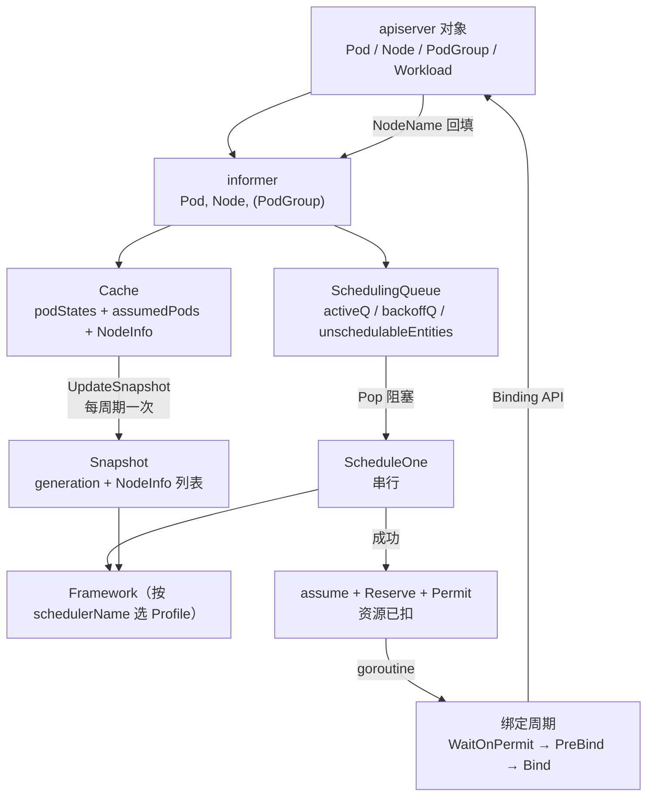
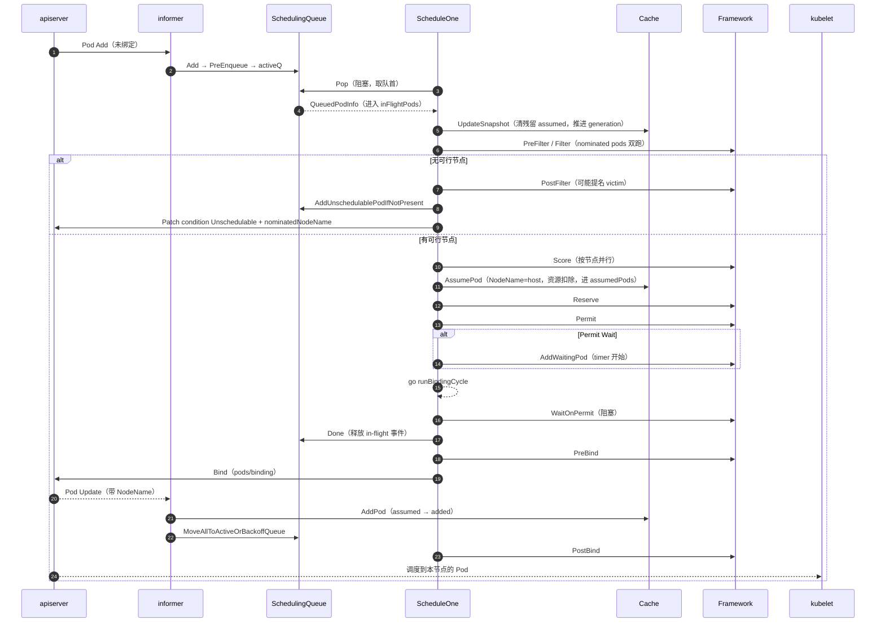

# kube-scheduler：对象、队列与调度主流程

这篇页面回答一个具体问题：**一个 Pending 的 Pod（或一个开启了 `GenericWorkload` 的 PodGroup），在 kube-scheduler 内部到底经过了哪些对象、哪几个队列、哪两段周期，资源账本什么时候被扣、什么时候被确认、失败时怎么退回去、scheduler 重启后怎么重建。** 它不讲全部 Filter 插件的语义，也不讲 Volcano 的内部实现；扩展点的逐个说明见 [Scheduling Framework](./scheduling-framework.md)，策略取舍见 [调度策略与约束](./scheduling-strategy.md)。

版本基线是 Kubernetes **v1.37.2**，代码链接全部固定到 commit `c50e5395f1ae2d4a2c05f28fdcc38c0916cc1a32`。一个必须先说清楚的边界：v1.37 里 `GenericWorkload`（PodGroup/Workload API + gang）是 **Beta 但默认关闭**，所以**默认配置下的 scheduler 仍然逐 Pod 调度**，队列里只有 `QueuedPodInfo`。把 PodGroup 当成 1.37 的默认能力是本专题最常见的误读。

## 1. 版本与能力基线

| Feature gate | v1.37.2 状态 | 对本文的影响 |
| --- | --- | --- |
| `GenericWorkload` | Beta，**默认 false**（1.35 引入为 Alpha） | 决定队列能否持有 `QueuedPodGroupInfo`、`GangScheduling` 插件是否注册、PodGroup informer 是否启动 |
| `DynamicResourceAllocation` | GA，默认 true 且自 1.35 起 LockToDefault | DRA 插件默认在插件链里，但本文只指出它在 Filter/Reserve/PreBind 的位置 |
| `PodGroupPreemptionPolicy` | Alpha，**默认 false** | PodGroup 级抢占策略；本文不展开 |
| `TopologyAwareWorkloadScheduling` | Alpha，**默认 false** | workload 级拓扑扩展点；见 [调度策略与约束](./scheduling-strategy.md) |
| `DRAWorkloadResourceClaims` | Beta，**默认 false** | PodGroup 级共享 claim；见策略页 |
| `CompositePodGroup` | Alpha，**默认 false** | 多级 PodGroup 层级；本文只提一句 |
| `SchedulerPopFromBackoffQ` | Beta，默认 true（1.33 起） | 让 backoffQ 具备“到期即按优先级弹出”的排序窗口语义 |

`GenericWorkload` 的定义见 [kube_features.go#L1622-L1625](https://github.com/kubernetes/kubernetes/blob/c50e5395f1ae2d4a2c05f28fdcc38c0916cc1a32/pkg/features/kube_features.go#L1622-L1625)，DRA 见 [#L1579-L1586](https://github.com/kubernetes/kubernetes/blob/c50e5395f1ae2d4a2c05f28fdcc38c0916cc1a32/pkg/features/kube_features.go#L1579-L1586)，PodGroup 抢占见 [#L1956-L1958](https://github.com/kubernetes/kubernetes/blob/c50e5395f1ae2d4a2c05f28fdcc38c0916cc1a32/pkg/features/kube_features.go#L1956-L1958)，TAS 见 [#L2231-L2233](https://github.com/kubernetes/kubernetes/blob/c50e5395f1ae2d4a2c05f28fdcc38c0916cc1a32/pkg/features/kube_features.go#L2231-L2233)，DRA workload claims 见 [#L1545-L1548](https://github.com/kubernetes/kubernetes/blob/c50e5395f1ae2d4a2c05f28fdcc38c0916cc1a32/pkg/features/kube_features.go#L1545-L1548)。官方文档对 PodGroup 的标注同样是 “Beta since v1.37; disabled by default”。

`GangScheduling` 插件不是独立 gate，而是 `GenericWorkload` 打开后由默认插件函数追加：

```go
func applyFeatureGates(config *v1.Plugins) {
	if utilfeature.DefaultFeatureGate.Enabled(features.DynamicResourceAllocation) {
		applyDynamicResources(config)
	}
	if utilfeature.DefaultFeatureGate.Enabled(features.GenericWorkload) {
		applyGangScheduling(config)
	}
	...
}
```

见 [default_plugins.go#L62-L87](https://github.com/kubernetes/kubernetes/blob/c50e5395f1ae2d4a2c05f28fdcc38c0916cc1a32/pkg/scheduler/apis/config/v1/default_plugins.go#L62-L87)。所以“v1.37 有 gang”这句话只在“显式开了 gate 并配置了 PodGroup”时成立。

## 2. 对象图



| 对象 | 作用 | 生命周期 | 持久化 |
| --- | --- | --- | --- |
| `Pod` | 调度请求的载体；`spec.schedulerName` 选 profile，`spec.schedulingGroup.podGroupName` 选 PodGroup | 由 API 决定 | 是（etcd） |
| `Node` | 资源与约束来源；`NodeInfo` 是它在 cache 中的投影 | 由 kubelet/云控制器驱动 | 是 |
| `PodGroup`（`scheduling.k8s.io/v1beta1`） | 组级策略载体：`spec.schedulingPolicy.gang.minCount`、拓扑约束、组级 claim | `GenericWorkload` 开启时由控制器创建 | 是 |
| `Workload`（同组） | PodGroup 模板 + 策略模板，供控制器生成 PodGroup | 同上 | 是 |
| `Profile` / `Framework` | 一个 `schedulerName` 对应一个框架实例，持有插件集与等待队列 | 进程内 | 否 |
| `QueuedPodInfo` / `QueuedPodGroupInfo` | 队列中的实体，带 `QueueingParams`（时间戳、尝试次数、backoff、失败插件集合） | 进程内 | 否 |
| `PodInfo` / `NodeInfo` | 不可变的 Pod 视图 + 带资源账本的节点视图（`Requested` 含 assumed Pods） | 进程内 | 否 |
| `Cache` / `Snapshot` | cache 是权威账本；snapshot 是每周期的一致性读视图 | 进程内 | 否 |
| `Extender` | 老式外置 HTTP 扩展（Filter/Score/Bind），与 Framework 并存 | 进程内 | 否 |

实体定义的入口：`QueuedPodInfo` 在 [types.go#L693-L701](https://github.com/kubernetes/kubernetes/blob/c50e5395f1ae2d4a2c05f28fdcc38c0916cc1a32/pkg/scheduler/framework/types.go#L693-L701)，`QueuedPodGroupInfo` 在 [#L783-L791](https://github.com/kubernetes/kubernetes/blob/c50e5395f1ae2d4a2c05f28fdcc38c0916cc1a32/pkg/scheduler/framework/types.go#L783-L791)，`QueueingParams`（含 `UnschedulableCount` 与 `ConsecutiveErrorsCount` 两个不同计数器）在 [#L574-L622](https://github.com/kubernetes/kubernetes/blob/c50e5395f1ae2d4a2c05f28fdcc38c0916cc1a32/pkg/scheduler/framework/types.go#L574-L622)。`Scheduler` 结构体本身见 [scheduler.go#L69-L126](https://github.com/kubernetes/kubernetes/blob/c50e5395f1ae2d4a2c05f28fdcc38c0916cc1a32/pkg/scheduler/scheduler.go#L69-L126)。

`NodeInfo.Requested` 的注释直接说明了账本口径：**“This includes assumed pods, which scheduler has sent for binding, but may not be scheduled yet.”**（[types.go#L193-L216](https://github.com/kubernetes/kubernetes/blob/c50e5395f1ae2d4a2c05f28fdcc38c0916cc1a32/pkg/scheduler/framework/types.go#L193-L216)）。这句话是理解后面所有“暂记/撤回”的锚点。

## 3. 入口：informer 事件如何进入队列

调度器启动时先注册 handler，再 `WaitForCacheSync`，最后等所有 handler 的初始 list 处理完（`WaitForHandlersSync`）才开始调度（[eventhandlers.go#L611-L620](https://github.com/kubernetes/kubernetes/blob/c50e5395f1ae2d4a2c05f28fdcc38c0916cc1a32/pkg/scheduler/eventhandlers.go#L611-L620)）。`PodGroup` informer 只在 `GenericWorkload` 打开时注册（[#L661-L671](https://github.com/kubernetes/kubernetes/blob/c50e5395f1ae2d4a2c05f28fdcc38c0916cc1a32/pkg/scheduler/eventhandlers.go#L661-L671)）。

| 事件 | 处理 | 结果 |
| --- | --- | --- |
| Pod Add，未绑定 | `addPodToSchedulingQueue`：先 `Cache.AddPodGroupMember`，再 `Queue.Add` | 走 PreEnqueue，通过则进 activeQ，否则进 unschedulable(pool) 并被标记 gated |
| Pod Add，已绑定 | `addAssignedPodToCache`：`Cache.AddPod` + `MoveAllToActiveOrBackoffQueue(AssignedPodAdd)` | 把 assumed 转正；并唤醒等待该资源的 Pod |
| Pod Update，未绑定→已绑定 | 视为 binding 完成：`addAssignedPodToCache` + `deletePodFromSchedulingQueue(oldPod, true)` | 从队列移除，避免重复调度 |
| Pod Update，仍未绑定 | `SchedulingQueue.Update`：按“调度属性是否变化”决定是否从 unschedulable 移到 activeQ | 见下方 QueueingHint |
| Pod Delete | 已绑定则删 cache；未绑定则删队列 | — |
| Node Add/Delete | 更新 cache，并发 Node Add/Delete cluster event | 触发 unschedulable 里的 Pod 重排 |
| Node Update | 更新 cache；按 `NodeSchedulingPropertiesChange` 只发出“变好”的事件 | 避免无关节点的状态抖动引发大规模重排 |

`addPodToSchedulingQueue` 的实现在 [eventhandlers.go#L238-L248](https://github.com/kubernetes/kubernetes/blob/c50e5395f1ae2d4a2c05f28fdcc38c0916cc1a32/pkg/scheduler/eventhandlers.go#L238-L248)，已绑定 Pod 的回填在 [#L401-L412](https://github.com/kubernetes/kubernetes/blob/c50e5395f1ae2d4a2c05f28fdcc38c0916cc1a32/pkg/scheduler/eventhandlers.go#L401-L412)，Update 的分支判断在 [#L146-L194](https://github.com/kubernetes/kubernetes/blob/c50e5395f1ae2d4a2c05f28fdcc38c0916cc1a32/pkg/scheduler/eventhandlers.go#L146-L194)。

**PreEnqueue 是“入队前的门”。** 队列在 `moveToActiveQ` 里对实体跑一遍 `PreEnqueue` 插件；任一 Pod 返回非 Success，整个实体就被标成 `Gated`，不进入 activeQ，而是留在 `unschedulableEntities` 里等它的 gating 事件（[scheduling_queue.go#L707-L729](https://github.com/kubernetes/kubernetes/blob/c50e5395f1ae2d4a2c05f28fdcc38c0916cc1a32/pkg/scheduler/backend/queue/scheduling_queue.go#L707-L729)）。`SchedulingGates` 插件把“Pod 还有未移除的 scheduling gate”这件事变成 gated 状态；`GangScheduling` 的 `PreEnqueue` 把“PodGroup 对象还没出现”或“组内 Pod 数不足 `minCount`”变成 gated（[gangscheduling.go#L206-L240](https://github.com/kubernetes/kubernetes/blob/c50e5395f1ae2d4a2c05f28fdcc38c0916cc1a32/pkg/scheduler/framework/plugins/gangscheduling/gangscheduling.go#L206-L240)）。gated 的实体不会被 `Pop` 到，所以**它不消耗调度周期**。

`schedulerName` 不匹配任何 profile 的 Pod 根本不会进入这个调度器的队列（`responsibleForPod` 判断），这也是多调度器共存的边界：每个调度器只看自己的 Pod。

## 4. 队列三层、backoff 与 QueueingHint

### 4.1 三层结构与不变量

`PriorityQueue` 的注释把三层写得很直白（[scheduling_queue.go#L186-L207](https://github.com/kubernetes/kubernetes/blob/c50e5395f1ae2d4a2c05f28fdcc38c0916cc1a32/pkg/scheduler/backend/queue/scheduling_queue.go#L186-L207)）：

- **activeQ**：按 `QueueSort`（默认 PrioritySort：优先级降序、同优先级按入队时间）排序的堆，`Pop` 在这里阻塞等待；
- **backoffQ**：v1.37 里其实是**两个堆**——`entityBackoffQ`（可调度性失败）与 `entityErrorBackoffQ`（内部错误），都按 backoff 到期时间排序；
- **unschedulableEntities**：等待 cluster event 或超时 flush 的池子，不再是“永久不可调度”的意思。

开启 `GenericWorkload` 后还有三个辅助结构保证 Pod 与 PodGroup 的生命周期不变量：PodGroup 对象未观测到时 Pod 进 `incompletePodGroupPods`；PodGroup 在飞时新到的 Pod 进 `pendingPodGroupPods`；其余情况 Pod 被封装进 `QueuedPodGroupInfo` 排在上面三个队列之一（同一条注释的后半段）。

接口层见 [scheduling_queue.go#L98-L176](https://github.com/kubernetes/kubernetes/blob/c50e5395f1ae2d4a2c05f28fdcc38c0916cc1a32/pkg/scheduler/backend/queue/scheduling_queue.go#L98-L176)：`Pop` 阻塞、`Done` 必须被调用、`MoveAllToActiveOrBackoffQueue` 是事件驱动的重排入口。

### 4.2 in-flight 与 Done：为什么队列要记住“正在处理的 Pod”

`activeQ` 维护 `inFlightPods`（已 Pop、尚未 Done）和 `inFlightEvents`（这些 Pod 在飞行期间收到的 cluster event）两条结构（[active_queue.go#L181-L203](https://github.com/kubernetes/kubernetes/blob/c50e5395f1ae2d4a2c05f28fdcc38c0916cc1a32/pkg/scheduler/backend/queue/active_queue.go#L181-L203)）。这件事的意义：

- 调度一个 Pod 期间，集群可能变了（节点被删、别的 Pod 释放了资源）。如果只按“当前状态”判断，会漏掉“飞行期间发生、但已经足以让它变可调度”的事件；
- 所以失败回收时不是简单“扔回 unschedulable”，而是先用 `clusterEventsForPod` 取回飞行期间的事件，再让每个 rejector 插件的 `QueueingHint` 判断这些事件是否值得重试（`determineSchedulingHintForInFlightPod`，[scheduling_queue.go#L1032-L1069](https://github.com/kubernetes/kubernetes/blob/c50e5395f1ae2d4a2c05f28fdcc38c0916cc1a32/pkg/scheduler/backend/queue/scheduling_queue.go#L1032-L1069)）；
- `Done` 会在 `inFlightPods` 里删除该 Pod 并剪掉只被它引用的过期事件（[active_queue.go#L508-L545](https://github.com/kubernetes/kubernetes/blob/c50e5395f1ae2d4a2c05f28fdcc38c0916cc1a32/pkg/scheduler/backend/queue/active_queue.go#L508-L545)）。漏调 `Done` 就是内存泄漏 + 后续事件被错误归因。

绑定周期里有一个值得记住的顺序：`WaitOnPermit` 成功后立刻调用 `Done`，**早于** PreBind/Bind。代码注释给的理由是“尽早释放队列里的事件，省内存”，代价是从此之后队列不再为该 Pod 积累事件——这也解释了为什么 PreBind/Bind 失败后必须显式 `MoveAllToActiveOrBackoffQueue(EventAssignedPodDelete)` 来补偿（见 §8）。

### 4.3 backoff 公式与两个计数器

```go
func (bq *backoffQueue) calculateBackoffDuration(count int, entitySize int) time.Duration {
	if count == 0 {
		return 0
	}
	maxBackoff := bq.podMaxBackoff
	if entitySize > 1 { // PodGroup：按 Pod 数的平方根放大上限
		maxBackoff = time.Duration(float64(maxBackoff) * math.Sqrt(float64(entitySize)))
	}
	shift := count - 1
	if bq.podInitialBackoff > maxBackoff>>shift {
		return maxBackoff
	}
	return time.Duration(bq.podInitialBackoff << shift)
}
```

见 [backoff_queue.go#L246-L266](https://github.com/kubernetes/kubernetes/blob/c50e5395f1ae2d4a2c05f28fdcc38c0916cc1a32/pkg/scheduler/backend/queue/backoff_queue.go#L246-L266)。即 `backoff = min(initial << (count-1), max * sqrt(entitySize))`，`entitySize=1` 时退化为 `min(initial << (count-1), max)`。

- `initial` / `max` 默认 **1s / 10s**，来自 scheduler 配置 `podInitialBackoffSeconds` / `podMaxBackoffSeconds`（[defaults.go#L160-L166](https://github.com/kubernetes/kubernetes/blob/c50e5395f1ae2d4a2c05f28fdcc38c0916cc1a32/pkg/scheduler/apis/config/v1/defaults.go#L160-L166)），队列侧默认值同值（`DefaultPodInitialBackoffDuration`/`DefaultPodMaxBackoffDuration`）。
- `count` **不是** `Attempts`。`getBackoffTime` 先取 `UnschedulableCount`，若 `ConsecutiveErrorsCount > 0` 则改用后者（[backoff_queue.go#L219-L244](https://github.com/kubernetes/kubernetes/blob/c50e5395f1ae2d4a2c05f28fdcc38c0916cc1a32/pkg/scheduler/backend/queue/backoff_queue.go#L219-L244)）。两个计数器在 `AddUnschedulablePodIfNotPresent` 里按“有没有 rejector 插件”互斥地自增（[scheduling_queue.go#L1097-L1105](https://github.com/kubernetes/kubernetes/blob/c50e5395f1ae2d4a2c05f28fdcc38c0916cc1a32/pkg/scheduler/backend/queue/scheduling_queue.go#L1097-L1105)）：有插件拒绝 → `UnschedulableCount++` 且错误计数清零；无插件拒绝（网络/内部错误）→ `ConsecutiveErrorsCount++`。这把“浪费调度周期的惩罚”和“保护 apiserver 的退避”分开了。
- `podMaxBackoff = 0` 时退避被完全禁用（`getBackoffTime` 直接返回零值时间）。
- 启用 `SchedulerPopFromBackoffQ` 时，到期时间会被截断到 1s 的排序窗口（`backoffQOrderingWindowDuration`，[backoff_queue.go#L36-L38](https://github.com/kubernetes/kubernetes/blob/c50e5395f1ae2d4a2c05f28fdcc38c0916cc1a32/pkg/scheduler/backend/queue/backoff_queue.go#L36-L38)），窗口内按 activeQ 的排序规则决出先后。所以“1s 初始退避”在观测上通常是按秒取整的。

**flush 超时**：实体在 `unschedulableEntities` 里停留超过 `podMaxInUnschedulablePodsDuration`（默认 **5min**）会被强制移到 activeQ/backoffQ，并打上 `WasFlushedFromUnschedulable`（[scheduling_queue.go#L1306-L1333](https://github.com/kubernetes/kubernetes/blob/c50e5395f1ae2d4a2c05f28fdcc38c0916cc1a32/pkg/scheduler/backend/queue/scheduling_queue.go#L1306-L1333)）。这是防止 `QueueingHint` 写错导致 Pod 永久卡死的**安全网**；如果某个 Pod 总是“flush 之后马上被调度成功”，指标 `scheduler_pod_scheduled_after_flush_total`（`PodScheduledAfterFlush`，[metrics.go#L389-L395](https://github.com/kubernetes/kubernetes/blob/c50e5395f1ae2d4a2c05f28fdcc38c0916cc1a32/pkg/scheduler/metrics/metrics.go#L389-L395)）会增长，通常意味着某个插件的 hint 漏了事件。

### 4.4 QueueingHint：事件是否值得重排

`QueueingHint` 只有两个值：`QueueSkip`（这个事件不会让该 Pod 变可调度）和 `Queue`（值得重试）（[types.go#L241-L260](https://github.com/kubernetes/kubernetes/blob/c50e5395f1ae2d4a2c05f28fdcc38c0916cc1a32/staging/src/k8s.io/kube-scheduler/framework/types.go#L241-L260)）。运行时的判定规则很关键：

1. 只有**当初拒绝过这个 Pod 的插件**（`UnschedulablePlugins ∪ PendingPlugins`）注册的 hint 会被调用；没有 rejector 时直接 `queueAfterBackoff`（[scheduling_queue.go#L587-L621](https://github.com/kubernetes/kubernetes/blob/c50e5395f1ae2d4a2c05f28fdcc38c0916cc1a32/pkg/scheduler/backend/queue/scheduling_queue.go#L587-L621)）。
2. hint 返回 `Queue` 且插件属于 `PendingPlugins` → `queueImmediately`（跳过 backoff，直接进 activeQ）。
3. hint 返回 `Queue` 且插件属于 `UnschedulablePlugins` → `queueAfterBackoff`（尊重剩余退避时间）。
4. hint 函数**返回 error 时按 `Queue` 处理**，这是“宁可多试一次也不要卡死”的取向。
5. 通配事件（例如 §4.3 的 flush、`EventForceActivate`）对所有实体生效，是 QueueingHint 之外的强制唤醒通道。

三种排队策略的枚举见 [scheduling_queue.go#L518-L526](https://github.com/kubernetes/kubernetes/blob/c50e5395f1ae2d4a2c05f28fdcc38c0916cc1a32/pkg/scheduler/backend/queue/scheduling_queue.go#L518-L526)，落队逻辑见 `requeueEntityWithQueueingStrategy`（[#L1894-L1916](https://github.com/kubernetes/kubernetes/blob/c50e5395f1ae2d4a2c05f28fdcc38c0916cc1a32/pkg/scheduler/backend/queue/scheduling_queue.go#L1894-L1916)）。PodGroup 的 hint 判定是“任一 Pod 值得重排则整组值得”，并取最高优先级策略（[#L564-L579](https://github.com/kubernetes/kubernetes/blob/c50e5395f1ae2d4a2c05f28fdcc38c0916cc1a32/pkg/scheduler/backend/queue/scheduling_queue.go#L564-L579)）。

## 5. 调度周期（scheduling cycle）

`ScheduleOne` 是个死循环体：`NextEntity` 阻塞取实体，按类型分派到 `scheduleOnePod` 或 `scheduleOnePodGroup`（[schedule_one.go#L67-L90](https://github.com/kubernetes/kubernetes/blob/c50e5395f1ae2d4a2c05f28fdcc38c0916cc1a32/pkg/scheduler/schedule_one.go#L67-L90)）。注释明确说它 **“serialized on the scheduling algorithm's host fitting”**：调度周期是串行的，并发来自 Score 内部和绑定周期。

`scheduleOnePod` 做四件事：按 `schedulerName` 找 Framework、跳过删除中/已 assumed 的 Pod、建 `CycleState` 与 `podsToActivate`、调 `schedulingCycle` 并在成功后 `go runBindingCycle`（[schedule_one.go#L93-L142](https://github.com/kubernetes/kubernetes/blob/c50e5395f1ae2d4a2c05f28fdcc38c0916cc1a32/pkg/scheduler/schedule_one.go#L93-L142)）。“已 assumed 就跳过”很关键：一个 Pod 在自己的调度周期里若收到 Update 被重新入队，再次被 Pop 时不能重复调度（[#L548-L570](https://github.com/kubernetes/kubernetes/blob/c50e5395f1ae2d4a2c05f28fdcc38c0916cc1a32/pkg/scheduler/schedule_one.go#L548-L567)）。

```go
func (sched *Scheduler) schedulingCycle(...) (ScheduleResult, *framework.QueuedPodInfo, *fwk.Status) {
	if err := sched.Cache.UpdateSnapshot(ctx, sched.nodeInfoSnapshot); err != nil {
		return ScheduleResult{nominatingInfo: clearNominatedNode}, podInfo, fwk.AsStatus(err)
	}
	scheduleResult, status := sched.schedulingAlgorithm(ctx, state, schedFramework, podInfo, start)
	if !status.IsSuccess() {
		return scheduleResult, podInfo, status
	}
	assumedPodInfo, status := sched.prepareForBindingCycle(ctx, state, schedFramework, podInfo, podsToActivate, scheduleResult)
	if !status.IsSuccess() {
		return ScheduleResult{nominatingInfo: clearNominatedNode}, assumedPodInfo, status
	}
	return scheduleResult, assumedPodInfo, nil
}
```

见 [schedule_one.go#L168-L192](https://github.com/kubernetes/kubernetes/blob/c50e5395f1ae2d4a2c05f28fdcc38c0916cc1a32/pkg/scheduler/schedule_one.go#L168-L192)。

### 5.1 UpdateSnapshot：一致性读视图

`UpdateSnapshot` 在每个调度周期开始时把 cache 增量同步进 `nodeInfoSnapshot`：按 `NodeInfo.Generation` 只克隆发生变化的节点，并把 snapshot 的 `generation` 推到最后（[cache.go#L200-L274](https://github.com/kubernetes/kubernetes/blob/c50e5395f1ae2d4a2c05f28fdcc38c0916cc1a32/pkg/scheduler/backend/cache/cache.go#L200-L274)）。**它在增量同步之前会先调 `forgetAllAssumedPods`**：把上一周期遗留、没被 Forget 的 assumed Pod 从快照里清掉——这是“上周期 assume 泄漏”的安全网，正常路径下应该什么都不做。

注意 generation 的所有权：cache 里的 `NodeInfo.Generation` 是权威值，snapshot 里克隆出来的 `NodeInfo` 在 `AssumePod`/`ForgetPod` 时会临时改动 generation，然后**再改回原值**，以免污染下一次增量比较（[snapshot.go#L581-L600](https://github.com/kubernetes/kubernetes/blob/c50e5395f1ae2d4a2c05f28fdcc38c0916cc1a32/pkg/scheduler/backend/cache/snapshot.go#L581-L600)）。

### 5.2 PreFilter / Filter / Score

`schedulePod` 先看 `NumNodesInPlacement()==0` 直接返回 `ErrNoNodesAvailable`，否则 `findNodesThatFitPod` 跑 PreFilter 与 Filter，再对可行节点跑 Score（[schedule_one.go#L569-L640](https://github.com/kubernetes/kubernetes/blob/c50e5395f1ae2d4a2c05f28fdcc38c0916cc1a32/pkg/scheduler/schedule_one.go#L569-L640)）。三个反直觉的点：

- **只有一个可行节点时不跑 Score**，直接选它（省掉整个打分阶段）；
- Filter 通过后再用 `numFeasibleNodesToFind` 决定“找到多少可行节点就停止搜索”，这是为了让每条调度周期有上界、同时保留分散性（[#L866-L895](https://github.com/kubernetes/kubernetes/blob/c50e5395f1ae2d4a2c05f28fdcc38c0916cc1a32/pkg/scheduler/schedule_one.go#L866-L895)）；
- Score 阶段对每个插件按节点并行，`RunScorePlugins` 内部起 goroutine 并在最后归一化（[framework.go#L1405](https://github.com/kubernetes/kubernetes/blob/c50e5395f1ae2d4a2c05f28fdcc38c0916cc1a32/pkg/scheduler/framework/runtime/framework.go#L1405)）。Score 对 `NodeInfo` 只读，插件不能在这里改状态。

### 5.3 nominated pods 双跑

Filter 不是“只跑一次”。`RunFilterPluginsWithNominatedPods` 会对同一节点最多跑两遍（[framework.go#L1275-L1320](https://github.com/kubernetes/kubernetes/blob/c50e5395f1ae2d4a2c05f28fdcc38c0916cc1a32/pkg/scheduler/framework/runtime/framework.go#L1275-L1320)）：

1. 第一遍：把该节点上**优先级 ≥ 当前 Pod** 的 nominated pods（`nominatedNodeName == 本节点`，通常是抢占的受益者）临时加入 `NodeInfo` 与 `CycleState`，再跑 Filter。这一步让资源类/反亲和类约束把“即将到来的 Pod”算进去；
2. 只有在第一遍**全部通过**、且确实加过 nominated pods 时，才跑第二遍：不加这些 Pod 再跑一次。这一步让亲和类约束（加入之后反而不满足）也能通过。

两遍都成功才算可行。设计意图是“保守”：既不能抢占一个已经承诺给更高优先级 Pod 的位置，也不能因为承诺而拒绝一个本来能放下的 Pod。这段代码也解释了为什么 Preemption 复用同一个函数（先移除 victim，再加 nominated pods）。

### 5.4 PostFilter：失败之后才有的一次机会

`ErrNoNodesAvailable` 直接映射成 `UnschedulableAndUnresolvable`；真正的 Filter 失败（`*framework.FitError`）才会跑 PostFilter（[schedule_one.go#L250-L312](https://github.com/kubernetes/kubernetes/blob/c50e5395f1ae2d4a2c05f28fdcc38c0916cc1a32/pkg/scheduler/schedule_one.go#L250-L312)）。默认 `DefaultPreemption` 在这里挑 victim 并把提名写进 `NominatingInfo`。`GenericWorkload` 下，PodGroup 成员在组周期内**不跑** PostFilter，而是整组失败后由 `PodGroupPostFilter` 统一处理（同一段代码的 `IsPodGroupSchedulingCycle` 分支）。

### 5.5 assumeAndReserve：资源在这里被暂记

```go
assumedPodInfo := podInfo.DeepCopy()
assumedPodInfo.Pod.Spec.NodeName = scheduleResult.SuggestedHost
if err := sched.assume(logger, state, assumedPodInfo, scheduleResult.SuggestedHost); err != nil {
	return assumedPodInfo, fwk.AsStatus(err)   // 视为 Error，退回队列重试
}
if sts := schedFramework.RunReservePluginsReserve(ctx, state, assumedPod, scheduleResult.SuggestedHost); !sts.IsSuccess() {
	_ = sched.unreserveAndForget(ctx, state, schedFramework, assumedPodInfo, scheduleResult.SuggestedHost)
	...  // 构造 FitError，把该节点标成拒绝原因
}
```

见 [schedule_one.go#L314-L361](https://github.com/kubernetes/kubernetes/blob/c50e5395f1ae2d4a2c05f28fdcc38c0916cc1a32/pkg/scheduler/schedule_one.go#L314-L361)。

`assume` 做三件事（[schedule_one.go#L1060-L1095](https://github.com/kubernetes/kubernetes/blob/c50e5395f1ae2d4a2c05f28fdcc38c0916cc1a32/pkg/scheduler/schedule_one.go#L1060-L1095)）：把 `Spec.NodeName` 写成选中节点；调用 `Cache.AssumePod`（PodGroup 周期内改为 `Snapshot.AssumePod`）；把该 Pod 从 nominator 里删掉（它已经不需要被“提名”了）。`Cache.AssumePod` 在 Pod 已存在时直接报错 `pod ... is in the cache, so can't be assumed`（[cache.go#L447-L459](https://github.com/kubernetes/kubernetes/blob/c50e5395f1ae2d4a2c05f28fdcc38c0916cc1a32/pkg/scheduler/backend/cache/cache.go#L447-L459)）——所以重复 assume 是内部 bug，不是可忽略的竞态。

**此时 API 里 Pod 仍未绑定**，但 `NodeInfo.Requested` 已经扣掉了它的 request，后来的调度周期看到的就是“已占用”。这就是“先记账、后确认”。

### 5.6 Permit：唯一的“等待型”扩展点

`RunPermitPlugins` 收集所有 `Wait` 状态的最长等待时间并返回 `Wait`，然后 `schedFramework.AddWaitingPod` 为该 Pod 建一个 `waitingPod`，每个插件一个 `time.Timer`（[framework.go#L2097-L2142](https://github.com/kubernetes/kubernetes/blob/c50e5395f1ae2d4a2c05f28fdcc38c0916cc1a32/pkg/scheduler/framework/runtime/framework.go#L2097-L2142)）。两个上限：

- 框架层 `maxTimeout = 15 * time.Minute`，插件返回值会被截断到它；
- 原生 gang 的 `permitTimeoutDuration = 5 * time.Minute`（[gangscheduling.go#L36-L42](https://github.com/kubernetes/kubernetes/blob/c50e5395f1ae2d4a2c05f28fdcc38c0916cc1a32/pkg/scheduler/framework/plugins/gangscheduling/gangscheduling.go#L36-L42)）。

gang 的语义在 `permitPodGroup`：若 `scheduledPodsCount < minCount`，先 `Activate` 组内未调度的 Pod 让它们一起去抢资源，然后返回 `Wait`；一旦达到 quorum，就把组内所有等待中的 Pod 一起 `Allow`（[gangscheduling.go#L396-L420](https://github.com/kubernetes/kubernetes/blob/c50e5395f1ae2d4a2c05f28fdcc38c0916cc1a32/pkg/scheduler/framework/plugins/gangscheduling/gangscheduling.go#L396-L420)）。注意 `minCount` 是 `PodGroup.Spec.SchedulingPolicy.Gang.MinCount`（[types.go#L444-L461](https://github.com/kubernetes/kubernetes/blob/c50e5395f1ae2d4a2c05f28fdcc38c0916cc1a32/staging/src/k8s.io/api/scheduling/v1beta1/types.go#L444-L461)）。超时后 `waitingPod` 会以 Reject 结束，走 §8 的 Permit 失败路径。

`prepareForBindingCycle` 里 `Wait` 只是注册，不会阻塞调度周期；真正阻塞发生在绑定周期的 `WaitOnPermit`。这是“Permit 允许异步”的实现方式。

## 6. 绑定周期（binding cycle）

```go
// runBindingCycle
status := sched.bindingCycle(bindingCycleCtx, state, schedFramework, scheduleResult, assumedPodInfo, start, podsToActivate)
if !status.IsSuccess() {
	sched.handleBindingCycleError(bindingCycleCtx, state, schedFramework, assumedPodInfo, start, scheduleResult, status)
	return
}
```

每个 Pod 一个 goroutine，由 `scheduler_goroutines{operation="binding"}` 计数（[schedule_one.go#L144-L164](https://github.com/kubernetes/kubernetes/blob/c50e5395f1ae2d4a2c05f28fdcc38c0916cc1a32/pkg/scheduler/schedule_one.go#L144-L164)）。`bindingCycle` 的顺序与“不可回头点”如下（[#L399-L505](https://github.com/kubernetes/kubernetes/blob/c50e5395f1ae2d4a2c05f28fdcc38c0916cc1a32/pkg/scheduler/schedule_one.go#L399-L505)）：

1. `WaitOnPermit`：如果该 Pod 在 `waitingPods` 里，阻塞直到 Allow/Reject/超时；返回值直接决定成败（[framework.go#L2250-L2275](https://github.com/kubernetes/kubernetes/blob/c50e5395f1ae2d4a2c05f28fdcc38c0916cc1a32/pkg/scheduler/framework/runtime/framework.go#L2250-L2275)）。
2. **不可回头点**：`Done(uid)`。注释写明“PreBind 或 Bind 失败不应再被视为 unschedulable，而应回 BackoffQ 重试”。
3. `RunPreBindPlugins`：内部支持并行插件集合（`GetParallelPreBindPlugins`），失败**不能**把 Pod 判成 unschedulable（[framework.go#L1763-L1790](https://github.com/kubernetes/kubernetes/blob/c50e5395f1ae2d4a2c05f28fdcc38c0916cc1a32/pkg/scheduler/framework/runtime/framework.go#L1763-L1790)）。
4. `bind`：先 extender（如果有），否则 `RunBindPlugins`；`DefaultBinder` 发出 `pods/binding` 子资源请求（[schedule_one.go#L1097-L1111](https://github.com/kubernetes/kubernetes/blob/c50e5395f1ae2d4a2c05f28fdcc38c0916cc1a32/pkg/scheduler/schedule_one.go#L1097-L1111)、[framework.go#L1929-L1965](https://github.com/kubernetes/kubernetes/blob/c50e5395f1ae2d4a2c05f28fdcc38c0916cc1a32/pkg/scheduler/framework/runtime/framework.go#L1929-L1966)）。
5. `RunPostBindPlugins` + 成功指标（`scheduler_pod_scheduling_attempts`、`scheduler_pod_scheduling_sli_duration_seconds` 等，[metrics.go#L340-L392](https://github.com/kubernetes/kubernetes/blob/c50e5395f1ae2d4a2c05f28fdcc38c0916cc1a32/pkg/scheduler/metrics/metrics.go#L340-L392)）与 `podsToActivate` 的唤醒。

一个容易被忽略的细节：`bind` 成功只是“apiserver 接受了 Binding 对象”，**真正把 assumed 转正的是随后到达的 Pod Add/Update 事件**。所以从 Bind 返回到 cache 转正之间存在一个短暂窗口，窗口内 cache 认为 Pod 是 assumed（资源已扣、`podStates` 里 `pod.Spec.NodeName` 已写）。这个窗口不会导致资源被重复分配，因为 assumed 已经扣过了；它只影响“这个 Pod 是 assumed 还是 added”的观测口径。

## 7. 资源账本：assume / 转正 / 撤回

### 7.1 四个状态与写入者

| 状态 | 谁记录 | `NodeInfo.Requested` | API 视角 | 重启后 |
| --- | --- | --- | --- | --- |
| 未绑定、排队中 | `QueuedPodInfo`（activeQ/backoffQ/unschedulable） | 未扣 | 无 `NodeName` | 从 informer 重新入队 |
| **assumed** | `Cache.assumedPods` 集合 + `podStates` | **已扣** | 仍无 `NodeName`（或刚写入 Binding） | **不恢复**（进程内状态） |
| bound（cache 已确认） | `Cache.podStates`，不在 `assumedPods` | 已扣 | 有 `NodeName` | 从 informer 重建 |
| unschedulable | `unschedulableEntities` + Pod condition | 未扣 | `PodScheduled=False` | condition 保留，队列重建 |

### 7.2 AssumePod / AddPod / ForgetPod / RemoveAssumedPod

```go
func (cache *cacheImpl) AddPod(logger klog.Logger, pod *v1.Pod) error {
	...
	switch {
	case ok && cache.assumedPods.Has(key):
		// assumed → added：先 update（内部 remove+add，清掉 assumed 标记）
		if err = cache.updatePod(logger, currState.pod, pod); err != nil { ... }
		if currState.pod.Spec.NodeName != pod.Spec.NodeName {
			// 被假定到 A，实际绑定到 B：只记日志，不报错
			return nil
		}
	case !ok:
		cache.addPod(logger, pod, false)   // 从 informer 首次见到
	default:
		return fmt.Errorf("pod %v(%v) was already in added state", key, klog.KObj(pod))
	}
	return nil
}
```

见 [cache.go#L609-L639](https://github.com/kubernetes/kubernetes/blob/c50e5395f1ae2d4a2c05f28fdcc38c0916cc1a32/pkg/scheduler/backend/cache/cache.go#L609-L639)。四个方法的职责差异：

- **`AssumePod`**：`addPod(assumePod=true)`，把 key 放进 `assumedPods`（[cache.go#L447-L459](https://github.com/kubernetes/kubernetes/blob/c50e5395f1ae2d4a2c05f28fdcc38c0916cc1a32/pkg/scheduler/backend/cache/cache.go#L447-L459)）；
- **`AddPod`**：informer 说“这个 Pod 现在长这样”，assumed 分支把它转正；
- **`ForgetPod`**：撤回 assume，**Pod 仍然存在**，是 `AssumePod` 的逆操作（[cache.go#L475-L495](https://github.com/kubernetes/kubernetes/blob/c50e5395f1ae2d4a2c05f28fdcc38c0916cc1a32/pkg/scheduler/backend/cache/cache.go#L475-L495)）；
- **`RemoveAssumedPod`**：Pod 从集群里**被删除**时清理 assumed 状态，与 `ForgetPod` 的差别在于如何处理 PodGroup 成员（前者从组状态里移除成员，后者把它退回组的 unscheduled 集合）（[cache.go#L497-L519](https://github.com/kubernetes/kubernetes/blob/c50e5395f1ae2d4a2c05f28fdcc38c0916cc1a32/pkg/scheduler/backend/cache/cache.go#L497-L519)）。

`ForgetPod` 与 `RemoveAssumedPod` 的共同前置校验是 `validateAssumedPod`：`NodeName` 必须一致、key 必须在 `assumedPods` 里，否则报错而不是静默修复。这个严格性是有意的——撤回错对象比泄漏更危险。

### 7.3 Snapshot 里的 assume 与 generation 安全网

PodGroup 周期不能在 cache 上 assume（一组 Pod 要么整体成功、要么整体不留痕），所以它 assume 到 **snapshot**：`Snapshot.AssumePod` 把 Pod 加进 `nodeInfoMap` 并记录 `assumedPodState`（用于逆操作），同时保持 `NodeInfo.Generation` 不变（[snapshot.go#L581-L641](https://github.com/kubernetes/kubernetes/blob/c50e5395f1ae2d4a2c05f28fdcc38c0916cc1a32/pkg/scheduler/backend/cache/snapshot.go#L581-L641)）。撤回是 `Snapshot.ForgetPod`，它按 **LIFO** 契约撤销对快照级索引（亲和/反亲和列表、PVC 引用计数）的追加（[snapshot.go#L643-L701](https://github.com/kubernetes/kubernetes/blob/c50e5395f1ae2d4a2c05f28fdcc38c0916cc1a32/pkg/scheduler/backend/cache/snapshot.go#L643-L701)）。LIFO 是硬约束：不是最后一个 assume 的 Pod 被 Forget 时会打错误日志并拒绝撤销索引。

下一周期的 `UpdateSnapshot` 会调 `forgetAllAssumedPods` 逆序清理残留（[snapshot.go#L703-L724](https://github.com/kubernetes/kubernetes/blob/c50e5395f1ae2d4a2c05f28fdcc38c0916cc1a32/pkg/scheduler/backend/cache/snapshot.go#L703-L724)）。它会在日志里输出 `Found assumed pods in the snapshot that were not forgotten` —— 这条日志出现即代表一次调度周期内的 assume 没有被正确撤回，是排查“资源看起来被占但实际没绑定”的第一现场证据。

## 8. 失败矩阵：谁回滚、进哪个队列、condition 写什么

### 8.1 失败点与后果

| 失败点 | 返回码 | 谁回滚 | 队列去向 | Pod condition |
| --- | --- | --- | --- | --- |
| PreFilter/Filter 无可行节点 | `Unschedulable` | 未 assume，无需回滚 | unschedulable（或按 PostFilter 提名） | `PodScheduled=False`, `reason=Unschedulable` |
| 无节点（`ErrNoNodesAvailable`） | `UnschedulableAndUnresolvable` | 无 | 同上 | 同上 |
| `Cache.AssumePod` 失败 | `Error` | 无（本次 assume 未写入；报“已在 cache”说明重复 assume） | backoff（错误退避，`ConsecutiveErrorsCount++`） | `SchedulerError` |
| Reserve 失败 | 插件返回码 | `Unreserve` + `ForgetPod` | 通常 unschedulable | 通常 `Unschedulable` |
| Permit Reject | `Unschedulable` | `Unreserve` + `ForgetPod` | unschedulable | `Unschedulable` |
| Permit 超时 | `Unschedulable` | `Unreserve` + `ForgetPod`（在绑定周期） | unschedulable | `Unschedulable` |
| PreBind / Bind 失败 | `Error` | `Unreserve` + `ForgetPod` + `AssignedPodDelete` 事件 | backoff（**不再**判 unschedulable） | `SchedulerError` |
| Bind 返回 Conflict/超时（apiserver 侧其实已绑定） | `Error` | `Unreserve` + `ForgetPod`（资源退回，随后由 informer 重新 Add） | **不入队**（informer 中已有 `NodeName`） | 仍会 patch 一次 `SchedulerError`，随后被 kubelet 重算的 `PodScheduled=True` 覆盖 |

这张表可以从两个函数读出来：调度周期里的失败统一交给 `FailureHandler`（即 `handleSchedulingFailure`），绑定周期的失败先由 `handleBindingCycleError` 回滚再交给同一个 handler（[schedule_one.go#L507-L538](https://github.com/kubernetes/kubernetes/blob/c50e5395f1ae2d4a2c05f28fdcc38c0916cc1a32/pkg/scheduler/schedule_one.go#L507-L538)）。

`unreserveAndForget` 是撤回的唯一入口（[schedule_one.go#L363-L396](https://github.com/kubernetes/kubernetes/blob/c50e5395f1ae2d4a2c05f28fdcc38c0916cc1a32/pkg/scheduler/schedule_one.go#L363-L396)）：先 `RunReservePluginsUnreserve`（**按 Reserve 的逆序**调用，[framework.go#L2056-L2080](https://github.com/kubernetes/kubernetes/blob/c50e5395f1ae2d4a2c05f28fdcc38c0916cc1a32/pkg/scheduler/framework/runtime/framework.go#L2056-L2080)），再 `Cache.ForgetPod`；若当前是 PodGroup 周期则改为 `Snapshot.ForgetPod`，并把 assume 时删掉的 nomination 加回去。

`handleBindingCycleError` 里有一处顺序值得记住：只有当 `Unreserve+Forget` **成功**时才发 `EventAssignedPodDelete`；并且对 `IsRejected` 的 status 用 `defer` 延后发出，避免这条事件被还在飞行的 assumed Pod 自己吃掉（代码注释在 [#L510-L535](https://github.com/kubernetes/kubernetes/blob/c50e5395f1ae2d4a2c05f28fdcc38c0916cc1a32/pkg/scheduler/schedule_one.go#L510-L535)）。

### 8.2 handleSchedulingFailure：condition 是写回 API 的

`handleSchedulingFailure` 做五件事（[schedule_one.go#L1150-L1263](https://github.com/kubernetes/kubernetes/blob/c50e5395f1ae2d4a2c05f28fdcc38c0916cc1a32/pkg/scheduler/schedule_one.go#L1150-L1263)）：

1. **确定 reason**：`status.IsRejected()` → `Unschedulable`，否则 `SchedulerError`；并分别计入 `PodUnschedulable` / `PodScheduleError` 指标；
2. **防止重复入队**：先从 informer 里取同名 Pod。若它**已经有 `NodeName`**，说明“extender bind 成功但响应超时”之类的情况，直接放弃入队（`Pod has been assigned to node. Abort adding it back to queue.`）；若 UID 变了（Pod 被重建），也放弃（`Pod was recreated while handling scheduling failure`）；
3. **刷新排队对象**：用 informer 里的 Pod 覆盖 `podInfo.PodInfo`——这非常重要，因为 assumed 后的内存副本带着 `NodeName`，不能拿它入队；
4. **写入队状态**：`AddUnschedulablePodIfNotPresent`（内部会调 `Done`），并把 PostFilter 的提名写进 nominator；
5. **写 API**：`updatePod` 用一次 status patch 同时更新 `PodScheduled=False` condition 与 `status.nominatedNodeName`（[#L1275-L1307](https://github.com/kubernetes/kubernetes/blob/c50e5395f1ae2d4a2c05f28fdcc38c0916cc1a32/pkg/scheduler/schedule_one.go#L1275-L1307)）；同时发一条 `FailedScheduling` Event。

condition 的 `reason` 只有两个取值（`Unschedulable` / `SchedulerError`），定义见 [core/v1 types.go#L3774-L3784](https://github.com/kubernetes/kubernetes/blob/c50e5395f1ae2d4a2c05f28fdcc38c0916cc1a32/staging/src/k8s.io/api/core/v1/types.go#L3774-L3784)。`updatePod` 有两条实现路径：开启异步 API 调用时走 `APICacher.PatchPodStatus`，否则走 `util.PatchPodStatus`；后者会先比较 condition/nominatedNodeName 是否真的变化，没变化就不发请求。`ObservedGeneration` 用 `CalculatePodConditionObservedGeneration` 计算，避免把旧 generation 的 condition 当成当前结论。

> [!WARNING]
> `PodScheduled=False` 并不等于“永远调不上”。condition 只是**上一次尝试的结论**；Pod 仍在队列里等事件/超时。判读时要同时看 `reason`、`message` 和 events，不要把 condition 当终态。

### 8.3 一个完整的撤回序列

典型路径：Reserve 成功 → Permit 被 gang 插件 Wait → 5 分钟后超时 Reject。

```text
schedulingCycle: assume(扣资源) → Reserve(插件记账) → Permit Wait(注册 waitingPod)
bindingCycle:    WaitOnPermit 阻塞 → timer 到期 Reject
handleBindingCycleError:
  unreserveAndForget → Unreserve(逆序) → Cache.ForgetPod(资源退回)
  MoveAllToActiveOrBackoffQueue(AssignedPodDelete)   // 唤醒等资源的 Pod
  handleSchedulingFailure → condition Unschedulable + 入 unschedulable
```

## 9. 重启恢复与多实例边界

### 9.1 从 informer 重建，而不是从磁盘恢复

`Scheduler.Run` 只做三件事：启动队列 goroutine、启动 `ScheduleOne` 循环、等 ctx 结束后关闭（[scheduler.go#L538-L565](https://github.com/kubernetes/kubernetes/blob/c50e5395f1ae2d4a2c05f28fdcc38c0916cc1a32/pkg/scheduler/scheduler.go#L538-L565)）。没有任何“把队列写盘”的代码。重启后的状态全部来自 informer：

- **cache**：已绑定 Pod 通过 Pod Add 事件进入 `Cache.AddPod`（`!ok` 分支），Node 通过 Node Add 进入 `Cache.AddNode`；
- **队列**：未绑定的 Pod 由 informer 初始 list 的 Add 事件重新入队，重新过 PreEnqueue 与 QueueingHint；
- **assume**：进程内状态，**不持久化**。重启后所有 assumed Pod 都“消失”，如果它们的 Binding 已经写进 apiserver，就会以已绑定 Pod 的身份回到 cache；如果 Binding 没写，它们会被当作普通未绑定 Pod 重新排队。

`DelayCacheUntilActive` 关闭时，informer 在拿到 leader 之前就启动；开启时则等到 `OnStartedLeading` 才 `startInformersAndWaitForSync`。这决定了“重启后多久能开始调度”，也决定了热备实例的 cache 新鲜度（见 [控制面高可用方案](../Control_Plane/控制面高可用方案.md)）。

### 9.2 Binding 为什么天然幂等

绑定是一次 `pods/binding` 子资源写入：`Binding{ObjectMeta{Namespace,Name,UID}, Target{Node}}`。`BindPod` 只在 `IsInternalError` / `IsServiceUnavailable` / `IsConnectionRefused` 时重试（[utils.go#L100-L117](https://github.com/kubernetes/kubernetes/blob/c50e5395f1ae2d4a2c05f28fdcc38c0916cc1a32/pkg/scheduler/util/utils.go#L100-L117)），**Conflict（已绑定）不在重试集合里**，所以“重复绑定”会直接返回错误而不是覆盖。

因此幂等性不来自 scheduler 的去重逻辑，而来自 API 语义：同一 Pod 只能被绑定一次；第二次尝试得到错误 → 走 §8 的失败路径回滚 → 但 Pod 实际上已经是绑定状态 → informer 随后把 `NodeName` 带回来 → `handleSchedulingFailure` 的第 2 步检测到 `cachedPod.Spec.NodeName != ""` 并放弃入队。**这条“先看 informer 再入队”的检查是幂等闭环的最后一块。** 注意它只跳过**入队**、不跳过 condition patch：所以绑定竞争窗口里 Pod 可能短暂出现 `PodScheduled=False`，kubelet 在状态同步时会重新生成 `PodScheduled=True`（[kubelet_pods.go#L2014-L2018](https://github.com/kubernetes/kubernetes/blob/c50e5395f1ae2d4a2c05f28fdcc38c0916cc1a32/pkg/kubelet/kubelet_pods.go#L2014-L2018)）。

### 9.3 nominatedNodeName 与抢占的跨重启恢复

`status.nominatedNodeName` 是唯一写回 API 的“抢占中间态”。它让 cluster autoscaler 之类的组件知道“这个 Pod 即将占用哪个节点”，也让重启后的 scheduler 能从 Pod 对象重建 nomination（`AddNominatedPod` 在入队时无条件调用）。它不是承诺：victim 可能没被驱逐、Pod 可能改绑别的节点，所以代码里它是 `ModeOverride` 语义，失败时会被清空（`clearNominatedNode`）。

### 9.4 多 scheduler / leader election 的边界

- **同一个 `schedulerName` 只能有一个活跃实例**：多个实例同时调度同一批 Pod 会各自 assume、各自 bind，靠 API 层的“只能绑一次”收敛，但会造成大量无效周期与 condition 抖动；
- **不同 `schedulerName` 天然隔离**：`responsibleForPod` 让每个实例只处理自己的 Pod，`Profiles` 按名字索引；
- **cache 不跨实例共享**：每个实例有自己的 `Cache` 与 `Snapshot`，看到的是同一个 API 的不同视图，因此“另一个调度器刚 assume 的 Pod”在本实例看来仍是未绑定。

## 10. 端到端时序图



## 11. 与其它页面的分工

- 插件在哪些点被调用、`CycleState` 的作用域、错误码与并发语义 → [Scheduling Framework](./scheduling-framework.md)；
- 队列权益、Gang、回填、碎片、DRA、拓扑、多集群的**策略选择** → [调度策略与约束](./scheduling-strategy.md)；
- 本文这些机制如何被验证（不变式、失败注入、指标、同轨迹对比） → [调度正确性与优化证据](./scheduling-evidence.md)；
- 对照实现（Session/Action/Statement、gang/capacity/proportion） → [Volcano 调度器](./volcano-scheduler.md)；
- 专题地图与阅读路径 → [调度器源码与策略：专题导读](./scheduling-overview.md)。

一个必须反复强调的差异：原生 scheduler 的“暂记”是**以 Pod 为单位、cache 为账本、informer 为确认源**；Volcano 的“暂记”是**以 Session 为单位、内存 statement 为事务、Commit 才落盘**。两者的扩展点也不能按名字映射——原生的 Filter 是每节点调用的框架扩展点，Volcano 的 predicate 是 action 内部调用的插件回调，调用者、状态作用域与失败语义都不同。

## 参考资料

### 官方文档

- [kube-scheduler](https://kubernetes.io/docs/concepts/scheduling-eviction/kube-scheduler/) —— 调度器的职责、`schedulerName`、默认行为。
- [Scheduling Framework](https://kubernetes.io/docs/concepts/scheduling-eviction/scheduling-framework/) —— 扩展点顺序与语义（本页只做流程串联）。
- [Gang Scheduling](https://kubernetes.io/docs/concepts/scheduling-eviction/gang-scheduling/) / [PodGroup API](https://kubernetes.io/docs/concepts/workloads/podgroup-api/) —— PodGroup 的 Beta 状态与“disabled by default”。
- [Pod Scheduling Group](https://kubernetes.io/docs/concepts/workloads/pods/scheduling-group/) —— Pod 如何通过 `spec.schedulingGroup` 关联 PodGroup。
- [Pod Priority and Preemption](https://kubernetes.io/docs/concepts/scheduling-eviction/pod-priority-preemption/) —— `nominatedNodeName` 与抢占提名的官方口径。
- [Assigning Pods to Nodes](https://kubernetes.io/docs/concepts/scheduling-eviction/assign-pod-node/) —— Filter 阶段常见约束的来源。
- [Dynamic Resource Allocation](https://kubernetes.io/docs/concepts/scheduling-eviction/dynamic-resource-allocation/) —— DRA 在 Filter/Reserve/PreBind 的位置。
- [kube-scheduler configuration (v1)](https://kubernetes.io/docs/reference/config-api/kube-scheduler-config.v1/) —— `podInitialBackoffSeconds`、`podMaxBackoffSeconds`、`percentageOfNodesToScore` 等字段。
- [Feature Gates](https://kubernetes.io/docs/reference/command-line-tools-reference/feature-gates/) —— 本文 §1 各 gate 的官方状态。

### KEP

- [KEP-4671: Gang Scheduling](https://github.com/kubernetes/enhancements/tree/master/keps/sig-scheduling/4671-gang-scheduling) —— PodGroup/Workload API 与 Permit 等待的设计。

### 源码（固定 commit `c50e539`）

- `pkg/scheduler/scheduler.go` —— Scheduler 结构、`New`、`Run`。
- `pkg/scheduler/schedule_one.go` —— `ScheduleOne`、调度/绑定周期、assume/Reserve/Permit、`handleSchedulingFailure`。
- `pkg/scheduler/schedule_one_podgroup.go` —— PodGroup 周期、`PodGroupPostFilter`、组级 condition。
- `pkg/scheduler/backend/queue/{scheduling_queue,backoff_queue,active_queue}.go` —— 三层队列、backoff、QueueingHint、in-flight。
- `pkg/scheduler/backend/cache/{cache,snapshot}.go` —— 账本、Snapshot generation、LIFO assume/forget。
- `pkg/scheduler/eventhandlers.go` —— informer → cache/queue 的分发。
- `pkg/scheduler/framework/{types.go,runtime/framework.go}` —— 实体定义与扩展点运行时。
- `pkg/scheduler/framework/plugins/gangscheduling/gangscheduling.go` —— Permit 等待与 5 分钟超时。

## 本 wiki 相关页面

- [Scheduling Framework：扩展点、状态与并发语义](./scheduling-framework.md)
- [调度正确性与优化证据：不变式、指标与同轨迹对比](./scheduling-evidence.md)
- [Volcano 调度器：Session、Action 与队列模型](./volcano-scheduler.md)
- [调度器源码与策略：专题导读](./scheduling-overview.md)
- [k8s scheduler 源码分析（旧版，Framework 之前的实现，已归档）](./4_kube-scheduler源码分析.md)
- [Kueue：Kubernetes 原生作业队列管理器](./kueue.md)
- [API Priority and Fairness：FlowSchema 与 PriorityLevelConfiguration](../Control_Plane/flowschema.md)
- [控制面高可用方案](../Control_Plane/控制面高可用方案.md)
- [Kubelet 原理](../Node_Runtime/kubelet原理.md)
