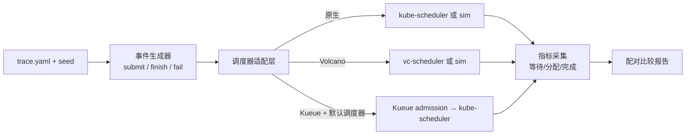

# 调度正确性与优化证据：不变式、指标与同轨迹对比

这篇页面回答两个容易被混在一起的问题：**怎么证明调度器没有做错**（正确性），以及**怎么证明某个策略更好**（优化）。前者靠不变量与失败注入，后者靠同一负载轨迹下的可重复对比；两者都不能靠"演示一次看起来没问题"。

覆盖范围：6 条正确性不变式（分配不超额、失败释放、状态重建、抢占可恢复、gang 原子性、幂等）、失败注入与测试证据的证明力边界、指标公式与三个系统的具体 metric 名、同轨迹对比（trace schema / 重放器 / 统计）、仿真与生产的边界、报告模板与反模式。不覆盖：具体产品的调参手册、性能 benchmark 结论（本专题没有生产 trace，任何"A 比 B 快 X%"都不是本文能给的结论）。

版本基线：Kubernetes **v1.37.2**（`c50e5395f1ae2d4a2c05f28fdcc38c0916cc1a32`）、Volcano **v1.16.1**（`a2543678633b4e30fda413f8ad386fc34e10f8ae`）、Kueue **main@2026-11-23**（`be7dc9d31470258dd324e5bd6d84f7eaf90f5f69`，晚于 v0.20.8，是未发布的 main 快照，不能当成某个 release 的行为）。原生 gang 相关能力受 `GenericWorkload`（Beta 默认关闭）等 feature gate 控制；Volcano 默认 action 只有 `enqueue, allocate, backfill`，`preempt`/`reclaim` 需要显式配置。下文凡涉及这些能力都按"开启后"描述，不要把默认值当成已生效。

## 1. 四类证据的证明力

先把"证据"分层，避免把测试当证明、把指标当因果。

| 证据类型 | 能证明 | 不能证明 | 本文位置 |
| --- | --- | --- | --- |
| 不变量（代码路径） | 某条约束在实现中被强制执行，以及违反时由谁回滚 | 运行时从未被违反、外部组件不会破坏它 | §2 |
| 单测 / 集成测试 | 特定输入下行为符合预期，回滚路径存在 | 规模、竞争、时钟、网络、apiserver 抖动下的行为 | §3 |
| 指标 | 生产或仿真中的分布与趋势 | 因果（是不是这个策略导致的） | §4 |
| 同轨迹对比 | 固定 trace 与固定容量下两个策略的差异 | 换 trace、换容量、换故障模型后仍成立 | §5 |

一个常见的错误链条是：看到集成测试通过 → 认为正确性没问题；看到 P95 等待下降 → 认为策略更好。前者只覆盖测试写到的路径，后者没控制 trace。这两件事必须分开做。

## 2. 六条正确性不变式

先给总表，再逐条展开。"最省事的破坏方式"一列是有意给出的反例，用来设计失败注入。

| # | 不变式 | 主要实现位置 | 最省事的破坏方式 | 失败后的现象 |
| --- | --- | --- | --- | --- |
| I1 | 分配不超额 | NodeInfo 资源账本 + assumed 集合；Kueue usage；Volcano node/queue 账本 | 直接改 cache，或让 Reserve 分配了账本外的资源 | 假性满载：节点还有空闲但 Filter 全失败 |
| I2 | 失败必释放 | `Unreserve` + `ForgetPod`；DRA `Unreserve`；Volcano `Statement.Discard`；Kueue 撤销假定 | Reserve 里返回错误但不实现 Unreserve | 资源泄漏：账本被占住，没有对应 Pod |
| I3 | 状态可重建 | informer 全量重建、snapshot、status 回写 | 把 assume / Session 内存态当成持久事实 | 重启后超卖、计数漂移、Pod 永久 Pending |
| I4 | 抢占可恢复 | victim 删除 + `nominatedNodeName` + 重试 | 删了 victim 但不清提名，或无视 grace period | preemptor 卡在提名节点，等到下一次事件 |
| I5 | gang 原子性 | 原生 `minCount` + Permit；Volcano `minMember` + `JobReady` | 只按单 Pod 成功判定，或让 backfill 绕过门槛 | 部分成员 Running、PodGroup 与 Pod 状态不一致 |
| I6 | 幂等 | Binding 单次；claim `reservedFor`；PodGroup/Workload status | 重复提交同一变更并期望"再写一次没关系" | 重复计数、phase 抖动、配额双扣 |

### 2.1 I1 分配不超额

**定义**。任意时刻，对任一节点 `n` 与资源 `r`：`Σ_{p ∈ pods(n)} request(p, r) ≤ allocatable(n, r)`；并且任何"已承诺但未落地"的分配都记在一个**可撤销**的账本里。第二个分句比不等式本身更重要——调度的分配是暂记（assume），不是 API 里的既成事实。

**在哪个实现里保证**。

- 原生：`AssumePod` 把 Pod 以 `Spec.NodeName=host` 写入 cache 并加入 `assumedPods`，资源立刻从 `NodeInfo` 扣除（[cache.go#L447-L461](https://github.com/kubernetes/kubernetes/blob/c50e5395f1ae2d4a2c05f28fdcc38c0916cc1a32/pkg/scheduler/backend/cache/cache.go#L447-L461)）。确认路径是 apiserver 接受 Binding 后 informer 收到带 `NodeName` 的 Pod，`AddPod` 把 assumed 转正（[cache.go#L609-L637](https://github.com/kubernetes/kubernetes/blob/c50e5395f1ae2d4a2c05f28fdcc38c0916cc1a32/pkg/scheduler/backend/cache/cache.go#L609-L637)）。
- 原生快照：每个调度周期开始 `UpdateSnapshot` 先 `forgetAllAssumedPods`，把上一个快照版本里的 assumed 全部丢弃再按增量重建（[cache.go#L206-L236](https://github.com/kubernetes/kubernetes/blob/c50e5395f1ae2d4a2c05f28fdcc38c0916cc1a32/pkg/scheduler/backend/cache/cache.go#L206-L236)）。这是"漏掉一次 Forget 也不会永久多算"的安全网。
- Kueue：账本在 `clusterQueue.resourceNode.Usage`，调度周期用 `Snapshot` 拿一份"配额固定、用量克隆"的副本做模拟（[snapshot.go#L295-L305](https://github.com/kubernetes-sigs/kueue/blob/be7dc9d31470258dd324e5bd6d84f7eaf90f5f69/pkg/cache/scheduler/snapshot.go#L295-L305)）。Kueue 记的是 `nominalQuota` 加 `borrowingLimit`（[clusterqueue_types.go#L338-L366](https://github.com/kubernetes-sigs/kueue/blob/be7dc9d31470258dd324e5bd6d84f7eaf90f5f69/apis/kueue/v1beta2/clusterqueue_types.go#L338-L366)、[cohortName](https://github.com/kubernetes-sigs/kueue/blob/be7dc9d31470258dd324e5bd6d84f7eaf90f5f69/apis/kueue/v1beta2/clusterqueue_types.go#L103-L110)），不是节点容量。
- Volcano：`Session` 打开时从 cache 克隆 Nodes/Jobs/Queues（[session.go#L183-L200](https://github.com/volcano-sh/volcano/blob/a2543678633b4e30fda413f8ad386fc34e10f8ae/pkg/scheduler/framework/session.go#L183-L200)），action 内部只改克隆体；队列配额维度是 Weight/Capability/Guarantee/Deserved（[types.go#L622-L666](https://github.com/volcano-sh/volcano/blob/a2543678633b4e30fda413f8ad386fc34e10f8ae/staging/src/volcano.sh/apis/pkg/apis/scheduling/v1beta1/types.go#L622-L666)）。

**怎么验证 / 怎么破坏**。验证靠两层：单测断言 assume 后 `NodeInfo` 的扣减与 `ForgetPod` 后的还原（`TestAssumePodScheduled`、`TestSchedulerCache_UpdateSnapshot`，见 §3.1）；运行时用 `scheduler_cache_size{type="assumed_pods"}` 与 `scheduler_pending_pods` 交叉看。破坏方式是让"账本外分配"出现：在自定义 Reserve 插件里把资源记到自己的表里，而 `Unreserve` 只清自己的表、不调用框架的释放——或者干脆让 `AssumePod` 与 `RunReservePluginsReserve` 的次序被绕过（见 I2）。

**失败后的现象**。典型症状不是"两个 Pod 抢到同一份 CPU"（Binding 会被 apiserver 拒绝，见 I6），而是**假性满载**：目标节点 allocatable 还有余量，但 Filter 对所有节点返回 `Unschedulable`，`scheduler_unschedulable_pods{plugin=NodeResourcesFit}` 上升，实际利用率（kubelet 侧）却不高。第二类症状是 `cache_size{type="assumed_pods"}` 长期不回落。

### 2.2 I2 失败必释放

**定义**。从"资源被暂记"到"资源被确认"之间的每一步都可能失败；每一步失败都必须把账本恢复到该步之前的状态，且释放动作本身要能被重复调用。释放不完整的后果比调度失败严重得多——失败只是慢，泄漏会让集群永久少一块容量。

**在哪个实现里保证**。按失败点分四条链路：

| 层 | 失败点 | 释放动作 | 代码 |
| --- | --- | --- | --- |
| 原生 | Reserve 拒绝 | `RunReservePluginsUnreserve` + `ForgetPod`，转成 `FitError` 回队列 | [schedule_one.go#L315-L363](https://github.com/kubernetes/kubernetes/blob/c50e5395f1ae2d4a2c05f28fdcc38c0916cc1a32/pkg/scheduler/schedule_one.go#L315-L363) |
| 原生 | Permit 拒绝 / 超时 | 同上；随后进 unschedulable，而不是 backoff | [schedule_one.go#L507-L538](https://github.com/kubernetes/kubernetes/blob/c50e5395f1ae2d4a2c05f28fdcc38c0916cc1a32/pkg/scheduler/schedule_one.go#L507-L538) |
| 原生 | PreBind / Bind 失败 | `Unreserve` + `ForgetPod` + 进 backoffQ；此处**不能再判** `Unschedulable` | [schedule_one.go#L448-L456](https://github.com/kubernetes/kubernetes/blob/c50e5395f1ae2d4a2c05f28fdcc38c0916cc1a32/pkg/scheduler/schedule_one.go#L448-L456) |
| 原生 DRA | PreBind 失败 | `Unreserve`：移除 pending allocation、`AssumedClaimRestore`、patch 掉 `reservedFor` 里的本 Pod | [dynamicresources.go#L1583-L1620](https://github.com/kubernetes/kubernetes/blob/c50e5395f1ae2d4a2c05f28fdcc38c0916cc1a32/pkg/scheduler/framework/plugins/dynamicresources/dynamicresources.go#L1583-L1620) |
| Volcano | Allocate 后 job 未 Ready | `Statement.Discard` 逆序 `unallocate`/`unevict` | [statement.go#L377-L400](https://github.com/volcano-sh/volcano/blob/a2543678633b4e30fda413f8ad386fc34e10f8ae/pkg/scheduler/framework/statement.go#L377-L400) |
| Volcano | Bind 失败 | `taskUnschedulable` + `PreBindRollBack` + `resyncTask` | [cache.go#L1102-L1135](https://github.com/volcano-sh/volcano/blob/a2543678633b4e30fda413f8ad386fc34e10f8ae/pkg/scheduler/cache/cache.go#L1102-L1135) |
| Kueue | admit 写 API 失败 | 若 cache 里仍是本轮的 resourceVersion，`DeleteWorkloadIfUnchanged` 撤销假定 | [cache.go#L1063-L1075](https://github.com/kubernetes-sigs/kueue/blob/be7dc9d31470258dd324e5bd6d84f7eaf90f5f69/pkg/cache/scheduler/cache.go#L1063-L1075) |

三条细节值得单独记：

1. **`unreserveAndForget` 是两件事**：先跑插件 Unreserve，再 `ForgetPod`。PodGroup 场景走的是 `nodeInfoSnapshot.ForgetPod` 并恢复 Pod 的 nomination，而不是 `Cache.ForgetPod`（[schedule_one.go#L366-L397](https://github.com/kubernetes/kubernetes/blob/c50e5395f1ae2d4a2c05f28fdcc38c0916cc1a32/pkg/scheduler/schedule_one.go#L366-L397)）。`ForgetPod` 与 `RemoveAssumedPod` 的差别只在 PodGroup 成员：前者把成员退回 PodGroup 的未调度集合，后者彻底移除（[cache.go#L477-L519](https://github.com/kubernetes/kubernetes/blob/c50e5395f1ae2d4a2c05f28fdcc38c0916cc1a32/pkg/scheduler/backend/cache/cache.go#L477-L519)）。
2. **DRA 的释放分两步，第二步不在调度器里**。`Unreserve` 只在"没有其它 Pod 还需要这份 pending allocation"时才移除它，然后把 `reservedFor` 里本 Pod 的 uid 用 strategic-merge patch 删掉。真正的 deallocate 由 ResourceClaim 控制器在 `reservedFor` 变空时完成——它把 `status.allocation` 置空，从而把设备还给集群（[controller.go#L1583-L1612](https://github.com/kubernetes/kubernetes/blob/c50e5395f1ae2d4a2c05f28fdcc38c0916cc1a32/pkg/controller/resourceclaim/controller.go#L1583-L1612)）。所以"claim 仍存在、allocation 仍非空、但 reservedFor 为空"是一个**正常中间态**；真正要警惕的是 `reservedFor` 永远不空。
3. **Volcano 的回滚是内存事务，不是 API 撤销**。`Statement` 只记录 `Evict`/`Pipeline`/`Allocate` 三种 op，`Discard` 逆序调用 `unevict`/`unPipeline`/`unallocate`（[statement.go#L123-L150](https://github.com/volcano-sh/volcano/blob/a2543678633b4e30fda413f8ad386fc34e10f8ae/pkg/scheduler/framework/statement.go#L123-L150)、[statement.go#L329-L357](https://github.com/volcano-sh/volcano/blob/a2543678633b4e30fda413f8ad386fc34e10f8ae/pkg/scheduler/framework/statement.go#L329-L357)）。如果 `Commit` 已经把 bind 发出去，`Discard` 撤不回来，只能靠 bind 失败分支的 `resyncTask`。

Volcano 的 `Commit` 在 Allocate 失败时会自己再 `unallocate` 一次（[statement.go#L402-L432](https://github.com/volcano-sh/volcano/blob/a2543678633b4e30fda413f8ad386fc34e10f8ae/pkg/scheduler/framework/statement.go#L402-L432)），这是"释放动作要幂等"的一个实现级例子。

**怎么验证 / 怎么破坏**。验证靠 statement 单测（`TestDiscardReversesOperations`、`TestAllocateAutoRollbackOnError`，见 §3.2）与 Kueue 的两个写失败用例（§3.3）。破坏方式：在 Reserve 里 `return framework.AsStatus(err)` 却不实现 `Unreserve`；或者实现 `Unreserve` 但漏掉"移除 pending allocation"这一步。

**失败后的现象**。`scheduler_cache_size{type="assumed_pods"}` 只增不减；节点 `Allocatable` 逐步"消失"但没有任何 Pod 在跑；Volcano 表现为同一 Pod 在下一轮 session 里仍被算作已分配、却从未 bind；Kueue 表现为 `cluster_queue_resource_reservation` 比 `cluster_queue_resource_usage` 高出一块且不回落。

### 2.3 I3 状态可重建

**定义**。调度器的内存状态必须能从持久对象**重新推导**出来；任何"只存在于内存、丢失后无法重建"的承诺都是 bug。可重建性的判据是：杀掉进程，重启后不超卖、不重复绑定、不永久丢任务。

**在哪个实现里保证**。

- 原生：不持久化 assume 与队列。重启后 cache 从 informer 全量构建，已绑定 Pod 以 `Spec.NodeName` 恢复，未绑定 Pod 由 `addPodToSchedulingQueue` 重新进队（[eventhandlers.go#L238-L248](https://github.com/kubernetes/kubernetes/blob/c50e5395f1ae2d4a2c05f28fdcc38c0916cc1a32/pkg/scheduler/eventhandlers.go#L238-L248)）；`nominatedNodeName` 在 Pod status 里，所以抢占提名也能恢复。快照本身也是从 cache 派生（[snapshot.go#L184-L220](https://github.com/kubernetes/kubernetes/blob/c50e5395f1ae2d4a2c05f28fdcc38c0916cc1a32/pkg/scheduler/backend/cache/snapshot.go#L184-L220)）。
- Volcano：`Session` 是**一次调度回合的快照**，不是持久状态；进程重启后 cache 由 informer 重建，`Run` 启动 informer、等同步完成后才允许调度（[cache.go#L971-L975](https://github.com/volcano-sh/volcano/blob/a2543678633b4e30fda413f8ad386fc34e10f8ae/pkg/scheduler/cache/cache.go#L971-L975)），每个调度回合再从 cache 克隆一份 `ClusterInfo`（[cache.go#L1626-L1645](https://github.com/volcano-sh/volcano/blob/a2543678633b4e30fda413f8ad386fc34e10f8ae/pkg/scheduler/cache/cache.go#L1626-L1645)）。持久化的只有 PodGroup/Queue 的 status：`CloseSession` 里 `JobUpdater.UpdateAll()` + `updateQueueStatus` 把这一轮结果写回 API（[session.go#L540-L556](https://github.com/volcano-sh/volcano/blob/a2543678633b4e30fda413f8ad386fc34e10f8ae/pkg/scheduler/framework/session.go#L540-L556)），下一轮再按 Pod 状态重算 phase（`getPodGroupPhase`）。
- Kueue：持久事实是 `Workload.status.admission`。cache 从 informer 重建并由已准入的 Workload 重算用量；因为"写成功但 cache 没看到"和"cache 改了但写失败"都可能发生，所以用 resourceVersion 做条件删除/条件更新（[cache.go#L1063-L1075](https://github.com/kubernetes-sigs/kueue/blob/be7dc9d31470258dd324e5bd6d84f7eaf90f5f69/pkg/cache/scheduler/cache.go#L1063-L1075)）。

**怎么验证 / 怎么破坏**。验证方式是在"assume 之后、bind 之前"杀进程（`kill -9`，不要用会走 graceful shutdown 的 `SIGTERM`），重启后核对：节点上没有两个 Pod 声称同一份资源、Pending 数量没有永久增加、`nominatedNodeName` 指向的 Pod 最终要么绑定要么被清理。破坏方式是引入第二个 scheduler 实例同时处理同一批 Pod（没有正确的 leader election 或 sharding），或者在 Volcano 里把某个 Session 内分配结果当作"已提交"直接写 status。

**失败后的现象**。①双绑定尝试：两个实例给同一 Pod 写不同 `NodeName`，后者收到 Conflict；②计数漂移：PodGroup 的 `Phase` 在 `Pending`/`Inqueue` 之间抖动，因为每轮重算的输入不同步；③永久 Pending：`nominatedNodeName` 指向的节点上 victim 已消失，但没有事件把 Pod 唤醒（QueueingHint 的经典失效场景）。

### 2.4 I4 抢占可恢复

**定义**。抢占是一个多步、跨组件的操作：选 victim → 标记 → 删除 victim → 等资源真正释放 → preemptor 再次调度 → 绑定。中间任何一步的延迟或失败都不能让 preemptor 永远卡住。

**在哪个实现里保证**。

- **victim 真正删除**：原生走 `Delete`（[utils.go#L195-L199](https://github.com/kubernetes/kubernetes/blob/c50e5395f1ae2d4a2c05f28fdcc38c0916cc1a32/pkg/scheduler/util/utils.go#L195-L199)），由 preemption executor 调用（[executor.go#L140-L150](https://github.com/kubernetes/kubernetes/blob/c50e5395f1ae2d4a2c05f28fdcc38c0916cc1a32/pkg/scheduler/framework/preemption/executor.go#L140-L150)）。Volcano 走 `defaultEvictor`，先写 `DisruptionTarget` condition 再 Delete（[cache.go#L284-L330](https://github.com/volcano-sh/volcano/blob/a2543678633b4e30fda413f8ad386fc34e10f8ae/pkg/scheduler/cache/cache.go#L284-L330)）。
- **资源释放的延迟**：Pod 被 Delete 后进入 Terminating，`terminationGracePeriodSeconds` 内容器仍在跑、仍占资源，直到 kubelet 完成终止、apiserver 真正删除对象。**这是"抢占执行了但 preemptor 还 Pending"的第一大原因**，不是调度器 bug。
- **preemptor 重试**：原生在绑定周期给 preemptor 写 `nominatedNodeName`（[schedule_one.go#L420-L432](https://github.com/kubernetes/kubernetes/blob/c50e5395f1ae2d4a2c05f28fdcc38c0916cc1a32/pkg/scheduler/schedule_one.go#L420-L432)），并在 Filter 阶段对 nominated pods 做"双跑"（带/不带低优先级提名 Pod 各算一次），从而判断提名是否还有效。抢占失败后 Pod 进 unschedulable 或 backoff，等待事件唤醒。
- **PDB 与 grace period**：原生 v1.37.2 的 `DefaultPreemption` **会读取 PDB**：`getPodDisruptionBudgets` 拉取全部 PDB，`SelectVictimsOnNode` 把 victim 分成 violating/non-violating，优先 reprieve 会造成违规的 victim，并在多节点候选中偏向 PDB 违规数更少的方案（[preemption.go#L216-L220](https://github.com/kubernetes/kubernetes/blob/c50e5395f1ae2d4a2c05f28fdcc38c0916cc1a32/pkg/scheduler/framework/preemption/preemption.go#L216-L220)、[default_preemption.go#L384-L430](https://github.com/kubernetes/kubernetes/blob/c50e5395f1ae2d4a2c05f28fdcc38c0916cc1a32/pkg/scheduler/framework/plugins/defaultpreemption/default_preemption.go#L384-L430)）。但 PDB 是**偏好而不是硬闸门**：必要时仍可能击穿，而且最终走 `Delete` 而不是 Eviction 子资源，所以不经过 PDB 的准入检查。Volcano 则用 `pdb` 插件在 victim 选择阶段过滤（[pdb.go#L136-L143](https://github.com/volcano-sh/volcano/blob/a2543678633b4e30fda413f8ad386fc34e10f8ae/pkg/scheduler/plugins/pdb/pdb.go#L136-L143)），最终同样是 Delete。
- **进度损失**：被抢占的是训练作业时，损失 ≈ 上次 checkpoint 之后的步数（§4.5）。这部分损失不出现在任何调度器指标里，必须由训练框架侧记录。

**怎么验证 / 怎么破坏**。验证：观察 `scheduler_preemption_victims` 与实际 Pod 删除时间的差；注入 `terminationGracePeriodSeconds` 很长且不做 preStop 的 victim，看 preemptor 的等待是否超过预期。破坏：把 PDB 当"抢占保护伞"（原生只是优先少违规，不保证零违规；且 Delete 不走 Eviction API）；或让 preemptor 的提名一直指向一个已经不再有 victim 的节点，同时抑制 `AssignedPodDelete` 事件。

**失败后的现象**。preemptor 长期 `Pending` 且 `nominatedNodeName` 指向同一个节点；`scheduler_preemption_attempts_total` 增长但 `preemption_victims` 不再增长；受害作业的重调度与 preemptor 形成"抢了又被抢"的循环。

### 2.5 I5 gang 原子性

**定义**。一个 gang 要么达到 `minCount`/`minMember` 个成员被放行，要么一个都不放行。这里的"原子"只覆盖**放行决策**，不覆盖运行期：已放行的成员不会因为后来某个成员失败而被整体撤回。

**在哪个实现里保证**。

- 原生：`GangScheduling` 插件在 Permit 阶段检查 PodGroup 已调度成员数是否达到 `MinCount`；未达到就返回 `Wait`，等待时长上限是 `permitTimeoutDuration = 5 * time.Minute`（[gangscheduling.go#L38-L44](https://github.com/kubernetes/kubernetes/blob/c50e5395f1ae2d4a2c05f28fdcc38c0916cc1a32/pkg/scheduler/framework/plugins/gangscheduling/gangscheduling.go#L38-L44)、[gangscheduling.go#L396-L410](https://github.com/kubernetes/kubernetes/blob/c50e5395f1ae2d4a2c05f28fdcc38c0916cc1a32/pkg/scheduler/framework/plugins/gangscheduling/gangscheduling.go#L396-L410)）。超时的实现是给每个等待中的 Pod 起 timer，到点 `Reject`（[waiting_pods_map.go#L95-L110](https://github.com/kubernetes/kubernetes/blob/c50e5395f1ae2d4a2c05f28fdcc38c0916cc1a32/pkg/scheduler/framework/runtime/waiting_pods_map.go#L95-L110)），状态码是 `Unschedulable` 而不是 `Error`。
- Volcano：`gang` 插件注册 `JobValid`，检查有效任务数是否 ≥ `MinAvailable`（[gang.go#L57-L118](https://github.com/volcano-sh/volcano/blob/a2543678633b4e30fda413f8ad386fc34e10f8ae/pkg/scheduler/plugins/gang/gang.go#L57-L118)）；`allocate` 只在 `ssn.JobReady(job)` 时才 `Commit`（[allocate.go#L384-L392](https://github.com/volcano-sh/volcano/blob/a2543678633b4e30fda413f8ad386fc34e10f8ae/pkg/scheduler/actions/allocate/allocate.go#L384-L392)）。`backfill` **故意不保证 gang**，它只挑 pending task 做 first-fit，整个文件里没有 `JobReady` 调用。

**关键边界**：原生的原子性只到"未达 minCount 时不让任何成员通过 Permit"。一旦成员通过 Permit 并 bind，超时拒绝的是**另一个**还没通过的 Pod，已通过的成员不会回滚。所以"gang 原子性 = 不会出现部分绑定"是错的，正确说法是"不会在配额不足时放行整组，但已放行部分不回滚"。Volcano 的 `backfill` 同理：它是利用率工具，不是 gang 保证。

**怎么验证 / 怎么破坏**。验证：`TestGangSchedulingFlow`（§3.1）覆盖 minCount 门控与 CompositePodGroup；集成测试 `TestPodGroupScheduling` 覆盖真实 apiserver 下的 gang 行为。破坏：只提交 `minCount-1` 个成员并观察 5 分钟窗口；把 `minMember` 设得大于队列 capability；在 `backfill` 打开时只给一半资源。

**失败后的现象**。①死锁：两个 gang 各占一半资源、互相等对方释放，谁也不满足 minCount；②部分成员 Running 而 PodGroup `Phase=Pending`；③Permit 超时后成员被逐个拒绝，日志里能看到 `rejected due to timeout`，但没有"整组撤回"的动作。

### 2.6 I6 幂等

**定义**。同一个变更被重复提交时，第二次应该什么都不改（或明确失败），而不是再产生一次副作用。调度链路上有四个独立的幂等点：Binding、claim 预留、PodGroup status、Workload admission。

- **Binding**：同一 Pod 只能有一个 `spec.nodeName`。重复 Binding 会被 apiserver 以 Conflict 拒绝，因此"重试绑定"天然安全——代价是第二次失败要落回 backoff，而不是被当成不可调度。
- **claim 预留**：`reservedFor` 是集合语义，`Unreserve` 用 strategic-merge patch 按 uid 删除单个条目（[dynamicresources.go#L1583-L1620](https://github.com/kubernetes/kubernetes/blob/c50e5395f1ae2d4a2c05f28fdcc38c0916cc1a32/pkg/scheduler/framework/plugins/dynamicresources/dynamicresources.go#L1583-L1620)），函数注释明确写了 "It's idempotent"。重复调用不会把别人的预留删掉，也不会重复 deallocate。
- **PodGroup status**：Volcano 每轮由 `closeSession` 重算并写回，输入是任务状态；同样的输入重复写是幂等的。但"输入不同步"会让 phase 抖动（见 I3）。
- **Workload admission**：Kueue 的准入是"假定 → 异步 patch"。这里幂等不是靠重试，而是靠 resourceVersion 条件：写失败时只有在 cache 仍持有本轮版本时才撤销假定，否则保留（[scheduler.go#L1132-L1200](https://github.com/kubernetes-sigs/kueue/blob/be7dc9d31470258dd324e5bd6d84f7eaf90f5f69/pkg/scheduler/scheduler.go#L1132-L1200)）。这条分支正是为了避免"撤销已经成功的写"。

**怎么验证 / 怎么破坏**。验证：重复调用 `Unreserve`/`ForgetPod`（单测已覆盖），或重复 patch 同一个 Workload；Kueue 的两个用例分别覆盖"第一遍写失败要丢弃"和"已提交但客户端报错要保留"（§3.3）。破坏：把 `reservedFor` 当成"覆盖写"而不是"集合增删"，或在 admit 失败时无条件从 cache 删除。

**失败后的现象**。①配额双扣：`cluster_queue_resource_reservation` 是真实值的两倍；②指标双计：同一个 Pod 的 bind 被记两次 `schedule_attempts_total`；③claim 被误释放：另一 Pod 的预留被覆盖掉，导致设备被重复分配。

## 3. 失败注入与测试证据

测试的用途不是"证明对"，而是**证明某条回滚路径存在**。读测试时要问三个问题：它断言了什么（最终态还是中间态）、它用什么替身（fake 还是真 apiserver）、它有没有把超时/重试变成隐式假设。

### 3.1 Kubernetes：单测与集成

| 位置 | 代表用例 | 能证明 | 不能证明 |
| --- | --- | --- | --- |
| `pkg/scheduler/backend/cache` | `TestForgetPod`（[cache_test.go#L1572-L1580](https://github.com/kubernetes/kubernetes/blob/c50e5395f1ae2d4a2c05f28fdcc38c0916cc1a32/pkg/scheduler/backend/cache/cache_test.go#L1572-L1580)）、`TestSchedulerCache_UpdateSnapshot` | assume/forget/快照三者的账本一致性 | 与真实 apiserver 的时序竞争 |
| `pkg/scheduler/framework/plugins/gangscheduling` | `TestGangSchedulingFlow`（[gangscheduling_test.go#L830-L840](https://github.com/kubernetes/kubernetes/blob/c50e5395f1ae2d4a2c05f28fdcc38c0916cc1a32/pkg/scheduler/framework/plugins/gangscheduling/gangscheduling_test.go#L830-L840)） | minCount 门控、超时返回码、CompositePodGroup 语义 | 真实 bind 竞争与 5 分钟等待 |
| `test/integration/scheduler/podgroup` | `TestPodGroupScheduling`（[podgroup_test.go#L46-L52](https://github.com/kubernetes/kubernetes/blob/c50e5395f1ae2d4a2c05f28fdcc38c0916cc1a32/test/integration/scheduler/podgroup/podgroup_test.go#L46-L52)） | 真 apiserver + informer 下的 PodGroup 调度与抢占触发 | 规模、延迟分布、中间态 |
| `test/integration/scheduler/bind` | `TestDefaultBinder`（[bind_test.go#L35-L40](https://github.com/kubernetes/kubernetes/blob/c50e5395f1ae2d4a2c05f28fdcc38c0916cc1a32/test/integration/scheduler/bind/bind_test.go#L35-L40)） | 绑定周期在 async API 开关两种配置下都能收敛 | 绑定失败后的队列分布 |

要特别注意：集成测试等的是"最终状态"，它**不检查**"中间是否曾经超额"。所以"集成测试全绿"不能推出 I1，只能推出 I3 的弱形式（最终不超卖）。

### 3.2 Volcano：action 单测与 `TestCommonStruct`

Volcano 的 action 单测统一走 `uthelper.TestCommonStruct`（[helper.go#L58-L124](https://github.com/volcano-sh/volcano/blob/a2543678633b4e30fda413f8ad386fc34e10f8ae/pkg/scheduler/uthelper/helper.go#L58-L124)）：把 Pods/Nodes/Queues/PodGroups/ResourceSlices 塞进假 cache，`RegisterSession` 打开 Session，`Run(actions)` 依次执行（[helper.go#L214-L231](https://github.com/volcano-sh/volcano/blob/a2543678633b4e30fda413f8ad386fc34e10f8ae/pkg/scheduler/uthelper/helper.go#L214-L231)），最后 `CheckAll` 断言 bind 集合、evict 集合、pipelined 结果、任务状态计数与 PodGroup phase。

```go
// 断言的是"action 应该产生哪些 bind/evict"，而不是 bind 是否真的成功
ExpectBindMap:        map[string]string{"ns/pod": "node"},
ExpectEvicted:        []string{"ns/victim"},
ExpectBindsNum:       1,
ExpectEvictNum:       1,
ExpectStatus:         map[api.JobID]scheduling.PodGroupPhase{...},
```

能证明：给定输入，`allocate`/`backfill`/`preempt`/`reclaim` 产生的 bind/evict **集合与数量**符合预期，且 `Statement` 回滚后内存状态正确。不能证明：bind 真的成功（`FakeBinder` 只记录 channel）、跨 session 的持久状态、真实 apiserver 的冲突。`CheckBind` 用的是 300ms 超时轮询，在慢 CI 上会 flaky——**不要把一个 flaky 用例当作"行为不稳定"的证据**。

`Statement` 的事务语义有独立单测：`TestDiscardReversesOperations`（[statement_test.go#L365-L375](https://github.com/volcano-sh/volcano/blob/a2543678633b4e30fda413f8ad386fc34e10f8ae/pkg/scheduler/framework/statement_test.go#L365-L375)）逐 op 验证 Pipeline/Allocate/Evict 的逆操作，`TestAllocateAutoRollbackOnError` 验证 `Commit` 内 allocate 失败时的自愈。它们能证明内存回滚，**不能**证明"API 侧的操作也被撤销"——那要看 bind 失败分支。

### 3.3 Kueue：scheduler 单测与集成

Kueue 的写失败语义有两个非常直接的用例：

- `TestSchedulerDropsAssumedWorkloadWhenFirstPassAdmissionWriteFails`（[scheduler_test.go#L12432-L12440](https://github.com/kubernetes-sigs/kueue/blob/be7dc9d31470258dd324e5bd6d84f7eaf90f5f69/pkg/scheduler/scheduler_test.go#L12432-L12440)）：第一遍准入写失败 → 从 cache 丢弃假定。
- `TestSchedulerKeepsAdmittedWorkloadWhenCommittedAdmissionWriteReportsError`（[scheduler_test.go#L12554-L12562](https://github.com/kubernetes-sigs/kueue/blob/be7dc9d31470258dd324e5bd6d84f7eaf90f5f69/pkg/scheduler/scheduler_test.go#L12554-L12562)）：写其实已提交、只是客户端报错 → 保留准入，不能撤销。

这两条合起来就是"幂等 + 回滚"的完整语义，也是 §2.6 最硬的证据。公平性排序有 `TestScheduleForFairSharing`（[scheduler_fs_test.go#L40-L46](https://github.com/kubernetes-sigs/kueue/blob/be7dc9d31470258dd324e5bd6d84f7eaf90f5f69/pkg/scheduler/scheduler_fs_test.go#L40-L46)）；集成层在 `test/integration/singlecluster/scheduler/{preemption_test.go,fairsharing/}`，用真实 CRD 与 controller 覆盖"驱逐 → requeue → 再准入"闭环。

不能证明：多副本 leader 切换窗口、真实规模下的调度延迟、以及"驱逐后 Pod 真的停止了"（那由 pod-termination controller 与 kubelet 决定）。

### 3.4 四个可复用的故障注入配方

| 目标 | 注入手段 | 期望观测 | 常见误判 |
| --- | --- | --- | --- |
| assume 后 bind 失败 | 用 ValidatingWebhook 拒绝 `pods/binding`，或把目标节点设为 NotReady | assumed 计数回落、Pod 进 backoffQ、`schedule_attempts_total{result=error}` 上升 | 看到 Pending 就归因 Filter |
| Permit 超时 | 只提交 `minCount-1` 个 gang 成员 | 成员在等待窗口后变 `Unschedulable`，reason 含 `rejected due to timeout` | 归因资源不足 |
| claim 竞争 | 两个 Pod 引用同一 ResourceClaim，制造 resourceVersion 冲突 | 一个成功、一个回 backoff；`reservedFor` 只有一个 uid | 归因 DRA 插件 bug |
| cache 重建 | 在 assume 与 bind 之间 `kill -9` scheduler | 重启后不超卖、Pod 重新入队、`cache_size{type="assumed_pods"}` 归零 | 只看 Pod 最终 Running 就收工 |

## 4. 指标：定义、公式与代码位置

指标的第一原则：**先写清楚分子、分母、时间窗和标签，再看数值**。同一个名字在不同系统里语义可能完全不同。

### 4.1 等待时间

三个窗口必须分开报，否则会得出矛盾结论：

| 窗口 | 公式 | 覆盖什么 | 数据来源 |
| --- | --- | --- | --- |
| 创建 → 绑定 | `t_bind − pod.metadata.creationTimestamp` | 全部等待，含准入、门控、调度、绑定 | 需自己从事件或 status 拼 |
| 入队 → 绑定 | `t_bind − t_enqueued` | 只含调度器内部等待 | 原生 `pod_scheduling_sli_duration_seconds` |
| 创建 → 开始运行 | `t_running − t_created` | 还含镜像拉取、卷挂载、init | kubelet / 事件 |

原生的 SLI 直方图明确写的是"从进入调度队列开始"（[metrics.go#L369-L381](https://github.com/kubernetes/kubernetes/blob/c50e5395f1ae2d4a2c05f28fdcc38c0916cc1a32/pkg/scheduler/metrics/metrics.go#L369-L381)），标签只有 `attempts`。它的分母是**成功绑定的 Pod**，所以失败/被撤销的 Pod 不在样本里（幸存者偏差，见 §6.2）。Kueue 把等待拆成 `quota_reserved_wait_time_seconds`（创建或重新入队 → 拿到配额预留）与 `admission_wait_time_seconds`（创建或重新入队 → 准入）（[metrics.go#L604-L675](https://github.com/kubernetes-sigs/kueue/blob/be7dc9d31470258dd324e5bd6d84f7eaf90f5f69/pkg/metrics/metrics.go#L604-L675)）。Volcano 的 `e2e_job_scheduling_duration` 是**作业创建 → 最后一个 task 被 assume**，不是 Running（[metrics.go#L81-L108](https://github.com/volcano-sh/volcano/blob/a2543678633b4e30fda413f8ad386fc34e10f8ae/pkg/scheduler/metrics/metrics.go#L81-L108)）。

### 4.2 完成时间（makespan / JCT）

- 作业周转时间：`JCT_i = C_i − S_i`，`S_i` 用作业首次提交时间（不是首个 Pod 被调度的时间），`C_i` 必须明确是"最后一个 Pod Succeeded"还是"Workload 标记 Finished"。两者在带 sidecar 或有重试的作业上能差出很多。
- makespan：`M = max_i(C_i) − min_i(S_i)`，时间窗为一批作业的提交区间。makespan 对长尾极敏感，必须同时报 P50/P95，否则一个卡住的作业会让整组数字失去意义。
- 吞吐：`N_finished / T_window`，注意按 `S_i` 还是 `C_i` 归窗会导致不同的结论。

示例（数值仅用于说明计算方式，不是实测）：若一批 10 个作业在窗口内 `min(S)=0s`、`max(C)=3600s`，则 `M=3600s`；其中 9 个 JCT 为 600s、1 个为 3600s，则 JCT P50=600s、P95≈3600s，均值被长尾拉到 900s。只看均值会得出"平均 15 分钟"的错误印象。

### 4.3 分配率与利用率

这两个词最常被混用。**分配率看的是 request，利用率看的是实际消耗**，而调度器只知道前者。

- 分配率（时间加权，不是瞬时快照）：`A = (1/T) · ∫_0^T [ Σ_q allocated_q(t) / Σ_n allocatable_n(t) ] dt`。用 `rate()` 会算成"每秒变化量"，必须用 `avg_over_time` 或对 gauge 做积分。
- 利用率：`U = Σ actual_usage / Σ allocatable`，来源是 kubelet/cAdvisor/DCGM 等，**不在调度器指标里**。`A` 高 `U` 低说明超卖或 request 虚高。
- 队列份额：`share_q = allocated_q / Σ_q allocated_q`，分母是同一层级的可分配量；层级队列（Volcano capacity、Kueue cohort）必须按同一父节点聚合，否则跨层比较无意义。
- 原生没有队列概念，只有 PriorityClass/Namespace 维度；要做队列份额必须换系统或自己聚合。

### 4.4 碎片

碎片没有唯一公式，必须声明用的是哪一种：

1. **机会成本（推荐）**：`F = 1 − (能放下的最大同形 gang 的 request 之和) / allocatable`。需要一个离线 oracle（把当前空闲资源喂给 binpacking 求解器），监控里读不到，只能在采集点周期性计算。
2. **维度失衡**：`F_dim = 1 − max_r(allocated_r / allocatable_r)`。`F_dim` 大说明还有余量，但如果同时有大量 Pending，就说明余量是"错的维度"（例如 CPU 有余、GPU 已满）。
3. **代理指标**：`scheduler_unschedulable_pods{plugin=NodeResourcesFit}`、Volcano `unschedule_task_count`、Kueue `pending_workloads`。这些是症状，不是碎片本身。

拓扑碎片与设备碎片要单独看：机架/NVLink 域内是否还有"整组"可用、GPU 是否被切到无法再放整卡（MIG 场景）。

### 4.5 进度损失

被抢占或失败重启时，训练作业损失的是"上次 checkpoint 之后的进度"：

- 单次损失步数：`L_i = (t_evict − t_last_ckpt) / t_step`。
- 折算资源损失：`G_i = L_i · t_step · gpus_i`（GPU·秒）。
- 相对损失率：`LossRatio = Σ G_i / Σ (有效的 allocated GPU·秒)`。
- 无 checkpoint 的作业，损失 = 全部已完成进度；带 checkpoint 的作业，期望损失约为间隔的一半（假设驱逐时刻在间隔内均匀分布，这是**模型假设**，不是事实）。

标签建议：`job`、`queue`、`checkpoint_interval`、`evict_reason`。时间窗按作业或按天，不要按分钟（样本太少）。

### 4.6 三个系统的指标对照

| 语义 | 原生（`scheduler_` 前缀） | Volcano（`volcano_` 前缀） | Kueue（`kueue_` 前缀） |
| --- | --- | --- | --- |
| 等待（入队→绑定） | `pod_scheduling_sli_duration_seconds{attempts}` | `e2e_job_scheduling_duration{job_name,queue,job_namespace}` | `quota_reserved_wait_time_seconds`、`admission_wait_time_seconds` |
| 调度尝试 | `schedule_attempts_total{result,profile}` | `schedule_attempts_total` | `admission_attempts_total{result}` |
| 挂起量 | `pending_pods{queue}` | `unschedule_task_count` | `pending_workloads` |
| 抢占 | `preemption_victims`、`preemption_attempts_total` | `pod_preemption_victims`、`total_preemption_attempts`、`eviction_transactions_total{action}` | `evicted_workloads_total{reason,underlying_cause}` |
| 配额/账本 | 无 | `queue_allocated_milli_cpu{queue_name}`、`queue_allocated_memory_bytes`、`queue_allocated_scalar_resources{resource}` | `cluster_queue_resource_reservation`、`cluster_queue_resource_usage`、`cluster_queue_nominal_quota` |
| 公平 | 无 | `queue_deserved_*`、`queue_request_*` | `cluster_queue_weighted_share`、`cohort_weighted_share` |
| 完成/执行 | 无（调度器不管完成） | 无 | `execution_time_seconds`（含驱逐重准入） |
| Permit 等待 | `permit_wait_duration_seconds{result}` | 无（gang 无 Permit 阶段） | 无 |
| 阶段耗时 | `framework_extension_point_duration_seconds`、`plugin_execution_duration_seconds` | `plugin_scheduling_latency_milliseconds`、`action_scheduling_latency_milliseconds` | `admission_attempt_duration_seconds` |

三点提醒：

- 原生 `permit_wait_duration_seconds` 的标签只有 `result`，没有 plugin——想知道"是哪个 gang 卡住的"，只能看日志。
- Volcano 的 `queue_allocated_*` 由插件侧的 `allocated` 写入（[queue.go#L243-L249](https://github.com/volcano-sh/volcano/blob/a2543678633b4e30fda413f8ad386fc34e10f8ae/pkg/scheduler/metrics/queue.go#L243-L249)），含义是"本轮 Session 视角下已分配"，包含已 `Allocate` 但 bind 尚未完成的 task；`queue_request_*` 是**请求**。二者不能互换，指标里也没有"实际使用"。
- Kueue 的 `cluster_queue_weighted_share` 在权重为 0 且发生借用时返回 NaN，做图时要显式处理，否则会把 NaN 当 0 报。

### 4.7 口径速查

写报告前把这张表填满；分子分母的标签集和时间窗必须一致，否则比率没有意义。

| 指标 | 分子 | 分母 | 时间窗 | 必需标签 |
| --- | --- | --- | --- | --- |
| 等待 P50/P95 | 每个作业的 `t_admit − t_submit` | 作业数（失败单列，不混入） | 按提交日切片 | `queue`、`priority`、`gang_size` |
| makespan | —（极值，不是比率） | 一批作业 | 提交窗口 → 全部完成 | `batch_id` |
| 分配率 A | `Σ allocated · Δt` | `Σ allocatable · Δt` | 1h 或 1d 滑动 | `queue`、`node_pool` |
| 利用率 U | `Σ actual_usage · Δt` | `Σ allocatable · Δt` | 与 A 相同 | `node`、`gpu_model` |
| 碎片 F | `1 − largest_fit / allocatable` | `allocatable` | 采样点（如每 5min） | `node_pool`、拓扑域 |
| 进度损失 | `Σ lost_gpu_seconds` | `Σ allocated_gpu_seconds` | 按作业或按天 | `queue`、`checkpoint_interval`、`evict_reason` |

## 5. 同轨迹对比

目标：在同一份负载轨迹、同一份容量、同一套故障注入下比较两个策略，让差异只来自策略本身。

### 5.1 trace schema

轨迹的粒度要到"作业 + 成员 Pod"，字段少一个，后面的实验就做不了。

```yaml
trace_id: t-2026-11-a
seed: 1234
capacity: {nodes: 64, cpu: 4096, mem_gib: 16384, gpu: {A100: 32}}
window: {submit_from: 0s, submit_to: 86400s}
jobs:
  - id: j1
    submit_at: 0s                 # 相对窗口起点，不用绝对时间
    queue: q-train
    priority: 100
    gang: {min_member: 8, size: 8}
    pods:
      - {cpu: 8, mem_gib: 64, gpu: {A100: 1}, duration: 3600s}
    topology: {required: nvlink-domain, spread: rack}
    dra: {device_class: gpu-a100, count: 1}
    runtime_model: {dist: lognormal, p50: 1800s, p99: 21600s}
    failure_model: {preemptible: true, node_fail_rate: 0.001/h}
```

必填字段的理由：`submit_at` 决定到达过程；`gang` 决定死锁；`runtime_model` 决定 backfill 的收益；`failure_model` 决定抢占/重试的影响；`seed` 决定可复现。**没有 `runtime_model` 的 trace 只能比较"调度排序"，不能比较"利用率"**。

### 5.2 重放器



三条工程约束：

1. **时钟**：真实调度器的时钟不可控，重放时要么用离散事件仿真器，要么用"逻辑时间 + 屏障"——每次 `submit` 都等到上一个事件的调度决策落地再推进，否则测到的是重放器自身并发度。
2. **预热**：丢弃前 `W` 个作业的样本（集群从空开始，前几个作业的等待没有代表性），`W` 取"填满容量所需作业数"的经验值。
3. **终止条件**：全部作业完成，或到达 `window + max_runtime` 上限。不要用"跑满 N 分钟"——那会让 makespan 依赖采集时长。

### 5.3 统计

- 配对：同一 trace 的第 `i` 个作业在两个策略下的结果配对，比较差值而不是比较两组均值。
- 置信区间：对配对差值做 percentile bootstrap（重采样作业，10000 次），报中位数与 95% 区间。区间跨 0 就是"分不出胜负"。
- 样本量：等待时间分布通常重尾，P95 需要足够多的作业才稳定；样本不足时只报 P50 与"超过阈值的作业数"。
- 单 seed 不下结论：至少 5 个 seed（到达过程与运行时随机），报 seed 间方差；如果 seed 间方差大于策略差异，结论是"分不出"。

### 5.4 四个可执行实验

| 实验 | 假设 | 变量 | 主指标 | 判据 | 伪结论风险 |
| --- | --- | --- | --- | --- | --- |
| E1 fairness | 改权重只改份额分布，不显著改变 makespan | Volcano `proportion` 权重 / Kueue cohort 权重 | 每队列 `share_q` 与权益（Volcano `deserved` / Kueue weighted share）的相对偏差、等待 P95 | 偏差下降且 makespan 差值 CI 跨 0 | trace 中队列本身负载不均，份额差异来自负载 |
| E2 gang | 提高 `minMember` 会减少碎片但增加等待 | `minMember` ∈ {1, 4, 8, 16} | 原子性违例数、死锁次数、等待 P95、碎片 F | 违例=0 且等待增幅可接受 | 把 Permit 超时当作策略失败 |
| E3 backfill | 开 backfill 提高分配率、恶化大作业队头 | Volcano actions 含/不含 `backfill` | 分配率 A、大作业队头等待、小作业 P99 | A 上升且大作业等待不超阈值 | trace 太短，看不到长尾收益 |
| E4 DRA/拓扑 | 拓扑约束收紧会提高放置失败率与设备碎片 | `DeviceClass`/CEL、TAS 开关、binpack vs spread | `unschedulable_pods{plugin=DynamicResources}`、可放置整卡数、重试次数 | 失败率与碎片同时可接受 | 两次实验容量不同，差异来自容量 |

E2 的"原子性违例"要定义清楚：**存在 Running 成员但 PodGroup 未达到 Ready 的时间窗长度 > 0**。这在 Volcano 的 backfill 路径上是预期行为，必须和"allocate 路径违例"分开统计。E3 的"队头等待"是专属大作业的指标：大作业从提交到开始运行的时间，不受小作业数量影响。

## 6. 仿真 vs 生产

### 6.1 各自能回答什么

| 问题 | 仿真 | 生产 |
| --- | --- | --- |
| 排序/打分变化会不会改变结果 | 能（可控、可重复） | 不能（混杂因素太多） |
| 配额公式在极端负载下的行为 | 能（可以构造） | 难（极端负载不常出现） |
| gang 死锁、碎片趋势 | 能 | 只能观测到已经发生的 |
| 真实到达过程、突发 | 不能（是模型） | 能（但只有一次样本） |
| 运行时抖动、设备故障、网络 | 不能（除非显式建模） | 能，但不可控 |
| 调度器之外的瓶颈（镜像、存储、驱动） | 不能 | 能，但需要跨系统关联 |

结论的写法要匹配证据来源："在 trace A 与容量 C 下，策略 X 的等待 P95 比 Y 低"，不能写成"X 更好"。

### 6.2 生产指标的五个偏差

1. **幸存者偏差**：只统计完成的作业 → JCT 偏小；被抢占/失败重试的作业不在样本里。修法：把失败与驱逐也计入，或单独报失败率。
2. **缺少队列时间**：`creationTimestamp` 不是入队时间；Kueue 准入、SchedulingGates、镜像预热都在入队之前。原生的 SLI 从入队起算，会**低估**端到端等待。
3. **标签基数**：Volcano 的 `e2e_job_scheduling_duration` 带 `job_name`，作业多了会打爆 Prometheus；Kueue 的 custom labels 需要显式开启。高基数还会让采样与聚合结果失真。
4. **采集窗口**：直方图桶边界决定了 P99 的分辨率；`scrape_interval` 决定短作业被漏采的概率；进程重启会让 counter 归零，`rate()` 出现尖刺。
5. **多副本与切换**：scheduler/Kueue 多副本时，counter 在不同实例上分别累计，聚合要和 leader 切换时间对齐，否则会双计或漏计。

### 6.3 报告模板

| 策略 | 等待 P50 | 等待 P95 | makespan | 分配率 | 碎片 F | 进度损失 | 失败率 |
| --- | --- | --- | --- | --- | --- | --- | --- |
| baseline |  |  |  |  |  |  |  |
| 候选 A |  |  |  |  |  |  |  |
| 候选 B |  |  |  |  |  |  |  |

每行必须附：trace id、容量、seed 数、CI、指标定义（尤其"等待"是哪个窗口、"完成"指什么）。

**结论适用范围**（模板）："本结论基于 trace `<id>`（N 个作业、M 个 seed）、容量 `<C>`、`<gate/action 配置>`；在 `<等待窗口>` 与 `<完成定义>` 下，候选 A 的 P95 等待相对基线变化 `<x>%`（95% CI `<a,b>`），makespan 变化 `<y>%`（CI 跨 0 表示不显著）。该结论不覆盖：到达过程显著更突发的负载、`minMember` 更大的 gang、拓扑约束更紧的集群、以及调度器之外的瓶颈。"

### 6.4 反模式清单

| # | 反模式 | 为什么会错 | 正确做法 |
| --- | --- | --- | --- |
| 1 | 用两段不同时间的生产数据比较策略 | 负载、容量、版本都变了 | 同 trace 重放，或至少同窗口同容量 |
| 2 | 只看平均等待 | 重尾分布下均值无意义 | P50/P95 + 超阈值作业数 |
| 3 | 把分配率当利用率 | request ≠ 实际消耗 | 分配率与利用率分开报 |
| 4 | 用 `creationTimestamp` 当入队时间 | 漏掉准入/门控等待 | 明确窗口，或从事件取真实入队时间 |
| 5 | 把仿真结论写成生产结论 | 模型没覆盖抖动与故障 | 结论里写清 trace/容量/边界 |
| 6 | 单 seed 下结论 | 随机性大于策略差异 | 多 seed + 区间估计 |
| 7 | 用 `rate()` 算分配率 | 得到的是"每秒变化" | `avg_over_time` 或积分 |
| 8 | 集成测试全绿就认为不变量成立 | 测试只断言最终态 | 加中间态断言与失败注入 |
| 9 | 把 Volcano `backfill` 当 gang 保证 | backfill 有意绕过门槛 | 分开统计 allocate/backfill 路径 |
| 10 | 把原生 SLI 当端到端等待 | 它从入队起算 | 另算创建→运行 |
| 11 | 把 PDB 当硬性抢占保护 | 原生会读 PDB 并优先减少违规，但必要时仍会击穿，且走 Delete 不走 Eviction API | 用 Volcano pdb 插件或自定义 victim 过滤，或显式接受原生语义 |
| 12 | 忽略 `terminationGracePeriodSeconds` | victim 未真正退出，资源未释放 | 把 grace period 纳入等待模型 |

## 参考资料

### 官方文档

- Kubernetes：[Scheduling, Preemption and Eviction](https://kubernetes.io/docs/concepts/scheduling-eviction/)（调度与驱逐的概念总览）
- Kubernetes：[Scheduling Framework](https://kubernetes.io/docs/concepts/scheduling-eviction/scheduling-framework/)（扩展点与错误语义的官方定义）
- Kubernetes：[Gang Scheduling](https://kubernetes.io/docs/concepts/scheduling-eviction/gang-scheduling/)（PodGroup/minCount 与 Permit 门控）
- Kubernetes：[Pod Priority and Preemption](https://kubernetes.io/docs/concepts/scheduling-eviction/pod-priority-preemption/)（nominatedNodeName 与抢占语义）
- Kubernetes：[Dynamic Resource Allocation](https://kubernetes.io/docs/concepts/scheduling-eviction/dynamic-resource-allocation/)（claim 生命周期与 reservedFor）
- Kubernetes：[Topology Aware Scheduling](https://kubernetes.io/docs/concepts/scheduling-eviction/topology-aware-scheduling/)
- Volcano：[Scheduler Overview](https://volcano.sh/en/docs/scheduler_overview/)、[Actions](https://volcano.sh/en/docs/actions/)、[Plugins](https://volcano.sh/en/docs/plugins/)、[Queue](https://volcano.sh/en/docs/queue/)
- Volcano：[Architecture](https://volcano.sh/docs/Home/Architecture)
- Kueue：[ClusterQueue](https://kueue.sigs.k8s.io/docs/concepts/cluster_queue/)、[Cohort](https://kueue.sigs.k8s.io/docs/concepts/cohort/)、[Preemption](https://kueue.sigs.k8s.io/docs/concepts/preemption/)、[Workload](https://kueue.sigs.k8s.io/docs/concepts/workload/)
- Kueue：[Metrics reference](https://kueue.sigs.k8s.io/docs/reference/metrics/)

### KEP

- [KEP-4671 Gang Scheduling](https://kep.k8s.io/4671)（PodGroup 与 gang 语义）
- [KEP-5710 Workload-Aware Preemption](https://kep.k8s.io/5710)（workload 级抢占）
- [KEP-5729 ResourceClaim Support for Workloads](https://kep.k8s.io/5729)（PodGroup 级 claim）
- [KEP-5732 Topology Aware Workload Scheduling](https://kep.k8s.io/5732)（TAS 与拓扑域）

### 源码（pinned）

- Kubernetes v1.37.2：[assumeAndReserve](https://github.com/kubernetes/kubernetes/blob/c50e5395f1ae2d4a2c05f28fdcc38c0916cc1a32/pkg/scheduler/schedule_one.go#L315-L363) / [unreserveAndForget](https://github.com/kubernetes/kubernetes/blob/c50e5395f1ae2d4a2c05f28fdcc38c0916cc1a32/pkg/scheduler/schedule_one.go#L366-L397) / [bindingCycle 错误边界](https://github.com/kubernetes/kubernetes/blob/c50e5395f1ae2d4a2c05f28fdcc38c0916cc1a32/pkg/scheduler/schedule_one.go#L448-L456) / [handleBindingCycleError](https://github.com/kubernetes/kubernetes/blob/c50e5395f1ae2d4a2c05f28fdcc38c0916cc1a32/pkg/scheduler/schedule_one.go#L507-L538)
- Kubernetes v1.37.2：[UpdateSnapshot](https://github.com/kubernetes/kubernetes/blob/c50e5395f1ae2d4a2c05f28fdcc38c0916cc1a32/pkg/scheduler/backend/cache/cache.go#L206-L236) / [AssumePod](https://github.com/kubernetes/kubernetes/blob/c50e5395f1ae2d4a2c05f28fdcc38c0916cc1a32/pkg/scheduler/backend/cache/cache.go#L447-L461) / [ForgetPod/RemoveAssumedPod](https://github.com/kubernetes/kubernetes/blob/c50e5395f1ae2d4a2c05f28fdcc38c0916cc1a32/pkg/scheduler/backend/cache/cache.go#L477-L519) / [AddPod](https://github.com/kubernetes/kubernetes/blob/c50e5395f1ae2d4a2c05f28fdcc38c0916cc1a32/pkg/scheduler/backend/cache/cache.go#L609-L637) / [NewSnapshot](https://github.com/kubernetes/kubernetes/blob/c50e5395f1ae2d4a2c05f28fdcc38c0916cc1a32/pkg/scheduler/backend/cache/snapshot.go#L184-L220)
- Kubernetes v1.37.2：[backoff 公式](https://github.com/kubernetes/kubernetes/blob/c50e5395f1ae2d4a2c05f28fdcc38c0916cc1a32/pkg/scheduler/backend/queue/backoff_queue.go#L249-L269) / [flushUnschedulableEntitiesLeftover](https://github.com/kubernetes/kubernetes/blob/c50e5395f1ae2d4a2c05f28fdcc38c0916cc1a32/pkg/scheduler/backend/queue/scheduling_queue.go#L1305-L1325)
- Kubernetes v1.37.2：[gang permitTimeout](https://github.com/kubernetes/kubernetes/blob/c50e5395f1ae2d4a2c05f28fdcc38c0916cc1a32/pkg/scheduler/framework/plugins/gangscheduling/gangscheduling.go#L38-L44) / [permitPodGroup](https://github.com/kubernetes/kubernetes/blob/c50e5395f1ae2d4a2c05f28fdcc38c0916cc1a32/pkg/scheduler/framework/plugins/gangscheduling/gangscheduling.go#L396-L410) / [waitingPod timer](https://github.com/kubernetes/kubernetes/blob/c50e5395f1ae2d4a2c05f28fdcc38c0916cc1a32/pkg/scheduler/framework/runtime/waiting_pods_map.go#L95-L110) / [WaitOnPermit](https://github.com/kubernetes/kubernetes/blob/c50e5395f1ae2d4a2c05f28fdcc38c0916cc1a32/pkg/scheduler/framework/runtime/framework.go#L2251-L2275)
- Kubernetes v1.37.2：[DRA Unreserve](https://github.com/kubernetes/kubernetes/blob/c50e5395f1ae2d4a2c05f28fdcc38c0916cc1a32/pkg/scheduler/framework/plugins/dynamicresources/dynamicresources.go#L1583-L1620) / [DeletePod](https://github.com/kubernetes/kubernetes/blob/c50e5395f1ae2d4a2c05f28fdcc38c0916cc1a32/pkg/scheduler/util/utils.go#L195-L199) / [preemption executor 删除 victim](https://github.com/kubernetes/kubernetes/blob/c50e5395f1ae2d4a2c05f28fdcc38c0916cc1a32/pkg/scheduler/framework/preemption/executor.go#L140-L150)
- Kubernetes v1.37.2：[schedule_attempts_total](https://github.com/kubernetes/kubernetes/blob/c50e5395f1ae2d4a2c05f28fdcc38c0916cc1a32/pkg/scheduler/metrics/metrics.go#L267-L274) / [pod_scheduling_sli_duration_seconds](https://github.com/kubernetes/kubernetes/blob/c50e5395f1ae2d4a2c05f28fdcc38c0916cc1a32/pkg/scheduler/metrics/metrics.go#L369-L381) / [permit_wait_duration_seconds](https://github.com/kubernetes/kubernetes/blob/c50e5395f1ae2d4a2c05f28fdcc38c0916cc1a32/pkg/scheduler/metrics/metrics.go#L458-L466) / [pending_pods](https://github.com/kubernetes/kubernetes/blob/c50e5395f1ae2d4a2c05f28fdcc38c0916cc1a32/pkg/scheduler/metrics/metrics.go#L329-L340) / [result 标签](https://github.com/kubernetes/kubernetes/blob/c50e5395f1ae2d4a2c05f28fdcc38c0916cc1a32/pkg/scheduler/metrics/profile_metrics.go#L20-L32)
- Kubernetes v1.37.2 测试：[TestForgetPod](https://github.com/kubernetes/kubernetes/blob/c50e5395f1ae2d4a2c05f28fdcc38c0916cc1a32/pkg/scheduler/backend/cache/cache_test.go#L1572-L1580) / [TestGangSchedulingFlow](https://github.com/kubernetes/kubernetes/blob/c50e5395f1ae2d4a2c05f28fdcc38c0916cc1a32/pkg/scheduler/framework/plugins/gangscheduling/gangscheduling_test.go#L830-L840) / [TestPodGroupScheduling](https://github.com/kubernetes/kubernetes/blob/c50e5395f1ae2d4a2c05f28fdcc38c0916cc1a32/test/integration/scheduler/podgroup/podgroup_test.go#L46-L52) / [TestDefaultBinder](https://github.com/kubernetes/kubernetes/blob/c50e5395f1ae2d4a2c05f28fdcc38c0916cc1a32/test/integration/scheduler/bind/bind_test.go#L35-L40)
- Volcano v1.16.1：[Statement.Discard](https://github.com/volcano-sh/volcano/blob/a2543678633b4e30fda413f8ad386fc34e10f8ae/pkg/scheduler/framework/statement.go#L377-L400) / [Statement.Commit](https://github.com/volcano-sh/volcano/blob/a2543678633b4e30fda413f8ad386fc34e10f8ae/pkg/scheduler/framework/statement.go#L402-L432) / [unallocate](https://github.com/volcano-sh/volcano/blob/a2543678633b4e30fda413f8ad386fc34e10f8ae/pkg/scheduler/framework/statement.go#L329-L357) / [unevict](https://github.com/volcano-sh/volcano/blob/a2543678633b4e30fda413f8ad386fc34e10f8ae/pkg/scheduler/framework/statement.go#L123-L150)
- Volcano v1.16.1：[OpenSession/CloseSession](https://github.com/volcano-sh/volcano/blob/a2543678633b4e30fda413f8ad386fc34e10f8ae/pkg/scheduler/framework/framework.go#L58-L101) / [openSession 快照](https://github.com/volcano-sh/volcano/blob/a2543678633b4e30fda413f8ad386fc34e10f8ae/pkg/scheduler/framework/session.go#L183-L200) / [closeSession 回写](https://github.com/volcano-sh/volcano/blob/a2543678633b4e30fda413f8ad386fc34e10f8ae/pkg/scheduler/framework/session.go#L540-L556)
- Volcano v1.16.1：[cache.Snapshot](https://github.com/volcano-sh/volcano/blob/a2543678633b4e30fda413f8ad386fc34e10f8ae/pkg/scheduler/cache/cache.go#L1626-L1645) / [Bind 失败处理](https://github.com/volcano-sh/volcano/blob/a2543678633b4e30fda413f8ad386fc34e10f8ae/pkg/scheduler/cache/cache.go#L1102-L1135) / [Evict](https://github.com/volcano-sh/volcano/blob/a2543678633b4e30fda413f8ad386fc34e10f8ae/pkg/scheduler/cache/cache.go#L1053-L1098) / [defaultEvictor](https://github.com/volcano-sh/volcano/blob/a2543678633b4e30fda413f8ad386fc34e10f8ae/pkg/scheduler/cache/cache.go#L284-L330)
- Volcano v1.16.1：[preempt 的 Commit/Discard](https://github.com/volcano-sh/volcano/blob/a2543678633b4e30fda413f8ad386fc34e10f8ae/pkg/scheduler/actions/preempt/preempt.go#L221-L233) / [allocate 的 JobReady 门槛](https://github.com/volcano-sh/volcano/blob/a2543678633b4e30fda413f8ad386fc34e10f8ae/pkg/scheduler/actions/allocate/allocate.go#L384-L392) / [gang 插件](https://github.com/volcano-sh/volcano/blob/a2543678633b4e30fda413f8ad386fc34e10f8ae/pkg/scheduler/plugins/gang/gang.go#L57-L118) / [pdb 插件](https://github.com/volcano-sh/volcano/blob/a2543678633b4e30fda413f8ad386fc34e10f8ae/pkg/scheduler/plugins/pdb/pdb.go#L136-L143)
- Volcano v1.16.1：[TestCommonStruct](https://github.com/volcano-sh/volcano/blob/a2543678633b4e30fda413f8ad386fc34e10f8ae/pkg/scheduler/uthelper/helper.go#L58-L124) / [Run](https://github.com/volcano-sh/volcano/blob/a2543678633b4e30fda413f8ad386fc34e10f8ae/pkg/scheduler/uthelper/helper.go#L214-L231) / [TestDiscardReversesOperations](https://github.com/volcano-sh/volcano/blob/a2543678633b4e30fda413f8ad386fc34e10f8ae/pkg/scheduler/framework/statement_test.go#L365-L375)
- Volcano v1.16.1：[默认配置](https://github.com/volcano-sh/volcano/blob/a2543678633b4e30fda413f8ad386fc34e10f8ae/pkg/scheduler/util.go#L38-L51) / [作业调度指标](https://github.com/volcano-sh/volcano/blob/a2543678633b4e30fda413f8ad386fc34e10f8ae/pkg/scheduler/metrics/metrics.go#L81-L108) / [队列 allocated 指标](https://github.com/volcano-sh/volcano/blob/a2543678633b4e30fda413f8ad386fc34e10f8ae/pkg/scheduler/metrics/queue.go#L28-L50) / [QueueSpec](https://github.com/volcano-sh/volcano/blob/a2543678633b4e30fda413f8ad386fc34e10f8ae/staging/src/volcano.sh/apis/pkg/apis/scheduling/v1beta1/types.go#L622-L666)
- Kueue main@2026-11-23：[schedule 循环](https://github.com/kubernetes-sigs/kueue/blob/be7dc9d31470258dd324e5bd6d84f7eaf90f5f69/pkg/scheduler/scheduler.go#L360-L400) / [admit](https://github.com/kubernetes-sigs/kueue/blob/be7dc9d31470258dd324e5bd6d84f7eaf90f5f69/pkg/scheduler/scheduler.go#L1132-L1200) / [assumeWorkload](https://github.com/kubernetes-sigs/kueue/blob/be7dc9d31470258dd324e5bd6d84f7eaf90f5f69/pkg/scheduler/scheduler.go#L1256-L1284)
- Kueue main@2026-11-23：[cache Snapshot](https://github.com/kubernetes-sigs/kueue/blob/be7dc9d31470258dd324e5bd6d84f7eaf90f5f69/pkg/cache/scheduler/snapshot.go#L295-L305) / [DeleteWorkloadIfUnchanged](https://github.com/kubernetes-sigs/kueue/blob/be7dc9d31470258dd324e5bd6d84f7eaf90f5f69/pkg/cache/scheduler/cache.go#L1063-L1075) / [Evict](https://github.com/kubernetes-sigs/kueue/blob/be7dc9d31470258dd324e5bd6d84f7eaf90f5f69/pkg/workload/evict/evict.go#L147-L215) / [ClusterQueue 停止即驱逐](https://github.com/kubernetes-sigs/kueue/blob/be7dc9d31470258dd324e5bd6d84f7eaf90f5f69/pkg/controller/core/workload_controller.go#L1207-L1236)
- Kueue main@2026-11-23：[ClusterQueueSpec](https://github.com/kubernetes-sigs/kueue/blob/be7dc9d31470258dd324e5bd6d84f7eaf90f5f69/apis/kueue/v1beta2/clusterqueue_types.go#L86-L110) / [nominalQuota/borrowingLimit](https://github.com/kubernetes-sigs/kueue/blob/be7dc9d31470258dd324e5bd6d84f7eaf90f5f69/apis/kueue/v1beta2/clusterqueue_types.go#L338-L366) / [admission_wait_time 等指标](https://github.com/kubernetes-sigs/kueue/blob/be7dc9d31470258dd324e5bd6d84f7eaf90f5f69/pkg/metrics/metrics.go#L604-L675) / [execution_time_seconds](https://github.com/kubernetes-sigs/kueue/blob/be7dc9d31470258dd324e5bd6d84f7eaf90f5f69/pkg/metrics/metrics.go#L586-L596) / [资源账本指标](https://github.com/kubernetes-sigs/kueue/blob/be7dc9d31470258dd324e5bd6d84f7eaf90f5f69/pkg/metrics/metrics.go#L977-L1000) / [weighted_share](https://github.com/kubernetes-sigs/kueue/blob/be7dc9d31470258dd324e5bd6d84f7eaf90f5f69/pkg/metrics/metrics.go#L1058-L1071)
- Kueue main@2026-11-23 测试：[第一遍写失败丢弃假定](https://github.com/kubernetes-sigs/kueue/blob/be7dc9d31470258dd324e5bd6d84f7eaf90f5f69/pkg/scheduler/scheduler_test.go#L12432-L12440) / [已提交报错保留准入](https://github.com/kubernetes-sigs/kueue/blob/be7dc9d31470258dd324e5bd6d84f7eaf90f5f69/pkg/scheduler/scheduler_test.go#L12554-L12562) / [TestScheduleForFairSharing](https://github.com/kubernetes-sigs/kueue/blob/be7dc9d31470258dd324e5bd6d84f7eaf90f5f69/pkg/scheduler/scheduler_fs_test.go#L40-L46)

## 本 wiki 相关页面

- [调度器源码与策略：专题导读](./scheduling-overview.md)（专题地图、版本基线与阅读路径）
- [kube-scheduler：对象、队列与调度主流程](./native-scheduler.md)（assume / 绑定 / 失败矩阵的完整流程）
- [Scheduling Framework：扩展点、状态与并发语义](./scheduling-framework.md)（Permit 与错误码的精确语义）
- [Volcano 调度器：Session、Action 与队列模型](./volcano-scheduler.md)（Statement 与 Session 生命周期）
- [调度策略与约束：配额、Gang、拓扑与 DRA](./scheduling-strategy.md)（策略选择与约束分析）
- [Kueue](./kueue.md)（作业级准入与配额借贷）
- [Slurm](../../../Machine_Learning/High_Performance_Computing/slurm.md)（保守回填与 reservation 的对照）
