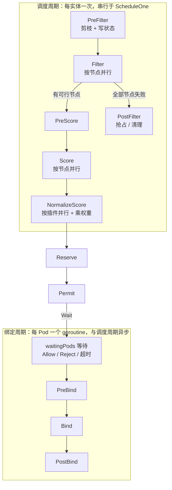

# Scheduling Framework：扩展点、状态与并发语义

Scheduling Framework 是 kube-scheduler 的插件运行时：它把"这个 Pod 能不能放在这个 Node 上"（Filter）、"哪个 Node 更合适"（Score）、"占住资源"（Reserve）、"等别人同意再绑"（Permit）、"真正写 bind"（Bind）切成若干**扩展点**，并按调度周期 / 绑定周期两个阶段调用插件实现。读这一层的价值不在"有哪些钩子"，而在于：**每个钩子的输入是什么、返回码意味着什么、失败后 Pod 进哪个队列、以及这段代码在哪个 goroutine 里跑**。判错其中任何一项，都会写出"看似生效、实际没生效"的插件，或者把可重试的错误变成永久的 unschedulable。

本文基于 Kubernetes v1.37.2，代码链接统一固定到 commit `c50e5395f1ae2d4a2c05f28fdcc38c0916cc1a32`。v1.37 与旧版最大的差异是引入了 **workload 级扩展点**（`PlacementGenerate`、`PlacementFeasible`、`PlacementScore`、`PodGroupPostFilter`）和 **PodGroup/Placement 两级新状态作用域**——它们只在 `GenericWorkload`（Beta，默认关）与 `TopologyAwareWorkloadScheduling`（Alpha，默认关）打开时才存在，不能和 Pod 级扩展点混着讲。

覆盖范围：配置模型、全部 Pod 级扩展点、v1.37 workload 级扩展点、三种 CycleState 作用域、状态码语义、并发模型、out-of-tree 插件骨架。不覆盖：队列三层/backoff 公式/绑定重试的完整链路（见 [kube-scheduler：对象、队列与调度主流程](./native-scheduler.md)）、Volcano 的 Action 细节（见 [Volcano 调度器](./volcano-scheduler.md)）。

## 1. 为什么需要 Framework

早期 scheduler 把可行性判断写成固定的 `Predicates` 列表、把打分写成 `PriorityFunctions` 列表，插件只能用编译期注入的函数；想在"选点之后、绑定之前"做点事（比如等 gang 成员、等设备分配）就无处可放。Framework 用四件事替代了这套结构：

1. **扩展点化**：每个阶段是一个 Go interface，接口注释就是语义合同。旧概念仍然留在注释里——`FilterPlugin` 明确写着 "This concept used to be called 'predicate'"，`ReservePlugin` 写着 "This concept used to be called 'assume'"（[interface.go#L541-L548](https://github.com/kubernetes/kubernetes/blob/c50e5395f1ae2d4a2c05f28fdcc38c0916cc1a32/staging/src/k8s.io/kube-scheduler/framework/interface.go#L541-L548)、[#L664-L669](https://github.com/kubernetes/kubernetes/blob/c50e5395f1ae2d4a2c05f28fdcc38c0916cc1a32/staging/src/k8s.io/kube-scheduler/framework/interface.go#L664-L669)）。
2. **运行时状态**：`CycleState` 让 PreFilter 算出来的东西能被 Filter/Score 复用，不必每个节点重算。
3. **profile 隔离 + 统一注册表**：一份 `KubeSchedulerConfiguration` 可以有多个 `KubeSchedulerProfile`，Pod 用 `spec.schedulerName` 选一个，不同 profile 有各自的插件集与权重、但共享同一个队列（QueueSort 必须一致）；in-tree 与 out-of-tree 插件都注册进 `runtime.Registry`，`New` 时按名字实例化（[registry.go#L71-L90](https://github.com/kubernetes/kubernetes/blob/c50e5395f1ae2d4a2c05f28fdcc38c0916cc1a32/pkg/scheduler/framework/runtime/registry.go#L71-L90)）。

Framework 不负责的事要说清楚：它**不做配额**（没有队列/权益模型）、**不做抢占决策**（抢占只是 `DefaultPreemption` 这个 PostFilter 插件）、**不保证插件状态一致**（CycleState 无锁、假定插件可信）。这些边界决定了后面所有"为什么这个错误没有回滚""为什么这个状态被并发写坏"的问题。

## 2. 全景：扩展点在两个周期里的位置



`getExtensionPoints` 里登记的扩展点集合一共 15 个（Pod 级 12 个 + workload 级 3 个；`PlacementFeasible` 不在配置里，见 §5.2），它们的**登记顺序不是执行顺序**，执行顺序由调度/绑定周期决定（[framework.go#L127-L145](https://github.com/kubernetes/kubernetes/blob/c50e5395f1ae2d4a2c05f28fdcc38c0916cc1a32/pkg/scheduler/framework/runtime/framework.go#L127-L145)）。

| 扩展点 | 阶段 | 调用点 | 能否改变调度结果 | 并发性 |
| --- | --- | --- | --- | --- |
| `PreEnqueue` | 入队前 | 队列 `runPreEnqueuePlugins` | 能：把实体 gate 住，送进 unschedulable 池 | 事件回调内逐 Pod 串行 |
| `QueueSort` | 队列排序 | 堆的 `Less` | 能：决定出队顺序 | 队列持锁比较 |
| `PreFilter` | 调度周期开头 | `RunPreFilterPlugins` | 能：拒绝 Pod，或缩小候选节点集 | 串行 |
| `Filter` | 选点 | `RunFilterPlugins`（逐节点） | 能：只要一个节点失败即排除该节点 | 按节点并行 |
| `PostFilter` | 选点失败后 | `RunPostFilterPlugins` | 能：改集群状态（驱逐/释放 claim）并提名节点 | 串行 |
| `PreScore` | 打分前 | `RunPreScorePlugins` | 能：拒绝 Pod（可返回 Skip 跳过自己的 Score） | 串行 |
| `Score` | 打分 | `RunScorePlugins` | 只影响偏好，不影响可行性 | 按节点并行 |
| `NormalizeScore` | 打分后 | `normalizeScores` | 只改本插件分数分布 | 按插件并行 |
| `Reserve` / `Unreserve` | 暂记后 / 回滚 | `RunReservePluginsReserve` / `RunReservePluginsUnreserve` | Reserve 能拒绝 Pod（触发 Unreserve）；Unreserve 只清理 | 串行，Unreserve 逆序 |
| `Permit` | 绑定前 | `RunPermitPlugins` / `WaitOnPermit` | 能：延迟（Wait）或拒绝 | 串行调用，等待在绑定 goroutine |
| `PreBind` | 绑定前 | `RunPreBindPlugins` | 能：失败后进 backoff，**不会**被判 unschedulable | 分组：组内并行、组间串行 |
| `Bind` | 绑定 | `RunBindPlugins` | 能：选中一个 binder，其余 Skip | 串行（按配置顺序） |
| `PostBind` | 绑定后 | `RunPostBindPlugins` | 不能 | 串行 |

## 3. 配置模型：Configuration / Profile / Plugins

```yaml
apiVersion: kubescheduler.config.k8s.io/v1
kind: KubeSchedulerConfiguration
parallelism: 16                      # 算法并行度，默认 16
profiles:
- schedulerName: default-scheduler
  plugins:
    score:
      disabled:
      - name: ImageLocality          # 从默认集中移除
      enabled:
      - name: SampleTopologyFit      # 追加在默认插件之后
        weight: 5                    # 只对 Score / PlacementScore 有意义
    filter:
      enabled:
      - name: SampleTopologyFit      # 显式写在 Filter 点：位置以此为准
  pluginConfig:                      # 传给插件 New 的 Args，与扩展点无关
  - name: SampleTopologyFit
    args:
      zoneLabel: topology.kubernetes.io/zone
```

四层结构：`KubeSchedulerConfiguration`（全局 `parallelism`、backoff、`profiles[]`）→ `KubeSchedulerProfile`（`schedulerName`、每个 profile 自己的 `percentageOfNodesToScore`、`plugins`、`pluginConfig`）→ `Plugins`（16 个 `PluginSet`：12 个 Pod 级 + `MultiPoint` + 3 个 workload 级）→ `PluginSet{Enabled, Disabled}`（[types.go#L100-L131](https://github.com/kubernetes/kubernetes/blob/c50e5395f1ae2d4a2c05f28fdcc38c0916cc1a32/pkg/scheduler/apis/config/types.go#L100-L131)、[#L138-L190](https://github.com/kubernetes/kubernetes/blob/c50e5395f1ae2d4a2c05f28fdcc38c0916cc1a32/pkg/scheduler/apis/config/types.go#L138-L190)、[#L193-L208](https://github.com/kubernetes/kubernetes/blob/c50e5395f1ae2d4a2c05f28fdcc38c0916cc1a32/pkg/scheduler/apis/config/types.go#L193-L208)）。`Parallelism` 的默认值是 16，`WithParallelism` 把它注入框架，`parallelize.DefaultParallelism` 也是 16（[types.go#L47-L49](https://github.com/kubernetes/kubernetes/blob/c50e5395f1ae2d4a2c05f28fdcc38c0916cc1a32/pkg/scheduler/apis/config/types.go#L47-L49)、[parallelism.go#L27-L28](https://github.com/kubernetes/kubernetes/blob/c50e5395f1ae2d4a2c05f28fdcc38c0916cc1a32/pkg/scheduler/framework/parallelize/parallelism.go#L27-L28)）。

### 3.1 mergePluginSet：Enabled 是"增量"，不是"白名单"

`mergePluginSet` 的语义容易被误读（[default_plugins.go#L137-L187](https://github.com/kubernetes/kubernetes/blob/c50e5395f1ae2d4a2c05f28fdcc38c0916cc1a32/pkg/scheduler/apis/config/v1/default_plugins.go#L137-L187)）：

- `Enabled` 里的插件**追加在默认集之后**；若名字和默认插件相同，则**就地替换**（保持默认顺序）而不是追加，这保证"改配置不会悄悄把插件挪到别的插件后面"；
- `Disabled` 从默认集中移除；`Disabled: [{name: "*"}]` 表示该扩展点全部禁用（`expandMultiPointPlugins` 看到 `*` 会整体跳过展开）；
- 重复启用同一个插件（既在具体扩展点又在 MultiPoint）会被判为 "already registered" 而让 scheduler 启动失败。

### 3.2 MultiPoint 展开规则

`MultiPoint` 是"一次启用、在所有它实现的扩展点上生效"的简写。展开逻辑在 `expandMultiPointPlugins`（[framework.go#L650-L745](https://github.com/kubernetes/kubernetes/blob/c50e5395f1ae2d4a2c05f28fdcc38c0916cc1a32/pkg/scheduler/framework/runtime/framework.go#L650-L745)），顺序规则是：

1. **override**：如果在具体扩展点里显式写了这个插件，以具体扩展点的位置为准，MultiPoint 的这条被丢弃（日志是 `MultiPoint plugin is explicitly re-configured; overriding`）；
2. **MultiPoint 新增**：只出现在 MultiPoint 里的插件，按 MultiPoint 中的顺序追加；
3. **其余默认插件**：最后补上。

这条规则解释了两个常见困惑：为什么"在 MultiPoint 里加一个插件"可能完全没生效（因为你在 `filter.enabled` 里也写了它，位置由那里决定）；以及为什么 `Score` 的权重必须写在**生效的那个位置**上。

### 3.3 默认插件集与权重

默认集只有一段 `MultiPoint.Enabled`，然后按 feature gate 增删（[default_plugins.go#L32-L60](https://github.com/kubernetes/kubernetes/blob/c50e5395f1ae2d4a2c05f28fdcc38c0916cc1a32/pkg/scheduler/apis/config/v1/default_plugins.go#L32-L60)、[#L62-L78](https://github.com/kubernetes/kubernetes/blob/c50e5395f1ae2d4a2c05f28fdcc38c0916cc1a32/pkg/scheduler/apis/config/v1/default_plugins.go#L62-L78)）：

| 插件 | 权重 | 实际参与的扩展点 |
| --- | --- | --- |
| `SchedulingGates` | — | PreEnqueue |
| `PrioritySort` | — | QueueSort |
| `NodeName` / `NodeUnschedulable` / `NodePorts` | — | PreFilter + Filter |
| `TaintToleration` | 3 | PreFilter + Filter + PreScore + Score |
| `NodeAffinity` | 2 | PreFilter + Filter + PreScore + Score |
| `NodeResourcesFit` | 1 | PreFilter + Filter + PreScore + Score（+ PlacementScore） |
| `VolumeRestrictions` / `NodeVolumeLimits` / `VolumeZone` | — | PreFilter + Filter |
| `VolumeBinding` | — | PreFilter + Filter + PreScore + Score + Reserve + PreBind |
| `PodTopologySpread` / `InterPodAffinity` | 2 | PreFilter + Filter + PreScore + Score |
| `DefaultPreemption` | — | PostFilter（+ PreEnqueue，异步抢占时） |
| `NodeResourcesBalancedAllocation` / `ImageLocality` | 1 | Score |
| `DefaultBinder` | — | Bind |

feature gate 带来的变化（同一文件的 `applyFeatureGates`）：

- `DynamicResourceAllocation`（v1.37 已 GA、默认开）把 `DynamicResources`（权重 2）**插到 `DefaultPreemption` 之前**，注释给的理由是"PostFilter 应先考虑释放空闲 ResourceClaim，再考虑驱逐 Pod"（[#L80-L96](https://github.com/kubernetes/kubernetes/blob/c50e5395f1ae2d4a2c05f28fdcc38c0916cc1a32/pkg/scheduler/apis/config/v1/default_plugins.go#L80-L96)）；
- `GenericWorkload`（Beta，默认关）追加 `GangScheduling`（[#L98-L100](https://github.com/kubernetes/kubernetes/blob/c50e5395f1ae2d4a2c05f28fdcc38c0916cc1a32/pkg/scheduler/apis/config/v1/default_plugins.go#L98-L100)）；
- `TopologyAwareWorkloadScheduling`（Alpha，默认关）追加 `TopologyPlacementGenerator` 与 `PodGroupPodsCount`（权重 1）（[#L102-L105](https://github.com/kubernetes/kubernetes/blob/c50e5395f1ae2d4a2c05f28fdcc38c0916cc1a32/pkg/scheduler/apis/config/v1/default_plugins.go#L102-L105)）。

插件名常量集中在 `names` 包，配置里写的就是这些字符串（[names.go#L19-L44](https://github.com/kubernetes/kubernetes/blob/c50e5395f1ae2d4a2c05f28fdcc38c0916cc1a32/pkg/scheduler/framework/plugins/names/names.go#L19-L44)）。

### 3.4 多 profile 与 schedulerName

profile 的匹配键是 `spec.schedulerName`；未指定 schedulerName 的 Pod 落到 `default-scheduler` profile。约束有两条：**QueueSort 插件与它的 PluginConfig 必须在所有 profile 中完全一致**（因为全集群只有一个调度队列），以及每个 profile 各自校验插件集（[validation.go#L225-L255](https://github.com/kubernetes/kubernetes/blob/c50e5395f1ae2d4a2c05f28fdcc38c0916cc1a32/pkg/scheduler/apis/config/validation/validation.go#L225-L255)）。所有 profile 共享同一个 Cache / Snapshot / 队列，`SnapshotSharedLister` 拿到的是全局快照——profile 只隔离"用哪些插件、什么权重"，不隔离视图。

### 3.5 out-of-tree 注册与启动期校验

out-of-tree 插件走 `scheduler.WithFrameworkOutOfTreeRegistry(registry)`，该 registry 在启动时被 `Merge` 进 in-tree registry，重名即报错（[scheduler.go#L211-L216](https://github.com/kubernetes/kubernetes/blob/c50e5395f1ae2d4a2c05f28fdcc38c0916cc1a32/pkg/scheduler/scheduler.go#L211-L216)、[#L312-L314](https://github.com/kubernetes/kubernetes/blob/c50e5395f1ae2d4a2c05f28fdcc38c0916cc1a32/pkg/scheduler/scheduler.go#L312-L314)、[registry.go#L92-L100](https://github.com/kubernetes/kubernetes/blob/c50e5395f1ae2d4a2c05f28fdcc38c0916cc1a32/pkg/scheduler/framework/runtime/registry.go#L92-L100)）。in-tree 的注册表在 `NewInTreeRegistry`，可以当作"一个插件实现了哪些扩展点"的事实来源（[registry.go#L51-L81](https://github.com/kubernetes/kubernetes/blob/c50e5395f1ae2d4a2c05f28fdcc38c0916cc1a32/pkg/scheduler/framework/plugins/registry.go#L51-L81)）。

框架在 `New` 阶段做四项硬校验，任何一项失败 scheduler 直接起不来（[framework.go#L447-L455](https://github.com/kubernetes/kubernetes/blob/c50e5395f1ae2d4a2c05f28fdcc38c0916cc1a32/pkg/scheduler/framework/runtime/framework.go#L447-L455)）：

- `QueueSort` 插件必须**恰好一个**；
- `Bind` 插件**至少一个**；
- `PlacementGenerate` 插件**最多一个**；每个 `Score` / `PlacementScore` 插件的权重必须非 0（否则报 "not configured with weight"）。

## 4. Pod 级扩展点逐个说

### 4.1 PreEnqueue 与 QueueSort

`PreEnqueue` 在实体被放进 activeQ/backoffQ **之前**调用，签名里只有 Pod，没有 CycleState（[interface.go#L442-L453](https://github.com/kubernetes/kubernetes/blob/c50e5395f1ae2d4a2c05f28fdcc38c0916cc1a32/staging/src/k8s.io/kube-scheduler/framework/interface.go#L442-L453)）：

```go
PreEnqueue(ctx context.Context, p *v1.Pod) *Status
```

- **返回**：`Success`（入队）或非 `Success`（被 gate）。接口注释要求它"轻量、不要访问外部端点"，因为它在事件处理路径上会阻塞其它 Pod 入队。
- **失败语义**：不成功即视为 gated，实体进入 unschedulable 池，之后**只在 gating 插件注册的事件或 wildcard 事件**上重新评估。队列实现里，任一 Pod 被 gate 则整个实体被 gate（[scheduling_queue.go#L703-L730](https://github.com/kubernetes/kubernetes/blob/c50e5395f1ae2d4a2c05f28fdcc38c0916cc1a32/pkg/scheduler/backend/queue/scheduling_queue.go#L703-L730)）。
- **concurrency**：在 informer 事件回调里串行执行，插件内部若有共享状态必须自己加锁。
- 典型用法：`SchedulingGates` 卡 `.spec.schedulingGates`；`DefaultPreemption` 在异步抢占开启时卡住"正在被抢占处理"的 Pod；`GangScheduling` 在 gang 未达 `minCount` 前不放行（[gangscheduling.go#L208-L215](https://github.com/kubernetes/kubernetes/blob/c50e5395f1ae2d4a2c05f28fdcc38c0916cc1a32/pkg/scheduler/framework/plugins/gangscheduling/gangscheduling.go#L208-L215)）。

`QueueSort` 只有一个实现点：`Less(entity1, entity2 QueuedEntityInfo) bool`，且**同一个队列只能有一个**（v1.37 的实体既可能是 Pod 也可能是 PodGroup，所以签名已经泛化成 entity）。它不是"扩展点之一"那么轻——改了它等于改了全局出队顺序，所有 profile 必须一致。

### 4.2 PreFilter：剪枝与状态写入

`PreFilter` 在调度周期开头调用一次，拿到**全部节点的只读列表**，可以返回 `PreFilterResult` 参与剪枝（[interface.go#L517-L539](https://github.com/kubernetes/kubernetes/blob/c50e5395f1ae2d4a2c05f28fdcc38c0916cc1a32/staging/src/k8s.io/kube-scheduler/framework/interface.go#L517-L539)、[#L390-L394](https://github.com/kubernetes/kubernetes/blob/c50e5395f1ae2d4a2c05f28fdcc38c0916cc1a32/staging/src/k8s.io/kube-scheduler/framework/interface.go#L390-L394)）：

```go
PreFilter(ctx context.Context, state CycleState, p *v1.Pod, nodes []NodeInfo) (*PreFilterResult, *Status)
PreFilterExtensions() PreFilterExtensions
```

三条容易踩的语义：

1. **`PreFilterResult` 的剪枝等价于 `UnschedulableAndUnresolvable`**：被 filter 掉的节点不进入下游评估，也**不进入抢占候选**（接口注释与 runtime 的合并逻辑都这么写）。
2. **`Unschedulable` 与 `UnschedulableAndUnresolvable` 的执行差异**：runtime 遇到 `UnschedulableAndUnresolvable` 会**立刻返回**（本周期不打算抢占，没必要跑完其余 PreFilter）；遇到 `Unschedulable` 则**记录后继续跑完所有 PreFilter**，以便后面还能跑 PostFilter 抢占（[framework.go#L934-L996](https://github.com/kubernetes/kubernetes/blob/c50e5395f1ae2d4a2c05f28fdcc38c0916cc1a32/pkg/scheduler/framework/runtime/framework.go#L934-L996)，对应 issue #119770）。
3. **`Skip` 会连带跳过耦合的 Filter 与 PreFilterExtensions**：返回 Skip 时 `PreFilterResult` 与其它字段全部忽略，插件名被记入 `skipFilterPlugins`，后续 `RunFilterPlugins` 直接跳过它。

`PreFilterExtensions` 提供 `AddPod`/`RemovePod` 两个增量回调，用于抢占/驱逐模拟"把某个 Pod 加进/移出这个节点后是否还可行"（[interface.go#L500-L515](https://github.com/kubernetes/kubernetes/blob/c50e5395f1ae2d4a2c05f28fdcc38c0916cc1a32/staging/src/k8s.io/kube-scheduler/framework/interface.go#L500-L515)）。这里有一个 v1.37 特别标注的坑：**传进来的 `NodeInfo` 可能是共享的、非快照对象（尤其跨节点 victim 场景），必须只读，不得调用 `RemovePod`/`AddPodInfo` 去改它**；直接读 NodeInfo 而不是读 CycleState 的插件在这些节点上会看到 stale 状态。

### 4.3 Filter：按节点并行的可行性判定

```go
Filter(ctx context.Context, state CycleState, pod *v1.Pod, nodeInfo NodeInfo) *Status
```

- **输入**：`state`（PreFilter 写入的内容）、`pod`、**该节点自己的** `nodeInfo`。接口明确要求读传进来的这个 `nodeInfo`，而不是去 Snapshot 里再查一次——抢占时会传入"删掉若干 victim 后的副本"，两者内容不同（[interface.go#L549-L574](https://github.com/kubernetes/kubernetes/blob/c50e5395f1ae2d4a2c05f28fdcc38c0916cc1a32/staging/src/k8s.io/kube-scheduler/framework/interface.go#L549-L574)）。
- **返回**：`Success` / `Unschedulable` / `UnschedulableAndUnresolvable` / `Error`。runtime 只接受这几种：其它码会被包成 `Error`（`RunFilterPlugins` 里 `if !status.IsRejected()` 的分支）。
- **并发**：`Filter` 是**按节点并行**的（`schedFramework.Parallelizer().Until(ctx, numAllNodes, checkNode, metrics.Filter)`），一旦找到足够多的可行节点会 cancel 上下文；插件应当检查 ctx 取消，并按注释返回带 `context.Cause(ctx)` 的 `UnschedulableAndUnresolvable`（[schedule_one.go#L779-L850](https://github.com/kubernetes/kubernetes/blob/c50e5395f1ae2d4a2c05f28fdcc38c0916cc1a32/pkg/scheduler/schedule_one.go#L779-L850)）。
- **对结果的影响**：一个节点上任何一个 Filter 插件非 Success，该节点即被排除；全节点被排除则进入 PostFilter。

### 4.4 PostFilter：只在"已经失败"之后

`PostFilter` 仅在 PreFilter/Filter 返回 unschedulable 之后调用，入参是"每个节点得到了什么状态"的只读视图 `NodeToStatusReader`（[interface.go#L576-L598](https://github.com/kubernetes/kubernetes/blob/c50e5395f1ae2d4a2c05f28fdcc38c0916cc1a32/staging/src/k8s.io/kube-scheduler/framework/interface.go#L576-L598)）：

```go
PostFilter(ctx context.Context, state CycleState, pod *v1.Pod,
	filteredNodeStatusMap NodeToStatusReader) (*PostFilterResult, *Status)
```

- **执行规则**：按配置顺序跑，遇到 `Success` 或 `UnschedulableAndUnresolvable` 立即停止；遇到 `Unschedulable` 继续跑下一个并累积 reasons；遇到其它码按 `Error` 处理（[framework.go#L1152-L1200](https://github.com/kubernetes/kubernetes/blob/c50e5395f1ae2d4a2c05f28fdcc38c0916cc1a32/pkg/scheduler/framework/runtime/framework.go#L1152-L1200)）。
- **能否改变结果**：能，但方式是"改集群状态 + 提名"而不是"改写本周期结论"。`PostFilterResult` 里带 `NominatingInfo`，框架用它更新 preemptor 的 `status.nominatedNodeName`。
- **忽略 `UnschedulableAndUnresolvable` 是插件的责任**：接口注释写得很直白——框架在"所有节点都是 Unresolvable"时**仍然会调用** PostFilter，自定义抢占必须自己跳过这些节点。
- **边界**：`schedulingAlgorithm` 里如果 `state.IsPodGroupSchedulingCycle()` 为真，**单个 Pod 不会跑 PostFilter**，留给 PodGroup 级的 `PodGroupPostFilter`（[schedule_one.go#L250-L320](https://github.com/kubernetes/kubernetes/blob/c50e5395f1ae2d4a2c05f28fdcc38c0916cc1a32/pkg/scheduler/schedule_one.go#L250-L320)）；没有注册任何 PostFilter 插件时也直接判 unschedulable。

### 4.5 PreScore / Score / NormalizeScore

```go
PreScore(ctx context.Context, state CycleState, pod *v1.Pod, nodes []NodeInfo) *Status
Score(ctx context.Context, state CycleState, p *v1.Pod, nodeInfo NodeInfo) (int64, *Status)
NormalizeScore(ctx context.Context, state CycleState, p *v1.Pod, scores NodeScoreList) *Status
```

- **PreScore** 是"信息性"扩展点：拿到通过 Filter 的节点列表，用于写状态/打日志。返回 `Skip` 时，**它耦合的 Score 插件在本周期被跳过**（[interface.go#L627-L640](https://github.com/kubernetes/kubernetes/blob/c50e5395f1ae2d4a2c05f28fdcc38c0916cc1a32/staging/src/k8s.io/kube-scheduler/framework/interface.go#L627-L640)）。
- **Score** 逐节点调用，必须返回 `Success` 与 `[0, 100]` 的整数；框架不校验未归一化的值，但**归一化之后**会校验范围，越界直接 `Error`（[interface.go#L320-L334](https://github.com/kubernetes/kubernetes/blob/c50e5395f1ae2d4a2c05f28fdcc38c0916cc1a32/staging/src/k8s.io/kube-scheduler/framework/interface.go#L320-L334)）。
- **NormalizeScore** 在"同一插件的全部节点分数"上运行，用于把原始值拉到 0–100；返回非 Success 会让整个 Score 阶段失败。
- **并发**：`Score` 按节点并行、`NormalizeScore` 按插件并行、乘权重也按节点并行；任一 goroutine 出错会 cancel 其余（`errCh.SendWithCancel`）（[framework.go#L1405-L1470](https://github.com/kubernetes/kubernetes/blob/c50e5395f1ae2d4a2c05f28fdcc38c0916cc1a32/pkg/scheduler/framework/runtime/framework.go#L1405-L1470)、[#L1526-L1580](https://github.com/kubernetes/kubernetes/blob/c50e5395f1ae2d4a2c05f28fdcc38c0916cc1a32/pkg/scheduler/framework/runtime/framework.go#L1526-L1580)）。
- **只读约束**：Score 运行在并行 goroutine 里，`nodeInfo` 与 `state` 都是共享的；**不能写 CycleState**（写会并发写同一 sync.Map 里的同一对象），也不能改 `NodeInfo`。这是本页最常被违反的一条，见 §6.3。

### 4.6 Reserve / Unreserve

```go
Reserve(ctx context.Context, state CycleState, p *v1.Pod, nodeName string) *Status
Unreserve(ctx context.Context, state CycleState, p *v1.Pod, nodeName string)
```

- **时机**：Reserve 发生在 cache 已完成 assume 之后，此时 `Pod.Spec.NodeName` 在内存里已指向该节点，但 API 里还没有 Binding。
- **返回**：接口说"只应返回 Success 或 Error"，但 runtime 也接受其它被拒绝的码；任何非 Success 都会触发**所有** Reserve 插件的 `Unreserve`（[interface.go#L664-L682](https://github.com/kubernetes/kubernetes/blob/c50e5395f1ae2d4a2c05f28fdcc38c0916cc1a32/staging/src/k8s.io/kube-scheduler/framework/interface.go#L664-L682)）。
- **Unreserve 必须幂等**：即便对应的 Reserve 没被调用也可能收到 Unreserve；执行顺序是**Reserve 的逆序**（[framework.go#L2014-L2044](https://github.com/kubernetes/kubernetes/blob/c50e5395f1ae2d4a2c05f28fdcc38c0916cc1a32/pkg/scheduler/framework/runtime/framework.go#L2014-L2044)、[#L2058-L2078](https://github.com/kubernetes/kubernetes/blob/c50e5395f1ae2d4a2c05f28fdcc38c0916cc1a32/pkg/scheduler/framework/runtime/framework.go#L2058-L2078)）。
- **典型用途**：`VolumeBinding` 在 Reserve 里做 PV 的假设绑定；`DynamicResources` 在 Reserve 里把 DRA 的 pending allocation 记到 claim 上，Unreserve 时释放（[dynamicresources.go#L250-L259](https://github.com/kubernetes/kubernetes/blob/c50e5395f1ae2d4a2c05f28fdcc38c0916cc1a32/pkg/scheduler/framework/plugins/dynamicresources/dynamicresources.go#L250-L259)）。

### 4.7 Permit：唯一允许"等"的点

```go
Permit(ctx context.Context, state CycleState, p *v1.Pod, nodeName string) (*Status, time.Duration)
```

- **返回**：`Success`、`Wait`（附超时）或拒绝。返回 `Wait` 时，框架**先把其余 Permit 插件跑完**，只要没人拒绝才开始等——所以"我 Wait 了但别人 Reject"的路径不会浪费时间（[interface.go#L712-L723](https://github.com/kubernetes/kubernetes/blob/c50e5395f1ae2d4a2c05f28fdcc38c0916cc1a32/staging/src/k8s.io/kube-scheduler/framework/interface.go#L712-L723)）。
- **等待机制**：`AddWaitingPod` 为每个 Wait 的插件挂一个 `time.AfterFunc`，任一插件 `Reject` 或超时即整体失败；全部 `Allow` 才放行（[waiting_pods_map.go#L84-L113](https://github.com/kubernetes/kubernetes/blob/c50e5395f1ae2d4a2c05f28fdcc38c0916cc1a32/pkg/scheduler/framework/runtime/waiting_pods_map.go#L84-L113)）。等待发生在**绑定周期**（`WaitOnPermit` 阻塞在绑定 goroutine），不占用调度周期。
- **超时上限**：单个 Permit 插件的等待时间会被截断到 `maxTimeout = 15 * time.Minute`（[framework.go#L56-L60](https://github.com/kubernetes/kubernetes/blob/c50e5395f1ae2d4a2c05f28fdcc38c0916cc1a32/pkg/scheduler/framework/runtime/framework.go#L56-L60)）。原生 gang 插件用的是 `permitTimeoutDuration = 5 * time.Minute`（[gangscheduling.go#L37-L45](https://github.com/kubernetes/kubernetes/blob/c50e5395f1ae2d4a2c05f28fdcc38c0916cc1a32/pkg/scheduler/framework/plugins/gangscheduling/gangscheduling.go#L37-L45)）。
- **对结果的影响**：Permit 是**最后一个可以判 unschedulable 的扩展点**（见 §7.6）。

### 4.8 PreBind / Bind / PostBind

```go
PreBindPreFlight(ctx context.Context, state CycleState, p *v1.Pod, nodeName string) (*PreBindPreFlightResult, *Status)
PreBind(ctx context.Context, state CycleState, p *v1.Pod, nodeName string) *Status
```

`PreBindPreFlight` 是 v1.37 的前置探测点：**必须轻量、不能做真实操作**，只回答"我这个插件要不要参与这个 Pod 的 PreBind"，并通过 `AllowParallel` 声明自己的 PreBind 能否与相邻插件并行（[interface.go#L684-L699](https://github.com/kubernetes/kubernetes/blob/c50e5395f1ae2d4a2c05f28fdcc38c0916cc1a32/staging/src/k8s.io/kube-scheduler/framework/interface.go#L684-L699)、[#L377-L435](https://github.com/kubernetes/kubernetes/blob/c50e5395f1ae2d4a2c05f28fdcc38c0916cc1a32/staging/src/k8s.io/kube-scheduler/framework/interface.go#L377-L435)）。

- **返回**：`Success`（参与 PreBind）、`Skip`（不参与，后续 PreBind 被跳过）、`Error`；其它码（包括 `Unschedulable`）会被判为不支持并整体报错（[framework.go#L1875-L1917](https://github.com/kubernetes/kubernetes/blob/c50e5395f1ae2d4a2c05f28fdcc38c0916cc1a32/pkg/scheduler/framework/runtime/framework.go#L1875-L1917)）。
- **并行分组**：PreFlight 的结果被写进 CycleState 的 `skipPreBindPlugins` / `parallelPreBindPlugins`；PreBind 阶段把**连续**的 `AllowParallel: true` 插件分成一组并行执行，遇到 `AllowParallel: false` 就断开分组、串行执行（[framework.go#L1836-L1858](https://github.com/kubernetes/kubernetes/blob/c50e5395f1ae2d4a2c05f28fdcc38c0916cc1a32/pkg/scheduler/framework/runtime/framework.go#L1836-L1858)）。组内任一失败会 cancel 同组其余插件（[#L1766-L1835](https://github.com/kubernetes/kubernetes/blob/c50e5395f1ae2d4a2c05f28fdcc38c0916cc1a32/pkg/scheduler/framework/runtime/framework.go#L1766-L1835)）。
- **失败语义**：PreBind 失败**不会再判 unschedulable**，Pod 进 backoff 重试（§7.6）。这也是 `VolumeBinding`/`DynamicResources` 把"真正创建/绑定外部资源"放在 PreBind 的原因：这一步失败通常是暂时性的。

```go
Bind(ctx context.Context, state CycleState, p *v1.Pod, nodeName string) *Status
PostBind(ctx context.Context, state CycleState, p *v1.Pod, nodeName string)
```

- **Bind 按配置顺序调用，谁的返回码不是 `Skip` 谁就"认领"这个 Pod**，后面的 binder 全部跳过；全 `Skip` 意味着没人绑，绑定周期按失败处理（[interface.go#L725-L736](https://github.com/kubernetes/kubernetes/blob/c50e5395f1ae2d4a2c05f28fdcc38c0916cc1a32/staging/src/k8s.io/kube-scheduler/framework/interface.go#L725-L736)、[framework.go#L1930-L1966](https://github.com/kubernetes/kubernetes/blob/c50e5395f1ae2d4a2c05f28fdcc38c0916cc1a32/pkg/scheduler/framework/runtime/framework.go#L1930-L1966)）。这也是为什么框架强制"至少一个 Bind 插件"。
- **默认实现**：`DefaultBinder` 用 `v1.Binding` 走一次 API 更新（有 API cacher 时走 cacher），失败返回 `AsStatus(err)`（即 `Error`）（[default_binder.go#L52-L76](https://github.com/kubernetes/kubernetes/blob/c50e5395f1ae2d4a2c05f28fdcc38c0916cc1a32/pkg/scheduler/framework/plugins/defaultbinder/default_binder.go#L52-L76)）。
- **PostBind** 是纯信息性回调，无返回码，不能失败；用于清理状态、打点。它在 Bind 成功、指标已记之后调用。

## 5. v1.37 的 workload 级扩展点

这一组扩展点处理的对象不是 Pod 而是 **PodGroup（或 CompositePodGroup）的一次放置（Placement）**。存在前提是 feature gate：`GenericWorkload` 在 v1.37 从 Alpha 升为 **Beta 但仍默认关闭**，`TopologyAwareWorkloadScheduling` 是 **Alpha 默认关闭**（[kube_features.go#L1622-L1625](https://github.com/kubernetes/kubernetes/blob/c50e5395f1ae2d4a2c05f28fdcc38c0916cc1a32/pkg/features/kube_features.go#L1622-L1625)、[#L2231-L2233](https://github.com/kubernetes/kubernetes/blob/c50e5395f1ae2d4a2c05f28fdcc38c0916cc1a32/pkg/features/kube_features.go#L2231-L2233)）。默认配置下这些扩展点**不会运行**，讲原生 gang 时不要假设它们在。

| 维度 | Pod 级扩展点 | workload 级扩展点 |
| --- | --- | --- |
| 调度单元 | 一个 Pod | 一个 PodGroup（可嵌套 CompositePodGroup） |
| 状态作用域 | `CycleState` | `PodGroupCycleState` / `PlacementCycleState` |
| 是否在配置里 | `Plugins.*`（12 个） | `Plugins.PlacementGenerate` / `PlacementScore` / `PodGroupPostFilter` |
| 失败后 | 单 Pod unschedulable / backoff | 整个 placement 或 PodGroup 重新评估 |
| 抢占 | `PostFilter` | `PodGroupPostFilter`（可重新调用调度函数） |
| 数量限制 | 多点可任意组合 | `PlacementGenerate` 最多一个；`PlacementFeasible` 只有 `GangScheduling` 实现 |
| 默认是否可用 | 是 | 否，需显式打开 gate |

### 5.1 PlacementGenerate

```go
GeneratePlacements(ctx context.Context, state PodGroupCycleState,
	podGroup PodGroupInfo, parentPlacement *Placement) (*GeneratePlacementsResult, *Status)
```

把节点全集**切分成若干候选 placement**（"资源分区"，允许重叠），下游对每个 placement 各跑一遍 Pod 级调度，再对 placement 打分选优（[interface.go#L791-L807](https://github.com/kubernetes/kubernetes/blob/c50e5395f1ae2d4a2c05f28fdcc38c0916cc1a32/staging/src/k8s.io/kube-scheduler/framework/interface.go#L791-L807)）。语义细节：

- **最多一个实现**，配置多了启动失败；**一个都没有时**，框架返回"单个 placement、包含全部节点"，行为退化成逐 Pod 调度（[framework.go#L2208-L2244](https://github.com/kubernetes/kubernetes/blob/c50e5395f1ae2d4a2c05f28fdcc38c0916cc1a32/pkg/scheduler/framework/runtime/framework.go#L2208-L2244)）。
- 返回空列表会被转成 `Unschedulable("no feasible placements found")`；in-tree 实现是 `TopologyPlacementGenerator`：读 PodGroup 的拓扑约束按拓扑域分组节点，每个域一个 placement，已有 Pod 绑定在某个域时只保留该域（[topology_placement.go#L30-L110](https://github.com/kubernetes/kubernetes/blob/c50e5395f1ae2d4a2c05f28fdcc38c0916cc1a32/pkg/scheduler/framework/plugins/topologyaware/topology_placement.go#L30-L110)）。

### 5.2 PlacementFeasible：不在 PluginSet 里、由框架硬绑定的扩展点

`PlacementFeasiblePlugin` 定义在**内部** framework 包而不是 staging 的公共接口包里（[interface.go#L167-L190](https://github.com/kubernetes/kubernetes/blob/c50e5395f1ae2d4a2c05f28fdcc38c0916cc1a32/pkg/scheduler/framework/interface.go#L167-L190)）：

```go
PlacementFeasible(ctx context.Context, placementCycleState PlacementCycleState,
	podGroupInfo PodGroupInfo, placementProgress PlacementProgress) *Status
```

- **谁调用**：每评估完一个 Pod（在某个 placement 内）调用一次，用来判断"这个 placement 还有没有希望"。
- **返回码**：`Success`（可以继续，且之后应一直 Success）、`Wait`（部分评估不足以下结论，继续评估剩余 Pod）、`Unschedulable`（放弃该 placement，**剩余 Pod 不再评估**，但它仍可参与抢占）（[framework.go#L2160-L2200](https://github.com/kubernetes/kubernetes/blob/c50e5395f1ae2d4a2c05f28fdcc38c0916cc1a32/pkg/scheduler/framework/runtime/framework.go#L2160-L2200)、[interface.go#L182-L190](https://github.com/kubernetes/kubernetes/blob/c50e5395f1ae2d4a2c05f28fdcc38c0916cc1a32/pkg/scheduler/framework/interface.go#L182-L190)）。**谁能实现**：框架硬编码"`GangScheduling` 是唯一的 PlacementFeasible 插件"——`GenericWorkload` 打开但没有这个插件、或它没实现该接口，`New` 直接失败（[framework.go#L480-L500](https://github.com/kubernetes/kubernetes/blob/c50e5395f1ae2d4a2c05f28fdcc38c0916cc1a32/pkg/scheduler/framework/runtime/framework.go#L480-L500)）。所以它既不在 `Plugins` 配置里，也不能被替换。
- **gang 语义就长在这里**：`minCount > scheduled + remaining` 直接判该 placement 不可行；`scheduled < minCount` 返回 `Wait` 继续攒（[gangscheduling.go#L489-L510](https://github.com/kubernetes/kubernetes/blob/c50e5395f1ae2d4a2c05f28fdcc38c0916cc1a32/pkg/scheduler/framework/plugins/gangscheduling/gangscheduling.go#L489-L510)）。

### 5.3 PlacementScore / NormalizePlacementScore

```go
ScorePlacement(ctx context.Context, state PlacementCycleState,
	podGroup PodGroupInfo, placement *PodGroupAssignments) (int64, *Status)
NormalizePlacementScore(ctx context.Context, state PodGroupCycleState,
	podGroup PodGroupInfo, placementScores []PlacementScore) *Status
```

对**已经通过可行性评估的 placement** 打分，用 `weight` 加权后选总分最高的一个（[interface.go#L809-L839](https://github.com/kubernetes/kubernetes/blob/c50e5395f1ae2d4a2c05f28fdcc38c0916cc1a32/staging/src/k8s.io/kube-scheduler/framework/interface.go#L809-L839)）。并发模型与 Score 一致：`ScorePlacement` 按 placement 并行、`NormalizePlacementScore` 按插件并行、乘权重按 placement 并行（[framework.go#L1625-L1700](https://github.com/kubernetes/kubernetes/blob/c50e5395f1ae2d4a2c05f28fdcc38c0916cc1a32/pkg/scheduler/framework/runtime/framework.go#L1625-L1700)）。权重同样必须非 0（`placementScorePluginWeight`）。in-tree 实现 `PodGroupPodsCount` 用"该 placement 能容纳多少个该组的 Pod"作为分数，并在归一化时按最大计数缩放（[podgroup_pods_count.go#L55-L90](https://github.com/kubernetes/kubernetes/blob/c50e5395f1ae2d4a2c05f28fdcc38c0916cc1a32/pkg/scheduler/framework/plugins/podgrouppodscount/podgroup_pods_count.go#L55-L90)）。

### 5.4 PodGroupPostFilter

```go
PodGroupPostFilter(ctx context.Context, state PodGroupCycleState, pgInfo PodGroupInfo,
	pgSchedulingFunc PodGroupSchedulingFunc) (*PodGroupPostFilterResult, *Status)
```

PodGroup 调度失败后的"组级 PostFilter"：可以调用 `pgSchedulingFunc` **重新跑一次组级可行性检查**（通常在改完前提之后，比如释放 claim 或驱逐 victim），成功时用 `PodGroupPostFilterResult.NominatingInfos` 给组内 Pod 分别写提名节点（[interface.go#L600-L625](https://github.com/kubernetes/kubernetes/blob/c50e5395f1ae2d4a2c05f28fdcc38c0916cc1a32/staging/src/k8s.io/kube-scheduler/framework/interface.go#L600-L625)）。

- **状态码**：`Success`（后续插件跳过）、`UnschedulableAndUnresolvable`（后续插件跳过）、`Unschedulable`（累积 reason 继续）、其它按 `Error`（[framework.go#L1212-L1253](https://github.com/kubernetes/kubernetes/blob/c50e5395f1ae2d4a2c05f28fdcc38c0916cc1a32/pkg/scheduler/framework/runtime/framework.go#L1212-L1253)）。
- **gate 检查在入口**：`GenericWorkload` 关闭时该函数直接返回 `Unschedulable` 并附 "generic workload feature is disabled"。
- **特殊权限**：`MutableSnapshotSharedLister()` **只允许**这个扩展点使用（[interface.go#L844-L864](https://github.com/kubernetes/kubernetes/blob/c50e5395f1ae2d4a2c05f28fdcc38c0916cc1a32/staging/src/k8s.io/kube-scheduler/framework/interface.go#L844-L864)）——因为它要模拟"删掉某些 Pod 后组是否可行"。in-tree 里 `DynamicResources` 同时实现了 Pod 级 `PostFilter` 与组级 `PodGroupPostFilter`，是"一个插件跨多个扩展点"的典型案例。

## 6. CycleState 与三种作用域

先把对象和作用域分清楚（[cycle_state.go#L30-L39](https://github.com/kubernetes/kubernetes/blob/c50e5395f1ae2d4a2c05f28fdcc38c0916cc1a32/staging/src/k8s.io/kube-scheduler/framework/cycle_state.go#L30-L39)）：

- `StateKey`：字符串键，约定带命名空间前缀（如 `kubernetes.io/pods-to-activate`）；
- `StateData`：只有 `Clone() StateData` 一个方法的任意数据；
- 三种容器：`CycleState`（Pod 级）、`PodGroupCycleState`（组级）、`PlacementCycleState`（placement 级）。

| 作用域 | 生命周期 | 谁读写 | 能否访问上级 |
| --- | --- | --- | --- |
| `CycleState` | 一个实体、一个调度周期（含其绑定周期） | 全部 Pod 级插件 | `GetPodGroupSchedulingCycle()`、`GetPlacementCycleState()`（仅 GenericWorkload） |
| `PodGroupCycleState` | 一次 PodGroup 调度周期 | `PlacementGenerate`、`PlacementScore` 的归一化、`PodGroupPostFilter` | — |
| `PlacementCycleState` | 单个 placement 迭代 | `ScorePlacement`、`PlacementFeasible` | `GetPodGroupSchedulingCycle()` |

（定义见 [cycle_state.go#L41-L108](https://github.com/kubernetes/kubernetes/blob/c50e5395f1ae2d4a2c05f28fdcc38c0916cc1a32/staging/src/k8s.io/kube-scheduler/framework/cycle_state.go#L41-L108)、[#L110-L137](https://github.com/kubernetes/kubernetes/blob/c50e5395f1ae2d4a2c05f28fdcc38c0916cc1a32/staging/src/k8s.io/kube-scheduler/framework/cycle_state.go#L110-L137)、[#L139-L165](https://github.com/kubernetes/kubernetes/blob/c50e5395f1ae2d4a2c05f28fdcc38c0916cc1a32/staging/src/k8s.io/kube-scheduler/framework/cycle_state.go#L139-L165)。`PodGroupCycleState.GetParentPlacementCycleState()` 用于嵌套组的父 placement 回看。）

### 6.1 实现：sync.Map + "无数据保护"

```go
type CycleState struct {
	storage                   sync.Map   // key: StateKey, value: StateData
	recordPluginMetrics       bool
	skipFilterPlugins         sets.Set[string]
	skipScorePlugins          sets.Set[string]
	skipPreBindPlugins        sets.Set[string]
	parallelPreBindPlugins    sets.Set[string]
	skipAllPostFilterPlugins  bool
	podGroupCycleState        fwk.PodGroupCycleState
	placementCycleState       fwk.PlacementCycleState
}
```

（[cycle_state.go#L28-L58](https://github.com/kubernetes/kubernetes/blob/c50e5395f1ae2d4a2c05f28fdcc38c0916cc1a32/pkg/scheduler/framework/cycle_state.go#L28-L58)）注释写得很清楚：底层用 `sync.Map` 是为了"写一次、读多次"场景下的线程安全，**但 `CycleState does not provide any data protection, as all plugins are assumed to be trusted`**——`sync.Map` 保护的是 map 本身，不是 map 里那个对象。两个插件在并行 goroutine 里对同一个 `*preFilterState` 做 `+=` 依然会竞态。

`Clone()` 逐项调用 `StateData.Clone()` 生成新容器，值仍由插件自己决定是否深拷贝（[cycle_state.go#L145-L160](https://github.com/kubernetes/kubernetes/blob/c50e5395f1ae2d4a2c05f28fdcc38c0916cc1a32/pkg/scheduler/framework/cycle_state.go#L145-L160)）。抢占在逐节点选 victim 时用 `state.Clone()` 隔离"假设驱逐了谁"的分支；batching 的重算也用它（[preemption.go#L466](https://github.com/kubernetes/kubernetes/blob/c50e5395f1ae2d4a2c05f28fdcc38c0916cc1a32/pkg/scheduler/framework/preemption/preemption.go#L466)）。

### 6.2 并行 Score 的只读约定

`RunScorePlugins` 为每个节点起一个并行任务，所有任务共享**同一个** `state` 与各自的 `nodeInfo`（[framework.go#L1405-L1470](https://github.com/kubernetes/kubernetes/blob/c50e5395f1ae2d4a2c05f28fdcc38c0916cc1a32/pkg/scheduler/framework/runtime/framework.go#L1405-L1470)）。由此得出三条硬约束：

1. **Score 里不写 CycleState**。需要"每个节点算出来的中间值"，写到函数局部变量或插件自己的结构里，不要写进 shared state。
2. **不修改 NodeInfo**。`NodeInfo` 是快照里的共享对象；Filter 接口也明确说读传入的那份，不要去 Snapshot 再查（[interface.go#L549-L574](https://github.com/kubernetes/kubernetes/blob/c50e5395f1ae2d4a2c05f28fdcc38c0916cc1a32/staging/src/k8s.io/kube-scheduler/framework/interface.go#L549-L574)）。
3. **跨 Pod / 跨周期的共享状态用插件自己的锁**。in-tree 的示范是 `PodsToActivate`：它内嵌 `sync.Mutex`，且 `Clone()` 直接返回自身（而不是复制 map），因为它的语义就是"整个周期共享的一个集合"（[interface.go#L133-L156](https://github.com/kubernetes/kubernetes/blob/c50e5395f1ae2d4a2c05f28fdcc38c0916cc1a32/pkg/scheduler/framework/interface.go#L133-L156)）。

### 6.3 常见踩坑

| 写法 | 后果 |
| --- | --- |
| 在 Filter/Score 里 `state.Write(...)` | 并行写同一对象；竞态，甚至 `fatal error: concurrent map writes` |
| `Clone()` 返回共享的指针而未复制可变字段 | 抢占的"假设分支"污染主分支状态 |
| 在 PreBind/Bind 里用 `SnapshotSharedLister()` | 绑定阶段快照可能已被并发修改，接口明确不建议（[interface.go#L851-L864](https://github.com/kubernetes/kubernetes/blob/c50e5395f1ae2d4a2c05f28fdcc38c0916cc1a32/staging/src/k8s.io/kube-scheduler/framework/interface.go#L851-L864)） |
| 在 PreEnqueue/QueueingHint 里读 Snapshot | 可能拿到过期信息，且拖慢事件处理 |

## 7. 状态码与失败语义

### 7.1 六个码

`Status` 的 `Code` 一共 6 个（[interface.go#L46-L101](https://github.com/kubernetes/kubernetes/blob/c50e5395f1ae2d4a2c05f28fdcc38c0916cc1a32/staging/src/k8s.io/kube-scheduler/framework/interface.go#L46-L101)）：

| 码 | 含义 | 之后发生什么 |
| --- | --- | --- |
| `Success` | 插件正常，Pod 在该点可行 | 继续 |
| `Error` | 内部错误/意外输入 | Pod 进 backoff 重试，**不记录 unschedulable 插件** |
| `Unschedulable` | 插件判定不可行，但**可能被后续 PostFilter 改变** | 跑完 PostFilter/抢占后进 unschedulable 池，等事件唤醒 |
| `UnschedulableAndUnresolvable` | 不可行且**抢占也没用** | 跳过后续 PostFilter 类逻辑 |
| `Wait` | 等待（**仅 Permit**） | 进 waitingPods，Allow/Reject/超时 |
| `Skip` | 我在这个点不参与 | 由各扩展点自行解释（见 §7.5） |

### 7.2 Unschedulable vs UnschedulableAndUnresolvable

这是本页最影响行为的区分：

- 只有 `PreFilter`/`Filter` 会借它决定"要不要继续跑抢占"。返回 `Unschedulable` = "我这次不行，但也许驱逐别人就行"，所以还会跑 PostFilter（抢占）；返回 `UnschedulableAndUnresolvable` = "换谁来都不行"，抢占没有意义。
- **PreFilter 的执行差异**：`UnschedulableAndUnresolvable` 让 runtime 立刻返回（因为本周期不会有抢占）；`Unschedulable` 会让 runtime **继续跑完其余 PreFilter** 再返回，否则并行插件里"另一个插件其实还有戏"的信息就丢了（[framework.go#L934-L996](https://github.com/kubernetes/kubernetes/blob/c50e5395f1ae2d4a2c05f28fdcc38c0916cc1a32/pkg/scheduler/framework/runtime/framework.go#L934-L996)）。
- **`PreFilterResult` 剪枝 = Unresolvable**：被剪掉的节点不进抢占候选，这一点常被忽略。
- **PostFilter 里**：`UnschedulableAndUnresolvable` 中止后续插件，`Unschedulable` 只是累积原因（[framework.go#L1152-L1200](https://github.com/kubernetes/kubernetes/blob/c50e5395f1ae2d4a2c05f28fdcc38c0916cc1a32/pkg/scheduler/framework/runtime/framework.go#L1152-L1200)）。

### 7.3 Error 进 backoff，不进 unschedulable 池

`Error` 的注释写明"队列登记这个 Pod 时不带 unschedulable 插件，意味着它很快会被重新放回 activeQ/backoffQ"。实现上是 `AddUnschedulablePodIfNotPresent` 里的分支：`UnschedulablePlugins` 为空时 `ConsecutiveErrorsCount++`（走错误退避），否则 `UnschedulableCount++` 并把错误计数清零（[scheduling_queue.go#L1073-L1105](https://github.com/kubernetes/kubernetes/blob/c50e5395f1ae2d4a2c05f28fdcc38c0916cc1a32/pkg/scheduler/backend/queue/scheduling_queue.go#L1073-L1105)）。区别的实际影响：

- `Error`：**不依赖集群事件**，按指数退避重试，因为没有哪个事件能证明"错误消失了"；
- `Unschedulable`：记录是哪个插件拒的，只有该插件注册的相关事件（`EnqueueExtensions.EventsToRegister`）发生时才重新入队，效率高得多。

这也是 `EnqueueExtensions` 接口的由来：它明确列出"能让 Pod 变 unschedulable 的扩展点只有 PreEnqueue、PreFilter、Filter、Reserve、Permit"，这几类插件**必须**实现它，否则退化成"任何事件都重试"（[interface.go#L484-L498](https://github.com/kubernetes/kubernetes/blob/c50e5395f1ae2d4a2c05f28fdcc38c0916cc1a32/staging/src/k8s.io/kube-scheduler/framework/interface.go#L484-L498)）。

### 7.4 Wait 只在 Permit

`Wait` 在其它扩展点没有意义，runtime 也不会特判。Permit 的等待由 `permit_wait_duration_seconds{result}` 观测（[metrics.go#L457-L466](https://github.com/kubernetes/kubernetes/blob/c50e5395f1ae2d4a2c05f28fdcc38c0916cc1a32/pkg/scheduler/metrics/metrics.go#L457-L466)）。两条实践要点：

1. **超时值的上限是 15 分钟**，写更大的值会被截断；
2. **超时路径等于 Reject**，最终是 `Unschedulable`（不是 `Error`），所以 gang 超时会让 Pod 回到 unschedulable 池等事件而非无脑重试；等待本身发生在**绑定 goroutine**（调度周期已让出），不拖慢其它 Pod 的选点，但占一个 goroutine 与一次 assume 的资源。

### 7.5 Skip 的四个适用点

`Skip` 不是"成功"，各扩展点的解释权在调用方：

| 扩展点 | `Skip` 的含义 |
| --- | --- |
| `PreFilter` | 本周期跳过该插件耦合的 Filter 与 `PreFilterExtensions` |
| `PreScore` | 本周期跳过该插件耦合的 Score |
| `PreBindPreFlight` | 该插件不参与本 Pod 的 PreBind（后续 `PreBind` 被跳过） |
| `Bind` | 我不认领这个 Pod，交给下一个 binder |

`RunBindPlugins` 的循环是 `if status.IsSkip() { continue }`，全部 Skip 时返回最后一个 Skip，绑定周期因此失败并重试（[framework.go#L1930-L1966](https://github.com/kubernetes/kubernetes/blob/c50e5395f1ae2d4a2c05f28fdcc38c0916cc1a32/pkg/scheduler/framework/runtime/framework.go#L1930-L1966)）。

### 7.6 为什么 Bind 失败不能再被判 unschedulable

绑定周期的代码里有一段明确的注释，位置就在 `WaitOnPermit` 成功之后、`Done()` 调用之前：

```go
// Any failures after this point cannot lead to the Pod being considered unschedulable.
// We define the Pod as "unschedulable" only when Pods are rejected at specific extension
// points, and Permit is the last one in the scheduling/binding cycle.
// If a Pod fails on PreBind or Bind, it should be moved to BackoffQ for retry.
sched.SchedulingQueue.Done(assumedPod.UID)
```

（[schedule_one.go#L449-L457](https://github.com/kubernetes/kubernetes/blob/c50e5395f1ae2d4a2c05f28fdcc38c0916cc1a32/pkg/scheduler/schedule_one.go#L449-L457)）原因是语义上的：Permit 之前的所有判断都还在讨论"这个节点行不行"，失败能给出可解释的"为什么不行"；PreBind/Bind 之后节点已经定了，失败只可能是外部系统暂时不可用（PV 绑定超时、apiserver 冲突、设备未就绪），把它写成 `PodScheduled=False/Unschedulable` 会误导用户与 cluster autoscaler。实现上的保证是：

- `handleSchedulingFailure` 用 `status.IsRejected()` 决定 condition 的 `reason`（`Unschedulable` 还是 `SchedulerError`）（[schedule_one.go#L1152-L1160](https://github.com/kubernetes/kubernetes/blob/c50e5395f1ae2d4a2c05f28fdcc38c0916cc1a32/pkg/scheduler/schedule_one.go#L1152-L1160)）；
- PreBind/Bind 的普通错误被 `AsStatus(err)` 包成 `Error`（`Error` 不是 rejected），因此落到 `SchedulerError` + backoff；
- 同时 `Done()` 提前调用，尽早释放队列里占用的 cluster events（内存考虑）。

需要提醒的是：这是**合同**而非编译期强制。`RunPreBindPlugins` 会把插件返回的 rejected 状态原样上抛，所以一个 PreBind 插件如果硬返回 `Unschedulable`，仍然会被当成 unschedulable 处理——属于违反接口约定。

### 7.7 失败矩阵

| 失败点 | 谁回滚 | 回滚动作 | Pod 去向 | condition reason |
| --- | --- | --- | --- | --- |
| PreFilter / Filter 全部节点失败 | 框架 | 无需回滚（未 assume） | unschedulable 池（+ PostFilter 已尝试抢占） | `Unschedulable` |
| Reserve 失败 | 框架 | `Unreserve`（逆序）+ Forget | unschedulable 池 | `Unschedulable` |
| Permit 拒绝 / 超时 | 框架 / waitingPod 的 timer | `Unreserve` + Forget | unschedulable 池 | `Unschedulable` |
| PreBind / Bind 失败 | `handleBindingCycleError` | `Unreserve` + Forget | backoff 重试 | `SchedulerError` |
| PostBind 内错误/panic | 无 | 无法回滚（接口无返回码；panic 不是可重试错误） | 已绑定 | — |

（PreFilter/Filter 无回滚，见 [schedule_one.go#L250-L320](https://github.com/kubernetes/kubernetes/blob/c50e5395f1ae2d4a2c05f28fdcc38c0916cc1a32/pkg/scheduler/schedule_one.go#L250-L320)；Reserve/Permit 的回滚见 [#L196-L248](https://github.com/kubernetes/kubernetes/blob/c50e5395f1ae2d4a2c05f28fdcc38c0916cc1a32/pkg/scheduler/schedule_one.go#L196-L248) 与 [#L399-L445](https://github.com/kubernetes/kubernetes/blob/c50e5395f1ae2d4a2c05f28fdcc38c0916cc1a32/pkg/scheduler/schedule_one.go#L399-L445)；绑定阶段见 [#L466-L481](https://github.com/kubernetes/kubernetes/blob/c50e5395f1ae2d4a2c05f28fdcc38c0916cc1a32/pkg/scheduler/schedule_one.go#L466-L481)、[#L507-L535](https://github.com/kubernetes/kubernetes/blob/c50e5395f1ae2d4a2c05f28fdcc38c0916cc1a32/pkg/scheduler/schedule_one.go#L507-L535)。）

## 8. 并发模型

| 阶段 | 并发方式 | 依据 |
| --- | --- | --- |
| `ScheduleOne`（调度周期） | **串行**，一次一个实体 | 注释 "It is serialized on the scheduling algorithm's host fitting"（[schedule_one.go#L65-L67](https://github.com/kubernetes/kubernetes/blob/c50e5395f1ae2d4a2c05f28fdcc38c0916cc1a32/pkg/scheduler/schedule_one.go#L65-L67)） |
| `PreFilter` / `PreScore` / `PostFilter` / `Reserve` / `Permit` | 串行 | runtime 里的 `for range` 循环 |
| `Filter` | **按节点并行**，找到足够节点即 cancel | `Parallelizer().Until(..., metrics.Filter)`（[schedule_one.go#L848](https://github.com/kubernetes/kubernetes/blob/c50e5395f1ae2d4a2c05f28fdcc38c0916cc1a32/pkg/scheduler/schedule_one.go#L848)） |
| `Score` | **按节点并行** | [framework.go#L1436-L1460](https://github.com/kubernetes/kubernetes/blob/c50e5395f1ae2d4a2c05f28fdcc38c0916cc1a32/pkg/scheduler/framework/runtime/framework.go#L1436-L1460) |
| `NormalizeScore` / 乘权重 | 按插件并行 / 按节点并行 | [#L1541-L1580](https://github.com/kubernetes/kubernetes/blob/c50e5395f1ae2d4a2c05f28fdcc38c0916cc1a32/pkg/scheduler/framework/runtime/framework.go#L1541-L1580) |
| `PlacementScore` | 按 placement 并行 | [#L1654-L1700](https://github.com/kubernetes/kubernetes/blob/c50e5395f1ae2d4a2c05f28fdcc38c0916cc1a32/pkg/scheduler/framework/runtime/framework.go#L1654-L1700) |
| `PreBind` | 分组：`AllowParallel` 的连续插件并行，其余串行 | [#L1836-L1858](https://github.com/kubernetes/kubernetes/blob/c50e5395f1ae2d4a2c05f28fdcc38c0916cc1a32/pkg/scheduler/framework/runtime/framework.go#L1836-L1858) |
| 绑定周期整体 | **异步**，每 Pod 一个 goroutine | `prepareForBindingCycle` 之后交给 binding goroutine（[schedule_one.go#L196-L248](https://github.com/kubernetes/kubernetes/blob/c50e5395f1ae2d4a2c05f28fdcc38c0916cc1a32/pkg/scheduler/schedule_one.go#L196-L248)） |
| `Permit` 等待 | 阻塞在绑定 goroutine 的 channel 上 | `WaitOnPermit`（[framework.go#L2251-L2279](https://github.com/kubernetes/kubernetes/blob/c50e5395f1ae2d4a2c05f28fdcc38c0916cc1a32/pkg/scheduler/framework/runtime/framework.go#L2251-L2279)） |

并行度由 `parallelism` 控制（默认 16），所有 `Parallelizer().Until` 共享同一个并行器。这意味着：**并行不是"每个节点一个 goroutine"**，节点数远大于 16 时是分片执行；也因此插件里若有全局锁，很容易成为瓶颈。

`SnapshotSharedLister` 的时间边界值得单独记：接口说快照"在调度周期开始时取得，到 Permit 结束前保持不变"，并明确"绑定阶段不保证不变，插件不要在 PreBind/Bind/PostBind/Unreserve 里用它"（[interface.go#L851-L864](https://github.com/kubernetes/kubernetes/blob/c50e5395f1ae2d4a2c05f28fdcc38c0916cc1a32/staging/src/k8s.io/kube-scheduler/framework/interface.go#L851-L864)）。`MutableSnapshotSharedLister()` 只有 `PodGroupPostFilter` 能用，因为只有它在设计上就要模拟"删 Pod 后重新评估"。

## 9. out-of-tree 插件骨架：Filter + Score

最小但**签名与 v1.37 一致**的 out-of-tree 插件，依赖 `k8s.io/kube-scheduler/framework`，而不是 `k8s.io/kubernetes/...` 的内部包。

```go
package sampletopologyfit

import (
	"context"

	v1 "k8s.io/api/core/v1"
	"k8s.io/apimachinery/pkg/runtime"
	fwk "k8s.io/kube-scheduler/framework"
)

const (
	Name      = "SampleTopologyFit"
	zoneLabel = "topology.kubernetes.io/zone"
)

const preFilterStateKey fwk.StateKey = "SampleTopologyFit/prefilter"

// 只读状态：Clone 返回自身即可，Score 并行时无需复制。
type preFilterState struct{ requiredZone string }

func (s *preFilterState) Clone() fwk.StateData { return s }
```

```go
type Sample struct{ handle fwk.Handle }

var (
	_ fwk.Plugin            = &Sample{}
	_ fwk.PreFilterPlugin   = &Sample{}
	_ fwk.FilterPlugin      = &Sample{}
	_ fwk.ScorePlugin       = &Sample{}
	_ fwk.EnqueueExtensions = &Sample{}
)

// New 的签名必须匹配 runtime.PluginFactory。
func New(_ context.Context, _ runtime.Object, h fwk.Handle) (fwk.Plugin, error) {
	return &Sample{handle: h}, nil
}

func (pl *Sample) Name() string { return Name }
```

PreFilter 只写状态（剪枝用 `PreFilterResult`，见 §4.2）；Filter 读状态，并且只看传进来的 `nodeInfo`：

```go
func (pl *Sample) PreFilter(ctx context.Context, state fwk.CycleState, p *v1.Pod,
	_ []fwk.NodeInfo) (*fwk.PreFilterResult, *fwk.Status) {
	zone := p.Labels["example.com/zone"]
	if zone == "" {
		return nil, nil // 不参与，等同 AllNodes
	}
	state.Write(preFilterStateKey, &preFilterState{requiredZone: zone})
	return nil, nil
}

func (pl *Sample) Filter(ctx context.Context, state fwk.CycleState, p *v1.Pod,
	nodeInfo fwk.NodeInfo) *fwk.Status {
	raw, err := state.Read(preFilterStateKey)
	if err != nil {
		return fwk.AsStatus(err) // Error：进 backoff，不是 unschedulable
	}
	if got := nodeInfo.Node().Labels[zoneLabel]; got != raw.(*preFilterState).requiredZone {
		return fwk.NewStatus(fwk.Unschedulable, "node %q in zone %q, want %q",
			nodeInfo.Node().Name, got, raw.(*preFilterState).requiredZone)
	}
	return nil
}
```

Score 只读 `nodeInfo`、不碰 `state`；归一化后的分数越界会被框架判 `Error`：

```go
func (pl *Sample) Score(ctx context.Context, state fwk.CycleState, p *v1.Pod,
	nodeInfo fwk.NodeInfo) (int64, *fwk.Status) {
	return nodeInfo.Node().Status.Allocatable.Cpu().MilliValue() / 1000, nil
}

func (pl *Sample) ScoreExtensions() fwk.ScoreExtensions { return pl }

func (pl *Sample) NormalizeScore(ctx context.Context, state fwk.CycleState, p *v1.Pod,
	scores fwk.NodeScoreList) *fwk.Status {
	var maxScore int64
	for _, s := range scores {
		maxScore = max(maxScore, s.Score)
	}
	for i := range scores {
		if maxScore > 0 {
			scores[i].Score = fwk.MinScore + scores[i].Score*(fwk.MaxScore-fwk.MinScore)/maxScore
		}
	}
	return nil
}

// 只有节点标签变化可能让本插件拒绝的 Pod 变可行；其他事件不必重试。
func (pl *Sample) EventsToRegister(context.Context) ([]fwk.ClusterEventWithHint, error) {
	return []fwk.ClusterEventWithHint{
		{Event: fwk.ClusterEvent{Resource: fwk.Node, ActionType: fwk.Update}},
	}, nil
}
```

插件会返回 `Unschedulable`，所以**必须**实现 `EnqueueExtensions`（`EventsToRegister(ctx) ([]fwk.ClusterEventWithHint, error)`，见 §7.3），否则 Pod 只能被"任何事件"唤醒。注册与启用：

```go
registry := runtime.Registry{}   // map[string]PluginFactory
if err := registry.Register(sampletopologyfit.Name, sampletopologyfit.New); err != nil {
	return err
}
sched, err := scheduler.New(ctx, kubeClient, informerFactory, dynInformerFactory, recorderFactory,
	scheduler.WithFrameworkOutOfTreeRegistry(registry), // 与 in-tree registry 合并，重名即错
	scheduler.WithProfiles(cfg.Profiles...))
```

`PluginFactory` 的类型是 `func(ctx context.Context, configuration runtime.Object, f fwk.Handle) (fwk.Plugin, error)`（[registry.go#L31-L40](https://github.com/kubernetes/kubernetes/blob/c50e5395f1ae2d4a2c05f28fdcc38c0916cc1a32/pkg/scheduler/framework/runtime/registry.go#L31-L40)、[#L71-L90](https://github.com/kubernetes/kubernetes/blob/c50e5395f1ae2d4a2c05f28fdcc38c0916cc1a32/pkg/scheduler/framework/runtime/registry.go#L71-L90)）。配置见 §3：`multiPoint.enabled` 一行就同时启用 PreFilter/Filter/Score；只想在 Filter+Score 生效就分别写进 `filter.enabled` 与 `score.enabled`。两个易错点：插件名必须与配置字符串完全一致（否则报 `... does not exist`），Score 必须有非 0 权重（否则启动失败）。

## 10. 配置与运维

- **指标**：`framework_extension_point_duration_seconds{extension_point,status,profile}` 按扩展点聚合，`plugin_execution_duration_seconds{plugin,extension_point,status}` 按插件（BETA，采样受 `pluginMetricsSamplePercent` 影响），`permit_wait_duration_seconds{result}` 看 Permit 等待（[metrics.go#L406-L425](https://github.com/kubernetes/kubernetes/blob/c50e5395f1ae2d4a2c05f28fdcc38c0916cc1a32/pkg/scheduler/metrics/metrics.go#L406-L425)、[#L457-L466](https://github.com/kubernetes/kubernetes/blob/c50e5395f1ae2d4a2c05f28fdcc38c0916cc1a32/pkg/scheduler/metrics/metrics.go#L457-L466)）。`extension_point` 的取值集合见 `metrics.ExtensionPoints`。
- **看 status 与 profile**：`status="Error"` 增长说明插件在抛内部错误（进 backoff），`status="Unschedulable"` 是正常容量不足，`status="Skip"` 异常增长通常是 MultiPoint/`disabled` 配错；`profile` 标签能区分是哪个 profile 慢。**确认插件真的生效**看 `-v=2` 启动日志里 "the scheduler starts to work with those plugins" 的展开结果（[framework.go#L519-L524](https://github.com/kubernetes/kubernetes/blob/c50e5395f1ae2d4a2c05f28fdcc38c0916cc1a32/pkg/scheduler/framework/runtime/framework.go#L519-L524)）。

## 11. 与原生主流程、Volcano 的对照

原生这边，扩展点是**框架调插件**：`schedule_one.go` 调用 `RunFilterPlugins` → runtime 遍历 `f.filterPlugins` → 每个插件实现 `FilterPlugin` 接口。这条调用栈是固定的，插件不能选择"什么时候被调"。

Volcano 那边，插件是把回调注册进 Session（`PredicateFn`、`NodeOrderFn`、`JobOrderFn`…），由 **action**（allocate/backfill/preempt）在自己的流程里调用。因此两者只能做**调用栈层面**的对照，不能做名称映射：

| 维度 | 原生 Framework | Volcano |
| --- | --- | --- |
| 扩展单元 | Go interface + 扩展点枚举 | `OnSessionOpen` 里注册的回调函数 |
| 调用者 | framework runtime（`RunXxxPlugins`） | action（allocate/backfill/preempt…） |
| 状态作用域 | `CycleState`（每 Pod 每周期） | Session 快照 + 插件自身状态 |
| 失败语义 | `Status.Code` 决定 unschedulable/backoff/抢占 | 回调返回 error/字符串，由 action 决定跳过 task/job |
| 抢占 | `PostFilter` 扩展点（`DefaultPreemption` 插件） | 独立 `preempt` action，默认**不**启用 |
| 配置 | `KubeSchedulerConfiguration` 的 profile/plugin/weight | `scheduler.conf` 的 actions + tiers |
| 调度单元 | 默认 Pod；PodGroup 需 `GenericWorkload` | Job/PodGroup 是一等公民 |

**不要写"Volcano 的 predicate = 原生 Filter"**：原生 `Filter` 是 per-node 的框架扩展点，由 runtime 在并行 goroutine 里调用，失败产生 `Unschedulable`/`Unresolvable` 并影响抢占候选；Volcano 的 `PredicateFn` 是插件注册的回调，在 action 内部按 task 逐个调用，失败通常直接导致该 task 本轮不被分配、job 被跳过，与抢占的耦合方式完全不同。详见 [Volcano 调度器：Session、Action 与队列模型](./volcano-scheduler.md) 的 Action 与插件章节。

## 参考资料

官方文档：

- [Scheduling Framework](https://kubernetes.io/docs/concepts/scheduling-eviction/scheduling-framework/) —— 扩展点的官方定义、`PreFilter`/`Permit`/`Bind` 的行为描述。
- [Scheduler Configuration](https://kubernetes.io/docs/reference/scheduling/config/) —— `KubeSchedulerConfiguration`、profile、`MultiPoint`、`pluginConfig` 的字段与示例。
- [kube-scheduler](https://kubernetes.io/docs/concepts/scheduling-eviction/kube-scheduler/) —— 调度周期/绑定周期的概念划分。
- [Gang Scheduling](https://kubernetes.io/docs/concepts/scheduling-eviction/gang-scheduling/) —— PodGroup/`minCount` 与原生 gang 的使用前提。
- [Topology Aware Scheduling](https://kubernetes.io/docs/concepts/scheduling-eviction/topology-aware-scheduling/) —— `TopologyPlacementGenerator` 对应的拓扑放置语义。
- [Pod Priority and Preemption](https://kubernetes.io/docs/concepts/scheduling-eviction/pod-priority-preemption/) —— `PostFilter`/抢占的用户侧行为。
- [Dynamic Resource Allocation](https://kubernetes.io/docs/concepts/scheduling-eviction/dynamic-resource-allocation/) —— `DynamicResources` 在 PreFilter/Filter/Reserve/PreBind 的组合案例。

KEP：

- [KEP-624: Scheduling Framework](https://github.com/kubernetes/enhancements/tree/master/keps/sig-scheduling/624-scheduling-framework) —— 扩展点设计动机与状态码约定。
- [KEP-4671: Gang Scheduling](https://github.com/kubernetes/enhancements/tree/master/keps/sig-scheduling/4671-gang-scheduling) —— PodGroup、`minCount`、Permit 等待。
- [KEP-5732: Topology Aware Workload Scheduling](https://github.com/kubernetes/enhancements/tree/master/keps/sig-scheduling/5732-topology-aware-workload-scheduling) —— Placement 概念与拓扑放置。
- [KEP-5598: Opportunistic Batching](https://github.com/kubernetes/enhancements/tree/master/keps/sig-scheduling/5598-opportunistic-batching) —— `SignPlugin` 与"签名相同可复用打分结果"。
- [KEP-5710: Workload Aware Preemption](https://github.com/kubernetes/enhancements/tree/master/keps/sig-scheduling/5710-workload-aware-preemption) —— `PodGroupPostFilter` 与组级抢占。
- [KEP-5729: ResourceClaim Support for Workloads](https://github.com/kubernetes/enhancements/tree/master/keps/sig-scheduling/5729-resourceclaim-support-for-workloads) —— 组级 DRA claim。

源码（均为 `kubernetes/kubernetes@c50e5395`）：

- 接口/状态：`staging/src/k8s.io/kube-scheduler/framework/{interface.go,cycle_state.go}`；内部接口 `pkg/scheduler/framework/{interface.go,cycle_state.go}`
- 运行时与配置：`pkg/scheduler/framework/runtime/{framework.go,registry.go,waiting_pods_map.go}`、`pkg/scheduler/apis/config/{types.go,v1/default_plugins.go,validation/validation.go}`
- 插件与主流程：`pkg/scheduler/framework/plugins/{registry.go,names/names.go,defaultbinder,defaultpreemption,gangscheduling,topologyaware,podgrouppodscount,dynamicresources}`、`pkg/scheduler/{schedule_one.go,scheduler.go}`、`pkg/scheduler/backend/queue/scheduling_queue.go`

## 本 wiki 相关页面

- [kube-scheduler：对象、队列与调度主流程](./native-scheduler.md) —— 队列三层、assume/rollback、绑定重试的完整链路
- [Volcano 调度器：Session、Action 与队列模型](./volcano-scheduler.md) —— Session/Action/Plugin、Statement 事务
- [调度策略与约束：配额、Gang、拓扑与 DRA](./scheduling-strategy.md) —— 配额、公平、gang、碎片与拓扑策略
- [调度器源码与策略：专题导读](./scheduling-overview.md) —— 版本基线、五个模型、阅读路径
- [4_kube-scheduler源码分析](./4_kube-scheduler源码分析.md) —— 早期版本的分析（API 与扩展点叙述已过时，以本页为准）
- [client-go list & watch 原理](../Extensibility/client-go-list-watch.md) —— informer 事件如何驱动入队与 `PreEnqueue`
