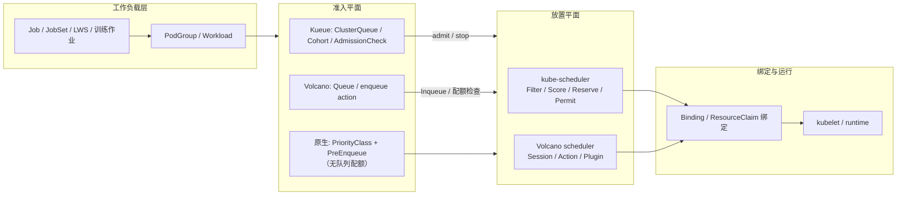

# 调度器源码与策略：专题导读

这组页面讨论同一个问题的五个切面：**一个待调度的实体，如何从队列进入调度器、被判定"能放在哪"、把资源暂时记在账上、最终确认或撤回，并在失败/重启/抢占后恢复到一个可解释的状态**。它既读源码（kube-scheduler v1.37.2、Volcano v1.16.1），也讨论策略（配额、公平、Gang、回填、拓扑、DRA、多集群），最后给出"如何证明它是对的、如何比较它好不好"的证据方法。

覆盖范围与边界：

- **覆盖**：原生 kube-scheduler 的对象/队列/cache/调度与绑定循环、Scheduling Framework 的扩展点与状态语义、Volcano 的 Session/Action/Plugin 模型、队列与作业级策略、DRA claim 分配、多集群选址、正确性不变式与同轨迹评估方法。
- **不覆盖**：kubelet 的 Pod 启动细节、CRI/CNI/CSI 实现、云厂商托管调度器的内部实现、具体生产集群的调参手册。这些只在必要处引用既有页面。
- **没有生产 trace**：本专题不声称任何"A 比 B 快 N%"的实测结论；所有性能讨论要么是指标定义，要么是实验设计，要么明确标注"示例"。

## 1. 版本与能力基线

所有代码链接固定到下表 commit；不同版本的默认值和扩展点可能不同，读页面时先对齐版本。

| 项目 | 基线 | 固定 commit | 关键能力状态 |
| --- | --- | --- | --- |
| Kubernetes | v1.37.2 | [`c50e539`](https://github.com/kubernetes/kubernetes/blob/c50e5395f1ae2d4a2c05f28fdcc38c0916cc1a32/pkg/scheduler/scheduler.go#L69-L126) | DRA GA 默认开；`GenericWorkload`（PodGroup + gang）Beta **默认关**；TAS、PodGroup 抢占、PodGroup 级 DRA claim 为 Alpha/Beta **默认关** |
| Volcano | v1.16.1 | [`a254367`](https://github.com/volcano-sh/volcano/blob/a2543678633b4e30fda413f8ad386fc34e10f8ae/pkg/scheduler/scheduler.go#L138-L170) | 默认 action 仅 `enqueue, allocate, backfill`；preempt/reclaim 需显式配置 |
| Kueue | main@2026-11-23（晚于 v0.20.8） | [`be7dc9d`](https://github.com/kubernetes-sigs/kueue/blob/be7dc9d31470258dd324e5bd6d84f7eaf90f5f69/apis/kueue/v1beta2/clusterqueue_types.go#L86-L132) | 作业级准入/配额/借用/公平分享；MultiKueue 多集群分发 |

> [!WARNING]
> 不要把 Kubernetes 的 `GenericWorkload`（Beta 默认关）当成"1.37 默认支持 gang"。在默认配置下，原生 scheduler 仍然逐 Pod 调度；PodGroup/gang 需要显式打开 feature gate 并创建 `scheduling.k8s.io/v1beta1` 的 PodGroup。Volcano 的 gang 则是其默认插件链的一部分，但默认 action 里没有 preempt/reclaim。

## 2. 一张总图：三个平面，四种所有权

调度不是一个函数，而是**准入（admission）**、**放置（placement）**、**绑定/运行（binding/runtime）**三个平面叠加。不同项目拥有不同平面：

读任何调度问题时，先问三个问题：

1. **谁在做准入？** 是 Kueue 决定"这个 Workload 能不能现在启动"，还是 Volcano 的 enqueue 决定 PodGroup 能否 Inqueue，还是根本没有人管队列、Pod 直接进 kube-scheduler？
2. **谁在做放置？** 是 kube-scheduler 的 Filter/Score，还是 Volcano 的 predicate/nodeorder，还是两者级联（Kueue 准入后仍由 kube-scheduler 选点）？
3. **资源账本在哪？** 是 kube-scheduler 的 cache/snapshot，还是 Volcano 的 session/cache，还是 Kueue 的 ClusterQueue 账本？三套账本各自独立，不能假设它们实时一致。

## 3. 五个核心模型

### 3.1 实体与队列：Pod 不是唯一的调度单位

原生 v1.37 的队列可以放 `QueuedPodInfo` 或 `QueuedPodGroupInfo`；`GenericWorkload` 关闭时只有 Pod。Volcano 的调度单位是 Task（Pod）与 Job（PodGroup 的聚合视图）；Kueue 的单位是 Workload（一组 PodSet）。

因此"排队"至少有三层含义：

- **作业准入队列**：Kueue 的 LocalQueue/ClusterQueue、Volcano 的 Queue、Slurm 的 partition；
- **调度器内部队列**：activeQ/backoffQ/unschedulable pool（原生）、Session 内的 Job/Task 优先队列（Volcano）；
- **API 层的门控**：SchedulingGates、PreEnqueue、PodGroup phase。

把这三层混为一谈，就会出现"队列明明有空位，为什么 Pod 还 Pending"——空位可能是配额空位、可能是调度器 activeQ 为空但 backoffQ 里有一堆 Pod、也可能是 Pod 被 gate 住。

### 3.2 周期与状态：调度周期不是绑定周期

原生 scheduler 的 `ScheduleOne` 先做**调度周期**（选点、试分配、Reserve、Permit），成功后再异步开**绑定周期**（WaitOnPermit、PreBind、Bind、PostBind）。资源在调度周期就"暂记"了，不等绑定成功。

Volcano 的 `Session` 是一个**回合**：打开时从 cache 做快照，所有 action 在快照上做决策，`Statement` 记录操作，`CloseSession` 才把 dirty jobs 刷回 cache。Action 内部的 `Allocate` 先改内存，`Commit` 才走 API。

两种模型的共同点是"先记账、后确认"，区别是**账本的粒度和事务边界**：原生以 Pod 为单位、cache 为账本；Volcano 以 Session 为单位、Statement 为事务。

### 3.3 暂记/确认/撤回：三个必须分开的动作

| 动作 | 原生 | Volcano |
| --- | --- | --- |
| 暂记 | `Cache.AssumePod`，Pod 进 `assumedPods`，NodeInfo 立即扣资源 | `Session.Allocate` 改 session 内 Job/Task/Node 状态 |
| 确认 | Binding 被 apiserver 接受，informer 回填 `NodeName`，`Cache.AddPod` 转正 | `Statement.Commit` 调 cache/API；Pod 真正 bind |
| 撤回 | `Unreserve` + `Cache.ForgetPod`；失败进 unschedulable/backoff | `Statement.Discard` 逆序 unallocate/unevict；或 bind 失败后 unallocate |

三者的失败后果不同：**暂记失败**通常意味着内部状态不一致（重试或报错）；**确认失败**意味着资源要退回并重新排队；**撤回失败**是最危险的，可能留下"账上已扣、实际没绑定"的泄漏。证据页会把每一条展开成可验证的不变式。

### 3.4 权益/准入/回收：队列不是一个数字

队列策略至少有四个独立概念：

- **权益（entitlement）**：这个队列"应得"多少（Kueue `nominalQuota`、Volcano `deserved`/`guarantee`、proportion 的 weight share）；
- **上限（capability）**：这个队列"最多"能用多少（Kueue `borrowingLimit`、Volcano `capability`）；
- **实际分配（allocation）**：当前账本上已记了多少；
- **需求（request/inqueue）**：排队中的作业还想拿多少。

公平性通常比较的是**分配/权益**或**主导资源份额（DRS）**，而不是绝对用量；回收通常发生在"某队列超过权益、且另一个队列有 starving 作业"时。把 `capability` 当 `deserved`、把 `allocated` 当 `usage`，是最常见的策略误读。

### 3.5 可行性：资源够不够，不只看 CPU/内存

一个放置是否可行，至少要同时满足：

- **数量与维度**：CPU/内存/GPU/自定义资源，以及 Pod 级 overhead、init container 的最大值；
- **设备**：GPU 型号/显存/MIG、DRA `DeviceClass` + CEL、驱动/运行时；
- **拓扑**：NUMA、NVLink/IB、机架/交换机、云可用区、本地盘；
- **策略**：配额、优先级、抢占、PDB、拓扑分布、亲和/反亲和；
- **集群**：多集群场景下还要加数据/镜像位置、网络连通、集群配额与故障域。

DRA 把这套可行性从"扩展资源计数"推进到"按 claim 申请、按设备属性筛选、按 CEL 约束选择"，但并没有消除上面的任何一层；它只是把"设备"这一层变成了可编程的分配问题。

## 4. 页面导航

| 页面 | 先读它，如果你想回答 |
| --- | --- |
| [kube-scheduler：对象、队列与调度主流程](./native-scheduler.md) | Pod 从 informer 到 activeQ、再到绑定，资源账本在哪一步变化？失败/重启后发生了什么？ |
| [Scheduling Framework：扩展点、状态与并发语义](./scheduling-framework.md) | 插件在哪些点被调用？CycleState 能存什么？返回 Unschedulable 和 Error 有什么区别？ |
| [Volcano 调度器：Session、Action 与队列模型](./volcano-scheduler.md) | Volcano 的 allocate/backfill/preempt/reclaim 怎么工作？gang/capacity/proportion 各自改哪个决策？ |
| [调度策略与约束：配额、Gang、拓扑与 DRA](./scheduling-strategy.md) | 队列权益怎么算、怎么借、怎么回收？Gang/回填/碎片/异构卡/DRA/多集群如何进入同一套可行性分析？ |
| [调度正确性与优化证据：不变式、指标与同轨迹对比](./scheduling-evidence.md) | 怎么证明"不超额、失败会释放、重启能恢复"？怎么用同一负载轨迹比较等待、完成时间、碎片和进度损失？ |
| [kube-scheduler 源码分析（旧版归档）](./4_kube-scheduler源码分析.md) | 早期（Framework 之前）的 predicates/priorities 实现；仅作历史对照 |

## 5. 十条结论（先给判断，细节在各自页面）

1. **"调度成功"至少有四个状态**：选点成功、资源已 assume、Binding 被接受、Pod 真正 Running。只监控其中一个，会把"卡在绑定/启动"误判成"调度慢"。
2. **assume 是性能优化，不是承诺**。它让 scheduler 不必等绑定完成就能继续调度，代价是必须有一整套 `ForgetPod`/`Unreserve`/snapshot 清理来兜底。
3. **原生队列没有配额**。PriorityClass 只影响排序和抢占，不限制某个租户能用多少；队列配额必须由 Kueue/Volcano/上层系统提供。
4. **原生 gang 是 Beta 默认关**，实现方式是 PodGroup + Permit 等待（5 分钟超时）；Volcano 的 gang 是默认插件链的一部分，但默认 action 不含 preempt/reclaim。两者不能互相替代着讲。
5. **Volcano 的 Session 是快照 + 事务**。Action 在 session 内改状态，Statement 决定提交还是回滚；它和原生"逐 Pod assume + 异步 bind"是两种不同的一致性模型。
6. **capacity 与 proportion 不是同义词**。前者是层级队列的 guarantee/capability 模型，后者是权重份额模型；混用会把"保底"和"上限"算错。
7. **借用与回收是一对**。只配 borrowing 不配 reclaim，会把别人的空闲资源变成事实上的永久占用；只配 reclaim 不配 borrowing，则队列空闲时资源无法流动。
8. **回填提升利用率，但会把碎片和饥饿藏起来**。回填的前提是"不会延迟已承诺的 reservation"；没有这个前提的 backfill 只是"先到先占"。
9. **DRA 把设备分配变成 claim 级问题**，但可行性仍要过资源、拓扑、配额、优先级四关。claim 的 `Filter` 试分配、`Reserve` 记录、`PreBind` 绑定、`Unreserve` 释放是四个不同阶段，不能只看"claim 是否 allocated"。
10. **仿真和生产回答不同的问题**。仿真适合比较算法排序、配额公式、gang 死锁和碎片趋势；生产指标才包含真实到达过程、运行时抖动、设备故障和调度器之外的瓶颈。把两者混在一起，结论一定过拟合。

## 6. 三条阅读路径

**路径 A：读源码（scheduler 开发者）**

`native-scheduler` → `scheduling-framework` → `volcano-scheduler` → `scheduling-evidence`。先建立"实体—队列—账本—事务"的模型，再看扩展点和 Volcano 的差异，最后用不变式检查自己改的代码。

**路径 B：做平台/多租户（平台工程师）**

`scheduling-strategy` §2–§5 → `volcano-scheduler` 的 capacity/proportion → `kueue` 页面 → `scheduling-evidence` 的指标与实验。先确定"权益/准入/回收"三层由谁负责，再选型。

**路径 C：做 AI 训练/异构资源（ML 平台）**

`scheduling-strategy` §6–§12 → `volcano-scheduler` 的 gang/backfill → [HAMi](../../AI_Infrastructure/Accelerators/hami.md) → [工作负载建模](../../AI_Infrastructure/Distributed_Training/workload-modeling.md) → `scheduling-evidence` 的进度损失与同轨迹对比。先确定 gang 的原子性边界，再谈拓扑和卡型。

## 7. 术语表

| 术语 | 本专题的含义 |
| --- | --- |
| entity | 调度队列中的单位：Pod 或 PodGroup（v1.37） |
| assume | 把 Pod 以目标节点写入 scheduler cache，资源立即扣减，但 API 尚未绑定 |
| snapshot | 每个调度周期开始时从 cache 同步出的只读 NodeInfo 视图，带 generation |
| CycleState | 一个调度周期内插件共享的 KV 状态，无锁、可信插件、可 Clone |
| Reserve | 资源已选定后，插件在内存中预留/记账的扩展点；失败会触发 Unreserve |
| Permit | 调度周期末尾的等待/放行点；可 Wait、Allow、Reject、Timeout |
| PodGroup | 一组 Pod 的调度单元；原生 v1beta1（Beta 默认关），Volcano 用自己的 v1beta1 |
| Session | Volcano 的一次调度回合，包含 Jobs/Nodes/Queues 快照与插件运行时 |
| Statement | Volcano 的操作日志（Allocate/Pipeline/Evict），支持 Commit/Discard |
| entitlement | 队列"应得"的资源，不等同于上限或实际分配 |
| DRS | Dominant Resource Share，主导资源份额；Kueue Fair Sharing 用它比较队列 |
| 进度损失 | 抢占/重启导致训练从最后一个 checkpoint 重算的时间 |

## 8. 证据与版本说明

- 代码证据统一使用 pinned SHA；行号在写作时逐一核对。Kueue 使用 main 快照（`be7dc9d`，2026-11-23），因为它晚于 v0.20.8 且包含本页讨论的 fair sharing / MultiKueue 代码；不要把该快照说成某个 release。
- 官方文档链接在写入前用 HTTP 200 验证；KEP 链接指向 `kubernetes/enhancements` 的具体目录。
- 页面中的"经验值/通常/取决于"表示非代码强制的行为；没有标注的默认值/状态码应当能在代码或文档中找到。
- 本专题不提供生产 benchmark。`scheduling-evidence.md` 给的是指标定义、实验设计和报告模板；任何示例数值都只用于说明计算方式。

## 本 wiki 相关页面

- [kube-scheduler：对象、队列与调度主流程](./native-scheduler.md)
- [Scheduling Framework：扩展点、状态与并发语义](./scheduling-framework.md)
- [Volcano 调度器：Session、Action 与队列模型](./volcano-scheduler.md)
- [调度策略与约束：配额、Gang、拓扑与 DRA](./scheduling-strategy.md)
- [调度正确性与优化证据：不变式、指标与同轨迹对比](./scheduling-evidence.md)
- [Kueue](./kueue.md)
- [kube-scheduler 源码分析（旧版归档）](./4_kube-scheduler源码分析.md)
- [HAMi](../../AI_Infrastructure/Accelerators/hami.md)
- [云原生分布式训练：编排与稳定性专题](../../AI_Infrastructure/Distributed_Training/overview.md)
- [Slurm](../../../Machine_Learning/High_Performance_Computing/slurm.md)
