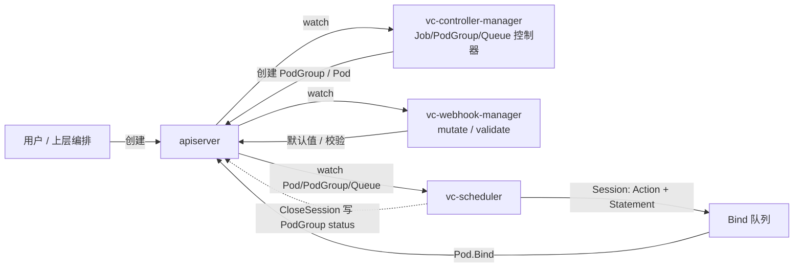
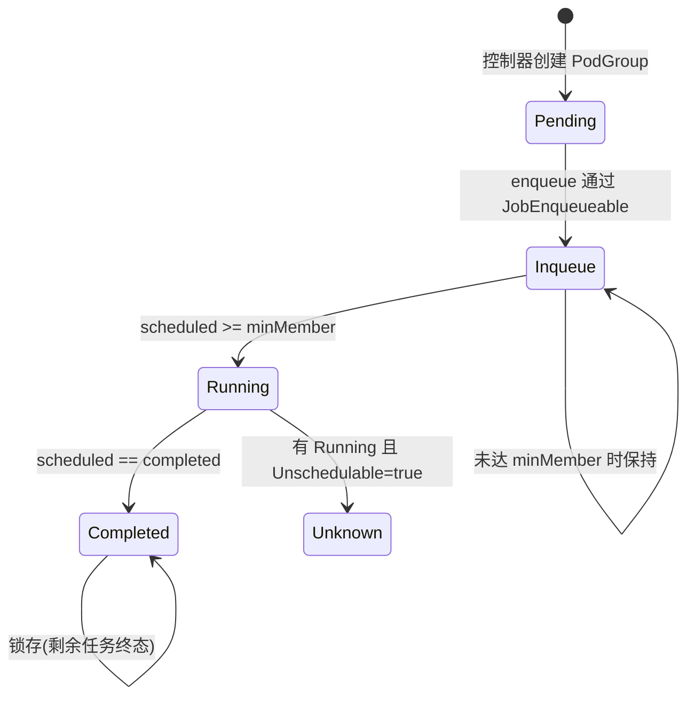
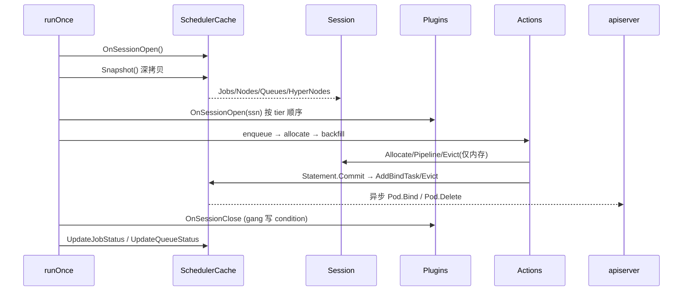

# Volcano 调度器：Session、Action 与队列模型

Volcano 把「批作业调度」做成了一套与 kube-scheduler 平行的调度器：它自己维护作业快照、自己做节点筛选与打分、自己向 apiserver 发 Bind。
本页回答三个问题：一次调度回合（Session）里状态是怎么组织的；Action 管线为什么必须是那个顺序；Statement 事务和原生 assume 到底差在哪。
对象模型、gang 门槛、队列权益、主要 action 和插件都会逐个落到代码上；Kueue 的准入模型、DRA allocator 的内部算法不在本页展开（分别见 [kueue.md](./kueue.md) 与 [scheduling-strategy.md](./scheduling-strategy.md)）。

> 版本基线：Volcano **v1.16.1**，commit [`a254367`](https://github.com/volcano-sh/volcano/blob/a2543678633b4e30fda413f8ad386fc34e10f8ae/pkg/scheduler/util.go#L38-L51)（仓库 `.repos/upstream/volcano`）。
> 文中的默认值、状态机、回调语义都来自该 commit；调参建议会明确标注为经验判断。官方文档站为 "Latest"（v1.16.x）分支，与代码基线同代。

## 一、组件边界：谁创建对象、谁选点、谁 Bind

Volcano 不是一个「extender」：它不是把节点选择结果交给 kube-scheduler 去 bind，而是直接充当名为 `volcano` 的 scheduler。三个常驻组件分工如下。

| 组件 | 负责 | 不负责 |
|---|---|---|
| `vc-scheduler` | 监听 Pod/PodGroup/Queue/HyperNode；周期性 `OpenSession`；按配置顺序执行 Action；用插件做 predicate 与打分；`Pods().Bind` 写回绑定 | 不创建 Job/Pod、不生成 Pod 模板、不改 workload 控制器语义 |
| `vc-controller-manager` | Job/PodGroup/Queue/JobFlow/CronJob 等控制器；创建 PodGroup、按 PodGroup 状态创建 Pod、维护 Queue 状态 | 不参与节点选择（`syncJob` 只按 PodGroup phase 决定是否建 Pod） |
| `vc-webhook-manager` | Pod/PodGroup/Queue/Job 的 mutate 与 validate：按资源组配置注入 `schedulerName`/label/affinity/toleration、可选 scheduling gate；校验 queue 是否存在且 Open、拓扑字段是否互斥 | 不做配额准入（那是 `enqueue` action 的职责） |

三者的连接点有两处，都值得记住：

1. **调度权按 `schedulerName` 切分**。Volcano 的 cache 只接受 `SchedulerName` 在 `--scheduler-name` 列表里的 Pod（可重复的 StringArray，默认 `volcano`），否则连 JobInfo 都不会创建（[`options.go#L181`](https://github.com/volcano-sh/volcano/blob/a2543678633b4e30fda413f8ad386fc34e10f8ae/cmd/scheduler/app/options/options.go#L181)、[`event_handlers.go#L72-L82`](https://github.com/volcano-sh/volcano/blob/a2543678633b4e30fda413f8ad386fc34e10f8ae/pkg/scheduler/cache/event_handlers.go#L72-L82)）。所以 kube-scheduler 不会去调度 `schedulerName: volcano` 的 Pod，Volcano 也不需要 kube-scheduler 帮它算节点。
2. **Bind 由 Volcano 自己发**。`DefaultBinder.Bind` 逐 Pod 调 `CoreV1().Pods(ns).Bind(&v1.Binding{...})`，把 `Target.Name` 设为选中的节点（[`cache.go#L245-L266`](https://github.com/volcano-sh/volcano/blob/a2543678633b4e30fda413f8ad386fc34e10f8ae/pkg/scheduler/cache/cache.go#L245-L266)）。这和 kube-scheduler 的 defaultBinder 用的是同一个 API，但实例、队列、重试语义完全不同。



一个容易被忽略的因果链：`enqueue` 把 PodGroup 从 `Pending` 改为 `Inqueue` 之后，Job 控制器才会创建 Pod（[`job_controller_actions.go#L439-L444`](https://github.com/volcano-sh/volcano/blob/a2543678633b4e30fda413f8ad386fc34e10f8ae/pkg/controllers/job/job_controller_actions.go#L439-L444)）。
也就是说 Volcano 的「准入」不是软性的排队，而是**直接决定集群里有没有这些 Pod**。这一点与 Kueue 的 admit/stop 在效果上相近，但 Volcano 把它做在调度器的一个 action 里，而不是独立控制器里。

## 二、对象模型：Job → PodGroup → Pod，Queue 是另一条轴

Volcano 的调度单元是 **PodGroup**，不是单个 Pod。三者关系是：

```text
Volcano Job (batch.volcano.sh/v1alpha1)
  └─ ownerReference → PodGroup (scheduling.volcano.sh/v1beta1)
        └─ Pod 通过 annotation scheduling.k8s.io/group-name 归属 PodGroup
```

Volcano Job 只是「便捷控制器」：它把多 Task 模板展开成 Pod、写好 `minAvailable`/`minSuccess`/`policies`，并创建 PodGroup（[`job_controller_actions.go#L825-L880`](https://github.com/volcano-sh/volcano/blob/a2543678633b4e30fda413f8ad386fc34e10f8ae/pkg/controllers/job/job_controller_actions.go#L825-L880)）。裸 Pod 只要带 `group-name` 注解且 `schedulerName: volcano`，PodGroup 控制器也会为它补建 PodGroup（[`pg_controller_handler.go#L293-L319`](https://github.com/volcano-sh/volcano/blob/a2543678633b4e30fda413f8ad386fc34e10f8ae/pkg/controllers/podgroup/pg_controller_handler.go#L293-L319)）。

### 2.1 Job 字段落到 PodGroup

Job 的调度相关字段基本 1:1 写进 PodGroup，但两者不是同一层对象：

| Volcano Job | PodGroup | 语义 |
|---|---|---|
| `spec.minAvailable` | `spec.minMember` | gang 门槛：本 Job 至少要同时可调度的成员数；也是 phase 判定的阈值 |
| `spec.tasks[].minAvailable` / `partitionPolicy` | `spec.minTaskMember` | 每个 task 角色的最小数，gang 用它做「每角色都要够数」的检查 |
| `spec.queue` | `spec.queue` | 指向 cluster-scoped Queue；不存在则不会被调度 |
| `spec.priorityClassName` | `spec.priorityClassName` | 最终被 cache 解析成 `JobInfo.Priority`，供 priority 插件排序/选 victim |
| `spec.networkTopology` | `spec.networkTopology` | `hard`/`soft` + 最高拓扑层，供 hyperNode 搜索 |
| — | `spec.minResources` | **准入预留**：enqueue 时按它判断队列/集群放不放；不是实际分配量 |
| — | `spec.subGroupPolicy` | 子组级 gang 与拓扑域，是 `minTaskMember` 的演进方向 |

字段定义见 [`scheduling/v1beta1/types.go#L174-L230`](https://github.com/volcano-sh/volcano/blob/a2543678633b4e30fda413f8ad386fc34e10f8ae/staging/src/volcano.sh/apis/pkg/apis/scheduling/v1beta1/types.go#L174-L230)，Job 侧见 [`batch/v1alpha1/job.go#L55-L127`](https://github.com/volcano-sh/volcano/blob/a2543678633b4e30fda413f8ad386fc34e10f8ae/staging/src/volcano.sh/apis/pkg/apis/batch/v1alpha1/job.go#L55-L127)。

> 两个「门槛」别混：`minMember` 是**调度门槛**（不到就不 bind，见 §5），`minResources` 是**准入门槛**（enqueue 时读，见 §4）。前者决定 gang 原子性，后者决定队列配额预留。

### 2.2 Queue：weight / capability / guarantee / deserved 各管一段

Queue 是集群级对象，字段语义经常被混为一谈（[`types.go#L622-L681`](https://github.com/volcano-sh/volcano/blob/a2543678633b4e30fda413f8ad386fc34e10f8ae/staging/src/volcano.sh/apis/pkg/apis/scheduling/v1beta1/types.go#L622-L681)）：

| 字段 | 作用 | 谁读它 |
|---|---|---|
| `weight` | 相对权重，用于按 `weight/totalWeight × totalResource` 切分 | `proportion` 插件；`capacity` 不读 |
| `capability` | 队列资源上限（硬顶） | `capacity`/`proportion` 的 `realCapability`/`deserved` 计算 |
| `guarantee.resource` | 给本队列预留、其他队列不能动的资源 | `capacity`（`proportion` 也用它做 deserved 下限） |
| `deserved` | 显式的「应得份额」，超出部分可被回收 | 仅 `capacity` 插件；官方文档明确写 "only used by capacity plugin" |
| `reclaimable` | 是否允许别的队列回收本队列资源，**默认 true**（[`queue_info.go#L173-L187`](https://github.com/volcano-sh/volcano/blob/a2543678633b4e30fda413f8ad386fc34e10f8ae/pkg/scheduler/api/queue_info.go#L173-L187)） | `reclaim` action 的 victim 队列过滤 |
| `parent` | 层级队列的父队列 | `capacity`/`proportion` 的层级模式 |
| `priority` | 队列排序优先级（高者先、回收时后动） | `QueueOrderFn` |
| `dequeueStrategy` | 声明 `fifo`（严格队头）/ `traverse`（跳过卡住的队头）；**v1.16.1 核心仓库只把它映射到 `NamespaceQueue`，scheduler 侧没有消费点**（`grep` 仅命中 API 类型与转换），不要依赖它控制出队 | 暂无 |

三者关系有明确约束：`guarantee ≤ deserved ≤ capability`，且 `deserved` 必须显式配置、`capability` 子队列不能超过父队列（见[队列资源管理](https://volcano.sh/docs/KeyFeatures/QueueResourceManagement)）。
注意 `capability` 是上限、`guarantee` 是下限、`deserved` 是「可被回收的界线」——它们不是同一个配额概念的三种写法。

Queue 的 `status.allocated` 由调度器在 `CloseSession` 时按 Session 内任务重算并写回（含父队列累加，[`session.go#L483-L513`](https://github.com/volcano-sh/volcano/blob/a2543678633b4e30fda413f8ad386fc34e10f8ae/pkg/scheduler/framework/session.go#L483-L513)），所以它天然滞后于真实 Pod 状态一个调度周期。

### 2.3 PodGroup phase 以代码为准

phase 常量只有五个（[`types.go#L39-L59`](https://github.com/volcano-sh/volcano/blob/a2543678633b4e30fda413f8ad386fc34e10f8ae/staging/src/volcano.sh/apis/pkg/apis/scheduling/v1beta1/types.go#L39-L59)），但**取值不是控制器随便写的**，而是 `CloseSession` 时由 `getPodGroupPhase` 从任务状态重算（[`session.go#L563-L617`](https://github.com/volcano-sh/volcano/blob/a2543678633b4e30fda413f8ad386fc34e10f8ae/pkg/scheduler/framework/session.go#L563-L617)）：

```go
// 已调度数 = ScheduledStatus（Running/Bound/Failed/Succeeded）+ 已绑定的 Releasing
scheduled := int(jobInfo.ScheduledTaskNum())
completed := 0
for s, tasks := range jobInfo.TaskStatusIndex {
    if api.CompletedStatus(s) { completed += len(tasks) }
}
scheduled += int(jobInfo.ReleasingScheduledTaskNum())

if int32(scheduled) >= jobInfo.PodGroup.Spec.MinMember {
    if scheduled == completed { return scheduling.PodGroupCompleted }
    return scheduling.PodGroupRunning
}
if jobInfo.PodGroup.Status.Phase != scheduling.PodGroupInqueue {
    return scheduling.PodGroupPending
}
return jobInfo.PodGroup.Status.Phase
```

三个细节：`Completed` 有「锁存」逻辑（一旦 Completed 且剩余任务都终态就保持，避免 TTL 删除过程中被降级回 Pending 又被重新 enqueue）；`Unknown` 只在「有 Running 任务且本 session 打了 Unschedulable condition」时出现；`Inqueue` 由 `enqueue` action 推进（未配置 `enqueue` 时 `allocate` 会兜底改写），不会被这个函数重算掉。

还要注意 `ScheduledStatus` 只包含 `Running/Bound/Failed/Succeeded`，**不含 `Allocated/Binding`**：Statement Commit 后任务只是 `Binding`，要等 informer 看到带 `nodeName` 的 Pod 才进入 `Bound/Running`。所以 PodGroup 变 `Running` 不仅滞后一个 session，还依赖 apiserver/informer 的确认。



## 三、Session：一次调度回合的快照与插件运行时

`vc-scheduler` 每 `--schedule-period`（默认 1s，[`options.go#L36-L48`](https://github.com/volcano-sh/volcano/blob/a2543678633b4e30fda413f8ad386fc34e10f8ae/cmd/scheduler/app/options/options.go#L36-L48)）执行一次 `runOnce`：开 Session → 跑 Action → 关 Session（[`scheduler.go#L138-L165`](https://github.com/volcano-sh/volcano/blob/a2543678633b4e30fda413f8ad386fc34e10f8ae/pkg/scheduler/scheduler.go#L138-L165)）。

`OpenSession` 做的事（[`framework.go#L59-L90`](https://github.com/volcano-sh/volcano/blob/a2543678633b4e30fda413f8ad386fc34e10f8ae/pkg/scheduler/framework/framework.go#L59-L90)）：

1. `cache.OnSessionOpen()`，然后 `snapshot := cache.Snapshot()`：**深拷贝** Jobs、Nodes、Queues、NamespaceInfo、HyperNodes（[`session.go#L258-L270`](https://github.com/volcano-sh/volcano/blob/a2543678633b4e30fda413f8ad386fc34e10f8ae/pkg/scheduler/framework/session.go#L258-L270)）。
2. 记录 `PodGroupOldState`（status + annotations），用于 Close 时判断要不要写 API。
3. 建虚拟顶层 HyperNode、按 tier 整理拓扑；把所有 Node 的 Allocatable 累加成 `Session.TotalResource`（[`session.go#L303-L318`](https://github.com/volcano-sh/volcano/blob/a2543678633b4e30fda413f8ad386fc34e10f8ae/pkg/scheduler/framework/session.go#L303-L318)）。
4. 按 `tiers` 配置顺序实例化插件并调用 `OnSessionOpen(ssn)`：插件在这个回调里注册回调函数、计算本 session 的队列/作业视图（如 capacity 的 per-queue deserved）。
5. `InitCycleState()`：为每个 Pending 且未被 gate 的任务建一份 `CycleState`，供 PrePredicate/Predicate 之间传状态。
6. `applyCachedSkips()`：把 unschedulable-job cache 的结论套到本 session（被抑制的 Job 不再尝试）。

Session 是**内存视图**，action 里所有的分配、驱逐、pipeline 都只改这份克隆；真正写 API 的只有三处：Statement 的 `Commit`（bind/evict）、Session 关闭时的状态回写、以及 `shuffle` 直接调 `ssn.Evict`。这也是为什么「调度成功」必须拆成「内存分配」「bind 请求」「Pod 真正 Running」三段来看。

`CloseSession` 的顺序（[`framework.go#L92-L101`](https://github.com/volcano-sh/volcano/blob/a2543678633b4e30fda413f8ad386fc34e10f8ae/pkg/scheduler/framework/framework.go#L92-L101)、[`session.go#L540-L561`](https://github.com/volcano-sh/volcano/blob/a2543678633b4e30fda413f8ad386fc34e10f8ae/pkg/scheduler/framework/session.go#L540-L561)）：

1. 每个插件 `OnSessionClose`——gang 在这里写 `Unschedulable`/`Scheduled` condition。
2. `JobUpdater.UpdateAll()` 并发逐 Job 调 `updateJob`：重算 phase、同步 hyperNode 注解，只有状态/注解变了或 Job 被标 dirty 才 `cache.UpdateJobStatus`（[`job_updater.go#L136-L150`](https://github.com/volcano-sh/volcano/blob/a2543678633b4e30fda413f8ad386fc34e10f8ae/pkg/scheduler/framework/job_updater.go#L136-L150)）。
3. `updateQueueStatus`：按 Session 内任务的 `AllocatedStatus` 重算每个队列（含祖先）的 allocated 并写回。
4. `reconcileUnschedulableCache`、`cache.OnSessionClose`，然后把 Session 字段置 nil。



### 3.1 Session 内状态 vs cache

| 维度 | Session | SchedulerCache |
|---|---|---|
| 生命周期 | 一次 `runOnce`（默认 1s） | 进程级，随 informer 持续更新 |
| 数据来源 | `Snapshot()` 深拷贝 | informer 事件（Pod/Node/PodGroup/Queue） |
| 资源账本 | `NodeInfo.Idle/Used/Releasing` 的克隆，Action 内随便改 | 真实 NodeInfo；`AddBindTask`/`Evict` 会立刻改它 |
| 任务状态 | Action 改的是克隆的 `TaskStatusIndex` | 只有 bind/evict 相关的状态变更会进 cache |
| 写回时机 | `CloseSession` 写 PodGroup status/annotations、Queue status | bind 请求由 20ms 一次的 `processBindTask` 批量发出 |
| 崩溃影响 | 直接丢失，无副作用 | 重启后由 informer 全量重建 |

`DirtyJobs` 容易被误解：它**不是**「所有被改过的 Job」，而是需要在 Close 时把 hyperNode 提名/placement 写回 cache 的 Job（`allocate` 的 nominated 分支会 `MarkJobDirty`）。普通的任务分配状态不需要这个标记，因为 PodGroup status 本来就会被重算。

## 四、Action 管线：默认三个，扩容必须显式配置

默认 scheduler conf 只有三个 action（[`util.go#L38-L51`](https://github.com/volcano-sh/volcano/blob/a2543678633b4e30fda413f8ad386fc34e10f8ae/pkg/scheduler/util.go#L38-L51)）：

```yaml
actions: "enqueue, allocate, backfill"
tiers:
- plugins:
  - name: priority
  - name: gang
  - name: conformance
- plugins:
  - name: overcommit
  - name: drf
  - name: predicates
  - name: proportion
  - name: nodeorder
```

| Action | 做什么 | 默认 | 关键前提 |
|---|---|---|---|
| `enqueue` | Pending → Inqueue；按 `JobEnqueueable`（overcommit/capacity/proportion）与 Queue 状态做准入 | ✅ | Job 无 `minResources` 时直接放行 |
| `allocate` | 队列→Job→Task 三级选择，predicate + node order，gang 达标才 commit | ✅ | 需 Job 已不是 Pending（否则跳过） |
| `backfill` | 只给「无资源请求、无 DRA claim」的 BestEffort 任务找节点 | ✅ | 不做 gang/配额校验 |
| `preempt` | 队列内、按优先级抢占，让 starving job 变 pipelined | ❌ 显式配置 | 必须有 Pending 任务 |
| `reclaim` | 跨队列按权益回收（overused/preemptive/reclaimable） | ❌ | 同上 |
| `gangpreempt` | 以整 Job/bundle 为单位驱逐，按 HyperNode 域做提名 | ❌ | 新增 action（文件头 Copyright 2026），参数 `maxDomains`/`allowWholeBundle` |
| `gangreclaim` | 同上，但跨队列回收 | ❌ | 同上 |
| `shuffle` | 按插件的 `VictimTasksFn` 选一批 Running 任务直接驱逐 | ❌ | 只驱逐、不分配 |

顺序不是随意的，至少四条理由：

1. **`enqueue` 必须在 `allocate` 之前**：`allocate` 只处理非 Pending 的 Job。若配置里没有 `enqueue`，`allocate` 会把 Pending 在**内存里**改成 Inqueue 再继续（[`allocate.go#L173-L186`](https://github.com/volcano-sh/volcano/blob/a2543678633b4e30fda413f8ad386fc34e10f8ae/pkg/scheduler/actions/allocate/allocate.go#L161-L180)），但这只是兜底。
2. **`allocate` 必须在 `preempt`/`reclaim` 之前**：先试便宜路径（有空闲就分配），只有仍然 starving 的 Job 才值得付驱逐成本。反过来会把还能正常调度的 victim 先杀掉。
3. **`allocate` 必须在 `backfill` 之前**：有资源请求的 Pod 先占位，BestEffort 再用剩下的节点填空；`backfill` 自己不检查 gang，也不走 Statement。
4. **`enqueue` 与 `preempt`/`reclaim` 存在语义冲突**：官方文档明确提示，若 enqueue 判定 Job 不能入队，控制器就不会创建 Pending Pod，后续 preempt/reclaim 也就没有对象可抢（[Actions 文档](https://volcano.sh/docs/Scheduler/Actions)）。生产配置通常二选一，或让 enqueue 足够宽松。

`gangpreempt`/`gangreclaim` 与 `preempt`/`reclaim` 是**两代实现**：后者的粒度是 task，前者把「整个 Job 的待调度任务」作为一个 bundle，在最多 `maxDomains` 个 HyperNode 域里选 victim 组合，成功后把 `NominatedHyperNode` 写回 SubJob，交给下一个 `allocate` 周期兑现（[`gangpreempt.go#L79-L139`](https://github.com/volcano-sh/volcano/blob/a2543678633b4e30fda413f8ad386fc34e10f8ae/pkg/scheduler/actions/gangpreempt/gangpreempt.go#L79-L139)）。两者不建议同时开启。

## 五、allocate 与 backfill：gang 分配和 BestEffort 填空

### 5.1 allocate 的三级选择

`allocate.Execute` 的注释就是算法骨架：选 Queue → 选 Job → 选 Task → predicate 过滤 → node order 选点（[`allocate.go#L138-L158`](https://github.com/volcano-sh/volcano/blob/a2543678633b4e30fda413f8ad386fc34e10f8ae/pkg/scheduler/actions/allocate/allocate.go#L138-L158)）。

- **队列**：`PriorityQueue(QueueOrderFn)`，按插件给出的顺序取；**overused 的队列直接跳过**（[`allocate.go#L356-L372`](https://github.com/volcano-sh/volcano/blob/a2543678633b4e30fda413f8ad386fc34e10f8ae/pkg/scheduler/actions/allocate/allocate.go#L356-L372)）。
- **Job**：`JobOrderFn` 决定；`JobValid` 失败、被 unschedulable cache 抑制、队列不存在的 Job 都跳过。
- **Task**：`TaskOrderFn`；每次取一个，先查 `ssn.Allocatable(queue, task)`——这是队列权益在分配侧的唯一闸门。
- **节点**：`PrePredicateFn` → 若 Pod 带 `status.nominatedNodeName` 且该节点仍在候选域内，优先只试它 → 否则对所有节点跑 `PredicateNodes`（资源 fit + 各插件 predicate）。注意 predicate 返回 `Unschedulable`/`UnschedulableAndUnresolvable`/`ErrorSkipOrWait` 都算失败，其余错误被忽略（[`session.go#L662-L690`](https://github.com/volcano-sh/volcano/blob/a2543678633b4e30fda413f8ad386fc34e10f8ae/pkg/scheduler/framework/session.go#L662-L690)）。
- **打分**：候选节点分两档——`Idle` 够用的（第一档）与只有 `FutureIdle`（含 Releasing）够用的（第二档）。第一档有解就不看第二档；同档内用 `BatchNodeOrderFn`/`NodeOrderFn` 打分，`BestNodeFn` 或最高分胜出（[`allocate.go#L1154-L1223`](https://github.com/volcano-sh/volcano/blob/a2543678633b4e30fda413f8ad386fc34e10f8ae/pkg/scheduler/actions/allocate/allocate.go#L1154-L1223)）。
- **落账**：第一档节点 → `stmt.Allocate`（占 Idle）；第二档 → `stmt.Pipeline`（占 Releasing，任务变 `Pipelined`，等 victim 真正退出后再 bind）。

### 5.2 gang 门槛与 statement 的生命周期

`allocateResourcesForTasks` 会为**一个 SubJob 的所有 Pending 任务**开一个 Statement，逐个分配；每分配完一个就检查 `SubJobReady`，达到门槛立即停手，调用方再检查 `JobReady` 决定是否 Commit（[`allocate.go#L925-L1000`](https://github.com/volcano-sh/volcano/blob/a2543678633b4e30fda413f8ad386fc34e10f8ae/pkg/scheduler/actions/allocate/allocate.go#L925-L1000)）。如果整轮下来没达到门槛：

- 任务没达到 `SubJobPipelined` → `stmt.Discard()`，内存里的分配全部逆序回滚，等于这个 Job 本轮一个都没占；
- 达到了 `SubJobPipelined` 但 Job 没 Ready → 只返回 statement，**不 Commit**：内存里仍算占位，但不会发 bind，session 结束后自然消失。

这正是 Volcano gang 的实现方式：**先在一个 Statement 里试满整组，再决定是否提交**。它没有原生 `Permit` 那样的「等待队列」——等的是下一个调度周期，而不是在 bind 周期里阻塞。

集群级队列闸门来自 `Allocatable`：proportion 比较 `allocated + req ≤ deserved`，capacity 则逐层检查 capability/deserved（含祖先）。两者都注册 `SimulateAllocatableFn`，供抢占时的 dry-run 使用。

### 5.3 backfill：只补 BestEffort，不保证 gang

`backfill` 的选择范围比很多人以为的窄（[`backfill.go#L60-L135`](https://github.com/volcano-sh/volcano/blob/a2543678633b4e30fda413f8ad386fc34e10f8ae/pkg/scheduler/actions/backfill/backfill.go#L60-L135)、[`#L137-L200`](https://github.com/volcano-sh/volcano/blob/a2543678633b4e30fda413f8ad386fc34e10f8ae/pkg/scheduler/actions/backfill/backfill.go#L137-L200)）：

1. 跳过 `Pending` 的 Job（未入队的 Job 不该被填进来）。
2. 只取**既没有普通资源请求、也没有 DRA claim** 的 Pending 任务——即 BestEffort Pod。有请求的任务留给 `allocate`。
3. 对 `Pipelined` 的同类任务先 `stmt.UnPipeline` 拉回 Pending，再重新找节点。
4. 每个任务独立走：`PrePredicateFn` → 全节点 `PredicateNodes` → 若只有一个候选就直接用，多候选时仍走 `BatchNodeOrderFn` 选最优 → `ssn.Allocate`（不走 Statement 批量）。失败时只把错误写进 `NodesFitErrors` 并继续下一个任务；因为没有 Statement，也就**没有批量回滚**，前一个任务已经做的内存改动不会被撤销。

所以 backfill **不检查 `JobReady`，也不调用 `Allocatable`**：它不保证 gang 原子性，也不做队列配额判断（这些任务的 request 为 0，配额账本本来也记不到它们头上）。它提高利用率的方式很直接：不等整组到齐，先把零请求 Pod 塞进节点空位；但这些 Pod 仍占 Pod 数量槽位、可能改变后续 gang 的 predicate/亲和性结果——而且 `JobInfo.IsReady()` 会把 Pending 的 BestEffort 任务也计入（[`job_info.go#L1352-L1362`](https://github.com/volcano-sh/volcano/blob/a2543678633b4e30fda413f8ad386fc34e10f8ae/pkg/scheduler/api/job_info.go#L1352-L1362)）；不过 gang 的 `JobReady` 还要求 `CheckTaskReady`，所以这主要影响 gang 的 `JobOrderFn` 排序，不一定能让 gang 门槛通过。

## 六、preempt 与 reclaim：只处理 starving / overused

两者共享同一套骨架（挑 starving Job → 逐 task → 在节点上选 victim → 用 Statement 试 → 成功才 Commit），差别在**范围**和**判定依据**。

### 6.1 preempt：队列内按优先级

1. 预选 preemptor Job：非 Pending、`JobValid` 通过、`JobStarving(job)` 为真、且不含 `networkTopology`（当前版本明确跳过带拓扑的 Job，[`preempt.go#L101-L158`](https://github.com/volcano-sh/volcano/blob/a2543678633b4e30fda413f8ad386fc34e10f8ae/pkg/scheduler/actions/preempt/preempt.go#L101-L158)）。
2. 两层循环：**队列内 Job 之间**（victim 必须同队列、不同 Job）与 **Job 内 Task 之间**（victim 必须同 Job）。
3. 每个 preemptor task：`PreemptionPolicy: Never` 直接拒；`PrePredicateFn`；带 `nominatedNodeName` 时若该节点上有「已被抢占、正在终止」的低优 Pod 则本轮不再抢（防重复驱逐）。
4. 排除 `allocate` 阶段已标记 `UnschedulableAndUnresolvable` 的节点，再跑 `PredicateForPreemptAction`（只把不可解/跳过类错误当失败，可解的资源不足留给抢占解决）。
5. 逐个节点：把 Running、`Preemptable`、同队列的 victim 交给 `ssn.Preemptable` 做 tier 交集；`ValidateVictims` 确认资源确实够；按最低优先级先驱逐，直到 `preemptorFitsOnNode`（`Allocatable` + 资源 + predicate）为真；然后 `Pipeline` preemptor。每个节点用独立 `nodeStmt`，失败就 `Discard`，成功才 `Merge` 进主 statement（[`preempt.go#L340-L390`](https://github.com/volcano-sh/volcano/blob/a2543678633b4e30fda413f8ad386fc34e10f8ae/pkg/scheduler/actions/preempt/preempt.go#L340-L390)）。
6. 循环结束后**只有 `JobPipelined(job)` 为真才 `Commit`**：commit 才真正调 `cache.Evict` 删 victim Pod；否则 `Discard` 把内存里的驱逐逆序撤销。

victim 的合法性由插件交集决定：gang 保证 victim Job 剩余数不低于 `MinAvailable`，priority 保证优先级更低，pdb 保证 `disruptionsAllowed` 不被击穿，conformance 保证 `kube-system` 与 critical Pod 不被选。`SelectVictimsOnNode` 还做了「取出最小 victim 集合后再逐个放回」的 reprieve 逻辑（[`preempt.go#L739-L800`](https://github.com/volcano-sh/volcano/blob/a2543678633b4e30fda413f8ad386fc34e10f8ae/pkg/scheduler/actions/preempt/preempt.go#L739-L800)），避免一次杀太多。

### 6.2 reclaim：跨队列按权益

reclaim 的入口判定换了（[`reclaim.go#L57-L88`](https://github.com/volcano-sh/volcano/blob/a2543678633b4e30fda413f8ad386fc34e10f8ae/pkg/scheduler/actions/reclaim/reclaim.go#L57-L88)、[`#L180-L264`](https://github.com/volcano-sh/volcano/blob/a2543678633b4e30fda413f8ad386fc34e10f8ae/pkg/scheduler/actions/reclaim/reclaim.go#L180-L264)）：

- 队列维度：`Overused(queue)` 为真则整队跳过；每个 task 还要过 `Preemptive(queue, tasks)`——proportion 用它判断「加上这些请求后是否仍在 deserved 内」，capacity 用它判断 `realCapability` 与逐维 deserved（含祖先）。
- victim 维度：只选**其他队列**的 Running/Preemptable 任务，且那个队列 `spec.reclaimable` 不为 false；再交给 `ssn.Reclaimable` 做 tier 交集（gang 保护 minAvailable、capacity 保护 guarantee/deserved、proportion 保护 deserved、pdb 过滤）。
- 满足条件同样是「驱逐到 `reclaimerFitsOnNode` 成立 → Pipeline → Merge」，最后 `JobPipelined` 才 Commit。

一个关键实现事实：**默认配置里只有 proportion 注册 `OverusedFn`**（另有可选的 `extender` 插件也会注册）。纯 capacity 配置下 `ssn.Overused()` 恒为 false，队列不会被这一步短路，真正的约束由 `Preemptive`/`Reclaimable` 里的 deserved/guarantee 比较承担。这也是为什么官方 capacity 指南要求「启用 capacity 时同时启用 reclaim」。

| 维度 | preempt | reclaim |
|---|---|---|
| 范围 | 同队列内、不同 Job（或同 Job 不同 Task） | 跨队列 |
| 触发 | `JobStarving` | `JobStarving` + 队列非 overused + `Preemptive` |
| victim 条件 | 任务 `Preemptable`、优先级更低、gang/pdb 允许 | 其他队列 + `reclaimable` + `Reclaimable` 回调允许 |
| 依据 | 优先级的「谁该让」 | 权益的「谁超了 deserved」 |
| 插件 | `PreemptableFn` | `ReclaimableFn` |
| 结果 | victim 被删、preemptor 变 Pipelined | 同左，但 preemptor 来自另一队列 |

## 七、插件：注册了哪些回调，改变哪个决策

插件不是 Framework 插件，而是在 `OnSessionOpen` 里往 Session 注册回调函数。Session 按 `tiers` 顺序遍历插件调用这些回调，语义分三类（[`session_plugins.go#L491-L569`](https://github.com/volcano-sh/volcano/blob/a2543678633b4e30fda413f8ad386fc34e10f8ae/pkg/scheduler/framework/session_plugins.go#L491-L569)、[`#L702-L860`](https://github.com/volcano-sh/volcano/blob/a2543678633b4e30fda413f8ad386fc34e10f8ae/pkg/scheduler/framework/session_plugins.go#L702-L860)）：

- **AND 式**（`JobReady`、`Allocatable`、`JobValid`、`SubJobReady`）：任一插件返回 false 即失败。
- **首个结论式**（`Preemptable`/`Reclaimable`/`JobPipelined`/`JobStarving`/`JobEnqueueable`）：同一 tier 内取交集或投票，**某一 tier 一旦给出结论就返回**，不再看下一 tier。
- **排序式**（`JobOrderFn`/`TaskOrderFn`/`QueueOrderFn`）：按 tier 顺序取**第一个非零比较结果**，不是加权求和；全为 0 时用创建时间/UID 等兜底。

每个插件还可以按回调粒度开关（`enableJobOrder`、`enabledPreemptive` 等），默认全开（[`scheduler_conf.go#L26-L44`](https://github.com/volcano-sh/volcano/blob/a2543678633b4e30fda413f8ad386fc34e10f8ae/pkg/scheduler/conf/scheduler_conf.go#L26-L44)）。

| 插件 | 注册的回调 | 改变的决策 |
|---|---|---|
| `gang` | `JobValid`、`JobReady`/`SubJobReady`、`JobPipelined`、`JobStarving`、`JobOrder`/`SubJobOrder`、`Preemptable`+`Reclaimable`、`UnifiedEvictable` | 定义 minMember 门槛；Ready 的 Job 优先；victim Job 不能被降到 minAvailable 以下 |
| `capacity` | `Allocatable`、`Preemptive`、`Reclaimable`、`UnifiedEvictable`、`JobEnqueueable`/`JobEnqueued`、`QueueOrder`、`PrePredicate`+`Simulate*` | 层级 guarantee/capability/deserved；准入与回收的边界 |
| `proportion` | `QueueOrder`、`Overused`、`Allocatable`、`Preemptive`、`Reclaimable`、`JobEnqueueable`/`JobEnqueued`、`PrePredicate`+`Simulate*` | 按 weight 计算 deserved，`share`（各维 allocated/deserved 的最大值）决定排序 |
| `drf` | `JobOrder`、`Preemptable`；层级模式下 `QueueOrder`/`Reclaimable` | 按 dominant resource share 排序/选 victim |
| `priority` | `TaskOrder`、`JobOrder`、`SubJobOrder`、`Preemptable`、`UnifiedEvictable`、`JobStarving` | 高优先级先排；victim 必须更低优先级 |
| `predicates` | `PrePredicate`、`Predicate`、`BatchNodeOrder`、`SimulateAdd/Remove/Predicate`、注册 Binder | 复用 k8s filter 插件（含 DRA/volumebinding）做节点可行性 |
| `nodeorder` | `NodeOrder`、`BatchNodeOrder` | 复用 k8s score 插件按权重打分选点 |
| `binpack` | `NodeOrder` | 按资源维度做装箱分，倾向「填满」而非「打散」 |
| `deviceshare` | `Predicate`、`NodeOrder`、`BatchNodeOrder` | GPU/NPU 等设备资源维度与切分的可行性/打分 |
| `network-topology-aware` | `HyperNodeCandidate`、`HyperNodeOrder`、`BatchNodeOrder`、`HyperNodeGradientForJob/SubJob` | 把 Job/SubJob 限制或偏向某个 HyperNode 域（hard/soft） |
| `resource-strategy-fit` | `Predicate`（proportional 策略）、`NodeOrder` | 维度比例约束 + SRA 打分 |
| `pdb` | `VictimTasksFns`、`Preemptable`、`Reclaimable`、`UnifiedEvictable` | 过滤会击穿 `disruptionsAllowed` 的 victim |

几点值得单独说：

- **gang 的 victim 保护**是「preemptee 所属 Job 的 Ready 数 > minAvailable 才可杀」，按 Job 逐个扣减模拟（[`gang.go#L101-L160`](https://github.com/volcano-sh/volcano/blob/a2543678633b4e30fda413f8ad386fc34e10f8ae/pkg/scheduler/plugins/gang/gang.go#L101-L160)）。它是「不把别人打到 gang 以下」，不是「victim 也得是 gang 成员」。
- **capacity 的 `realCapability`** 不是简单的 `capability`：它是 `ExceededPart(totalResource, totalGuarantee) + guarantee`，再被 `capability` 逐维截断（[`capacity.go#L1077-L1099`](https://github.com/volcano-sh/volcano/blob/a2543678633b4e30fda413f8ad386fc34e10f8ae/pkg/scheduler/plugins/capacity/capacity.go#L1077-L1099)）。所以 `capability` 配得比「集群减预留」还大时也不会真的超卖。
- **proportion 的 overused** 定义是 `deserved ≤ allocated`（[`proportion.go#L326-L339`](https://github.com/volcano-sh/volcano/blob/a2543678633b4e30fda413f8ad386fc34e10f8ae/pkg/scheduler/plugins/proportion/proportion.go#L326-L339)），`share` 取各资源维度 `allocated/deserved` 的最大值；排序先看队列 priority，再看 share。
- **capacity vs proportion**：capacity 用显式 `deserved` 做「借出/回收」的界线，支持层级与祖先回收；proportion 用 `weight` 动态算 deserved，是扁平权重模型。两者冲突，不能同时启用（[capacity 用户指南](https://volcano.sh/docs/UserGuide/user_guide_how_to_use_capacity_plugin)）。
- **network-topology-aware** 的 hard 模式会按 `highestTierAllowed` 收紧搜索域，soft 模式只在已分配域为空时退化为不约束（[`network_topology_aware.go#L271-L315`](https://github.com/volcano-sh/volcano/blob/a2543678633b4e30fda413f8ad386fc34e10f8ae/pkg/scheduler/plugins/network-topology-aware/network_topology_aware.go#L271-L315)）。
- **predicates 里的 DRA**：它直接实例化上游 `dynamicresources` 插件并挂到 PreFilter/Filter/Reserve/PreBind/Score（[`predicates.go#L611-L623`](https://github.com/volcano-sh/volcano/blob/a2543678633b4e30fda413f8ad386fc34e10f8ae/pkg/scheduler/plugins/predicates/predicates.go#L611-L623)）。所以 Volcano 的 Statement **不覆盖 claim 分配**，claim 的分配与回滚走的是上游插件的 PreBind/PreBindRollBack，`capacity` 另外按 DeviceClass 记 DRA 配额。

## 八、Statement 事务：Commit/Discard 与原生 assume 的差异

Statement 是 Volcano 自己的「事务层」，只有三种操作：`Evict`、`Pipeline`、`Allocate`（[`statement.go#L38-L57`](https://github.com/volcano-sh/volcano/blob/a2543678633b4e30fda413f8ad386fc34e10f8ae/pkg/scheduler/framework/statement.go#L38-L57)）。它的工作方式是「**内存先改，操作记账，最后统一提交或逆序撤销**」：

- `Allocate(task, node)`：立刻改 session 克隆（任务 → Allocated、`node.AddTask` 扣 Idle），记一条 Allocate 操作；回调出错则当场 `unallocate` 回滚（[`statement.go#L258-L327`](https://github.com/volcano-sh/volcano/blob/a2543678633b4e30fda413f8ad386fc34e10f8ae/pkg/scheduler/framework/statement.go#L258-L327)）。
- `Pipeline(task, node)`：任务 → Pipelined、占 Releasing，记 Pipeline；失败当场 `unPipeline`。
- `Evict(victim)`：任务 → Releasing、`node.UpdateTask`，记 Evict。
- `Discard()`：**倒序**遍历操作，依次 `unevict`/`unPipeline`/`unallocate`（[`statement.go#L377-L401`](https://github.com/volcano-sh/volcano/blob/a2543678633b4e30fda413f8ad386fc34e10f8ae/pkg/scheduler/framework/statement.go#L377-L401)）。
- `Commit()`：**正序**遍历，Evict → `cache.Evict`（真删 Pod），Allocate → `cache.AddBindTask`（入 bind 队列）；Allocate 失败会 `unallocate`，Evict 失败会 `unevict`（[`statement.go#L404-L428`](https://github.com/volcano-sh/volcano/blob/a2543678633b4e30fda413f8ad386fc34e10f8ae/pkg/scheduler/framework/statement.go#L404-L428)）。

还有两个进阶用法：`Merge` 把多个子 statement 的操作合并（preempt/reclaim 里每个节点一个子 statement，成功才并入主 statement）；`SaveOperations` + `RecoverOperations` 用于 dry-run——allocate 在多个 HyperNode 候选上试算，留下最优的那个再「重放」操作。

和原生 assume 的区别，最少有这五点：

| 维度 | 原生 scheduler assume | Volcano Statement |
|---|---|---|
| 作用对象 | 单个 Pod | 跨多个 Pod，甚至包含驱逐 |
| 生效位置 | 写 scheduler cache，并从 NodeInfo 扣资源 | 只改 Session 克隆；Commit 才碰 cache/API |
| 回滚 | `Unreserve` + `Cache.ForgetPod`（或 snapshot Forget） | `Discard` 逆序撤销，或 Commit 中单操作失败就地补偿 |
| 失败语义 | 与 Reserve/Permit/Bind 的失败矩阵绑定 | Commit 内逐操作 continue-on-error：**不是原子事务**，可能部分成功 |
| 持久化 | assumed 集合不持久化，靠 informer 校正 | 完全没有持久化；未 Commit 的操作随 Session 消失 |

最容易被误读的一点：Statement 的 Allocate 并不等于 assume。原生 assume 之后 Pod 已经在 cache 里「占位」，绑定失败要靠 `ForgetPod` 撤回；Volcano 的 Allocate 只在 Session 里占位，真正进入 cache 是 `Commit → AddBindTask`（[`cache.go#L1485-L1524`](https://github.com/volcano-sh/volcano/blob/a2543678633b4e30fda413f8ad386fc34e10f8ae/pkg/scheduler/cache/cache.go#L1485-L1524)），而那已经是 bind 请求入队，不是「假设」。

## 九、原生 vs Volcano：能对照，不能 1:1 替换

| 维度 | kube-scheduler（v1.37） | Volcano（v1.16.1） |
|---|---|---|
| 调度单元 | Pod；`GenericWorkload` 关闭时没有组概念 | PodGroup / Volcano Job（多 Task） |
| 队列 | 内部的 activeQ/backoffQ/unschedulable，是「待调度 Pod 的容器」 | Queue 是集群级配额对象；内部另有按 `QueueOrderFn` 排序的优先队列 |
| 扩展点 | Framework 的 12 个 Pod 级扩展点（Filter/Score/Reserve/Permit…） | 插件在 `OnSessionOpen` 注册回调，被 Action 内部调用 |
| 状态作用域 | `CycleState`，一个 Pod 一个调度周期 | `Session` + 每 task 的 `CycleState`（跨整个 session 存活） |
| gang | Permit 等待 / `GangScheduling` 插件 | `minMember` + Statement 试分配后 Discard |
| 抢占 | PostFilter 的 defaultpreemption + `nominatedNodeName` | `preempt` action + `JobStarving` + Statement Evict + Pipelined |
| 配额 | 无队列配额，只有 PriorityClass | capability/guarantee/deserved/weight |
| 拓扑 | PodTopologySpread、TAS（alpha） | HyperNode + network-topology-aware |
| DRA | 结构化 allocator 贯穿 Filter/Reserve/PreBind | 复用上游 DRA 插件 + capacity 的 DeviceClass 账本 |
| 配置热更新 | `KubeSchedulerConfiguration` 改动通常要重启组件 | fsnotify 监听 conf 文件，下一个 `runOnce` 生效（[`scheduler.go#L228-L252`](https://github.com/volcano-sh/volcano/blob/a2543678633b4e30fda413f8ad386fc34e10f8ae/pkg/scheduler/scheduler.go#L228-L252)） |
| 绑定者 | kube-scheduler 的 defaultBinder | Volcano 自己的 `DefaultBinder` |

**不能直接替换名称**，举四个最常见的错位：

1. 「Volcano 的 predicate = 原生 Filter」不成立：原生 Filter 是框架扩展点，返回 status 后由 runtime 决定后继（unschedulable/抢占）；Volcano 的 `PredicateFn` 是 action 内部调用的函数，返回值还要经过 `PredicateForAllocateAction`/`PredicateForPreemptAction` 两种不同过滤，调用者、状态、失败语义都不同。
2. 「gang 插件 = Permit」不成立：Permit 是异步等待 + 超时；Volcano 的 gang 是同一次 session 内的「试满再提交」，没有等待队列。
3. 「Queue = Kueue ClusterQueue」不成立：Volcano Queue 直接参与每一轮 allocate/reclaim，Kueue ClusterQueue 只决定准入。
4. 「deserved = nominalQuota」不成立：deserved 是「可被回收的界线」，nominalQuota 是准入的名义配额；公式与生效点都不同。

## 十、正确性边界：窗口在哪里

Volcano 的一致性依赖「Snapshot 克隆 + Statement 试算 + informer 校正」，因此有几个必须知道的窗口：

| 失败/边界 | 发生位置 | 处理 | 后果 |
|---|---|---|---|
| predicate 全失败 | allocate/backfill | 写 `NodesFitErrors`，不 bind | Job 可能本轮不 Ready，phase 保持 |
| Statement 内回调失败 | Allocate/Pipeline | 当场 unallocate/unPipeline | 单个 task 回滚，其余继续试 |
| `AddBindTask` 失败 | Commit | `unallocate` + 记日志 | 该任务回 Pending（session 内） |
| apiserver Bind 失败 | 异步 `cache.Bind` | PreBindRollBack、写 `PodScheduled=False`、`resyncTask` | Session 已关，靠 informer 重新对齐 |
| `cache.Evict` 失败 | Commit | `unevict` 回滚内存 | victim 仍在，preemptor 下轮再试 |
| PreBind 失败 | bind 前 | 逆序回滚已执行的 PreBinder | claim/volume 分配不会遗留 |
| PodGroup status 写失败 | CloseSession | 打日志 | 下个周期用旧状态重算；状态由任务推导，通常能自愈 |

两个实践上最重要的窗口：

- **bind 是异步批处理的**：`processBindTask` 每 20ms 轮询一次队列，攒够 `batchNum` 就交 `BindTask` 起 goroutine 发 Bind（[`cache.go#L1603-L1622`](https://github.com/volcano-sh/volcano/blob/a2543678633b4e30fda413f8ad386fc34e10f8ae/pkg/scheduler/cache/cache.go#L1603-L1622)）。所以「Action commit 完」不等于「Pod 已绑定」，下一个 session 的 Snapshot 可能还没看到这些 bind。
- **preempt 后 victim 只是被删**：Pod 有优雅终止期，资源不会立刻回来；preemptor 停在 `Pipelined`，直到后续 session 看到资源释放才转 Allocated。这段时间里，`nominatedNodeName` 与「terminating by preemption」检查是防止反复抢占的唯一护栏。

Volcano 的恢复模型很朴素：Session 里没有持久状态，Statement 未 Commit 就没有 API 副作用；重启后 cache 从 informer 全量重建，已绑定的 Pod 靠 `spec.nodeName` 直接恢复，未绑定的重新走 enqueue/allocate。换句话说，**它把一致性责任推给了 Kubernetes 的对象状态，而不是自己的 WAL**。

## 参考资料

**官方文档**

- [Volcano 架构总览](https://volcano.sh/docs/Home/Architecture)：scheduler / controller-manager / admission / vcctl 的职责划分。
- [Scheduler Introduction](https://volcano.sh/docs/Scheduler/Overview)：action 与 plugin 的关系、一次调度的流程。
- [Scheduler Actions](https://volcano.sh/docs/Scheduler/Actions)：enqueue/allocate/preempt/reclaim/backfill 的官方语义，含 enqueue 与 preempt/reclaim 的冲突提示。
- [Queue 概念](https://volcano.sh/docs/Concepts/Queue)：weight/deserved/guarantee/capability 的适用插件。
- [PodGroup 概念](https://volcano.sh/docs/Concepts/PodGroup)：minMember/minResources/priorityClassName 的最小示例。
- [Volcano Job 概念](https://volcano.sh/docs/Concepts/VolcanoJob)：多 Task、minAvailable、policies、plugins。
- [Queue Resource Management](https://volcano.sh/docs/KeyFeatures/QueueResourceManagement)：`guarantee ≤ deserved ≤ capability` 与层级队列约束。
- [Capacity 插件用户指南](https://volcano.sh/docs/UserGuide/user_guide_how_to_use_capacity_plugin)：capacity 是 proportion 的替代品，两者不能同时启用。
- [Network Topology Aware Scheduling](https://volcano.sh/docs/KeyFeatures/NetworkTopologyAware)：HyperNode 与 hard/soft 模式的背景。
- [gang](https://volcano.sh/docs/Scheduler/Plugins/gang)、[proportion](https://volcano.sh/docs/Scheduler/Plugins/proportion)、[drf](https://volcano.sh/docs/Scheduler/Plugins/drf) 插件页（capacity 无独立插件页，见上条用户指南）。

**源码（pinned）**

- [Scheduler struct 与 Run](https://github.com/volcano-sh/volcano/blob/a2543678633b4e30fda413f8ad386fc34e10f8ae/pkg/scheduler/scheduler.go#L108-L137)
- [runOnce：OpenSession → Actions → CloseSession](https://github.com/volcano-sh/volcano/blob/a2543678633b4e30fda413f8ad386fc34e10f8ae/pkg/scheduler/scheduler.go#L138-L165)
- [Session struct（含 DirtyJobs/cycleStatesMap/回调表）](https://github.com/volcano-sh/volcano/blob/a2543678633b4e30fda413f8ad386fc34e10f8ae/pkg/scheduler/framework/session.go#L69-L96)
- [Session.Allocate / dispatch（AddBindTask）](https://github.com/volcano-sh/volcano/blob/a2543678633b4e30fda413f8ad386fc34e10f8ae/pkg/scheduler/framework/session.go#L772-L839)
- [Reclaimable 的 tier 交集语义](https://github.com/volcano-sh/volcano/blob/a2543678633b4e30fda413f8ad386fc34e10f8ae/pkg/scheduler/framework/session_plugins.go#L230-L277)
- [JobReady / JobStarving](https://github.com/volcano-sh/volcano/blob/a2543678633b4e30fda413f8ad386fc34e10f8ae/pkg/scheduler/framework/session_plugins.go#L491-L569)
- [capacity.Allocatable（层级检查）](https://github.com/volcano-sh/volcano/blob/a2543678633b4e30fda413f8ad386fc34e10f8ae/pkg/scheduler/plugins/capacity/capacity.go#L724-L747)
- [capacity.JobEnqueueable（MinResources vs capability）](https://github.com/volcano-sh/volcano/blob/a2543678633b4e30fda413f8ad386fc34e10f8ae/pkg/scheduler/plugins/capacity/capacity.go#L749-L787)
- [gang.OnSessionClose（写 Unschedulable condition）](https://github.com/volcano-sh/volcano/blob/a2543678633b4e30fda413f8ad386fc34e10f8ae/pkg/scheduler/plugins/gang/gang.go#L229-L300)
- [podgroup 控制器为普通 Pod 补建 PodGroup](https://github.com/volcano-sh/volcano/blob/a2543678633b4e30fda413f8ad386fc34e10f8ae/pkg/controllers/podgroup/pg_controller_handler.go#L293-L319)
- [Pod 注入 group-name 注解](https://github.com/volcano-sh/volcano/blob/a2543678633b4e30fda413f8ad386fc34e10f8ae/pkg/controllers/job/job_controller_util.go#L108-L119)
- [Pod mutate：schedulerName/资源组/可选 scheduling gate](https://github.com/volcano-sh/volcano/blob/a2543678633b4e30fda413f8ad386fc34e10f8ae/pkg/webhooks/admission/pods/mutate/mutate_pod.go#L107-L157)
- [PodGroup validate：queue 状态与拓扑字段互斥](https://github.com/volcano-sh/volcano/blob/a2543678633b4e30fda413f8ad386fc34e10f8ae/pkg/webhooks/admission/podgroups/validate/validate_podgroup.go#L94-L108)
- [shuffle：直接 ssn.Evict，不走 Statement](https://github.com/volcano-sh/volcano/blob/a2543678633b4e30fda413f8ad386fc34e10f8ae/pkg/scheduler/actions/shuffle/shuffle.go#L48-L71)
- [preempt：victim 选择与 reprieve](https://github.com/volcano-sh/volcano/blob/a2543678633b4e30fda413f8ad386fc34e10f8ae/pkg/scheduler/actions/preempt/preempt.go#L739-L800)
- [proportion：deserved 计算与 share](https://github.com/volcano-sh/volcano/blob/a2543678633b4e30fda413f8ad386fc34e10f8ae/pkg/scheduler/plugins/proportion/proportion.go#L273-L339)
- [drf：calculateShare（dominant resource）](https://github.com/volcano-sh/volcano/blob/a2543678633b4e30fda413f8ad386fc34e10f8ae/pkg/scheduler/plugins/drf/drf.go#L566-L577)
- [pdb：按 disruptionsAllowed 过滤 victim](https://github.com/volcano-sh/volcano/blob/a2543678633b4e30fda413f8ad386fc34e10f8ae/pkg/scheduler/plugins/pdb/pdb.go#L55-L139)
- [nodeorder：复用上游 score 插件](https://github.com/volcano-sh/volcano/blob/a2543678633b4e30fda413f8ad386fc34e10f8ae/pkg/scheduler/plugins/nodeorder/nodeorder.go#L180-L199)
- [binpack：NodeOrder 装箱分](https://github.com/volcano-sh/volcano/blob/a2543678633b4e30fda413f8ad386fc34e10f8ae/pkg/scheduler/plugins/binpack/binpack.go#L164-L199)
- [deviceshare：设备 predicate 与打分](https://github.com/volcano-sh/volcano/blob/a2543678633b4e30fda413f8ad386fc34e10f8ae/pkg/scheduler/plugins/deviceshare/deviceshare.go#L223-L260)
- [resource-strategy-fit：比例约束 + SRA](https://github.com/volcano-sh/volcano/blob/a2543678633b4e30fda413f8ad386fc34e10f8ae/pkg/scheduler/plugins/resource-strategy-fit/resource_strategy_fit.go#L260-L285)

**延伸阅读**

- [Workload API（原生 PodGroup/gang 的演进）](https://kubernetes.io/docs/concepts/workloads/workload-api/)：与 Volcano 的 PodGroup 对比时，先确认 feature gate 状态。
- [Volcano 项目仓库](https://github.com/volcano-sh/volcano)：本页未覆盖的 jobflow、colocation、sharding 等能力。

## 本 wiki 相关页面

- [kube-scheduler：对象、队列与调度主流程](./native-scheduler.md)：原生 assume/绑定/撤回的完整链路，是 §8 对照的另一半。
- [Scheduling Framework：扩展点、状态与并发语义](./scheduling-framework.md)：解释为什么 Volcano 的插件回调不能和 Framework 扩展点类比。
- [调度策略与约束：配额、Gang、拓扑与 DRA](./scheduling-strategy.md)：把 Queue/gang/拓扑放回统一的可行性分析框架。
- [调度正确性与优化证据](./scheduling-evidence.md)：如何为这里的 Statement、gang、preempt 设计失败注入与指标。
- [Kueue：作业队列管理器](./kueue.md)：作业级准入的另一种做法，与 Volcano 的 enqueue 对照阅读。
- [工作负载建模：从 Pod 到可恢复的成员组](../../AI_Infrastructure/Distributed_Training/workload-modeling.md)：Volcano Job 在训练负载建模里的位置。
