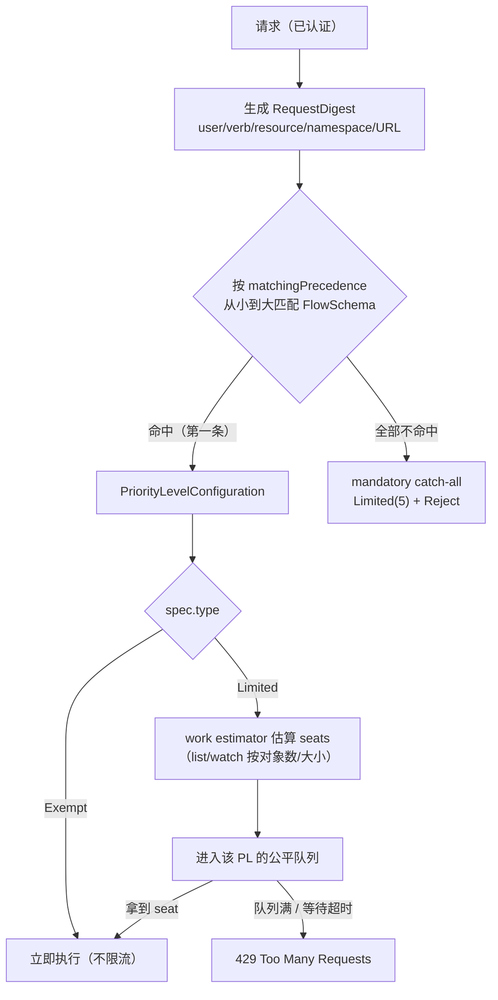

# API Priority and Fairness：FlowSchema 与 PriorityLevelConfiguration

API Priority and Fairness（APF）是 kube-apiserver 内部的**流量分类与并发隔离**机制：它把请求按客户端、资源、动词等特征分到不同的 **FlowSchema**，再交给对应的 **PriorityLevelConfiguration**（简称 PL）做并发限额、排队和公平调度。它解决的是 `--max-requests-inflight` 这类全局阈值"一刀切"的问题——即使 API Server 已经过载，系统组件、leader election、kubelet 上报仍然应该能拿到名额，而某个刷 API 的客户端不应该拖垮所有人。

本文基于 Kubernetes v1.37.2，API 版本为 `flowcontrol.apiserver.k8s.io/v1`（1.29 起 GA；更早的 `v1beta1/v1beta2/v1beta3` 已不再 serve，只保留转换，老 YAML 里的 `assuredConcurrencyShares` 在 v1 中叫 `nominalConcurrencyShares`）。代码链接统一固定到 commit `c50e5395f1ae2d4a2c05f28fdcc38c0916cc1a32`。

## 1. 解决什么问题

APF 开启时，API Server 仍然有总并发上限：

- `--max-requests-inflight`（默认 400，非变更请求）
- `--max-mutating-requests-inflight`（默认 200，变更请求）

两者之和是 **ServerCL**，默认 **600**（[server/config.go#L451-L453](https://github.com/kubernetes/kubernetes/blob/c50e5395f1ae2d4a2c05f28fdcc38c0916cc1a32/staging/src/k8s.io/apiserver/pkg/server/config.go#L451-L453)）。但单纯的 max-inflight 没有优先级概念，也没有排队：只要总量满了，所有请求一起 429，包括 kubelet 心跳和 controller 的 leader election。

APF 在这个总容量之内再做两件事：

1. **分类**：每个请求按 `FlowSchema` 的规则归类，得到它所属的 `PriorityLevelConfiguration`；
2. **隔离 + 排队**：每个 PL 有独立的并发上限；超限的请求进入该 PL 的公平队列（或直接被拒绝），队列之间按 flow 做公平调度，并允许 PL 之间临时借用空闲名额。

APF 由 `--enable-priority-and-fairness` 控制，默认开启（[feature.go#L35-L60](https://github.com/kubernetes/kubernetes/blob/c50e5395f1ae2d4a2c05f28fdcc38c0916cc1a32/staging/src/k8s.io/apiserver/pkg/server/options/feature.go#L35-L60)）。几个容易忽略的边界：

- APF **对 watch 请求也生效**（大 list/watch 会占用 seats）；
- `exec`、`port-forward`、日志这类 long-running 请求**不经过** APF（也不受 max-inflight 限制）；
- APF 是**每个 apiserver 实例独立**的限流器，不是集群级全局协调。

## 2. 请求在 APF 里的完整路径



对应代码路径：

- 过滤器入口：`configController.Handle`（[apf_filter.go#L155-L200](https://github.com/kubernetes/kubernetes/blob/c50e5395f1ae2d4a2c05f28fdcc38c0916cc1a32/staging/src/k8s.io/apiserver/pkg/util/flowcontrol/apf_filter.go#L155-L200)）；
- 分类与启动请求：`startRequest`（[apf_controller.go#L1022](https://github.com/kubernetes/kubernetes/blob/c50e5395f1ae2d4a2c05f28fdcc38c0916cc1a32/staging/src/k8s.io/apiserver/pkg/util/flowcontrol/apf_controller.go#L1022)）；
- FlowSchema/规则匹配：`matchesFlowSchema`、`matchesPolicyRule`（[rule.go#L30-L39](https://github.com/kubernetes/kubernetes/blob/c50e5395f1ae2d4a2c05f28fdcc38c0916cc1a32/staging/src/k8s.io/apiserver/pkg/util/flowcontrol/rule.go#L30-L39)），subject、resource、non-resource 匹配分别在 [rule.go#L58-L92](https://github.com/kubernetes/kubernetes/blob/c50e5395f1ae2d4a2c05f28fdcc38c0916cc1a32/staging/src/k8s.io/apiserver/pkg/util/flowcontrol/rule.go#L58-L92)、[#L110-L149](https://github.com/kubernetes/kubernetes/blob/c50e5395f1ae2d4a2c05f28fdcc38c0916cc1a32/staging/src/k8s.io/apiserver/pkg/util/flowcontrol/rule.go#L110-L149)；
- seats 分配：`nominalCL = ceil(ServerCL * NCS / sum(NCS))`（[apf_controller.go#L846-L870](https://github.com/kubernetes/kubernetes/blob/c50e5395f1ae2d4a2c05f28fdcc38c0916cc1a32/staging/src/k8s.io/apiserver/pkg/util/flowcontrol/apf_controller.go#L846-L870)）；
- 超限拒绝：`http.StatusTooManyRequests`（[priority-and-fairness.go#L378-L380](https://github.com/kubernetes/kubernetes/blob/c50e5395f1ae2d4a2c05f28fdcc38c0916cc1a32/staging/src/k8s.io/apiserver/pkg/server/filters/priority-and-fairness.go#L378-L380)）。

## 3. FlowSchema：给请求分类

### 3.1 对象结构

```yaml
apiVersion: flowcontrol.apiserver.k8s.io/v1
kind: FlowSchema
metadata:
  name: ci-batch
spec:
  matchingPrecedence: 1500          # 1–10000，越小越先匹配
  priorityLevelConfiguration:
    name: ci-batch                  # 必须引用一个存在的 PL
  distinguisherMethod:
    type: ByUser                    # ByUser | ByNamespace；不填则所有请求算一个 flow
  rules:                            # 只要任意一条 rule 命中，就属于这个 FlowSchema
  - subjects:                       # 至少一个 subject
    - kind: ServiceAccount
      serviceAccount:
        namespace: ci
        name: runner
    resourceRules:                  # resourceRules 与 nonResourceRules 至少一个非空
    - verbs: ["*"]
      apiGroups: ["*"]
      resources: ["*"]
      clusterScope: true            # 匹配不带 namespace 的请求
      namespaces: ["*"]             # 匹配所有带 namespace 的请求
```

字段语义（类型定义见 [flowcontrol/v1/types.go#L146-L230](https://github.com/kubernetes/kubernetes/blob/c50e5395f1ae2d4a2c05f28fdcc38c0916cc1a32/staging/src/k8s.io/api/flowcontrol/v1/types.go#L146-L230)）：

| 字段 | 说明 |
|---|---|
| `matchingPrecedence` | 1–10000，数字越小优先级越高；第一条命中的 FlowSchema 生效。不填默认 1000；值 1 只允许给 mandatory 的 `exempt` FlowSchema。相同值时按名字字典序决出，官方建议避免重复。 |
| `priorityLevelConfiguration.name` | 引用的 PL 名。引用不存在时 FlowSchema 会被忽略，并在 `status.conditions` 标记 `Dangling`。 |
| `distinguisherMethod` | `ByUser`（按用户名分流）、`ByNamespace`（按对象命名空间分流）或不填（整条 FlowSchema 视为单个 flow）。它只影响**同一 PL 内部**的公平性，不改变 PL 归属。 |
| `rules[].subjects` | `User` / `Group` / `ServiceAccount` 三类；名字支持 `*`。同时列出 `system:authenticated` 和 `system:unauthenticated` 两个 group 等于匹配所有请求。 |
| `rules[].resourceRules` | 按 `verbs`、`apiGroups`、`resources`（可带子资源，如 `pods/status`）、`clusterScope`、`namespaces` 匹配；支持 `*`。 |
| `rules[].nonResourceRules` | 按 `verbs` 和 `nonResourceURLs`（前缀匹配）匹配，例如 `/metrics`、`/healthz`。 |

一个 rule 命中的条件是：**至少一个 subject 命中，且至少一个 resource rule 或 non-resource rule 命中**（两者按请求类型二选一）。`rules` 为空表示该 FlowSchema 不匹配任何请求，而不是"匹配所有"（[types.go#L208-L230](https://github.com/kubernetes/kubernetes/blob/c50e5395f1ae2d4a2c05f28fdcc38c0916cc1a32/staging/src/k8s.io/api/flowcontrol/v1/types.go#L208-L230)）。

### 3.2 内置 FlowSchema 与匹配顺序

apiserver 会创建一组"建议配置"（suggested）和 4 个"强制配置"（mandatory）。它们的名字和 `matchingPrecedence` 决定了系统流量的分类顺序（定义见 [bootstrap/default.go#L282-L440](https://github.com/kubernetes/kubernetes/blob/c50e5395f1ae2d4a2c05f28fdcc38c0916cc1a32/staging/src/k8s.io/apiserver/pkg/apis/flowcontrol/bootstrap/default.go#L282-L440)）：

| FlowSchema | precedence | 指向的 PL | 典型匹配对象 |
|---|---|---|---|
| `exempt`（mandatory） | 1 | `exempt` | `system:masters` |
| `probes` | 2 | `exempt` | 健康检查/探针流量 |
| `system-leader-election` | 100 | `leader-election` | KCM/scheduler 等选主请求 |
| `system-node-high` | 400 | `node-high` | 节点高优先级上报 |
| `system-nodes` | 500 | `system` | kubelet/kube-proxy 等节点请求 |
| `kube-controller-manager` | 800 | `workload-high` | KCM |
| `kube-scheduler` | 800 | `workload-high` | scheduler |
| `kube-system-service-accounts` | 900 | `workload-high` | kube-system 里的 ServiceAccount |
| `service-accounts` | 9000 | `workload-low` | 其他命名空间的 ServiceAccount |
| `global-default` | 9900 | `global-default` | 其余已认证/未认证请求 |
| `catch-all`（mandatory） | 10000 | `catch-all` | 兜底（5 份额 + Reject） |

因此**自定义 FlowSchema 一般把 `matchingPrecedence` 放在 1000–9000**：既能排在 `service-accounts`(9000) 之前，又不会抢在 kube-system SA（900）和系统组件前面。如果客户端本身就是 `kube-system` 的 ServiceAccount，900 那条会先命中，需要更小的 precedence 才能覆盖。

### 3.3 查看与验证

```bash
kubectl get flowschemas
kubectl get flowschema ci-batch -o yaml     # 看 status.conditions 是否有 Dangling
kubectl get prioritylevelconfigurations
```

`kubectl get flowschemas` 的 `PRIORITYLEVEL` 列就是它指向的 PL；如果显示空或 PL 不存在，说明引用有问题。

## 4. PriorityLevelConfiguration：并发、排队与借还

### 4.1 Limited：份额与 seats

对 `type: Limited` 的 PL：

```text
NominalCL(i) = ceil( ServerCL * NCS(i) / sum(NCS) )
```

其中 `ServerCL = max-requests-inflight + max-mutating-requests-inflight`（每个 apiserver 实例独立计算），`NCS` 就是 `nominalConcurrencyShares`。**NCS 是相对值**：给某个 PL 调大，其他 PL 的绝对名额会等比例减少；新增一个 PL 也会稀释所有 PL。

默认 suggested 配置的份额合计约 **245**（`exempt` 的 NCS 为 0，不占份额），在 ServerCL=600 时大致是：

| PL | NCS | lendable% | limitResponse | 队列参数（queues/handSize/length） | 约 seats |
|---|---|---|---|---|---|
| `system` | 30 | 33 | Queue | 64 / 6 / 50 | 74 |
| `node-high` | 40 | 25 | Queue | 64 / 6 / 50 | 98 |
| `leader-election` | 10 | 0 | Queue | 16 / 4 / 50 | 25 |
| `workload-high` | 40 | 50 | Queue | 128 / 6 / 50 | 98 |
| `workload-low` | 100 | 90 | Queue | 128 / 6 / 50 | 245 |
| `global-default` | 20 | 50 | Queue | 128 / 6 / 50 | 49 |
| `catch-all`（mandatory） | 5 | 0 | Reject | — | 13 |

（seats 向上取整，总和会略大于 600；具体数值随 share 总和与配置变化。默认定义见 [bootstrap/default.go#L169-L280](https://github.com/kubernetes/kubernetes/blob/c50e5395f1ae2d4a2c05f28fdcc38c0916cc1a32/staging/src/k8s.io/apiserver/pkg/apis/flowcontrol/bootstrap/default.go#L169-L280)。）

`nominalConcurrencyShares: 0` 有特殊含义：构造一个"jail"，基本不给这个 PL 名额（仅用于把某些请求关起来），不要拿它当普通低优先级。

### 4.2 limitResponse：排队还是直接拒绝

- `type: Queue`：超限请求进入公平队列，短暂突发不会立刻 429；
- `type: Reject`：超限立即 429（`catch-all` 用的就是它，防止兜底流量无限堆积）。

Queue 的参数（类型定义 [types.go#L586-L655](https://github.com/kubernetes/kubernetes/blob/c50e5395f1ae2d4a2c05f28fdcc38c0916cc1a32/staging/src/k8s.io/api/flowcontrol/v1/types.go#L586-L655)，默认值 [defaults.go#L30-L76](https://github.com/kubernetes/kubernetes/blob/c50e5395f1ae2d4a2c05f28fdcc38c0916cc1a32/pkg/apis/flowcontrol/v1/defaults.go#L30-L76)）：

| 字段 | 默认 | 含义 |
|---|---|---|
| `queues` | 64 | 该 PL 内队列数；队列在**每个 apiserver 实例**上独立存在 |
| `handSize` | 8 | shuffle sharding 的 hand size：每个 flow 只映射到 `queues` 的一个子集，降低不同 flow 互相碰撞的概率；必须 `<= queues` |
| `queueLengthLimit` | 50 | 每个队列最多排队的请求数，超出即拒绝 |

校验规则见 [validation.go#L490-L517](https://github.com/kubernetes/kubernetes/blob/c50e5395f1ae2d4a2c05f28fdcc38c0916cc1a32/pkg/apis/flowcontrol/validation/validation.go#L490-L517)。

### 4.3 借还：lendablePercent 与 borrowingLimitPercent

- `lendablePercent`：该 PL 愿意把多少比例的名额借给其他 PL（`LendableCL = round(NominalCL * percent/100)`）；
- `borrowingLimitPercent`：该 PL 最多能借到多少（`BorrowingCL = round(NominalCL * percent/100)`；不填表示不限制）。

借还只发生在别人**空闲**的 seats 上，不是保证；高峰时仍然只能用自己的 NominalCL。默认配置里 `workload-low` 的 lendable 是 90%、`workload-high` 是 50%，就是让低优先级在空闲时把名额让给高优先级用（[types.go#L519-L547](https://github.com/kubernetes/kubernetes/blob/c50e5395f1ae2d4a2c05f28fdcc38c0916cc1a32/staging/src/k8s.io/api/flowcontrol/v1/types.go#L519-L547)）。

### 4.4 Exempt

`type: Exempt` 的 PL 完全不受 APF 限制，请求立即执行。内置的 `exempt` PL 被 mandatory `exempt` FlowSchema 用于 `system:masters`，也被 `probes` 用于健康检查；你可以新增 FlowSchema 指向它，但**不要把普通业务流量放进 Exempt**——它等于绕过所有保护。

### 4.5 内置配置的维护：mandatory vs suggested

每个 apiserver 维护两类对象（列表见 [bootstrap/default.go#L36-L80](https://github.com/kubernetes/kubernetes/blob/c50e5395f1ae2d4a2c05f28fdcc38c0916cc1a32/staging/src/k8s.io/apiserver/pkg/apis/flowcontrol/bootstrap/default.go#L36-L80)）：

- **mandatory**：`exempt`/`catch-all` 两个 PL 及其 FlowSchema，共 4 个对象。它们是 APF 自身不崩的兜底，**用户改 spec 会被 apiserver 改回**；你可以加 FlowSchema 指向 `exempt`，但不能改 `exempt` 本身。
- **suggested**：`system`、`node-high`、`leader-election`、`workload-high`、`workload-low`、`global-default` 及 9 条 FlowSchema。它们是"建议配置"，**可以改**，但要显式关掉自动更新，否则 apiserver 约每分钟按 bootstrap 默认值把 spec 修订回去。

控制权由注解 `apf.kubernetes.io/autoupdate-spec` 决定（常量见 [types.go#L103](https://github.com/kubernetes/kubernetes/blob/c50e5395f1ae2d4a2c05f28fdcc38c0916cc1a32/staging/src/k8s.io/api/flowcontrol/v1/types.go#L103)）：

- 注解为 `"true"` → apiserver 控制该对象（会覆盖你的 spec）；
- 注解为 `"false"` → 用户控制该对象（apiserver 保留你的修改）；
- 没有注解时看 `metadata.generation`：为 1 表示 apiserver 控制，否则用户控制（文档：[API Priority and Fairness](https://kubernetes.io/docs/concepts/cluster-administration/flow-control/)）。

apiserver 侧的周期 reconcile、创建缺失对象、按策略修订 spec 的逻辑在 [storage_flowcontrol.go#L150-L215](https://github.com/kubernetes/kubernetes/blob/c50e5395f1ae2d4a2c05f28fdcc38c0916cc1a32/pkg/registry/flowcontrol/rest/storage_flowcontrol.go#L150-L215) 与 [ensurer/strategy.go#L34-L50](https://github.com/kubernetes/kubernetes/blob/c50e5395f1ae2d4a2c05f28fdcc38c0916cc1a32/pkg/registry/flowcontrol/ensurer/strategy.go#L34-L50)、[#L160-L200](https://github.com/kubernetes/kubernetes/blob/c50e5395f1ae2d4a2c05f28fdcc38c0916cc1a32/pkg/registry/flowcontrol/ensurer/strategy.go#L160-L200)：

- mandatory 对象永远 auto-update（改回去）；
- suggested 对象只在"用户没有接管"时 auto-update；
- 被删除的内置对象（无论 mandatory 还是 suggested）都会在下一轮 reconcile 被重新创建；
- **没有 `autoupdate-spec` 注解的自定义对象不会被 ensurer 修改或删除**（所以自定义请走独立对象，不要改内置）。

## 5. 使用方法

### 5.1 自定义 PL + FlowSchema（推荐）

**Step 1：建 PL**——给 CI 批处理一个独立、低份额、可排队的优先级：

```yaml
apiVersion: flowcontrol.apiserver.k8s.io/v1
kind: PriorityLevelConfiguration
metadata:
  name: ci-batch
spec:
  type: Limited
  limited:
    nominalConcurrencyShares: 10      # 相对份额；新增会稀释其他 PL
    lendablePercent: 0                # 空闲名额不借给别人
    borrowingLimitPercent: 100        # 最多借到与 nominal 同量（可选）
    limitResponse:
      type: Queue
      queuing:
        queues: 16
        handSize: 4
        queueLengthLimit: 50
```

**Step 2：建 FlowSchema**——把特定客户端导入该 PL：

```yaml
apiVersion: flowcontrol.apiserver.k8s.io/v1
kind: FlowSchema
metadata:
  name: ci-batch
spec:
  matchingPrecedence: 1500            # 1000–9000 之间较安全
  priorityLevelConfiguration:
    name: ci-batch
  distinguisherMethod:
    type: ByUser                      # 或 ByNamespace
  rules:
  - subjects:
    - kind: ServiceAccount
      serviceAccount:
        namespace: ci
        name: runner
    resourceRules:
    - verbs: ["*"]
      apiGroups: ["*"]
      resources: ["*"]
      clusterScope: true
      namespaces: ["*"]
```

```bash
kubectl apply -f ci-batch-plc.yaml
kubectl apply -f ci-batch-fs.yaml

kubectl get prioritylevelconfiguration ci-batch -o yaml
kubectl get flowschema ci-batch -o yaml     # status.conditions 里不应有 Dangling
```

先建 PL 再建 FlowSchema；如果 FlowSchema 引用的 PL 不存在，它会被忽略并在 status 标记 `Dangling`。

### 5.2 常用匹配模板

**按 Group 匹配一批 ServiceAccount**：

```yaml
    subjects:
    - kind: Group
      group:
        name: system:serviceaccounts:ci
```

**只匹配非资源 URL（例如 /metrics）**：

```yaml
    nonResourceRules:
    - verbs: ["get"]
      nonResourceURLs: ["/metrics"]
```

**匹配所有请求**：`subjects` 同时列 `system:authenticated` 和 `system:unauthenticated`，并给 `resourceRules` 配 `verbs/apiGroups/resources: ["*"]`、`clusterScope: true`、`namespaces: ["*"]`。这种 FlowSchema 的 precedence 一定要小心，通常只在做全局兜底时使用。

### 5.3 调整内置策略

如果想改内置的 suggested PL（例如给 `leader-election` 更多份额），**先接管对象，再改**：

```bash
kubectl annotate prioritylevelconfiguration leader-election apf.kubernetes.io/autoupdate-spec=false
kubectl patch prioritylevelconfiguration leader-election --type merge \
  -p '{"spec":{"limited":{"nominalConcurrencyShares":20}}}'
```

改完确认：

```bash
kubectl get prioritylevelconfiguration leader-election -o yaml
```

想恢复默认：把注解改回 `"true"`（或删除注解并让 generation 语义生效），apiserver 会在下一轮 reconcile 把 spec 修订回 bootstrap 值。注意 `exempt`/`catch-all` 是 mandatory，改不动。

### 5.4 观测与排障

```bash
# 当前配置
kubectl get prioritylevelconfigurations
kubectl get flowschemas

# APF 内部状态（debug 端点，需 API 权限）
kubectl get --raw '/debug/api_priority_and_fairness/dump_priority_levels'
kubectl get --raw '/debug/api_priority_and_fairness/dump_queues'
kubectl get --raw '/debug/api_priority_and_fairness/dump_requests'
```

debug 端点实现见 [apf_controller_debug.go#L43-L47](https://github.com/kubernetes/kubernetes/blob/c50e5395f1ae2d4a2c05f28fdcc38c0916cc1a32/staging/src/k8s.io/apiserver/pkg/util/flowcontrol/apf_controller_debug.go#L43-L47)。

关键指标（实现见 [metrics.go#L90-L100](https://github.com/kubernetes/kubernetes/blob/c50e5395f1ae2d4a2c05f28fdcc38c0916cc1a32/staging/src/k8s.io/apiserver/pkg/util/flowcontrol/metrics/metrics.go#L90-L100)、[#L203-L262](https://github.com/kubernetes/kubernetes/blob/c50e5395f1ae2d4a2c05f28fdcc38c0916cc1a32/staging/src/k8s.io/apiserver/pkg/util/flowcontrol/metrics/metrics.go#L203-L262)）：

```promql
# 某个 PL 被拒绝的请求（reason=queue-full 或 time-out）
sum by (priority_level, reason) (
  rate(apiserver_flowcontrol_rejected_requests_total[5m])
)

# 排队深度与等待时间
apiserver_flowcontrol_current_inqueue_requests{priority_level="ci-batch"}
histogram_quantile(0.99,
  rate(apiserver_flowcontrol_request_wait_duration_seconds_bucket{priority_level="ci-batch"}[5m]))

# 该 PL 的实际名额
apiserver_flowcontrol_nominal_limit_seats{priority_level="ci-batch"}
```

排查思路：`rejected_requests_total{reason="queue-full"}` 增长说明队列满（要么调大队列/份额，要么治理客户端）；`reason="time-out"` 说明等待超时；`current_inqueue_requests` 持续高但 `nominal_limit_seats` 没打满，通常是上游（etcd/存储）慢导致请求执行时间变长。

### 5.5 容量规划清单

1. **先量再调**：看 `request_wait_duration_seconds`、`current_inqueue_requests`、`rejected_requests_total`，确认是哪类请求、哪个 PL 出问题；
2. **份额是相对的**：新增 PL 会稀释所有 PL；调大某个 PL 等于调小其他所有 PL；
3. **给系统流量留保底**：`system`、`node-high`、`leader-election` 的默认 shares 是按大规模集群经验配的，改之前确认系统请求的 429/wait 没有恶化；
4. **大 list/watch 会放大 seats**：APF 的 work estimator 会按对象数/大小给 list 请求估算 seats（[list_work_estimator.go#L128-L140](https://github.com/kubernetes/kubernetes/blob/c50e5395f1ae2d4a2c05f28fdcc38c0916cc1a32/staging/src/k8s.io/apiserver/pkg/util/flowcontrol/request/list_work_estimator.go#L128-L140)），所以"一个没分页的 LIST"可能比几十个小写请求更占名额；
5. **APF 是每实例的**：客户端经 LB 分摊到多个 apiserver，每个实例各自限流；容量估算按"每实例 ServerCL"算，不要当成全局总池；
6. **不要用 Exempt 解决限流**：那只是把问题从"偶尔 429"变成"apiserver 被打穿"。

## 6. 常见误区

| 误区 | 事实 |
|---|---|
| "assuredConcurrencyShares / v1beta1 还能用" | 现版本只 serve `v1`，字段是 `nominalConcurrencyShares`；老 YAML 要迁移。 |
| "shares 是绝对并发数" | 是相对份额，实际名额 = `ceil(ServerCL * shares / sum(shares))`，会随其他 PL 变化。 |
| "APF 是一个全局限流器" | 每个 apiserver 实例独立限流，实例间不协调。 |
| "watch/exec 都不受 APF" | watch 受 APF；只有 exec/port-forward/日志等 long-running 不受。 |
| "自定义 FlowSchema 的 rules 为空就匹配所有" | 空 rules 匹配零个请求；要匹配所有必须显式写 subject + 规则。 |
| "precedence 越小越好" | 太小会抢在系统 FlowSchema 前面，把 kubelet/选主流量降级；业务通常用 1000–9000。 |
| "改 suggested PL 立即生效且保留" | 不设 `apf.kubernetes.io/autoupdate-spec=false` 会被 apiserver 改回去。 |
| "删掉内置 FlowSchema 就绕过了" | 会被自动重建；mandatory 还会恢复。 |
| "429 都是 APF 造成的" | 也可能是 `--max-requests-inflight` / webhook 超时等其他路径；看 `reason` 和指标确认。 |

## 7. 延伸阅读

- [Kubernetes 官方文档：API Priority and Fairness](https://kubernetes.io/docs/concepts/cluster-administration/flow-control/) —— feature 状态、mandatory/suggested 对象、autoupdate 注解、观测指标。
- [KEP-1040: API Priority and Fairness](https://github.com/kubernetes/enhancements/tree/master/keps/sig-api-machinery/1040-priority-and-fairness) —— 设计动机、seat 模型与队列算法。
- [Kubernetes 控制面高可用方案](./控制面高可用方案.md) —— APF 默认份额与 `max-requests-inflight` 在 HA 容量规划中的位置（§8）。
- [Kubernetes 控制面事故处理手册](./控制面事故处理手册.md) —— 429/APF 过载的现场定位与止血流程（R8）。

## 本 wiki 相关页面

- [Kubernetes API Server](./2_kubernetes-api-server.md)
- [client-go list & watch 原理](client-go-list-watch.md)
- [Kubelet 原理](./kubelet原理.md)
- [RBAC](./rbac.md)
