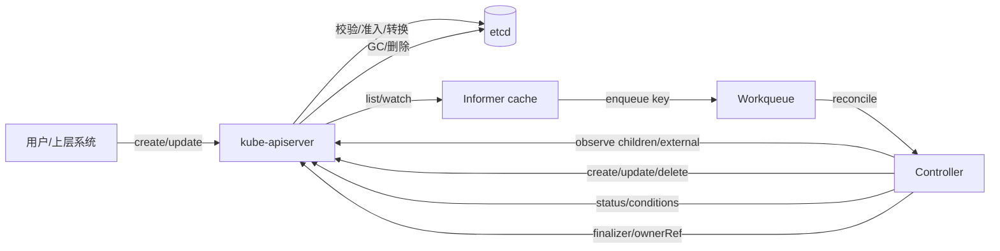

# 生产级 Kubernetes Operator：从 CRD 到状态收敛与升级

> **一句话**：Operator 不是“用 Go 写个 controller”，而是**把一个领域 API 连同它的生命周期、失败语义和升级路径一起交给 Kubernetes**。CRD 决定 API 契约，API Server 决定请求语义，List/Watch 与 Informer 决定事件模型，Reconcile 决定系统能否收敛，Finalizer/OwnerReference 决定资源能否干净地消失，升级策略决定这套契约能活多久。

本文按“一个 CR 从被创建到被删除、一个 Operator 从 v1 升到 v2”的完整链路组织，覆盖：

1. Operator 的职责边界与成熟度
2. CRD：schema、版本、子资源、转换
3. API Server 如何服务一个 CR 请求
4. List/Watch：`resourceVersion`、watch cache、`410 Gone`
5. Informer/Workqueue：从事件到 Reconcile
6. API 设计：spec/status、conditions、校验、版本
7. 状态收敛：Reconcile 的正确形状
8. 幂等：为什么重试是常态
9. 清理：OwnerReference、Finalizer、级联删除
10. 并发：吞吐、顺序与一致性
11. 升级：CRD、控制器、Operand、OLM
12. 可观测性与测试
13. 生产检查清单

> **证据约定**：源码链接固定到 2026-11 拉取的 commit，格式为 `https://github.com/<org>/<repo>/blob/<40位sha>/<path>#Lx-Ly`，行号与本地 checkout 一致；官方文档直接引用 URL。版本基线见下表。

| 项目 | 版本 | Commit | 本地 checkout |
|---|---|---|---|
| Kubernetes | v1.37.2 | `c50e5395f1ae2d4a2c05f28fdcc38c0916cc1a32` | `.repos/upstream/kubernetes` |
| controller-runtime | v0.25.2 | `5d8467b3065818a3b382d8f6941147a801fd1969` | `.repos/upstream/controller-runtime` |
| sample-controller | main @ 2026-11 | `7204184eb240515173848d28f2e1f3788104a4d1` | `.repos/upstream/sample-controller` |
| Cluster API | v1.14.4 | `4356c154f4a76b8939748ef7ebc2d0793ffe47e8` | `.repos/upstream/cluster-api` |

## 0. 全景：一次 CR 的完整生命周期



这条链路上有四个独立的“一致性边界”：

1. **API 边界**：CRD schema、admission、conversion 决定“什么能写进去”。
2. **事件边界**：watch cache、informer、workqueue 决定“控制器看到什么、什么时候看到”。
3. **收敛边界**：Reconcile 决定“看到之后做什么、失败了怎么办”。
4. **生命周期边界**：finalizer/ownerReference 决定“删除时谁负责清理、清理不干净怎么办”。

生产级 Operator 的难点通常不在第 3 步写业务逻辑，而在 1、2、4 的语义没有被想清楚。

## 1. Operator 的职责边界

### 1.1 定义

Kubernetes 官方对 Operator 的定义是：把**领域知识**编码进自定义控制器，用 [Custom Resource](https://kubernetes.io/docs/concepts/extend-kubernetes/api-extension/custom-resources/) 描述期望状态，由控制器持续把实际状态收敛到期望状态。官方文档把这种模式称为 [Operator pattern](https://kubernetes.io/docs/concepts/extend-kubernetes/operator/)。

一个生产级 Operator 通常由四部分组成：

| 部分 | 作用 | 典型实现 |
|---|---|---|
| **CRD** | 定义 API 的 group/version/kind、schema、子资源 | `apiextensions.k8s.io/v1` YAML 或 Kubebuilder 生成 |
| **Controller** | 监听 CR 与 owned 资源，执行 Reconcile | controller-runtime、client-go |
| **Webhook**（可选） | 默认值、复杂校验、版本转换 | controller-runtime webhook、cert-manager |
| **打包/交付**（可选） | 安装、升级图、RBAC、CRD 生命周期 | OLM/CSV、Helm、Kustomize |

### 1.2 控制循环是 level-based，不是 edge-based

Kubernetes API 约定明确要求：系统行为应是 **level-based**，而不是 edge-based；即使中间状态变化被漏掉，也要能从当前状态直接收敛到最新 spec。见 [API conventions: Spec and Status](https://github.com/kubernetes/community/blob/master/contributors/devel/sig-architecture/api-conventions.md#spec-and-status)。

controller-runtime 的 `Reconcile` 文档也强调：Reconcile 不是由单个事件的内容驱动，而是由**当前集群状态**驱动；请求里只有 namespace/name，没有“发生了什么事件”。见 [reconcile.go](https://github.com/kubernetes-sigs/controller-runtime/blob/5d8467b3065818a3b382d8f6941147a801fd1969/pkg/reconcile/reconcile.go#L60-L105)。

这带来两个直接推论：

- **不要写 `if event.Type == Update` 的业务分支**。事件只负责把 key 放进队列，Reconcile 每次都重新观察。
- **不要依赖“事件一定会到达”**。Informer 可能 resync、可能 relist、可能丢事件；正确性必须来自“读当前状态再决策”。

### 1.3 Operator、Helm、OLM、Aggregated API 的边界

| 方案 | 它解决什么 | 不解决什么 |
|---|---|---|
| **Helm/Kustomize** | 安装时渲染 YAML、一次性 apply | 不持续 reconcile；漂移不会自动修复；不处理外部资源生命周期 |
| **Operator（CRD + controller）** | 持续收敛、外部资源编排、状态上报、清理 | 不负责自己的安装/升级图（通常交给 OLM/Helm） |
| **OLM** | Operator 的安装、升级图、RBAC、CRD 所有权、依赖解析 | 不实现你的领域逻辑 |
| **Aggregated API Server** | 自定义存储、protobuf、strategic merge、额外子资源 | 需要自己实现 API server，运维成本高 |

官方对 CRD 与 Aggregated API 的取舍有一张很实用的对比表：CRD 更简单、无需额外服务，但不支持 custom storage、protobuf、strategic-merge-patch、额外子资源；Aggregated API 更灵活但需要自己运行 API server。见 [Custom resources: Comparing ease of use](https://kubernetes.io/docs/concepts/extend-kubernetes/api-extension/custom-resources/#comparing-ease-of-use)。

> [!NOTE]
> Operator 的最佳实践是**一个 Operator 管理一类应用**、**一个 CRD 一个 controller**；不要让一个 controller 同时 reconcile 多个 Kind。Kubebuilder 和 Operator SDK 都明确建议如此，原因是复杂度、错误隔离、并发与可维护性。见 [Kubebuilder Good practices](https://book.kubebuilder.io/reference/good-practices) 和 [Operator SDK Best practices](https://sdk.operatorframework.io/docs/best-practices/best-practices/)。

### 1.4 成熟度：从“能装”到“能运营”

Operator SDK 把 Operator 能力分为五级（[Operator Capability Levels](https://sdk.operatorframework.io/docs/overview/operator-capabilities/)）：

| 级别 | 能力 | 生产含义 |
|---|---|---|
| L1 Basic Install | 用 CR 完成安装与配置，status 反映就绪 | 能替代一部分 Helm |
| L2 Seamless Upgrades | Operator 与 Operand 可平滑升级，能管理旧版本 Operand | **生产底线** |
| L3 Full Lifecycle | 备份/恢复、故障切换、扩缩容、成员变更 | 有状态服务的门槛 |
| L4 Deep Insights | 指标、告警、事件、仪表盘 | 可运营 |
| L5 Auto Pilot | 自动扩缩、自愈、调优、异常检测 | 少人值守 |

“生产级”至少意味着 L2 + L4 的工程能力；L3/L5 取决于领域。很多事故不是因为不会写 Reconcile，而是因为**升级路径和清理路径**没有设计。

## 2. CRD：把 API 契约交给 API Server

### 2.1 一个 CRD 由什么组成

`CustomResourceDefinitionSpec` 的核心字段：

| 字段 | 含义 | 生产注意 |
|---|---|---|
| `group` | API group，如 `example.com` | 用自有域名，避免与内置 group 冲突 |
| `names` | plural/singular/kind/shortNames/categories | plural 必须与 CRD 名 `<plural>.<group>` 一致 |
| `scope` | `Namespaced` 或 `Cluster` | 默认 Namespaced；集群级资源慎用 |
| `versions` | 每个版本的 `served`/`storage`/schema/subresources | **有且仅有一个 `storage: true`** |
| `conversion` | `None` 或 `Webhook` | schema 有差异时不能用 `None` |

类型定义见 [types.go: CustomResourceDefinitionSpec](https://github.com/kubernetes/kubernetes/blob/c50e5395f1ae2d4a2c05f28fdcc38c0916cc1a32/staging/src/k8s.io/apiextensions-apiserver/pkg/apis/apiextensions/v1/types.go#L41-L73)；版本字段见 [types.go: CustomResourceDefinitionVersion](https://github.com/kubernetes/kubernetes/blob/c50e5395f1ae2d4a2c05f28fdcc38c0916cc1a32/staging/src/k8s.io/apiextensions-apiserver/pkg/apis/apiextensions/v1/types.go#L170-L210)。

一个最小但接近生产形态的 CRD：

```yaml
apiVersion: apiextensions.k8s.io/v1
kind: CustomResourceDefinition
metadata:
  name: widgets.example.com
spec:
  group: example.com
  scope: Namespaced
  names:
    plural: widgets
    singular: widget
    kind: Widget
    shortNames: [wd]
    categories: [example]
  versions:
    - name: v1
      served: true
      storage: true
      subresources:
        status: {}
      additionalPrinterColumns:
        - name: Ready
          type: string
          jsonPath: .status.conditions[?(@.type=="Ready")].status
      schema:
        openAPIV3Schema:
          type: object
          properties:
            spec:
              type: object
              required: [image]
              properties:
                image:
                  type: string
                  minLength: 1
                replicas:
                  type: integer
                  minimum: 0
                  maximum: 100
                  default: 1
                strategy:
                  type: string
                  enum: [RollingUpdate, Recreate]
                  default: RollingUpdate
            status:
              type: object
              properties:
                observedGeneration:
                  type: integer
                  format: int64
                conditions:
                  type: array
                  x-kubernetes-list-type: map
                  x-kubernetes-list-map-keys: [type]
                  items:
                    type: object
                    required: [type, status, reason, message, lastTransitionTime]
                    properties:
                      type:
                        type: string
                      status:
                        type: string
                        enum: ["True", "False", "Unknown"]
                      reason:
                        type: string
                        minLength: 1
                      message:
                        type: string
                      observedGeneration:
                        type: integer
                        format: int64
                      lastTransitionTime:
                        type: string
                        format: date-time
```

### 2.2 Structural schema、pruning 与 defaulting

`apiextensions.k8s.io/v1` **强制要求 structural schema**：每个 object/array 节点必须有非空 `type`（除非使用 `x-kubernetes-int-or-string` 或 `x-kubernetes-preserve-unknown-fields`），并且 `allOf/anyOf/oneOf/not` 里不能定义类型、默认值等关键结构。规则见 [Specifying a structural schema](https://kubernetes.io/docs/tasks/extend-kubernetes/custom-resources/custom-resource-definitions/#specifying-a-structural-schema)。

这带来几个实际后果：

- **未在 schema 中声明的字段会被 pruning**。写进 etcd 前就被裁掉，控制器永远看不到。字段改名不是“旧字段还在”，而是“旧字段被静默删除”。
- **`preserveUnknownFields: true` 已废弃**，不要用它绕过 schema；它会让默认值、pruning、OpenAPI、conversion 等能力失效。
- **默认值只对 optional 字段有意义**，并且 default 必须能通过 schema 校验、非叶子默认值必须能被 pruning 处理。见 [Defaulting](https://kubernetes.io/docs/tasks/extend-kubernetes/custom-resources/custom-resource-definitions/#defaulting)。

默认值的应用时机很关键：

1. 请求进入 API Server 时，按**请求版本**的 default 填充；
2. 从 etcd 读取时，按**存储版本**的 default 填充；
3. mutating admission webhook 打 patch 后，按 webhook 对象版本的 default 填充。

但“读时默认”**不会自动写回 etcd**；只有后续 update 才会持久化。这意味着：

- 新增 default 后，旧对象在 read 时看起来有新值，但 etcd 里可能没有；
- 如果控制器依赖“字段一定存在”，read 时是安全的；如果依赖“etcd 里一定存在”，则不成立；
- 对需要区分“用户没写”和“用户写了零值”的字段，用 pointer + `omitempty`，不要靠 default 猜。

### 2.3 校验：OpenAPI、CEL、ratcheting

CRD 的校验分三层：

1. **OpenAPI v3 schema**：类型、必填、枚举、范围、长度、pattern、list/map 语义。
2. **CEL `x-kubernetes-validations`**：跨字段、条件、不可变等声明式规则；编译期做类型检查，运行期有 cost budget。
3. **Admission webhook**：需要外部状态、复杂业务规则或跨对象检查时使用。

Admission webhook 的生产边界：

- 能用 CRD schema/CEL 表达的，优先不用 webhook；webhook 是额外的可用性、延迟和证书负担。
- `failurePolicy: Fail` 会把 webhook 故障放大成“所有相关写请求失败”；`Ignore` 则可能放过非法对象。按风险选择，并监控失败率。
- 设置 `timeoutSeconds`（默认 10s 太长）、`namespaceSelector`/`objectSelector` 限制范围；webhook 自身要有多副本、PDB、证书轮换。
- 不要让 webhook 依赖“它正在校验的 CR”的 cache/控制器；否则启动顺序或故障会形成循环依赖。

见 [Admission webhooks](https://kubernetes.io/docs/reference/access-authn-authz/extensible-admission-controllers/)。

CEL 规则是**对象内**的，不支持跨对象或状态查询。官方明确说 “All validation rules are scoped to the current object: no cross-object or stateful validation rules are supported.” 见 [Validation rules](https://kubernetes.io/docs/tasks/extend-kubernetes/custom-resources/custom-resource-definitions/#validation-rules)。

一个常见的不可变字段写法：

```yaml
x-kubernetes-validations:
  - rule: "self == oldSelf"
    message: "spec.storageClass is immutable"
```

CEL 的 cost 估算按最坏情况计算；对可迭代字段（list/map/string）必须设置 `maxItems`/`maxProperties`/`maxLength`，否则规则可能因为“潜在成本超过预算”而被拒绝。见 [Validation rules 的 cost 部分](https://kubernetes.io/docs/tasks/extend-kubernetes/custom-resources/custom-resource-definitions/#validation-rules)。

**Validation ratcheting** 是升级时的重要机制：如果你新增校验，API Server 允许“更新前就已经非法、且本次更新没有触碰该部分”的对象继续通过；它不允许把合法对象改成非法。注意，`required`、`properties` 名称、`x-kubernetes-list-type` 等结构变化不在 ratcheting 范围内。见 [Validation ratcheting](https://kubernetes.io/docs/tasks/extend-kubernetes/custom-resources/custom-resource-definitions/#validation-ratcheting)。

> [!WARNING]
> 不要指望“加一条 required 校验”能安全地推广到存量对象。ratcheting 对 `required` 不生效；存量对象只要被更新就可能失败。正确做法是新版本 + 默认值/迁移，或者在 controller 中先补齐字段。

### 2.4 子资源：status、scale 与 generation

启用 `subresources.status` 后：

- 对主资源的 `PUT/POST/PATCH` 忽略 `status`；
- 对 `/status` 的 `PUT` 只接受 `status`，忽略其他字段；
- `.metadata.generation` 在**除 metadata/status 之外**的内容变化时递增；
- 控制器通过 `/status` 写状态，避免与用户写 spec 冲突。

代码上，CRD 的 generic strategy 在 create 时删除 status 并置 generation=1；update 时恢复旧 status，并在非 metadata 内容变化时 generation+1。见 [strategy.go:144-187](https://github.com/kubernetes/kubernetes/blob/c50e5395f1ae2d4a2c05f28fdcc38c0916cc1a32/staging/src/k8s.io/apiextensions-apiserver/pkg/registry/customresource/strategy.go#L144-L187)。

`scale` 子资源让 HPA 等按 scale 协议工作的组件能像操作 Deployment 一样扩缩 CR：

```yaml
subresources:
  scale:
    specReplicasPath: .spec.replicas
    statusReplicasPath: .status.replicas
    labelSelectorPath: .status.selector
```

`labelSelectorPath` 必须是字符串形式的 selector；不设置时，依赖 selector 的组件（例如 HPA 的某些指标）拿不到 selector。见 [Scale subresource](https://kubernetes.io/docs/tasks/extend-kubernetes/custom-resources/custom-resource-definitions/#scale-subresource)。

### 2.5 版本与存储：`served`、`storage`、`storedVersions`

每个 CRD 版本有两个独立开关：

- `served`：是否通过 REST 端点提供服务；
- `storage`：是否作为 etcd 的序列化版本。

必须**恰好一个**版本 `storage: true`，否则 CRD 校验失败（[validation.go:448](https://github.com/kubernetes/kubernetes/blob/c50e5395f1ae2d4a2c05f28fdcc38c0916cc1a32/staging/src/k8s.io/apiextensions-apiserver/pkg/apis/apiextensions/validation/validation.go#L448)）。

写入时用当前 storage 版本；读取时按请求版本转换；**已有对象不会因为切换 storage 版本自动重写**，只有 update 才会写到新 storage 版本。`status.storedVersions` 记录“曾经作为 storage 版本出现过的版本”，只要某个版本还在这个列表里，就不能从 `spec.versions` 中删除。见 [Upgrade existing objects to a new stored version](https://kubernetes.io/docs/tasks/extend-kubernetes/custom-resources/custom-resource-definition-versioning/#upgrade-existing-objects-to-a-new-stored-version)。

> [!WARNING]
> 切换 storage 版本后，必须做 **storage migration**（StorageVersionMigration 或“逐个 list + 原样 update”），并确认 `status.storedVersions` 只剩新版本，才能删除旧版本。否则旧对象仍在旧编码里，删掉版本后可能读不出来。

### 2.6 conversion：`None` 还是 `Webhook`

- `strategy: None`：只改 `apiVersion`，不碰其他字段。只适用于**schema 完全兼容、字段含义没有变化**的版本。
- `strategy: Webhook`：API Server 调用外部 conversion webhook，在“请求版本 ↔ 存储版本”之间转换。

官方明确说：如果不同版本用不同字段表达同一数据，就**不能**用 `None`。见 [Writing, reading, and updating versioned CRD objects](https://kubernetes.io/docs/tasks/extend-kubernetes/custom-resources/custom-resource-definition-versioning/#writing-reading-and-updating-versioned-customresourcedefinition-objects)。

conversion webhook 有几个生产特性：

- 它位于**读/写/watch 的关键路径**上：请求非 storage 版本、watch 事件从 storage 版本转成请求版本时都会调用；
- 它没有 admission webhook 的 `failurePolicy: Ignore` 选项；webhook 不可用，需要转换的非 storage 版本请求就失败；
- 对已经在目标版本的对象，webhook 会跳过，不调用（[webhook_converter.go:122-142](https://github.com/kubernetes/kubernetes/blob/c50e5395f1ae2d4a2c05f28fdcc38c0916cc1a32/staging/src/k8s.io/apiextensions-apiserver/pkg/apiserver/conversion/webhook_converter.go#L122-L142)）；
- 列表转换会把“所有需要转换的 item”批量发给 webhook，大列表可能产生很大的请求体。

Kubebuilder 推荐 **hub-and-spoke** 模型：选一个 hub 版本，其他版本只实现“到 hub / 从 hub”的转换，避免 N×N 条转换路径。见 [Hubs, spokes, and other wheel metaphors](https://book.kubebuilder.io/multiversion-tutorial/conversion-concepts)。

> [!NOTE]
> 有损转换的生产做法：在 down-conversion 时把 hub 版本的完整对象序列化到目标对象的 annotation 里，up-conversion 时再取回。Cluster API 用 `cluster.x-k8s.io/conversion-data` 注解实现这一点，并用 fuzz round-trip 测试保证“spoke → hub → spoke”不丢数据。见 [conversion.go:40-120](https://github.com/kubernetes-sigs/cluster-api/blob/4356c154f4a76b8939748ef7ebc2d0793ffe47e8/util/conversion/conversion.go#L40-L120) 和 [FuzzTestFunc](https://github.com/kubernetes-sigs/cluster-api/blob/4356c154f4a76b8939748ef7ebc2d0793ffe47e8/util/conversion/conversion.go#L195-L230)。

### 2.7 CRD 生命周期：Established、Terminating、删除

- `NamesAccepted`：名字没有冲突；
- `Established`：CRD 可以被客户端发现和使用；
- `Terminating`：CRD 正在删除，正在清理所有 CR。

HA 集群里，establishing controller 会等至少 5 秒再置 `Established`，避免多 apiserver 竞争。见 [customresource_handler.go:485-495](https://github.com/kubernetes/kubernetes/blob/c50e5395f1ae2d4a2c05f28fdcc38c0916cc1a32/staging/src/k8s.io/apiextensions-apiserver/pkg/apiserver/customresource_handler.go#L485-L495)。

删除 CRD 时，`customresourcecleanup.apiextensions.k8s.io` finalizer 会**先删除该 CRD 下的所有 CR**，再移除 finalizer。代码见 [crd_finalizer.go:181-232](https://github.com/kubernetes/kubernetes/blob/c50e5395f1ae2d4a2c05f28fdcc38c0916cc1a32/staging/src/k8s.io/apiextensions-apiserver/pkg/controller/finalizer/crd_finalizer.go#L181-L232)。

这意味着 `kubectl delete crd widgets.example.com` **等价于删除所有 Widget 实例**。生产环境必须：

- 删除前备份 CR（或整库 etcd 快照）；
- 用 GitOps/OLM 管理 CRD 生命周期，避免“卸载 Operator 时顺手删 CRD”；
- 对用户数据型 CR，设置 `helm.sh/resource-policy: keep` 或在卸载流程中显式保留 CRD。

## 3. API Server 视角：一个 CR 请求发生了什么

### 3.1 CRD 是“委托的 API Server”

CRD 不是客户端库的语法糖。kube-apiserver 内置了 `apiextensions-apiserver`，它根据 CRD 动态注册 REST 端点：

```
/apis/<group>/<version>/<plural>
/apis/<group>/<version>/namespaces/<ns>/<plural>
/apis/<group>/<version>/.../<name>/status
/apis/<group>/<version>/.../<name>/scale
```

`crdHandler.ServeHTTP` 的处理顺序（[customresource_handler.go:228-368](https://github.com/kubernetes/kubernetes/blob/c50e5395f1ae2d4a2c05f28fdcc38c0916cc1a32/staging/src/k8s.io/apiextensions-apiserver/pkg/apiserver/customresource_handler.go#L228-L368)）：

1. 从请求路径解析 `requestInfo`；
2. 用 `<resource>.<group>` 找到 CRD；
3. 检查 scope 是否匹配（namespaced/cluster）；
4. 检查请求版本是否 `served`；
5. 检查 `NamesAccepted` 或 `Established`；
6. 标记 `terminating`（CRD 正在删除）；
7. `getOrCreateServingInfoFor` 构建该 CRD 的 per-version storage、request scope、converter、field manager；
8. 按子资源分发到 `serveResource` / `serveStatus` / `serveScale`。

### 3.2 每个版本一套 storage，编码到 storage 版本

`getOrCreateServingInfoFor` 会：

- 找到 `storageVersion`；
- 为每个 `served` 或 `storage` 版本构建 `customresource.NewStorage`；
- 设置 `decoderVersion = 请求版本`，`encoderVersion = storageVersion`；
- 安装 `crdConversionRESTOptionsGetter`，在读写时做转换；
- 安装 per-version 的 `managedfields.FieldManager`，支持 server-side apply。

关键代码：

```go
crdConversionRESTOptionsGetter{
    RESTOptionsGetter:     r.restOptionsGetter,
    converter:             safeConverter,
    decoderVersion:        schema.GroupVersion{Group: crd.Spec.Group, Version: v.Name},
    encoderVersion:        schema.GroupVersion{Group: crd.Spec.Group, Version: storageVersion},
    ...
}
```

见 [customresource_handler.go:860-879](https://github.com/kubernetes/kubernetes/blob/c50e5395f1ae2d4a2c05f28fdcc38c0916cc1a32/staging/src/k8s.io/apiextensions-apiserver/pkg/apiserver/customresource_handler.go#L860-L879)。

这解释了三个常见现象：

- 用旧版本 `kubectl get` 看到的对象，可能是 API Server 从 storage 版本**实时转换**出来的；
- 用旧版本 watch，每个事件都可能触发 conversion webhook；
- 如果对象已经以 storage 版本持久化，用 storage 版本读写不需要转换；迁移完成前，旧对象仍可能触发转换。

### 3.3 准入与校验的顺序

对 CR 的写请求，大致顺序是：

1. **认证/授权**（RBAC）；
2. **mutating admission webhooks**（可以改对象、填默认值）；
3. **CRD schema 校验 + CEL**（在 custom resource strategy 中）；
4. **validating admission webhooks**；
5. **写入 etcd**（storage 版本）；
6. **watch cache 更新**，向 watcher 分发事件。

CRD 的 schema 校验不是 admission webhook，而是 `customResourceStrategy.Validate/ValidateUpdate` 的一部分；它和 CEL 一起在 API Server 内执行，不依赖外部服务。见 [strategy.go:200-280](https://github.com/kubernetes/kubernetes/blob/c50e5395f1ae2d4a2c05f28fdcc38c0916cc1a32/staging/src/k8s.io/apiextensions-apiserver/pkg/registry/customresource/strategy.go#L200-L280)。

> [!NOTE]
> 能用 schema/CEL 表达的校验，优先不要用 webhook。webhook 是额外的可用性风险、延迟来源和证书管理负担；而且 webhook 失效时，所有 CR 写入都可能失败。

### 3.4 status/scale 子资源的策略

`serveStatus` 使用独立的 request scope 和 status schema validator；`serveScale` 把 CR 的 `spec.replicas`/`status.replicas` 映射成 `autoscaling/v1.Scale`。见 [customresource_handler.go:418-455](https://github.com/kubernetes/kubernetes/blob/c50e5395f1ae2d4a2c05f28fdcc38c0916cc1a32/staging/src/k8s.io/apiextensions-apiserver/pkg/apiserver/customresource_handler.go#L418-L455)。

对控制器的实际影响：

- 写 status 必须走 `client.Status().Update/Patch`，否则主资源 update 会忽略/覆盖 status；
- 写 status 不会触发 generation 递增，所以 `observedGeneration` 和 `generation` 可以对齐；
- HPA 通过 `/scale` 读写 replicas；其他遵循 scale 协议的工具同理。控制器不要在 reconcile 里无条件把 replicas 改回去，否则会和 autoscaler 打架。

### 3.5 CRD 更新会重建 serving storage

CRD 的 spec 或 accepted names 变化时，`updateCustomResourceDefinition` 会移除旧 storage，下一次请求重新构建：

```go
if apiequality.Semantic.DeepEqual(&newCRD.Spec, oldInfo.spec) &&
   apiequality.Semantic.DeepEqual(&newCRD.Status.AcceptedNames, oldInfo.acceptedNames) {
    return
}
r.removeStorage_locked(newCRD.UID)
```

见 [customresource_handler.go:507-513](https://github.com/kubernetes/kubernetes/blob/c50e5395f1ae2d4a2c05f28fdcc38c0916cc1a32/staging/src/k8s.io/apiextensions-apiserver/pkg/apiserver/customresource_handler.go#L507-L513)。

这意味着：**CRD 变更不是“无感配置更新”**。在重建窗口内，in-flight 请求可能失败；客户端/控制器必须能重试。生产上应避免频繁修改 CRD spec，尤其是 schema 和 conversion 配置。

### 3.6 watch cache：API Server 的内存状态

kube-apiserver 为每个 GVR 维护 watch cache：它从 etcd list 一次，然后持续 watch etcd，把事件放进环形历史缓冲；客户端的 list/watch 大多由 watch cache 服务，而不是每次都打 etcd。

关键语义：

- watch cache 的历史窗口有限，超出范围的 `resourceVersion` 会返回 `410 Gone`；
- `resourceVersion=0` 的 list 可以从任意缓存状态返回（Any）；
- `sendInitialEvents=true` 时，watch 流先发 synthetic ADDED，再发 initial-events-end bookmark（需要 `allowWatchBookmarks=true`）；
- cache 初始化期间，1.37 的 API Server 会拒绝 watch/未分页/带过滤的 list（429 + `Retry-After`），避免打爆 etcd。见 [Watch cache initialization](https://kubernetes.io/docs/reference/using-api/api-concepts/#watch-cache-initialization)。

历史过期错误的代码位置：[watch_cache_history.go:216-240](https://github.com/kubernetes/kubernetes/blob/c50e5395f1ae2d4a2c05f28fdcc38c0916cc1a32/staging/src/k8s.io/apiserver/pkg/storage/cacher/watch_cache_history.go#L216-L240)。

### 3.7 CRD 删除的最后一道门

CRD 的 finalizer 会：

1. 设置 `Terminating=True`；
2. 列出该 CRD 的所有 CR；
3. 按 namespace 执行 `DeleteCollection`；
4. 等待所有 CR 消失；
5. 移除 finalizer，CRD 被删除。

代码见 [crd_finalizer.go:181-260](https://github.com/kubernetes/kubernetes/blob/c50e5395f1ae2d4a2c05f28fdcc38c0916cc1a32/staging/src/k8s.io/apiextensions-apiserver/pkg/controller/finalizer/crd_finalizer.go#L181-L260)。

> [!WARNING]
> 如果某个 CR 自己有 finalizer 且对应 controller 已经卸载，CRD 删除会卡在 `Terminating`，进而阻塞整个删除流程。卸载顺序必须是：先停止/迁移 controller 的 finalizer 责任，再删 CR，最后删 CRD。

## 4. List/Watch：一致性、`resourceVersion` 与 `410 Gone`

### 4.1 `resourceVersion` 的语义

`resourceVersion` 是 API Server 给对象的版本标识。它**必须原样传回**，客户端不能假设它是 etcd 的 `mod_revision`，也不能跨资源类型比较。1.35+ 的 conformance 要求同一资源类型的 RV 可按十进制整数比较大小；此外只看相等性。见 [Resource versions](https://kubernetes.io/docs/reference/using-api/api-concepts/#resource-versions)。

对 **get/list**：

| `resourceVersion` | 语义 | 一致性/来源 |
|---|---|---|
| 不设置 | Most Recent | 读到最新一致状态（通常 quorum read / 带 progress 的 cache） |
| `"0"` | Any | 任意版本，最新优先；通常由 watch cache 服务，可能较旧 |
| 其他值 | Not older than | 至少和给定 RV 一样新；通常由 watch cache 服务 |

对 **list**，还受 `resourceVersionMatch` 和分页参数影响：

| `resourceVersionMatch` | 分页 | 不设置 RV | `"0"` | 其他 RV |
|---|---|---|---|---|
| 未设置 | 无 limit | Most Recent | Any | Not older than |
| 未设置 | 有 limit、无 continue | Most Recent | Any | **Exact** |
| `Exact` | 任意 | 非法 | 非法 | Exact（不可用则 410） |
| `NotOlderThan` | 任意 | 非法 | Any | Not older than |

完整表格见 [Semantics for get and list](https://kubernetes.io/docs/reference/using-api/api-concepts/#semantics-for-get-and-list)。

对 **watch**：

| `resourceVersion` | 语义 |
|---|---|
| 不设置 | Get State and Start at Most Recent：先 synthetic ADDED 全量状态，再从最新开始 |
| `"0"` | Get State and Start at Any：从任意可用版本开始，可能返回陈旧数据，**不能假设自己看到了最新状态** |
| 其他值 | Start at Exact：从该 RV 之后开始，不发 synthetic ADDED；客户端应已有初始状态 |

见 [Semantics for watch](https://kubernetes.io/docs/reference/using-api/api-concepts/#semantics-for-watch)。

> [!WARNING]
> `resourceVersion=0` 的 watch **可能从很旧的版本开始**，甚至回退到客户端已经见过的状态之前。只有能容忍“时间倒流/重复事件”的客户端才可以用。控制器应依赖 Reflector/Informer 的 list-then-watch，而不是自己写 `watch?resourceVersion=0`。

### 4.2 `410 Gone` 与 `Too large resource version`

API Server 不保证保留所有历史版本。请求的 RV 太旧时返回 `410 Gone`；请求的 RV 比 cache 还新（例如多 apiserver 之间的进度差）时，可能返回 `504`/`Retry-After`，并带 `Too large resource version` 消息。见 [410 Gone responses](https://kubernetes.io/docs/reference/using-api/api-concepts/#410-gone-responses) 和 [Unavailable resource versions](https://kubernetes.io/docs/reference/using-api/api-concepts/#unavailable-resource-versions)。

正确的客户端行为：

- `410` → 清空本地缓存，重新 list，拿新 RV，再 watch；
- `Too large RV` → 退避重试，或回退到较旧/空的 RV；
- **不要**假装没看见、继续用旧缓存，否则会永久落后。

### 4.3 Reflector：list-then-watch 的标准实现

client-go 的 `Reflector` 把上述逻辑封装起来：

1. 初始 list（`resourceVersion=0`，可分页）；
2. 从 list 返回的 RV 开始 watch；
3. 处理 `ADDED/MODIFIED/DELETED/BOOKMARK`；
4. 遇到 `Expired` 或 `TooLargeResourceVersion`，回退到一个安全的 RV（通常是 `0` 或空）重新 list；
5. 断流后从最后 RV 重试；
6. 周期性 resync（可选）。

关键代码：

- `ListAndWatchWithContext`：先尝试 WatchList（如果启用），失败则回退 list，再进入 watch；见 [reflector.go:463-530](https://github.com/kubernetes/kubernetes/blob/c50e5395f1ae2d4a2c05f28fdcc38c0916cc1a32/staging/src/k8s.io/client-go/tools/cache/reflector.go#L463-L530)。
- list 失败时的 410 回退：见 [reflector.go:719-729](https://github.com/kubernetes/kubernetes/blob/c50e5395f1ae2d4a2c05f28fdcc38c0916cc1a32/staging/src/k8s.io/client-go/tools/cache/reflector.go#L719-L729)。
- watch 事件处理与 bookmark：见 [reflector.go:1036-1078](https://github.com/kubernetes/kubernetes/blob/c50e5395f1ae2d4a2c05f28fdcc38c0916cc1a32/staging/src/k8s.io/client-go/tools/cache/reflector.go#L1036-L1078)。

> [!NOTE]
> 不要自己实现“list + watch + 410 处理”，除非你在写一个新的客户端库。Informer/Reflector 已经处理了分页、RV 过期、bookmark、重连和 resync；自己写通常会在“list 和 watch 之间的窗口”丢事件。

### 4.4 Bookmark 与 Streaming List

**Bookmark** 是一种特殊 watch 事件：对象只带 `metadata.resourceVersion`，表示“到该 RV 为止的事件都已经发完”。客户端可以用它推进“最后已知 RV”，而不必等一个真实对象变化。`allowWatchBookmarks=true` 只是“允许”，不保证服务端一定发。见 [Watch bookmarks](https://kubernetes.io/docs/reference/using-api/api-concepts/#watch-bookmarks)。

**Streaming list**（`sendInitialEvents=true`）把初始 list 合并进 watch 流：先发 synthetic ADDED 构建全量状态，再发一个带 `k8s.io/initial-events-end` 注解的 BOOKMARK，然后继续正常 watch。它要求 `resourceVersionMatch=NotOlderThan`。见 [Streaming lists](https://kubernetes.io/docs/reference/using-api/api-concepts/#streaming-lists)。

版本状态（1.37）：

- `WatchList` 是 beta，1.34 起默认开启（[kube_features.go:487-494](https://github.com/kubernetes/kubernetes/blob/c50e5395f1ae2d4a2c05f28fdcc38c0916cc1a32/staging/src/k8s.io/apiserver/pkg/features/kube_features.go#L487-L494)）；
- client-go 的 `WatchListClient` 从 1.35 起默认开启（[known_features.go:141-145](https://github.com/kubernetes/kubernetes/blob/c50e5395f1ae2d4a2c05f28fdcc38c0916cc1a32/staging/src/k8s.io/client-go/features/known_features.go#L141-L145)）。

它的价值是降低大集群初始 list 的**峰值内存**：不必在服务端构造完整 List 对象再序列化。代价是客户端要正确处理 synthetic ADDED 和 bookmark。

### 4.5 分片：客户端分片与 API Server 分片

大集群里，“每个 controller 副本都 watch 全量 Pod”是不可扩展的。两条路：

**（1）客户端分片（成熟）**

- 按 namespace 拆分 informer cache（controller-runtime `Cache.DefaultNamespaces`）；
- 按 label/field selector 缩小 watch 范围；
- 按对象名/UID 哈希把对象分配给不同副本；
- 每个副本用独立的 Lease 做 leader election，互不抢占。

**（2）API Server 端分片（1.36+ alpha）**

`ShardedListAndWatch` 允许客户端在 `ListOptions.ShardSelector` 里写：

```
shardRange(object.metadata.uid, '0x0000000000000000', '0x8000000000000000')
```

服务端用 FNV-1a 对 `metadata.uid` 或 `metadata.namespace` 做哈希，只返回落在区间内的对象和事件。见 [Sharded list and watch](https://kubernetes.io/docs/reference/using-api/api-concepts/#sharded-list-and-watch)。

> [!WARNING]
> `ShardedListAndWatch` 在 1.37 仍是 alpha，默认关闭；而且如果服务端不支持，`ShardSelector` 会被忽略并返回全量数据。使用前必须检查 list 响应里是否有 `shardInfo`，否则客户端要自己做 fallback 过滤。

### 4.6 降低 watch 成本的几个杠杆

| 杠杆 | 做法 | 代价/限制 |
|---|---|---|
| 缩小范围 | namespace 级 cache、label selector、field selector | 需要 API 设计支持 label/field |
| 只取 metadata | `metav1.PartialObjectMetadata` / `Accept: as=PartialObjectMetadata` | 看不到 spec/status |
| 减少类型 | 只 watch 真正需要的 GVR | 依赖关系可能要多 watch |
| 分片 | 按 namespace/UID 哈希，多副本 | 需要路由与再平衡 |
| 服务端分片 | `ShardSelector`（alpha） | 版本/网关限制 |
| 降低副本数 | leader election + 单活 controller | 故障切换变慢 |

metadata-only fetch 的协议见 [Metadata-only fetches](https://kubernetes.io/docs/reference/using-api/api-concepts/#metadata-only-fetches)；CRD 的 `selectableFields` 最多 8 个，见 [Field selectors for custom resources](https://kubernetes.io/docs/tasks/extend-kubernetes/custom-resources/custom-resource-definitions/#field-selectors)。

## 5. Informer/Workqueue：从事件到 Reconcile

### 5.1 SharedInformer 的三层结构

client-go 的 `SharedInformer` 由三部分组成：

1. **Reflector**：负责 list/watch，把事件写进 DeltaFIFO；
2. **DeltaFIFO + Indexer**：按对象 key 累积 delta，维护本地缓存（Store）；
3. **sharedProcessor**：把 Add/Update/Delete 通知分发给多个 EventHandler。

一个 `SharedInformerFactory` 对每个 GVR 只创建一个 informer，多个 controller 共享同一份缓存和 watch。这也是为什么“多写一个 controller watch 同一个类型”通常不会线性增加 API Server 压力。

### 5.2 DeltaFIFO 的语义

DeltaFIFO 的设计目标（见 [delta_fifo.go:75-120](https://github.com/kubernetes/kubernetes/blob/c50e5395f1ae2d4a2c05f28fdcc38c0916cc1a32/staging/src/k8s.io/client-go/tools/cache/delta_fifo.go#L75-L120)）：

- 每个对象的变化**至少处理一次**；
- 处理某个对象时，能看到自上次处理以来的**所有 delta**；
- 删除也会作为 delta 出现；
- 支持周期性 resync；
- 同一个 key 的多个事件会合并成一个 `Deltas`，避免队列膨胀。

这解释了为什么 Reconcile 不应该依赖“事件次数”：两次快速 update 可能只触发一次 reconcile，但 Reconcile 读到的是最新对象。

### 5.3 EventHandler 只做一件事：入队

事件处理函数运行在 informer 的分发 goroutine 上。它应该：

- 做最小过滤（predicate）；
- 把 `namespace/name` 放进 workqueue；
- 立即返回。

不要在 EventHandler 里做 API 调用、外部 HTTP、sleep 或复杂计算；这会阻塞该 listener 的事件分发，甚至拖慢整个 informer。

controller-runtime 的 `EnqueueRequestForObject` 就是标准做法：Create/Update/Delete 都把对象 key 入队。见 [enqueue.go](https://github.com/kubernetes-sigs/controller-runtime/blob/5d8467b3065818a3b382d8f6941147a801fd1969/pkg/handler/enqueue.go#L40-L90)。

### 5.4 Resync 不是“重新 list”

Informer 的 resync 会为缓存中的每个对象生成一个 **相同 resourceVersion 的 Update 事件**；shared informer 会判断 `old RV == new RV`，把它标记为 sync，并且只发给显式请求了 resync 的 listener。见 [shared_informer.go:1083-1125](https://github.com/kubernetes/kubernetes/blob/c50e5395f1ae2d4a2c05f28fdcc38c0916cc1a32/staging/src/k8s.io/client-go/tools/cache/shared_informer.go#L1083-L1125)。

controller-runtime 的 cache 默认 `SyncPeriod=10h`，带 10% jitter；文档明确说：

- resync 是“防止 controller 漏掉 requeue 的保险”，不是“和服务器对账”；
- 如果需要对账/轮询外部系统，应该在 Reconcile 里返回 `RequeueAfter`，而不是调小 SyncPeriod；
- `GenerationChangedPredicate` 这类 predicate 会过滤掉同 RV 的 resync 事件。

见 [cache.go:94-128](https://github.com/kubernetes-sigs/controller-runtime/blob/5d8467b3065818a3b382d8f6941147a801fd1969/pkg/cache/cache.go#L94-L128)。

### 5.5 Workqueue：去重、串行化、限速

workqueue 的核心是三个集合：

- `queue`：待处理 key；
- `dirty`：需要处理的 key；
- `processing`：正在处理的 key。

关键行为（[queue.go:224-300](https://github.com/kubernetes/kubernetes/blob/c50e5395f1ae2d4a2c05f28fdcc38c0916cc1a32/staging/src/k8s.io/client-go/util/workqueue/queue.go#L224-L300)）：

| 操作 | 行为 |
|---|---|
| `Add(key)` | 如果 key 已在 `dirty`，直接返回；如果在 `processing`，只标 dirty，不重复入队 |
| `Get()` | 从 queue 取出，放入 `processing`，从 `dirty` 删除 |
| `Done(key)` | 从 `processing` 删除；如果期间又被 Add（dirty），重新入队 |
| `AddRateLimited(key)` | 按 rate limiter 计算延迟后再入队 |
| `Forget(key)` | 清除该 key 的失败计数 |

这意味着：

- **同一个 key 不会并发执行**（在单个 controller 进程内）；`MaxConcurrentReconciles` 提高的是“不同 key”的并行度。
- 事件在 Reconcile 期间到达不会丢：会被标 dirty，等当前 Reconcile 结束后再跑一次。
- 失败重试由 rate limiter 控制；成功时必须 `Forget`，否则失败计数不会清零。

client-go 默认的 controller rate limiter 是 `MaxOf(ItemExponentialFailureRateLimiter(5ms, 1000s), BucketRateLimiter(10qps, 100 burst))`，见 [default_rate_limiters.go:45-60](https://github.com/kubernetes/kubernetes/blob/c50e5395f1ae2d4a2c05f28fdcc38c0916cc1a32/staging/src/k8s.io/client-go/util/workqueue/default_rate_limiters.go#L45-L60)。

### 5.6 controller-runtime 的 Reconcile 循环

controller-runtime 把上述逻辑封装成：

```go
for {
    obj, priority, shutdown := c.Queue.GetWithPriority()
    if shutdown { return false }
    defer c.Queue.Done(obj)
    c.reconcileHandler(ctx, obj, priority)
}
```

核心判定（[controller.go:478-517](https://github.com/kubernetes-sigs/controller-runtime/blob/5d8467b3065818a3b382d8f6941147a801fd1969/pkg/internal/controller/controller.go#L478-L517)）：

| Reconcile 返回 | 行为 |
|---|---|
| `err == nil` | `Forget`，不再重试，等下一次事件 |
| `err != nil` | 按 rate limiter 重新入队（无限重试） |
| `err` 是 `TerminalError` | 不重试，只记录错误指标 |
| `RequeueAfter > 0` | `Forget` + `AddAfter`，用于轮询/等待 |
| `Requeue`（已废弃） | 按 rate limiter 重新入队 |

> [!NOTE]
> `RequeueAfter` 和 `error` 同时返回时，`RequeueAfter` 会被忽略。不要既返回 error 又指望按固定间隔重试；要么返回 error 让 rate limiter 退避，要么返回 `RequeueAfter` 做定时轮询。

### 5.7 Cache 读与“写后读”陷阱

controller-runtime 的 `client.Get/List` 默认读 **informer cache**，不是直接读 API Server：

```go
if !isUncached {
    return c.cache.Get(ctx, key, obj, opts...)
}
```

见 [client.go:430-460](https://github.com/kubernetes-sigs/controller-runtime/blob/5d8467b3065818a3b382d8f6941147a801fd1969/pkg/client/client.go#L430-L460)。

这带来“写后读”问题：

- Reconcile 里刚 `Update` 了对象，紧接着 `Get` 可能还读到旧版本；
- 刚创建的子资源，cache 可能还没收到 ADDED；
- 依赖“立刻看到自己写的值”的逻辑会不稳定。

解决方式：

1. **不要写后立刻读**。更新后直接基于内存对象继续，或返回 `RequeueAfter` 让下一轮从 cache 读。
2. 需要强一致读时，用 `mgr.GetAPIReader()` 直接读 API Server（ sparingly，避免打爆 apiserver）。
3. 对非 cache 类型（如 `unstructured` 未配置 cache）配置 `Cache.DisableFor` 或 `Client` 的 uncached 选项。

### 5.8 启动顺序与 cache 同步

controller-runtime manager 的启动顺序（[internal.go:426-452](https://github.com/kubernetes-sigs/controller-runtime/blob/5d8467b3065818a3b382d8f6941147a801fd1969/pkg/manager/internal.go#L426-L452)）：

1. HTTP server（health/metrics）；
2. Webhook server；
3. Cache（informer）；
4. 非 leader-election runnable；
5. Leader election + leader-only runnable。

两个重要含义：

- **Webhook 必须先于 cache 启动**：如果 cache 先启动，它的初始 list 可能需要 conversion webhook 把 storage 版本转成请求版本，而 webhook 还没 ready，就会卡住 cache 初始化，形成死锁。代码注释明确警告了这一点。
- **Cache 在 leader election 之前启动**，所以 standby 副本也会 list/watch。做容量规划时，不能只算 leader 的 watch 开销。

`CacheSyncTimeout` 默认 2 分钟；CRD 未安装时，controller 会等待 cache sync 失败并退出/重试。controller-runtime 的 source 会明确提示 “if kind is a CRD, it should be installed before calling Start”。见 [kind.go:90-100](https://github.com/kubernetes-sigs/controller-runtime/blob/5d8467b3065818a3b382d8f6941147a801fd1969/pkg/internal/source/kind.go#L90-L100)。

### 5.9 Workqueue 与 Reconcile 的指标

controller-runtime 默认暴露：

| 指标 | 含义 |
|---|---|
| `controller_runtime_reconcile_total{controller,result}` | success/error/requeue/requeue_after |
| `controller_runtime_reconcile_errors_total` | 错误总数 |
| `controller_runtime_reconcile_time_seconds` | Reconcile 耗时 |
| `controller_runtime_max_concurrent_reconciles` | 配置的并发度 |
| `controller_runtime_active_workers` | 当前活跃 worker |
| `controller_runtime_reconcile_timeouts_total` | 超时次数 |

定义见 [metrics.go:28-95](https://github.com/kubernetes-sigs/controller-runtime/blob/5d8467b3065818a3b382d8f6941147a801fd1969/pkg/internal/controller/metrics/metrics.go#L28-L95)。

workqueue 侧还有 `workqueue_depth`、`workqueue_adds_total`、`workqueue_queue_duration_seconds`、`workqueue_work_duration_seconds`、`workqueue_retries_total` 等，见 [workqueue.go:19-29](https://github.com/kubernetes-sigs/controller-runtime/blob/5d8467b3065818a3b382d8f6941147a801fd1969/pkg/metrics/workqueue.go#L19-L29)。

## 6. API 设计：让 Operator 的 API 可长期维护

### 6.1 先定边界，再写字段

在写 `types.go` 之前，先回答：

1. 这个 CR 是**声明式资源**还是**操作请求**？如果是“执行一次、返回结果”，它可能不适合 CRD。
2. 它是 namespace 级还是 cluster 级？多租户场景默认 namespace 级。
3. 它的生命周期由谁负责？用户删除 CR 后，外部资源应该保留还是删除？
4. 哪些字段是用户意图，哪些是系统观察？两者必须分到 spec/status。
5. 哪些字段需要 HPA/调度器/其他生态组件识别？需要 scale subresource 或标准字段。
6. 哪些字段需要被 `kubectl get`/field selector 高效查询？需要 printer columns/selectableFields/labels。

官方明确不建议把 CR 当数据存储：单个对象“超过几 kB”或“上千个对象”就不适合；也不要把终端用户数据、PII、大文件塞进 CR。见 [Should I add a custom resource to my Kubernetes cluster?](https://kubernetes.io/docs/concepts/extend-kubernetes/api-extension/custom-resources/#should-i-add-a-custom-resource-to-my-kubernetes-cluster)。

### 6.2 spec/status 与声明式命名

API conventions 要求：

- `spec` 是**完整期望状态**，用户写；
- `status` 是**最近观察到的实际状态**，controller 写；
- `spec` 字段用声明式语义，不要用 `doThis`/`start`/`stop` 这类命令式命名；
- 同时有 spec/status 的对象，顶层不应再有其他非标准字段；
- 主资源的 PUT/POST 必须忽略 status，status 通过 `/status` 子资源写。

见 [Spec and Status](https://github.com/kubernetes/community/blob/master/contributors/devel/sig-architecture/api-conventions.md#spec-and-status)。

一个常见的错误是把“操作”塞进 spec：

```yaml
# 反例：这不是声明式 API
spec:
  action: restart
  requestID: abc-123
```

更好的做法：

- 用 `spec.paused`/`spec.suspend` 表达“期望暂停”；
- 用 generation/annotation 表达“触发一次滚动”；
- 复杂操作拆成独立 CR（如 `WidgetUpgrade`）或由 controller 内部状态机处理。

### 6.3 optional/required 与 pointer

Kubernetes API conventions 对 optional/required 有明确规则：

- 字段必须显式 optional 或 required；
- optional 字段用 pointer 或天然可 nil 的 map/slice，并加 `omitempty`；
- 需要区分“未设置”和“零值”时，必须用 pointer；
- required 字段通常不用 pointer，除非零值是合法值。

见 [Optional vs. Required](https://github.com/kubernetes/community/blob/master/contributors/devel/sig-architecture/api-conventions.md#optional-vs-required)。

Kubebuilder 标记示例：

```go
type WidgetSpec struct {
    // +kubebuilder:validation:MinLength=1
    Image string `json:"image"`

    // +optional
    // +kubebuilder:default=1
    // +kubebuilder:validation:Minimum=0
    // +kubebuilder:validation:Maximum=100
    Replicas *int32 `json:"replicas,omitempty"`

    // +optional
    // +kubebuilder:validation:Enum=RollingUpdate;Recreate
    // +kubebuilder:default=RollingUpdate
    Strategy string `json:"strategy,omitempty"`
}
```

不要用 `int32` + `omitempty` 表达“可选但零值有意义”的字段：JSON 会把 0 省略，API Server 无法区分“用户写了 0”和“用户没写”。

### 6.4 Conditions：状态机的标准接口

`metav1.Condition` 是 Kubernetes 的标准条件类型：

```go
type Condition struct {
    Type               string
    Status             ConditionStatus // True/False/Unknown
    ObservedGeneration int64
    LastTransitionTime Time
    Reason             string
    Message            string
}
```

字段定义见 [types.go:1642-1690](https://github.com/kubernetes/kubernetes/blob/c50e5395f1ae2d4a2c05f28fdcc38c0916cc1a32/staging/src/k8s.io/apimachinery/pkg/apis/meta/v1/types.go#L1642-L1690)。

生产约定：

- **list type 必须是 map，key 是 type**：

  ```go
  // +listType=map
  // +listMapKey=type
  // +optional
  Conditions []metav1.Condition `json:"conditions,omitempty"`
  ```

- 用 `meta.SetStatusCondition` 更新，它只在 status 变化时更新 `LastTransitionTime`，避免每次 reconcile 都刷新时间戳。见 [conditions.go:31-68](https://github.com/kubernetes/kubernetes/blob/c50e5395f1ae2d4a2c05f28fdcc38c0916cc1a32/staging/src/k8s.io/apimachinery/pkg/api/meta/conditions.go#L31-L68)。
- **第一次见到对象就设置条件**，哪怕值是 `Unknown`；这样其他组件知道 controller 已经开始处理。见 [API conventions: Conditions](https://github.com/kubernetes/community/blob/master/contributors/devel/sig-architecture/api-conventions.md#typical-status-properties)。
- 条件类型描述“当前观察到的状态”，不要描述“正在进行的动作”。用 `Ready`/`Available`/`Degraded`，不要用 `Deploying`；长耗时过程可以用 `Progressing` + `Unknown`。
- 顶层放一个汇总条件（通常是 `Ready`），细节放子条件；不要让消费者自己组合一堆布尔值。
- `Reason` 是 CamelCase、稳定的程序标识；`Message` 是给人看的，不要包含随机数/时间戳。

### 6.5 `observedGeneration`：告诉用户“我看到的是哪一版 spec”

`metadata.generation` 在 spec 变化时递增；controller 处理完后，把当时的 generation 写进 `status.observedGeneration`（或每个 condition 的 `observedGeneration`）。

判定逻辑：

```go
if obj.Status.ObservedGeneration == obj.Generation {
    // status 反映的是当前 spec
}
```

Cluster API 的做法是：只有 Reconcile 成功时才设置 `status.observedGeneration`，失败时保留旧值，让用户知道“这一版还没处理完”。见 [machine_controller.go:250-263](https://github.com/kubernetes-sigs/cluster-api/blob/4356c154f4a76b8939748ef7ebc2d0793ffe47e8/core/reconcilers/machine/machine_controller.go#L250-L263)。

> [!NOTE]
> 不要只在 condition 里写 `observedGeneration` 而忘了顶层 `status.observedGeneration`。很多工具/用户先看顶层字段；两者都写最稳妥。

### 6.6 List/Map 的 schema 语义

Kubernetes 的 SSA 和 patch 依赖 list/map 的拓扑：

- `x-kubernetes-list-type: atomic`：整个 list 作为一个值，单 manager 拥有；
- `set`：元素唯一，按值合并；
- `map`：按 `x-kubernetes-list-map-keys` 合并，适合 conditions、env、volumeMounts 等。

API conventions 要求所有 list 字段都设置 listType，并对 set/map 做唯一性校验。见 [List fields](https://github.com/kubernetes/community/blob/master/contributors/devel/sig-architecture/api-conventions.md#list-fields)。

生产影响：

- conditions 用 `map` + key=type，多个 controller 可以各自更新自己的 condition 而不互相覆盖；
- 如果 conditions 用了 `atomic`，任何一次 status 写入都会整体替换，容易丢条件；
- 把 `atomic` 改成 `map`/`set` 时，API Server 无法推断已有字段的 ownership，SSA 可能不产生预期冲突；反向改动更危险。见 [Compatibility across topology changes](https://kubernetes.io/docs/reference/using-api/server-side-apply/#compatibility-across-topology-changes)。

### 6.7 Printer columns、selectable fields、scale

- **Additional printer columns**：让 `kubectl get widgets` 直接显示 `Ready`、`Age`、`Replicas` 等。列定义在 `spec.versions[].additionalPrinterColumns`。
- **Selectable fields**：让 `kubectl get widgets --field-selector spec.color=green` 走 API Server 过滤，而不是客户端全量过滤。最多 8 个，字段必须是 string/boolean/integer，不能是 array/object。见 [Field selectors](https://kubernetes.io/docs/tasks/extend-kubernetes/custom-resources/custom-resource-definitions/#field-selectors)。
- **Scale subresource**：让 HPA 等按 scale 协议工作的组件识别 CR。`specReplicasPath`/`statusReplicasPath` 必须在 `.spec`/`.status` 下，且是简单 JSONPath。

### 6.8 版本策略：从 v1alpha1 到 v1

推荐路径：

1. **v1alpha1**：快速迭代，允许 breaking change；明确标注不支持生产。
2. **v1beta1**：API 基本稳定，开始提供 conversion；至少保证 N-1 兼容。
3. **v1**：承诺兼容性；字段只增不删，语义不变；删除字段必须走新版本 + conversion。

Kubernetes API 的兼容性规则见 [API changes](https://github.com/kubernetes/community/blob/master/contributors/devel/sig-architecture/api_changes.md)。核心原则：

- 同一版本内，**只能加 optional 字段**，不能改已有字段的类型/语义/默认值；
- 删除/重命名字段 = 新版本 + conversion；
- 枚举只能加值，不能删值；
- validation 只能放松或通过 ratcheting 渐进收紧；
- 默认值变更要谨慎：它会改变读到的对象，可能让旧 controller 行为变化。

### 6.9 API 设计反模式

| 反模式 | 问题 | 替代 |
|---|---|---|
| `spec.action: restart` | 命令式、不可重放、无法表达“已经完成” | `spec.paused` / generation / 独立操作 CR |
| 把 status 当 spec 用 | 用户和 controller 互相覆盖 | spec/status 分离 + `/status` |
| 把大文件/日志/指标塞进 CR | etcd 压力、watch 放大、备份变慢 | ConfigMap/Secret/对象存储/外部系统 |
| 用 annotation 存核心状态 | 无法 schema 校验、无法被工具理解 | status 字段 + conditions |
| 一个 CR 控制所有资源 | 单点、难扩展、错误隔离差 | 一个 CRD 一个 controller，必要时分层 |
| 无界 list/map | CEL cost 爆炸、SSA 冲突、对象过大 | `maxItems`/`maxProperties` + 分页/子资源 |
| 跨 namespace ownerReference | Kubernetes 禁止，GC 不工作 | 同 namespace ownerRef 或显式 finalizer |
| 未限定 finalizer 名 | API Server 拒绝 | `example.com/finalizer` |

## 7. 状态收敛：Reconcile 的正确形状

### 7.1 一次 Reconcile 的标准骨架

```go
func (r *Reconciler) Reconcile(ctx context.Context, req ctrl.Request) (ctrl.Result, error) {
    obj := &examplev1.Widget{}
    if err := r.Get(ctx, req.NamespacedName, obj); err != nil {
        // 对象可能已经被删除：不是错误
        return ctrl.Result{}, client.IgnoreNotFound(err)
    }

    // 1) 删除路径优先
    if !obj.DeletionTimestamp.IsZero() {
        return r.reconcileDelete(ctx, obj)
    }

    // 2) 先确保 finalizer 存在，再做任何外部副作用
    if !controllerutil.ContainsFinalizer(obj, widgetFinalizer) {
        base := obj.DeepCopy()
        controllerutil.AddFinalizer(obj, widgetFinalizer)
        if err := r.Patch(ctx, obj, client.MergeFrom(base)); err != nil {
            return ctrl.Result{}, err
        }
        return ctrl.Result{}, nil
    }

    // 3) 记录进入时的状态，用于最后 diff + patch
    before := obj.DeepCopy()

    // 4) 观察实际状态（子资源、外部系统）
    deploy, err := r.observeDeployment(ctx, obj)
    if err != nil {
        return r.fail(ctx, obj, before, "ObserveFailed", err)
    }

    // 5) 收敛
    if err := r.reconcileDeployment(ctx, obj, deploy); err != nil {
        return r.fail(ctx, obj, before, "ReconcileFailed", err)
    }

    // 6) 报告状态：只有成功才推进 observedGeneration
    obj.Status.ObservedGeneration = obj.Generation
    meta.SetStatusCondition(&obj.Status.Conditions, metav1.Condition{
        Type:               "Ready",
        Status:             metav1.ConditionTrue,
        Reason:             "Reconciled",
        Message:            "Widget is ready",
        ObservedGeneration: obj.Generation,
    })

    if err := r.patchStatus(ctx, obj, before); err != nil {
        return ctrl.Result{}, err
    }
    return ctrl.Result{}, nil
}
```

这个骨架体现了四个原则：

1. **删除路径优先**：`deletionTimestamp` 非零时，只做清理，不再创建新资源。
2. **finalizer 先于副作用**：避免“对象已被删除，但外部资源刚创建”的泄漏窗口。
3. **失败也要写状态**：`fail` 里设置 `Ready=False`、`Reason`、`Message`，并保留 `observedGeneration` 不变。
4. **成功才推进 observedGeneration**：用户能区分“处理完了”和“还在处理/失败”。

### 7.2 失败分类：transient、terminal、wait

| 失败类型 | 例子 | 返回方式 | 用户看到 |
|---|---|---|---|
| **Transient** | API 超时、409 冲突、外部服务 5xx | `return ctrl.Result{}, err` | rate limiter 退避重试；条件可保持 `Unknown`/`False` |
| **Terminal** | spec 非法、引用的 CRD 不存在且不会出现 | `reconcile.TerminalError(err)` | 不重试；条件 `False` + 明确 reason |
| **Wait** | 等待 Deployment ready、等待外部资源创建 | `RequeueAfter: 30*time.Second` | 条件 `Progressing=True`/`Ready=False` |
| **Success** | 收敛完成 | `return ctrl.Result{}, nil` | 条件 `Ready=True` |

`TerminalError` 的语义是“不再重试，但仍然记录日志和指标”，见 [reconcile.go:174-190](https://github.com/kubernetes-sigs/controller-runtime/blob/5d8467b3065818a3b382d8f6941147a801fd1969/pkg/reconcile/reconcile.go#L174-L190)。

> [!WARNING]
> 最常见的热循环：spec 非法或引用的资源永远不存在，Reconcile 每次都返回 error，workqueue 无限重试。对这类错误必须用 `TerminalError` 或写条件后返回 `nil`，否则会把 apiserver 和日志打爆。

### 7.3 状态冲突：status 写入失败不是业务失败

status 是共享对象的一部分，多个 controller/用户可能同时写。处理原则：

- 用 `Status().Patch` 而不是 `Status().Update`，缩小冲突窗口；
- 用 `client.MergeFromWithOptimisticLock` 或带 `resourceVersion` 的 patch，冲突时重新 GET；
- 409 冲突是**可重试的 transient 错误**，不要把它当成“业务失败”写进 `Degraded`；
- 冲突重试不应无限循环；有限次退避后让队列重试。

Cluster API 的 patch helper 对 conditions 做了 5 次指数退避 + optimistic lock，冲突时 requeue：

```go
backoff := wait.Backoff{Steps: 5, Duration: 100 * time.Millisecond, Jitter: 1.0}
return wait.ExponentialBackoff(backoff, func() (bool, error) {
    latest := ...
    if err := h.client.Get(ctx, key, latest); err != nil { return false, err }
    conditionsPatch := client.MergeFromWithOptions(
        latest.DeepCopyObject().(client.Object),
        client.MergeFromWithOptimisticLock{},
    )
    // apply condition diff to latest ...
    err := h.client.Status().Patch(ctx, latest, conditionsPatch)
    if apierrors.IsConflict(err) { return false, nil } // retry
    ...
})
```

见 [patch.go:340-385](https://github.com/kubernetes-sigs/cluster-api/blob/4356c154f4a76b8939748ef7ebc2d0793ffe47e8/util/patch/patch.go#L340-L385)。

### 7.4 依赖顺序：CRD、webhook、证书、Operand

Operator 常见的启动/收敛顺序：

1. **CRD** 安装并 `Established`；
2. **webhook 证书**（Secret/ cert-manager）就绪；
3. **conversion/validating webhook** Service/Endpoints 就绪；
4. **controller manager** 启动，cache sync；
5. **Operand** 资源创建；
6. **Operand** ready，CR 条件 `Ready=True`。

控制器里不要假设“CRD 一定已安装”。controller-runtime 的 source 在 cache sync 失败时会明确提示 CRD 应先安装；如果 CRD 未安装，controller 会一直重试启动，表现为 `CrashLoopBackOff`/启动失败。见 [kind.go:90-100](https://github.com/kubernetes-sigs/controller-runtime/blob/5d8467b3065818a3b382d8f6941147a801fd1969/pkg/internal/source/kind.go#L90-L100)。

部署顺序上：

- 用 `kubectl wait --for=condition=Established crd/widgets.example.com` 等 CRD 可用；
- Helm 的 `crds/` 目录只在首次安装时创建 CRD，**升级不会更新 CRD**；需要单独的 CRD upgrade Job/流程；
- OLM 通过 CSV 的 `owned` CRD 管理安装/升级，但仍需注意 CRD 版本与 conversion webhook 的顺序。

### 7.5 Pause/Suspend：不要和用户/自动伸缩器打架

如果 CR 支持 `spec.paused`/`spec.suspend`：

- 进入 paused 时，停止创建/更新新资源，但**不要停止状态上报**；
- 设置 `Paused=True` 条件，保留其他条件；
- 不要删除已有资源；恢复时重新观察并收敛；
- 对 HPA 管理的 replicas，paused 不应把 replicas 改回去。

Cluster API 在 Reconcile 早期调用 `paused.EnsurePausedCondition`，如果 paused 就返回，不再继续；这是可借鉴的模式。见 [machine_controller.go:229-231](https://github.com/kubernetes-sigs/cluster-api/blob/4356c154f4a76b8939748ef7ebc2d0793ffe47e8/core/reconcilers/machine/machine_controller.go#L229-L231)。

### 7.6 Drift：如何发现“有人手动改了”

三种机制：

1. **watch owned resources**：controller-runtime `Owns(&appsv1.Deployment{})`，子资源变化会 enqueue owner；
2. **周期性 reconcile**：`RequeueAfter` 或 cache resync；resync 会发同 RV Update，predicate 可能过滤；
3. **对账外部系统**：定时 list 外部资源，按标签/UID 比较。

注意：

- ownerReference 只保证“删除时级联”，不保证“子资源被改后自动修复”；修复靠 Reconcile。
- 如果子资源被用户改成“不属于 controller”的状态，先判断是否应该接管；不要在未确认 ownership 的情况下强行覆盖。
- 对 autoscaler 管理的字段（如 HPA 的 `replicas`），用 SSA field ownership 或显式禁用对应字段来避免冲突。

### 7.7 多步操作：把进度写进 status

复杂 Operator（升级、扩缩容、故障切换）通常需要多步、跨多次 Reconcile：

- 在 status 里记录 `phase`/`currentStep`/`lastTransitionTime`；
- 每一步都幂等，失败可从当前 step 重试；
- 不要用内存变量保存进度；controller 重启后必须能从 status 恢复；
- 步骤切换时写条件（`Progressing=True` + `Reason`），让用户知道卡在哪；
- 对“不可逆”步骤（删数据、切主）先做前置检查，再执行，并记录审计事件。

## 8. 幂等：为什么重试是常态

### 8.1 幂等的定义

在 Operator 语境里，幂等不是“函数返回相同值”，而是：

> 对同一个期望状态，Reconcile 执行 1 次和执行 N 次，最终集群/外部系统的状态一致，且不会产生重复资源、重复扣费、重复通知。

Kubernetes 的 API 本身提供了两层幂等基础：

- **name idempotency**：POST 同名对象返回 409 `AlreadyExists`；见 [API conventions: Idempotency](https://github.com/kubernetes/community/blob/master/contributors/devel/sig-architecture/api-conventions.md#idempotency)。
- **optimistic concurrency**：update 带旧 `resourceVersion` 返回 409，客户端 GET 后重试；见 [Concurrency Control and Consistency](https://github.com/kubernetes/community/blob/master/contributors/devel/sig-architecture/api-conventions.md#concurrency-control-and-consistency)。

### 8.2 Create：409 不是错误

```go
err := r.Create(ctx, desired)
switch {
case err == nil:
    return nil
case apierrors.IsAlreadyExists(err):
    // 可能是上一次 Reconcile 已经创建成功，但状态没写回
    current := &appsv1.Deployment{}
    if err := r.Get(ctx, key, current); err != nil {
        return err
    }
    return r.adoptOrVerify(ctx, current, desired)
default:
    return err
}
```

关键点：

- **不要**把 `AlreadyExists` 当成失败；它往往说明“上一次已经做了一半”。
- 创建前用确定性名字（owner name + UID / hash），不要用随机名；否则重试会产生重复资源。
- 如果必须用 `GenerateName`，遇到 409 要重试生成，而不是假设成功。
- 创建后立刻把外部 ID/状态写回 status；即使写回失败，下一次也能通过“名字/标签”找回。

### 8.3 Update：read-modify-write 与 SSA

**方式 A：read-modify-write + resourceVersion**

```go
for {
    current := &appsv1.Deployment{}
    if err := r.Get(ctx, key, current); err != nil { return err }
    if equal(current.Spec, desired.Spec) { return nil }
    current.Spec = desired.Spec
    err := r.Update(ctx, current)
    if apierrors.IsConflict(err) { continue } // 重新 GET
    return err
}
```

适合字段少、需要精确控制整个对象的场景。缺点是容易和其他 manager 冲突，且可能覆盖别人写的字段。

**方式 B：Server-Side Apply（推荐用于“我拥有这些字段”）**

SSA 的语义是“提交我的完整意图”，API Server 按 field manager 合并：

- 不需要先 GET；
- 不需要 `resourceVersion`；
- 冲突返回 409，`force` 可以接管；
- 删除字段 = 从 apply 配置里去掉，且没有其他 owner 时才会删除。

官方对控制器的建议是：**对自己拥有的对象，通常应该 force conflicts**，因为控制器无法交互式解决冲突。见 [Using Server-Side Apply in a controller](https://kubernetes.io/docs/reference/using-api/server-side-apply/#using-server-side-apply-in-a-controller)。

```go
func (r *Reconciler) applyDeployment(ctx context.Context, w *examplev1.Widget) error {
    desired := &appsv1.Deployment{
        TypeMeta: metav1.TypeMeta{APIVersion: "apps/v1", Kind: "Deployment"},
        ObjectMeta: metav1.ObjectMeta{
            Name:      w.Name,
            Namespace: w.Namespace,
            Labels:    map[string]string{"app.kubernetes.io/instance": w.Name},
        },
        Spec: appsv1.DeploymentSpec{
            // 省略 selector/template；真实代码必须完整
        },
    }
    u, err := runtime.DefaultUnstructuredConverter.ToUnstructured(desired)
    if err != nil {
        return err
    }
    return r.Apply(ctx,
        client.ApplyConfigurationFromUnstructured(&unstructured.Unstructured{Object: u}),
        client.FieldOwner("widget-controller"),
        client.ForceOwnership,
    )
}
```

> [!WARNING]
> 不要对“用户拥有的字段”盲目 force。例如 HPA 拥有 `spec.replicas`，controller 也 force 就会和 HPA 打架。正确做法是：controller 只 apply 自己拥有的字段；需要接管时用 ownership transfer 流程（先共享 ownership，再让原 owner 移除字段）。见 [Transferring ownership](https://kubernetes.io/docs/reference/using-api/server-side-apply/#transferring-ownership)。

### 8.4 外部副作用：真正的难点

Kubernetes 资源可以靠 409/SSA 幂等，外部系统（云 API、数据库、SaaS）不一定。生产模式：

| 模式 | 做法 |
|---|---|
| **确定性名字** | 外部资源名 = `<owner>-<uid>` 或 `<owner>-<hash>`；重试不会新建 |
| **幂等键** | 创建请求带 `Idempotency-Key`/`client token`；服务端保证同一 key 只创建一次 |
| **标签/所有权标记** | 外部资源打上 owner UID、namespace、name 标签；创建前先 list by tag |
| **先观察后创建** | 先查询“是否已存在”，再决定 create；不要盲目 create |
| **记录外部 ID** | 创建成功后把 ID 写进 status；下次优先按 ID 查 |
| **两阶段状态** | 先写 `Creating` + 幂等键，再调用；成功后写 `Created` + ID；失败可重试 |
| **孤儿清理** | 定期扫描“有标签但 owner 不存在”的外部资源，确认后删除 |

一个典型的失败窗口：

```
Reconcile #1: 创建外部资源成功 -> 写 status 前崩溃
Reconcile #2: 看不到 status 里的 ID
```

如果名字是确定性的，第二次可以按名字查到；如果名字随机，就会重复创建。**确定性名字 + 标签**是最便宜、最可靠的兜底。

### 8.5 删除也幂等

```go
if err := r.Delete(ctx, child); err != nil && !apierrors.IsNotFound(err) {
    return err
}
// NotFound 视为删除成功
```

删除外部资源同理：

- 外部 API 返回 404 → 视为成功；
- 重复删除同一个资源不应报错；
- 只有确认“外部资源不存在或已标记删除”后，才移除 finalizer；
- 如果外部资源是异步删除（比如云盘有 `deleting` 状态），要轮询到终态再移除 finalizer。

### 8.6 状态与事件的幂等

- **status 重算而不是累加**：`status.replicas = len(pods)`，不要 `status.replicas++`。
- **事件去重**：Event 是 best-effort，不要用事件驱动状态；同一次 Reconcile 不要重复发相同事件。
- **条件更新用 `SetStatusCondition`**：只有 status 变化才更新 `LastTransitionTime`，避免 status 每次 reconcile 都变，引发额外 watch 事件。
- **不要每次 reconcile 都写 status**：先 diff，再 patch；否则会形成“写 status → watch → reconcile → 写 status”的自激循环。

## 9. 清理：OwnerReference、Finalizer、级联删除

### 9.1 两种机制，解决两个不同问题

| 机制 | 解决什么 | 不解决什么 |
|---|---|---|
| **OwnerReference + GC** | owner 删除后，自动删除其 dependent（namespaced owner 仅限同 namespace） | 不处理外部资源；不跨 namespace；默认不保证顺序 |
| **Finalizer** | 删除前执行异步清理（外部资源、数据备份、通知） | 不自动触发；需要 controller 实现；可能卡住删除 |

生产 Operator 通常**两者都用**：

- 对 Kubernetes 内的子资源，用 ownerReference，让 GC 兜底；
- 对外部资源/需要顺序的清理，用 finalizer；
- 对跨 namespace 的资源，不能用 ownerReference，只能用 finalizer + 标签。

### 9.2 OwnerReference 的规则

```go
if err := controllerutil.SetControllerReference(widget, deploy, r.Scheme); err != nil {
    return err
}
```

`SetControllerReference` 会设置 `controller: true` 和 `blockOwnerDeletion: true`。规则：

- **同 namespace**：namespaced dependent 可以引用同 namespace 的 namespaced owner，也可以引用 cluster-scoped owner；
- **cluster-scoped dependent**：只能引用 cluster-scoped owner；
- **跨 namespace**：禁止；GC 会把无效引用当作“owner 不存在”，可能删除 dependent；见 [Owners and Dependents](https://kubernetes.io/docs/concepts/overview/working-with-objects/owners-dependents/)；
- `blockOwnerDeletion=true` 只对 foreground deletion 有意义；它要求调用者有 owner 的 delete 权限。

### 9.3 级联删除的三种模式

| 模式 | 行为 | 使用场景 |
|---|---|---|
| **Background**（默认） | 立即删除 owner，GC 后台删除 dependents | 大多数场景 |
| **Foreground** | owner 进入 `deletionTimestamp`，加 `foregroundDeletion` finalizer；先删 dependents，再删 owner | 需要“子资源先消失”的顺序 |
| **Orphan** | 删除 owner，保留 dependents（移除 ownerReference） | 迁移/保留数据 |

见 [Cascading deletion](https://kubernetes.io/docs/concepts/architecture/garbage-collection/#cascading-deletion)。

> [!NOTE]
> Foreground deletion 只阻塞“在 GC cache 中、且 `blockOwnerDeletion=true`”的 dependents；GC cache 可能因为 list/watch 失败或并发创建而漏掉对象。不要把 foreground 当作严格的事务边界。

### 9.4 Finalizer 的机制

删除一个带 finalizer 的对象时：

1. API Server 设置 `metadata.deletionTimestamp`；
2. 对象不会被删除，返回 202；
3. controller 观察到 `deletionTimestamp`，执行清理；
4. controller 从 `finalizers` 中移除自己的条目；
5. 当 `finalizers` 为空，对象被删除。

见 [Finalizers](https://kubernetes.io/docs/concepts/overview/working-with-objects/finalizers/)。

关键限制：

- **删除开始后不能添加新 finalizer**，只能移除已有条目；
- finalizer 名称必须是 qualified name（`example.com/name`），否则 API Server 拒绝；见 [objectmeta.go:116-125](https://github.com/kubernetes/kubernetes/blob/c50e5395f1ae2d4a2c05f28fdcc38c0916cc1a32/staging/src/k8s.io/apimachinery/pkg/api/validation/objectmeta.go#L116-L125)；
- 多个 finalizer 之间**没有顺序保证**；每个 controller 只负责自己的；
- 不能“强制删除”跳过 finalizer；只能删除 finalizer 条目（危险）。

### 9.5 Finalizer 的正确写法

**第一步：在创建外部资源之前加 finalizer。**

```go
if !controllerutil.ContainsFinalizer(obj, finalizerName) {
    base := obj.DeepCopy()
    controllerutil.AddFinalizer(obj, finalizerName)
    if err := r.Patch(ctx, obj, client.MergeFrom(base)); err != nil {
        return ctrl.Result{}, err
    }
    return ctrl.Result{}, nil
}
```

Cluster API 的 `EnsureFinalizer` 就是这个模式，并且明确注释“Finalizers can only be added when the deletionTimestamp is not set”。见 [finalizers.go:28-49](https://github.com/kubernetes-sigs/cluster-api/blob/4356c154f4a76b8939748ef7ebc2d0793ffe47e8/util/finalizers/finalizers.go#L28-L49)。

**第二步：删除路径只做清理，不创建新资源。**

```go
func (r *Reconciler) reconcileDelete(ctx context.Context, obj *examplev1.Widget) (ctrl.Result, error) {
    if err := r.deleteExternal(ctx, obj); err != nil {
        return ctrl.Result{}, err // 保留 finalizer，等待重试
    }
    base := obj.DeepCopy()
    controllerutil.RemoveFinalizer(obj, widgetFinalizer)
    return ctrl.Result{}, r.Patch(ctx, obj, client.MergeFrom(base))
}
```

**第三步：清理逻辑必须幂等，NotFound 视为成功。**

### 9.6 跨 namespace 清理

Kubernetes 不允许跨 namespace ownerReference，所以：

- 如果子资源在另一个 namespace，用 **finalizer + 显式 delete**；
- 用 label 标记 owner UID（`example.com/owner-uid`），定期扫描；
- 或者把资源设计成同 namespace，避免跨 namespace 依赖；
- 集群级资源可以拥有集群级子资源，但不能拥有 namespaced 子资源。

### 9.7 卡住的 finalizer 怎么排查

症状：对象 `deletionTimestamp` 非零，`finalizers` 一直不空，namespace 卡在 `Terminating`。

排查顺序：

1. `kubectl get <kind> <name> -o yaml` 看 `finalizers` 列表；
2. 找到对应 finalizer 的 controller，确认它是否还在运行、日志是否报错；
3. 检查外部依赖（云 API、DNS、数据库）是否可达；
4. 检查 controller 是否有权限删除外部资源/更新 CR；
5. 确认 controller 是否把 `deletionTimestamp` 分支写对（很多 bug 是“删除时仍然走正常 reconcile，永远不清理”）；
6. 只有在确认外部资源已经手动清理后，才考虑移除 finalizer；不要把它当成常规操作。

> [!WARNING]
> 手动移除 finalizer 会让对象消失，但外部资源可能仍在，造成泄漏/计费。移除前必须确认清理已完成，并记录审计。

### 9.8 CRD 删除与“卸载”语义

- 删除 CRD = 删除该类型的所有 CR，且不可恢复（除非有备份）；
- 卸载 Operator 时，通常应该**保留 CRD 和 CR**，只删除 controller Deployment/RBAC；
- 如果产品语义是“卸载即删除数据”，要在文档/安装参数里明确，并提供备份/导出；
- Helm 的 `crds/` 不会在 `helm uninstall` 时删除 CRD（这是好事）；OLM 的 CRD 生命周期由 CSV 管理，需要理解其 ownership。

### 9.9 孤儿资源清理器

即使有 finalizer，也可能出现孤儿（controller 崩溃、finalizer 被误删、外部资源创建成功但 status 写失败）。生产上建议一个**低频、只读优先**的 sweeper：

- 列出带有 `example.com/owner-uid` 标签的外部资源；
- 查询对应 UID 的 CR 是否存在；
- 不存在且超过 grace period → 删除（或先标记、再人工确认）；
- 对“存在但 spec 已不引用”的资源，按 owner 的保留策略处理；
- 记录 metrics/事件，便于审计。

sweeper 必须：

- 默认 dry-run；
- 有白名单/黑名单；
- 有速率限制；
- 不删除“没有 owner 标签”的资源（可能是别人的）。

## 10. 并发：吞吐、顺序与一致性

### 10.1 Workqueue 已经保证“同一对象串行”

在单个 controller 进程内，workqueue 的 `processing` 集合保证同一个 key 不会被两个 worker 同时处理。`MaxConcurrentReconciles` 提高的是**不同 key** 的并行度，不是同一对象的并行度。见 [controller.go:48-68](https://github.com/kubernetes-sigs/controller-runtime/blob/5d8467b3065818a3b382d8f6941147a801fd1969/pkg/controller/controller.go#L48-L68)。

因此：

- 单对象内部不需要额外加锁；
- 同一对象的两次事件会合并成“当前 Reconcile 结束后再跑一次”；
- 跨对象的一致性需要显式设计（状态机、锁、单 worker、分片）。

### 10.2 `MaxConcurrentReconciles` 怎么定

经验公式：

```
并发度 ≈ min(
    单副本能承受的外部 API QPS / 单次 Reconcile 的外部调用数,
    API Server 能给这个 controller 的写 QPS / 单次 Reconcile 的写请求数,
    CPU 核数 * 2~4
)
```

不要凭感觉设 100：

- 每个 worker 都可能持有内存对象、打开连接、调用外部 API；
- 并发写同一个 namespace 的其他对象会增加冲突；
- 外部系统可能有自己的 QPS/租户限制；
- 过高的并发会让 rate limiter 失效，错误时形成重试风暴。

先从 1–4 开始，按 `controller_runtime_reconcile_time_seconds`、`workqueue_depth`、外部 API 错误率逐步调。

### 10.3 Leader Election：单活还是多活

controller-runtime 默认 `NeedLeaderElection=true`，即 controller 只在 leader 上运行。Leader election 用 `Lease`，默认参数：

| 参数 | 默认 | 含义 |
|---|---|---|
| `LeaseDuration` | 15s | 非 leader 等待多久强制接管 |
| `RenewDeadline` | 10s | leader 续约超时 |
| `RetryPeriod` | 2s | 重试间隔 |

见 [manager.go:219-236](https://github.com/kubernetes-sigs/controller-runtime/blob/5d8467b3065818a3b382d8f6941147a801fd1969/pkg/manager/manager.go#L219-L236) 和 [leaderelection.go:211-230](https://github.com/kubernetes/kubernetes/blob/c50e5395f1ae2d4a2c05f28fdcc38c0916cc1a32/staging/src/k8s.io/client-go/tools/leaderelection/leaderelection.go#L211-L230)。

生产注意：

- `OnStoppedLeading` 默认让进程退出（controller-runtime 返回 error，`main` 里 `log.Fatal`）；不要吞掉这个错误继续跑，否则会出现“两个 leader”；
- `LeaderElectionReleaseOnCancel=true` 可以在优雅退出时主动释放 Lease，缩短切换时间；但要确保 Reconcile 已经 checkpoint，避免半途而废；
- 滚动升级时 `maxUnavailable=0` + 新 Pod ready 后再切 leader；默认租约下旧 leader 退出到新 leader 接管可能有十几秒空窗（`ReleaseOnCancel` 可缩短）；
- 多副本的 cache 仍然会 list/watch（cache 在 leader election 之前启动），容量规划要算所有副本。

### 10.4 什么时候可以多活

只有在满足以下条件时，才考虑关闭 leader election、让多副本同时 reconcile：

1. **对象之间无共享状态**，或者可以按 key 稳定分片；
2. 对同一对象的并发写有分布式互斥（Lease/DB 锁）；
3. 外部系统支持幂等 + 并发；
4. 能接受状态短暂不一致。

更常见的生产方案是**分片 + 每片单活**：

- 按 namespace/cluster ID/对象名哈希分片；
- 每个分片一个 Deployment/StatefulSet 副本；
- 每个副本用自己的 Lease 名（如 `widget-<shard>`）；
- 分片映射放在 ConfigMap/CR 里，变更时做再平衡；
- 或者用 1.36+ 的 `ShardSelector`（alpha）让 API Server 只发本片对象。

### 10.5 乐观并发与冲突

Kubernetes 用 `resourceVersion` 做乐观锁：

- update 带旧 RV → 409 `Conflict`；
- 正确反应是 GET 最新对象、重新应用变更、重试；
- etcd 的 `GuaranteedUpdate` 内部也会在 cache 过期时重试，见 [store.go:473-570](https://github.com/kubernetes/kubernetes/blob/c50e5395f1ae2d4a2c05f28fdcc38c0916cc1a32/staging/src/k8s.io/apiserver/pkg/storage/etcd3/store.go#L473-L570)。

生产建议：

- 用 `retry.RetryOnConflict` 包裹 read-modify-write；
- 尽量用 patch/SSA 缩小写集；
- status 用 `/status` 子资源 + patch，减少和 spec 的冲突；
- 冲突重试要有上限/退避，避免活锁；
- 多 controller 写同一对象时，用 SSA field manager 明确 ownership。

### 10.6 API Server 容量：客户端 QPS、APF、watch

client-go 默认 `QPS=5`、`Burst=10`（[config.go:48-49](https://github.com/kubernetes/kubernetes/blob/c50e5395f1ae2d4a2c05f28fdcc38c0916cc1a32/staging/src/k8s.io/client-go/rest/config.go#L48-L49)）。对 controller 来说这通常太低，但也不能无脑调高：

- 读多走 cache，写才消耗 QPS；
- 调高 `QPS/Burst` 后，用 APF 的 FlowSchema 给 controller 分类，避免挤占系统组件；
- 监控 `apiserver_request_total`、`apiserver_request_duration_seconds`、`apiserver_flowcontrol_rejected_requests_total`；
- 大集群控制面要关注 watch cache 内存和 `apiserver_cache_*` 指标。

APF 的机制见本 wiki 的 [API Priority and Fairness：FlowSchema 与 PriorityLevelConfiguration](./flowschema.md)。

### 10.7 热循环与重试风暴

常见原因：

- spec 非法，Reconcile 永远返回 error；
- 引用的 CRD/Secret/ConfigMap 不存在；
- 外部 API 限流，但返回的是可重试错误；
- status 每次 reconcile 都变，触发新的 watch 事件；
- 多个 controller 互相写对方拥有的字段，形成 conflict 循环。

对策：

- 区分 transient/terminal，terminal 用 `TerminalError`；
- 写条件后返回 `nil`，等 spec 变化再重试；
- 对“等待外部状态”用 `RequeueAfter` + 指数退避；
- 写 status 前 diff，避免无变化写入；
- 用 SSA 明确字段 ownership，避免互相覆盖；
- 监控 `workqueue_retries_total` 和 `workqueue_depth`。

### 10.8 多 controller 写同一对象

不建议两个 controller 管理同一个 CRD。确实需要时：

- 用 SSA field manager 划分字段所有权；
- 用 conditions 的 type 划分（每个 controller 只写自己的 condition）；
- 不要用 full Update，否则会清掉对方字段；
- 定义“谁负责删除/最终状态”，避免都以为对方会清理；
- 在 CRD 文档里写清楚字段 ownership。

## 11. 升级：CRD、控制器、Operand

### 11.1 CRD 版本升级的标准流程

以 `v1beta1 → v1` 为例：

| 步骤 | 操作 | 验证 |
|---|---|---|
| 1 | 确定 conversion 策略（schema 相同可用 `None`，否则 webhook） | round-trip 测试 |
| 2 | 部署 conversion webhook（先于 CRD 变更） | webhook ready、证书有效 |
| 3 | CRD 增加 `v1`，`served: true`，`storage` 仍为 `v1beta1` | `kubectl get crd -o yaml` |
| 4 | 客户端逐步迁移到 `v1` | 观察 deprecated version 请求 |
| 5 | 把 `storage` 切到 `v1` | 新写入走 `v1` |
| 6 | 迁移存量对象到 `v1`（SVM 或 list+update） | `status.storedVersions` 只剩 `v1` |
| 7 | 旧版本 `served: false` | 确认无客户端报错 |
| 8 | 从 `spec.versions` 删除旧版本 | CRD 校验通过 |
| 9 | 删除 conversion webhook 对旧版本的支持 | 保留回滚窗口 |

官方流程见 [Overview](https://kubernetes.io/docs/tasks/extend-kubernetes/custom-resources/custom-resource-definition-versioning/#overview) 和 [Version removal](https://kubernetes.io/docs/tasks/extend-kubernetes/custom-resources/custom-resource-definition-versioning/#version-removal)。

> [!WARNING]
> 不要在第 6 步之前删除旧版本。`status.storedVersions` 里还有旧版本，说明 etcd 里可能还有旧编码对象；删掉 `spec.versions` 后这些对象可能无法解码。CRD 校验会阻止你删掉 `storedVersions` 里的版本，但不会替你完成迁移。

### 11.2 Conversion Webhook 的运维要求

conversion webhook 是**读路径上的强依赖**：

- 至少 2 副本，PDB `minAvailable: 1`，反亲和/拓扑分布；
- 证书自动轮换（cert-manager/controller-runtime cert watcher），监控过期时间；
- Service/Endpoints 就绪探针；
- 不要和“正在升级的 controller”绑在同一个 Deployment 里；否则 controller 升级会导致 conversion 不可用，进而所有非 storage 版本请求失败；
- 监控 `apiserver_crd_conversion_webhook_duration_seconds` 和 `apiserver_conversion_webhook_request_total`（指标名见 [metrics.go:62-125](https://github.com/kubernetes/kubernetes/blob/c50e5395f1ae2d4a2c05f28fdcc38c0916cc1a32/staging/src/k8s.io/apiextensions-apiserver/pkg/apiserver/conversion/metrics.go#L62-L125)）；
- 大列表转换会放大延迟/内存，必要时限制 list 页大小或拆分对象。

### 11.3 Storage Migration

两种方式：

**（1）StorageVersionMigration（推荐，若集群支持）**

```yaml
apiVersion: storagemigration.k8s.io/v1
kind: StorageVersionMigration
metadata:
  name: widgets-v1
spec:
  resource:
    group: example.com
    resource: widgets
```

迁移完成后，旧版本会从 `status.storedVersions` 移除。API 版本以集群实际 serve 为准；1.37 代码中同时存在 `v1`/`v1beta1`。

**（2）手动 list + update**

1. 把 `storage` 切到新版本；
2. 列出所有对象；
3. 对每个对象执行一次“内容不变”的 update（强制写到新 storage 版本）；
4. 确认 `storedVersions` 只剩新版本；
5. 再删除旧版本。

手动方式要注意：

- 大集群要分页、限速、可恢复；
- 迁移期间不要改 schema；
- 迁移是幂等的，可重复执行；
- 记录进度，失败可断点续跑。

### 11.4 Schema 演进规则

| 变更 | 是否安全 | 说明 |
|---|---|---|
| 加 optional 字段 | ✅ | 旧对象没有该字段；controller 要容忍零值 |
| 加 required 字段 | ❌ | 存量对象更新会失败；ratcheting 不覆盖 required |
| 加 default | ⚠️ | 读到的对象会变；旧 controller 可能行为变化 |
| 删除字段 | ❌ | 用新版本 + conversion；直接删会被 pruning |
| 改字段类型 | ❌ | 新版本 + conversion |
| 收紧 validation | ⚠️ | ratcheting 只保护未变更部分；新写入会失败 |
| 放宽 validation | ✅ | 一般安全 |
| 改 listType/mapType | ⚠️ | 影响 SSA ownership，可能产生冲突；见 SSA 文档 |
| 改 enum 删除值 | ❌ | 存量对象可能非法；只加不删 |

### 11.5 Controller 升级：滚动、兼容窗口、finalizer

**滚动升级**

```yaml
strategy:
  type: RollingUpdate
  rollingUpdate:
    maxUnavailable: 0
    maxSurge: 1
```

配合：

- readiness probe 检查 cache sync（不要让 non-leader 因未选主而不 ready，否则滚动会卡住）；
- `terminationGracePeriodSeconds` 足够完成当前 Reconcile；
- PDB 防止同时驱逐；
- leader election 确保同一时刻只有一个 active controller。

**N-1 兼容窗口**

升级过程中，旧 Pod 和新 Pod 可能同时存在（旧 leader 退出前/新 leader 接管前），也可能短时间内新旧 controller 都处理过同一个对象。要求：

- 新 controller 能处理旧 CR 的字段/默认值/status；
- 旧 controller 不应把新字段清掉——用 patch/SSA，不要 full Update；
- finalizer 名称保持不变；新旧 controller 都能识别并清理；
- status schema 只加字段，不改语义；
- 如果新版本引入了新的外部资源，旧版本至少不能删除它（否则回滚会丢资源）。

**升级顺序**

1. CRD 先做**加法**（新版本、新字段、新 default），保持旧版本可用；
2. 部署新 controller（兼容旧 CR）；
3. 迁移客户端/CR；
4. 切 storage、迁移数据；
5. 停止旧版本服务、移除旧字段/旧版本；
6. 最后删除 conversion 对旧版本的支持。

> [!WARNING]
> 不要先删 CRD 字段再升级 controller。CRD pruning 会在写入时静默删除字段，旧 controller 可能因此读到零值，做出错误决策。

### 11.6 OLM 与升级图

如果通过 OLM 交付：

- CSV 的 `spec.customresourcedefinitions.owned` 声明 CRD 所有权；
- `replaces` / `skips` / `skipRange` 定义升级边（CSV 或 file-based catalog 的 `olm.channel`）；
- 升级图必须是**有向、可测试**的：每个 `replaces` 边都应该有 e2e；
- `skipRange` 会剪掉中间版本，谨慎使用；最好和 `replaces` 一起用；
- 跨 channel 升级不会自动发生，需要用户手动改 `Subscription.spec.channel`；
- 一个 CRD 只应由一个 Operator 拥有；共享 CRD 用单独的“API operator”。

见 [ClusterServiceVersion](https://olm.operatorframework.io/docs/concepts/crds/clusterserviceversion/) 和 [Creating an update graph with OLM](https://olm.operatorframework.io/docs/concepts/olm-architecture/operator-catalog/creating-an-update-graph/)。

### 11.7 回滚边界

| 回滚对象 | 可行性 | 注意 |
|---|---|---|
| **Controller image** | ✅ 通常可以 | 前提是 CRD/CR 仍兼容旧 controller |
| **CRD schema** | ❌ 很难 | 已写入的新字段可能被 pruning；旧版本可能不认识新数据 |
| **Storage version** | ❌ 很难 | 需要反向迁移 + 旧版本仍 served；不建议 |
| **Conversion webhook** | ⚠️ | 保留双向转换；旧版本 webhook 要能处理新对象 |
| **Operand 数据** | ⚠️ | 依赖应用自身备份/恢复；Operator 不能假设可回滚 |
| **CR 数据** | ⚠️ | 删除 CRD/CR 不可逆；用备份/软删除 |

生产升级前必须：

- 备份 etcd（或至少 CR 数据）；
- 验证 conversion round-trip；
- 在预发环境跑完整的“旧版本 → 新版本 → 回滚”；
- 准备“只回滚 controller、不回滚 CRD”的降级方案。

### 11.8 升级测试矩阵

| 测试 | 目的 |
|---|---|
| 旧 CR + 新 controller | 新 controller 能读旧对象并收敛 |
| 新 CR + 旧 controller | 旧 controller 不破坏新字段（在兼容窗口内） |
| conversion round-trip | spoke→hub→spoke 不丢数据 |
| storage migration | 迁移后 `storedVersions` 正确、对象可读 |
| 滚动升级 | leader 切换、无重复 active、无长时间中断 |
| webhook 不可用 | 非 storage 版本请求失败，恢复后自动恢复 |
| 回滚 controller | 旧 controller 能接管新 CR |
| 大规模数据 | 迁移/升级在预期时间内完成，API Server 不被打爆 |

## 12. 可观测性与测试

### 12.1 必须暴露的指标

| 类别 | 指标 | 用途 |
|---|---|---|
| Reconcile | `controller_runtime_reconcile_total`、`..._errors_total`、`..._time_seconds` | 成功率、错误率、P99 延迟 |
| Worker | `controller_runtime_active_workers`、`..._max_concurrent_reconciles` | 并发是否打满 |
| Queue | `workqueue_depth`、`workqueue_adds_total`、`workqueue_retries_total`、`workqueue_longest_running_processor_seconds` | 积压、重试风暴、卡死 |
| APIServer | `apiserver_request_total`、`apiserver_request_duration_seconds`、`apiserver_flowcontrol_rejected_requests_total` | 429/5xx、限流 |
| Watch | `apiserver_cache_*`、`apiserver_watch_events_*` | cache 容量、事件量 |
| Conversion | `apiserver_crd_conversion_webhook_duration_seconds`、`apiserver_conversion_webhook_request_total` | 转换延迟/失败 |
| Leader | `leader_election_master_status` | 是否频繁切换 |
| 进程 | Go/process metrics | 内存、GC、fd |

controller-runtime 的指标名见 [metrics.go:28-95](https://github.com/kubernetes-sigs/controller-runtime/blob/5d8467b3065818a3b382d8f6941147a801fd1969/pkg/internal/controller/metrics/metrics.go#L28-L95)；workqueue 指标见 [workqueue.go:19-29](https://github.com/kubernetes-sigs/controller-runtime/blob/5d8467b3065818a3b382d8f6941147a801fd1969/pkg/metrics/workqueue.go#L19-L29)。

### 12.2 建议的告警

- Reconcile 错误率 > 5%（按 controller）；
- `workqueue_depth` 持续增长 10 分钟；
- `workqueue_longest_running_processor_seconds` > 5 分钟（可能卡死）；
- conversion webhook 失败率 > 1% 或 P99 > 1s；
- CRD `Established=False` 超过 5 分钟；
- 带 finalizer 的对象年龄 > 1 小时（可能卡删除）；
- apiserver 429/5xx 突增；
- leader election 切换次数 > 3/小时。

### 12.3 日志与事件

- 用结构化日志（`logr`/`klog`），带 `controller`、`reconcileID`、`namespace/name`、`generation`；
- 不要打印 Secret/Token/密码；
- 遵循 Kubernetes 日志约定：大写开头、过去时、对象类型明确、不要句号；见 [Kubebuilder Good practices: logging](https://book.kubebuilder.io/reference/good-practices)；
- Event 用于**用户可见的状态变化**（创建成功、升级开始、失败原因），不要每个 reconcile 都发；
- Event 有速率限制/保留时间，不是审计日志。

### 12.4 测试分层

| 层 | 工具 | 能测什么 | 不能测什么 |
|---|---|---|---|
| 单元 | fake client | 业务分支、错误处理 | schema/default/admission/SSA 细节 |
| 集成 | envtest（真实 apiserver + etcd） | CRD 校验、status 子资源、conversion、finalizer、GC | kubelet/节点/真实云资源 |
| 端到端 | kind/真实集群 | 安装、升级、删除、外部资源 | 极端规模/故障 |
| 转换 | fuzz round-trip | 版本转换不丢数据 | API Server 行为 |
| 故障注入 | 杀进程/断网/删外部资源 | 幂等、恢复、finalizer | 所有组合 |
| 规模 | 大量 CR/watch | 吞吐、内存、API Server 压力 | 真实业务分布 |

`envtest` 会启动本地 etcd + kube-apiserver，不启动 kubelet；适合测 CRD/controller 的 API 语义。见 [envtest doc.go](https://github.com/kubernetes-sigs/controller-runtime/blob/5d8467b3065818a3b382d8f6941147a801fd1969/pkg/envtest/doc.go#L17-L26)。

> [!NOTE]
> fake client 不执行 CRD schema/defaulting/admission，也不完全模拟 SSA 的 field ownership。不要只用 fake client 测 API 语义；关键路径至少要有 envtest。

### 12.5 必须做的故障演练

1. Reconcile 中途 kill controller，重启后是否重复创建外部资源？
2. 创建外部资源成功、写 status 前 kill，是否产生孤儿？
3. 删除 CR 时外部 API 不可用，finalizer 是否保留、恢复后是否继续？
4. conversion webhook 全部不可用，旧版本请求是否快速失败、恢复后是否自愈？
5. apiserver 返回 409/429/500，controller 是否退避而不是热循环？
6. 手动删除/修改 owned 资源，controller 是否修复？
7. 升级过程中 leader 切换，是否有重复 active/漏处理？
8. CRD 删除时仍有 CR/ finalizer，是否按预期阻塞/清理？

## 13. 生产检查清单

### API 与 CRD

- [ ] 一个 Operator 管理一类应用；一个 CRD 一个 controller
- [ ] CRD 有 structural schema，字段有类型/必填/范围/长度
- [ ] 所有 list 字段设置 listType；conditions 用 `map` + key=type
- [ ] 需要跨字段校验的规则用 CEL；CEL 有 `maxItems`/`maxLength`
- [ ] 需要区分 unset/zero 的字段用 pointer
- [ ] status 子资源启用；controller 只写 status
- [ ] `observedGeneration` 在成功时推进
- [ ] 条件类型稳定、Reason 稳定、Message 可读
- [ ] 需要 HPA 等按 scale 协议工作的组件能识别 CR（scale subresource）
- [ ] `kubectl get` 的关键列有 printer columns
- [ ] 高频过滤字段有 selectableFields/labels
- [ ] 版本策略明确（alpha/beta/v1），有 conversion 计划
- [ ] 不在 CR 里存大文件/日志/指标/终端用户数据
- [ ] finalizer 名是 qualified name

### 控制器

- [ ] Reconcile 是 level-based，不依赖事件内容
- [ ] 删除路径优先，`deletionTimestamp` 非零时不再创建资源
- [ ] finalizer 在外部副作用之前添加
- [ ] Reconcile 幂等，Create 409、Delete 404 都按成功处理
- [ ] 外部资源用确定性名字/幂等键/标签
- [ ] status 写前 diff，冲突可重试
- [ ] transient/terminal/wait 分类清晰
- [ ] 不用 `time.Sleep`；用 `RequeueAfter`
- [ ] 不在 Reconcile 里无限重试同一错误
- [ ] 不阻塞 worker 做长时间同步操作
- [ ] `ReconciliationTimeout` 已设置（如有外部调用）
- [ ] 不在 EventHandler 里做 API 调用/复杂计算
- [ ] 对 owned 资源用 `Owns`/`Watches`，能发现 drift
- [ ] 对 autoscaler 管理的字段不盲目覆盖
- [ ] pause/suspend 语义清晰

### 清理

- [ ] Kubernetes 子资源设置 ownerReference（同 namespace）
- [ ] 跨 namespace 资源用 finalizer + 标签，不强行 ownerRef
- [ ] 删除外部资源 NotFound 视为成功
- [ ] 异步删除轮询到终态再移除 finalizer
- [ ] 卡住的 finalizer 有 runbook
- [ ] CRD 删除/卸载策略明确（保留还是删除数据）
- [ ] 有孤儿资源 sweeper（默认 dry-run）
- [ ] namespace 删除场景演练过

### 并发与容量

- [ ] `MaxConcurrentReconciles` 有依据，不是拍脑袋
- [ ] rate limiter 配置合理，失败不会热循环
- [ ] leader election 配置/租期符合故障切换目标
- [ ] 多副本 cache 的 watch 成本已计入容量
- [ ] client QPS/Burst 调整过，且有 APF 保护
- [ ] 大集群有 namespace/字段/分片策略
- [ ] 多 controller 写同一对象时，ownership 清晰

### 升级

- [ ] CRD 版本升级有 conversion + round-trip 测试
- [ ] conversion webhook 多副本、PDB、证书轮换
- [ ] storage migration 做过，`storedVersions` 正确
- [ ] 旧版本在迁移完成前不删除
- [ ] controller 升级有 N-1 兼容窗口
- [ ] finalizer 名称跨版本稳定
- [ ] 升级顺序有文档（conversion webhook 先于 CRD 版本变更；controller 保持 N-1 兼容；最后迁移 CR）
- [ ] 回滚方案验证过（至少 controller 回滚）
- [ ] 升级前备份 CR/etcd
- [ ] OLM/Helm 的升级图有 e2e

### 可观测性与测试

- [ ] Reconcile/queue/APIServer/conversion 指标有 dashboard
- [ ] 关键告警有 runbook
- [ ] 日志结构化、带 reconcileID、无敏感信息
- [ ] Event 用于用户可见状态变化
- [ ] 单元 + envtest + e2e + 故障注入
- [ ] 升级/回滚/删除路径有 e2e
- [ ] 大规模/长时间 soak 测试
- [ ] 关键路径有分布式追踪（可选）

## 参考资料

### 官方文档

- Kubernetes：[Operator pattern](https://kubernetes.io/docs/concepts/extend-kubernetes/operator/)
- Kubernetes：[Custom Resources](https://kubernetes.io/docs/concepts/extend-kubernetes/api-extension/custom-resources/)
- Kubernetes：[CustomResourceDefinition](https://kubernetes.io/docs/tasks/extend-kubernetes/custom-resources/custom-resource-definitions/)
- Kubernetes：[CRD versioning](https://kubernetes.io/docs/tasks/extend-kubernetes/custom-resources/custom-resource-definition-versioning/)
- Kubernetes：[API concepts](https://kubernetes.io/docs/reference/using-api/api-concepts/)
- Kubernetes：[Server-Side Apply](https://kubernetes.io/docs/reference/using-api/server-side-apply/)
- Kubernetes：[Finalizers](https://kubernetes.io/docs/concepts/overview/working-with-objects/finalizers/)
- Kubernetes：[Owners and Dependents](https://kubernetes.io/docs/concepts/overview/working-with-objects/owners-dependents/)
- Kubernetes：[Garbage Collection](https://kubernetes.io/docs/concepts/architecture/garbage-collection/)
- Kubernetes：[Storage Versions](https://kubernetes.io/docs/concepts/overview/working-with-objects/storage-version/)
- Kubernetes Community：[API conventions](https://github.com/kubernetes/community/blob/master/contributors/devel/sig-architecture/api-conventions.md)
- Kubernetes Community：[API changes](https://github.com/kubernetes/community/blob/master/contributors/devel/sig-architecture/api_changes.md)
- Kubebuilder：[Good practices](https://book.kubebuilder.io/reference/good-practices)
- Kubebuilder：[Using finalizers](https://book.kubebuilder.io/reference/using-finalizers)
- Kubebuilder：[Hubs, spokes, and other wheel metaphors](https://book.kubebuilder.io/multiversion-tutorial/conversion-concepts)
- Operator SDK：[Operator Best Practices](https://sdk.operatorframework.io/docs/best-practices/best-practices/)
- Operator SDK：[Operator Capability Levels](https://sdk.operatorframework.io/docs/overview/operator-capabilities/)
- OLM：[ClusterServiceVersion](https://olm.operatorframework.io/docs/concepts/crds/clusterserviceversion/)
- OLM：[Creating an update graph](https://olm.operatorframework.io/docs/concepts/olm-architecture/operator-catalog/creating-an-update-graph/)

### 源码（pinned）

- Kubernetes v1.37.2 CRD 类型：[types.go](https://github.com/kubernetes/kubernetes/blob/c50e5395f1ae2d4a2c05f28fdcc38c0916cc1a32/staging/src/k8s.io/apiextensions-apiserver/pkg/apis/apiextensions/v1/types.go#L41-L73) / [version/subresources](https://github.com/kubernetes/kubernetes/blob/c50e5395f1ae2d4a2c05f28fdcc38c0916cc1a32/staging/src/k8s.io/apiextensions-apiserver/pkg/apis/apiextensions/v1/types.go#L170-L210) / [conditions](https://github.com/kubernetes/kubernetes/blob/c50e5395f1ae2d4a2c05f28fdcc38c0916cc1a32/staging/src/k8s.io/apiextensions-apiserver/pkg/apis/apiextensions/v1/types.go#L302-L390)
- Kubernetes v1.37.2 CRD 校验：[validation.go](https://github.com/kubernetes/kubernetes/blob/c50e5395f1ae2d4a2c05f28fdcc38c0916cc1a32/staging/src/k8s.io/apiextensions-apiserver/pkg/apis/apiextensions/validation/validation.go#L77-L101) / [storage version](https://github.com/kubernetes/kubernetes/blob/c50e5395f1ae2d4a2c05f28fdcc38c0916cc1a32/staging/src/k8s.io/apiextensions-apiserver/pkg/apis/apiextensions/validation/validation.go#L448)
- Kubernetes v1.37.2 CRD 请求路径：[customresource_handler.go](https://github.com/kubernetes/kubernetes/blob/c50e5395f1ae2d4a2c05f28fdcc38c0916cc1a32/staging/src/k8s.io/apiextensions-apiserver/pkg/apiserver/customresource_handler.go#L228-L368) / [per-version storage](https://github.com/kubernetes/kubernetes/blob/c50e5395f1ae2d4a2c05f28fdcc38c0916cc1a32/staging/src/k8s.io/apiextensions-apiserver/pkg/apiserver/customresource_handler.go#L860-L879) / [field manager](https://github.com/kubernetes/kubernetes/blob/c50e5395f1ae2d4a2c05f28fdcc38c0916cc1a32/staging/src/k8s.io/apiextensions-apiserver/pkg/apiserver/customresource_handler.go#L1128-L1144)
- Kubernetes v1.37.2 CRD strategy：[strategy.go](https://github.com/kubernetes/kubernetes/blob/c50e5395f1ae2d4a2c05f28fdcc38c0916cc1a32/staging/src/k8s.io/apiextensions-apiserver/pkg/registry/customresource/strategy.go#L144-L187)
- Kubernetes v1.37.2 CRD finalizer：[crd_finalizer.go](https://github.com/kubernetes/kubernetes/blob/c50e5395f1ae2d4a2c05f28fdcc38c0916cc1a32/staging/src/k8s.io/apiextensions-apiserver/pkg/controller/finalizer/crd_finalizer.go#L181-L232)
- Kubernetes v1.37.2 conversion：[webhook_converter.go](https://github.com/kubernetes/kubernetes/blob/c50e5395f1ae2d4a2c05f28fdcc38c0916cc1a32/staging/src/k8s.io/apiextensions-apiserver/pkg/apiserver/conversion/webhook_converter.go#L122-L142) / [metrics.go](https://github.com/kubernetes/kubernetes/blob/c50e5395f1ae2d4a2c05f28fdcc38c0916cc1a32/staging/src/k8s.io/apiextensions-apiserver/pkg/apiserver/conversion/metrics.go#L62-L125)
- Kubernetes v1.37.2 watch cache：[watch_cache_history.go](https://github.com/kubernetes/kubernetes/blob/c50e5395f1ae2d4a2c05f28fdcc38c0916cc1a32/staging/src/k8s.io/apiserver/pkg/storage/cacher/watch_cache_history.go#L216-L240) / [cacher.go](https://github.com/kubernetes/kubernetes/blob/c50e5395f1ae2d4a2c05f28fdcc38c0916cc1a32/staging/src/k8s.io/apiserver/pkg/storage/cacher/cacher.go#L516-L645)
- Kubernetes v1.37.2 reflector：[reflector.go](https://github.com/kubernetes/kubernetes/blob/c50e5395f1ae2d4a2c05f28fdcc38c0916cc1a32/staging/src/k8s.io/client-go/tools/cache/reflector.go#L463-L530) / [410 fallback](https://github.com/kubernetes/kubernetes/blob/c50e5395f1ae2d4a2c05f28fdcc38c0916cc1a32/staging/src/k8s.io/client-go/tools/cache/reflector.go#L719-L729)
- Kubernetes v1.37.2 informer：[delta_fifo.go](https://github.com/kubernetes/kubernetes/blob/c50e5395f1ae2d4a2c05f28fdcc38c0916cc1a32/staging/src/k8s.io/client-go/tools/cache/delta_fifo.go#L75-L120) / [shared_informer.go](https://github.com/kubernetes/kubernetes/blob/c50e5395f1ae2d4a2c05f28fdcc38c0916cc1a32/staging/src/k8s.io/client-go/tools/cache/shared_informer.go#L1083-L1125)
- Kubernetes v1.37.2 workqueue：[queue.go](https://github.com/kubernetes/kubernetes/blob/c50e5395f1ae2d4a2c05f28fdcc38c0916cc1a32/staging/src/k8s.io/client-go/util/workqueue/queue.go#L224-L300) / [default_rate_limiters.go](https://github.com/kubernetes/kubernetes/blob/c50e5395f1ae2d4a2c05f28fdcc38c0916cc1a32/staging/src/k8s.io/client-go/util/workqueue/default_rate_limiters.go#L45-L60)
- Kubernetes v1.37.2 optimistic concurrency：[store.go](https://github.com/kubernetes/kubernetes/blob/c50e5395f1ae2d4a2c05f28fdcc38c0916cc1a32/staging/src/k8s.io/apiserver/pkg/registry/generic/registry/store.go#L792-L809) / [etcd GuaranteedUpdate](https://github.com/kubernetes/kubernetes/blob/c50e5395f1ae2d4a2c05f28fdcc38c0916cc1a32/staging/src/k8s.io/apiserver/pkg/storage/etcd3/store.go#L473-L570)
- Kubernetes v1.37.2 SSA：[patch.go](https://github.com/kubernetes/kubernetes/blob/c50e5395f1ae2d4a2c05f28fdcc38c0916cc1a32/staging/src/k8s.io/apiserver/pkg/endpoints/handlers/patch.go#L485-L530) / [fieldmanager.go](https://github.com/kubernetes/kubernetes/blob/c50e5395f1ae2d4a2c05f28fdcc38c0916cc1a32/staging/src/k8s.io/apimachinery/pkg/util/managedfields/internal/fieldmanager.go#L187-L213)
- Kubernetes v1.37.2 finalizer/GC：[store.go](https://github.com/kubernetes/kubernetes/blob/c50e5395f1ae2d4a2c05f28fdcc38c0916cc1a32/staging/src/k8s.io/apiserver/pkg/registry/generic/registry/store.go#L1203-L1292) / [ownerReference types](https://github.com/kubernetes/kubernetes/blob/c50e5395f1ae2d4a2c05f28fdcc38c0916cc1a32/staging/src/k8s.io/apimachinery/pkg/apis/meta/v1/types.go#L326-L355)
- controller-runtime v0.25.2：[controller options](https://github.com/kubernetes-sigs/controller-runtime/blob/5d8467b3065818a3b382d8f6941147a801fd1969/pkg/controller/controller.go#L48-L101) / [reconcile loop](https://github.com/kubernetes-sigs/controller-runtime/blob/5d8467b3065818a3b382d8f6941147a801fd1969/pkg/internal/controller/controller.go#L478-L517) / [manager startup](https://github.com/kubernetes-sigs/controller-runtime/blob/5d8467b3065818a3b382d8f6941147a801fd1969/pkg/manager/internal.go#L426-L452)
- controller-runtime v0.25.2：[client cache](https://github.com/kubernetes-sigs/controller-runtime/blob/5d8467b3065818a3b382d8f6941147a801fd1969/pkg/client/client.go#L430-L460) / [cache resync](https://github.com/kubernetes-sigs/controller-runtime/blob/5d8467b3065818a3b382d8f6941147a801fd1969/pkg/cache/cache.go#L94-L128) / [metrics](https://github.com/kubernetes-sigs/controller-runtime/blob/5d8467b3065818a3b382d8f6941147a801fd1969/pkg/internal/controller/metrics/metrics.go#L28-L95)
- sample-controller：[syncHandler](https://github.com/kubernetes/sample-controller/blob/7204184eb240515173848d28f2e1f3788104a4d1/controller.go#L243-L330) / [workqueue](https://github.com/kubernetes/sample-controller/blob/7204184eb240515173848d28f2e1f3788104a4d1/controller.go#L110-L125)
- Cluster API v1.14.4：[Reconcile](https://github.com/kubernetes-sigs/cluster-api/blob/4356c154f4a76b8939748ef7ebc2d0793ffe47e8/core/reconcilers/machine/machine_controller.go#L190-L290) / [finalizer first](https://github.com/kubernetes-sigs/cluster-api/blob/4356c154f4a76b8939748ef7ebc2d0793ffe47e8/util/finalizers/finalizers.go#L28-L49) / [patch helper](https://github.com/kubernetes-sigs/cluster-api/blob/4356c154f4a76b8939748ef7ebc2d0793ffe47e8/util/patch/patch.go#L340-L385) / [conversion data](https://github.com/kubernetes-sigs/cluster-api/blob/4356c154f4a76b8939748ef7ebc2d0793ffe47e8/util/conversion/conversion.go#L40-L120)

### 本 wiki 相关页面

- [client-go list & watch 原理](<5_client-go list & watch 原理.md>)：Reflector、watch cache、apiserver watch 的源码级分析
- [Kubernetes API Server](./2_kubernetes-api-server.md)：kube-apiserver 的认证、TLS 与架构
- [API Priority and Fairness：FlowSchema 与 PriorityLevelConfiguration](./flowschema.md)：控制器请求的限流与隔离
- [Kubernetes 控制面高可用方案](./控制面高可用方案.md)：apiserver/etcd/选主的 HA 基础
- [大规模多集群 Kubernetes 版本升级](./大规模多集群版本升级.md)：集群版本升级与 Operator 升级的边界
- [Cluster API](../Cluster_Lifecycle/cluster-api.md)：大规模生产 Operator 的参考实现
- [Kueue](./kueue.md)：Kubernetes 原生作业队列管理器，另一个 controller-runtime 生产案例
- [容器运行时](./容器运行时.md)：Operator 管理的 Operand 最终如何落到运行时
