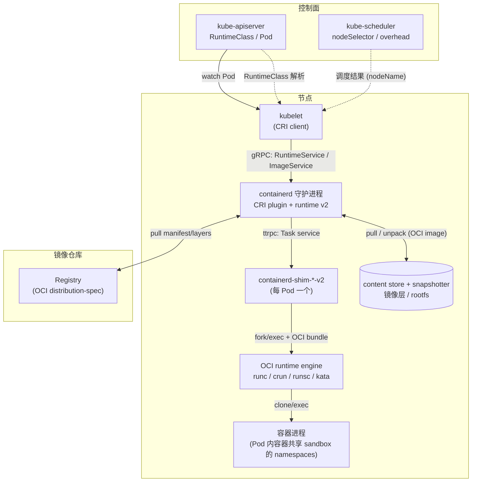
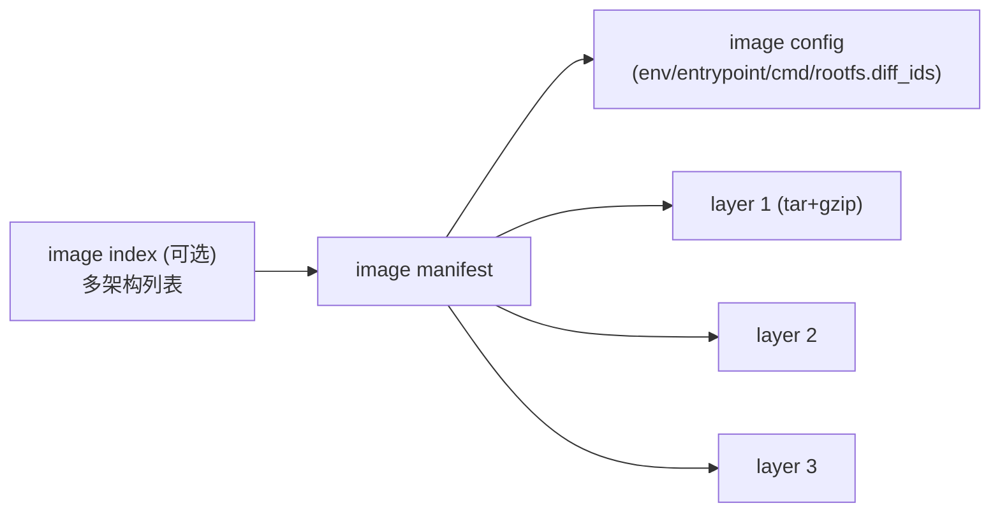
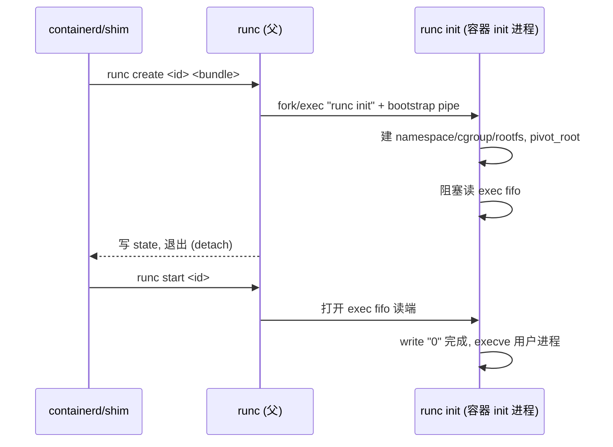
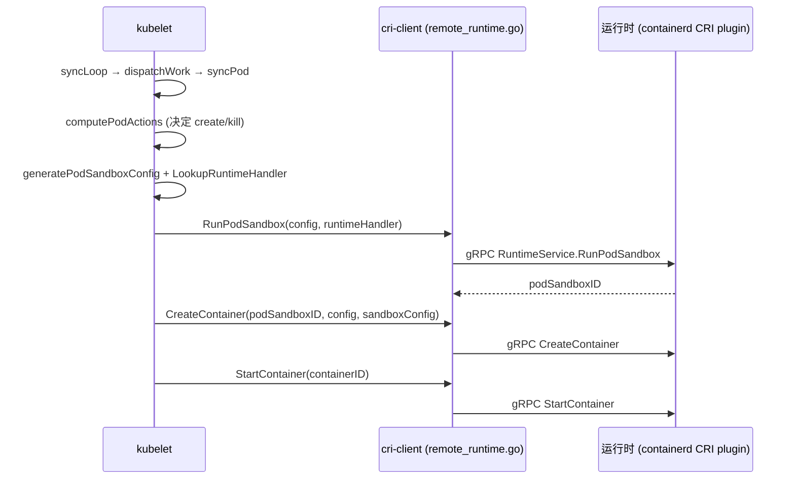
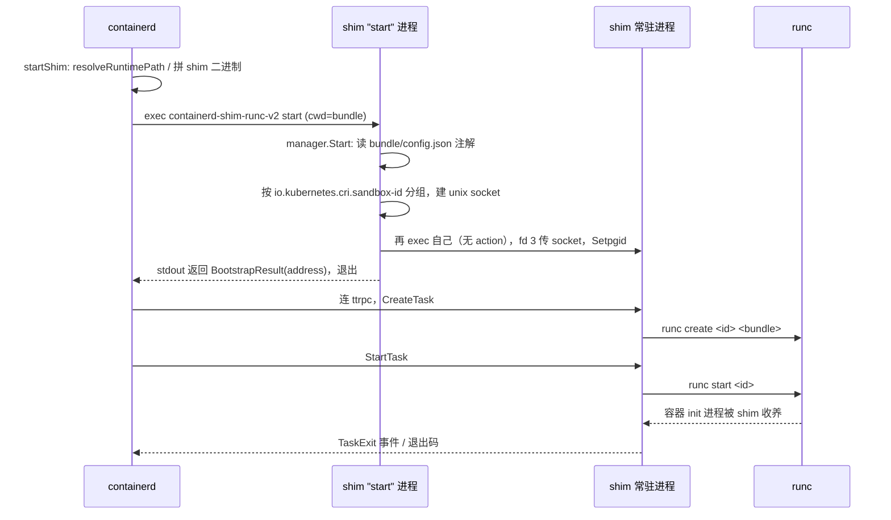
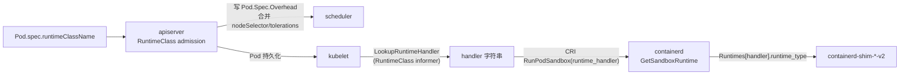
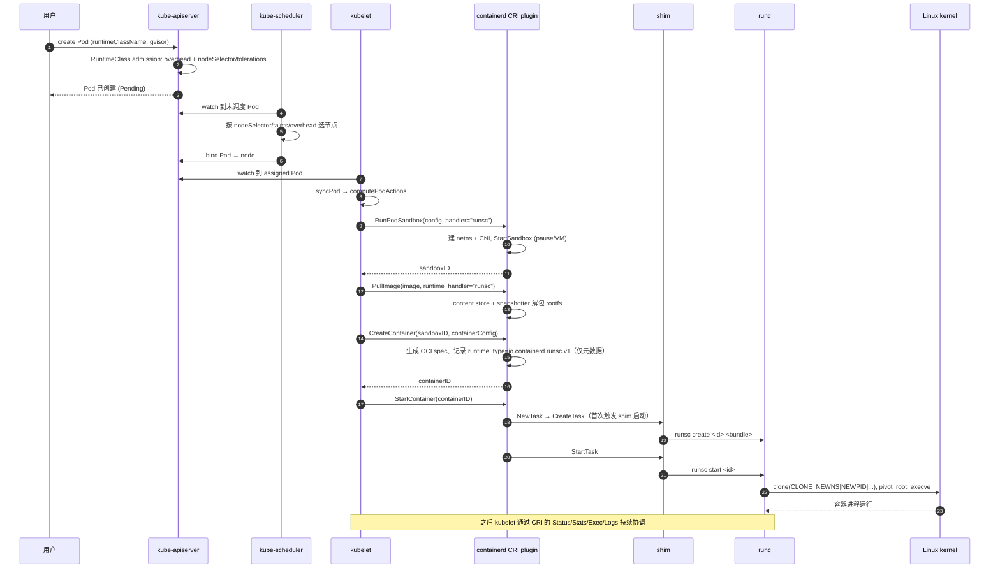

# 容器运行时全链路：OCI、CRI、containerd、shim 与 RuntimeClass

这五个词经常被混在一起说，但它们回答的是完全不同的问题：

| 名词 | 回答的问题 | 本质 |
|---|---|---|
| **OCI** | 容器"长什么样"、运行时"该做什么"？ | 规范/契约（image-spec、runtime-spec、distribution-spec） |
| **CRI** | kubelet 怎么和运行时说话？ | gRPC API（kubelet 是 client，运行时是 server） |
| **containerd** | 节点上谁在管镜像、rootfs、容器任务？ | 容器守护进程 + 插件体系 |
| **shim** | 谁真正"抱着"容器进程，containerd 重启也不松手？ | 每个 Pod 一个的伴生进程 |
| **RuntimeClass** | Kubernetes 用户/管理员怎么选择用哪个运行时？ | `node.k8s.io/v1` API + admission + 调度约束 |

一句话链路（后文逐段拆开）：

```
kubectl → kube-apiserver → kubelet
  → CRI (gRPC, unix socket)  → containerd 的 CRI plugin
  → containerd runtime v2    → shim（ttrpc）
  → OCI runtime（runc）      → 容器进程
```

> **引用约定**：本文所有代码/规范引用都固定到 2026-11 拉取的具体 commit，链接形如
> `https://github.com/<org>/<repo>/blob/<commit>/<path>#Lx-Ly`，行号与当时本地代码一致。
> 版本一览：
>
> | 项目 | tag | commit |
> |---|---|---|
> | OCI runtime-spec | v1.3.0 | `92249139eea7161e13745abd4cb6d0ea02a3227a` |
> | OCI image-spec | v1.1.1 | `147f9c13cedb47a0c4d9a11a222961073d585877` |
> | runc | v1.5.3 | `46365c62967c76a765a5e347f48f0c7b3b571fe9` |
> | containerd | v2.4.2 | `b7a25261e029d68978bbf290df0a62fc819b3c51` |
> | Kubernetes | v1.37.2 | `c50e5395f1ae2d4a2c05f28fdcc38c0916cc1a32` |
> | CRI API | v0.37.2 | `d279f3cbb9d18b653d5fab12e187589914329c77` |
> | CRI-O | v1.37.4 | `c11d3e70365ab7a671894258601d54091ec384cf` |
>
> 本文 134 条 GitHub 固定链接均用脚本校验过：文件在对应 commit 存在、`#Lx-Ly` 不越界、commit 与本地 checkout 一致。

---

## 1. 全景图



分层要点：

- **OCI 在两个地方生效**：镜像拉取/解包时用 image-spec；创建容器时用 runtime-spec（生成 `config.json`）。
- **CRI 只描述"操作语义"**（RunPodSandbox、CreateContainer…），不规定底层实现。
- **containerd 负责"准备"**：拉镜像、解包成 rootfs、生成 OCI config、管理元数据。
- **shim 负责"持有"**：容器进程的父/收养者、stdio 转发、退出码回收。
- **RuntimeClass 只负责"选"**：把用户意图变成 CRI 的 `runtime_handler` 字符串，再由 containerd 映射到具体 runtime 配置。

---

## 2. 为什么长成这样：一条历史线

理解分层的最好方式是看它解决过什么问题。

1. **Docker 单体时代**：kubelet 只能通过 dockershim 跟 Docker 的 daemon 对话。Docker 内部有自己的"运行时"概念，Kubernetes 被迫依赖 Docker 的实现细节。
2. **OCI 成立（2015）**：把"镜像格式"和"运行时行为"标准化为 image-spec / runtime-spec，2017 年发布 1.0。runc 成为 runtime-spec 的参考实现。→ 镜像和运行时终于可以互换。
3. **CRI 引入（Kubernetes 1.5，2016）**：把 kubelet 与运行时之间的接口定义成 gRPC API，kubelet 不再关心底层是 Docker、containerd 还是 CRI-O。官方定义："CRI is a plugin interface which enables the kubelet to use a wide variety of container runtimes"（[K8s 官方 CRI 文档](https://kubernetes.io/docs/concepts/containers/cri/)）。
4. **containerd 独立**：2017 年从 Docker 捐给 CNCF，成为通用容器守护进程；1.1 起内置 CRI plugin（[containerd README](https://github.com/containerd/containerd/blob/b7a25261e029d68978bbf290df0a62fc819b3c51/README.md#L131)）。Docker 自己则用 containerd 作为底层。
5. **dockershim 移除（Kubernetes 1.24）**：kubelet 不再内置 dockershim，节点必须直接配置 containerd/CRI-O 等 CRI 实现（[官方 FAQ](https://kubernetes.io/blog/2022/02/17/dockershim-faq/)）。
6. **RuntimeClass（1.20 GA）**：把"选择运行时"变成 K8s 一等 API，支持异构节点调度与 Pod Overhead（[K8s RuntimeClass 文档](https://kubernetes.io/docs/concepts/containers/runtime-class/)）。

> 注意：CRI 的 API 从 v1.23 起稳定；从 **Kubernetes 1.26** 起，kubelet 要求运行时必须支持 **CRI v1**，否则节点无法注册（[CRI 文档](https://kubernetes.io/docs/concepts/containers/cri/)）。

---

## 3. OCI：只定义契约，不提供实现

OCI（Open Container Initiative）产出三个规范：

| 规范 | 管什么 | 本文关注点 |
|---|---|---|
| [image-spec](https://github.com/opencontainers/image-spec/blob/147f9c13cedb47a0c4d9a11a222961073d585877/spec.md) | 镜像的 manifest/config/layer 格式 | containerd 拉镜像、解包 rootfs |
| [runtime-spec](https://github.com/opencontainers/runtime-spec/blob/92249139eea7161e13745abd4cb6d0ea02a3227a/runtime.md) | 容器的配置（bundle 里的 config.json）与生命周期操作 | runc 等 runtime engine 执行 |
| [distribution-spec](https://github.com/opencontainers/distribution-spec) | 镜像仓库的 pull/push API | 与 kubelet/containerd 拉镜像相关 |

**OCI 不定义 CRI，也不实现任何运行时。** 它只规定"符合规范的 runtime 在收到 create/start/kill/delete 时应该做什么"，以及"镜像应该长什么样"。

### 3.1 image-spec：内容寻址的树

OCI 镜像不是"一个 tar 包"，而是一棵由 **content descriptor**（`mediaType` + `digest` + `size` 三元组，[descriptor.md#L20-L35](https://github.com/opencontainers/image-spec/blob/147f9c13cedb47a0c4d9a11a222961073d585877/descriptor.md#L20-L35)）串起来的树：



- **manifest**：指向一个 config + 一组 layers（[manifest.md#L12-L16](https://github.com/opencontainers/image-spec/blob/147f9c13cedb47a0c4d9a11a222961073d585877/manifest.md#L12-L16)）。
- **image index**：多架构/多平台的入口（[image-index.md#L10](https://github.com/opencontainers/image-spec/blob/147f9c13cedb47a0c4d9a11a222961073d585877/image-index.md#L10)）。
- **config**：容器的默认进程配置和 `rootfs.diff_ids`（每层未压缩 digest）（[config.md#L91](https://github.com/opencontainers/image-spec/blob/147f9c13cedb47a0c4d9a11a222961073d585877/config.md#L91)）。
- **layer**：文件系统增量（changeset），通常是 tar（可压缩）；`.wh.` 开头的 whiteout 文件表示"删除下层路径"。

OCI 还定义了可选的 [image layout](https://github.com/opencontainers/image-spec/blob/147f9c13cedb47a0c4d9a11a222961073d585877/image-layout.md#L3-L10)：`oci-layout` + `index.json` + `blobs/<algo>/<hex>`，文件系统上的目录结构就是 CAS。

为什么 containerd 可以直接消费？因为所有内容都用 digest 寻址，天然适配 content-addressable storage（CAS）：拉取时按 digest 校验并落到 content store，解包时按 manifest 顺序叠加成 rootfs（snapshotter）。Docker 镜像格式在 2017 年后已与 OCI 对齐，所以"docker 镜像"和"OCI 镜像"在绝大多数场景下是同一套东西。

### 3.2 runtime-spec：bundle + config.json + 生命周期

OCI runtime 的输入是一个 **filesystem bundle**：一个目录，里面必须有 `config.json`，以及 `root.path` 指向的 rootfs（[bundle.md#L5-L20](https://github.com/opencontainers/runtime-spec/blob/92249139eea7161e13745abd4cb6d0ea02a3227a/bundle.md#L5-L20)）。

`config.json` 的核心字段（[config.md](https://github.com/opencontainers/runtime-spec/blob/92249139eea7161e13745abd4cb6d0ea02a3227a/config.md)）：

| 字段 | 含义 | 与本链路的关系 |
|---|---|---|
| `ociVersion` | 规范版本 | containerd 生成 spec 时写入 |
| `process` | 要执行的程序、args/env/cwd、rlimits（[#L237](https://github.com/opencontainers/runtime-spec/blob/92249139eea7161e13745abd4cb6d0ea02a3227a/config.md#L237)） | 来自 CRI 的 `ContainerConfig` |
| `root` | rootfs 路径与只读标记（[#L27](https://github.com/opencontainers/runtime-spec/blob/92249139eea7161e13745abd4cb6d0ea02a3227a/config.md#L27)） | containerd snapshotter 挂载出的 rootfs |
| `mounts` | 额外挂载（[#L63](https://github.com/opencontainers/runtime-spec/blob/92249139eea7161e13745abd4cb6d0ea02a3227a/config.md#L63)） | CRI 的 volume/secret/configmap 挂载 |
| `linux.namespaces` / `cgroups` / `seccomp` / `capabilities` | 隔离与资源限制 | 来自 `LinuxContainerSecurityContext` |
| `hooks`（prestart/createRuntime/…/poststop，[#L548](https://github.com/opencontainers/runtime-spec/blob/92249139eea7161e13745abd4cb6d0ea02a3227a/config.md#L548)） | 生命周期钩子 | 例如 kata 的 VM 启动钩子 |
| `annotations` | 任意元数据 | CRI 把 Pod/容器注解透传进来 |

**生命周期**（规范规定 13 步，[runtime.md#L54-L79](https://github.com/opencontainers/runtime-spec/blob/92249139eea7161e13745abd4cb6d0ea02a3227a/runtime.md#L54-L79)）：

1. `create <id> <bundle>`：按 config.json 创建运行环境，**但不执行 process.args**；
2. 依次触发 `prestart`、`createRuntime`、`createContainer` hooks；
3. `start <id>`：触发 `startContainer` hooks → **执行用户进程** → `poststart` hooks；
4. 进程退出 → `delete <id>`：销毁 create 阶段创建的资源 → `poststop` hooks。

状态机（[runtime.md#L8-L38](https://github.com/opencontainers/runtime-spec/blob/92249139eea7161e13745abd4cb6d0ea02a3227a/runtime.md#L8-L38)）：`creating → created → running → stopped`。

> **关键点**：`create` 和 `start` 是分开的，`create` 阶段不能跑用户进程。这个"两段式"设计正是 runc 能"create 完就退出、由 shim 后续 start"的基础。

### 3.3 谁实现 runtime-spec

OCI 官方列的 runtime 实现（[implementations.md#L7-L20](https://github.com/opencontainers/runtime-spec/blob/92249139eea7161e13745abd4cb6d0ea02a3227a/implementations.md#L7-L20)）：

- 普通容器：**runc**（参考实现）、crun（C）、youki（Rust）、systemd-nspawn
- 虚拟化/用户态内核：**runsc**（gVisor，用户态内核）、**kata-runtime**（轻量 VM）、runv

它们对上层提供同一套语义，因此 containerd 可以只实现一次"调用 runtime"，就支持所有 OCI runtime —— 这也是 **RuntimeClass** 能把 runc/gVisor/Kata 统一到同一个 API 下的原因。

---

## 4. runc：一个"一次性"进程

runc 是 runtime-spec 的参考实现。理解 runc 的关键是：**它没有守护进程，create 后就退出**。

### 4.1 命令到代码

| CLI | 入口 | 实际动作 |
|---|---|---|
| `runc create` | [create.go#L63](https://github.com/opencontainers/runc/blob/46365c62967c76a765a5e347f48f0c7b3b571fe9/create.go#L63) | `startContainer(ctx, CT_ACT_CREATE)` |
| `runc start` | start.go | `container.Exec()`：打开 exec fifo 读端，解除 init 的阻塞，使其 execve 用户进程 |
| `runc delete` | delete.go | 销毁 cgroup/namespace/rootfs 等资源 |

### 4.2 `runc create` 的 fork/exec 内幕

`runc create` → `startContainer()`（[utils_linux.go#L367](https://github.com/opencontainers/runc/blob/46365c62967c76a765a5e347f48f0c7b3b571fe9/utils_linux.go#L367)）→ `runner.run()`（[utils_linux.go#L222](https://github.com/opencontainers/runc/blob/46365c62967c76a765a5e347f48f0c7b3b571fe9/utils_linux.go#L222)）→ `container.Start()`：

1. `container_linux.go` 的 `start()` 先 `createExecFifo()`，在 state 目录创建一个 FIFO（[container_linux.go#L447](https://github.com/opencontainers/runc/blob/46365c62967c76a765a5e347f48f0c7b3b571fe9/libcontainer/container_linux.go#L447)）；
2. `newParentProcess()` 把运行配置编码成 bootstrap 数据（netlink 格式，含 initConfig 与 config），通过 pipe 传给子进程，并 **fork/exec 自己**：`runc init`（带 `_LIBCONTAINER_INITPIPE`、`_LIBCONTAINER_FIFOFD` 等环境变量）；
3. 子进程从 root `init.go` 的 `init()` 进入（[init.go#L10-L16](https://github.com/opencontainers/runc/blob/46365c62967c76a765a5e347f48f0c7b3b571fe9/init.go#L10-L16)）——注意这是在 `nsexec`（C 代码）之后、`main()` 之前执行的，用来在正确的 namespace 里做初始化；
4. `libcontainer.Init()`（[init_linux.go#L106](https://github.com/opencontainers/runc/blob/46365c62967c76a765a5e347f48f0c7b3b571fe9/libcontainer/init_linux.go#L106)）→ `startInitialization()`（[#L128](https://github.com/opencontainers/runc/blob/46365c62967c76a765a5e347f48f0c7b3b571fe9/libcontainer/init_linux.go#L128)）：设置 namespaces、cgroup、挂载 rootfs、`pivot_root`、降权，然后**在写 exec fifo 时阻塞**，等待 `runc start` 打开读端；
5. 因为 `CT_ACT_CREATE` 时 `detach = true`（[utils_linux.go#L258](https://github.com/opencontainers/runc/blob/46365c62967c76a765a5e347f48f0c7b3b571fe9/utils_linux.go#L258)），runc 父进程写完 state 后直接返回，**不等待容器进程**。

### 4.3 `runc start` 的 fifo 握手

方向要搞对：**init 进程写、`runc start` 读**。init 在 execve 前把 exec.fifo 以 `O_WRONLY` 重新打开并写入一个字节 `"0"`；由于此时还没有读端，这个 write 会**阻塞**（这正是容器能停在 `created` 状态的原因）。`runc start` 走 `container.Exec()` 打开读端（[container_linux.go#L226-L249](https://github.com/opencontainers/runc/blob/46365c62967c76a765a5e347f48f0c7b3b571fe9/libcontainer/container_linux.go#L226-L249)）、用 `readFromExecFifo` 读走数据（[#L256](https://github.com/opencontainers/runc/blob/46365c62967c76a765a5e347f48f0c7b3b571fe9/libcontainer/container_linux.go#L256)），init 的 write 完成，随即 `execve` 用户进程。

`exec.fifo` 的存在与否本身就是状态标志：runc 的 `refreshState` 先看 init 进程是否存活，再看 exec.fifo 是否存在 —— 存在 = `created`，不存在 = `running`（start 时删除该文件）（[container_linux.go#L874-L891](https://github.com/opencontainers/runc/blob/46365c62967c76a765a5e347f48f0c7b3b571fe9/libcontainer/container_linux.go#L874-L891)）。再加上 `<root>/<id>/state.json`（`--root` 默认 `/run/runc`），runc 的状态完全落在磁盘上，任何进程都能接管同一容器。



### 4.4 为什么 runc 单独撑不起 Kubernetes

- 没有 daemon：create 完就退出，**没人负责后续的 wait/信号转发/日志**；
- 没有 API：只有 CLI，kubelet 无法直接对话；
- 没有状态管理：容器 ID、镜像、快照、网络、事件都不管。

于是需要 containerd 管"平台能力"，需要 **shim** 管"进程寿命"。这正好引出下一节。

---

## 5. CRI：kubelet 与运行时的 gRPC 接口

### 5.1 定义

> "The CRI is a plugin interface which enables the kubelet to use a wide variety of container runtimes, without having a need to recompile the cluster components."（[K8s CRI 文档](https://kubernetes.io/docs/concepts/containers/cri/)）

- kubelet 是 **client**，通过 gRPC 连接运行时的 unix socket（`--container-runtime-endpoint`，如 `unix:///run/containerd/containerd.sock`）；
- 运行时（containerd 的 CRI plugin / CRI-O）是 **server**；
- 接口定义在独立仓库 [`kubernetes/cri-api`](https://github.com/kubernetes/cri-api/blob/d279f3cbb9d18b653d5fab12e187589914329c77/pkg/apis/runtime/v1/api.proto)，kubelet 侧实现位于 `staging/src/k8s.io/cri-client`。

### 5.2 两组服务

`api.proto` 定义了两个 service：

- **RuntimeService**（[api.proto#L24](https://github.com/kubernetes/cri-api/blob/d279f3cbb9d18b653d5fab12e187589914329c77/pkg/apis/runtime/v1/api.proto#L24)）
- **ImageService**（[api.proto#L230](https://github.com/kubernetes/cri-api/blob/d279f3cbb9d18b653d5fab12e187589914329c77/pkg/apis/runtime/v1/api.proto#L230)）

核心 RPC 与它们在本链路中的落点：

| RPC | 作用 | 谁真正干活 |
|---|---|---|
| `Version` | 协商 API 版本（v1） | 运行时返回 `runtime_name` / `runtime_version` / `runtime_api_version`（[#L273](https://github.com/kubernetes/cri-api/blob/d279f3cbb9d18b653d5fab12e187589914329c77/pkg/apis/runtime/v1/api.proto#L273-L286)） |
| `RunPodSandbox` | 创建并启动 Pod 级 sandbox | containerd：pause 容器 + netns/CNI |
| `CreateContainer` / `StartContainer` | 在 sandbox 里创建/启动业务容器 | containerd → shim → OCI runtime |
| `ExecSync` / `Exec` / `Attach` / `PortForward` | 执行命令 / 流式接入 | 返回 streaming URL（由 CRI 实现的 streaming server 提供，kubelet 反代） |
| `StopContainer` / `RemoveContainer` / `StopPodSandbox` / `RemovePodSandbox` | 停止/删除 | 幂等语义写在 proto 注释里 |
| `PullImage` / `ListImages` / `ImageFsInfo` / `RemoveImage` | 镜像管理 | containerd content store + snapshotter |
| `Status` / `UpdateRuntimeConfig` | 运行时状态、Pod CIDR 等运行时配置 | 各实现 |

### 5.3 PodSandbox：CRI 最重要的抽象（也是术语坑）

CRI 里没有"直接创建容器"这回事 —— **所有容器都必须属于一个 PodSandbox**：

- **sandbox 是 Pod 级资源的载体**：网络 namespace、IPC/UTS namespace、cgroup、DNS、端口映射都在 sandbox 上（[PodSandboxConfig#L578-L625](https://github.com/kubernetes/cri-api/blob/d279f3cbb9d18b653d5fab12e187589914329c77/pkg/apis/runtime/v1/api.proto#L578-L625)）；
- 同一 sandbox 内的容器共享这些 namespace，这才实现了"Pod 内容器像在同一台机器上"；
- CRI 只定义"sandbox"这个概念，**具体怎么实现由运行时决定**：containerd 默认用 **pause 容器**（一个只 sleep 的占位进程）持有 namespace，Kata 用 VM，gVisor 用 sentry。containerd 文档明确描述了 pause 容器的角色（[docs/cri/architecture.md](https://github.com/containerd/containerd/blob/b7a25261e029d68978bbf290df0a62fc819b3c51/docs/cri/architecture.md)）。

> ⚠️ **术语重载警告**：CRI 的 "PodSandbox" 是"Pod 级 namespace 载体"的抽象，和"安全沙箱（sandboxed runtime，如 gVisor/Kata）"不是同一个概念。前者是 CRI API 的对象，后者是隔离强度。

**runtime handler 到底在哪个字段？** 这是一个很容易看错的地方：`runtime_handler` **不在** `PodSandboxConfig` 里，而是 `RunPodSandboxRequest` 的独立字段：

```protobuf
message RunPodSandboxRequest {
    PodSandboxConfig config = 1;
    // Named runtime configuration to use for this PodSandbox.
    // If the runtime handler is unknown, this request should be rejected.
    // An empty string should select the default handler...
    string runtime_handler = 2;
}
```

（[api.proto#L627-L636](https://github.com/kubernetes/cri-api/blob/d279f3cbb9d18b653d5fab12e187589914329c77/pkg/apis/runtime/v1/api.proto#L627-L636)）

对应的 kubelet 侧调用也印证了这一点：`RunPodSandbox(ctx, podSandboxConfig, runtimeHandler)` 是三个参数（[kuberuntime_sandbox.go#L60-L71](https://github.com/kubernetes/kubernetes/blob/c50e5395f1ae2d4a2c05f28fdcc38c0916cc1a32/pkg/kubelet/kuberuntime/kuberuntime_sandbox.go#L60-L71)）。此外 `PodSandboxStatus.runtime_handler` 用于回读（[api.proto#L717](https://github.com/kubernetes/cri-api/blob/d279f3cbb9d18b653d5fab12e187589914329c77/pkg/apis/runtime/v1/api.proto#L717)）。

`metadata`/`labels`/`annotations`/`log_directory` 等字段的语义都直接写在 proto 注释里，是理解 CRI 契约的好材料。

### 5.4 流式接口：运行时提供 streaming server，kubelet 只做反代

`Exec` / `Attach` / `PortForward` 的 gRPC 调用**不传输数据**，只返回一个 `url`（`ExecResponse.url`，[api.proto#L1640-L1664](https://github.com/kubernetes/cri-api/blob/d279f3cbb9d18b653d5fab12e187589914329c77/pkg/apis/runtime/v1/api.proto#L1640-L1664)）。真正的 streaming server 由 **CRI 实现**提供：

- containerd 的 CRI plugin 内部自带 streaming server（`internal/cri/streaming`，初始化在 [service.go#L250](https://github.com/containerd/containerd/blob/b7a25261e029d68978bbf290df0a62fc819b3c51/internal/cri/server/service.go#L250)），`Exec` handler 直接返回 `c.streamServer.GetExec(r)`（[container_exec.go#L28-L39](https://github.com/containerd/containerd/blob/b7a25261e029d68978bbf290df0a62fc819b3c51/internal/cri/server/container_exec.go#L28-L39)）；
- CRI-O 同样内嵌 `k8s.io/cri-streaming` 的 server。

kubelet 侧不再自己起 streaming server，而是把请求**反向代理**到运行时返回的 URL（`proxy.NewUpgradeAwareHandler`，[pkg/kubelet/server/server.go#L1176-L1182](https://github.com/kubernetes/kubernetes/blob/c50e5395f1ae2d4a2c05f28fdcc38c0916cc1a32/pkg/kubelet/server/server.go#L1176-L1182)）。`k8s.io/cri-streaming` 作为独立 module 提供 `GetExec`/`GetAttach`/`GetPortForward` 接口（[server.go#L46-L48](https://github.com/kubernetes/kubernetes/blob/c50e5395f1ae2d4a2c05f28fdcc38c0916cc1a32/staging/src/k8s.io/cri-streaming/pkg/streaming/server.go#L46-L48)），供各 CRI 实现复用。

### 5.5 kubelet 侧完整调用链（代码级）



关键代码点：

1. **客户端初始化**：`PreInitRuntimeService` 创建 runtime/image 两个 client，分别连 `--container-runtime-endpoint` 与 `--image-service-endpoint`（[kubelet.go#L407-L433](https://github.com/kubernetes/kubernetes/blob/c50e5395f1ae2d4a2c05f28fdcc38c0916cc1a32/pkg/kubelet/kubelet.go#L407-L433)）。端点默认值是 `unix:///run/containerd/containerd.sock`（[defaults.go#L303-L304](https://github.com/kubernetes/kubernetes/blob/c50e5395f1ae2d4a2c05f28fdcc38c0916cc1a32/pkg/kubelet/apis/config/v1beta1/defaults.go#L303-L304)）。
2. **连接即验版本**：`validateServiceConnection` 连上后先调 `Version`，不通过就报错（[remote_runtime.go#L250-L263](https://github.com/kubernetes/kubernetes/blob/c50e5395f1ae2d4a2c05f28fdcc38c0916cc1a32/staging/src/k8s.io/cri-client/pkg/remote_runtime.go#L250-L263)）。此外 kubelet 要求 `VersionResponse.version` 严格等于 `"0.1.0"`（`kubeRuntimeAPIVersion`，[kuberuntime_manager.go#L82](https://github.com/kubernetes/kubernetes/blob/c50e5395f1ae2d4a2c05f28fdcc38c0916cc1a32/pkg/kubelet/kuberuntime/kuberuntime_manager.go#L82)、判等逻辑 [#L299-L312](https://github.com/kubernetes/kubernetes/blob/c50e5395f1ae2d4a2c05f28fdcc38c0916cc1a32/pkg/kubelet/kuberuntime/kuberuntime_manager.go#L299-L312)），不匹配返回 `ErrVersionNotSupported`。
3. **RunPodSandbox**：超时是普通请求的 2 倍（注释说明 sandbox 操作更慢）（[remote_runtime.go#L308-L343](https://github.com/kubernetes/kubernetes/blob/c50e5395f1ae2d4a2c05f28fdcc38c0916cc1a32/staging/src/k8s.io/cri-client/pkg/remote_runtime.go#L308-L343)）。
4. **SyncPod**：kubelet 的核心同步函数（[kuberuntime_manager.go#L1854](https://github.com/kubernetes/kubernetes/blob/c50e5395f1ae2d4a2c05f28fdcc38c0916cc1a32/pkg/kubelet/kuberuntime/kuberuntime_manager.go#L1854)），内部 `computePodActions` 决定要创建哪些 sandbox/container，然后调用 `createPodSandbox`（[#L2018](https://github.com/kubernetes/kubernetes/blob/c50e5395f1ae2d4a2c05f28fdcc38c0916cc1a32/pkg/kubelet/kuberuntime/kuberuntime_manager.go#L2018)）。
5. **创建 sandbox**：`createPodSandbox` 里先 `generatePodSandboxConfig`，再 `LookupRuntimeHandler(pod.Spec.RuntimeClassName)`，最后 `RunPodSandbox(ctx, config, handler)`（[kuberuntime_sandbox.go#L41-L78](https://github.com/kubernetes/kubernetes/blob/c50e5395f1ae2d4a2c05f28fdcc38c0916cc1a32/pkg/kubelet/kuberuntime/kuberuntime_sandbox.go#L41-L78)）。
6. **启动容器**：`startContainer` 四步 —— 拉镜像（把 handler 传进 `ImageSpec`）→ `CreateContainer` → `StartContainer` → 执行 PostStart hook（[kuberuntime_container.go#L200-L340](https://github.com/kubernetes/kubernetes/blob/c50e5395f1ae2d4a2c05f28fdcc38c0916cc1a32/pkg/kubelet/kuberuntime/kuberuntime_container.go#L200-L340)）。
7. **镜像也能带 handler（但默认关闭）**：`ImageSpec.runtime_handler`（[api.proto#L956-L973](https://github.com/kubernetes/cri-api/blob/d279f3cbb9d18b653d5fab12e187589914329c77/pkg/apis/runtime/v1/api.proto#L956-L973)）让运行时按 handler 拉镜像；kubelet 侧受 feature gate `RuntimeClassInImageCriAPI`（Alpha、默认 false）控制才填充（[convert.go#L65-L78](https://github.com/kubernetes/kubernetes/blob/c50e5395f1ae2d4a2c05f28fdcc38c0916cc1a32/pkg/kubelet/kuberuntime/convert.go#L65-L78)、[kube_features.go#L2087-L2089](https://github.com/kubernetes/kubernetes/blob/c50e5395f1ae2d4a2c05f28fdcc38c0916cc1a32/pkg/features/kube_features.go#L2087-L2089)）。

> 也就是说：**kubelet 从头到尾只认识 CRI 的 `PodSandbox` / `Container` 抽象和字符串 handler，完全不知道 runc/containerd 的存在。**

### 5.6 CRI 的实现者

| 实现 | 形态 | 说明 |
|---|---|---|
| **containerd（内置 CRI plugin）** | 一个 daemon 里的插件 | K8s 默认生态；同时服务 CRI 和 containerd 原生 API（ctr/nerdctl） |
| **CRI-O** | 独立的 CRI daemon | "OCI-based implementation of Kubernetes Container Runtime Interface"（[README](https://github.com/cri-o/cri-o/blob/c11d3e70365ab7a671894258601d54091ec384cf/README.md#L5)） |
| **dockershim** | kubelet 内置适配层 | 1.24 移除（见第 2 节） |

CRI-O 的实现方式是"直接调 OCI runtime + conmon"，containerd 则是"CRI plugin → containerd runtime v2 → shim"。两者都暴露同一个 CRI 接口，所以可以互换。

---

## 6. containerd：节点侧的容器管理器

### 6.1 它管什么

containerd 的定位是"管理节点上容器与内容的 daemon"，核心内部对象：

| 组件 | 作用 |
|---|---|
| **content store** | 按 digest 存镜像 manifest/config/layer（OCI image 的 CAS） |
| **snapshotter** | 把 layer 叠加成容器 rootfs（overlayfs 等） |
| **metadata** | bbolt 存容器/镜像/任务的元数据 |
| **namespace** | 多租户隔离（k8s.io 命名空间等） |
| **task service** | 容器任务（进程）生命周期 |
| **event service** | 发布容器事件（TaskExit 等） |
| **plugin** | 所有能力都是插件（[docs/PLUGINS.md](https://github.com/containerd/containerd/blob/b7a25261e029d68978bbf290df0a62fc819b3c51/docs/PLUGINS.md)） |

**containerd 本身不创建容器进程**，它只负责准备 rootfs/config，然后让 runtime（shim + engine）去做。containerd 官方文档原话：

> "containerd, the daemon, does not directly launch containers. Instead, it acts as a higher-level manager or hub for coordinating the activities of containers and content, that lower-level programs, called 'runtimes', actually implement to start, stop and manage containers."（[docs/runtime-v2.md#L3-L8](https://github.com/containerd/containerd/blob/b7a25261e029d68978bbf290df0a62fc819b3c51/docs/runtime-v2.md#L3-L8)）

### 6.2 CRI plugin：containerd 里的"CRI server"

containerd 的 CRI 实现不是独立进程，而是内置插件。它接收 kubelet 的 CRI gRPC 请求，翻译成 containerd 内部操作：

- 文档：[docs/cri/architecture.md](https://github.com/containerd/containerd/blob/b7a25261e029d68978bbf290df0a62fc819b3c51/docs/cri/architecture.md) 描述了 "kubelet → CRI plugin → containerd internals → pause 容器 + CNI" 的完整流程；
- 插件注册：`plugins/cri/runtime/plugin.go`（ID `runtime`，[#L49](https://github.com/containerd/containerd/blob/b7a25261e029d68978bbf290df0a62fc819b3c51/plugins/cri/runtime/plugin.go#L49)）与 `plugins/cri/images/plugin.go`（ID `images`，[#L47](https://github.com/containerd/containerd/blob/b7a25261e029d68978bbf290df0a62fc819b3c51/plugins/cri/images/plugin.go#L47)）；
- **containerd 2.x 的插件 ID 变了**：配置段从 1.x 的 `plugins."io.containerd.grpc.v1.cri"` 改为 `plugins."io.containerd.cri.v1.runtime"` / `plugins."io.containerd.cri.v1.images"`（[docs/cri/config.md#L90-L108](https://github.com/containerd/containerd/blob/b7a25261e029d68978bbf290df0a62fc819b3c51/docs/cri/config.md#L90-L108)）。

`RunPodSandbox` 在 containerd 里的主要步骤（[internal/cri/server/sandbox_run.go#L54](https://github.com/containerd/containerd/blob/b7a25261e029d68978bbf290df0a62fc819b3c51/internal/cri/server/sandbox_run.go#L54)）：

1. 生成 sandbox ID/name，创建 lease；
2. 准备并 `setupPodNetwork`（CNI 配置 netns、分配 IP）；
3. 调 `sandboxService.CreateSandbox` / `StartSandbox`（2.x 的 sandbox API）；
4. 确保 pause 镜像存在（`ensurePauseImageExists`，[#L416](https://github.com/containerd/containerd/blob/b7a25261e029d68978bbf290df0a62fc819b3c51/internal/cri/server/sandbox_run.go#L416)）；containerd 2.4 的默认 sandbox 镜像是 `registry.k8s.io/pause:3.10.2`（[config.go#L73-L75](https://github.com/containerd/containerd/blob/b7a25261e029d68978bbf290df0a62fc819b3c51/internal/cri/config/config.go#L73-L75)），可用 `sandbox_image` 覆盖（[docs/cri/config.md#L375-L376](https://github.com/containerd/containerd/blob/b7a25261e029d68978bbf290df0a62fc819b3c51/docs/cri/config.md#L375-L376)）；
5. 等待 sandbox 退出事件、标记 Ready。

> containerd 2.x 引入了 **sandboxer** 抽象：默认 `podsandbox`（pause 容器），VM 类 runtime 可以注册自己的 sandboxer 直接管理 VM（`Runtime.Sandboxer` 字段，[internal/cri/config/config.go#L122-L126](https://github.com/containerd/containerd/blob/b7a25261e029d68978bbf290df0a62fc819b3c51/internal/cri/config/config.go#L122-L126)）。这是 2.x 相对 1.x 的一个重要架构变化，但"CRI sandbox"的语义未变。

### 6.3 handler 如何映射到 runtime 配置

kubelet 传来的 `runtime_handler` 字符串，在 containerd 里由 `Config.GetSandboxRuntime` 解析（[internal/cri/config/config.go#L692-L720](https://github.com/containerd/containerd/blob/b7a25261e029d68978bbf290df0a62fc819b3c51/internal/cri/config/config.go#L692-L720)）：

```go
if runtimeHandler == "" {
    runtimeHandler = config.DefaultRuntimeName
}
r, ok := config.Runtimes[runtimeHandler]
if !ok {
    return Runtime{}, fmt.Errorf("no runtime for %q is configured", runtimeHandler)
}
return r, nil
```

每个 runtime 配置项（[internal/cri/config/config.go#L84-L130](https://github.com/containerd/containerd/blob/b7a25261e029d68978bbf290df0a62fc819b3c51/internal/cri/config/config.go#L84-L130)）决定"用哪个 shim"：

```toml
[plugins."io.containerd.cri.v1.runtime".containerd]
  default_runtime_name = "runc"
  [plugins."io.containerd.cri.v1.runtime".containerd.runtimes.runc]
    runtime_type = "io.containerd.runc.v2"   # → containerd-shim-runc-v2
    [plugins."io.containerd.cri.v1.runtime".containerd.runtimes.runc.options]
      SystemdCgroup = true
```

`runtime_type` 是 shim 的名字（见 7.6 的命名算法），`options` 是传给 shim 的 protobuf 配置。

### 6.4 从 CRI 容器到 OCI spec

创建业务容器时（[internal/cri/server/container_create.go](https://github.com/containerd/containerd/blob/b7a25261e029d68978bbf290df0a62fc819b3c51/internal/cri/server/container_create.go)）：

1. 取 sandbox 的 runtime 配置（`getPodSandboxRuntime`，[#L234](https://github.com/containerd/containerd/blob/b7a25261e029d68978bbf290df0a62fc819b3c51/internal/cri/server/container_create.go#L234)）；
2. 把 `ContainerConfig` 翻译成 **OCI spec**（`runtimeSpec`，[#L613](https://github.com/containerd/containerd/blob/b7a25261e029d68978bbf290df0a62fc819b3c51/internal/cri/server/container_create.go#L613)）；
3. 用 `containerd.NewContainer(..., containerd.WithRuntime(runtimeName, runtimeOption))` 创建**容器元数据**（[#L379-L390](https://github.com/containerd/containerd/blob/b7a25261e029d68978bbf290df0a62fc819b3c51/internal/cri/server/container_create.go#L379-L390)）—— 此时还没有 task/shim。

真正的 task 是在 **`StartContainer`** 里创建的：`container.NewTask()` 才会触发 shim 启动（[container_start.go#L146-L149](https://github.com/containerd/containerd/blob/b7a25261e029d68978bbf290df0a62fc819b3c51/internal/cri/server/container_start.go#L146-L149)），随后 `task.Start()`。这也是为什么 `CreateContainer` 很快、`StartContainer` 才可能因为运行时问题失败。

---

## 7. shim：为什么 containerd 重启后容器还活着

### 7.1 shim 的职责

| 职责 | 说明 | 代码证据 |
|---|---|---|
| **进程持有** | 容器进程的父进程/收养者；containerd 只是"客户端" | shim 把自己设为 sub-reaper（`PR_SET_CHILD_SUBREAPER`，[reaper_utils_linux.go#L27](https://github.com/containerd/containerd/blob/b7a25261e029d68978bbf290df0a62fc819b3c51/pkg/sys/reaper/reaper_utils_linux.go#L27)） |
| **回收僵尸** | SIGCHLD → `reaper.Reap()` | [shim_unix.go#L85](https://github.com/containerd/containerd/blob/b7a25261e029d68978bbf290df0a62fc819b3c51/pkg/shim/shim_unix.go#L85) |
| **stdio/TTY 转发** | containerd 通过 FIFO 与 shim 传 stdout/stderr/stdin | [docs/runtime-v2.md#L325-L350](https://github.com/containerd/containerd/blob/b7a25261e029d68978bbf290df0a62fc819b3c51/docs/runtime-v2.md#L325-L350) |
| **隔离 runtime 实现** | shim 提供统一的 ttrpc API，内部可调 runc/crun/runsc/kata | [docs/runtime-v2.md#L58-L84](https://github.com/containerd/containerd/blob/b7a25261e029d68978bbf290df0a62fc819b3c51/docs/runtime-v2.md#L58-L84) |

"containerd 重启容器不挂"不是魔法：容器进程的父进程是 shim，不是 containerd。containerd 挂掉/升级时，shim 和容器都不受影响；containerd 重启后通过 bundle 里的地址信息**重新连上 shim**（`loadShims`，[shim_load.go#L66](https://github.com/containerd/containerd/blob/b7a25261e029d68978bbf290df0a62fc819b3c51/core/runtime/v2/shim_load.go#L66)、`loadShim`，[#L128](https://github.com/containerd/containerd/blob/b7a25261e029d68978bbf290df0a62fc819b3c51/core/runtime/v2/shim_load.go#L128)）。

### 7.2 启动时序（containerd 2.4 的代码路径）



逐步对应代码：

1. **containerd 侧**：`ShimManager.Start`（[core/runtime/v2/shim_manager.go#L205](https://github.com/containerd/containerd/blob/b7a25261e029d68978bbf290df0a62fc819b3c51/core/runtime/v2/shim_manager.go#L205)）→ `startShim`（[#L348](https://github.com/containerd/containerd/blob/b7a25261e029d68978bbf290df0a62fc819b3c51/core/runtime/v2/shim_manager.go#L348)）→ `resolveRuntimePath`（[#L422](https://github.com/containerd/containerd/blob/b7a25261e029d68978bbf290df0a62fc819b3c51/core/runtime/v2/shim_manager.go#L422)）把 `io.containerd.runc.v2` 解析成 `containerd-shim-runc-v2`。
2. **执行 shim**：`binary.Start`（[core/runtime/v2/binary.go#L66](https://github.com/containerd/containerd/blob/b7a25261e029d68978bbf290df0a62fc819b3c51/core/runtime/v2/binary.go#L66)）以 `cwd = bundle` 执行 `<shim> start`，并通过 stdin 传 `BootstrapParams`（containerd 2.3+ 的新 bootstrap 协议）。
3. **shim "start" 模式**：`pkg/shim` 的 `case "start"`（[pkg/shim/shim.go#L272](https://github.com/containerd/containerd/blob/b7a25261e029d68978bbf290df0a62fc819b3c51/pkg/shim/shim.go#L272)）读 bootstrap → `manager.Start`。
4. **runc shim 的 manager.Start**（[manager_linux.go#L187](https://github.com/containerd/containerd/blob/b7a25261e029d68978bbf290df0a62fc819b3c51/cmd/containerd-shim-runc-v2/manager/manager_linux.go#L187)）：
   - 读 bundle 里的 `config.json` 注解，按 `io.kubernetes.cri.sandbox-id` 分组（[#L67-L69](https://github.com/containerd/containerd/blob/b7a25261e029d68978bbf290df0a62fc819b3c51/cmd/containerd-shim-runc-v2/manager/manager_linux.go#L67-L69)）；
   - 建 unix socket，**再 exec 自己一次**（不带 action），用 fd 3 把 socket 传过去（`newCommand`，[#L84-L114](https://github.com/containerd/containerd/blob/b7a25261e029d68978bbf290df0a62fc819b3c51/cmd/containerd-shim-runc-v2/manager/manager_linux.go#L84-L114)）；
   - 返回 address 后退出 —— 所以 containerd 看到的是一次短命的 "start" 进程。
5. **常驻 shim**：不带 action 启动，`serve`（[pkg/shim/shim.go#L466](https://github.com/containerd/containerd/blob/b7a25261e029d68978bbf290df0a62fc819b3c51/pkg/shim/shim.go#L466)）在继承的 socket fd 上提供 ttrpc；同时 `subreaper()`（[#L233](https://github.com/containerd/containerd/blob/b7a25261e029d68978bbf290df0a62fc819b3c51/pkg/shim/shim.go#L233)）和 SIGCHLD reap 生效。
6. **task 操作**：containerd 连上 ttrpc 后调 `CreateTask`/`StartTask`，shim 内部调 `runc create`/`runc start`。runc 退出后，容器 init 进程被 shim 收养，后续信号、退出码、日志都由 shim 负责。

### 7.3 一个 shim 服务一个 Pod，而不是一个容器

shim 的分组逻辑在 `manager.Start` 里：读取 bundle `config.json` 的 annotations，命中 `io.kubernetes.cri.sandbox-id` 就把 grouping 设为 sandbox ID，这样**同一个 Pod 的所有容器共用一个 shim/socket**（[manager_linux.go#L206-L212](https://github.com/containerd/containerd/blob/b7a25261e029d68978bbf290df0a62fc819b3c51/cmd/containerd-shim-runc-v2/manager/manager_linux.go#L206-L212)）。

这与 containerd 文档一致："containers launched by Kubernetes, that are part of the same Kubernetes pod, are handled by a single shim, grouping on the `io.kubernetes.cri.sandbox-id` label"（[docs/runtime-v2.md#L104-L112](https://github.com/containerd/containerd/blob/b7a25261e029d68978bbf290df0a62fc819b3c51/docs/runtime-v2.md#L104-L112)）。

> 实践意义：`ps aux | grep containerd-shim` 看到的 shim 数量约等于 Pod 数，而不是容器数。

### 7.4 shim v1 → v2

| | shim v1 | shim v2 |
|---|---|---|
| 二进制 | 每个容器一个（如 `docker-containerd-shim`） | 统一 `containerd-shim-<engine>-v2`，同一二进制可服务多个容器 |
| 通信 | gRPC | **ttrpc**（更轻量的 RPC，protobuf + unix socket） |
| 接口 | 自定义 Shim service | ttrpc `Task` service；containerd 2.4 默认 task API 是 `containerd.task.v3`，v2 由 `ttrpcV2Bridge` 兼容（[bridge.go#L70-L95](https://github.com/containerd/containerd/blob/b7a25261e029d68978bbf290df0a62fc819b3c51/core/runtime/v2/bridge.go#L70-L95)） |
| 配置 | `runtime_type = "io.containerd.runtime.v1.linux"` | `runtime_type = "io.containerd.runc.v2"` 等 |
| 现状 | containerd v2.0 已移除 | 当前默认 |

证据：containerd 的 `RELEASES.md` 明确列出 "Runtime V1 API and implementation (`io.containerd.runtime.v1.linux`)" 在 v2.0 移除、推荐 `io.containerd.runc.v2`（[RELEASES.md#L606](https://github.com/containerd/containerd/blob/b7a25261e029d68978bbf290df0a62fc819b3c51/RELEASES.md#L606)）；同一张表里 `io.containerd.runc.v1` 也在 v2.0 移除（[#L607](https://github.com/containerd/containerd/blob/b7a25261e029d68978bbf290df0a62fc819b3c51/RELEASES.md#L607)）。ttrpc 与 shim API 的设计说明见 [docs/runtime-v2.md#L575](https://github.com/containerd/containerd/blob/b7a25261e029d68978bbf290df0a62fc819b3c51/docs/runtime-v2.md#L575)。

> 命名注意：**"shim v2" 是架构名，不是 task API 的版本号**。containerd 2.4 默认 task API 已经是 v3（v2 兼容）， `containerd-shim-runc-v2` 里的 `v2` 指的是 shim 架构，不是 RPC 版本。

### 7.5 shim 不是一个"容器运行时"

- **shim 不实现 OCI runtime spec**，它是 containerd 的伴生进程，负责暴露 ttrpc 并管理容器进程；
- 真正实现 runtime-spec 的是 runc/crun/runsc/kata；
- `containerd-shim-runc-v2` 名字里的 `runc` 只表示"默认调 runc 这个 OCI engine"，用 `--runc-binary` 或 `options.BinaryName` 可以换成 crun（[docs/runtime-v2.md#L160-L166](https://github.com/containerd/containerd/blob/b7a25261e029d68978bbf290df0a62fc819b3c51/docs/runtime-v2.md#L160-L166)）。

### 7.6 名字解密：runtime_type → shim 二进制

containerd 的转换规则（[docs/runtime-v2.md#L117-L160](https://github.com/containerd/containerd/blob/b7a25261e029d68978bbf290df0a62fc819b3c51/docs/runtime-v2.md#L117-L160)、[pkg/shim/util.go#L41-L45](https://github.com/containerd/containerd/blob/b7a25261e029d68978bbf290df0a62fc819b3c51/pkg/shim/util.go#L41-L45)）：

1. 把 runtime 名字里的 `.` 换成 `-`；
2. 取最后两段（engine + version）；
3. 前面拼 `containerd-shim-`。

| runtime_type | shim 二进制 |
|---|---|
| `io.containerd.runc.v2` | `containerd-shim-runc-v2` |
| `io.containerd.runsc.v1` | `containerd-shim-runsc-v1` |
| `io.containerd.kata.v2` | `containerd-shim-kata-v2` |
| `io.containerd.spin.v2`（runwasi） | `containerd-shim-spin-v2` |

`BinaryName` 的实现只有几行（[util.go#L41-L45](https://github.com/containerd/containerd/blob/b7a25261e029d68978bbf290df0a62fc819b3c51/pkg/shim/util.go#L41-L45)），格式串 `containerd-shim-%s-%s` 定义在 [pkg/shim/util_unix.go#L46](https://github.com/containerd/containerd/blob/b7a25261e029d68978bbf290df0a62fc819b3c51/pkg/shim/util_unix.go#L46)。

---

## 8. RuntimeClass：把"选择运行时"暴露给 Kubernetes

### 8.1 API 定义

`node.k8s.io/v1` 的集群级资源（[types.go#L36-L100](https://github.com/kubernetes/kubernetes/blob/c50e5395f1ae2d4a2c05f28fdcc38c0916cc1a32/staging/src/k8s.io/api/node/v1/types.go#L36-L100)）：

| 字段 | 作用 |
|---|---|
| `handler` | **必填**，对应 CRI/containerd 里的 runtime handler 名（DNS label，小写） |
| `overhead` | Pod 固定开销（`podFixed`），用于调度记账（Pod Overhead） |
| `scheduling.nodeSelector` | 限制哪些节点能跑该 RuntimeClass 的 Pod |
| `scheduling.tolerations` | 追加容忍，匹配被 taint 的专用节点 |

校验规则：`handler` 必填、小写 DNS label、不可变（[validation.go#L45-L70](https://github.com/kubernetes/kubernetes/blob/c50e5395f1ae2d4a2c05f28fdcc38c0916cc1a32/pkg/apis/node/validation/validation.go#L45-L70)）；RuntimeClass 自身是集群级资源（`NameIsDNSSubdomain`），Pod 侧 `runtimeClassName` 同样是 DNS subdomain，指向 RuntimeClass 的 `metadata.name`。

设计文档：[KEP-585 RuntimeClass](https://github.com/kubernetes/enhancements/tree/master/keps/sig-node/585-runtime-class)；使用文档：[K8s RuntimeClass](https://kubernetes.io/docs/concepts/containers/runtime-class/)。

### 8.2 端到端解析链



1. **admission**：apiserver 的 `RuntimeClass` 插件做两件事（[admission.go#L166-L214](https://github.com/kubernetes/kubernetes/blob/c50e5395f1ae2d4a2c05f28fdcc38c0916cc1a32/plugin/pkg/admission/runtimeclass/admission.go#L166-L214)）：
   - 把 `RuntimeClass.spec.overhead.podFixed` 写进 `Pod.Spec.Overhead`（校验不一致则拒绝）；
   - 合并 `scheduling.nodeSelector`（冲突则拒绝）与 `tolerations`。
2. **scheduler**：按合并后的 nodeSelector/tolerations 选节点，并把 `Pod.Spec.Overhead` 计入资源账本（Pod Overhead 概念见[官方文档](https://kubernetes.io/docs/concepts/scheduling-eviction/pod-overhead/)）。
3. **kubelet**：`LookupRuntimeHandler(pod.Spec.RuntimeClassName)`（[runtimeclass_manager.go#L62-L78](https://github.com/kubernetes/kubernetes/blob/c50e5395f1ae2d4a2c05f28fdcc38c0916cc1a32/pkg/kubelet/runtimeclass/runtimeclass_manager.go#L62-L78)）——用 informer/lister 查 RuntimeClass；名字为空返回 `""`（默认 handler），查不到返回 NotFound。
4. **CRI**：handler 作为 `RunPodSandboxRequest.runtime_handler` 发出（见 5.3）。
5. **containerd**：`GetSandboxRuntime` 用 handler 查 `Runtimes` 表；空 handler 用 `default_runtime_name`；查不到直接报错（见 6.3）。

> **"RuntimeClass 不存在"到底会怎样？** 默认开启的 RuntimeClass admission 在**创建 Pod 时**就直接 Forbidden（`pod rejected: RuntimeClass "xxx" not found`），见 [admission.go#L152-L160](https://github.com/kubernetes/kubernetes/blob/c50e5395f1ae2d4a2c05f28fdcc38c0916cc1a32/plugin/pkg/admission/runtimeclass/admission.go#L152-L160)。官方文档所说的 "Pod 进入 Failed 终态"更接近另一种情况：Pod 已存在，而 RuntimeClass 后来被删除（或 admission 被禁用），kubelet 的 `LookupRuntimeHandler` 失败、反复产生 `FailedCreatePodSandBox` 事件。以实际集群配置为准。

### 8.3 配置示例

**containerd 2.x**（[docs/cri/config.md#L90-L108](https://github.com/containerd/containerd/blob/b7a25261e029d68978bbf290df0a62fc819b3c51/docs/cri/config.md#L90-L108)）：

```toml
version = 3
[plugins."io.containerd.cri.v1.runtime".containerd]
  default_runtime_name = "runc"
  [plugins."io.containerd.cri.v1.runtime".containerd.runtimes.runc]
    runtime_type = "io.containerd.runc.v2"
  [plugins."io.containerd.cri.v1.runtime".containerd.runtimes.runsc]
    runtime_type = "io.containerd.runsc.v1"
  [plugins."io.containerd.cri.v1.runtime".containerd.runtimes.kata]
    runtime_type = "io.containerd.kata.v2"
```

**RuntimeClass + Pod**：

```yaml
apiVersion: node.k8s.io/v1
kind: RuntimeClass
metadata:
  name: gvisor
handler: runsc          # 对应 containerd 的 runtimes.runsc
scheduling:
  nodeSelector:
    sandbox: gvisor     # 只在装了 runsc 的节点上调度
---
apiVersion: v1
kind: Pod
metadata:
  name: untrusted-workload
spec:
  runtimeClassName: gvisor
  containers:
    - name: app
      image: nginx
```

**CRI-O**：`crio.conf` 用 `crio.runtime.runtimes.<handler>.runtime_path` 指定运行时二进制（[crio.conf.5.md#L353-L365](https://github.com/cri-o/cri-o/blob/c11d3e70365ab7a671894258601d54091ec384cf/docs/crio.conf.5.md#L353-L365)）：

```toml
[crio.runtime.runtimes.runc]
runtime_path = "/usr/bin/runc"
[crio.runtime.runtimes.kata]
runtime_path = "/usr/bin/containerd-shim-kata-v2"
```

> 注意 CRI-O 的 handler 配置键名是 `runtime_path`，而 containerd 是 `runtime_type` + `options`。**RuntimeClass 的 handler 是 CR 实现无关的字符串，但节点侧配置格式由 CRI 实现决定。**

### 8.4 典型 handler 生态

| handler（示例） | runtime_type | 隔离级别 | 说明 |
|---|---|---|---|
| `runc`（默认） | `io.containerd.runc.v2` | 内核 namespace + cgroup | 默认运行时，无额外隔离 |
| `runsc` | `io.containerd.runsc.v1` | 用户态内核（gVisor） | 系统调用被 Sentry 拦截，隔离强、兼容性/性能有折损 |
| `kata` | `io.containerd.kata.v2` | 轻量 VM | 每个 Pod 一个 VM，shim 是 VM 代理 |
| `spin` / `wasmtime` | `io.containerd.spin.v2` 等 | Wasm 沙箱 | [runwasi](https://github.com/containerd/runwasi) 提供的 wasm shim |

**RuntimeClass 本身不提供隔离**，它只是"选择器 + 调度约束 + 开销声明"；隔离来自被选中的 runtime/shim。这也是为什么"用了 RuntimeClass 就安全了"是错的 —— 关键看 handler 指向什么。

### 8.5 失败语义与常见坑

| 现象 | 原因 | 排查 |
|---|---|---|
| Pod `Failed`，event 含 `no runtime for "xxx" is configured` | 节点 containerd/CRI-O 没配该 handler | 检查 `RuntimeClass.spec.handler` 与节点 config |
| Pod 创建被 apiserver 拒绝：`pod rejected: RuntimeClass "xxx" not found` | RuntimeClass 不存在（admission 在创建时拒绝） | `kubectl get runtimeclass`；注意 RuntimeClass 名 ≠ handler 名 |
| Pod 停在 Pending，反复出现 `FailedCreatePodSandBox` | Pod 已创建后 RuntimeClass 才被删除 / admission 被禁用，kubelet 解析 handler 失败 | 看 kubelet 日志与 Pod events |
| Pod `Pending` | `scheduling.nodeSelector` 与节点标签不匹配 | `kubectl describe pod` 看调度事件 |
| Pod 创建被 apiserver 拒绝 | nodeSelector 与 Pod 自身冲突（admission 拒绝） | 检查 Pod 手写的 nodeSelector |
| 以为 overhead 只是调度参数 | overhead 既进调度账本（scheduler 的 `PodRequests`），也由 kubelet 作为 `LinuxPodSandboxConfig.Overhead` 落到 pod-level cgroup；容器自身资源会扣减以避免重复计数 | 看 `Pod.Spec.Overhead` 与容器 `resources`，二者含义不同 |
| 多租户误用 | RuntimeClass 是集群级资源，普通用户可创建任意 handler | 用 RBAC 限制 RuntimeClass 写权限（官方推荐） |

---

## 9. 端到端：`kubectl apply` 一个 Pod 到底发生了什么



分步说明（每一步的"证据"）：

1. **API 层**：Pod 对象入库；admission 把 RuntimeClass 的 overhead/scheduling 合并进 Pod（[admission.go#L166](https://github.com/kubernetes/kubernetes/blob/c50e5395f1ae2d4a2c05f28fdcc38c0916cc1a32/plugin/pkg/admission/runtimeclass/admission.go#L166)）。
2. **调度层**：scheduler 只看到 Pod 的 nodeSelector/overhead，不关心 runc/gVisor。
3. **kubelet 同步**：`syncLoop` → `syncPod`（[kuberuntime_manager.go#L1854](https://github.com/kubernetes/kubernetes/blob/c50e5395f1ae2d4a2c05f28fdcc38c0916cc1a32/pkg/kubelet/kuberuntime/kuberuntime_manager.go#L1854)）。
4. **sandbox**：`createPodSandbox` 解析 handler 后调 CRI（[kuberuntime_sandbox.go#L60-L71](https://github.com/kubernetes/kubernetes/blob/c50e5395f1ae2d4a2c05f28fdcc38c0916cc1a32/pkg/kubelet/kuberuntime/kuberuntime_sandbox.go#L60-L71)）；containerd 完成 netns/CNI/pause（[sandbox_run.go#L54](https://github.com/containerd/containerd/blob/b7a25261e029d68978bbf290df0a62fc819b3c51/internal/cri/server/sandbox_run.go#L54)）。
5. **镜像**：kubelet 调 ImageService；containerd 按 OCI image-spec 拉取并按 digest 校验、snapshotter 解包。
6. **容器**：kubelet `startContainer` 依次 `CreateContainer`/`StartContainer`（[kuberuntime_container.go#L200](https://github.com/kubernetes/kubernetes/blob/c50e5395f1ae2d4a2c05f28fdcc38c0916cc1a32/pkg/kubelet/kuberuntime/kuberuntime_container.go#L200)）；containerd 在 `CreateContainer` 时生成 OCI spec 并记录 `WithRuntime(runtime_type)`（[container_create.go#L379-L390](https://github.com/containerd/containerd/blob/b7a25261e029d68978bbf290df0a62fc819b3c51/internal/cri/server/container_create.go#L379-L390)），在 `StartContainer` 时才 `NewTask` 触发 shim（[container_start.go#L146-L149](https://github.com/containerd/containerd/blob/b7a25261e029d68978bbf290df0a62fc819b3c51/internal/cri/server/container_start.go#L146-L149)）。
7. **task**：containerd runtime v2 → shim（按 sandbox ID 分组）→ OCI engine `create`/`start`（[runtime-v2.md#L414-L497](https://github.com/containerd/containerd/blob/b7a25261e029d68978bbf290df0a62fc819b3c51/docs/runtime-v2.md#L414-L497) 的官方时序图与本文 7.2 一致）。
8. **内核**：最终是 namespace/cgroup/pivot_root + execve。这部分可对照本 wiki 的 [容器知识备忘录](../Linux_Container/容器知识备忘录.md)。

---

## 10. 概念对照与常见误解

### 10.1 对照表

| 概念 | 所在层 | 一句话 | 不属于 |
|---|---|---|---|
| OCI image-spec | 制品格式 | 镜像 = descriptor 树 | 不是运行时 |
| OCI runtime-spec | 契约 | bundle/config.json + 生命周期 | 不是实现 |
| runc | 实现 | 一次性 CLI，create 后退出 | 不是 daemon |
| CRI | API | kubelet ↔ runtime 的 gRPC 契约 | 不是实现，不是 containerd |
| containerd | daemon | 镜像/rootfs/元数据/任务管理 | 不是 OCI runtime，不是 CRI |
| shim | 伴生进程 | 持有容器进程、转发 I/O、回收 | 不是 OCI runtime |
| RuntimeClass | K8s API | 选 handler + 调度约束 + 开销 | 不提供隔离 |

### 10.2 常见误解（逐条纠正）

1. **"OCI 是一个容器运行时"** —— 错。OCI 是规范组织（Linux Foundation 下），runtime-spec 只是契约；runc 才是实现。
2. **"OCI 镜像就是 Docker 镜像"** —— 现在基本可以等同：Docker 镜像格式已与 OCI 对齐；但"镜像"和"容器"是两回事。
3. **"CRI 是 containerd 的一部分"** —— 错。CRI 是 kubelet 的接口；containerd 只是实现了它（作为一个 plugin），CRI-O 也实现它。
4. **"containerd 重启，容器会挂"** —— 不会。容器父进程是 shim；containerd 重启后 re-adopt shim（见 7.1）。
5. **"shim 就是 runc"** —— 不是。shim 是 containerd 的伴生进程；runc 是实现 OCI runtime-spec 的 engine，被 shim 调用。
6. **"RuntimeClass 会提供安全隔离"** —— 不会。它只是选择 handler；隔离取决于 handler 指向的 runtime（runsc/kata 才有额外隔离）。
7. **"PodSandbox 就是 pause 容器"** —— 不完全是。PodSandbox 是 CRI 抽象；pause 容器是 containerd 的默认实现。Kata 的 sandbox 是一个 VM。
8. **"CRI 的 runtime_handler 在 PodSandboxConfig 里"** —— 错，在 `RunPodSandboxRequest.runtime_handler`（见 5.3）。
9. **"kubelet 会调 runc/containerd API"** —— 不会。kubelet 只会调 CRI；containerd 的 CRI plugin 再走 containerd 内部 API。
10. **"一个容器一个 shim"** —— 默认是一个 Pod 一个 shim（按 `io.kubernetes.cri.sandbox-id` 分组）。
11. **"runtime_type 就是容器运行时"** —— runtime_type 实际是 **shim** 的名字（`io.containerd.runc.v2` → `containerd-shim-runc-v2`），shim 再调 OCI engine。
12. **"用了 containerd 就不需要 CRI"** —— containerd 也可以被 ctr/nerdctl 直接使用（不走 CRI）；Kubernetes 场景才需要 CRI plugin。

---

## 11. 版本与近期变化（均可在代码中验证）

| 变化 | 说明 | 证据 |
|---|---|---|
| CRI v1 成为唯一版本 | 1.26 起 kubelet 要求 v1 | [CRI 文档](https://kubernetes.io/docs/concepts/containers/cri/) |
| CRI List 流式 RPC | `StreamPodSandboxes`/`StreamContainers`/`StreamImages`（KEP-5825，feature gate `CRIListStreaming`） | [api.proto#L50-L63](https://github.com/kubernetes/cri-api/blob/d279f3cbb9d18b653d5fab12e187589914329c77/pkg/apis/runtime/v1/api.proto#L50-L63) |
| dockershim 移除 | 1.24 起节点必须直接配 CRI 实现 | [dockershim FAQ](https://kubernetes.io/blog/2022/02/17/dockershim-faq/) |
| containerd 2.x 移除 Runtime V1 | `io.containerd.runtime.v1.linux` 移除 | [RELEASES.md#L606](https://github.com/containerd/containerd/blob/b7a25261e029d68978bbf290df0a62fc819b3c51/RELEASES.md#L606) |
| containerd 2.x CRI plugin ID 变更 | `io.containerd.cri.v1.runtime` / `.images` | [docs/cri/config.md#L90-L108](https://github.com/containerd/containerd/blob/b7a25261e029d68978bbf290df0a62fc819b3c51/docs/cri/config.md#L90-L108) |
| containerd 2.3+ Bootstrap 协议 | shim start 从 CLI flags/env 改为 stdin 上的 `BootstrapParams` | [docs/runtime-v2.md#L197-L228](https://github.com/containerd/containerd/blob/b7a25261e029d68978bbf290df0a62fc819b3c51/docs/runtime-v2.md#L197-L228) |
| containerd 2.x sandbox API/sandboxer | CRI sandbox 走 SandboxService，默认 podsandbox（pause） | [sandbox_run.go#L279-L298](https://github.com/containerd/containerd/blob/b7a25261e029d68978bbf290df0a62fc819b3c51/internal/cri/server/sandbox_run.go#L279-L298) |
| RuntimeClass GA | 1.20 起 stable；overhead 1.24 stable | [RuntimeClass 文档](https://kubernetes.io/docs/concepts/containers/runtime-class/) |

### 11.1 动手验证清单（在一个节点上）

```bash
# 1) kubelet 连的是哪个 endpoint
ps -ef | grep kubelet | tr ' ' '\n' | grep -A1 container-runtime-endpoint

# 2) CRI 实现暴露了哪些 runtime handler（需要 crictl）
crictl info            # 看 runtimeName/runtimeVersion/config（不同 CRI 实现字段不同）

# 3) containerd 的 CRI 插件是否加载、版本与 handler 配置
ctr plugins ls | grep -E 'cri|runtime'
cat /etc/containerd/config.toml | grep -A6 'runtimes'

# 4) 当前每个 Pod 对应的 shim（数量应约等于 Pod 数）
ps -eo pid,ppid,cmd | grep containerd-shim | grep -v grep
ls /run/containerd/io.containerd.runtime.v2.task/k8s.io/   # 每个 sandbox 一个目录

# 5) shim 与 containerd 的地址信息（containerd 重启后靠它重连）
cat /run/containerd/io.containerd.runtime.v2.task/k8s.io/<sandbox-id>/bootstrap.json

# 6) runc 视角的容器状态（root 用户）
runc --root /run/runc list

# 7) RuntimeClass → Pod 的账本
kubectl get runtimeclass
kubectl get pod <pod> -o jsonpath='{.spec.runtimeClassName}{"\n"}{.spec.overhead}{"\n"}'
```

这些命令对应的机制分别在第 5、6、7、8 节，可对照阅读。

---

## 12. 参考

### 规范与 OCI

- OCI runtime-spec v1.3.0：[repo](https://github.com/opencontainers/runtime-spec/tree/92249139eea7161e13745abd4cb6d0ea02a3227a) / [runtime.md（生命周期/状态/操作）](https://github.com/opencontainers/runtime-spec/blob/92249139eea7161e13745abd4cb6d0ea02a3227a/runtime.md) / [config.md（config.json）](https://github.com/opencontainers/runtime-spec/blob/92249139eea7161e13745abd4cb6d0ea02a3227a/config.md) / [bundle.md](https://github.com/opencontainers/runtime-spec/blob/92249139eea7161e13745abd4cb6d0ea02a3227a/bundle.md) / [implementations.md](https://github.com/opencontainers/runtime-spec/blob/92249139eea7161e13745abd4cb6d0ea02a3227a/implementations.md)
- OCI image-spec v1.1.1：[spec.md](https://github.com/opencontainers/image-spec/blob/147f9c13cedb47a0c4d9a11a222961073d585877/spec.md) / [manifest.md](https://github.com/opencontainers/image-spec/blob/147f9c13cedb47a0c4d9a11a222961073d585877/manifest.md) / [descriptor.md](https://github.com/opencontainers/image-spec/blob/147f9c13cedb47a0c4d9a11a222961073d585877/descriptor.md) / [image-index.md](https://github.com/opencontainers/image-spec/blob/147f9c13cedb47a0c4d9a11a222961073d585877/image-index.md)
- OCI distribution-spec：[repo](https://github.com/opencontainers/distribution-spec)

### CRI

- CRI API v0.37.2：[api.proto](https://github.com/kubernetes/cri-api/blob/d279f3cbb9d18b653d5fab12e187589914329c77/pkg/apis/runtime/v1/api.proto)
- kubelet CRI client：[remote_runtime.go](https://github.com/kubernetes/kubernetes/blob/c50e5395f1ae2d4a2c05f28fdcc38c0916cc1a32/staging/src/k8s.io/cri-client/pkg/remote_runtime.go)
- kubelet 运行时管理：[kuberuntime_manager.go](https://github.com/kubernetes/kubernetes/blob/c50e5395f1ae2d4a2c05f28fdcc38c0916cc1a32/pkg/kubelet/kuberuntime/kuberuntime_manager.go)
- 官方文档：[Container Runtime Interface (CRI)](https://kubernetes.io/docs/concepts/containers/cri/) / [Container Runtimes](https://kubernetes.io/docs/setup/production-environment/container-runtimes/)
- 历史：[Don't Panic: Kubernetes and Docker](https://kubernetes.io/blog/2020/12/02/dont-panic-kubernetes-and-docker/) / [dockershim FAQ](https://kubernetes.io/blog/2022/02/17/dockershim-faq/) / [KEP-2221 Remove dockershim](https://github.com/kubernetes/enhancements/tree/master/keps/sig-node/2221-remove-dockershim)

### containerd 与 shim

- containerd v2.4.2：[runtime v2 设计文档](https://github.com/containerd/containerd/blob/b7a25261e029d68978bbf290df0a62fc819b3c51/docs/runtime-v2.md) / [CRI 插件架构](https://github.com/containerd/containerd/blob/b7a25261e029d68978bbf290df0a62fc819b3c51/docs/cri/architecture.md) / [CRI 配置](https://github.com/containerd/containerd/blob/b7a25261e029d68978bbf290df0a62fc819b3c51/docs/cri/config.md)
- shim 启动：[shim_manager.go](https://github.com/containerd/containerd/blob/b7a25261e029d68978bbf290df0a62fc819b3c51/core/runtime/v2/shim_manager.go) / [pkg/shim](https://github.com/containerd/containerd/blob/b7a25261e029d68978bbf290df0a62fc819b3c51/pkg/shim/shim.go) / [runc shim manager](https://github.com/containerd/containerd/blob/b7a25261e029d68978bbf290df0a62fc819b3c51/cmd/containerd-shim-runc-v2/manager/manager_linux.go)
- CRI 实现：[sandbox_run.go](https://github.com/containerd/containerd/blob/b7a25261e029d68978bbf290df0a62fc819b3c51/internal/cri/server/sandbox_run.go) / [container_create.go](https://github.com/containerd/containerd/blob/b7a25261e029d68978bbf290df0a62fc819b3c51/internal/cri/server/container_create.go) / [CRI 配置解析](https://github.com/containerd/containerd/blob/b7a25261e029d68978bbf290df0a62fc819b3c51/internal/cri/config/config.go)

### runc

- runc v1.5.3：[create.go](https://github.com/opencontainers/runc/blob/46365c62967c76a765a5e347f48f0c7b3b571fe9/create.go) / [utils_linux.go](https://github.com/opencontainers/runc/blob/46365c62967c76a765a5e347f48f0c7b3b571fe9/utils_linux.go) / [init.go](https://github.com/opencontainers/runc/blob/46365c62967c76a765a5e347f48f0c7b3b571fe9/init.go) / [libcontainer/init_linux.go](https://github.com/opencontainers/runc/blob/46365c62967c76a765a5e347f48f0c7b3b571fe9/libcontainer/init_linux.go) / [libcontainer/container_linux.go](https://github.com/opencontainers/runc/blob/46365c62967c76a765a5e347f48f0c7b3b571fe9/libcontainer/container_linux.go)

### RuntimeClass

- API：[node/v1/types.go](https://github.com/kubernetes/kubernetes/blob/c50e5395f1ae2d4a2c05f28fdcc38c0916cc1a32/staging/src/k8s.io/api/node/v1/types.go)
- kubelet：[runtimeclass_manager.go](https://github.com/kubernetes/kubernetes/blob/c50e5395f1ae2d4a2c05f28fdcc38c0916cc1a32/pkg/kubelet/runtimeclass/runtimeclass_manager.go)
- admission：[runtimeclass/admission.go](https://github.com/kubernetes/kubernetes/blob/c50e5395f1ae2d4a2c05f28fdcc38c0916cc1a32/plugin/pkg/admission/runtimeclass/admission.go)
- 设计：[KEP-585 RuntimeClass](https://github.com/kubernetes/enhancements/tree/master/keps/sig-node/585-runtime-class) / [KEP-688 Pod Overhead](https://github.com/kubernetes/enhancements/tree/master/keps/sig-node/688-pod-overhead)
- 官方文档：[RuntimeClass](https://kubernetes.io/docs/concepts/containers/runtime-class/) / [Pod Overhead](https://kubernetes.io/docs/concepts/scheduling-eviction/pod-overhead/)

### 生态

- [CRI-O](https://github.com/cri-o/cri-o)（[crio.conf 文档](https://github.com/cri-o/cri-o/blob/c11d3e70365ab7a671894258601d54091ec384cf/docs/crio.conf.5.md)）
- [gVisor / runsc](https://gvisor.dev/docs/user_guide/containerd/quick_start/)
- [Kata Containers](https://katacontainers.io/)
- [runwasi（Wasm shim）](https://github.com/containerd/runwasi)

### 本 wiki 相关页面

- [Kubelet 原理](./kubelet原理.md)
- [容器知识备忘录](../Linux_Container/容器知识备忘录.md)
- [CNI 详解](./cni详解.md)
- [Agent Sandbox](../AI_Infrastructure/agent-sandbox.md)（沙箱运行时与 gVisor/Kata 的实践）
