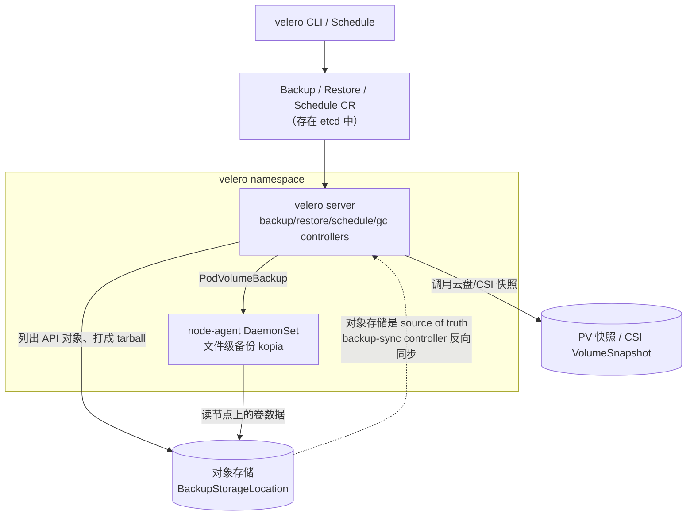
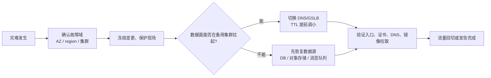

# Kubernetes 控制面灾备与恢复

控制面挂了、etcd 数据没了、证书过期了——这时候真正决定"能不能救回来"的不是架构图，而是三件事：**备份了哪些状态、备份是否可验证、恢复流程是否演练过**。本文回答"数据/控制面丢失后怎么找回来"：备份策略、etcd 快照与恢复、quorum 丢失恢复、全集群重建、Velero、多集群 DR、演练与验证。

不覆盖的内容：怎么设计才不容易挂（见 [控制面高可用方案](./控制面高可用方案.md)）；故障发生时值班人员的处置步骤（见 [控制面事故处理手册](./控制面事故处理手册.md)）。

> **引用约定**：代码链接固定到 2026-11 的本地 checkout commit，格式 `https://github.com/<org>/<repo>/blob/<40-hex>/<path>#Lx-Ly`；文档链接均于 2026-11 逐条 curl 验证为 200。
>
> | 项目 | 版本 | commit |
> |---|---|---|
> | Kubernetes | v1.37.2（kubeadm 默认 etcd 3.7.0-0） | `c50e5395f1ae2d4a2c05f28fdcc38c0916cc1a32` |
> | etcd | v3.7.4 | `2e8a5c99e4982c8d4c521be15364ea4c5c68a489` |
> | Velero | v1.18.4 | `4ee1e79a7aed367fd9b767b8219ec65bd0c96892` |
> | Cluster API | v1.14.4 | `4356c154f4a76b8939748ef7ebc2d0793ffe47e8` |

---

## 1. 先分清：备份、容灾、高可用与 RPO/RTO

| 概念 | 回答的问题 | 典型手段 | 本文/他文位置 |
| --- | --- | --- | --- |
| **高可用 HA** | 坏一台时怎么**不停服** | 多副本、quorum、LB/VIP、选主 | [控制面高可用方案](./控制面高可用方案.md) |
| **备份 Backup** | 数据没了，怎么**回到过去的某个点** | etcd 快照、对象存储、Velero | 本文第 3、4、7 节 |
| **容灾 DR** | 整个故障域（AZ/region/集群）没了，怎么**恢复服务** | 异地备份、多集群、DNS 切换 | 本文第 6、8 节 |
| **灾备体系** | 上面这些能不能**真的生效** | 校验、演练、RTO 测量、game day | 本文第 9 节 |
| **RPO** | 最坏能容忍丢多少数据 | 由备份频率决定（etcd 快照间隔、Velero schedule） | 第 3 节 |
| **RTO** | 最坏要多久恢复服务 | 由恢复流程 + 演练熟练度决定，不是由工具决定 | 第 9 节 |

控制面灾备有三个特殊性，决定了它和"备份一个数据库"不一样：

1. **所有 API 对象只存在于 etcd**。官方文档明确：所有 Kubernetes 对象都存储在 etcd 中，丢失全部控制面节点时快照文件包含全部集群状态与关键信息（[Operating etcd clusters for Kubernetes](https://kubernetes.io/docs/tasks/administer-cluster/configure-upgrade-etcd/)）。etcd 是关键路径上唯一的持久状态。
2. **PKI 不能从数据重建**。`kubeadm` 生成的 CA 私钥（`ca.key`、`front-proxy-ca.key`、`etcd/ca.key`）和 `sa.key` 只存在于控制面节点磁盘上；如果丢失，即使 etcd 数据完好，所有组件身份也需要重新签发。CA 与叶子证书的有效期分别是 10 年 / 1 年，见 `constants.go`（[kubeadm/constants.go#L47-L50](https://github.com/kubernetes/kubernetes/blob/c50e5395f1ae2d4a2c05f28fdcc38c0916cc1a32/cmd/kubeadm/app/constants/constants.go#L47-L50)）。
3. **apiserver 是无状态的，所以"重建出来即可"**。真正不可再生的是 etcd 数据 + PKI + 外部依赖配置。这也是为什么"全集群重建"是可行的兜底方案（第 6 节），但**不能**替代 etcd 数据恢复。

控制面全挂时数据面并不会立刻停：官方文档说明，多数 etcd 成员永久失效时 Kubernetes 无法做变更，"the scheduled pods might continue to run, no new pods can be scheduled"（[configure-upgrade-etcd](https://kubernetes.io/docs/tasks/administer-cluster/configure-upgrade-etcd/)）。已调度的 Pod 由 kubelet 继续维持，但没有新的调度与 reconcile。这意味着控制面故障不必然立即造成业务中断，但**控制面 RTO 必须显著小于业务 RTO**——恢复控制面本身会吃掉业务的停机窗口，之后还要留出数据校验与流量回切的时间。

## 2. 保护对象清单

灾备最容易犯的错是"只备份 etcd"，而 etcd 快照只覆盖下表第 5、6 行。逐项确认：

| # | 对象 | 存放位置（kubeadm 默认） | 丢失后果 | 备份方式 | 验证方式 |
| --- | --- | --- | --- | --- | --- |
| 1 | **etcd 数据** | 各控制面 `/var/lib/etcd`（`DefaultEtcdDataDir`，[defaults.go#L50-L51](https://github.com/kubernetes/kubernetes/blob/c50e5395f1ae2d4a2c05f28fdcc38c0916cc1a32/cmd/kubeadm/app/apis/kubeadm/v1beta4/defaults.go#L50-L51)） | 所有 API 对象消失，集群等于空集群 | `etcdctl snapshot save` + 异地对象存储；见第 3、4 节 | `etcdutl snapshot status`、定期 restore drill |
| 2 | **PKI：CA 与证书** | `/etc/kubernetes/pki/` | 无法签发新证书；CA 私钥丢失则全部组件身份需重建 | 离线拷贝 + 加密归档，定期 `kubeadm certs check-expiration` | 时间戳/哈希比对、校验 `ca.crt` 能验签现有 `apiserver.crt` |
| 3 | **`sa.key` / `sa.pub`** | `/etc/kubernetes/pki/sa.key` | ServiceAccount token 的签名/验证密钥丢失，旧 token 全部失效 | 与 PKI 一起离线备份 | 恢复后签发一个新 token 并用它访问 apiserver |
| 4 | **加密配置与 KMS 密钥** | apiserver `--encryption-provider-config` 指向的文件（如 `/etc/kubernetes/enc/encryption-config.yaml`） | 丢失配置无法解密 etcd 中已加密的 Secret；KMS 主密钥丢失更不可恢复 | 配置入库 + KMS 密钥由 KMS/HSM 自身容灾；快照与密钥分开存放 | 用恢复出的 etcd 数据 + 配置解密一个 Secret |
| 5 | **Kubernetes 对象（内置 + CRD）** | etcd | CRD/Namespace/RBAC/工作负载定义全丢 | 包含在 etcd 快照中；或 Velero | `kubectl get crd`、`kubectl api-resources` 计数比对 |
| 6 | **RBAC 对象** | etcd（见 [rbac](./rbac.md)） | 鉴权全失效/权限漂移 | etcd 快照或 Velero | `kubectl auth can-i --list` 抽查 |
| 7 | **kubeconfig** | `/etc/kubernetes/admin.conf`、`kubelet.conf`、`controller-manager.conf`、`scheduler.conf` | 管理员与组件无法连接 apiserver | 与 PKI 一起离线备份 | 用备份 kubeconfig 访问恢复后的集群 |
| 8 | **static pod manifests 与 kubeadm 配置** | `/etc/kubernetes/manifests/*.yaml`；`kube-system/kubeadm-config` ConfigMap | 无法按原参数重建控制面；`kubeadm upgrade` 会写回旧 dataDir 等错误配置 | 拷贝 manifests 目录 + `kubectl get cm -n kube-system kubeadm-config -oyaml` | 与 `kubeadm-config` 中的 `ClusterConfiguration` 交叉比对 |
| 9 | **PV 数据** | 云盘 / 本地盘 / CSI 存储 | 有状态业务数据丢失，且**不在 etcd 快照里** | 存储层快照、Velero CSI snapshot 或文件级备份 | 恢复后实际读业务数据，而非只看 PVC Bound |
| 10 | **外部依赖** | 镜像仓库、私有 Registry 凭据、DNS 记录、LB/VIP 配置、云 IAM、KMS | 集群恢复了也拉不到镜像/解析不了域名/拿不到云资源 | IaC 代码化 + 凭据管理系统 | 从零环境重建一次并跑通 |
| 11 | **IaC / GitOps 源** | Git 仓库（Terraform/Crossplane/Argo CD/Flux） | 无法重建集群与工作负载 | Git 远端多副本、定期可用性检查 | 在空环境执行一次 apply/sync |

> 结论：**etcd 快照是"Kubernetes 对象"的备份，不是"集群"的备份**。快照内容覆盖第 5、6 行；第 1 行是快照机制本身要保护的对象；第 2-4、7-11 行都在 etcd 之外，必须单独覆盖。

## 3. 备份策略：从 RPO 倒推

### 3.1 频率、保留与容量

RPO 决定快照间隔，RTO 决定保留与恢复策略。下面是经验值（不是官方硬性要求），需要按集群 etcd 大小与变更率调整：

| RPO 目标 | etcd 快照频率 | 保留 | 说明 |
| --- | --- | --- | --- |
| 24h | 每日 1 次 | 30 天 | 多数内部平台起点；灾难时平均丢半天数据 |
| 1h | 每小时 | 7 天 + 每日 30 天 | 变更频繁或承载关键元数据 |
| 5-15min | 每 5-15 分钟 | 24-72h 高频 + 长期日备 | 快照文件大、上传带宽是瓶颈时慎用 |

容量与成本：快照大小约等于该成员 bbolt backend 大小，可用 `endpoint status` 的 `DbSize` 观察，用 `etcdutl snapshot status` 的 `TOTAL SIZE` 验证（`Status` 结构见 [etcdutl/snapshot/v3_snapshot.go#L106-L115](https://github.com/etcd-io/etcd/blob/2e8a5c99e4982c8d4c521be15364ea4c5c68a489/etcdutl/snapshot/v3_snapshot.go#L106-L115)）。etcd 默认空间配额 2GB、官方建议常规环境不超过 8GB（[etcd FAQ](https://etcd.io/docs/v3.7/faq/)），所以单成员快照通常在百 MB 级，真正贵的是保留周期与跨区传输。

**全量还是增量**：etcd 只有全量快照语义。`etcdctl snapshot save` 每次拉取完整的 backend snapshot；不存在"增量快照"。需要增量请用 Velero/存储层快照，二者语义完全不同。

### 3.2 一致性：快照里有什么、没有什么

- `etcdctl snapshot save` 只允许**一个 endpoint**，因为它请求的是"被选中成员的某一时刻状态"（[client/v3/snapshot/v3_snapshot.go#L49-L53](https://github.com/etcd-io/etcd/blob/2e8a5c99e4982c8d4c521be15364ea4c5c68a489/client/v3/snapshot/v3_snapshot.go#L49-L53)）；save 走 `Maintenance.Snapshot` 流式 RPC，服务端对 bbolt snapshot 计算 SHA256 一并返回（[api/v3rpc/maintenance.go#L135-L165](https://github.com/etcd-io/etcd/blob/2e8a5c99e4982c8d4c521be15364ea4c5c68a489/server/etcdserver/api/v3rpc/maintenance.go#L135-L165)）。
- 客户端校验文件长度是否为 `512n + sha256.Size` 并 fsync 后原子 rename 成正式文件（[v3_snapshot.go#L96-L123](https://github.com/etcd-io/etcd/blob/2e8a5c99e4982c8d4c521be15364ea4c5c68a489/client/v3/snapshot/v3_snapshot.go#L96-L123)）——所以**不要**手工拷贝正在生成的 `.part` 文件。
- 官方文档提醒：直接复制 `member/snap/db` 可能丢失尚未落入 snapshot、但已在 WAL 里的数据；并且这样得到的文件没有内置 hash，restore 时必须 `--skip-hash-check`（[etcd Disaster recovery](https://etcd.io/docs/v3.7/op-guide/recovery/)）。**优先用 `etcdctl snapshot save`**。
- 快照是"单成员已提交状态"的一致视图，不是跨成员的分布式事务快照；但 Raft 保证已提交状态在各成员上一致，因此任意一个健康成员的快照都可用于恢复。
- 常见误解："快照会阻塞写入"。Kubernetes 文档称创建快照不会影响该成员性能（[configure-upgrade-etcd](https://kubernetes.io/docs/tasks/administer-cluster/configure-upgrade-etcd/)）；实际仍会消耗磁盘 IO 与网络带宽，**经验上**放到低峰期并限速更稳妥。

### 3.3 自动化：CronJob 只是补充，不是主链路

集群内 CronJob 依赖控制面；控制面挂了它就不会跑。**主备份链路应放在集群外**（独立备份机/外部调度器 + 只读 kubeconfig 或直接 SSH/证书访问 etcd）。CronJob 可作为"平时高频短周期"的补充：

```yaml
apiVersion: batch/v1
kind: CronJob
metadata:
  name: etcd-snapshot
  namespace: kube-system
spec:
  schedule: "*/30 * * * *"
  concurrencyPolicy: Forbid
  jobTemplate:
    spec:
      template:
        spec:
          hostNetwork: true          # 访问 127.0.0.1:2379 的 etcd client 端口
          nodeSelector:
            node-role.kubernetes.io/control-plane: ""
          tolerations:
            - key: node-role.kubernetes.io/control-plane
              operator: Exists
              effect: NoSchedule
          restartPolicy: Never
          containers:
            - name: snapshot
              image: registry.k8s.io/etcd:3.7.0-0
              command: ["/bin/sh", "-c"]
              args:
                - |
                  etcdctl --endpoints=https://127.0.0.1:2379 \
                    --cacert=/etc/kubernetes/pki/etcd/ca.crt \
                    --cert=/etc/kubernetes/pki/etcd/server.crt \
                    --key=/etc/kubernetes/pki/etcd/server.key \
                    snapshot save /backup/etcd-$(date +%Y%m%d-%H%M%S).db
              volumeMounts:
                - {name: pki, mountPath: /etc/kubernetes/pki, readOnly: true}
                - {name: out, mountPath: /backup}
          volumes:
            - name: pki
              hostPath: {path: /etc/kubernetes/pki}
            - name: out
              hostPath: {path: /var/backups/etcd, type: DirectoryOrCreate}
```

> [!WARNING]
> 该 Job 写在控制面节点本地盘（hostPath），**不等于异地备份**。必须再由节点上的 agent/rsync/systemd timer 把文件上传到对象存储（开启版本化/对象锁），并监控"最近一次成功上传时间"。

### 3.4 校验：没被恢复过的备份等于没有备份

最低要求三件套：

```bash
# 1) 快照元数据：revision / keys / size / 完整性
etcdutl snapshot status /backup/etcd-20261119-0300.db -w table

# 2) 恢复到临时目录（不启动 etcd），验证能成功 restore + db 可打开
etcdutl snapshot restore /backup/etcd-20261119-0300.db \
  --data-dir /tmp/restore-check --skip-hash-check=false

# 3) 记录并告警：文件大小、revision 是否只增不减、上传是否成功
```

`etcdutl snapshot status` 的完整性检查基于 bbolt `tx.Check()` 与 CRC32，见 [v3_snapshot.go#L118-L150](https://github.com/etcd-io/etcd/blob/2e8a5c99e4982c8d4c521be15364ea4c5c68a489/etcdutl/snapshot/v3_snapshot.go#L118-L150)。

### 3.5 加密、异地与凭据

- 快照是**明文全量数据库**（未启用 at-rest encryption 时），里面包含所有 Secret、ServiceAccount token、证书私钥相关对象。Kubernetes 文档直接建议加密快照文件（[configure-upgrade-etcd](https://kubernetes.io/docs/tasks/administer-cluster/configure-upgrade-etcd/)）。
- 如果启用了 etcd 静态加密：快照里存的是**密文**，恢复后必须用**同一份 encryption config + 同一把密钥**才能读出 Secret；KMS 场景下还需要 KMS 后端可用。这就是为什么第 2 节把"加密配置/KMS 密钥"单列为保护对象。
- 3-2-1 原则：至少 3 份副本、2 种介质、1 份异地；对象存储开启版本化与 Object Lock/不可变窗口，防止勒索软件或误删把备份一起删掉。
- 备份凭据（etcd 客户端证书、对象存储 access key）本身要么短期化、要么由 KMS 托管，**不要**和快照放在同一个桶里。

### 3.6 PKI 备份与"`--upload-certs` 不是备份"

`kubeadm` 生成哪些证书由证书清单决定：根 CA、apiserver、kubelet client、front-proxy CA/client、etcd CA/server/peer/healthcheck/apiclient（[certlist.go#L249-L264](https://github.com/kubernetes/kubernetes/blob/c50e5395f1ae2d4a2c05f28fdcc38c0916cc1a32/cmd/kubeadm/app/phases/certs/certlist.go#L249-L264)）；`sa.key`/`sa.pub` 单独生成，见 [certs.go#L76-L106](https://github.com/kubernetes/kubernetes/blob/c50e5395f1ae2d4a2c05f28fdcc38c0916cc1a32/cmd/kubeadm/app/phases/certs/certs.go#L76-L106)。

`kubeadm init --upload-certs` 把证书加密后放进 `kube-system/kubeadm-certs` Secret（[copycerts.go#L87-L122](https://github.com/kubernetes/kubernetes/blob/c50e5395f1ae2d4a2c05f28fdcc38c0916cc1a32/cmd/kubeadm/app/phases/copycerts/copycerts.go#L87-L122)），但这个 Secret 的生命周期绑定在一个**短期 bootstrap token** 上：token 默认 TTL 2 小时（[constants.go#L271-L273](https://github.com/kubernetes/kubernetes/blob/c50e5395f1ae2d4a2c05f28fdcc38c0916cc1a32/cmd/kubeadm/app/constants/constants.go#L271-L273)），Secret 的 OwnerReference 指向该 token Secret（[copycerts.go#L161-L172](https://github.com/kubernetes/kubernetes/blob/c50e5395f1ae2d4a2c05f28fdcc38c0916cc1a32/cmd/kubeadm/app/phases/copycerts/copycerts.go#L161-L172)）。它存在集群自己的 etcd 里——**集群没了它也没了**，只是"控制面节点扩容时传证书的通道"，不是备份。

一个可执行的控制面"离线状态包"：

```bash
# 在任一控制面节点（或从备份系统）执行，输出加密归档
sudo tar -czf control-plane-state-$(date +%F).tar.gz \
  /etc/kubernetes/pki \
  /etc/kubernetes/*.conf \
  /etc/kubernetes/manifests \
  /etc/kubernetes/encryption-config.yaml 2>/dev/null

# 集群侧配置：ClusterConfiguration（重建/升级都依赖它）
kubectl -n kube-system get cm kubeadm-config -oyaml > kubeadm-config.yaml
kubectl -n kube-system get cm kubelet-config -oyaml > kubelet-config.yaml

# 归档加密后异地保存（示例，密钥由 KMS/离线保管）
age -r <recipient> -o control-plane-state.tar.gz.age control-plane-state.tar.gz
```

证书不能等过期才想起来：`kubeadm certs check-expiration` 会读取本地 PKI 并列出到期时间与剩余天数，源码见 [certs.go#L430-L484](https://github.com/kubernetes/kubernetes/blob/c50e5395f1ae2d4a2c05f28fdcc38c0916cc1a32/cmd/kubeadm/app/cmd/certs.go#L430-L484)；续期后必须重启对应组件（官方文档：[Certificate Management with kubeadm](https://kubernetes.io/docs/tasks/administer-cluster/kubeadm/kubeadm-certs/)）。

## 4. etcd 快照原理与恢复

### 4.1 从 save 到 restore 的语义

`etcdctl snapshot save` 的代码路径很短：解析单 endpoint、`snapshot.SaveWithVersion` 流式落盘、打印 `Snapshot saved at ...`（[snapshot_command.go#L61-L98](https://github.com/etcd-io/etcd/blob/2e8a5c99e4982c8d4c521be15364ea4c5c68a489/etcdctl/ctlv3/command/snapshot_command.go#L61-L98)）。注意 v3.7 的 `etcdctl snapshot` 只剩 `save` 子命令，`status` 已由 `etcdutl` 接管（同一文件只注册了 `NewSnapshotSaveCommand`，见 [snapshot_command.go#L50-L59](https://github.com/etcd-io/etcd/blob/2e8a5c99e4982c8d4c521be15364ea4c5c68a489/etcdctl/ctlv3/command/snapshot_command.go#L50-L59)）。

`etcdutl snapshot restore` 做的事和"把文件拷回去"完全不同（[v3_snapshot.go#L257-L330](https://github.com/etcd-io/etcd/blob/2e8a5c99e4982c8d4c521be15364ea4c5c68a489/etcdutl/snapshot/v3_snapshot.go#L257-L330)）：

1. 用 `--initial-cluster` / `--initial-cluster-token` 构造**一个新的逻辑集群**，`--name` 与 `--initial-advertise-peer-urls` 定义本成员身份；
2. 输出目录必须不存在或为空，否则直接报错（避免误覆盖）；
3. 把快照 db 复制到新 data dir 的 `member/snap/db`，并**调用 `TrimMembershipFromBackend` 清空快照中的成员信息**（[membership.go#L124-L150](https://github.com/etcd-io/etcd/blob/2e8a5c99e4982c8d4c521be15364ea4c5c68a489/server/storage/schema/membership.go#L124-L150)），因此恢复后的成员 ID/cluster ID 全部是新的，旧成员无法"错接"进来；
4. 可选 `--bump-revision N --mark-compacted` 抬高 revision 并标记已压缩（[RestoreConfig 字段语义](https://github.com/etcd-io/etcd/blob/2e8a5c99e4982c8d4c521be15364ea4c5c68a489/etcdutl/snapshot/v3_snapshot.go#L245-L254)）。

**为什么 Kubernetes 场景要 bump revision**：快照是旧时间点，client/informer 的本地缓存可能比快照新。恢复后 revision 回退会让 watch 语义错乱；官方 etcd 文档强烈建议 Kubernetes 场景使用 `--bump-revision` + `--mark-compacted`，让所有 watch 终止、客户端重新 list（[etcd Disaster recovery](https://etcd.io/docs/v3.7/op-guide/recovery/)）。

`--skip-hash-check` 只在快照来自"直接复制 data 目录"时使用；`snapshot save` 生成的快照自带 SHA256，restore 默认校验。版本兼容性：可以从同一 `major.minor` 的快照恢复，也支持不同 patch 版本之间恢复（[configure-upgrade-etcd](https://kubernetes.io/docs/tasks/administer-cluster/configure-upgrade-etcd/)）。

### 4.2 stacked etcd 恢复：多成员完整流程

先明确 kubeadm 的默认布局：etcd 以 static pod 运行，数据目录挂在 `/var/lib/etcd`，命令行参数由 `getEtcdCommand` 生成（`--data-dir`、`--initial-cluster`、`--initial-cluster-state` 等，见 [local.go#L242-L285](https://github.com/kubernetes/kubernetes/blob/c50e5395f1ae2d4a2c05f28fdcc38c0916cc1a32/cmd/kubeadm/app/phases/etcd/local.go#L242-L285)）；代码注释还说明 `--initial-cluster` 只在首次 init 时生效，集群已在运行时无影响（[local.go#L54-L57](https://github.com/kubernetes/kubernetes/blob/c50e5395f1ae2d4a2c05f28fdcc38c0916cc1a32/cmd/kubeadm/app/phases/etcd/local.go#L54-L57)）。

> [!WARNING]
> 恢复前必须**停掉所有 kube-apiserver**（以及 kube-controller-manager/kube-scheduler），否则恢复期间的写入会造成 revision 回退后的持续不一致。官方文档的原话是：stop **all** API server instances → restore state in all etcd instances → restart all API server instances（[configure-upgrade-etcd](https://kubernetes.io/docs/tasks/administer-cluster/configure-upgrade-etcd/)）。

**步骤 0：准备**

- 选一个与目标 etcd `major.minor` 匹配的 `etcdutl` 二进制（kubeadm 默认 etcd 3.7.0-0，见 [constants.go#L329-L330](https://github.com/kubernetes/kubernetes/blob/c50e5395f1ae2d4a2c05f28fdcc38c0916cc1a32/cmd/kubeadm/app/constants/constants.go#L329-L330)）；容器内使用 `registry.k8s.io/etcd:3.7.0-0` 自带的 `/usr/local/bin/etcdutl` 也可以。
- 确认快照可用：`etcdutl snapshot status <file>`。
- 记录原集群成员与 peer URL：`etcdctl member list -w table`（如果集群还能读）。
- **尽力保留现场**：`sudo mv /var/lib/etcd /var/lib/etcd.broken`（别直接删，取证/兜底可能用到）。

**步骤 1：停控制面组件（每台控制面执行）**

```bash
sudo mkdir -p /tmp/manifests-backup
sudo mv /etc/kubernetes/manifests/*.yaml /tmp/manifests-backup/
# kubelet 感知 manifest 消失后会停止 static pods；确认已退出
sudo crictl ps | grep -E 'etcd|kube-apiserver|kube-controller-manager|kube-scheduler'
```

**步骤 2：每个成员 restore 同一份快照（在各自节点执行）**

```bash
# 以 c1=10.0.0.11 / c2=10.0.0.12 / c3=10.0.0.13 为例
SNAP=/backup/etcd-20261119-0300.db
ALL="c1=https://10.0.0.11:2380,c2=https://10.0.0.12:2380,c3=https://10.0.0.13:2380"

# 在 c1 上：
sudo etcdutl snapshot restore "$SNAP" \
  --name c1 \
  --initial-cluster "$ALL" \
  --initial-cluster-token k8s-etcd-cluster \
  --initial-advertise-peer-urls https://10.0.0.11:2380 \
  --bump-revision 1000000000 \
  --mark-compacted \
  --data-dir /var/lib/etcd-restored

# 在 c2 / c3 上同理，只改 --name 和 --initial-advertise-peer-urls
```

要点：

- **所有成员必须用同一份快照**，且 `--initial-cluster` 完全一致、`--initial-cluster-token` 一致，否则会形成互相不认的集群（[etcd Disaster recovery](https://etcd.io/docs/v3.7/op-guide/recovery/)）。
- `--name` 必须等于该节点 static pod 的 `--name`（kubeadm 用 nodeName）；`--initial-advertise-peer-urls` 必须等于 manifest 中的 `--initial-advertise-peer-urls`。恢复后的成员身份以 restore 参数为准，manifest 里旧的 `--initial-cluster` 在已有 data dir 时不再起作用（[local.go#L54-L57](https://github.com/kubernetes/kubernetes/blob/c50e5395f1ae2d4a2c05f28fdcc38c0916cc1a32/cmd/kubeadm/app/phases/etcd/local.go#L54-L57)）。
- `--data-dir` 必须为空/不存在。恢复完成后替换：

```bash
sudo mv /var/lib/etcd-restored /var/lib/etcd    # 若步骤 0 保留了 .broken 目录
```

**步骤 3：先只恢复 etcd，再恢复其他控制面组件**

```bash
# 只把 etcd.yaml 放回去
sudo mv /tmp/manifests-backup/etcd.yaml /etc/kubernetes/manifests/
# 等待所有成员就绪（每台控制面本机验证；也可指定其它成员 endpoint）
for ep in 10.0.0.11 10.0.0.12 10.0.0.13; do
  etcdctl --endpoints "https://$ep:2379" \
    --cacert=/etc/kubernetes/pki/etcd/ca.crt \
    --cert=/etc/kubernetes/pki/etcd/server.crt \
    --key=/etc/kubernetes/pki/etcd/server.key \
    endpoint health
done
etcdctl --endpoints https://127.0.0.1:2379 \
  --cacert=/etc/kubernetes/pki/etcd/ca.crt \
  --cert=/etc/kubernetes/pki/etcd/server.crt \
  --key=/etc/kubernetes/pki/etcd/server.key \
  member list -w table
```

此时应是 3 个 voting member、都有 leader、revision 已被 bump 过。

**步骤 4：恢复其余 static pods**

```bash
sudo mv /tmp/manifests-backup/*.yaml /etc/kubernetes/manifests/
# 观察 apiserver/controller-manager/scheduler 是否 Ready
kubectl get pods -n kube-system -o wide
kubectl get --raw /readyz?verbose
```

**步骤 5：数据面与状态核对**

- kubelet 会自动重连 apiserver；Node 对象若在快照之后才注册，kubelet 通常会重新注册（Node 缺失时 kubelet 可自行创建）。
- 若快照时间点晚于某些节点注册时间，旧节点可能需要 `kubeadm join` 重新加入；先看 `kubectl get nodes`。
- 核对：`kubectl get ns`、`kubectl get crd | wc -l`、关键 Operator 的 CR、以及业务 Pod 是否仍在运行（restore 不重启数据面容器）。

**kubeadm 特有注意点**：如果你把数据目录换到了新路径，除了改 etcd static pod manifest 的 `hostPath`，还要同步修改 `kube-system/kubeadm-config` 里的 `etcd.local.dataDir`，否则下一次 `kubeadm upgrade` 会把 manifest 写回旧目录（[configure-upgrade-etcd](https://kubernetes.io/docs/tasks/administer-cluster/configure-upgrade-etcd/)）。

### 4.3 external etcd 的差异

| 维度 | stacked etcd | external etcd |
| --- | --- | --- |
| 备份对象 | 控制面节点上的 `/var/lib/etcd` 成员 | 独立 etcd 集群成员 |
| 恢复时停什么 | 全部控制面 static pods + 全部 etcd 成员 | 只停 etcd 集群 + 所有 apiserver；控制面其它组件可留 |
| 恢复后 apiserver 配置 | 通常不变 | 若 endpoints/IP 变化，需改 `--etcd-servers` 或 LB 配置 |
| 成员管理 | kubeadm 自动 `member add` + learner promote（[etcd.go#L438-L444](https://github.com/kubernetes/kubernetes/blob/c50e5395f1ae2d4a2c05f28fdcc38c0916cc1a32/cmd/kubeadm/app/util/etcd/etcd.go#L438-L444)、[MemberPromote](https://github.com/kubernetes/kubernetes/blob/c50e5395f1ae2d4a2c05f28fdcc38c0916cc1a32/cmd/kubeadm/app/util/etcd/etcd.go#L580-L620)） | 手工 `etcdctl member add/remove` |
| 故障耦合 | 一台节点同时损失 etcd 成员 + apiserver | 故障域解耦，但主机数翻倍 |

external etcd 的 restore 命令、快照语义与 4.2 完全一致，只是"在 etcd 节点的数据目录上做"，不涉及 static pod manifests。

### 4.4 澄清：v1.37 的 kubeadm 没有 `kubeadm etcd restore`

kubeadm 顶层子命令只有 certs/completion/config/init/join/reset/version/token/upgrade/alpha/kubeconfig（[cmd.go#L83-L94](https://github.com/kubernetes/kubernetes/blob/c50e5395f1ae2d4a2c05f28fdcc38c0916cc1a32/cmd/kubeadm/app/cmd/cmd.go#L83-L94)）。etcd 相关能力是 init 的一个 phase：`kubeadm init phase etcd local`，只负责生成 etcd static pod manifest（[phases/init/etcd.go#L36-L65](https://github.com/kubernetes/kubernetes/blob/c50e5395f1ae2d4a2c05f28fdcc38c0916cc1a32/cmd/kubeadm/app/cmd/phases/init/etcd.go#L36-L65)）。**没有** `kubeadm etcd` 子命令，也没有内置 restore；恢复要靠 `etcdctl`/`etcdutl` + 手工编排 static pod manifests，如 4.2。

`--skip-phases` 是存在的（[runner.go#L426](https://github.com/kubernetes/kubernetes/blob/c50e5395f1ae2d4a2c05f28fdcc38c0916cc1a32/cmd/kubeadm/app/cmd/phases/workflow/runner.go#L426)），重建时可用 `kubeadm init --skip-phases=...` 精确控制执行到哪一步，但它不提供"恢复数据"能力。

## 5. quorum 丢失恢复

### 5.1 确认是否真的丢了 quorum

先算清容忍度：n 个成员 quorum 为 `(n/2)+1`，3 成员容忍 1 台永久故障、5 成员容忍 2 台；偶数成员不增加容错（[etcd FAQ](https://etcd.io/docs/v3.7/faq/)）。etcd 恢复文档的表述是 `(N-1)/2` 永久故障容忍度（[etcd Disaster recovery](https://etcd.io/docs/v3.7/op-guide/recovery/)）。

```bash
# 能连上的成员逐个看：有 leader 吗？报 no leader / request timed out 就是疑似 quorum 丢失
ETCDCTL="etcdctl --endpoints https://10.0.0.11:2379,https://10.0.0.12:2379,https://10.0.0.13:2379 \
  --cacert=/etc/kubernetes/pki/etcd/ca.crt \
  --cert=/etc/kubernetes/pki/etcd/server.crt \
  --key=/etc/kubernetes/pki/etcd/server.key"
$ETCDCTL endpoint status -w table
$ETCDCTL member list -w table

# 集群健康检查（kubeadm 内部也用它判断成员是否可加入）
kubectl get --raw /healthz   # apiserver 视角
```

判据：多数成员永久失效（机器没了/磁盘坏了且无法修复），而不是"网络抖动导致暂时失去多数派"。**网络分区恢复后 etcd 会自动恢复 quorum**（[etcd FAQ](https://etcd.io/docs/v3.7/faq/)），不要急着重做集群。

### 5.2 两条恢复路径

**路径 A：从快照 restore 一个新集群（优先）**

适用：有可用快照；能接受数据回退到快照时间点。流程就是 4.2 的恢复流程——restore 会创建一个全新集群并清空旧成员信息（第 4.1 节），所以它本质上也是"quorum 丢失后的标准恢复"。

**路径 B：`--force-new-cluster`（保留最新数据，单人重建）**

etcd 仍保留 `--force-new-cluster` 标志（[server/embed/config.go#L768](https://github.com/etcd-io/etcd/blob/2e8a5c99e4982c8d4c521be15364ea4c5c68a489/server/embed/config.go#L768)），语义是"用一个成员的数据强制重建单成员集群"。实现上会丢弃未提交的 Raft entries，并把 commit index 调整为 `max(HardState.Commit, consistent_index)` 以避免丢失已提交但未落盘索引的条目（[bootstrap.go#L586-L640](https://github.com/etcd-io/etcd/blob/2e8a5c99e4982c8d4c521be15364ea4c5c68a489/server/etcdserver/bootstrap.go#L586-L640)）。

```bash
# 前提：其他 etcd 成员和所有 apiserver 已停止
# 1) 选数据最新的成员，在其 static pod manifest 的 etcd 命令中加 --force-new-cluster
#    修改 /etc/kubernetes/manifests/etcd.yaml 后 kubelet 会自动重建该 pod
# 2) 等待其成为单成员集群的 leader
etcdctl --endpoints https://127.0.0.1:2379 \
  --cacert=/etc/kubernetes/pki/etcd/ca.crt \
  --cert=/etc/kubernetes/pki/etcd/server.crt \
  --key=/etc/kubernetes/pki/etcd/server.key \
  endpoint health
etcdctl --endpoints https://127.0.0.1:2379 \
  --cacert=/etc/kubernetes/pki/etcd/ca.crt \
  --cert=/etc/kubernetes/pki/etcd/server.crt \
  --key=/etc/kubernetes/pki/etcd/server.key \
  member list -w table

# 3) 恢复 3 成员：旧成员先 kubeadm reset 清空本地 etcd 数据与 manifests，
#    再执行 kubeadm join --control-plane；kubeadm 会先 AddMemberAsLearner 再 promote。
```

`kubeadm reset` 的 `remove-etcd-member` phase 会先摘除成员、再删除 etcd data dir（[removeetcdmember.go#L54-L91](https://github.com/kubernetes/kubernetes/blob/c50e5395f1ae2d4a2c05f28fdcc38c0916cc1a32/cmd/kubeadm/app/cmd/phases/reset/removeetcdmember.go#L54-L91)）——所以在做数据抢救时**不要**随手 reset 一台你还没确认的节点。

> [!WARNING]
> etcd 官方文档明确：`--force-new-cluster` **strongly discouraged**，如果旧集群其它成员还活着可能 panic（[etcd Disaster recovery](https://etcd.io/docs/v3.7/op-guide/recovery/)）。另外 etcd 3.6+ 成员关系以 v3store 为准，历史上（v3.5 及更早）`--force-new-cluster` 与旧版 `etcdctl snapshot restore` 都可能留下"僵尸成员"，从老版本数据恢复时要特别核对 `member list`；细节见 [Avoiding Zombie Cluster Members When Upgrading to etcd v3.6](https://kubernetes.io/blog/2025/12/21/preventing-etcd-zombies/)。恢复后务必确认 `member list` 只有预期成员。

### 5.3 两条路径对比

| 维度 | 路径 A：快照 restore | 路径 B：`--force-new-cluster` |
| --- | --- | --- |
| 数据完整性 | 回到快照时间点，快照之后的写入**永久丢失** | 保留该成员本地最新已提交数据（可能仍少于原集群多数派最新值） |
| 前提 | 有可校验快照；不要求任何原成员存活 | 至少一个成员数据目录**完好**；其它成员必须停机 |
| 数据一致性 | 由快照保证，干净的新集群 | 依赖该成员数据正确；磁盘损坏时不可用 |
| 主要风险 | 数据回退；忘停 apiserver 导致缓存/写入混乱 | 官方不推荐；旧成员复活可 panic；僵尸成员；revision 回退未处理 |
| revision 回退处理 | 显式 `--bump-revision --mark-compacted` | 无内建处理，需自行评估 client/informer 后果 |
| 后续 | 所有成员按 `--initial-cluster` 一起启动 | 单成员先起，再逐个扩容 |
| 适用 | 常规灾备、跨机重建 | 没有可用快照但单成员磁盘完好时的"抢数据" |

**共同点**：两条路径都要求 apiserver 全部停掉后再启动；路径 A 的 revision 一定回退到快照点（因此要显式 bump），路径 B 的 revision 不回退但数据可能落后于原集群多数派。恢复后都必须重启所有控制面组件（官方还建议重启 kubelet，避免依赖陈旧状态，见 [configure-upgrade-etcd](https://kubernetes.io/docs/tasks/administer-cluster/configure-upgrade-etcd/)）。

### 5.4 恢复后让节点与 apiserver 回来

1. **apiserver**：static pod 由 kubelet 拉起即可；若原 apiserver 证书/CA 未变，无需重新签发。
2. **Node**：kubelet 会重连；若 Node 对象在快照中缺失，kubelet 会重新注册 Node。若 kubelet 证书过期或被拒，需要重新签发/重新 join。
3. **新增/重装控制面节点**：worker 用 `kubeadm token create --print-join-command`；control-plane 用 `kubeadm join --control-plane`（带证书或 `--certificate-key`）。
4. **旧 etcd 数据目录**：确认新集群稳定后再清理 `*.broken` 目录，避免误删唯一可取证副本。

## 6. 全集群重建与迁移

当 etcd 快照不可用、或安全事件要求重建、或迁移到新基础设施时，"重建"是兜底方案。重建的前提是第 2 节表格中的 8-11 行（manifests、PV、外部依赖、IaC/GitOps 源）都有备份；若要保留原有身份（不让节点/客户端重新认证），还需要第 2 行的 PKI。

### 6.1 重建 vs 恢复

| 场景 | 是否需要 etcd 数据 | 主要工作 |
| --- | --- | --- |
| 控制面节点全损，etcd 数据在 | 需要（restore） | 换机器 + restore + 重新 join（第 4 节） |
| etcd 数据损坏/被勒索 | 不需要（重建） | 新集群 + IaC + GitOps 重新 apply + 恢复 PV |
| 迁移到新 region/云 | 可选 | 新集群 + 数据迁移（Velero/存储层复制） |
| 安全事件（CA 泄露） | 不需要，且必须换 CA | 全新 PKI + 重建 |

### 6.2 用 kubeadm 重建控制面

- **保留 PKI 重建**：把备份的 `/etc/kubernetes/pki` 和 `*.conf` 放回新节点的 `/etc/kubernetes/`，kubeadm 检测到已有 CA 就不会覆盖（官方文档："If a given certificate and private key pair exists before running kubeadm init, kubeadm does not overwrite them"，[Certificate Management with kubeadm](https://kubernetes.io/docs/tasks/administer-cluster/kubeadm/kubeadm-certs/)）。
- **external etcd 场景**：`ClusterConfiguration.etcd.external` 指向已恢复的 etcd 集群，kubeadm 不会生成本地 etcd static pod（[local.go#L58-L60](https://github.com/kubernetes/kubernetes/blob/c50e5395f1ae2d4a2c05f28fdcc38c0916cc1a32/cmd/kubeadm/app/phases/etcd/local.go#L58-L60)），apiserver 直接连上带完整数据的 etcd——这是"重建控制面但保留数据"最干净的路径。
- **配置来源**：`kube-system/kubeadm-config` ConfigMap 由 `kubeadm init phase upload-config` 写入 ClusterConfiguration（[uploadconfig.go#L42-L75](https://github.com/kubernetes/kubernetes/blob/c50e5395f1ae2d4a2c05f28fdcc38c0916cc1a32/cmd/kubeadm/app/phases/uploadconfig/uploadconfig.go#L42-L75)）；重建时用备份的 ConfigMap 或自己的 `kubeadm.yaml`，不要凭记忆手敲参数。
- **升级时 kubeadm 会顺手备份，但那不是灾备**：`kubeadm upgrade` 会在控制面节点生成带时间戳的 `kubeadm-backup-etcd-*` / `kubeadm-backup-manifests-*` 目录（[staticpods.go#L99-L115](https://github.com/kubernetes/kubernetes/blob/c50e5395f1ae2d4a2c05f28fdcc38c0916cc1a32/cmd/kubeadm/app/phases/upgrade/staticpods.go#L99-L115)），只用于升级回滚，既没有异地副本也没有校验，不能替代第 3 节的快照链路。
- 用 `--skip-phases` 可以对"只想重跑某些 phase"的场景做精确控制（[runner.go#L426](https://github.com/kubernetes/kubernetes/blob/c50e5395f1ae2d4a2c05f28fdcc38c0916cc1a32/cmd/kubeadm/app/cmd/phases/workflow/runner.go#L426)）。

### 6.3 Cluster API：`clusterctl move` / pivot

管理集群本身也是控制面：当承载 Cluster API 的管理集群要迁移/重建时，用 `clusterctl move` 把 Cluster/MachineDeployment 等对象 pivot 到新管理集群（[clusterctl move 文档](https://cluster-api.sigs.k8s.io/clusterctl/commands/move.html)）。

```bash
clusterctl move --to-kubeconfig=target-kubeconfig.yaml
# 也可以先落盘再恢复（不是备份方案，只是同一套 move 逻辑的另一种用法）
clusterctl move --to-directory /backup/capi-objects
clusterctl move --from-directory /backup/capi-objects --to-kubeconfig=target-kubeconfig.yaml
```

实现入口在 [move.go#L56-L104](https://github.com/kubernetes-sigs/cluster-api/blob/4356c154f4a76b8939748ef7ebc2d0793ffe47e8/cmd/clusterctl/client/move.go#L56-L104)（校验参数、选择 from/to 目录或 kubeconfig）与 [mover.go#L75-L105](https://github.com/kubernetes-sigs/cluster-api/blob/4356c154f4a76b8939748ef7ebc2d0793ffe47e8/cmd/clusterctl/client/cluster/mover.go#L75-L105)（对象图移动）；CLI flags 见 [cmd/move.go#L77-L96](https://github.com/kubernetes-sigs/cluster-api/blob/4356c154f4a76b8939748ef7ebc2d0793ffe47e8/cmd/clusterctl/cmd/move.go#L77-L96)。

> [!WARNING]
> 官方文档明确 `clusterctl move` **不是 backup/restore 方案**：它假设 move 期间集群稳定，升级/扩缩容/修复中的竞态从未被验证；而且**所有对象的 Status 子资源都不恢复**。原先的 `clusterctl backup/restore` 命令已因此被移除（[clusterctl move 文档](https://cluster-api.sigs.k8s.io/clusterctl/commands/move.html)）。把 move 当成"管理集群灾备"时要额外备份 Status 可重建性依赖的外部状态。

### 6.4 恢复顺序清单

无论用 Velero 还是 GitOps 重建，顺序错了会出现"CRD 不存在 → CR 被丢弃 → Controller 起不来"的死循环：

1. **CRD / APIService / 聚合层组件**（先装 CRD，再装依赖它们的 Operator）
2. **Namespace、ServiceAccount、RBAC、NetworkPolicy、Quota**
3. **Secret/ConfigMap**（含镜像拉取凭据、TLS 证书）
4. **StorageClass / PV / PVC**（先恢复 PV 数据，再创建工作负载）
5. **基础组件**：CNI、CoreDNS、Ingress、cert-manager、metrics-server
6. **业务工作负载**（Deployment/StatefulSet/Job），StatefulSet 要等 PV 数据就绪
7. **验证**：见第 9 节清单

## 7. Velero：对象级备份与恢复

Velero 解决的是"Kubernetes 对象 + PV 数据"的备份恢复与迁移，**不是 etcd 级灾备**。两者互补而非替代（对比见 7.5）。

### 7.1 架构



关键事实：Backup/Restore 本身是 CRD，CR 存在**集群 etcd 里**；但 Velero 把对象存储当作 source of truth，会持续把对象存储里格式正确的备份同步回 Kubernetes API（[How Velero Works](https://velero.io/docs/v1.18/how-velero-works/)）。这带来一个重要推论：**集群重建后装回 Velero 并指向同一个 bucket，备份记录会被自动同步回来**，然后就能 restore——这是 Velero 能在"集群全丢"场景工作的原因。

### 7.2 备份与恢复流程（源码位置）

1. 用户创建 `Backup` CR；`backupReconciler.Reconcile` 处理 `ReadyToStart` 阶段（[backup_controller.go#L254-L300](https://github.com/velero-io/velero/blob/4ee1e79a7aed367fd9b767b8219ec65bd0c96892/pkg/controller/backup_controller.go#L254-L300)）。
2. `runBackup` 设置 plugin manager、检查对象存储中是否已存在同名备份，然后调用 `Backupper.BackupWithResolvers` 遍历 API 资源（[backup_controller.go#L733-L800](https://github.com/velero-io/velero/blob/4ee1e79a7aed367fd9b767b8219ec65bd0c96892/pkg/controller/backup_controller.go#L733-L800)）。
3. 对象写入 tarball，PV 走云盘快照/CSI snapshot，或由 node-agent 做文件级备份；最后上传对象存储并更新 Backup 状态。
4. 恢复时 `runValidatedRestore` 拉取备份、准备 restore actions 与卷快照信息（[restore_controller.go#L514-L560](https://github.com/velero-io/velero/blob/4ee1e79a7aed367fd9b767b8219ec65bd0c96892/pkg/controller/restore_controller.go#L514-L560)），随后按资源优先级逐项 restore；资源排序由 `getOrderedResources` 实现（高优先级在前、其余按字母序，[restore.go#L688-L710](https://github.com/velero-io/velero/blob/4ee1e79a7aed367fd9b767b8219ec65bd0c96892/pkg/restore/restore.go#L688-L710)）。
5. restore 会重置对象元数据（UID/resourceVersion 等）并**不恢复 Status**（`resetMetadata`/`resetStatus`，[restore.go#L2416-L2449](https://github.com/velero-io/velero/blob/4ee1e79a7aed367fd9b767b8219ec65bd0c96892/pkg/restore/restore.go#L2416-L2449)）。

### 7.3 PV 数据的两条路

| 方式 | 机制 | 适用 | 注意 |
| --- | --- | --- | --- |
| **快照** | 云盘 native snapshot 或 CSI `VolumeSnapshot` | 云环境、CSI 驱动支持快照 | 依赖存储侧；跨云/跨 region 恢复受快照可用区限制 |
| **文件级备份（FSB）** | node-agent 用 kopia 读节点上的卷数据（restic 已进入弃用流程） | 无快照能力、跨云迁移、小文件多 | 只能备份**被 Pod 挂载**的卷；`hostPath` 不支持；孤儿 PVC 需要临时 Pod 挂载（[File System Backup](https://velero.io/docs/v1.18/file-system-backup/)） |

> [!WARNING]
> Velero FSB 默认对所有 backup repository 使用**静态公共加密密钥**——能访问你备份存储的人就能解密备份数据（[File System Backup 限制](https://velero.io/docs/v1.18/file-system-backup/)）。必须严格限制 bucket 权限，并对敏感数据另做应用层加密。

### 7.4 限制清单

| 限制 | 含义 | 应对 |
| --- | --- | --- |
| **不备份 etcd/控制面自身** | 备份通过 apiserver 读对象，控制面挂了 Velero 也挂了；PKI、kubeadm 配置、etcd 自身都不在其范围 | 必须另有 etcd 快照 + PKI 备份 |
| **备份非严格原子** | 备份期间创建/修改的对象可能漏掉（[How Velero Works](https://velero.io/docs/v1.18/how-velero-works/)） | 关键应用配 backup hook（flush/fsync） |
| **不恢复 Status** | 恢复后 Status 为空，由 controller 重建 | 确认 Operator 能自行收敛；否则需 restore hook |
| **API 版本必须存在** | 备份使用 server 的 preferred version；目标集群必须有同一 group/version | 先装 CRD/升级目标集群 API |
| **默认非破坏性恢复** | 目标已存在同名对象会跳过（除非 `--existing-resource-policy=update`） | 多次 restore 时明确策略 |
| **FSB 静态加密密钥** | 所有 repository 共用静态密钥，bucket 权限即解密权限 | 单独限制 bucket 访问 + 应用层加密 |
| **依赖对象存储与插件** | 跨云恢复需要对应 provider 插件 | 备份存储与恢复集群解耦 |

### 7.5 Velero 与 etcd 快照对比

| 维度 | etcd 快照 | Velero |
| --- | --- | --- |
| 备份对象 | 整个集群状态（所有 API 对象 + 元数据 + CRD + RBAC） | 选定的 API 对象（可过滤）+ PV 数据 |
| 粒度 | 集群级全量 | namespace/label/资源类型级 |
| 一致性 | 单成员已提交状态的一致视图 | 非原子，靠 hook 补 |
| 恢复单位 | 整个集群（新 logical cluster） | 单个/部分对象，可 namespace remap |
| 控制面依赖 | 恢复时控制面必须停 | 依赖目标集群可用 |
| 能否跨集群 | 可以（restore 成新集群） | 可以，设计目标之一 |
| 能否恢复 etcd/PKI | 是（数据），PKI 不在内 | 否 |
| 典型 RPO | 分钟-小时（快照频率） | 小时-天（schedule） |
| 典型用途 | 控制面灾难恢复、版本回滚 | 误删恢复、迁移、合规、应用级备份 |

**两者是不同层**：etcd 快照保"集群能不能活"，Velero 保"某个业务对象/卷能不能回来"。

### 7.6 典型场景与命令

```bash
# 误删 namespace 恢复
velero restore create --from-backup daily-20261119 --include-namespaces payment

# 集群迁移（灾备集群已就绪，Velero 已指向同一 bucket）
velero restore create --from-backup daily-20261119 --include-cluster-resources

# 灾难后把 BSL 置为只读，避免恢复期间新建/删除备份
kubectl patch backupstoragelocation default -n velero --type merge \
  --patch '{"spec":{"accessMode":"ReadOnly"}}'
```

只读切换与灾难恢复流程见 [Velero Disaster recovery](https://velero.io/docs/v1.18/disaster-case/)；详细字段见 [Backup Reference](https://velero.io/docs/v1.18/backup-reference/) 与 [Restore Reference](https://velero.io/docs/v1.18/restore-reference/)。

## 8. 多集群灾备架构

### 8.1 模式

| 模式 | 说明 | RTO | RPO | 成本 |
| --- | --- | --- | --- | --- |
| **Backup & Restore（冷备）** | 只有备份，灾难时新建集群 + 恢复 | 小时级 | 由备份频率决定 | 最低 |
| **Pilot Light** | 保持最小数据面/基础组件，灾难时扩容 | 30min-2h | 分钟-小时 | 低 |
| **Warm Standby** | 备用集群常驻、数据复制、DNS 未切换 | 分钟-30min | 秒-分钟 | 中高 |
| **Active-Active** | 两个集群同时承载流量 | 秒级 | 取决于数据层 | 最高 |

控制面有一个硬约束：**同一个逻辑集群不能跨两个独立 etcd 集群双活**。所谓"双活"通常是"两个独立集群 + 数据面/数据层双写或异步复制"，控制面各自独立。多活难点在数据一致性、写入冲突、DNS/流量切换的收敛时间，而不是控制面本身。

### 8.2 RTO/RPO 矩阵（经验值）

| 场景 | 依赖 | 典型 RTO | 典型 RPO |
| --- | --- | --- | --- |
| 单控制面节点故障 | HA 机制自动切换 | 0（无中断） | 0 |
| etcd 少一个成员 | 剩余成员保持 quorum | 0-分钟 | 0 |
| quorum 丢失 + 有快照 | 快照 + restore 流程 | 30min-4h | 快照间隔 |
| 控制面全损（数据在） | 新机器/快照/证书 | 1-8h | 快照间隔 |
| 整个集群丢失（重建） | IaC + GitOps + Velero + PV 快照 | 数小时-数天 | 最近一次对象级备份 |
| Region 故障（warm standby） | 备用集群 + 数据复制 | 分钟-小时 | 复制延迟 |

这些数字**不是**承诺值：真实 RTO 取决于最后一次演练的实测值，没演练过的流程按"数倍于预期"估算。

### 8.3 切换与依赖顺序



外部依赖顺序：**数据源 → 控制面 → 工作负载 → 入口（DNS/LB）→ 流量**。提前把 DNS TTL 调到 60s 级别、把证书和镜像仓库做成多 region 可访问，比事后改快得多。

## 9. 演练与验证

### 9.1 演练类型

| 演练 | 频率（建议） | 通过标准 |
| --- | --- | --- |
| 快照可恢复性（restore 到临时目录） | 每周/每月 | restore 成功、`snapshot status` 完整、能读到关键对象 |
| 单成员 etcd 故障 | 每季度 | 业务无感、quorum 保持、成员自动/手工替换成功 |
| 控制面单节点故障 | 每季度 | apiserver 切换、调度恢复、告警正确 |
| quorum 丢失恢复（隔离环境） | 每半年 | 从快照恢复到完整集群，RTO 有实测值 |
| 证书过期模拟 | 每半年 | 发现→续期→重启组件，全流程 < 1h |
| 集群重建（IaC+GitOps） | 每年 | 空环境重建出等价集群，工作负载与 PV 数据完整 |
| Region 切换 | 每年 | DNS 切换 + 数据校验，RTO/RPO 达标 |

### 9.2 RTO 测量方法

- 计时起点：故障被确认（或演练宣布开始）的时刻。
- 计时终点：**业务验证通过**的时刻，不是"apiserver Ready"的时刻。
- 分段记录：检测时间、决策时间、准备时间、restore 时间、组件启动时间、数据校验时间、流量切入时间。哪一段最长就优化哪一段。
- 把每次演练的时间线写入 runbook，形成可对比的基线。

### 9.3 恢复验证清单

- [ ] `kubectl get --raw /readyz?verbose` 全部通过；`/livez`
- [ ] `etcdctl endpoint health` 全成员健康，`member list` 数量正确
- [ ] `kubectl get nodes` 全部 Ready；节点数、版本与预期一致
- [ ] 对象数量比对：Namespace、CRD、Deployment、Service、Secret 数量与备份时基线差异在预期内
- [ ] RBAC 抽查：`kubectl auth can-i --list --as=system:serviceaccount:<ns>:<sa>`
- [ ] 关键 Operator/CRD 的 CR 已恢复且 controller 收敛（无 CrashLoop）
- [ ] PV/PVC 全部 Bound，实际读取业务数据校验（不是只看状态）
- [ ] Service/DNS/Ingress 可用：从集群内与集群外各访问一次
- [ ] 证书有效期：`kubeadm certs check-expiration`（kubeadm 集群）
- [ ] 加密数据可读：抽查一个启用 at-rest encryption 的 Secret
- [ ] 审计日志、监控、告警在恢复后重新工作（不要把监控也一起丢了）

### 9.4 混沌与故障注入

- 停一个 etcd 成员 / 停一个控制面节点：验证 quorum 与选主。
- 网络分区（iptables/tc）：验证"暂时失去多数派会自动恢复"，不要误判为永久故障。
- 证书到期模拟：在隔离环境把叶子证书改短，验证 `check-expiration` 告警与续期流程。
- 误删演练：删除测试 namespace 后用 Velero 恢复，验证 hook 与 PV 恢复。
- 所有注入必须在**隔离环境或明确变更窗口**内进行，并确保备份链路独立于被注入的集群。

## 10. 托管 Kubernetes 的灾备责任划分

| 层 | 谁负责 | 用户能做什么 | 用户不能做什么 |
| --- | --- | --- | --- |
| 控制面（apiserver/etcd/调度器） | 云厂商 | 通过 SLA 与状态页感知；设计跨 AZ 的节点池 | 访问 etcd、导出控制面快照、恢复控制面数据 |
| 工作负载对象 | 用户 | Velero、GitOps、定期导出 YAML | 依赖厂商回滚单个对象 |
| PV 数据 | 用户 | 存储快照、Velero FSB、应用级备份 | 假设控制面备份包含业务数据 |
| 外部依赖（DNS/LB/镜像仓库/KMS） | 用户 | IaC + 多 region 副本 | 假设集群恢复后依赖自动可用 |

实践要点：

- 托管集群的 etcd 通常由厂商托管，**用户拿不到 etcd 快照**，所以对象级备份（Velero）+ GitOps 是主力；PV 必须有独立备份。
- 跨 region 重建：用 IaC 新建集群 → 装 Velero 指向原 bucket → restore 对象 → 挂载/恢复 PV → 切 DNS。
- 厂商 SLA 通常只承诺控制面可用性，**不承诺你的数据可恢复**；备份责任始终在用户侧（这条是经验判断，具体以各厂商服务条款为准）。
- 跨 region 依赖：镜像仓库、KMS、DNS、对象存储都要确认在目标 region 可用，否则恢复会卡在拉镜像或解密。

## 11. 常见误区检查表

| # | 误区 | 后果 | 正确做法 |
| --- | --- | --- | --- |
| 1 | 只备份 etcd，不备份 PKI | 数据恢复了但 CA 丢失，全部组件身份重建 | 把 `/etc/kubernetes/pki`、`*.conf`、manifests、`kubeadm-config` 一起备份 |
| 2 | 备份和原集群在同一块盘/同一 AZ | 盘坏/AZ 故障时备份一起没 | 3-2-1，异地对象存储 + 版本化/对象锁 |
| 3 | 备份从来不校验、不演练 | 恢复时才发现快照损坏或流程不通 | `snapshot status` + 定期 restore drill |
| 4 | 以为 `--upload-certs` 是证书备份 | 集群丢了 Secret 也没了 | 离线备份 PKI；upload-certs 只是 join 通道 |
| 5 | restore 前没停 apiserver | revision 回退 + 持续写入，缓存/对象状态混乱 | 先停全部 apiserver，再恢复，再重启 |
| 6 | 用 `--force-new-cluster` 当常规恢复手段 | 官方不推荐；旧成员活着会 panic；可能产生僵尸成员 | 优先快照 restore；它只用于"无快照但单成员数据完好"的抢救 |
| 7 | restore 忘了 `--bump-revision --mark-compacted` | informer/watch 看到 revision 回退，控制器行为不可预测 | Kubernetes 场景默认加这两个参数 |
| 8 | 恢复后忘了改 `kubeadm-config` 的 `etcd.local.dataDir` | 下一次 `kubeadm upgrade` 覆盖 manifest，指回旧目录 | 换数据目录时同步改 ConfigMap |
| 9 | 以为 Velero 能恢复 etcd/控制面 | 控制面已挂时 Velero 也起不来 | etcd 快照 + PKI 备份是另一条独立链路 |
| 10 | 快照文件不加密 | 快照含全部 Secret/SA token，泄露即集群失守 | 备份加密 + bucket 权限最小化 |
| 11 | 忘记 KMS 主密钥/encryption config | 恢复出的 etcd 数据是密文，读不出 Secret | 密钥/配置与快照分开备份、定期解密验证 |
| 12 | 单节点或 2 成员 etcd 当"高可用" | 无 quorum 容错，等于没有 HA | 奇数成员（3 或 5），跨故障域 |
| 13 | 把 PV 数据当成 etcd 快照的一部分 | 恢复后 PVC Bound 但数据为空 | PV 单独备份（存储快照/FSB） |
| 14 | 灾难时先恢复业务，后恢复依赖 | 卡在镜像/证书/DNS | 按"数据源→控制面→工作负载→入口"顺序 |

---

## 参考资料

### 官方文档

- Kubernetes：[Operating etcd clusters for Kubernetes](https://kubernetes.io/docs/tasks/administer-cluster/configure-upgrade-etcd/)（备份/恢复/defrag/替换成员）
- Kubernetes：[Certificate Management with kubeadm](https://kubernetes.io/docs/tasks/administer-cluster/kubeadm/kubeadm-certs/)（证书清单、有效期、续期）
- Kubernetes：[Encrypting Confidential Data at Rest](https://kubernetes.io/docs/tasks/administer-cluster/encrypt-data/)（encryption config 与 provider 顺序）
- Kubernetes：[Using a KMS provider for data encryption](https://kubernetes.io/docs/tasks/administer-cluster/kms-provider/)
- Kubernetes：[High Availability Topology](https://kubernetes.io/docs/setup/production-environment/tools/kubeadm/ha-topology/)（stacked vs external etcd）
- Kubernetes：[Upgrading kubeadm clusters](https://kubernetes.io/docs/tasks/administer-cluster/kubeadm/kubeadm-upgrade/)（升级流程与升级前备份建议）
- Kubernetes Blog：[Avoiding Zombie Cluster Members When Upgrading to etcd v3.6](https://kubernetes.io/blog/2025/12/21/preventing-etcd-zombies/)
- Kubernetes Blog：[Announcing etcd v3.7.0](https://kubernetes.io/blog/2026/07/08/announcing-etcd-3.7/)（v3.7 从 v3store 引导、移除 v2store 依赖）
- etcd：[Disaster recovery](https://etcd.io/docs/v3.7/op-guide/recovery/)（snapshot/restore/revision bump/force-new-cluster 风险）
- etcd：[Maintenance](https://etcd.io/docs/v3.7/op-guide/maintenance/)（compaction、defrag、quota）
- etcd：[FAQ](https://etcd.io/docs/v3.7/faq/)（quorum、成员数、容量）
- Velero：[How Velero Works](https://velero.io/docs/v1.18/how-velero-works/)
- Velero：[Backup Reference](https://velero.io/docs/v1.18/backup-reference/)
- Velero：[Restore Reference](https://velero.io/docs/v1.18/restore-reference/)
- Velero：[File System Backup](https://velero.io/docs/v1.18/file-system-backup/)
- Velero：[Disaster recovery](https://velero.io/docs/v1.18/disaster-case/)
- Velero：[Resource Filtering](https://velero.io/docs/v1.18/resource-filtering/)
- Cluster API：[clusterctl move](https://cluster-api.sigs.k8s.io/clusterctl/commands/move.html)

### 源码（pinned）

- Kubernetes v1.37.2：[kubeadm etcd local](https://github.com/kubernetes/kubernetes/blob/c50e5395f1ae2d4a2c05f28fdcc38c0916cc1a32/cmd/kubeadm/app/phases/etcd/local.go#L194-L285) / [kubeadm etcd util](https://github.com/kubernetes/kubernetes/blob/c50e5395f1ae2d4a2c05f28fdcc38c0916cc1a32/cmd/kubeadm/app/util/etcd/etcd.go#L365-L460) / [certs](https://github.com/kubernetes/kubernetes/blob/c50e5395f1ae2d4a2c05f28fdcc38c0916cc1a32/cmd/kubeadm/app/phases/certs/certlist.go#L249-L276) / [copycerts](https://github.com/kubernetes/kubernetes/blob/c50e5395f1ae2d4a2c05f28fdcc38c0916cc1a32/cmd/kubeadm/app/phases/copycerts/copycerts.go#L53-L122) / [uploadconfig](https://github.com/kubernetes/kubernetes/blob/c50e5395f1ae2d4a2c05f28fdcc38c0916cc1a32/cmd/kubeadm/app/phases/uploadconfig/uploadconfig.go#L42-L100) / [encryptionconfig](https://github.com/kubernetes/kubernetes/blob/c50e5395f1ae2d4a2c05f28fdcc38c0916cc1a32/staging/src/k8s.io/apiserver/pkg/server/options/encryptionconfig/config.go#L226-L256) / [EncryptionConfiguration types](https://github.com/kubernetes/kubernetes/blob/c50e5395f1ae2d4a2c05f28fdcc38c0916cc1a32/staging/src/k8s.io/apiserver/pkg/apis/apiserver/types_encryption.go#L70-L103)
- etcd v3.7.4：[etcdctl snapshot](https://github.com/etcd-io/etcd/blob/2e8a5c99e4982c8d4c521be15364ea4c5c68a489/etcdctl/ctlv3/command/snapshot_command.go#L50-L98) / [client snapshot](https://github.com/etcd-io/etcd/blob/2e8a5c99e4982c8d4c521be15364ea4c5c68a489/client/v3/snapshot/v3_snapshot.go#L49-L123) / [etcdutl restore](https://github.com/etcd-io/etcd/blob/2e8a5c99e4982c8d4c521be15364ea4c5c68a489/etcdutl/snapshot/v3_snapshot.go#L257-L330) / [restore flags](https://github.com/etcd-io/etcd/blob/2e8a5c99e4982c8d4c521be15364ea4c5c68a489/etcdutl/etcdutl/snapshot_command.go#L69-L90) / [defrag](https://github.com/etcd-io/etcd/blob/2e8a5c99e4982c8d4c521be15364ea4c5c68a489/etcdutl/etcdutl/defrag_command.go#L29-L61) / [Maintenance RPC](https://github.com/etcd-io/etcd/blob/2e8a5c99e4982c8d4c521be15364ea4c5c68a489/server/etcdserver/api/v3rpc/maintenance.go#L135-L165) / [force-new-cluster](https://github.com/etcd-io/etcd/blob/2e8a5c99e4982c8d4c521be15364ea4c5c68a489/server/etcdserver/bootstrap.go#L586-L640)
- Velero v1.18.4：[backup controller](https://github.com/velero-io/velero/blob/4ee1e79a7aed367fd9b767b8219ec65bd0c96892/pkg/controller/backup_controller.go#L254-L300) / [restore controller](https://github.com/velero-io/velero/blob/4ee1e79a7aed367fd9b767b8219ec65bd0c96892/pkg/controller/restore_controller.go#L514-L560) / [restore ordering](https://github.com/velero-io/velero/blob/4ee1e79a7aed367fd9b767b8219ec65bd0c96892/pkg/restore/restore.go#L688-L710) / [metadata/status reset](https://github.com/velero-io/velero/blob/4ee1e79a7aed367fd9b767b8219ec65bd0c96892/pkg/restore/restore.go#L2416-L2449)
- Cluster API v1.14.4：[clusterctl move client](https://github.com/kubernetes-sigs/cluster-api/blob/4356c154f4a76b8939748ef7ebc2d0793ffe47e8/cmd/clusterctl/client/move.go#L56-L104) / [object mover](https://github.com/kubernetes-sigs/cluster-api/blob/4356c154f4a76b8939748ef7ebc2d0793ffe47e8/cmd/clusterctl/client/cluster/mover.go#L75-L105) / [move CLI](https://github.com/kubernetes-sigs/cluster-api/blob/4356c154f4a76b8939748ef7ebc2d0793ffe47e8/cmd/clusterctl/cmd/move.go#L77-L96)

### 事故复盘与延伸阅读

- [etcd Disaster recovery](https://etcd.io/docs/v3.7/op-guide/recovery/)：revision bump 与 `--force-new-cluster` 风险的第一手说明
- [Avoiding Zombie Cluster Members](https://kubernetes.io/blog/2025/12/21/preventing-etcd-zombies/)：v3.5→v3.6 升级与恢复导致成员关系不一致的复盘
- [Velero Disaster recovery](https://velero.io/docs/v1.18/disaster-case/)：灾难场景下 BSL 只读 + restore 的官方流程
- [Velero File System Backup 限制](https://velero.io/docs/v1.18/file-system-backup/)：FSB 的静态加密密钥、hostPath、孤儿 PVC 等边界

## 本 wiki 相关页面

- [Kubernetes 控制面高可用方案](./控制面高可用方案.md)（stacked/external etcd、quorum、LB/VIP、选主与失效域）
- [Kubernetes 控制面事故处理手册](./控制面事故处理手册.md)（故障检测、决策树、runbook、事故流程）
- [kube-apiserver 原理](./2_kubernetes-api-server.md)（无状态 apiserver、watch cache 与恢复后的缓存重建）
- [kubelet 原理](./kubelet原理.md)（控制面不可用时数据面为什么还在跑）
- [RBAC](./rbac.md)（RBAC 对象存在于 etcd，属于灾备对象的一部分）
- [Cluster API](../Cluster_Lifecycle/cluster-api.md)（管理集群的 pivot 与 `clusterctl move`）
