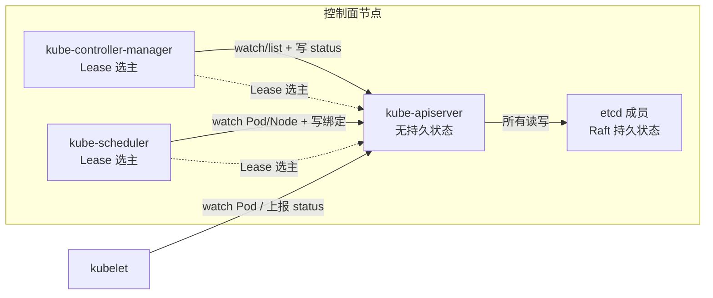
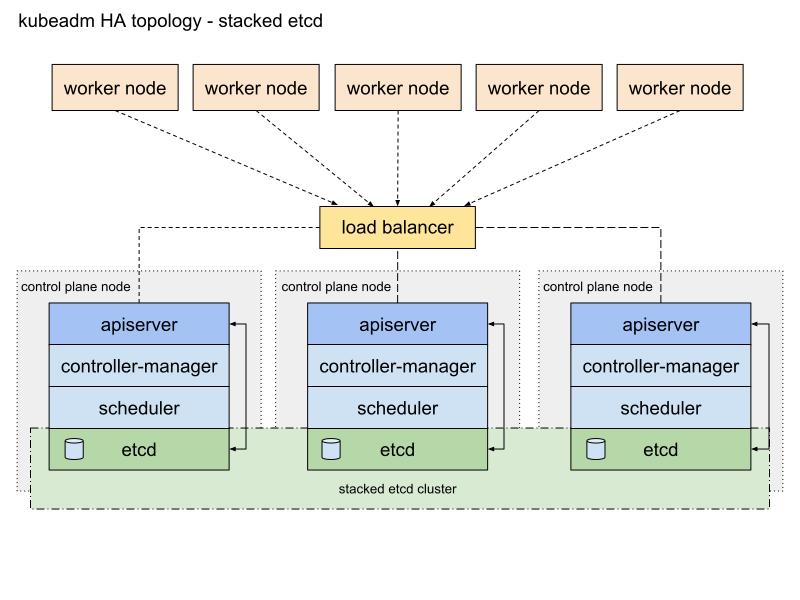
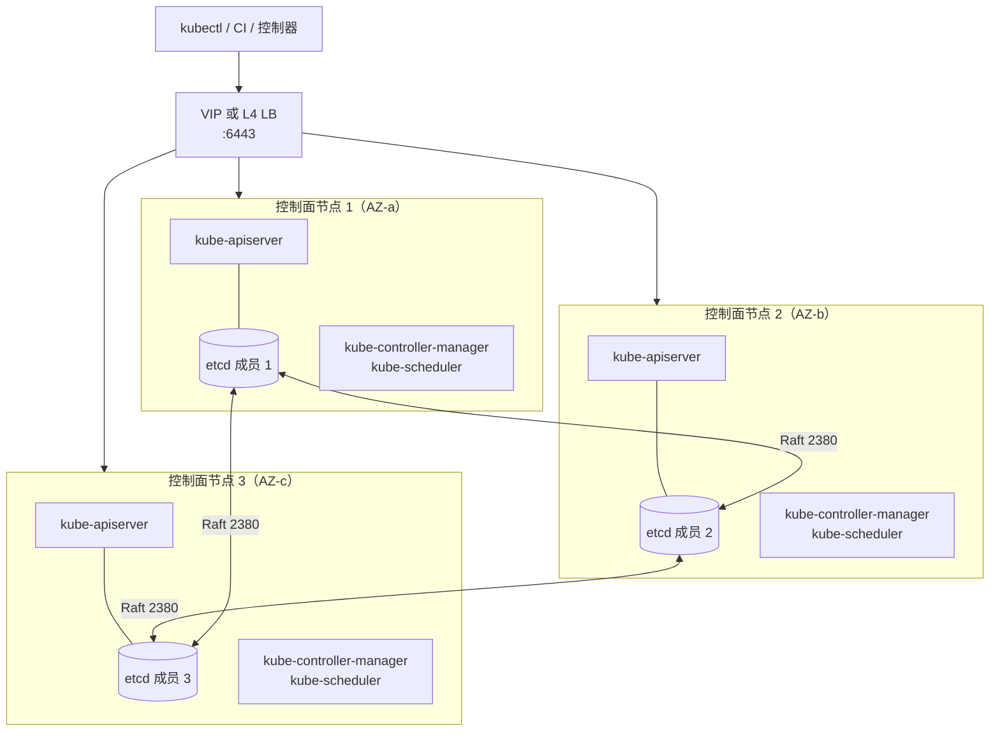
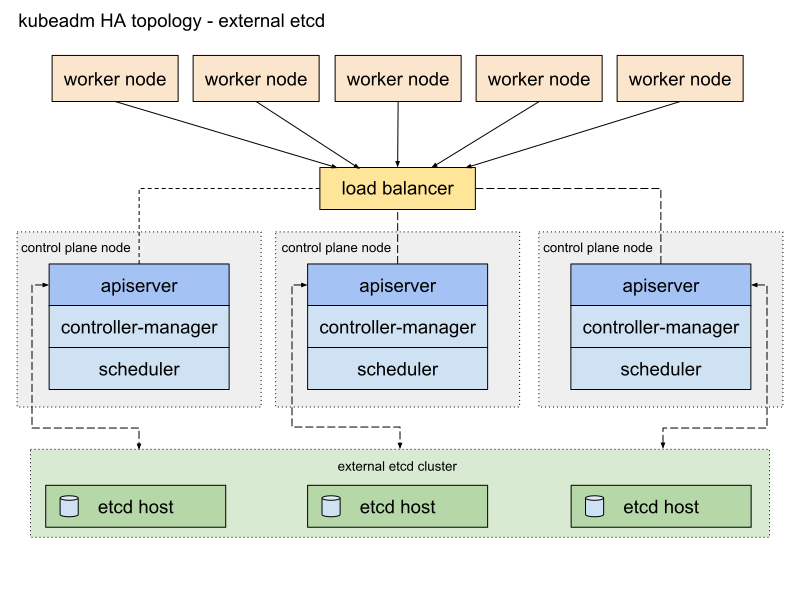
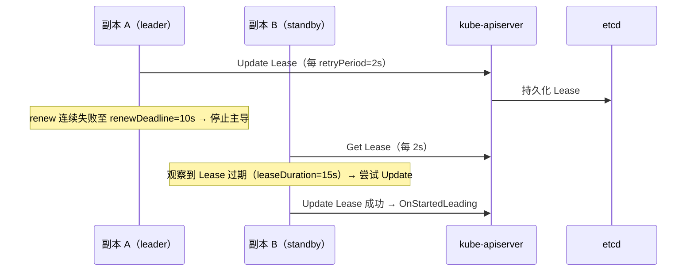
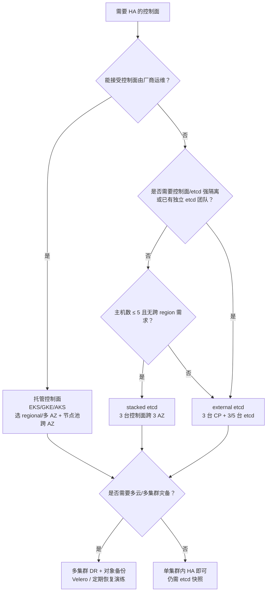

# Kubernetes 控制面高可用方案

控制面高可用（HA）解决的是"**部分控制面组件挂掉时，集群仍能接受请求并继续收敛**"，它既不是备份，也不是灾备：

- **HA**：冗余 + 快速切换，让故障对 API 的可用性影响最小；不保护数据被误删、不会让错误配置回滚。
- **备份/灾备**：数据丢了、quorum 永久丢失、集群被删之后怎么恢复；见 [控制面灾备与恢复](./控制面灾备与恢复.md)。
- **事故处理**：已经挂了，值班的人怎么定位和止血；见 [控制面事故处理手册](./控制面事故处理手册.md)。

本文只讨论设计和拓扑，不写"挂了之后逐步敲什么命令"。文中所有默认值、数字、行为都尽量固定到源码行或官方文档；版本基准如下：

| 项目 | 版本 | commit |
|---|---|---|
| Kubernetes | v1.37.2 | `c50e5395f1ae2d4a2c05f28fdcc38c0916cc1a32` |
| etcd | v3.7.4（kubeadm 默认 3.7.0） | `2e8a5c99e4982c8d4c521be15364ea4c5c68a489` |
| kube-vip | v1.3.1 | `6da770eac1eed9409a9feaccda3d782c94424c24` |

> 引用约定：GitHub 链接一律带 40 位 commit 与行号区间，形如 `.../blob/<commit>/<path>#Lx-Ly`；文档链接为英文原 URL，正文中文。行号已用本地 checkout 核对。

---

## 1. 结论速览

控制面 HA 其实是**三个互相独立的问题**，不能用同一种手段解决：

| 问题 | 涉及组件 | 状态属性 | 主要手段 |
|---|---|---|---|
| A. API 入口的冗余 | kube-apiserver | 无状态（watch cache 只是内存缓存） | 多副本 + VIP/LB + 健康检查 |
| B. 唯一持久状态的多数派 | etcd | 有状态，Raft 复制 | 奇数成员、quorum、跨 AZ 布局、磁盘/网络预算 |
| C. 单活控制器的高可用 | kube-controller-manager、kube-scheduler、cloud-controller-manager | 无持久状态，但同一时刻只应有一个在 reconcile | 多副本 + Lease 选主（热备） |

先记住三条结论：

1. **kube-apiserver 可以随意多副本、active-active**：它不把集群状态写本地，读写都落到 etcd（见 §2.1）。所以入口层的任务是"把请求送到任意一个活着的 apiserver"。
2. **etcd 的可用性只看 quorum**：3 成员容忍 1 个故障，5 成员容忍 2 个；**偶数成员不增加容错**（见 §4.1）。
3. **KCM/scheduler 的切换时间是"秒级到十几秒级"**，不是瞬时：Lease 默认 `leaseDuration=15s`、`renewDeadline=10s`、`retryPeriod=2s`（见 §6）。

一个常见误解是把"控制面 HA"当成"集群不会坏"。实际上 HA 只降低**组件故障**造成的停机概率；数据误删、证书过期、quorum 永久丢失、跨 AZ 网络分区导致的双主风险，都要靠灾备和事故流程兜底。

---

## 2. 组件状态模型：哪些东西必须冗余



### 2.1 kube-apiserver：无状态，但不等于"没内存"

apiserver 处理单个请求时，读路径直接访问 etcd：`store.Get` 里调用 etcd 客户端拿到 KV 再解码（[store.go L235-L254](https://github.com/kubernetes/kubernetes/blob/c50e5395f1ae2d4a2c05f28fdcc38c0916cc1a32/staging/src/k8s.io/apiserver/pkg/storage/etcd3/store.go#L235-L254)）；写路径同样编码后写入 etcd（[store.go L284-L320](https://github.com/kubernetes/kubernetes/blob/c50e5395f1ae2d4a2c05f28fdcc38c0916cc1a32/staging/src/k8s.io/apiserver/pkg/storage/etcd3/store.go#L284-L320)）。

它确实持有内存状态，但都是**可重建的缓存/会话**：

- watch cache：注释明确说它是一个"有容量上限的滑动窗口"（[watch_cache.go L78-L81](https://github.com/kubernetes/kubernetes/blob/c50e5395f1ae2d4a2c05f28fdcc38c0916cc1a32/staging/src/k8s.io/apiserver/pkg/storage/cacher/watch_cache.go#L78-L81)）。apiserver 重启后缓存清空，会从 etcd 重新 list/watch。
- 长连接（watch/exec/port-forward）、admission webhook 连接、aggregated API 的连接：断掉后客户端重连即可，不需要"迁移"。

因此 apiserver 可以水平扩展，且**任意副本都能服务任意请求**。真正需要关注的是：每个副本都能连到 etcd、证书一致、审计/加密配置一致。

### 2.2 etcd：集群对象状态的唯一持久化存储

Kubernetes 把 API 对象（Pod、Service、Deployment、Secret、CRD……）都存进 etcd；Raft 负责把这些写复制到多数派。etcd 官方 FAQ 对 quorum 的定义是 `(n/2)+1`，并指出集群只有在能建立成员多数派时才可操作（[etcd FAQ](https://etcd.io/docs/v3.7/faq/)）。

需要区分"持久状态"的边界：

- **在 etcd 里的**：所有通过 API 创建/更新的对象、Lease、Event、CRD 定义等。
- **不在 etcd 里的**：PKI（CA 私钥、apiserver/etcd 证书）、kubeconfig、static pod manifests、kubelet 本地状态、PV 里的业务数据。这些丢了 etcd 快照也救不回来——这是灾备篇的范围。

### 2.3 kube-controller-manager / kube-scheduler：多副本热备 + Lease 选主

这两个组件可以有多个副本同时运行，但同一时刻**只有一个会真正执行 reconcile/调度**：

- 它们都基于 client-go 的 leader election，用 `coordination.k8s.io/v1` 的 Lease 对象做锁（[leaderelection.go L211-L223](https://github.com/kubernetes/kubernetes/blob/c50e5395f1ae2d4a2c05f28fdcc38c0916cc1a32/staging/src/k8s.io/client-go/tools/leaderelection/leaderelection.go#L211-L223)、[leaselock.go L27-L56](https://github.com/kubernetes/kubernetes/blob/c50e5395f1ae2d4a2c05f28fdcc38c0916cc1a32/staging/src/k8s.io/client-go/tools/leaderelection/resourcelock/leaselock.go#L27-L56)）。
- 默认参数在 component-base 中：`leaseDuration=15s`、`renewDeadline=10s`、`retryPeriod=2s`（[defaults.go L37-L44](https://github.com/kubernetes/kubernetes/blob/c50e5395f1ae2d4a2c05f28fdcc38c0916cc1a32/staging/src/k8s.io/component-base/config/v1alpha1/defaults.go#L37-L44)）。kube-scheduler 显式写了同样的默认值与 `leases` 锁（[options.go L112-L120](https://github.com/kubernetes/kubernetes/blob/c50e5395f1ae2d4a2c05f28fdcc38c0916cc1a32/cmd/kube-scheduler/app/options/options.go#L112-L120)）。
- KCM 的锁对象名/命名空间是 `kube-controller-manager` / `kube-system`（[options.go L247-L248](https://github.com/kubernetes/kubernetes/blob/c50e5395f1ae2d4a2c05f28fdcc38c0916cc1a32/cmd/kube-controller-manager/app/options/options.go#L247-L248)）；scheduler 是 `kube-scheduler` / `kube-system`（同上 options.go）。

注意：**多副本不会带来吞吐提升**，第二个副本只是缩短故障切换时间。真正横向扩展的是 apiserver。

### 2.4 kubeadm 下的落地形态：static pod

kubeadm 把控制面组件都作为 static pod 交给本机 kubelet 管理：etcd 的 PodSpec 由 kubeadm 生成（[local.go L194-L239](https://github.com/kubernetes/kubernetes/blob/c50e5395f1ae2d4a2c05f28fdcc38c0916cc1a32/cmd/kubeadm/app/phases/etcd/local.go#L194-L239)），启动参数（listen/peer URL、initial-cluster、snapshot-count 等）在 `getEtcdCommand` 中拼装（[local.go L242-L285](https://github.com/kubernetes/kubernetes/blob/c50e5395f1ae2d4a2c05f28fdcc38c0916cc1a32/cmd/kubeadm/app/phases/etcd/local.go#L242-L285)），manifests 落在 kubelet 监听目录。kubelet 的 file source 从磁盘读取 static pod 配置（[file.go L30-L44](https://github.com/kubernetes/kubernetes/blob/c50e5395f1ae2d4a2c05f28fdcc38c0916cc1a32/pkg/kubelet/config/file.go#L30-L44)）；普通 Pod 则来自 apiserver 的 list/watch（[apiserver.go L41-L58](https://github.com/kubernetes/kubernetes/blob/c50e5395f1ae2d4a2c05f28fdcc38c0916cc1a32/pkg/kubelet/config/apiserver.go#L41-L58)）。

这带来一个重要的 HA 性质：**apiserver 挂掉不会让 kubelet 删掉 static pod**，因为 static pod 的期望状态来自本地文件而不是 API。这也是"全部控制面 down 时控制面容器仍在跑"的底层原因之一（详见 §7.2）。

| 组件 | 是否有持久状态 | 多副本语义 | 故障时的影响 |
|---|---|---|---|
| kube-apiserver | 否（只有内存缓存） | active-active，任意副本可服务 | 少一个入口，LB 剔除即可；容量下降 |
| etcd | **是**（Raft WAL/DB） | 多数派可写，少数派只读/拒绝写 | 丢失 quorum 则所有写失败 |
| kube-controller-manager | 否 | 一主多备，Lease 选主 | 切换窗口内无 reconcile；不丢已提交对象 |
| kube-scheduler | 否 | 一主多备，Lease 选主 | 切换窗口内新 Pod 不调度 |
| cloud-controller-manager | 否 | 一主多备，Lease 选主 | 切换窗口内 LB/路由/节点生命周期不更新 |

---

## 3. 拓扑方案对比

kubeadm 官方只定义了两种自建 HA 拓扑：stacked etcd 与 external etcd（[kubeadm HA topology](https://kubernetes.io/docs/setup/production-environment/tools/kubeadm/ha-topology/)）。

### 3.1 stacked etcd：控制面与 etcd 同机



stacked 是 kubeadm 的默认形态：每台控制面节点上同时跑 etcd 成员和 apiserver/KCM/scheduler。优点是主机少、复制关系简单；缺点是**故障耦合**——一台机器挂掉，同时损失一个 etcd 成员和一个 apiserver 实例，官方文档明确把这种耦合称为 failed coupling 风险（[kubeadm HA topology](https://kubernetes.io/docs/setup/production-environment/tools/kubeadm/ha-topology/)）。



### 3.2 external etcd：控制面与 etcd 分离



external etcd 把 3 台 etcd 独立出来，控制面节点不再承担存储。官方文档的代价很直接：**需要两倍主机数**（3 台控制面 + 3 台 etcd 是最小 HA 配置）（[kubeadm HA topology](https://kubernetes.io/docs/setup/production-environment/tools/kubeadm/ha-topology/)）。收益是故障不再耦合：丢一台控制面只损失一个 apiserver；丢一台 etcd 只损失一个投票成员。

kubeadm 通过 `ClusterConfiguration.etcd.external.endpoints` 配置外部 etcd（[types.go L317-L336](https://github.com/kubernetes/kubernetes/blob/c50e5395f1ae2d4a2c05f28fdcc38c0916cc1a32/cmd/kubeadm/app/apis/kubeadm/types.go#L317-L336)），internal/external 二选一（[types.go L276-L285](https://github.com/kubernetes/kubernetes/blob/c50e5395f1ae2d4a2c05f28fdcc38c0916cc1a32/cmd/kubeadm/app/apis/kubeadm/types.go#L276-L285)）。此时 apiserver 的 `--etcd-servers` 指向外部 etcd 的 client URL（[etcd.go L168-L172](https://github.com/kubernetes/kubernetes/blob/c50e5395f1ae2d4a2c05f28fdcc38c0916cc1a32/staging/src/k8s.io/apiserver/pkg/server/options/etcd.go#L168-L172)）。

### 3.3 托管控制面

EKS/GKE/AKS 把控制面（apiserver、etcd、KCM、scheduler）放到云厂商管理的账号/网络里，用户在 SLA 范围内不接触这些机器。几个可验证的边界：

- **多可用区**：GKE 的 regional cluster 明确是"同一 region 内多个 zone 各跑一份控制面副本"（[GKE regional clusters](https://cloud.google.com/kubernetes-engine/docs/concepts/regional-clusters)）；EKS 的控制面 endpoint 分为 public/private（[EKS cluster endpoint](https://docs.aws.amazon.com/eks/latest/userguide/cluster-endpoint.html)）；AKS 支持把节点池与系统组件分布在可用区（[AKS availability zones](https://learn.microsoft.com/en-us/azure/aks/availability-zones)）。
- **SLA 是"控制面 API 可用性"，不是"你的业务可用性"**：EKS 标准 SLA 为 99.95%（[EKS SLA](https://aws.amazon.com/eks/sla/)）；GKE 的 regional 控制面为 99.95%、zonal 控制面为 99.5%（[GKE SLA](https://cloud.google.com/kubernetes-engine/sla)）；AKS 的 SLA 条款见 [Azure Kubernetes Service SLA](https://azure.microsoft.com/en-us/support/legal/sla/kubernetes-service/)。SLA 不覆盖工作负载、节点、CNI、LB 的故障。

### 3.4 hosted control plane 与轻量发行版

- **hosted control plane**：把控制面（至少 apiserver + etcd）作为工作负载跑在另一个管理集群里，租户集群只留 kubelet 和 CNI。它在"控制面与数据面解耦"上等价于 external etcd 的进一步加强版，但多了一层"管理集群自身也要 HA"的依赖。Kamaji 是这类实现的代表；Cluster API 生态里也有对应的 ControlPlane provider（[Cluster API](https://cluster-api.sigs.k8s.io/)）。
- **轻量发行版**：k3s 默认用 embedded etcd 或 SQLite/kine，k0s 用 etcd 或 kine + 内置 controller。它们把"控制面 HA"打包成单二进制/单进程，适合边缘与资源受限场景，但可调参数、故障域隔离、etcd 可观测性都比 kubeadm 弱。选它们之前先确认：控制面故障时谁负责、etcd 数据放哪、能否跨 AZ。

### 3.5 对比表

| 维度 | stacked etcd | external etcd | 托管控制面 | hosted control plane |
|---|---|---|---|---|
| 最小主机数（HA） | 3 | 6（3 CP + 3 etcd） | 0（厂商负责） | 1 个管理集群 + 3 台 worker |
| 故障域耦合 | 高（CP 与 etcd 同机） | 低 | 厂商定义（通常多 AZ） | 中（管理集群是单点风险） |
| 网络要求 | etcd peer 跨节点低 RTT | 同左，另加 CP→etcd | 厂商内网 | 租户→管理集群 API 网络 |
| 升级影响 | 每台机器同时重启 etcd+apiserver | 可分开滚动 etcd 与控制面 | 厂商窗口/自动 | 管理集群与租户解耦 |
| 成本 | 最低 | 约 2 倍主机 | 控制面费用 | 中 |
| 适用场景 | 中小自建集群、边缘 | 大规模、强隔离、已有独立 etcd 团队 | 不想运维控制面 | 多租户、控制面集中托管 |

### 3.6 节点数怎么选

- **至少 3 台控制面**：这是 kubeadm 官方对 HA 的最低要求（[kubeadm high availability](https://kubernetes.io/docs/setup/production-environment/tools/kubeadm/high-availability/)）。
- **3 AZ 就选 3 台；2 AZ 时不要放 2 台 etcd**：2 成员 quorum 是 2，挂任意一台就永久失去写能力，容错为 0（见 §4）。
- **5 台不是"更 HA"的默认答案**：5 成员容忍 2 个故障，但写延迟随成员数增加，且跨 AZ 的 RTT/带宽成本更高。etcd FAQ 建议一般不超过 7 个成员（[etcd FAQ](https://etcd.io/docs/v3.7/faq/)）。

---

## 4. etcd quorum 与容量

### 4.1 quorum 数学

etcd 的写入需要多数派确认。quorum = `(n/2)+1`，容错 = `n - quorum`：

| 成员数 | quorum | 可容忍故障 | 说明 |
|---|---|---|---|
| 1 | 1 | 0 | 无 HA |
| 2 | 2 | 0 | **没有容错**：挂 1 台即失去 quorum |
| 3 | 2 | 1 | 最常见的最小 HA |
| 4 | 3 | 1 | 与 3 成员容错相同，多一台机器 |
| 5 | 3 | 2 | 大规模/多 AZ 常用 |
| 6 | 4 | 2 | 与 5 成员容错相同 |
| 7 | 4 | 3 | 一般不建议超过 7 |

这张表来自 etcd FAQ 的 failure tolerance 部分（[etcd FAQ](https://etcd.io/docs/v3.7/faq/)）：奇数成员与比它大 1 的偶数成员容错相同；跨 AZ 时还要保证"任意一个 AZ 挂掉后仍有多数派"。

### 4.2 成员变更：learner 与"先删后加"

etcd 对成员变更有严格保护，集群会拒绝"变更后剩余存活成员不足 quorum"的请求：

- 增加投票成员前检查 `nquorum := nmembers/2 + 1` 且 `nstarted >= nquorum`（[cluster.go L626-L655](https://github.com/etcd-io/etcd/blob/2e8a5c99e4982c8d4c521be15364ea4c5c68a489/server/etcdserver/api/membership/cluster.go#L626-L655)）。
- 删除成员、提升 learner 也有同样的 quorum 检查（[cluster.go L659-L685](https://github.com/etcd-io/etcd/blob/2e8a5c99e4982c8d4c521be15364ea4c5c68a489/server/etcdserver/api/membership/cluster.go#L659-L685)、[cluster.go L689-L707](https://github.com/etcd-io/etcd/blob/2e8a5c99e4982c8d4c521be15364ea4c5c68a489/server/etcdserver/api/membership/cluster.go#L689-L707)）。
- FAQ 的"先删后加"建议：在 3 成员集群里先增加新成员会把 quorum 从 2 抬到 3，新成员若起不来就永久失去 quorum；正确顺序是先移除坏成员再加新成员（[etcd FAQ](https://etcd.io/docs/v3.7/faq/)）。

kubeadm join 控制面时用的正是 **learner** 路径：先把新成员以 learner 身份加入（[local.go L150-L160](https://github.com/kubernetes/kubernetes/blob/c50e5395f1ae2d4a2c05f28fdcc38c0916cc1a32/cmd/kubeadm/app/phases/etcd/local.go#L150-L160)），等它追上日志后再 promote（[local.go L176-L180](https://github.com/kubernetes/kubernetes/blob/c50e5395f1ae2d4a2c05f28fdcc38c0916cc1a32/cmd/kubeadm/app/phases/etcd/local.go#L176-L180)）；`AddMemberAsLearner` 在 `addMember` 里根据布尔参数选择 API（[etcd.go L432-L440](https://github.com/kubernetes/kubernetes/blob/c50e5395f1ae2d4a2c05f28fdcc38c0916cc1a32/cmd/kubeadm/app/util/etcd/etcd.go#L432-L440)）。learner 不投票、只复制日志，因此不会因"加入慢节点"直接抬高 quorum。

> [!WARNING]
> 不要为了"恢复 quorum"盲目加成员。etcd 默认 `strict-reconfig-check` 会拒绝可能导致 quorum 丢失的变更；绕过它（`--strict-reconfig-check=false`）是拿一致性冒险，正确路径是先恢复/移除坏成员。恢复与重建流程见 [控制面灾备与恢复](./控制面灾备与恢复.md)。

### 4.3 跨 AZ 延迟、fsync 与选举

etcd 的提交延迟由两件事决定：**成员间网络 RTT + 本地 fdatasync**。官方性能文档给的数量级：同机房 RTT 几百微秒，美国境内 RTT 约 50ms，跨洲可达 400ms；SSD 的 fdatasync 通常 <1ms，机械盘约 10ms（[etcd performance](https://etcd.io/docs/v3.7/op-guide/performance/)）。

默认时序参数：心跳间隔 `TickMs=100ms`、选举超时 `ElectionMs=1000ms`（[config.go L530-L535](https://github.com/etcd-io/etcd/blob/2e8a5c99e4982c8d4c521be15364ea4c5c68a489/server/embed/config.go#L530-L535)），且校验要求 election timeout 至少是 heartbeat 的 5 倍（[config.go L1003-L1004](https://github.com/etcd-io/etcd/blob/2e8a5c99e4982c8d4c521be15364ea4c5c68a489/server/embed/config.go#L1003-L1004)）。

这带来两个直接结论：

1. **etcd 的 3 个成员应放在同一 region 的 3 个 AZ**，AZ 间 RTT 通常 <1ms 到几 ms；跨 region 部署需要显式调大 `heartbeat-interval`/`election-timeout`，并且每次写都要多付 RTT。
2. **慢盘会触发换主**：etcd 把"能否按时 fsync Raft 日志"当作 leader 存活性的一部分，盘抖动会让 leader 被误判为失效而触发选举（[etcd FAQ](https://etcd.io/docs/v3.7/faq/)）。生产上应给 etcd 独占 SSD，避免和镜像/日志/业务 IO 抢盘。

### 4.4 WAL/DB 大小、quota 与压缩

etcd 默认后端 quota 是 **2GiB**，最大建议 8GiB（[quota.go L26-L33](https://github.com/etcd-io/etcd/blob/2e8a5c99e4982c8d4c521be15364ea4c5c68a489/server/storage/quota.go#L26-L33)）。写入超过 quota 时，etcd 会激活 **NOSPACE** alarm 并拒绝后续写（[quota.go L40-L52](https://github.com/etcd-io/etcd/blob/2e8a5c99e4982c8d4c521be15364ea4c5c68a489/server/etcdserver/api/v3rpc/quota.go#L40-L52)），表现是 apiserver 所有写请求报 `mvcc: database space exceeded`。

HA 影响：

- **NOSPACE 是集群级故障**，不是单成员故障。任意成员接近 quota，都会影响写路径。
- **历史版本必须压缩**：apiserver 自身会按 `--etcd-compaction-interval` 发起 compaction，默认 5 分钟（[config.go L36-L39](https://github.com/kubernetes/kubernetes/blob/c50e5395f1ae2d4a2c05f28fdcc38c0916cc1a32/staging/src/k8s.io/apiserver/pkg/storage/storagebackend/config.go#L36-L39)），0 表示禁用（[etcd.go L192-L194](https://github.com/kubernetes/kubernetes/blob/c50e5395f1ae2d4a2c05f28fdcc38c0916cc1a32/staging/src/k8s.io/apiserver/pkg/server/options/etcd.go#L192-L194)）；否则 revision 无限增长。
- **compaction 只标记可回收，不归还磁盘**，需要 `etcdctl defrag` 或 maintenance 接口的 `Defragment`（[maintenance.go L119-L130](https://github.com/etcd-io/etcd/blob/2e8a5c99e4982c8d4c521be15364ea4c5c68a489/server/etcdserver/api/v3rpc/maintenance.go#L119-L130)）。
- **defrag 是单成员、会阻塞**：不要在业务高峰对所有成员并发 defrag；逐个做，并观察 `etcdctl endpoint status` 的 `DB SIZE`/`DB SIZE IN USE`（`Status` 返回 `DbSize`、`DbSizeInUse`、`Leader`、`RaftIndex` 等，[maintenance.go L261-L299](https://github.com/etcd-io/etcd/blob/2e8a5c99e4982c8d4c521be15364ea4c5c68a489/server/etcdserver/api/v3rpc/maintenance.go#L261-L299)）。

etcd 维护（compaction/defrag/quota/snapshot）的系统性说明见 [etcd maintenance](https://etcd.io/docs/v3.7/op-guide/maintenance/)。

### 4.5 容量估算思路

etcd 容量不是看"磁盘多大"，而是看**写入速率、对象数量、revision 增长速度**：

- 小集群（<100 节点、少量 CRD）：3 成员，每成员 2–4 vCPU、8GiB 内存、独立 SSD 通常够用；这是经验值，最终要用 `etcdctl check perf` 或实际负载验证。
- 大数据量（Event、大量 CRD、频繁更新）：优先缩短 Event TTL、降低高频对象的写放大，再考虑扩到 5 成员；不要把 etcd 当数据库用。
- 磁盘容量按 quota 的 2–3 倍规划，给 WAL、快照、defrag 腾挪空间。

硬件建议见 [etcd hardware](https://etcd.io/docs/v3.7/op-guide/hardware/)。

---

## 5. 流量入口：请求怎么到达某个活着的 apiserver

### 5.1 端口清单

kubeadm 集群的默认端口（[constants.go L94-L107](https://github.com/kubernetes/kubernetes/blob/c50e5395f1ae2d4a2c05f28fdcc38c0916cc1a32/cmd/kubeadm/app/constants/constants.go#L94-L107)、[constants.go L404-L413](https://github.com/kubernetes/kubernetes/blob/c50e5395f1ae2d4a2c05f28fdcc38c0916cc1a32/cmd/kubeadm/app/constants/constants.go#L404-L413)）：

| 端口 | 组件 | 用途 |
|---|---|---|
| 6443 | kube-apiserver | 客户端/组件访问 API（`KubeAPIServerPort`） |
| 2379 | etcd | client 流量（apiserver、etcdctl） |
| 2380 | etcd | peer 流量（Raft） |
| 2381 | etcd | metrics / 健康检查（kubeadm 配置的 listen-metrics-urls） |
| 10257 | kube-controller-manager | 自身 HTTPS 端口（healthz/metrics） |
| 10259 | kube-scheduler | 自身 HTTPS 端口（healthz/metrics） |
| 10250 | kubelet | 节点 API |

注意 **2379/2380 绝不能暴露到公网**；etcd 的 client 端口只对控制面/apiserver 网段开放。

### 5.2 四种入口方式

| 方式 | 原理 | 优点 | 风险 |
|---|---|---|---|
| DNS 轮询/多 A 记录 | 客户端解析到多个 apiserver IP | 无额外组件 | 客户端会缓存 DNS、失败重试不均衡；client-go 不保证故障转移 |
| L4 LB（云 LB/HAProxy/LVS） | TCP 转发到多个 6443 | 健康检查成熟、可跨 AZ | LB 自身要 HA；要区分 `/livez` 与 `/readyz` |
| VIP（kube-vip/keepalived） | 一个虚拟 IP 漂移到某台控制面 | 简单、无外部依赖 | L2 模式受广播域限制；漂移时间受选主影响 |
| in-cluster endpoints | Pod 通过 `kubernetes.default` Service 访问 | 集群内自动负载均衡 | 只覆盖集群内客户端；依赖 kube-proxy/CNI |

kubeadm 推荐用 `--control-plane-endpoint` 指定一个稳定的 VIP/DNS，各组件 kubeconfig 和证书 SAN 都指向它（[types.go L99-L111](https://github.com/kubernetes/kubernetes/blob/c50e5395f1ae2d4a2c05f28fdcc38c0916cc1a32/cmd/kubeadm/app/apis/kubeadm/types.go#L99-L111)）。这个地址会被写进 apiserver 证书的 SAN（[pki_helpers.go L415-L425](https://github.com/kubernetes/kubernetes/blob/c50e5395f1ae2d4a2c05f28fdcc38c0916cc1a32/cmd/kubeadm/app/util/pkiutil/pki_helpers.go#L415-L425)），所以**上线后再改 endpoint 通常需要重新签发证书**，属于高成本变更。

### 5.3 健康检查：/livez、/readyz、/healthz

kube-apiserver 暴露三个健康端点（[health checks](https://kubernetes.io/docs/reference/using-api/health-checks/)）：

- `/livez`：是否该重启进程（死锁等不可恢复状态）。注意 etcd 的 health 组也会进入 livez，它不是"纯进程存活"。
- `/readyz`：是否可以服务请求；除 health 组外还包含 **etcd-readiness** 与 watch cache 初始同步等 readyz-only 检查。
- `/healthz`：已废弃（v1.16 起）的兼容端点，包含 healthz 组检查（kube-apiserver 里也含 etcd）。

etcd 检查的接线在 apiserver 的 etcd options 里：`addEtcdHealthEndpoint` 用 `AddHealthChecks` 把 `etcd` 组注册进 healthz/livez/readyz，再用 `AddReadyzChecks` 把 `etcd-readiness` 只注册进 readyz（[etcd.go L421-L436](https://github.com/kubernetes/kubernetes/blob/c50e5395f1ae2d4a2c05f28fdcc38c0916cc1a32/staging/src/k8s.io/apiserver/pkg/server/options/etcd.go#L421-L436)、[healthz.go L79-L110](https://github.com/kubernetes/kubernetes/blob/c50e5395f1ae2d4a2c05f28fdcc38c0916cc1a32/staging/src/k8s.io/apiserver/pkg/server/healthz.go#L79-L110)），底层是向 etcd 做带超时的探测（[etcd3.go L113-L123](https://github.com/kubernetes/kubernetes/blob/c50e5395f1ae2d4a2c05f28fdcc38c0916cc1a32/staging/src/k8s.io/apiserver/pkg/storage/storagebackend/factory/etcd3.go#L113-L123)）。

LB 的健康检查建议：

- **用 `/readyz`，但把失败阈值调大**（例如连续失败 3 次才摘除）：etcd 短暂抖动会让所有 apiserver 同时 readyz 失败，阈值太小会把所有后端一起摘掉，等于制造一次全站故障。
- **不要只用 TCP 6443 探活**：端口能连上不代表能读写 etcd；但如果只用 `/readyz` 又可能因共享的 etcd 抖动而误摘。
- 滚动升级时配合 apiserver 的 drain/shutdown 延迟：`ShutdownDelayDuration` 期间 `/healthz` 仍 200、`/readyz` 失败（[config.go L243-L246](https://github.com/kubernetes/kubernetes/blob/c50e5395f1ae2d4a2c05f28fdcc38c0916cc1a32/staging/src/k8s.io/apiserver/pkg/server/config.go#L243-L246)），让 LB 先把流量摘走再关进程。

### 5.4 VIP 实现：kube-vip

kube-vip 支持 ARP（L2）和 BGP（L3）两种发布模式（[kube-vip modes](https://kube-vip.io/docs/modes/)）：

- **ARP 模式**：VIP 配在 leader 节点的网卡上，周期性发送 gratuitous ARP/NDP 刷新交换机 MAC 表（[arp.go L154-L166](https://github.com/kube-vip/kube-vip/blob/6da770eac1eed9409a9feaccda3d782c94424c24/pkg/arp/arp.go#L154-L166)、[arp.go L220](https://github.com/kube-vip/kube-vip/blob/6da770eac1eed9409a9feaccda3d782c94424c24/pkg/arp/arp.go#L220)）。官方给的"平均故障切换时间约 3 秒"，且依赖底层交换机是否放行（[kube-vip ARP troubleshooting](https://kube-vip.io/docs/troubleshooting/arp/)）。
- **BGP 模式**：把 VIP 作为 /32 或 /128 路由通告给上游路由器（[bgp.go L52-L58](https://github.com/kube-vip/kube-vip/blob/6da770eac1eed9409a9feaccda3d782c94424c24/pkg/manager/worker/bgp.go#L52-L58)），切换依赖 BGP 收敛，适合跨子网/裸金属。

kube-vip 的控制面 VIP 本身也是靠选主决定的：它用 Lease 对象竞选，默认 `leaseDuration=15s`、`renewDeadline=10s`、`retryPeriod=2s`（[election.go L93-L116](https://github.com/kube-vip/kube-vip/blob/6da770eac1eed9409a9feaccda3d782c94424c24/pkg/election/election.go#L93-L116)、[config_generator.go L402-L412](https://github.com/kube-vip/kube-vip/blob/6da770eac1eed9409a9feaccda3d782c94424c24/pkg/kubevip/config_generator.go#L402-L412)），并据此持有 VIP（[clusterLeaderElection.go L19-L45](https://github.com/kube-vip/kube-vip/blob/6da770eac1eed9409a9feaccda3d782c94424c24/pkg/cluster/clusterLeaderElection.go#L19-L45)）。

> [!WARNING]
> kube-vip 的控制面选主**依赖同一个 apiserver**。当全部控制面 down 时，Lease 无法续约，VIP 也就不会漂移——这是"控制面全挂时数据面还在跑，但新 apiserver 起不来"的典型鸡生蛋问题。生产上应保证至少有一个与 API 无关的带外恢复通道（串口/IPMI/云控制台），或改用外部 L4 LB。BGP 模式在数据面路径上更独立，但选主仍依赖 API。

### 5.5 客户端侧：kubeconfig 只有一个 server

kubeconfig 的 `Cluster.Server` 是单个 URL 字符串（[clientcmd types.go L60-L75](https://github.com/kubernetes/kubernetes/blob/c50e5395f1ae2d4a2c05f28fdcc38c0916cc1a32/staging/src/k8s.io/client-go/tools/clientcmd/api/v1/types.go#L60-L75)），**client-go 没有内置的"多 apiserver 轮询/故障转移"**。所以：

- 想要故障转移，必须靠 DNS/VIP/LB 提供稳定入口；
- 直接把 kubeconfig 指向某一台 apiserver 的 IP，那台挂了客户端就挂；
- 集群内组件（kubelet、kube-proxy、CoreDNS）通过 `kubernetes.default` Service + kube-proxy 访问 apiserver，入口是 Endpoints/服务 VIP，不是某个具体节点。

---

## 6. 选主组件的高可用

### 6.1 Lease 选主循环



关键代码路径（client-go）：

- `Run` 先 `acquire`，成功后启动 `OnStartedLeading`，进入 `renew`（[leaderelection.go L211-L223](https://github.com/kubernetes/kubernetes/blob/c50e5395f1ae2d4a2c05f28fdcc38c0916cc1a32/staging/src/k8s.io/client-go/tools/leaderelection/leaderelection.go#L211-L223)）。
- `acquire` 用 `JitterUntil` 按 `retryPeriod` 轮询 `tryAcquireOrRenew`（[leaderelection.go L250-L276](https://github.com/kubernetes/kubernetes/blob/c50e5395f1ae2d4a2c05f28fdcc38c0916cc1a32/staging/src/k8s.io/client-go/tools/leaderelection/leaderelection.go#L250-L276)）。
- `renew` 在 `renewDeadline` 内持续重试；一旦失败就退出主导（[leaderelection.go L279-L314](https://github.com/kubernetes/kubernetes/blob/c50e5395f1ae2d4a2c05f28fdcc38c0916cc1a32/staging/src/k8s.io/client-go/tools/leaderelection/leaderelection.go#L279-L314)）。
- `tryAcquireOrRenew` 先走"leader 乐观更新"快路径，再回退到 Get/比较/Update；只有当旧记录为空或已过期时，非 leader 才能抢占（[leaderelection.go L441-L490](https://github.com/kubernetes/kubernetes/blob/c50e5395f1ae2d4a2c05f28fdcc38c0916cc1a32/staging/src/k8s.io/client-go/tools/leaderelection/leaderelection.go#L441-L490)）。

### 6.2 故障切换时间

按默认参数，可以这样估算一次 leader 故障：

| 阶段 | 时间 |
|---|---|
| leader 进程崩溃/失联，Lease 不再续约 | t=0 |
| 原 leader 的 renew 在 `renewDeadline=10s` 后放弃，停止主导 | ≤10s |
| standby 观察到 Lease 过期（`leaseDuration=15s`） | ≤15s |
| standby 按 `retryPeriod=2s` 抢锁 | 0–2s |
| **合计** | **约 15–17 秒**（经验估算，取决于 API 延迟与时钟） |

这个数字说明：**不要把"controller-manager 切换"设计进秒级恢复的路径**。对时延敏感的业务应尽量不依赖控制面实时 reconcile；对可用性敏感的系统要接受"十几秒内没有新调度、没有新副本"。

### 6.3 语义与前提

- **不是严格单活**：leaderelection 包注释明确说它不保证只有一个客户端在行动（没有 fencing）（[leaderelection.go L18-L28](https://github.com/kubernetes/kubernetes/blob/c50e5395f1ae2d4a2c05f28fdcc38c0916cc1a32/staging/src/k8s.io/client-go/tools/leaderelection/leaderelection.go#L18-L28)）。实际安全由控制器的乐观并发（resourceVersion）兜底，而不是锁本身。
- **容忍时钟速率差，不容忍任意时钟跳变**：算法只用本地时间观察"记录是否变化"，因此对绝对时钟偏差不敏感，但对时钟速率差敏感；注释建议用 `leaseDuration/renewDeadline` 的比例来配置容忍度（[leaderelection.go L26-L44](https://github.com/kubernetes/kubernetes/blob/c50e5395f1ae2d4a2c05f28fdcc38c0916cc1a32/staging/src/k8s.io/client-go/tools/leaderelection/leaderelection.go#L26-L44)）。生产上仍应部署 NTP/chrony。
- **选主依赖 etcd quorum**：Lease 本身是 etcd 对象；quorum 丢失时，leader 无法续约、standby 无法抢锁，所有单活组件一起停摆。
- **选主流量有专门的 APF 保护**：默认 FlowSchema `system-leader-election` 把 KCM/scheduler 的 Lease 请求路由到 `leader-election` 优先级（NominalConcurrencyShares=10，[bootstrap/default.go L294-L306](https://github.com/kubernetes/kubernetes/blob/c50e5395f1ae2d4a2c05f28fdcc38c0916cc1a32/staging/src/k8s.io/apiserver/pkg/apis/flowcontrol/bootstrap/default.go#L294-L306)）。这解释了为什么 API 过载时选主通常还能工作。standby 每 2s 发一次 Get，2–3 副本足够，更多副本只增加 API 负载。

---

## 7. 失效域分析矩阵

### 7.1 场景矩阵

假设 3 台控制面、stacked etcd、3 AZ 各 1 台（external etcd 场景另列）：

| 场景 | etcd 状态 | apiserver | KCM/scheduler | 数据面 | 恢复后 |
|---|---|---|---|---|---|
| 1 台控制面 down（stacked） | 剩 2/3，quorum=2，**可写** | 剩 2 个入口 | leader 若在故障机，约 15–17s 后切换 | 存量 Pod 继续跑；新 Pod 可调度 | 故障机恢复后 etcd 自动追日志；无需人工 |
| 2 台控制面 down（stacked，3 成员） | 剩 1/3，**失去 quorum** | 仍可能响应，但读/写失败 | 无法选主 | 存量 Pod 继续跑；无新调度/无 reconcile | 第 2 台恢复即恢复 quorum；不要急着重装 |
| 1 台 external etcd down | 剩 2/3，**可写** | 不受影响 | 正常 | 正常 | 恢复后自动追赶 |
| 2 台 external etcd down | 剩 1/3，**失去 quorum** | 全部写失败 | 停止 | 存量 Pod 继续跑 | 同 stacked |
| 1 台控制面 down（external etcd） | 不受影响 | 剩 2 个入口 | 可能切换 | 正常 | 正常 |
| 单 AZ 故障（3 AZ 各 1 台） | 剩 2/3，**可写** | 剩 2 个入口 | 若 leader 在该 AZ 则切换 | 该 AZ 的 Pod 受影响；其他 AZ 继续 | 云上节点重新拉起后自动恢复 |
| 网络分区：少数派一侧 | 无法与多数派通信，**不能写** | 请求可能超时/失败 | 无法续约，停止主导 | 该侧 Pod 继续跑但无法上报状态 | 分区恢复后 Raft 自动对齐 |
| 网络分区：多数派一侧 | quorum 仍在，**可写** | 正常服务 | 重新选主，继续工作 | 正常 | 分区恢复后少数派追日志 |
| **全部控制面 down** | 无 quorum/无成员可达 | 全部不可用 | 全部停 | **存量 Pod 继续跑**（见 §7.2） | kubelet 重新连上后上报；注意节点状态与 Lease |

两个容易忽略的细节：**stacked 拓扑下"1 台机器 down"是双重故障**（apiserver + etcd 成员），但 3 成员还剩 2 仍满足 quorum；只剩 1 台机器时 etcd 先失去 quorum，apiserver 再多也没用。**奇数控制面不等于奇数 etcd**：external etcd 时控制面 3 台、etcd 5 台，各自独立计算 quorum——故障域矩阵要按 etcd 视图看，而不是按节点数看。

### 7.2 全部控制面 down 时，数据面到底发生什么

这是 HA 设计里最常被问的问题。结论是：**数据面进入"冻结"状态，而不是"崩溃"**。

| 行为 | 是否继续 | 原因 |
|---|---|---|
| 存量 Pod 的容器进程 | ✅ 继续运行 | 容器由 runtime/shim 持有；kubelet 不会因为 API 不可达而杀 Pod |
| kubelet 维持 Pod 期望状态 | ✅ 继续 | kubelet 的 Pod 来源是本地缓存 + static 文件源；API 只是其中一个来源 |
| static pod（含控制面容器） | ✅ 继续 | 期望状态来自 `/etc/kubernetes/manifests` 文件（[file.go L30-L44](https://github.com/kubernetes/kubernetes/blob/c50e5395f1ae2d4a2c05f28fdcc38c0916cc1a32/pkg/kubelet/config/file.go#L30-L44)） |
| 新建/删除 Pod | ❌ 停止 | 所有写操作都经过 apiserver → etcd |
| Deployment/StatefulSet/CronJob/HPA 收敛 | ❌ 停止 | KCM 停止（Lease 无法续约） |
| 新 Pod 调度 | ❌ 停止 | scheduler 停止 |
| Service/Endpoints 更新 | ❌ 停止 | EndpointSlice 控制器在 KCM 中 |
| 已有 Service 的转发 | ✅ 通常继续 | kube-proxy 保留最后一次下发的 iptables/IPVS 规则；已有连接可能保持 |
| DNS 解析 | ⚠️ 部分继续 | CoreDNS 进程可继续响应缓存/已加载记录；新的 Service 记录无法更新；未缓存的外部域名仍可 forward |
| 节点被标记 NotReady | ⚠️ 不会立即发生 | 标记 NotReady 的是 KCM 的 node lifecycle controller；控制面全挂时它也没在跑 |
| `kubectl exec/port-forward/logs`、监控写入 | ❌ 停止 | 都需要经过 apiserver；本地日志采集可继续 |

与 kubelet 相关的两个可验证数字：

- kubelet 每 10s 计算并上报节点状态（`nodeStatusUpdateFrequency` 默认 10s），node lease 默认 40s 过期（[kubelet config types L330-L357](https://github.com/kubernetes/kubernetes/blob/c50e5395f1ae2d4a2c05f28fdcc38c0916cc1a32/staging/src/k8s.io/kubelet/config/v1beta1/types.go#L330-L357)）。
- KCM 的 node lifecycle controller 默认 `NodeMonitorGracePeriod=50s`、`PodEvictionTimeout=5m`（[nodelifecycle defaults L33-L50](https://github.com/kubernetes/kubernetes/blob/c50e5395f1ae2d4a2c05f28fdcc38c0916cc1a32/pkg/controller/nodelifecycle/config/v1alpha1/defaults.go#L33-L50)）。

> [!WARNING]
> 控制面恢复时有一个**恢复期陷阱**：控制面 down 期间所有 Node 的 Lease 都已过期。如果恢复后某些 kubelet 仍连不上 apiserver，node lifecycle controller 会按正常逻辑把节点标 NotReady，并在 `PodEvictionTimeout=5m` 后驱逐 Pod。恢复时优先确认 kubelet→apiserver 网络已通，再让 KCM 大量处理过期 Lease。

以上"数据面继续"的判断中，容器与 kubelet 行为有源码/文档依据；CoreDNS 缓存、kube-proxy 保留规则属于实现语义推论（通常成立，但取决于具体版本与配置），不应作为 SLA 承诺。

---

## 8. 规模化与性能

### 8.1 APF：保护 apiserver 与 etcd 的主机制

API Priority and Fairness（APF）把请求按 FlowSchema 分到 PriorityLevel，再做排队/限流。它在 apiserver 内部，是**比 `--max-requests-inflight` 更细的保护层**（概念见 [API Priority and Fairness](https://kubernetes.io/docs/concepts/cluster-administration/flow-control/)）。

默认的 PriorityLevel 及份额（[bootstrap/default.go L168-L219](https://github.com/kubernetes/kubernetes/blob/c50e5395f1ae2d4a2c05f28fdcc38c0916cc1a32/staging/src/k8s.io/apiserver/pkg/apis/flowcontrol/bootstrap/default.go#L168-L219)）：

| PriorityLevel | NominalConcurrencyShares | 用途 |
|---|---|---|
| `system` | 30 | 系统组件、自维护请求（含 kubelet/kube-proxy） |
| `node-high` | 40 | 节点健康上报（大规模集群 50%–90% 的请求） |
| `leader-election` | 10 | KCM/scheduler 选主 |
| `workload-high` | 40 | scheduler、内置工作负载控制器 |
| `workload-low` | 100 | 普通 ServiceAccount 工作负载 |
| `global-default` | 20 | 其余流量 |

总并发上限 = `max-requests-inflight` + `max-mutating-requests-inflight`，默认 **400 + 200 = 600**（[config.go L449-L453](https://github.com/kubernetes/kubernetes/blob/c50e5395f1ae2d4a2c05f28fdcc38c0916cc1a32/staging/src/k8s.io/apiserver/pkg/server/config.go#L449-L453)；两个 flag 定义见 [server_run_options.go L348-L360](https://github.com/kubernetes/kubernetes/blob/c50e5395f1ae2d4a2c05f28fdcc38c0916cc1a32/staging/src/k8s.io/apiserver/pkg/server/options/server_run_options.go#L348-L360)）。每个 PL 的并发限额按 `ceil(serverCL * shares / shareSum)` 分配（[apf_controller.go L857-L864](https://github.com/kubernetes/kubernetes/blob/c50e5395f1ae2d4a2c05f28fdcc38c0916cc1a32/staging/src/k8s.io/apiserver/pkg/util/flowcontrol/apf_controller.go#L857-L864)）。

按默认 shares（总和 240）估算：`system` ≈ 75、`node-high` = 100、`leader-election` = 25、`workload-high` = 100、`workload-low` = 250、`global-default` = 50。这解释了两个现象：

- 大规模集群里 kubelet 上报会吃掉大量并发，这是 `node-high` 份额最大的原因；
- 业务请求把 `workload-*` 打满时，`system`/`leader-election` 仍有保底，控制面不至于被业务流量拖死。

### 8.2 etcd 磁盘与网络

- 写延迟 ≈ RTT + fdatasync；同 region 多 AZ 部署要把 RTT 控制在个位数 ms。
- 监控 `wal_fsync_duration_seconds` p99 < 10ms、`backend_commit_duration_seconds` p99 < 25ms 是 FAQ 给出的健康线（[etcd FAQ](https://etcd.io/docs/v3.7/faq/)）。
- 使用本地 SSD/NVMe；云盘优先选高 IOPS 的 provisioned 盘；不要让 etcd 与镜像仓库、日志盘共享 IO。

### 8.3 watch cache 与对象规模

watch cache 把 LIST/WATCH 从 etcd 卸载到 apiserver 内存，但它在 apiserver 重启后要重新建立：启动时的全量 LIST 会打 etcd。影响 HA 的几个点：

- 大量 CRD、大对象（大 Secret、大 ConfigMap）会显著增加每个 apiserver 的内存占用；多副本时内存成本 × 副本数。
- Event 是高频写入源，控制面故障恢复时大量 Event 可能造成写入尖峰。
- `--watch-cache-sizes` 已基本被动态 sizing 取代（flag 提示"只对 0 有意义"），不要依赖手工调大缓存解决性能问题（[etcd.go L147-L163](https://github.com/kubernetes/kubernetes/blob/c50e5395f1ae2d4a2c05f28fdcc38c0916cc1a32/staging/src/k8s.io/apiserver/pkg/server/options/etcd.go#L147-L163)）。

### 8.4 容量估算的思路

不要凭"节点数 × 固定 QPS"拍数字，按来源拆：

1. **kubelet**：每节点每 10s 上报 status + 续 node lease；节点数 × 0.2 QPS 量级（经验值）。
2. **controllers**：KCM 的 informer 全量 watch，对象越多，list/watch 越重。
3. **业务客户端与突发**：kubectl/CI/Operator 的 list/watch 频率；故障恢复、滚动发布、大规模调度会放大写入。

把这些加起来，再留 2–3 倍余量，用压测（如 `kubectl create --dry-run` 批量请求或 APF 指标）验证，而不是只看 CPU 使用率。

---

## 9. kubeadm HA 部署要点

### 9.1 前置条件

- 3 台以上满足 kubeadm 要求的控制面节点，奇数台更利于 etcd quorum（[kubeadm high availability](https://kubernetes.io/docs/setup/production-environment/tools/kubeadm/high-availability/)）。
- 一个稳定的入口：VIP（kube-vip）或 L4 LB 的 DNS 名，端口指向 6443。
- 所有节点时间同步（chrony/NTP）、主机名唯一、`/etc/hosts` 或内部 DNS 可解析。
- etcd 数据目录在独立 SSD 上；如果控制面与业务混部，给 apiserver/etcd 留足 CPU/内存。

### 9.2 stacked HA 的关键命令

第一台控制面（注意 `--control-plane-endpoint` 与 `--upload-certs`）：

```bash
sudo kubeadm init \
  --control-plane-endpoint "k8s-api.example.com:6443" \
  --upload-certs \
  --pod-network-cidr 10.244.0.0/16
```

`--control-plane-endpoint` 的 flag 定义见 [init.go L235-L240](https://github.com/kubernetes/kubernetes/blob/c50e5395f1ae2d4a2c05f28fdcc38c0916cc1a32/cmd/kubeadm/app/cmd/init.go#L235-L240)；`--upload-certs` 把控制面证书加密上传到 `kubeadm-certs` Secret（[init.go L270-L273](https://github.com/kubernetes/kubernetes/blob/c50e5395f1ae2d4a2c05f28fdcc38c0916cc1a32/cmd/kubeadm/app/cmd/init.go#L270-L273)）。

其余控制面节点：

```bash
sudo kubeadm join k8s-api.example.com:6443 \
  --token <token> \
  --discovery-token-ca-cert-hash sha256:<hash> \
  --control-plane \
  --certificate-key <key>
```

`--certificate-key` 在 join 侧对应 `JoinConfiguration.controlPlane.certificateKey`（[join.go L263-L266](https://github.com/kubernetes/kubernetes/blob/c50e5395f1ae2d4a2c05f28fdcc38c0916cc1a32/cmd/kubeadm/app/cmd/join.go#L263-L266)）。

> [!WARNING]
> 官方文档说明：`--upload-certs` 上传的证书会在 **2 小时后被删除**，需要重新上传时用 `kubeadm init phase upload-certs --upload-certs`（[kubeadm high availability](https://kubernetes.io/docs/setup/production-environment/tools/kubeadm/high-availability/)）。不要把它当证书备份——真正的 PKI 备份见 [控制面灾备与恢复](./控制面灾备与恢复.md)。

worker 节点直接用不带 `--control-plane` 的 join 命令；它们只需要连到 endpoint，不需要证书 key。

### 9.3 external etcd 的差异

external etcd 需要先准备好独立 etcd 集群（3 或 5 成员），然后在 kubeadm 配置里声明：

```yaml
apiVersion: kubeadm.k8s.io/v1beta4
kind: ClusterConfiguration
etcd:
  external:
    endpoints:
      - https://10.0.0.11:2379
      - https://10.0.0.12:2379
      - https://10.0.0.13:2379
    caFile: /etc/kubernetes/pki/etcd/ca.crt
    certFile: /etc/kubernetes/pki/apiserver-etcd-client.crt
    keyFile: /etc/kubernetes/pki/apiserver-etcd-client.key
```

字段定义见 [types.go L317-L336](https://github.com/kubernetes/kubernetes/blob/c50e5395f1ae2d4a2c05f28fdcc38c0916cc1a32/cmd/kubeadm/app/apis/kubeadm/types.go#L317-L336)。注意 external etcd 的备份/恢复、证书、成员管理都在 etcd 团队手里，kubeadm 不再介入。

### 9.4 放置与隔离

- **控制面跨 3 个 AZ 各 1 台**；不要 3 台都在同一机架/同一电源域。
- **etcd 与控制面同机时**，给 etcd 数据目录独立盘；不要和镜像存储、容器日志共用一块慢盘。
- 控制面节点加 taint（kubeadm 默认加 `node-role.kubernetes.io/control-plane:NoSchedule`，[initconfiguration.go L109-L112](https://github.com/kubernetes/kubernetes/blob/c50e5395f1ae2d4a2c05f28fdcc38c0916cc1a32/cmd/kubeadm/app/util/config/initconfiguration.go#L109-L112)），避免业务 Pod 抢控制面资源。
- kubeadm 给 etcd static pod 的默认 requests 只有 100m CPU / 100Mi 内存（[local.go L215-L220](https://github.com/kubernetes/kubernetes/blob/c50e5395f1ae2d4a2c05f28fdcc38c0916cc1a32/cmd/kubeadm/app/phases/etcd/local.go#L215-L220)），生产大集群要按实际调大。

### 9.5 LB/VIP 配置要点

以 HAProxy 为例（TCP 透传，不做 TLS 终止）：

```haproxy
frontend k8s-api
    bind *:6443
    mode tcp
    default_backend k8s-api-backend

backend k8s-api-backend
    mode tcp
    option tcp-check
    balance roundrobin
    server cp1 10.0.0.11:6443 check check-ssl verify none
    server cp2 10.0.0.12:6443 check check-ssl verify none
    server cp3 10.0.0.13:6443 check check-ssl verify none
```

- 用 TCP 透传，不要终止 TLS：客户端证书认证、SPDY/WebSocket、HTTP/2 都由 apiserver 处理。
- 健康检查优先 `/readyz`（HTTP 模式）或带 `check-ssl` 的 TCP 检查，并把 `fall`/`rise` 调大，避免共享 etcd 抖动导致全部摘除。
- LB 自身要 HA（双活 + VIP/Anycast），否则它成为新的单点。

---

## 10. 升级与变更

### 10.1 滚动顺序

kubeadm 官方升级流程（[kubeadm upgrade](https://kubernetes.io/docs/tasks/administer-cluster/kubeadm/kubeadm-upgrade/)）：

1. `kubeadm upgrade plan` 检查可升级版本与集群健康。
2. **第一个控制面节点**：`kubeadm upgrade apply v1.37.x`。
3. 其余控制面节点：`kubeadm upgrade node`，然后重启 kubelet。
4. worker 节点：`kubeadm upgrade node` + 重启 kubelet。

控制面升级的可用性分析（stacked，3 节点）：

- 升级一台时，etcd 剩 2/3（quorum 满足），apiserver 剩 2 个入口；LB 通过健康检查摘掉正在重启的节点。
- **绝不能同时升级两台**：那会同时损失 2 个 etcd 成员，quorum 立即丢失，升级脚本自己也会卡在 etcd 健康检查上。
- external etcd 可以把 etcd 滚动升级与控制面滚动升级解耦，风险更低。

### 10.2 版本 skew

kubeadm 的版本约束（[constants.go L483-L490](https://github.com/kubernetes/kubernetes/blob/c50e5395f1ae2d4a2c05f28fdcc38c0916cc1a32/cmd/kubeadm/app/constants/constants.go#L483-L490)）：

- 控制面组件之间允许的 skew 是 `-1` minor（`MinimumControlPlaneVersion`）。
- kubelet 允许落后控制面 `-3` 个 minor（`MinimumKubeletVersion`）。
- etcd 版本与 Kubernetes 版本的对应关系由 `SupportedEtcdVersion` 表维护，例如 v1.34–v1.36 都对应 etcd 3.7.0（[constants.go L511-L514](https://github.com/kubernetes/kubernetes/blob/c50e5395f1ae2d4a2c05f28fdcc38c0916cc1a32/cmd/kubeadm/app/constants/constants.go#L511-L514)）；kubeadm 的默认 etcd 版本是 **3.7.0-0**（[constants.go L327-L330](https://github.com/kubernetes/kubernetes/blob/c50e5395f1ae2d4a2c05f28fdcc38c0916cc1a32/cmd/kubeadm/app/constants/constants.go#L327-L330)）。

完整的 skew 规则见 [Kubernetes version skew policy](https://kubernetes.io/releases/version-skew-policy/)。

### 10.3 回滚边界

- **kubeadm 不支持 downgrade**。升级失败后的"回滚"实际上是：恢复升级前的 etcd 快照 + 重装旧版本二进制 + 重新加入节点；且 etcd 数据格式一旦升级，旧版本二进制可能无法读，代价远大于谨慎升级。
- 升级前必须确认：etcd 快照、PKI、kubeconfig、静态 pod manifests 都已备份，并且恢复流程演练过（见 [控制面灾备与恢复](./控制面灾备与恢复.md)）。

---

## 11. 托管 Kubernetes 的 HA 边界

托管控制面的 HA 由厂商负责，但"责任分界"经常被误解：

| 事项 | 自建 | 托管 |
|---|---|---|
| apiserver/etcd 多副本与 quorum | 你负责 | 厂商负责（SLA 覆盖） |
| 控制面节点 SSH / etcd 访问 | 可以 | **通常不可见/不可登** |
| apiserver flag / APF 调参 | 可以 | 受限或不可改 |
| 控制面升级窗口 | 你决定 | 厂商窗口（部分产品可配维护窗口） |
| 节点池/工作负载 HA | 你负责 | 你负责 |
| etcd 备份 | 你做快照 | 厂商做控制面备份，但你**不能**用 etcd 快照恢复业务对象 |
| 业务对象备份/恢复 | 自己做 | 自己做（Velero 等） |
| SLA 赔偿 | 无 | 按厂商条款 |

几个可验证的边界：

- EKS 的控制面 endpoint 有 public/private 两种模式，private 模式要求节点在 VPC 内访问（[EKS cluster endpoint](https://docs.aws.amazon.com/eks/latest/userguide/cluster-endpoint.html)）；控制面本身跨 AZ，但**你的节点池是否跨 AZ 要自己配**。
- GKE regional cluster 的控制面是"同一 region 多 zone 多副本"，zonal cluster 只有一份控制面（[GKE regional clusters](https://cloud.google.com/kubernetes-engine/docs/concepts/regional-clusters)），这也是 zonal SLA 99.5% vs regional 99.95% 的原因（[GKE SLA](https://cloud.google.com/kubernetes-engine/sla)）。
- AKS 支持把节点池/系统组件分布到可用区（[AKS availability zones](https://learn.microsoft.com/en-us/azure/aks/availability-zones)），但控制面 AZ 分布由厂商决定。

结论：**托管控制面把"控制面机器"的 HA 外包了，但没有外包"数据保护"和"工作负载 HA"**。你仍然需要：跨 AZ 节点池、PodDisruptionBudget、多副本、业务对象备份、多集群 DR（见 [控制面灾备与恢复](./控制面灾备与恢复.md)）。

---

## 12. 选型决策树与常见误区

### 12.1 决策树



### 12.2 常见误区

| 误区 | 为什么错 | 正确做法 |
|---|---|---|
| "3 台控制面都在同一 AZ，也算 HA" | AZ 故障会同时带走全部控制面 | 跨 3 AZ，或至少跨机架/电源域 |
| "2 台 etcd 比 1 台安全" | 2 成员 quorum=2，挂 1 台即失去写能力 | 3 或 5 成员；2 台不如单点+备份 |
| "4 台 etcd 容错更高" | 4 成员 quorum=3，容错仍为 1 | 奇数成员 |
| "LB 探活 6443 端口通就行" | 端口通但 etcd 不可用时 apiserver 不能服务 | 用 `/readyz` + 合理阈值 |
| "VIP 和 BGP 可以随便混着上" | 同一 VIP 用两种发布方式会路由冲突/L2 环路 | 二选一，按数据中心能力选 |
| "controller-manager 多副本能分摊负载" | 只有 leader 在 reconcile | 多副本只为缩短切换时间 |
| "stacked 下可以同时升级两台" | 同时损失 2 个 etcd 成员 → quorum 丢失 | 串行升级，一台健康后再下一台 |
| "做了 HA 就不需要备份" | HA 防组件故障，不防误删/勒索/逻辑损坏 | etcd 快照 + PKI 备份 + 定期恢复演练 |
| "托管集群不用备份工作负载" | 托管只保控制面可用性，不保你的对象 | Velero/对象存储备份 + 跨 region 副本 |
| "`--control-plane-endpoint` 以后还能随便改" | 地址进证书 SAN，改要重签证书 | 初始化前定好稳定 DNS/VIP |
| "kube-vip 在 API 全挂时还能漂移" | VIP 选主依赖同一套 apiserver Lease | 带外恢复通道 / 外部 LB |
| "忽略 NTP" | 选主容忍速率差但不容忍跳变；日志/证书校验也依赖时间 | 全节点 chrony + 监控时钟偏移 |

---

## 参考资料

### 官方文档

- Kubernetes：[Options for Highly Available Topology](https://kubernetes.io/docs/setup/production-environment/tools/kubeadm/ha-topology/)
- Kubernetes：[Creating Highly Available Clusters with kubeadm](https://kubernetes.io/docs/setup/production-environment/tools/kubeadm/high-availability/)
- Kubernetes：[kubeadm init](https://kubernetes.io/docs/reference/setup-tools/kubeadm/kubeadm-init/) / [kubeadm join](https://kubernetes.io/docs/reference/setup-tools/kubeadm/kubeadm-join/)
- Kubernetes：[Upgrading kubeadm clusters](https://kubernetes.io/docs/tasks/administer-cluster/kubeadm/kubeadm-upgrade/)
- Kubernetes：[Version skew policy](https://kubernetes.io/releases/version-skew-policy/)
- Kubernetes：[kube-apiserver reference](https://kubernetes.io/docs/reference/command-line-tools-reference/kube-apiserver/)
- Kubernetes：[API health endpoints](https://kubernetes.io/docs/reference/using-api/health-checks/)
- Kubernetes：[API Priority and Fairness](https://kubernetes.io/docs/concepts/cluster-administration/flow-control/)
- Kubernetes：[Nodes](https://kubernetes.io/docs/concepts/architecture/nodes/)
- etcd：[FAQ（quorum / failure tolerance / 磁盘）](https://etcd.io/docs/v3.7/faq/)
- etcd：[Maintenance（compaction / defrag / quota）](https://etcd.io/docs/v3.7/op-guide/maintenance/)
- etcd：[Understanding performance](https://etcd.io/docs/v3.7/op-guide/performance/)
- etcd：[Hardware recommendations](https://etcd.io/docs/v3.7/op-guide/hardware/)
- etcd：[Clustering guide](https://etcd.io/docs/v3.7/op-guide/clustering/)
- kube-vip：[Modes](https://kube-vip.io/docs/modes/) / [Architecture](https://kube-vip.io/docs/about/architecture/) / [ARP troubleshooting（故障切换时间）](https://kube-vip.io/docs/troubleshooting/arp/)
- 云厂商：[EKS SLA](https://aws.amazon.com/eks/sla/) / [EKS cluster endpoint](https://docs.aws.amazon.com/eks/latest/userguide/cluster-endpoint.html)
- 云厂商：[GKE SLA](https://cloud.google.com/kubernetes-engine/sla) / [GKE regional clusters](https://cloud.google.com/kubernetes-engine/docs/concepts/regional-clusters)
- 云厂商：[AKS SLA](https://azure.microsoft.com/en-us/support/legal/sla/kubernetes-service/) / [AKS availability zones](https://learn.microsoft.com/en-us/azure/aks/availability-zones)
- [Cluster API](https://cluster-api.sigs.k8s.io/)（hosted control plane 相关实现的基础）

### 源码（pinned）

- Kubernetes v1.37.2 选主：[leaderelection.go](https://github.com/kubernetes/kubernetes/blob/c50e5395f1ae2d4a2c05f28fdcc38c0916cc1a32/staging/src/k8s.io/client-go/tools/leaderelection/leaderelection.go) / [leaselock.go](https://github.com/kubernetes/kubernetes/blob/c50e5395f1ae2d4a2c05f28fdcc38c0916cc1a32/staging/src/k8s.io/client-go/tools/leaderelection/resourcelock/leaselock.go) / [component-base defaults.go](https://github.com/kubernetes/kubernetes/blob/c50e5395f1ae2d4a2c05f28fdcc38c0916cc1a32/staging/src/k8s.io/component-base/config/v1alpha1/defaults.go)
- Kubernetes apiserver 存储与健康：[etcd3/store.go](https://github.com/kubernetes/kubernetes/blob/c50e5395f1ae2d4a2c05f28fdcc38c0916cc1a32/staging/src/k8s.io/apiserver/pkg/storage/etcd3/store.go) / [etcd3 healthcheck](https://github.com/kubernetes/kubernetes/blob/c50e5395f1ae2d4a2c05f28fdcc38c0916cc1a32/staging/src/k8s.io/apiserver/pkg/storage/storagebackend/factory/etcd3.go) / [server options etcd.go](https://github.com/kubernetes/kubernetes/blob/c50e5395f1ae2d4a2c05f28fdcc38c0916cc1a32/staging/src/k8s.io/apiserver/pkg/server/options/etcd.go)
- Kubernetes APF：[bootstrap defaults](https://github.com/kubernetes/kubernetes/blob/c50e5395f1ae2d4a2c05f28fdcc38c0916cc1a32/staging/src/k8s.io/apiserver/pkg/apis/flowcontrol/bootstrap/default.go) / [apf_controller.go](https://github.com/kubernetes/kubernetes/blob/c50e5395f1ae2d4a2c05f28fdcc38c0916cc1a32/staging/src/k8s.io/apiserver/pkg/util/flowcontrol/apf_controller.go)
- kubeadm：[constants.go](https://github.com/kubernetes/kubernetes/blob/c50e5395f1ae2d4a2c05f28fdcc38c0916cc1a32/cmd/kubeadm/app/constants/constants.go) / [etcd local.go](https://github.com/kubernetes/kubernetes/blob/c50e5395f1ae2d4a2c05f28fdcc38c0916cc1a32/cmd/kubeadm/app/phases/etcd/local.go) / [etcd util](https://github.com/kubernetes/kubernetes/blob/c50e5395f1ae2d4a2c05f28fdcc38c0916cc1a32/cmd/kubeadm/app/util/etcd/etcd.go) / [init.go](https://github.com/kubernetes/kubernetes/blob/c50e5395f1ae2d4a2c05f28fdcc38c0916cc1a32/cmd/kubeadm/app/cmd/init.go) / [join.go](https://github.com/kubernetes/kubernetes/blob/c50e5395f1ae2d4a2c05f28fdcc38c0916cc1a32/cmd/kubeadm/app/cmd/join.go) / [kubeadm types.go](https://github.com/kubernetes/kubernetes/blob/c50e5395f1ae2d4a2c05f28fdcc38c0916cc1a32/cmd/kubeadm/app/apis/kubeadm/types.go)
- kubelet 配置来源：[file.go](https://github.com/kubernetes/kubernetes/blob/c50e5395f1ae2d4a2c05f28fdcc38c0916cc1a32/pkg/kubelet/config/file.go) / [apiserver.go](https://github.com/kubernetes/kubernetes/blob/c50e5395f1ae2d4a2c05f28fdcc38c0916cc1a32/pkg/kubelet/config/apiserver.go) / [kubelet config types.go](https://github.com/kubernetes/kubernetes/blob/c50e5395f1ae2d4a2c05f28fdcc38c0916cc1a32/staging/src/k8s.io/kubelet/config/v1beta1/types.go)
- etcd v3.7.4：[membership/cluster.go](https://github.com/etcd-io/etcd/blob/2e8a5c99e4982c8d4c521be15364ea4c5c68a489/server/etcdserver/api/membership/cluster.go) / [storage/quota.go](https://github.com/etcd-io/etcd/blob/2e8a5c99e4982c8d4c521be15364ea4c5c68a489/server/storage/quota.go) / [v3rpc maintenance.go](https://github.com/etcd-io/etcd/blob/2e8a5c99e4982c8d4c521be15364ea4c5c68a489/server/etcdserver/api/v3rpc/maintenance.go) / [embed config.go](https://github.com/etcd-io/etcd/blob/2e8a5c99e4982c8d4c521be15364ea4c5c68a489/server/embed/config.go)
- kube-vip v1.3.1：[clusterLeaderElection.go](https://github.com/kube-vip/kube-vip/blob/6da770eac1eed9409a9feaccda3d782c94424c24/pkg/cluster/clusterLeaderElection.go) / [election.go](https://github.com/kube-vip/kube-vip/blob/6da770eac1eed9409a9feaccda3d782c94424c24/pkg/election/election.go) / [arp.go](https://github.com/kube-vip/kube-vip/blob/6da770eac1eed9409a9feaccda3d782c94424c24/pkg/arp/arp.go) / [bgp.go](https://github.com/kube-vip/kube-vip/blob/6da770eac1eed9409a9feaccda3d782c94424c24/pkg/manager/worker/bgp.go)

### 事故复盘与延伸阅读

- etcd FAQ 中关于 leader 因磁盘延迟被换掉、heartbeat 超时、snapshot 过慢的排障条目：[etcd FAQ](https://etcd.io/docs/v3.7/faq/)
- kube-vip ARP 故障切换时间与调试：[Troubleshooting ARP](https://kube-vip.io/docs/troubleshooting/arp/)
- kubeadm 升级与 skew：[kubeadm upgrade](https://kubernetes.io/docs/tasks/administer-cluster/kubeadm/kubeadm-upgrade/) / [version skew policy](https://kubernetes.io/releases/version-skew-policy/)

## 本 wiki 相关页面

- [控制面灾备与恢复](./控制面灾备与恢复.md)：etcd 快照、quorum 丢失恢复、集群重建、Velero
- [控制面事故处理手册](./控制面事故处理手册.md)：症状→层决策树、分场景 runbook、事故流程
- [kube-apiserver 笔记](./2_kubernetes-api-server.md)
- [APF 与 FlowSchema](./flowschema.md)
- [client-go list & watch 原理](client-go-list-watch.md)
- [kubelet 原理](./kubelet原理.md)
- [容器运行时全链路](./容器运行时.md)
- [RBAC](./rbac.md)
- [Cluster API](../Cluster_Lifecycle/cluster-api.md)
