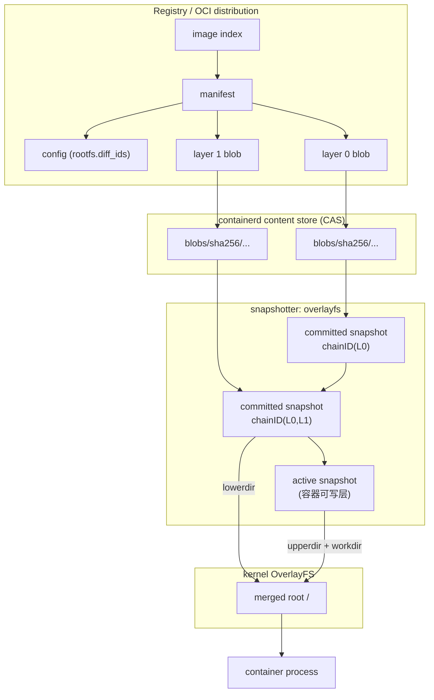
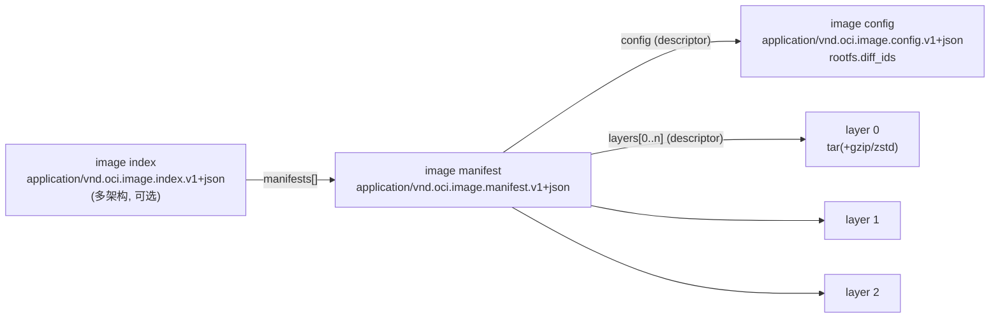
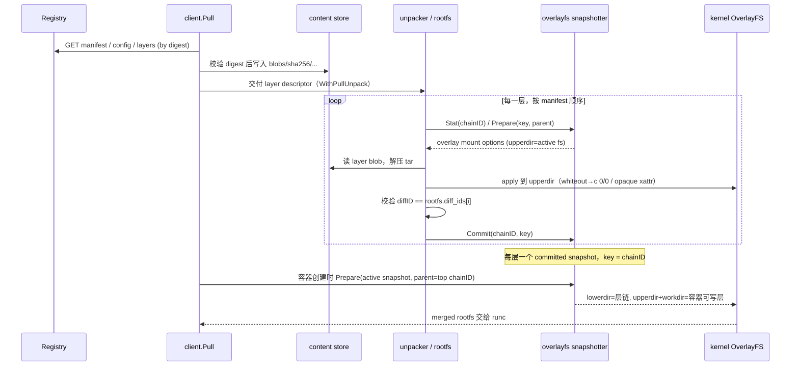

# OverlayFS 与镜像层：从联合挂载到 OCI 分层

> 基线：linux 7.3 (c03c1a1)、image-spec v1.1.1 (147f9c1)、containerd v2.4.2 (b7a2526)，检索于 2026-11。
> 本文所有 GitHub 代码链接固定到上述 40 位 commit，行号已用本地 checkout 的 `sed -n 'x,yp'` 逐条核对。

「容器分层」其实横跨三个世界：**OCI 规范**定义层长什么样，**内核 OverlayFS** 决定层怎么叠成一个目录，**containerd 的 snapshotter** 负责把前者变成后者。三者经常被混称为「镜像分层」，但边界很清楚。本文从规范一路下潜到 `fs/overlayfs`，再回到 containerd 的落地代码。

---

## 0. 一分钟版本：五个词各管一段

| 名词 | 一句话定义 | 谁负责 | 落盘/出现位置 |
|---|---|---|---|
| **OverlayFS** | 内核的联合挂载文件系统，把多个目录合成一棵可读写的目录树 | Linux kernel（`fs/overlayfs`） | 挂载后的 `merged` 视图，不占独立磁盘 |
| **镜像层（layer）** | OCI 定义的「文件系统增量」，序列化为 tar（可 gzip/zstd） | image-spec + 构建器（BuildKit 等） | registry 的 blob；本地 content store |
| **content store** | 按 digest 寻址的 CAS，所有 blob 一视同仁 | containerd `core/content` | `/var/lib/containerd/io.containerd.content.v1.content/blobs/sha256/...` |
| **snapshotter** | 管理「层解开后的目录快照」与挂载参数的插件 | containerd snapshotter（默认 `overlayfs`） | `/var/lib/containerd/io.containerd.snapshotter.v1.overlayfs/snapshots/<id>/fs` |
| **rootfs** | 容器进程看到的 `/` | OCI runtime（runc）+ overlay 挂载 | mount namespace 内 `pivot_root` 后的根 |

一句话链路：`registry → content store (CAS) → snapshotter (Prepare/Apply/Commit) → overlay merged rootfs → container`



术语边界见 [容器知识备忘录](./容器知识备忘录.md) 的 UnionFS 小节（只讲概念）；snapshotter 插件协议与 lazy pulling 分别在 [镜像快照器snapshotter](./镜像快照器snapshotter.md)、[镜像懒加载](./镜像懒加载.md) 展开，本文不重复。

---

## 1. 为什么镜像要分层

分层不是为了「好看」，而是同时解决五个互相独立的问题：

1. **写时复制（COW）**：容器启动不复制镜像；只有被写的文件才从 lower 复制到 upper。OverlayFS 文档把 copy-up 定义为「第一次需要写访问时」发生（[overlayfs.rst#L267-L272](https://github.com/torvalds/linux/blob/c03c1a14507dfaf8b856c2608f9ac216021fc222/Documentation/filesystems/overlayfs.rst#L267-L272)）。
2. **多镜像共享 base**：`python:3.12` 与 `python:3.12-slim` 若 base 层 digest 相同，本地只存一份，容器共用同一批 lower 目录。
3. **增量分发**：pull 时只需下载本地缺失的 digest；registry 天然支持按 blob 拉取（distribution-spec 的 blob API）。
4. **内容寻址去重**：manifest/config/layer 全部以 digest 命名，任何一层在 registry、content store、不同镜像之间都只存一份。
5. **可复现、可验证**：manifest 引用 config 与 layer 的 digest，config 又记录每层未压缩 tar 的 diffID；任何字节变化都会改变 digest。

还有一个工程收益：**构建缓存**。Dockerfile 的每条指令产生一层（`empty_layer` 的元数据指令除外），未变化的层可以直接复用。代价是层数会累积，后文 [3.5](#35-限制与坑) 和 [7](#7-常见误解) 会说明「层多」到底慢在哪。

---

## 2. UnionFS → OverlayFS：从 AUFS 到 overlay2

### 2.1 AUFS 的时代

AUFS（Another UnionFS）是最早被 Docker 大规模使用的联合文件系统。它长期是树外补丁：Docker 官方文档承认在 Ubuntu 上「需要把 AUFS 模块加进内核」才能用（[Docker: AUFS storage driver](https://docs.docker.com/engine/storage/drivers/aufs-driver/)）。树外的代价是每个发行版、每个内核版本都要自己打补丁，最终 AUFS 驱动在 Docker Engine v24.0 被移除。

OverlayFS 走的是相反路线：2014 年并入 Linux 3.18 主线（[Wikipedia: OverlayFS](https://en.wikipedia.org/wiki/OverlayFS)），从此成为内核自带能力。今天主流发行版的 Docker 经典存储驱动默认是 `overlay2`（[Docker: select a storage driver](https://docs.docker.com/engine/storage/drivers/select-storage-driver/)）；从 Docker Engine 29.0 起，新安装默认改用 containerd image store，底层仍是 containerd 的 `overlayfs` snapshotter。

### 2.2 三套命名，一个内核机制

| 语境 | 名字 | 目录布局 | 说明 |
|---|---|---|---|
| 内核 | OverlayFS（`overlay`） | `lowerdir` / `upperdir` / `workdir` / `merged` | 唯一真正实现联合挂载的组件 |
| Docker 经典驱动 | `overlay2` | `/var/lib/docker/overlay2/<id>/diff`、`/l` | 驱动自己管理层目录，最多 128 个 lower 层（[Docker 文档](https://docs.docker.com/engine/storage/drivers/overlayfs-driver/)） |
| containerd 插件 | `overlayfs` snapshotter | `snapshots/<id>/fs`、`snapshots/<id>/work` | snapshotter 协议 + overlay 挂载，见 [overlay.go#L620-L626](https://github.com/containerd/containerd/blob/b7a25261e029d68978bbf290df0a62fc819b3c51/plugins/snapshots/overlay/overlay.go#L620-L626) |

`overlay2` 为什么胜出，核心就三条：

- **在内核里**：不依赖树外模块，升级内核不用重新编译 AUFS。
- **性能与 page cache 共享**：多个容器读同一 lower 文件时共用同一份 page cache（[Docker 文档](https://docs.docker.com/engine/storage/drivers/overlayfs-driver/)）。
- **支持多层 lowerdir**：`overlay2` 正是为「多个只读层 + 一个可写层」设计的；老 `overlay` 驱动只有两个 lower，表达能力不足。

---

## 3. OverlayFS 内核语义

### 3.1 四要素与挂载

一个可写 overlay 挂载至少需要四个目录：

| 目录 | 角色 | 要求 |
|---|---|---|
| `lowerdir` | 只读的底层（可多个，`:` 分隔） | 可以任意文件系统；甚至可以是另一个 overlay |
| `upperdir` | 可写层，所有修改落在这里 | 必须可写；必须支持 `trusted.*`/`user.*` xattr 与合法 `d_type` |
| `workdir` | 内核内部工作区（原子 rename、whiteout 中转） | 必须与 upperdir 在**同一个 mount** 下，且不能互相包含 |
| `merged` | 用户看到的联合视图 | 由挂载点提供，本身不存数据 |

最小可写挂载：

```bash
mkdir -p /lower /upper /work /merged
mount -t overlay overlay \
  -o lowerdir=/lower,upperdir=/upper,workdir=/work \
  /merged
```

文档明确写了 `workdir` 必须与 `upperdir` 在同一文件系统上（[overlayfs.rst#L120-L126](https://github.com/torvalds/linux/blob/c03c1a14507dfaf8b856c2608f9ac216021fc222/Documentation/filesystems/overlayfs.rst#L120-L126)）；代码检查得更严格——要求两者是同一个 `vfsmount` 且不是互相包含的子树（[super.c#L812-L818](https://github.com/torvalds/linux/blob/c03c1a14507dfaf8b856c2608f9ac216021fc222/fs/overlayfs/super.c#L812-L818)、[super.c#L458-L460](https://github.com/torvalds/linux/blob/c03c1a14507dfaf8b856c2608f9ac216021fc222/fs/overlayfs/super.c#L458-L460)）。只读 overlay 可以省略 `upperdir`/`workdir`，但此时**至少要两个 lower**（[super.c#L1183-L1186](https://github.com/torvalds/linux/blob/c03c1a14507dfaf8b856c2608f9ac216021fc222/fs/overlayfs/super.c#L1183-L1186)）。

**多层顺序是本文最容易写错的地方**：`lowerdir` 从左到右，最左的是最高优先级（最靠近 upper），最右的是最低层。文档原文：

> The specified lower directories will be stacked beginning from the rightmost one and going left. In the above example lower1 will be the top, lower2 the middle and lower3 the bottom layer.

（[overlayfs.rst#L368-L378](https://github.com/torvalds/linux/blob/c03c1a14507dfaf8b856c2608f9ac216021fc222/Documentation/filesystems/overlayfs.rst#L368-L378)）

代码里的对应关系：upper 固定为 `layers[0]`（[super.c#L533](https://github.com/torvalds/linux/blob/c03c1a14507dfaf8b856c2608f9ac216021fc222/fs/overlayfs/super.c#L533)），lower 按参数出现顺序从 `layers[1]` 开始（[super.c#L1221-L1226](https://github.com/torvalds/linux/blob/c03c1a14507dfaf8b856c2608f9ac216021fc222/fs/overlayfs/super.c#L1221-L1226)）——所以 `lowerdir=/top:/mid:/base` 中 `/top` 是 `layers[1]`，优先级最高。split 逻辑在 [params.c#L210-L262](https://github.com/torvalds/linux/blob/c03c1a14507dfaf8b856c2608f9ac216021fc222/fs/overlayfs/params.c#L210-L262)，选项名注册在 [params.c#L162-L166](https://github.com/torvalds/linux/blob/c03c1a14507dfaf8b856c2608f9ac216021fc222/fs/overlayfs/params.c#L162-L166)。

层数有两个上限：

- 内核硬上限 `OVL_MAX_STACK 500`（[params.h#L20](https://github.com/torvalds/linux/blob/c03c1a14507dfaf8b856c2608f9ac216021fc222/fs/overlayfs/params.h#L20)）。
- 实际更早撞上的是 **mount 参数的页大小限制**。Docker 为此在 `overlay2/l/` 下放短符号链接，并在文档里说明 `overlay2` 原生支持最多 128 个 lower 层（[Docker 文档](https://docs.docker.com/engine/storage/drivers/overlayfs-driver/)）。

### 3.2 copy-up：什么时候复制，什么时候不复制

OverlayFS 只有在**需要写访问**时才把文件从 lower 复制到 upper。核心判断只有一行：

```c
static inline bool ovl_open_flags_need_copy_up(int flags)
{
	if (!flags)
		return false;

	return ((OPEN_FMODE(flags) & FMODE_WRITE) || (flags & O_TRUNC));
}
```

（[overlayfs.h#L443-L449](https://github.com/torvalds/linux/blob/c03c1a14507dfaf8b856c2608f9ac216021fc222/fs/overlayfs/overlayfs.h#L443-L449)）

`ovl_open` 在打开文件时调用 `ovl_maybe_copy_up`（[file.c#L198-L222](https://github.com/torvalds/linux/blob/c03c1a14507dfaf8b856c2608f9ac216021fc222/fs/overlayfs/file.c#L198-L222)），`ovl_maybe_copy_up` 再检查三件事：是否已经 copy-up、是否特殊文件、open flags 是否真的需要写（[copy_up.c#L1260-L1281](https://github.com/torvalds/linux/blob/c03c1a14507dfaf8b856c2608f9ac216021fc222/fs/overlayfs/copy_up.c#L1260-L1281)）。

| 操作 | 触发 copy-up？ | 依据 |
|---|---|---|
| `open(O_RDONLY)` | 否 | `flags == 0`，直接返回 false |
| `open(O_RDONLY\|O_DIRECT)` | 否 | 没有 `FMODE_WRITE`，也没有 `O_TRUNC` |
| `open(O_WRONLY/O_RDWR)`、`O_TRUNC` | 是 | 上面的表达式 |
| `chmod`/`chown`/`utimes`/`setxattr` | 是（元数据 copy-up） | `ovl_setattr` / `ovl_xattr_set` 先 `ovl_copy_up`（[inode.c#L21-L46](https://github.com/torvalds/linux/blob/c03c1a14507dfaf8b856c2608f9ac216021fc222/fs/overlayfs/inode.c#L21-L46)、[xattrs.c#L36-L54](https://github.com/torvalds/linux/blob/c03c1a14507dfaf8b856c2608f9ac216021fc222/fs/overlayfs/xattrs.c#L36-L54)） |
| `truncate` | 是，且连数据一起复制 | `ATTR_SIZE` 走 `ovl_copy_up_with_data`（同上） |
| 在 lower 文件上创建硬链接 | 是 | 文档明确要求（[overlayfs.rst#L270-L272](https://github.com/torvalds/linux/blob/c03c1a14507dfaf8b856c2608f9ac216021fc222/Documentation/filesystems/overlayfs.rst#L270-L272)） |
| `stat`/`readdir` | 否 | 只读路径不触发 |

完整 copy-up 路径：`ovl_copy_up_flags` 从目标 dentry 向上找到「第一个还没有 upper 别名的祖先」，逐级 copy-up 父目录，再 `ovl_copy_up_one`（[copy_up.c#L1209-L1258](https://github.com/torvalds/linux/blob/c03c1a14507dfaf8b856c2608f9ac216021fc222/fs/overlayfs/copy_up.c#L1209-L1258)）。复制顺序是：

1. 在 upper 里确保父目录存在，按 upper 元数据创建对象，复制数据（[copy_up.c#L639-L657](https://github.com/torvalds/linux/blob/c03c1a14507dfaf8b856c2608f9ac216021fc222/fs/overlayfs/copy_up.c#L639-L657)）和扩展属性（`ovl_copy_xattr`，[copy_up.c#L75-L169](https://github.com/torvalds/linux/blob/c03c1a14507dfaf8b856c2608f9ac216021fc222/fs/overlayfs/copy_up.c#L75-L169)）；
2. 用 rename/link 原子地装到 upper 的目标位置（首选 `O_TMPFILE` + link，见 `ovl_do_copy_up`，[copy_up.c#L932-L1026](https://github.com/torvalds/linux/blob/c03c1a14507dfaf8b856c2608f9ac216021fc222/fs/overlayfs/copy_up.c#L932-L1026)）。

**metacopy 优化**：如果只改了元数据（chmod/chown），`metacopy=on` 允许只复制元数据，文件内容留到真正 `open(O_WRITE)` 时再复制。此时 upper 文件带 `trusted.overlay.metacopy` xattr、内容为空（[overlayfs.rst#L394-L425](https://github.com/torvalds/linux/blob/c03c1a14507dfaf8b856c2608f9ac216021fc222/Documentation/filesystems/overlayfs.rst#L394-L425)；代码在 [copy_up.c#L1028-L1056](https://github.com/torvalds/linux/blob/c03c1a14507dfaf8b856c2608f9ac216021fc222/fs/overlayfs/copy_up.c#L1028-L1056) 与 [copy_up.c#L1082-L1128](https://github.com/torvalds/linux/blob/c03c1a14507dfaf8b856c2608f9ac216021fc222/fs/overlayfs/copy_up.c#L1082-L1128)）。代价是安全边界：文档明确警告不要对不可信 upper/lower 开 `metacopy=on`，否则攻击者可以构造带 `redirect`/`metacopy` xattr 的文件去读 lower 上任意路径（[overlayfs.rst#L414-L419](https://github.com/torvalds/linux/blob/c03c1a14507dfaf8b856c2608f9ac216021fc222/Documentation/filesystems/overlayfs.rst#L414-L419)）。

copy-up 的延迟是容器「第一次写」变慢的主因；一旦复制完成，后续写直接落到 upper，不再经过 overlay。文档还提到 `fsync=auto` 默认会在数据 copy-up 完成前对 upper 文件 `fsync`，把「崩溃后看到全零文件」的概率降到最低（[overlayfs.rst#L801-L848](https://github.com/torvalds/linux/blob/c03c1a14507dfaf8b856c2608f9ac216021fc222/Documentation/filesystems/overlayfs.rst#L801-L848)）。

### 3.3 删除与 whiteout：`rm` 到底做了什么

lower 是只读的，**不能真的删**。OverlayFS 的做法是在 upper 里放一个「墓碑」：

- **whiteout**：字符设备，major/minor 都是 0（`0/0`）。文档写得很直白：`A whiteout is created as a character device with 0/0 device number`（[overlayfs.rst#L147-L152](https://github.com/torvalds/linux/blob/c03c1a14507dfaf8b856c2608f9ac216021fc222/Documentation/filesystems/overlayfs.rst#L147-L152)）。
- **opaque 目录**：目录上设置 `trusted.overlay.opaque=y`，表示「这个目录的内容完全以 upper 为准，不要再往下 merge」（[overlayfs.rst#L154-L161](https://github.com/torvalds/linux/blob/c03c1a14507dfaf8b856c2608f9ac216021fc222/Documentation/filesystems/overlayfs.rst#L154-L161)）。

关键代码：

| 动作 | 位置 |
|---|---|
| 判断一个 dentry 是不是 whiteout | `ovl_is_whiteout` / `ovl_path_is_whiteout`（[util.c#L640-L655](https://github.com/torvalds/linux/blob/c03c1a14507dfaf8b856c2608f9ac216021fc222/fs/overlayfs/util.c#L640-L655)） |
| 创建 whiteout | `ovl_do_whiteout` → `vfs_whiteout`（[overlayfs.h#L397-L403](https://github.com/torvalds/linux/blob/c03c1a14507dfaf8b856c2608f9ac216021fc222/fs/overlayfs/overlayfs.h#L397-L403)） |
| whiteout inode 复用（性能优化） | `ovl_whiteout` 在 workdir 建一个共享 whiteout，再 hardlink 到目标目录（[dir.c#L77-L120](https://github.com/torvalds/linux/blob/c03c1a14507dfaf8b856c2608f9ac216021fc222/fs/overlayfs/dir.c#L77-L120)） |
| 删除 + 放 whiteout | `ovl_cleanup_and_whiteout`（[dir.c#L122-L159](https://github.com/torvalds/linux/blob/c03c1a14507dfaf8b856c2608f9ac216021fc222/fs/overlayfs/dir.c#L122-L159)） |
| `unlink(2)` / `rmdir(2)` 入口 | [dir.c#L985-L993](https://github.com/torvalds/linux/blob/c03c1a14507dfaf8b856c2608f9ac216021fc222/fs/overlayfs/dir.c#L985-L993) |
| lookup 时遇到 whiteout 就停止下探 | [namei.c#L284-L287](https://github.com/torvalds/linux/blob/c03c1a14507dfaf8b856c2608f9ac216021fc222/fs/overlayfs/namei.c#L284-L287) |
| 设置 opaque（`"y"`） | `ovl_set_opaque_xerr`（[dir.c#L270-L291](https://github.com/torvalds/linux/blob/c03c1a14507dfaf8b856c2608f9ac216021fc222/fs/overlayfs/dir.c#L270-L291)） |
| lookup 读取 opaque | [namei.c#L323-L333](https://github.com/torvalds/linux/blob/c03c1a14507dfaf8b856c2608f9ac216021fc222/fs/overlayfs/namei.c#L323-L333) |
| readdir 时跳过 whiteout | `ovl_check_whiteouts`（[readdir.c#L351-L371](https://github.com/torvalds/linux/blob/c03c1a14507dfaf8b856c2608f9ac216021fc222/fs/overlayfs/readdir.c#L351-L371)） |

xattr 名字的权威列表在 [util.c#L861-L887](https://github.com/torvalds/linux/blob/c03c1a14507dfaf8b856c2608f9ac216021fc222/fs/overlayfs/util.c#L861-L887)：`overlay.opaque`、`overlay.redirect`、`overlay.origin`、`overlay.metacopy`、`overlay.whiteout` 等，分别有 `trusted.` 和 `user.` 两套前缀。

**在 upperdir 里能看到什么**：whiteout 就是一个真实的字符设备：

```console
$ ls -la /upper/dir/
c--------- 1 root root 0, 0 Nov 19 12:00 deleted-file
$ stat /upper/dir/deleted-file
  File: /upper/dir/deleted-file
  Type: character special file
Device: 0,0     Inode: ...
```

在 `merged` 里，这个文件既看不到 whiteout 本身，也看不到 lower 里被遮住的原文件——lookup 遇到 whiteout 就停止（[namei.c#L284-L287](https://github.com/torvalds/linux/blob/c03c1a14507dfaf8b856c2608f9ac216021fc222/fs/overlayfs/namei.c#L284-L287)），readdir 也会跳过它（[readdir.c#L351-L371](https://github.com/torvalds/linux/blob/c03c1a14507dfaf8b856c2608f9ac216021fc222/fs/overlayfs/readdir.c#L351-L371)）。

`rm -rf` 一个 lower 目录时，upper 里留下的是该目录的 whiteout；如果之后又创建（或 rename 成）同名目录，内核会设置 `trusted.overlay.opaque=y` 来遮住 lower 的全部子项。文档同时规定 opaque 目录里不应再有 whiteout（[overlayfs.rst#L158-L163](https://github.com/torvalds/linux/blob/c03c1a14507dfaf8b856c2608f9ac216021fc222/Documentation/filesystems/overlayfs.rst#L158-L163)），因为它们已经没有意义。

### 3.4 特性开关：各自解决什么、代价是什么

| 开关 | 解决什么 | 代价 / 限制 |
|---|---|---|
| `redirect_dir` | 允许 `rename(2)` lower/merged 目录：copy-up 目录（不含内容），在 xattr 里记录原路径 | 默认关闭时目录 rename 返回 `EXDEV`；开启后多一层 redirect 查找与 xattr 依赖（[overlayfs.rst#L200-L246](https://github.com/torvalds/linux/blob/c03c1a14507dfaf8b856c2608f9ac216021fc222/Documentation/filesystems/overlayfs.rst#L200-L246)） |
| `metacopy` | 元数据变更只复制元数据，数据延迟到写时复制 | 安全风险（不可信层）、与 `redirect_dir`/`nfs_export` 部分组合冲突（[overlayfs.rst#L394-L425](https://github.com/torvalds/linux/blob/c03c1a14507dfaf8b856c2608f9ac216021fc222/Documentation/filesystems/overlayfs.rst#L394-L425)） |
| `index` | 为 copy-up 的 lower inode 建索引，保证硬链接不被 copy-up 拆散，并支持 NFS 文件句柄 | 要求 lower 支持 NFS export / 有效 UUID；mount 时校验 origin，失败 `ESTALE`；不适合「同一个 upper 换不同 lower」的场景（[overlayfs.rst#L563-L581](https://github.com/torvalds/linux/blob/c03c1a14507dfaf8b856c2608f9ac216021fc222/Documentation/filesystems/overlayfs.rst#L563-L581)） |
| `nfs_export` | 把 overlay 目录树导出给 NFS | 每次 copy-up 建 index entry；mount 时验证所有目录 index，可能很慢；`index=off,nfs_export=on` 对读写挂载冲突（[overlayfs.rst#L702-L767](https://github.com/torvalds/linux/blob/c03c1a14507dfaf8b856c2608f9ac216021fc222/Documentation/filesystems/overlayfs.rst#L702-L767)） |
| `userxattr` | 用 `user.overlay.*` 代替 `trusted.overlay.*`，支持非特权（rootless）挂载 | 换了 xattr 命名空间，与 root 模式的语义不通用；`user.*` 更容易被普通用户设置，安全边界不同（[overlayfs.rst#L879-L884](https://github.com/torvalds/linux/blob/c03c1a14507dfaf8b856c2608f9ac216021fc222/Documentation/filesystems/overlayfs.rst#L879-L884)） |
| `xino` | 让 `st_ino` 在多层、跨文件系统时保持唯一/持久 | 需要底层 inode 号高位空闲；`xino=on/auto` 通常能保持 `st_ino == d_ino`，但 inode 号溢出时退化为非持久 inode（[overlayfs.rst#L648-L663](https://github.com/torvalds/linux/blob/c03c1a14507dfaf8b856c2608f9ac216021fc222/Documentation/filesystems/overlayfs.rst#L648-L663)） |

containerd 的 `overlayfs` snapshotter **默认只追加 `index=off`（内核支持时）并按需检测 `userxattr`**，不启用 `metacopy`/`redirect_dir`（[overlay.go#L150-L165](https://github.com/containerd/containerd/blob/b7a25261e029d68978bbf290df0a62fc819b3c51/plugins/snapshots/overlay/overlay.go#L150-L165)）。因此容器默认拿不到 `index` 的硬链接保真能力；需要 NFS 导出或同一 upper 换 lower 复用时要显式调整挂载选项。

### 3.5 限制与坑

- **目录 rename**：默认返回 `EXDEV`，应用需要准备「复制 + 删除」回退；Docker 文档也把它列为兼容性限制（[Docker 文档](https://docs.docker.com/engine/storage/drivers/overlayfs-driver/)）。
- **硬链接语义**：没有 `index` 时，一个多硬链接文件 copy-up 会「拆链」，其他名字仍指向 lower，修改不互通（[overlayfs.rst#L638-L646](https://github.com/torvalds/linux/blob/c03c1a14507dfaf8b856c2608f9ac216021fc222/Documentation/filesystems/overlayfs.rst#L638-L646)）。
- **`st_ino` 不稳定**：所有层同一文件系统时，overlay 可以复用真实 inode 号；跨文件系统且 `xino=off` 时，持久性、`st_ino == d_ino` 都不保证（[overlayfs.rst#L54-L80](https://github.com/torvalds/linux/blob/c03c1a14507dfaf8b856c2608f9ac216021fc222/Documentation/filesystems/overlayfs.rst#L54-L80)）。代码里对「copy-up origin」的复用条件也有详细注释（[inode.c#L196-L229](https://github.com/torvalds/linux/blob/c03c1a14507dfaf8b856c2608f9ac216021fc222/fs/overlayfs/inode.c#L196-L229)）。依赖 inode 号的工具（备份、去重、inotify 观察）会遇到「同一文件不同视角」。
- **`d_type` 是硬要求**：upper 必须在 readdir 里返回合法 `d_type`，否则 whiteout 会暴露成普通文件；NFS 因此不适合做 upper（[overlayfs.rst#L98-L104](https://github.com/torvalds/linux/blob/c03c1a14507dfaf8b856c2608f9ac216021fc222/Documentation/filesystems/overlayfs.rst#L98-L104)）。内核 mount 时会显式检查并告警（[super.c#L691-L700](https://github.com/torvalds/linux/blob/c03c1a14507dfaf8b856c2608f9ac216021fc222/fs/overlayfs/super.c#L691-L700)），containerd 启动 snapshotter 时也会拒绝不支持 `d_type` 的目录（[overlay.go#L132-L138](https://github.com/containerd/containerd/blob/b7a25261e029d68978bbf290df0a62fc819b3c51/plugins/snapshots/overlay/overlay.go#L132-L138)）。
- **xattr 注入**：镜像 tar 里的 `SCHILY.xattr.*` 会被 containerd 直接 `setxattr`（[tar.go#L419-L435](https://github.com/containerd/containerd/blob/b7a25261e029d68978bbf290df0a62fc819b3c51/pkg/archive/tar.go#L419-L435)），包括 `trusted.overlay.*`。root 解包不可信镜像时，layer 作者有能力在 upper 里伪造 overlay 私有 xattr；这正是内核文档禁止 `metacopy=on` 与不可信层混用的原因（[overlayfs.rst#L414-L419](https://github.com/torvalds/linux/blob/c03c1a14507dfaf8b856c2608f9ac216021fc222/Documentation/filesystems/overlayfs.rst#L414-L419)）。overlay 挂载本身会用 `overlay.overlay.` 前缀转义私有 xattr，防止嵌套时泄漏（[xattrs.c#L7-L34](https://github.com/torvalds/linux/blob/c03c1a14507dfaf8b856c2608f9ac216021fc222/fs/overlayfs/xattrs.c#L7-L34)）。
- **列目录性能**：merged 目录的 readdir 要读 upper + 所有 lower 并合并去重，结果缓存在 `struct file` 上；目录读一半时发生的变化不会出现（[overlayfs.rst#L168-L176](https://github.com/torvalds/linux/blob/c03c1a14507dfaf8b856c2608f9ac216021fc222/Documentation/filesystems/overlayfs.rst#L168-L176)）。
- **不要在线改底层**：挂载期间修改 underlying upper/lower 是未定义行为；离线改 lower 也只在没启用 `metacopy`/`index`/`xino`/`redirect_dir` 时安全（[overlayfs.rst#L666-L679](https://github.com/torvalds/linux/blob/c03c1a14507dfaf8b856c2608f9ac216021fc222/Documentation/filesystems/overlayfs.rst#L666-L679)）。
- **非 POSIX 行为**：lower 文件的 `st_atime` 不更新、`MAP_SHARED` 的只读映射看不到后续修改、执行中的文件可被写/截断而不报 `ETXTBSY`（[overlayfs.rst#L614-L624](https://github.com/torvalds/linux/blob/c03c1a14507dfaf8b856c2608f9ac216021fc222/Documentation/filesystems/overlayfs.rst#L614-L624)）。

---

## 4. OCI 镜像分层（image-spec 精读）

### 4.1 index → manifest → config / layers

OCI 镜像是一棵由 **content descriptor** 串起来的 Merkle DAG。descriptor 的三个必需字段是 `mediaType`、`digest`、`size`（[descriptor.md#L20-L34](https://github.com/opencontainers/image-spec/blob/147f9c13cedb47a0c4d9a11a222961073d585877/descriptor.md#L20-L34)），另有可选的 `urls`/`annotations`/`data`。digest 是内容寻址的关键，规范明确说它「uniquely identifies content by taking a collision-resistant hash of the bytes」（[descriptor.md#L68-L80](https://github.com/opencontainers/image-spec/blob/147f9c13cedb47a0c4d9a11a222961073d585877/descriptor.md#L68-L80)）。



- **image index** 是可选的「fat manifest」，按平台列出 manifest（[image-index.md#L30-L33](https://github.com/opencontainers/image-spec/blob/147f9c13cedb47a0c4d9a11a222961073d585877/image-index.md#L30-L33)）。
- **manifest** 恰好引用一个 config 和一组 layers（[manifest.md#L36-L39](https://github.com/opencontainers/image-spec/blob/147f9c13cedb47a0c4d9a11a222961073d585877/manifest.md#L36-L39)）；layers 的第 0 项是 base，后续按 stack 顺序叠加（[manifest.md#L62-L75](https://github.com/opencontainers/image-spec/blob/147f9c13cedb47a0c4d9a11a222961073d585877/manifest.md#L62-L75)）。
- **config** 里 `rootfs.diff_ids` 是每层「未压缩 tar」的 digest，顺序与 layers 一致（[config.md#L220-L222](https://github.com/opencontainers/image-spec/blob/147f9c13cedb47a0c4d9a11a222961073d585877/config.md#L220-L222)）。

常见 media type 一览（[media-types.md#L3-L12](https://github.com/opencontainers/image-spec/blob/147f9c13cedb47a0c4d9a11a222961073d585877/media-types.md#L3-L12)）：

| 资源 | media type |
|---|---|
| index | `application/vnd.oci.image.index.v1+json` |
| manifest | `application/vnd.oci.image.manifest.v1+json` |
| config | `application/vnd.oci.image.config.v1+json` |
| layer（未压缩 tar） | `application/vnd.oci.image.layer.v1.tar` |
| layer（gzip） | `application/vnd.oci.image.layer.v1.tar+gzip` |
| layer（zstd） | `application/vnd.oci.image.layer.v1.tar+zstd` |

### 4.2 layer 是 tar changeset，不是「一个目录」

规范对 layer 的定义是 **filesystem changeset**：只包含相对父层的增删改，序列化成 tar（[layer.md#L19-L21](https://github.com/opencontainers/image-spec/blob/147f9c13cedb47a0c4d9a11a222961073d585877/layer.md#L19-L21)）。它可以是 `tar`、`tar+gzip`、`tar+zstd` 三种之一（[layer.md#L7](https://github.com/opencontainers/image-spec/blob/147f9c13cedb47a0c4d9a11a222961073d585877/layer.md#L7)）。

因此必须区分三个 digest：

| 名称 | 对什么算 digest | 出现在哪里 | 作用 |
|---|---|---|---|
| **layer digest（blob digest）** | registry 里实际存储的字节（通常是压缩后的 tar.gz） | manifest 的 `layers[].digest` | 分发、CAS 寻址、校验下载 |
| **diffID** | **解压后**的 tar 字节 | config 的 `rootfs.diff_ids[]`；containerd 还给 blob 打 `containerd.io/uncompressed` label | 校验「解包出来的内容」是否与镜像声明一致 |
| **chainID** | 递归哈希：`ChainID(L0)=diffID(L0)`，`ChainID(L0..Ln)=Digest(ChainID(L0..Ln-1) + " " + diffID(Ln))` | containerd 的 snapshot key | 标识「这一串层应用后的 rootfs」 |

diffID 的定义与「不要和 layer digest 混淆」的提醒在 [config.md#L26-L31](https://github.com/opencontainers/image-spec/blob/147f9c13cedb47a0c4d9a11a222961073d585877/config.md#L26-L31)；chainID 的递归定义和「为什么需要它」在 [config.md#L33-L53](https://github.com/opencontainers/image-spec/blob/147f9c13cedb47a0c4d9a11a222961073d585877/config.md#L33-L53)。ImageID 则是整个 config JSON 的 sha256（[config.md#L85-L89](https://github.com/opencontainers/image-spec/blob/147f9c13cedb47a0c4d9a11a222961073d585877/config.md#L85-L89)）。

> 一句话记法：**layer digest 管「传输」，diffID 管「内容」，chainID 管「顺序」**。同一层可以有不同压缩算法/不同 layer digest，但 diffID 必须相同；chainID 则把「层本身」和「层的应用顺序」绑定在一起。

### 4.3 whiteout 文件格式与「必须 apply」

OCI 的删除也用特殊文件表示：

- `.wh.<name>`：删除同目录下名为 `<name>` 的路径（[layer.md#L245-L252](https://github.com/opencontainers/image-spec/blob/147f9c13cedb47a0c4d9a11a222961073d585877/layer.md#L245-L252)）。
- `.wh..wh..opq`：opaque whiteout，隐藏该目录在 lower 里的**所有**子项（[layer.md#L276-L281](https://github.com/opencontainers/image-spec/blob/147f9c13cedb47a0c4d9a11a222961073d585877/layer.md#L276-L281)）。

例如 base 层有 `file1`、`a/file2`、`b/`，下一层删掉它们并新增 `file4`，tar 里是：

```text
.wh.file1
a/.wh.file2
.wh.b
file4
```

注意 `.wh.` 条目本身是普通文件（tar 里的 regular file），不是字符设备。规范特别规定「以 `.wh.` 开头的文件名不可能存在于合法文件系统」，并给出了三条顺序语义：

1. whiteout 只对 lower/parent 层生效；
2. 同一层里与 whiteout 同名的文件，不能被这一层的 whiteout 隐藏（只能被后续层的 whiteout 隐藏）；
3. opaque whiteout 要在处理该目录的新内容之前应用，**无论它在 tar 里的顺序**（[layer.md#L245-L252](https://github.com/opencontainers/image-spec/blob/147f9c13cedb47a0c4d9a11a222961073d585877/layer.md#L245-L252)、[layer.md#L336-L337](https://github.com/opencontainers/image-spec/blob/147f9c13cedb47a0c4d9a11a222961073d585877/layer.md#L336-L337)）。

**为什么必须 apply 而不是解包**：直接 `tar -xf` 只会得到一堆字面名为 `.wh.xxx` 的文件，删除语义完全丢失。规范的措辞是 layers 必须被 *applied*，而不是 simply extracted（[layer.md#L229-L233](https://github.com/opencontainers/image-spec/blob/147f9c13cedb47a0c4d9a11a222961073d585877/layer.md#L229-L233)）。containerd 的 `applyNaive` 就是这件事的参考实现：遇到 `.wh..wh..opq` 时清空目标目录里「不属于本层」的旧条目，遇到 `.wh.foo` 时删除 `foo`（[tar.go#L163-L227](https://github.com/containerd/containerd/blob/b7a25261e029d68978bbf290df0a62fc819b3c51/pkg/archive/tar.go#L163-L227)），并且用 `unpackedPaths` 记录本层已经写过的路径，避免 opaque 误删同层新文件。

> 顺序坑：explicit whiteout 和同名新增文件如果同时出现在一层，生成器应把 whiteout 放在前面（[layer.md#L274](https://github.com/opencontainers/image-spec/blob/147f9c13cedb47a0c4d9a11a222961073d585877/layer.md#L274)）。按 tar 顺序朴素 apply 的实现，如果先写 `foo` 再遇到 `.wh.foo`，会把刚写的新文件删掉。

---

## 5. 从 registry 到 merged rootfs：containerd 落地

### 5.1 content store 是 CAS

containerd 的 content store 按 digest 存 blob，与 registry 的布局几乎一致（[content-flow.md#L207-L213](https://github.com/containerd/containerd/blob/b7a25261e029d68978bbf290df0a62fc819b3c51/docs/content-flow.md#L207-L213)）：

```text
/var/lib/containerd/io.containerd.content.v1.content/
├── blobs/sha256/<hex>        # 每个 blob 一个文件，文件名就是 digest
└── ingest/<hash(ref)>/         # 正在写入的临时目录（可断点续传）
```

路径规则来自 [store.go#L646-L652](https://github.com/containerd/containerd/blob/b7a25261e029d68978bbf290df0a62fc819b3c51/plugins/content/local/store.go#L646-L652)。一次 pull 后 content store 里能同时看到 index、manifest、config、每层 blob（[content-flow.md#L225-L238](https://github.com/containerd/containerd/blob/b7a25261e029d68978bbf290df0a62fc819b3c51/docs/content-flow.md#L225-L238)）。

CAS 本身没有「引用」概念，GC 靠 **label** 表达引用边：

- manifest 上有 `containerd.io/gc.ref.content.config` 和 `containerd.io/gc.ref.content.l.<i>`；
- config 上有 `containerd.io/gc.ref.snapshot.overlayfs=<top chainID>`，把镜像和 snapshot 链钉住（[content-flow.md#L256-L270](https://github.com/containerd/containerd/blob/b7a25261e029d68978bbf290df0a62fc819b3c51/docs/content-flow.md#L256-L270)）；
- pull 期间用 **lease** 保护尚未完成的写入（`client.WithLease`，[image.go#L314-L319](https://github.com/containerd/containerd/blob/b7a25261e029d68978bbf290df0a62fc819b3c51/client/image.go#L314-L319)）。

### 5.2 Pull 与 unpack 链路

`WithPullUnpack` 只是把 `RemoteContext.Unpack` 置为 `true`（[client_opts.go#L161-L167](https://github.com/containerd/containerd/blob/b7a25261e029d68978bbf290df0a62fc819b3c51/client/client_opts.go#L161-L167)）；真正的拉取在 `Pull` 里：如果开了 unpack，会先构造 `unpack.Unpacker`，把 manifest/layer fetch 与解包流水线并行起来（[pull.go#L92-L160](https://github.com/containerd/containerd/blob/b7a25261e029d68978bbf290df0a62fc819b3c51/client/pull.go#L92-L160)）。

逐层解包的核心是 `Prepare → Apply → Commit` 三步（[rootfs/apply.go#L113-L175](https://github.com/containerd/containerd/blob/b7a25261e029d68978bbf290df0a62fc819b3c51/pkg/rootfs/apply.go#L113-L175)）：

1. `chainID = identity.ChainID(chain + diffID)`，先 `sn.Stat(chainID)`；已存在就跳过（[apply.go#L91-L111](https://github.com/containerd/containerd/blob/b7a25261e029d68978bbf290df0a62fc819b3c51/pkg/rootfs/apply.go#L91-L111)）。`sn.Prepare(key, parent)` 创建 active snapshot 并返回挂载参数。
2. `a.Apply(layer.Blob, mounts)` 把 tar 流应用到 active snapshot，核对 diffID 等于 `layer.Diff.Digest`，最后 `sn.Commit(chainID, key)` 提交为以 chainID 命名的 committed snapshot（[apply.go#L162-L175](https://github.com/containerd/containerd/blob/b7a25261e029d68978bbf290df0a62fc819b3c51/pkg/rootfs/apply.go#L162-L175)）。

并行 unpack 版本在 [unpacker.go#L495-L566](https://github.com/containerd/containerd/blob/b7a25261e029d68978bbf290df0a62fc819b3c51/core/unpack/unpacker.go#L495-L566)，逻辑等价；若 snapshot 已存在则直接跳过该层。

**whiteout 转换**发生在 diff applier 里。对 overlay 挂载，containerd 不走「挂载 merged 再解包」，而是直接把内容 apply 到 **upperdir** 路径，并传入 `OverlayConvertWhiteout`（[apply_linux.go#L34-L59](https://github.com/containerd/containerd/blob/b7a25261e029d68978bbf290df0a62fc819b3c51/core/diff/apply/apply_linux.go#L34-L59)；upperdir 从挂载参数里解析，[apply_linux.go#L75-L91](https://github.com/containerd/containerd/blob/b7a25261e029d68978bbf290df0a62fc819b3c51/core/diff/apply/apply_linux.go#L75-L91)）。转换规则非常直接：

```go
// .wh..wh..opq -> 在目录上设置 trusted.overlay.opaque=y
if base == whiteoutOpaqueDir {
    return false, unix.Setxattr(dir, "trusted.overlay.opaque", []byte{'y'}, 0)
}
// .wh.<name> -> 在 upper 里创建 0/0 字符设备
if strings.HasPrefix(base, whiteoutPrefix) {
    originalPath := filepath.Join(dir, base[len(whiteoutPrefix):])
    if err := unix.Mknod(originalPath, unix.S_IFCHR, 0); err != nil { ... }
    return false, os.Chown(originalPath, hdr.Uid, hdr.Gid)
}
```

（转换规则见 [tar_opts_linux.go#L28-L52](https://github.com/containerd/containerd/blob/b7a25261e029d68978bbf290df0a62fc819b3c51/pkg/archive/tar_opts_linux.go#L28-L52)。）

这也解释了为什么在 user namespace 里会退回 naive 路径：`mknod c 0 0` 在 userns 中通常不被允许（代码注释见 [apply_linux.go#L37-L41](https://github.com/containerd/containerd/blob/b7a25261e029d68978bbf290df0a62fc819b3c51/core/diff/apply/apply_linux.go#L37-L41)）。

### 5.3 最终的 overlay 挂载参数

snapshotter 的 `mounts()` 负责把 snapshot 链翻译成 mount options：没有 parent 时直接 bind `fs/`；有 parent 时拼 `lowerdir=<parentPaths joined by :>`，active snapshot 还加 `workdir` 与 `upperdir`（[overlay.go#L555-L618](https://github.com/containerd/containerd/blob/b7a25261e029d68978bbf290df0a62fc819b3c51/plugins/snapshots/overlay/overlay.go#L555-L618)）：

```go
options = append(options,
    fmt.Sprintf("workdir=%s", o.workPath(s.ID)),
    fmt.Sprintf("upperdir=%s", o.upperPath(s.ID)),
)
...
options = append(options, fmt.Sprintf("lowerdir=%s", strings.Join(parentPaths, ":")))
return []mount.Mount{{Type: "overlay", Source: "overlay", Options: options}}
```

`ParentIDs` 的顺序是「从最高层到最低层」（[metastore.go#L50-L58](https://github.com/containerd/containerd/blob/b7a25261e029d68978bbf290df0a62fc819b3c51/core/snapshots/storage/metastore.go#L50-L58)），正好符合 overlayfs「最左 = 最高优先级」的约定，所以直接 `strings.Join` 不需要反转。一个真实容器拿到的挂载大致是：

```bash
mount -t overlay overlay \
  -o lowerdir=/var/lib/containerd/io.containerd.snapshotter.v1.overlayfs/snapshots/6/fs:\
/var/lib/containerd/io.containerd.snapshotter.v1.overlayfs/snapshots/5/fs:\
...:\
/var/lib/containerd/io.containerd.snapshotter.v1.overlayfs/snapshots/1/fs,\
upperdir=/var/lib/containerd/io.containerd.snapshotter.v1.overlayfs/snapshots/7/fs,\
workdir=/var/lib/containerd/io.containerd.snapshotter.v1.overlayfs/snapshots/7/work \
  <container-rootfs>
```

（snapshot 编号是示意；active snapshot 的 `fs` 是 upperdir，`work` 是 workdir。）

### 5.4 全链路时序



注意最后一步：**容器启动不复制镜像**，只是为容器 `Prepare` 一个新的 active snapshot（upperdir + workdir），lowerdir 仍指向共享的 committed 链。这就是两个容器共用同一镜像时磁盘只多出各自可写层的原因（[content-flow.md#L450-L480](https://github.com/containerd/containerd/blob/b7a25261e029d68978bbf290df0a62fc819b3c51/docs/content-flow.md#L450-L480)）。

---

## 6. 动手验证清单

以下命令需要 root（`trusted.*` xattr 与 `mount` 需要 `CAP_SYS_ADMIN`）。建议在 disposable VM/容器里做。

### 6.1 手搓一个 overlay 挂载

```bash
sudo mkdir -p /tmp/ovl/{lower,upper,work,merged}
echo base > /tmp/ovl/lower/file
sudo mount -t overlay overlay \
  -o lowerdir=/tmp/ovl/lower,upperdir=/tmp/ovl/upper,workdir=/tmp/ovl/work \
  /tmp/ovl/merged

cat /tmp/ovl/merged/file                 # base
echo changed >> /tmp/ovl/merged/file     # 触发 copy-up
cat /tmp/ovl/upper/file                  # base changed
ls -la /tmp/ovl/lower /tmp/ovl/upper
mount | grep /tmp/ovl/merged             # 观察实际 lowerdir/upperdir/workdir
```

### 6.2 观察 whiteout 与 opaque

```bash
# ① whiteout：删除 lower 里的文件，upper 里出现 0/0 字符设备
sudo rm /tmp/ovl/merged/file
ls -la /tmp/ovl/upper/                   # c--------- 0,0 的字符设备 file
sudo stat /tmp/ovl/upper/file            # Type: character special file

# ② opaque：先在 lower 里预置目录（注意：挂载后直接改 lower 是未定义行为，
#    所以先卸载、补内容、再挂回）
sudo umount /tmp/ovl/merged
sudo mkdir -p /tmp/ovl/lower/dir && echo x | sudo tee /tmp/ovl/lower/dir/a >/dev/null
sudo mount -t overlay overlay \
  -o lowerdir=/tmp/ovl/lower,upperdir=/tmp/ovl/upper,workdir=/tmp/ovl/work \
  /tmp/ovl/merged

# 删除并重建同名目录：merged 目录的 upper 版本会带 opaque xattr
sudo rm -rf /tmp/ovl/merged/dir
sudo mkdir /tmp/ovl/merged/dir && echo y | sudo tee /tmp/ovl/merged/dir/b >/dev/null
sudo getfattr -d -m - /tmp/ovl/upper/dir # trusted.overlay.opaque="y"（需 attr 包）
ls /tmp/ovl/merged/dir                   # 只有 b（lower 的 a 被 opaque 隐藏）
```

### 6.3 看 containerd 的 content store 与 snapshots

```bash
sudo ctr content ls | head
sudo ctr snapshots ls                    # 或 ctr snapshot ls
sudo tree -L 3 /var/lib/containerd/io.containerd.content.v1.content/
sudo tree -L 3 /var/lib/containerd/io.containerd.snapshotter.v1.overlayfs/snapshots/ | head -30

# 验证 blob 的 digest 与 uncompressed（diffID）label
D=$(sudo ctr content ls -q | head -1)
sudo ctr content get "$D" | sha256sum
sudo ctr content ls | grep "$D"
```

### 6.4 在容器里写/删，再到 upperdir 看结果

```bash
sudo ctr run -d --snapshotter overlayfs docker.io/library/busybox:latest test-ovl sh -c 'sleep 1000'
CID=$(sudo ctr task ls | awk '/test-ovl/{print $1}')
sudo ctr task exec --exec-id 1 test-ovl sh -c 'echo hi > /tmp/x; rm /bin/sh'

# ① snapshot 的 key 就是容器 ID（client 用 id 调 Prepare）
sudo ctr snapshots ls | grep "$CID"       # 能看到 Active 快照，KEY=$CID

# ② 但快照目录名是 bolt 分配的数字 ID，不是 key/chainID；
#    从容器 rootfs 的 mount 参数里反查 upperdir 的数字 ID 目录
UPPER=$(sudo mount | grep 'type overlay' | grep 'test-ovl' | head -1 \
        | grep -o 'upperdir=[^,]*' | cut -d= -f2)
sudo ls -la "$UPPER/tmp/"                # 看到容器里写的 x
sudo ls -la "$UPPER/bin/" | grep sh      # 看到 0/0 字符设备 sh（rm /bin/sh 的 whiteout）
sudo ctr snapshots usage "$CID"          # 对比 Usage 与 upperdir 的实际占用
```

### 6.5 观察 `st_ino` 与 copy-up 前后的文件身份

```bash
stat -c '%i %d %n' /tmp/ovl/merged/file
echo z >> /tmp/ovl/merged/file
stat -c '%i %d %n' /tmp/ovl/merged/file   # 同 fs 时 st_ino 通常保持不变（copy-up origin）
```

如果所有层在同一个文件系统上，stat 的 inode 号会尽量复用 lower 的 origin；跨文件系统且 `xino=off` 时不要假设它稳定（见 [3.5](#35-限制与坑)）。

---

## 7. 常见误解

1. **「layer 就是一个 tar 文件」** —— 方向反了。layer 是「相对父层的 changeset」，tar 只是它的序列化容器；同一个 changeset 可以是 tar、tar.gz 或 tar.zst，diffID 不变、layer digest 会变。使用者必须 *apply* 它，而不是解包（[layer.md#L229-L233](https://github.com/opencontainers/image-spec/blob/147f9c13cedb47a0c4d9a11a222961073d585877/layer.md#L229-L233)）。
2. **「OverlayFS 会把各层合并占用一份磁盘」** —— `merged` 只是视图，不复制数据；磁盘占用等于 upper 的实际内容 + 各 lower 目录。`du` 在 merged 上看到的是底层真实文件的大小，不会把同一文件算两次。
3. **「容器里删文件就释放空间」** —— `rm` 只在 upper 里写一个 0 字节级的 whiteout，lower 的数据仍原样保留，镜像/快照不删就不会释放。要释放得删掉对应 snapshot/blob。
4. **「层数越多一定越慢」** —— 不准确。稳态下 dentry/inode 缓存会让 lookup 接近 O(1)；真正的成本在：首次访问未缓存路径时要逐层查找、readdir 要合并所有层、mount 参数随层数增长、copy-up 后 upper 层膨胀。层多的主要代价是**冷启动与元数据操作**，不是每次读都线性变慢。
5. **「snapshotter 是一种文件系统」** —— snapshotter 是 containerd 的插件/元数据管理者，负责创建、提交、挂载 snapshot；真正提供文件系统语义的是内核 overlayfs（或 btrfs/zfs/devmapper/native 等不同实现）。细节见 [镜像快照器snapshotter](./镜像快照器snapshotter.md)。
6. **「diffID 就是 layer digest」** —— diffID 是未压缩 tar 的 digest，layer digest 是 registry blob（通常压缩后）的 digest。containerd 用 `containerd.io/uncompressed` label 把两者关联（[content-flow.md#L273-L292](https://github.com/containerd/containerd/blob/b7a25261e029d68978bbf290df0a62fc819b3c51/docs/content-flow.md#L273-L292)）。
7. **「overlayfs 启动容器时会复制整个镜像」** —— 不会。启动只为容器 prepare 一个空的 active snapshot，lowerdir 共享已 committed 的层链，只有被写的文件才 copy-up。
8. **「多个 lowerdir 的顺序无所谓」** —— 顺序决定遮蔽关系：最左优先级最高，写反了会让低优先级层覆盖高优先级层，表现为「镜像里的文件版本不对」。
9. **「userxattr 只是 rootless 的小开关」** —— 它把私有 xattr 从 `trusted.overlay.*` 换成 `user.overlay.*`，两套命名空间语义不通用；安全边界也不同，不能和 root 模式的层混用。

---

## 8. 参考

**规范 / 官方文档**

- [OCI image-spec v1.1.1](https://github.com/opencontainers/image-spec/tree/147f9c13cedb47a0c4d9a11a222961073d585877) —— manifest / config / layer / descriptor / media-types
- [Linux kernel: Overlay Filesystem](https://docs.kernel.org/filesystems/overlayfs.html) —— 本文引用的 `overlayfs.rst` 的渲染版
- [Docker: OverlayFS storage driver](https://docs.docker.com/engine/storage/drivers/overlayfs-driver/)
- [Docker: AUFS storage driver（已废弃）](https://docs.docker.com/engine/storage/drivers/aufs-driver/) / [Select a storage driver](https://docs.docker.com/engine/storage/drivers/select-storage-driver/)
- [Wikipedia: OverlayFS](https://en.wikipedia.org/wiki/OverlayFS) —— 合并进主线的版本历史

**内核源码（linux @ c03c1a1）**

- [Documentation/filesystems/overlayfs.rst](https://github.com/torvalds/linux/blob/c03c1a14507dfaf8b856c2608f9ac216021fc222/Documentation/filesystems/overlayfs.rst)
- [fs/overlayfs/super.c](https://github.com/torvalds/linux/blob/c03c1a14507dfaf8b856c2608f9ac216021fc222/fs/overlayfs/super.c) / [params.c](https://github.com/torvalds/linux/blob/c03c1a14507dfaf8b856c2608f9ac216021fc222/fs/overlayfs/params.c) —— 挂载、层组装、workdir 校验
- [copy_up.c](https://github.com/torvalds/linux/blob/c03c1a14507dfaf8b856c2608f9ac216021fc222/fs/overlayfs/copy_up.c) / [inode.c](https://github.com/torvalds/linux/blob/c03c1a14507dfaf8b856c2608f9ac216021fc222/fs/overlayfs/inode.c) —— copy-up / metacopy / setattr / st_ino
- [dir.c](https://github.com/torvalds/linux/blob/c03c1a14507dfaf8b856c2608f9ac216021fc222/fs/overlayfs/dir.c) / [namei.c](https://github.com/torvalds/linux/blob/c03c1a14507dfaf8b856c2608f9ac216021fc222/fs/overlayfs/namei.c) —— whiteout / opaque / lookup
- [readdir.c](https://github.com/torvalds/linux/blob/c03c1a14507dfaf8b856c2608f9ac216021fc222/fs/overlayfs/readdir.c) / [util.c](https://github.com/torvalds/linux/blob/c03c1a14507dfaf8b856c2608f9ac216021fc222/fs/overlayfs/util.c) / [xattrs.c](https://github.com/torvalds/linux/blob/c03c1a14507dfaf8b856c2608f9ac216021fc222/fs/overlayfs/xattrs.c) —— merged readdir / xattr 名表 / 私有 xattr 过滤

**containerd（@ b7a2526）**

- [docs/content-flow.md](https://github.com/containerd/containerd/blob/b7a25261e029d68978bbf290df0a62fc819b3c51/docs/content-flow.md) —— content store / snapshots / container
- [pkg/archive/tar.go](https://github.com/containerd/containerd/blob/b7a25261e029d68978bbf290df0a62fc819b3c51/pkg/archive/tar.go) / [tar_opts_linux.go](https://github.com/containerd/containerd/blob/b7a25261e029d68978bbf290df0a62fc819b3c51/pkg/archive/tar_opts_linux.go) —— applyNaive 与 overlay whiteout 转换
- [core/diff/apply/apply_linux.go](https://github.com/containerd/containerd/blob/b7a25261e029d68978bbf290df0a62fc819b3c51/core/diff/apply/apply_linux.go) —— 直接 apply 到 upperdir
- [client/pull.go](https://github.com/containerd/containerd/blob/b7a25261e029d68978bbf290df0a62fc819b3c51/client/pull.go) / [client/image.go](https://github.com/containerd/containerd/blob/b7a25261e029d68978bbf290df0a62fc819b3c51/client/image.go) —— Pull / Unpack
- [pkg/rootfs/apply.go](https://github.com/containerd/containerd/blob/b7a25261e029d68978bbf290df0a62fc819b3c51/pkg/rootfs/apply.go) —— Prepare/Apply/Commit
- [plugins/snapshots/overlay/overlay.go](https://github.com/containerd/containerd/blob/b7a25261e029d68978bbf290df0a62fc819b3c51/plugins/snapshots/overlay/overlay.go) —— snapshotter 与 mount 参数

**站内相关**

- [容器知识备忘录](./容器知识备忘录.md) —— UnionFS 概念入门
- [镜像快照器snapshotter](./镜像快照器snapshotter.md) —— snapshotter 插件协议与实现
- [镜像懒加载](./镜像懒加载.md) —— stargz/nydus 等 lazy pulling
- [容器运行时全链路](../Kubernetes/容器运行时.md) —— OCI/CRI/containerd/shim 全景
