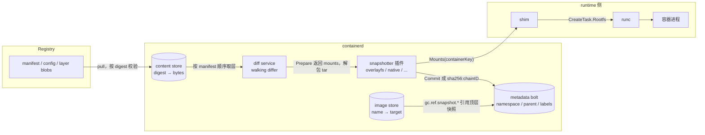
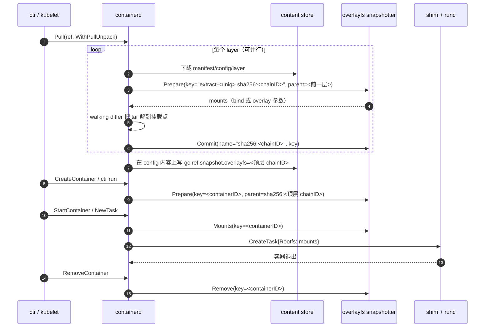

# 镜像快照器（Snapshotter）：containerd 如何把层变成 rootfs

> 基线：containerd v2.4.2 (b7a2526)，2026-11。
> 代码引用统一固定到 `github.com/containerd/containerd@b7a2526` 的 40 位 sha（形如 `/blob/<40位sha>/<path>#Lx-Ly`），行号用本地 checkout 核对过；镜像 ChainID 的定义引 image-spec。文档引用仓库内 `docs/` 的固定链接。

拉镜像时你看到的是 "layer"，跑容器时你看到的是 "rootfs"。把前者变成后者的那层插件，就是 **snapshotter**。它既不是镜像仓库，也不是存储驱动（storage driver）的简单等价物：它管理的是一棵**文件系统状态树**，每个节点是一次 COW 事务的产物。

---

## 1. 一分钟版本

### 1.1 三个概念

| 概念 | 是什么 | 寻址方式 | 谁负责 |
|---|---|---|---|
| **layer（层）** | 一段 tar（可压缩）形式的文件系统增量，以及 manifest/config 这些 JSON | `sha256:<digest>`（config 里记未压缩的 diffID） | content store（CAS） |
| **snapshot（快照）** | 某次挂载之后得到的文件系统状态；可能是可写的准备态、不可变的已提交态、只读视图 | 短字符串 key/name（active 用 key，committed 用 name） | snapshotter |
| **snapshotter（快照器）** | 把多个快照按父子关系叠起来、提供 mount 参数、并管理其生命周期的插件 | gRPC/Go 接口；插件 ID 如 `overlayfs` | 各驱动实现 + metadata 包装层 |

一句话：**content store 保存"字节"，snapshotter 保存"目录树状态"**。同一个 layer 字节可以被解包成多份快照，也可以从快照反向生成 diff（`ctr snapshot diff`）。

### 1.2 与其他组件的边界

| 组件 | 管什么 | 不管什么 |
|---|---|---|
| content store | manifest/config/layer blob，按 digest 校验与去重 | 目录、inode、可写层 |
| image store | `repo:tag` → target descriptor、平台、GC 标签 | 文件系统 |
| metadata（bolt） | 容器/镜像/快照的**命名空间、父子关系、标签、租约** | 数据本身 |
| **snapshotter** | 快照目录/子卷/块设备、mount options、父子链、usage | 镜像名、容器进程 |
| runtime v2 + shim/runc | 按 snapshotter 给的 mount 参数挂载 rootfs，执行 OCI 进程 | 层、快照元数据 |
| 客户端（ctr/CRI/nerdctl） | 决定用哪个 snapshotter、传 labels、在何时 Prepare/Commit/Remove | COW 细节 |



### 1.3 一次 pull + 一次 run 里 snapshotter 被调用几次

以 3 层镜像、`overlayfs` 为例：



| 阶段 | 调用 | 次数（3 层） | 说明 |
|---|---|---|---|
| pull | `Stat(chainID)` | 3（可选） | 判断该层是否已解包 |
| pull | `Prepare` | 3 | 每层一个 active key |
| pull | `Commit` | 3 | 提交为 `sha256:<chainID>` |
| pull | `Update`（content store 标签） | 1 | 顶层 chainID 挂到 config 内容上，供 GC 用 |
| run | `Prepare` | 1 | key=容器 ID，parent=镜像顶层 chainID |
| run | `Mounts` | 1 | 创建 task 时取 rootfs 挂载参数 |
| 删除 | `Remove` | 1 | 删除容器时清理容器快照 |

注意：**解包 tar 本身不是 snapshotter 干的**，是 diff service（walking differ）在 Prepare 返回的挂载点上做的。snapshotter 的职责到"给出可挂载的目录组合"为止。

---

## 2. 为什么需要 snapshotter

如果没有 snapshotter 这一层抽象，containerd 就要把"如何在各种文件系统上叠加层"硬编码进镜像解包和容器创建流程。抽象之后它解决五类问题：

1. **每容器一个可写层**：镜像层是只读共享的，容器写入只能落在自己的可写层；进程退出、容器删除后只丢可写层。
2. **共享只读层**：同一镜像的 100 个容器共享同一批 lowerdir（或同一批 btrfs 子卷、同一批块设备只读快照），磁盘占用不随容器数线性增长。
3. **快速删除与 GC**：删除容器只需删除一个 active 快照（overlay 下就是删一个目录），镜像层仍被 image/其他容器引用；GC 按引用关系决定何时真正删除。
4. **快照/回滚/提交**：`Prepare → apply → Commit` 是一个事务模型，可把任意中间状态提交为命名快照，也可以 `View` 出只读视图做 diff。
5. **文件系统可插拔**：overlayfs、btrfs、devmapper、blockfile、erofs……上层 API 完全一致；Kata/VM 场景甚至需要块设备而不是目录。

> 类比 Docker：containerd 的 `overlayfs` snapshotter ≈ Docker/Moby 的 `overlay2` storage driver；`native` ≈ `vfs`。但术语不能互换——snapshotter 还有 `View`、`Commit`、`Cleanup`、远程快照协议等 Docker storage driver 没有的语义（[docs/snapshotters/README.md](https://github.com/containerd/containerd/blob/b7a25261e029d68978bbf290df0a62fc819b3c51/docs/snapshotters/README.md#L1-L34)）。

---

## 3. 核心模型

### 3.1 Kind：三种快照状态

`Kind` 只有三种有效值（[snapshotter.go#L69-L78](https://github.com/containerd/containerd/blob/b7a25261e029d68978bbf290df0a62fc819b3c51/core/snapshots/snapshotter.go#L69-L78)）：

| Kind | 创建方式 | 可写 | 可作父 | 语义与典型用途 |
|---|---|---|---|---|
| `Active` | `Prepare` | 是 | **否** | 一次进行中的事务；overlay 下有 `upperdir` + `workdir`。解包单层、容器 rootfs 都用它 |
| `Committed` | `Commit(name, key)` | 否 | 是 | 事务完成后的不可变快照；镜像层快照名为 `sha256:<chainID>` |
| `View` | `View` | 否 | 否 | 父快照的只读合并视图，用于 diff 等只读场景；不能 Commit |

接口文档把生命周期讲得很直白：active 快照永远不会"变成" committed，Commit 是新建一个 committed 快照并移除 active key（[snapshotter.go#L165-L197](https://github.com/containerd/containerd/blob/b7a25261e029d68978bbf290df0a62fc819b3c51/core/snapshots/snapshotter.go#L165-L197)）。

### 3.2 key / name / parent / Info / Usage

| 字段 | 含义 | 备注 |
|---|---|---|
| `key` | **active/view** 快照的标识 | 与 committed 的 `name` 共享同一命名空间，不能重名 |
| `name` | **committed** 快照的标识 | 镜像场景下 = `sha256:<chainID>` |
| `parent` | 父快照的 name | 必须是 committed；空字符串表示"无父/空目录" |
| `Info` | `Kind`、`Name`、`Parent`、`Labels`、时间戳 | 对 `ctr snapshot ls` 暴露（[snapshotter.go#L127-L141](https://github.com/containerd/containerd/blob/b7a25261e029d68978bbf290df0a62fc819b3c51/core/snapshots/snapshotter.go#L127-L141)） |
| `Usage` | `Size`、`Inodes`，**不含父快照** | active 的 usage 常需实时扫描 upperdir（[snapshotter.go#L143-L160](https://github.com/containerd/containerd/blob/b7a25261e029d68978bbf290df0a62fc819b3c51/core/snapshots/snapshotter.go#L143-L160)） |

底层 bolt 存储不会把整条父链存成数组，而是每条快照记录一个 `parent` 名字，再在读取时向上走链。`storage.Snapshot.ParentIDs` 的顺序是**从直接父到最底层 base**，注释写得很明确（[metastore.go#L49-L59](https://github.com/containerd/containerd/blob/b7a25261e029d68978bbf290df0a62fc819b3c51/core/snapshots/storage/metastore.go#L49-L59)）：

```go
// The ParentIDs are ordered from the highest to the
// lowest base, meaning they should be applied in order from the last index to
// the first index. The first index should always be considered the active
// snapshot's immediate parent.
type Snapshot struct {
	Kind      snapshots.Kind
	ID        string
	ParentIDs []string
}
```

这个顺序直接决定了 `lowerdir=` 的拼法，见 §4.3。

`Info` 里没有 `Children` 字段：children 由 metadata 层用 bolt 的 children bucket 反向索引维护，删除父快照时靠它判断"还有没有子"（[snapshot.go#L683-L737](https://github.com/containerd/containerd/blob/b7a25261e029d68978bbf290df0a62fc819b3c51/core/metadata/snapshot.go#L683-L737)）。驱动本身只需要维护 `parent` 正向指针与 `ParentIDs` 链。

### 3.3 Labels：快照的"附带语义"

`containerd.io/snapshot/` 前缀的标签会被继承/透传，`containerd.io/snapshot.ref` 是其中特殊的一个（[snapshotter.go#L29-L67](https://github.com/containerd/containerd/blob/b7a25261e029d68978bbf290df0a62fc819b3c51/core/snapshots/snapshotter.go#L29-L67)）：

| Label | 谁写 | 作用 |
|---|---|---|
| `containerd.io/snapshot.ref` | unpacker | 本次 Prepare **期望得到的 committed 快照名**（chainID）。远程快照器若已有该快照，返回 `ErrAlreadyExists`，客户端就跳过下载与解包 |
| `containerd.io/snapshot/diff-id` | unpacker | 该层的未压缩 diffID |
| `containerd.io/snapshot/parent-chain-id` | unpacker | 并行解包时记录真实父，Commit 时用 `WithParent` rebase |
| `containerd.io/snapshot/uidmapping` / `gidmapping` | CRI/userns | 容器用户命名空间的映射，供 idmapped mount / chown 使用 |
| `containerd.io/snapshot/max-size` | 调用方 | 对可写快照的容量提示（blockfile/devmapper 类驱动可执行） |
| `containerd.io/snapshot/cri.image-ref` 等 | CRI/nerdctl 的 handler | 把镜像引用、manifest/layer digest 传给远程快照器 |
| `containerd.io/gc.root` | 调用方 | 值形如 RFC3339 时间，表示"在此之前别 GC 这个快照"（[snapshotter.go#L212-L218](https://github.com/containerd/containerd/blob/b7a25261e029d68978bbf290df0a62fc819b3c51/core/snapshots/snapshotter.go#L212-L218)） |

`FilterInheritedLabels` 只保留 `containerd.io/snapshot.ref` 和 `containerd.io/snapshot/` 前缀（[snapshotter.go#L406-L421](https://github.com/containerd/containerd/blob/b7a25261e029d68978bbf290df0a62fc819b3c51/core/snapshots/snapshotter.go#L406-L421)）；它保证 OCI descriptor 上的任意 annotation 不会无脑进入快照标签，只有约定的"快照标签"才会被继承。`WithParent` / `WithLabels` 则是两个 `Opt` 构造器（[snapshotter.go#L390-L429](https://github.com/containerd/containerd/blob/b7a25261e029d68978bbf290df0a62fc819b3c51/core/snapshots/snapshotter.go#L390-L429)）。

### 3.4 Snapshotter 接口逐方法

接口定义在 [snapshotter.go#L281-L377](https://github.com/containerd/containerd/blob/b7a25261e029d68978bbf290df0a62fc819b3c51/core/snapshots/snapshotter.go#L281-L377)：

| 方法 | 做了什么 | 典型调用者 |
|---|---|---|
| `Stat(ctx, key)` | 按 key/name 查 `Info`，用于存在性判断、取父、辨别 Kind | unpacker、CRI、ctr |
| `Update(ctx, info, fieldpaths...)` | 只允许改可变属性（标签/时间）；底层把 `containerd.io/snapshot/*` 过滤后透传 | `ctr snapshot set-label`、CRI 打标 |
| `Usage(ctx, key)` | 该快照自身占用；active 需扫描 upperdir，可能很慢 | kubelet 的 `ImageFsInfo`、监控 |
| `Mounts(ctx, key)` | 取 active/view 的 mount 参数，可重复调用（恢复挂载） | 创建 task 时（[container.go#L328-L360](https://github.com/containerd/containerd/blob/b7a25261e029d68978bbf290df0a62fc819b3c51/client/container.go#L328-L360)）、ctr |
| `Prepare(ctx, key, parent, opts...)` | 建 active 快照并返回 mounts；同 key 重复调用必须失败 | unpacker、容器创建 |
| `View(ctx, key, parent, opts...)` | 同 Prepare 但只读、不可 Commit | diff 计算（[diff.go#L33-L67](https://github.com/containerd/containerd/blob/b7a25261e029d68978bbf290df0a62fc819b3c51/pkg/rootfs/diff.go#L33-L67)） |
| `Commit(ctx, name, key, opts...)` | 把 active 提交为 committed；提交后 active key 消失 | unpacker、`ctr snapshot commit` |
| `Remove(ctx, key)` | 删 active 或 committed；有子快照时会失败 | 容器删除、打包清理 |
| `Walk(ctx, fn, filters...)` | 遍历，过滤条件支持 `name`/`parent`/`kind`/`labels.*` | `ctr snapshot ls`、GC |
| `Close()` | 释放 bolt 等内部资源 | 进程退出 |

另外还有可选的 **`Cleaner`** 接口，只有一个 `Cleanup(ctx)`（[snapshotter.go#L379-L388](https://github.com/containerd/containerd/blob/b7a25261e029d68978bbf290df0a62fc819b3c51/core/snapshots/snapshotter.go#L379-L388)）。它把"从元数据里删 key"（快）和"真正释放磁盘"（慢）拆开：支持异步删除的驱动先让 key 立即可复用，延迟到 `Cleanup` 再删目录/设备。

### 3.5 metadata（bolt）这一层做了什么

containerd 进程内并不是直接把用户 key 交给驱动，而是包了一层 `core/metadata`：

- **命名空间隔离**：`createKey` 把 `(namespace, id, key)` 编成后端 key：`<ns>/<seq>/<key>`（[snapshot.go#L61-L63](https://github.com/containerd/containerd/blob/b7a25261e029d68978bbf290df0a62fc819b3c51/core/metadata/snapshot.go#L61-L63)）。
- **带租约的存在**：创建快照时在 metadata 里挂 lease，避免并发 GC 把它删掉。
- **目标快照短路**：`Prepare` 若发现 `containerd.io/snapshot.ref` 指向的 committed 快照已存在，直接返回 `ErrAlreadyExists`（远程快照协议的关键，[snapshot.go#L297-L420](https://github.com/containerd/containerd/blob/b7a25261e029d68978bbf290df0a62fc819b3c51/core/metadata/snapshot.go#L297-L420)）。
- **后端一致性**：bolt 事务里做 `CreateSnapshot` / `CommitActive` / `Remove`，保证 key 的可见性与目录创建一致（[bolt.go#L217-L297](https://github.com/containerd/containerd/blob/b7a25261e029d68978bbf290df0a62fc819b3c51/core/snapshots/storage/bolt.go#L217-L297)、[#L298-L344](https://github.com/containerd/containerd/blob/b7a25261e029d68978bbf290df0a62fc819b3c51/core/snapshots/storage/bolt.go#L298-L344)、[#L350-L433](https://github.com/containerd/containerd/blob/b7a25261e029d68978bbf290df0a62fc819b3c51/core/snapshots/storage/bolt.go#L350-L433)）。

> 一个容易误解的点：**快照目录名是数字 ID，不是 key，也不是 chainID**。数字 ID 由 bolt 的 `NextSequence()` 分配，committed 后沿用同一个 ID（[bolt.go#L350-L380](https://github.com/containerd/containerd/blob/b7a25261e029d68978bbf290df0a62fc819b3c51/core/snapshots/storage/bolt.go#L350-L380)），所以你在 `snapshots/12/fs` 里看到的内容对应 `ctr snapshot ls` 里某条 `sha256:...`。

---

## 4. overlay 驱动实现精读

`overlayfs` 是默认快照器（[defaults_linux.go#L29-L32](https://github.com/containerd/containerd/blob/b7a25261e029d68978bbf290df0a62fc819b3c51/defaults/defaults_linux.go#L29-L32)），也是理解所有目录型快照器的最佳样本。插件 ID 注册为 `overlayfs`（[plugin.go#L56-L81](https://github.com/containerd/containerd/blob/b7a25261e029d68978bbf290df0a62fc819b3c51/plugins/snapshots/overlay/plugin/plugin.go#L56-L81)）。

### 4.1 插件根目录布局

插件根目录由 `config.Root` + 插件 URI 拼成（[server.go#L163-L176](https://github.com/containerd/containerd/blob/b7a25261e029d68978bbf290df0a62fc819b3c51/cmd/containerd/server/server.go#L163-L176)），默认 `root = /var/lib/containerd`、插件 URI = `io.containerd.snapshotter.v1.overlayfs`：

```text
/var/lib/containerd/io.containerd.snapshotter.v1.overlayfs/
├── metadata.db                      # bolt：快照 key/parent/kind/labels/usage
└── snapshots/
    ├── 12/                          # 数字 ID（bolt NextSequence 分配）
    │   ├── fs/                      # active 时是 upperdir；committed 时是只读层目录
    │   └── work/                    # 只有 active 才有：overlay 的 workdir
    └── 13/
        └── fs/
```

三个路径的构造函数一目了然（[overlay.go#L620-L626](https://github.com/containerd/containerd/blob/b7a25261e029d68978bbf290df0a62fc819b3c51/plugins/snapshots/overlay/overlay.go#L620-L626)）：

```go
func (o *snapshotter) upperPath(id string) string {
	return filepath.Join(o.root, "snapshots", id, "fs")
}
func (o *snapshotter) workPath(id string) string {
	return filepath.Join(o.root, "snapshots", id, "work")
}
```

初始化时做四件事（[overlay.go#L118-L176](https://github.com/containerd/containerd/blob/b7a25261e029d68978bbf290df0a62fc819b3c51/plugins/snapshots/overlay/overlay.go#L118-L176)）：

1. 检查根目录所在文件系统支持 `d_type`（xfs 需要 `ftype=1`），否则 overlay 不能可靠工作；
2. 打开/创建 `metadata.db`、`snapshots/`；
3. 自动判断是否需要 `userxattr`（rootless / userns 场景）；
4. 若内核支持 `index` 特性，默认加 `index=off`（避免 index 目录带来兼容问题；mount options 在内核里是 **last-wins**，所以追加在用户配置之后会覆盖配置，代码特意先检查是否已显式配置）。

### 4.2 createSnapshot：Prepare/View 的共同实现

`Prepare` 和 `View` 都进 `createSnapshot`（[overlay.go#L268-L274](https://github.com/containerd/containerd/blob/b7a25261e029d68978bbf290df0a62fc819b3c51/plugins/snapshots/overlay/overlay.go#L268-L274)、[#L431-L534](https://github.com/containerd/containerd/blob/b7a25261e029d68978bbf290df0a62fc819b3c51/plugins/snapshots/overlay/overlay.go#L431-L534)），步骤：

1. **在一个 bolt 写事务里**先调 `prepareDirectory`，在 `snapshots/` 下建临时目录 `new-*`：
   - `fs/` 权限 `0755`；
   - 只有 `KindActive` 才建 `work/`，权限 `0711`（[overlay.go#L536-L553](https://github.com/containerd/containerd/blob/b7a25261e029d68978bbf290df0a62fc819b3c51/plugins/snapshots/overlay/overlay.go#L536-L553)）。
2. `storage.CreateSnapshot` 写元数据：校验 parent 是 committed、分配 ID、写 parent backlink、组装 `ParentIDs`（[bolt.go#L217-L297](https://github.com/containerd/containerd/blob/b7a25261e029d68978bbf290df0a62fc819b3c51/core/snapshots/storage/bolt.go#L217-L297)）。
3. 处理 userns 的 uid/gid 映射：有映射标签就 chown 成映射后的 root；没有就沿用父快照 upperdir 的属主，保证 overlay 能合并。
4. 把临时目录 **rename** 成 `snapshots/<ID>`，然后返回 `o.mounts(s, info)`。

为什么先 `new-*` 再 rename：目录在元数据事务提交前不可见，进程崩在中间也只会留下一个不会被引用的临时目录，`Cleanup` 会按 ID 集合把它删掉。

### 4.3 mounts()：lowerdir 的顺序是灵魂

`mounts()` 是整个驱动最值得读的函数（[overlay.go#L555-L618](https://github.com/containerd/containerd/blob/b7a25261e029d68978bbf290df0a62fc819b3c51/plugins/snapshots/overlay/overlay.go#L555-L618)），按 parent 数量与 Kind 分四种情况：

| 条件 | 返回 | 原因 |
|---|---|---|
| `len(ParentIDs) == 0` | `bind` 挂自己的 `fs/`（active=`rw`，view=`ro`） | 没有 lower 时 overlay 无法工作，直接用 bind |
| `KindActive`（有 ≥1 个 parent） | `overlay`，带 `workdir=`、`upperdir=`、`lowerdir=` | 常规容器 rootfs / 解包 |
| `KindView` 且恰好 1 个 parent | `bind` 挂父快照的 `fs/`（`ro`） | 只有一层时 View 等价于只读 bind，省一次 overlay 挂载 |
| `KindView` 且 >1 个 parent | `overlay`，只有 `lowerdir=`，没有 upper/work | 没有 upperdir 的 overlay 天然是只读合并视图 |

lowerdir 的构造只有三行，但顺序至关重要：

```go
parentPaths := make([]string, len(s.ParentIDs))
for i := range s.ParentIDs {
	parentPaths[i] = o.upperPath(s.ParentIDs[i])
}
options = append(options, fmt.Sprintf("lowerdir=%s", strings.Join(parentPaths, ":")))
```

因为 `ParentIDs[0]` 是**直接父（最上层）**，最后一个元素是 base（最底层），而 overlayfs 的 lowerdir 里**左边优先级最高**，所以这里不能反转。一个 3 层镜像 + 容器可写层的挂载参数大致是：

```text
lowerdir=/var/lib/containerd/io.containerd.snapshotter.v1.overlayfs/snapshots/5/fs:\
/var/lib/containerd/io.containerd.snapshotter.v1.overlayfs/snapshots/4/fs:\
/var/lib/containerd/io.containerd.snapshotter.v1.overlayfs/snapshots/3/fs,\
upperdir=/var/lib/containerd/io.containerd.snapshotter.v1.overlayfs/snapshots/7/fs,\
workdir=/var/lib/containerd/io.containerd.snapshotter.v1.overlayfs/snapshots/7/work
```

5 是直接父（容器 active 快照的 parent，即镜像顶层 chainID），4、3 往下；7 是容器自己的 active 快照。**所有容器共享 3/4/5 这三个目录作为 lower**，只有 7 是各自的。

`mounts()` 结尾把驱动级 options（`userxattr`、`index=off`、`mount_options`）追加到 overlay 挂载参数里；bind 分支**不带**这些 options（[overlay.go#L74-L81](https://github.com/containerd/containerd/blob/b7a25261e029d68978bbf290df0a62fc819b3c51/plugins/snapshots/overlay/overlay.go#L74-L81)）。

### 4.4 Commit / Remove / AsynchronousRemove / Cleanup

**Commit**（[overlay.go#L300-L318](https://github.com/containerd/containerd/blob/b7a25261e029d68978bbf290df0a62fc819b3c51/plugins/snapshots/overlay/overlay.go#L300-L318)）：扫描 upperdir 得到 `Usage`，然后 `storage.CommitActive` 把 active 记录改名成 committed，目录不动、ID 不变。`CommitActive` 里有两个细节（[bolt.go#L350-L433](https://github.com/containerd/containerd/blob/b7a25261e029d68978bbf290df0a62fc819b3c51/core/snapshots/storage/bolt.go#L350-L433)）：

- **标签是替换而不是继承**（`si.Labels = base.Labels`）；
- 2.4 支持 **Commit 时 rebase 父**：如果 active 创建时没有父，而 commit 时 `WithParent` 指定了父，允许补上（并行解包场景，[unpacker.go#L550-L567](https://github.com/containerd/containerd/blob/b7a25261e029d68978bbf290df0a62fc819b3c51/core/unpack/unpacker.go#L550-L567)）。

**Remove**（[overlay.go#L320-L351](https://github.com/containerd/containerd/blob/b7a25261e029d68978bbf290df0a62fc819b3c51/plugins/snapshots/overlay/overlay.go#L320-L351)）：bolt 事务里调 `storage.Remove`（有子快照会直接失败，[bolt.go#L298-L344](https://github.com/containerd/containerd/blob/b7a25261e029d68978bbf290df0a62fc819b3c51/core/snapshots/storage/bolt.go#L298-L344)），事务提交后再删目录：

- `!asyncRemove`：事务内先算出哪些目录该删，提交后 `os.RemoveAll`；
- `asyncRemove`（2.4 的**默认**，因为插件配置 `sync_remove` 默认 false 且 `!SyncRemove` 就开异步，[plugin.go#L40-L49](https://github.com/containerd/containerd/blob/b7a25261e029d68978bbf290df0a62fc819b3c51/plugins/snapshots/overlay/plugin/plugin.go#L40-L49)、[#L76-L81](https://github.com/containerd/containerd/blob/b7a25261e029d68978bbf290df0a62fc819b3c51/plugins/snapshots/overlay/plugin/plugin.go#L76-L81)）：key 立即消失、立即可复用，磁盘留给 `Cleanup`。

**Cleanup**（[overlay.go#L373-L429](https://github.com/containerd/containerd/blob/b7a25261e029d68978bbf290df0a62fc819b3c51/plugins/snapshots/overlay/overlay.go#L373-L429)）：读 bolt 里的 ID 集合，扫描 `snapshots/` 目录，凡是目录名不在 `IDMap` 里的都删。它是幂等的，GC 每轮结束后调用一次。

> **挂载未卸载时删快照会怎样？** Remove 不会替你卸载。如果 rootfs 仍被 shim/runc 挂载着，`RemoveAll` 可能失败（EBUSY/ENOTEMPTY），代码只记 warn 并继续（[overlay.go#L323-L336](https://github.com/containerd/containerd/blob/b7a25261e029d68978bbf290df0a62fc819b3c51/plugins/snapshots/overlay/overlay.go#L323-L336)）；由于元数据已删，下一次 `Cleanup` 还会尝试删这个目录。正确做法是走容器生命周期（先停 task/删容器再删快照），而不是手动 `rm`。

### 4.5 rootless 与 userxattr

`userxattr` 是 overlayfs 在 **用户命名空间里** 用 `user.overlay.*` 代替 `trusted.overlay.*` 存放 whiteout/opaque 标记的选项。overlay 快照器启动时自动探测（[check.go#L114-L170](https://github.com/containerd/containerd/blob/b7a25261e029d68978bbf290df0a62fc819b3c51/plugins/snapshots/overlay/overlayutils/check.go#L114-L170)）：

- 进程不在 userns 里（真正的 root）→ 不需要；
- 根目录在 tmpfs 上 → 不加（tmpfs 不支持 user xattr）；
- 内核 ≥ 5.11 → 直接加；
- 老内核 → 实地用 `userxattr` 试挂一次 overlay 来判断。

这解释了为什么 rootless 场景会有 `userxattr` 出现在 `mount` 输出里，也解释了老内核需要 `fuse-overlayfs` 或 `native` 作为替代（[docs/rootless.md#L55-L67](https://github.com/containerd/containerd/blob/b7a25261e029d68978bbf290df0a62fc819b3c51/docs/rootless.md#L55-L67)）。whiteout/opaque 的机制本身属于 OverlayFS 内核语义，见 [OverlayFS与镜像层](./OverlayFS与镜像层.md)。

---

## 5. 端到端生命周期（代码级）

### 5.1 ChainID 与层复用

镜像 config 里的 `rootfs.diff_ids` 是每层的**未压缩** digest。ChainID 是把前缀逐层"滚"起来的结果：`C₁ = A`，`C₂ = digest(C₁ + " " + B)`，`C₃ = digest(C₂ + " " + C)`（[image-spec identity/chainid.go#L25-L45](https://github.com/opencontainers/image-spec/blob/147f9c13cedb47a0c4d9a11a222961073d585877/identity/chainid.go#L25-L45)）。因此：

- 同一组层 → 同一个顶层 chainID → 同一个 committed 快照名 → **天然去重**；
- 任何一层不同（哪怕内容相同、压缩方式不同导致 diffID 不同）→ chainID 不同；
- unpacker 会先一次性算出所有层的 chainID，再逐层推进（[unpacker.go#L461-L465](https://github.com/containerd/containerd/blob/b7a25261e029d68978bbf290df0a62fc819b3c51/core/unpack/unpacker.go#L461-L465)）。

### 5.2 拉镜像：Prepare → apply → Commit

2.4 里 `Pull(..., WithPullUnpack)` 走的是 `core/unpack.Unpacker`（[pull.go#L92-L140](https://github.com/containerd/containerd/blob/b7a25261e029d68978bbf290df0a62fc819b3c51/client/pull.go#L92-L140)），旧的 `image.Unpack` + `rootfs.ApplyLayerWithOpts` 路径也还在（[image.go#L314-L400](https://github.com/containerd/containerd/blob/b7a25261e029d68978bbf290df0a62fc819b3c51/client/image.go#L314-L400)、[apply.go#L91-L180](https://github.com/containerd/containerd/blob/b7a25261e029d68978bbf290df0a62fc819b3c51/pkg/rootfs/apply.go#L91-L180)），两者调用的 snapshotter API 相同：

```text
key    = "extract-<纳秒>-<随机> <chainID>"      // UnpackKeyFormat
labels = {snapshot.ref: <chainID>, snapshot/diff-id: <diffID>, ...}
mounts = sn.Prepare(ctx, key, parent, WithLabels(labels))
... diff service 在 mounts 上解包 tar，校验 diffID ...
sn.Commit(ctx, chainID /* 作为 name */, key, opts...)
```

三个关键点（[unpacker.go#L486-L520](https://github.com/containerd/containerd/blob/b7a25261e029d68978bbf290df0a62fc819b3c51/core/unpack/unpacker.go#L486-L520)）：

1. **active key 带随机后缀**：并行解包和重试时同一 chainID 可能同时有多个 active key，`extract-*` 前缀也方便驱动区分"这是解包事务"；
2. **`snapshot.ref` = chainID**：远程快照器可以据此判断"这个 committed 快照我已经有了"并返回 `ErrAlreadyExists`，unpacker 再 `Stat(chainID)` 确认后跳过整层（[remote-snapshotter.md#L96-L139](https://github.com/containerd/containerd/blob/b7a25261e029d68978bbf290df0a62fc819b3c51/docs/snapshotters/remote-snapshotter.md#L96-L139)）；
3. **Commit 之后把 chainID 写到 config 内容上**：`containerd.io/gc.ref.snapshot.overlayfs = <顶层 chainID>`（[unpacker.go#L754-L765](https://github.com/containerd/containerd/blob/b7a25261e029d68978bbf290df0a62fc819b3c51/core/unpack/unpacker.go#L754-L765)；legacy 路径在 [image.go#L385-L397](https://github.com/containerd/containerd/blob/b7a25261e029d68978bbf290df0a62fc819b3c51/client/image.go#L385-L397)），这就是快照的 GC 引用根。

### 5.3 创建容器：Prepare(key=容器 ID, parent=镜像 chainID)

CRI 创建业务容器时先设 snapshotter，再 `WithNewSnapshot(containerID, image)`（[container_create.go#L311-L320](https://github.com/containerd/containerd/blob/b7a25261e029d68978bbf290df0a62fc819b3c51/internal/cri/server/container_create.go#L311-L320)、[opts/container.go#L42-L56](https://github.com/containerd/containerd/blob/b7a25261e029d68978bbf290df0a62fc819b3c51/internal/cri/opts/container.go#L42-L56)）。客户端实现是（[container_opts.go#L240-L285](https://github.com/containerd/containerd/blob/b7a25261e029d68978bbf290df0a62fc819b3c51/client/container_opts.go#L240-L285)）：

```text
diffIDs = image.RootFS()
parent  = identity.ChainID(diffIDs).String()   // 镜像顶层快照名
sn.Prepare(ctx, id, parent)                    // id 就是容器 ID
container.Snapshotter = <name>
container.SnapshotKey = id
```

所以 `ctr snapshot ls` 里看到的 **active 快照 KEY 就是容器 ID**——这也回答了"为什么看不到容器名"：它既不是容器名也不是镜像名，而是 container ID。

注意：**只读 rootfs 的容器也创建 Active 快照**。CRI 注释明确说 rootfs 总是可写的，交给 runc 去创建 spec 里的挂载点，最后由 `spec.Root.Readonly` 保证容器内只读（[container_create.go#L313-L320](https://github.com/containerd/containerd/blob/b7a25261e029d68978bbf290df0a62fc819b3c51/internal/cri/server/container_create.go#L313-L320)）。

### 5.4 启动：Mounts → shim → runc

启动容器（`NewTask`）时，客户端把快照挂载参数塞进 `CreateTaskRequest.Rootfs`（[container.go#L328-L360](https://github.com/containerd/containerd/blob/b7a25261e029d68978bbf290df0a62fc819b3c51/client/container.go#L328-L360)）：

```go
mounts, err := s.Mounts(ctx, r.SnapshotKey)
...
request.Rootfs = append(request.Rootfs, &types.Mount{Type: m.Type, Source: m.Source, Target: m.Target, Options: m.Options})
```

shim 收到后建好 bundle 的 `rootfs/` 目录，用 `mount.All(mounts, rootfs)` 把 snapshotter 给的参数真正挂上，再交给 runc 执行 `pivot_root` 之类操作（[cmd/containerd-shim-runc-v2/runc/container.go#L65-L120](https://github.com/containerd/containerd/blob/b7a25261e029d68978bbf290df0a62fc819b3c51/cmd/containerd-shim-runc-v2/runc/container.go#L65-L120)）。挂载点、shim、runc 的协作见 [容器运行时](../Kubernetes/Node_Runtime/容器运行时.md)。容器退出后，CRI 删除容器时带 `WithSnapshotCleanup`（[container_remove.go#L100-L110](https://github.com/containerd/containerd/blob/b7a25261e029d68978bbf290df0a62fc819b3c51/internal/cri/server/container_remove.go#L100-L110)），最终落到 `sn.Remove(containerID)`，只删容器自己的 upperdir。

### 5.5 View 的实际用途

`View` 不是"给只读容器用"的（那仍是 Active + `spec.Root.Readonly`）。仓库里真正在用的是 diff 计算：`rootfs.CreateDiff` 先对父快照建一个 View 作为 lower，再对 active 快照或 committed 快照建 View 作为 upper，两个只读视图交给 comparer 算差异（[diff.go#L33-L67](https://github.com/containerd/containerd/blob/b7a25261e029d68978bbf290df0a62fc819b3c51/pkg/rootfs/diff.go#L33-L67)）。`ctr snapshot view` 也是同一条路径（[snapshots.go#L342-L383](https://github.com/containerd/containerd/blob/b7a25261e029d68978bbf290df0a62fc819b3c51/cmd/ctr/commands/snapshots/snapshots.go#L342-L383)）。

### 5.6 `ctr snapshot ls` 的名字从哪来

`ctr snapshot list` 直接遍历 `Info.Name/Parent/Kind`（[snapshots.go#L72-L100](https://github.com/containerd/containerd/blob/b7a25261e029d68978bbf290df0a62fc819b3c51/cmd/ctr/commands/snapshots/snapshots.go#L72-L100)）。一个典型输出（省略长 digest）：

```text
KEY                                    PARENT              KIND
extract-123456789-abc sha256:aaaa1111  -                   Active      # 正在/曾经解包
sha256:aaaa1111                        -                   Committed   # 第 1 层
sha256:bbbb2222                        sha256:aaaa1111     Committed   # 第 2 层
my-container-id                        sha256:bbbb2222     Active      # 容器可写层
```

- `extract-*` 是解包事务 key，正常情况下 Commit 后就消失；残留通常意味着上次解包失败；
- `sha256:*` 是 committed 镜像层快照，名字 = chainID；
- 容器 ID 是 active 容器快照的 key。

---

## 6. GC 与引用：快照什么时候被回收

containerd 的 GC 是**引用计数/可达性**模型：image、container、lease、content 的标签构成引用边，不可达的对象被删除。快照相关的引用有：

| 引用边 | 来源 | 说明 |
|---|---|---|
| image → content | image target 指向的 manifest | image 是 GC 根；target 内容直接可达 |
| content → content | manifest 上的 `gc.ref.content.config` / `gc.ref.content.l.*` | 让 config 与各层 blob 可达（标签生成见 [mediatypes.go#L216-L237](https://github.com/containerd/containerd/blob/b7a25261e029d68978bbf290df0a62fc819b3c51/core/images/mediatypes.go#L216-L237)） |
| image → snapshot | config 内容上的 `gc.ref.snapshot.<snapshotter>` | 值 = 顶层 chainID；镜像存在则顶层快照可达 |
| snapshot → parent | 快照记录的 `parent` 字段 | GC 遍历时把父快照加入可达集（[gc.go#L848-L870](https://github.com/containerd/containerd/blob/b7a25261e029d68978bbf290df0a62fc819b3c51/core/metadata/gc.go#L848-L870)） |
| container → snapshot | 容器记录的 snapshotter + snapshot key | 容器活着，其 rootfs 快照可达（[gc.go#L908-L920](https://github.com/containerd/containerd/blob/b7a25261e029d68978bbf290df0a62fc819b3c51/core/metadata/gc.go#L908-L920)） |
| lease → snapshot | lease 资源 | 拉取时客户端持有 lease；`containerd.io/gc.root` 可让快照在指定时间前不被回收 |
| label → snapshot | `containerd.io/gc.ref.snapshot.<snapshotter>=<name>` | 标签解析逻辑在 [gc.go#L301-L310](https://github.com/containerd/containerd/blob/b7a25261e029d68978bbf290df0a62fc819b3c51/core/metadata/gc.go#L301-L310) |

删除镜像/容器的真实时序（以删镜像为例）：

1. `ctr image rm` 删除的是 image store 里的 image 记录，**不直接删快照**；
2. 下一轮 GC：image 记录已不存在 → 它 target 的 manifest 内容不可达被删 → manifest 上的 `gc.ref.content.*` 标签失效 → config 与各层 blob 依次不可达被删（[mediatypes.go#L216-L237](https://github.com/containerd/containerd/blob/b7a25261e029d68978bbf290df0a62fc819b3c51/core/images/mediatypes.go#L216-L237)）；
3. config 内容被删后，其上的 `gc.ref.snapshot.<snapshotter>` 标签消失 → 对应顶层 committed 快照不可达；容器记录不存在时其 active 快照也不可达；
4. metadata 的 GC 从 bolt 里删掉这些快照记录（[db.go#L382-L422](https://github.com/containerd/containerd/blob/b7a25261e029d68978bbf290df0a62fc819b3c51/core/metadata/db.go#L382-L422)）；
5. 快照器被标记 dirty，随后执行 `garbageCollect`：把后端 `Walk` 出来的快照与 metadata 里"还存在的后端 key"集合对比，对不在集合里的快照**自底向上**调用 `Remove`（先删子再删父，避免 `cannot remove snapshot with child`），最后调用 `Cleaner.Cleanup`（[snapshot.go#L862-L941](https://github.com/containerd/containerd/blob/b7a25261e029d68978bbf290df0a62fc819b3c51/core/metadata/snapshot.go#L862-L941)、[#L949-L1000](https://github.com/containerd/containerd/blob/b7a25261e029d68978bbf290df0a62fc819b3c51/core/metadata/snapshot.go#L949-L1000)）。

所以：

- **镜像删了，磁盘不会立刻释放**：要等 GC 轮次 + `Cleanup`；overlay 默认异步删除还会再拆成"key 消失"和"目录消失"两步。
- **`ctr snapshot rm` 常见失败原因**：该快照还有子快照（镜像顶层快照被容器 active 快照引用，必须先删容器）；或者 key 拼错（用户 key 与后端 `<ns>/<id>/<key>` 不同）。注意还有一种"看起来失败"：删的是正在被容器使用的快照，元数据层会删掉记录，但目录因仍被挂载而删不掉，只留下 warning，磁盘要等挂载消失后的 `Cleanup` 才释放。
- **删除容器不会删镜像层**：容器 active 快照的 parent 是镜像顶层 committed 快照；删容器只调用一次 `Remove(containerID)`，镜像层仍被 image 的 `gc.ref.snapshot` 引用。

---

## 7. 内置 / 外置驱动对比

containerd 2.4 代码树里 `plugins/snapshots/` 下的内置插件有 overlay、native、btrfs、devmapper、blockfile、erofs（以及 Windows/lcow 相关），插件 ID 都注册在 `io.containerd.snapshotter.v1` 下（[plugins/types.go#L39](https://github.com/containerd/containerd/blob/b7a25261e029d68978bbf290df0a62fc819b3c51/plugins/types.go#L39)）；分类说明见 [docs/snapshotters/README.md#L1-L34](https://github.com/containerd/containerd/blob/b7a25261e029d68978bbf290df0a62fc819b3c51/docs/snapshotters/README.md#L1-L34)。

| 驱动 | 实现 / COW 粒度 | 块设备 | rootless | K8s 常用度 | 备注 |
|---|---|---|---|---|---|
| `overlayfs` | 目录 + overlayfs，文件级 COW | 否 | 可用（内核 ≥5.11 + `userxattr`，或 fuse-overlayfs） | **默认，绝大多数节点** | 分层目录共享、删除快；层数多时 lowerdir 字符串变长 |
| `native` | 每层完整拷贝到独立目录，bind 挂载 | 否 | 可用 | 低（调试/兜底） | 无 COW，磁盘与解包时间随层数线性增长（[native.go#L43-L55](https://github.com/containerd/containerd/blob/b7a25261e029d68978bbf290df0a62fc819b3c51/plugins/snapshots/native/native.go#L43-L55)） |
| `btrfs` | btrfs 子卷快照，文件系统级 COW | 否（但需 btrfs 根） | 通常不可 | 中低 | 插件根目录必须是 btrfs 挂载点 |
| `devmapper` | thin-pool 设备快照，块级 COW | 是 | 不可 | 中（Kata/VM 场景） | 需要预建 thin-pool、`dmsetup`，配置 `pool_name`/`base_image_size`（[devmapper.md#L1-L45](https://github.com/containerd/containerd/blob/b7a25261e029d68978bbf290df0a62fc819b3c51/docs/snapshotters/devmapper.md#L1-L45)） |
| `blockfile` | 每个快照一个裸块文件，从父/空块文件复制 | 是 | 不可 | 低（VM/Kata） | 需要 loopback 或 VM 内挂载（[blockfile.md#L1-L30](https://github.com/containerd/containerd/blob/b7a25261e029d68978bbf290df0a62fc819b3c51/docs/snapshotters/blockfile.md#L1-L30)） |
| `erofs` | committed 快照存 EROFS blob，active 用 overlay | 否 | 有限 | 新，逐渐增多 | 需 EROFS differ 才能发挥优势；支持 fsverity（[erofs.md#L1-L45](https://github.com/containerd/containerd/blob/b7a25261e029d68978bbf290df0a62fc819b3c51/docs/snapshotters/erofs.md#L1-L45)） |
| `fuse-overlayfs`（外置） | FUSE 实现 overlayfs | 否 | **可以**（内核 ≥4.18） | rootless 场景常见 | 不在 containerd 主仓库 |
| `nydus` / `overlaybd` / `stargz`（外置） | 懒加载/远程快照 | 视实现 | 视实现 | 特定大规模场景 | 均通过 proxy 插件接入，见 [镜像懒加载](./镜像懒加载.md) |

版本变化方面：containerd 2.0 **移除了 aufs**（[docs/containerd-2.0.md#L139-L141](https://github.com/containerd/containerd/blob/b7a25261e029d68978bbf290df0a62fc819b3c51/docs/containerd-2.0.md#L139-L141)）；在 2.4 这棵代码树里 devmapper/blockfile/erofs 都已是 `plugins/snapshots/` 下的内置实现。外置快照器通过 gRPC proxy 插件加载，不要求与 containerd 同仓库（[docs/PLUGINS.md#L74-L125](https://github.com/containerd/containerd/blob/b7a25261e029d68978bbf290df0a62fc819b3c51/docs/PLUGINS.md#L74-L125)）。

---

## 8. 常见误解与排障

1. **"snapshotter 就是 Docker 的 storage driver"**：概念相似但 API 不同。snapshotter 有 Active/Committed/View 三态、`Commit` 事务、`Cleanup` 异步回收、远程快照协议；Docker 的 graphdriver 没有这些语义。名字也不同：containerd 叫 `overlayfs`，Docker 叫 `overlay2`。
2. **"`ctr snapshot ls` 里应该看到镜像名"**：看不到。committed 的名字是 chainID，容器 active 的 key 是 container ID；镜像名只存在于 image store。
3. **"failed unpack 后 `extract-*` 快照会自己消失"**：不会立刻消失。它可以被重新 Prepare 复用，也可能残留到下次 GC；排障时看到一堆 `extract-*` 先确认是否 pull 失败/中断。
4. **"`ctr snapshot rm` 失败是 bug"**：大概率有子快照（`cannot remove snapshot with child`）。请先删容器（其 active 快照是子），或者按"顶层 → base"顺序删；不要指望删父快照时级联删子。
5. **"镜像删了磁盘应该立刻降"**：不会。要等 GC 与 `Cleanup`；overlay 默认还是异步删除。用 `ctr snapshot ls`、`ctr plugins ls` 和 `du -sh` 观察，而不是 `df` 立刻对账。
6. **"overlay 的快照目录可以直接 tar 备份"**：快照目录里可能含 whiteout（0/0 字符设备或 `trusted.overlay.*`/`user.overlay.*` xattr）与 opaque 目录，普通 tar/cp 不保留这些语义；备份/迁移请走镜像或 `ctr snapshot diff`。机制见 [OverlayFS与镜像层](./OverlayFS与镜像层.md)。
7. **"rootless 一定能用 overlayfs"**：老内核（<5.11，除 Ubuntu/Debian 补丁）不行，需要 `fuse-overlayfs` 或 `native`；`userxattr` 是自动探测的，不要手动乱加。
8. **"层数没有上限，随便叠"**：containerd 不限制层数，但 `lowerdir=` 是单个 mount option，受内核 overlayfs 多 lower 支持与参数长度影响；overlay 插件初始化时会检查根文件系统 `d_type` 与多 lower 支持（[check.go#L47-L100](https://github.com/containerd/containerd/blob/b7a25261e029d68978bbf290df0a62fc819b3c51/plugins/snapshots/overlay/overlayutils/check.go#L47-L100)），不支持时插件直接起不来。
9. **"删容器会把镜像层删掉"**：不会，见 §6。

---

## 9. 与 kubelet / CRI 的边界

- **CRI API 里没有 snapshotter**。kubelet 只发 `PullImage`、`CreateContainer`、`RemoveImage`、`ImageFsInfo` 等请求；snapshotter 是 containerd 内部实现细节，在 CRI 配置里选择（2.x 是 `plugins."io.containerd.cri.v1.images".snapshotter`，默认 `overlayfs`，[docs/cri/config.md#L70-L84](https://github.com/containerd/containerd/blob/b7a25261e029d68978bbf290df0a62fc819b3c51/docs/cri/config.md#L70-L84)）。
- kubelet 关心的"镜像文件系统"统计由 `ImageFsInfo` 提供：containerd 按 snapshotter 聚合快照 `Usage`，并把默认 snapshotter 放第一个（kubelet 只取第一个），供节点磁盘压力驱逐使用（[imagefs_info.go#L27-L82](https://github.com/containerd/containerd/blob/b7a25261e029d68978bbf290df0a62fc819b3c51/internal/cri/server/images/imagefs_info.go#L27-L82)）。
- 远程/懒加载快照器需要的镜像信息（引用、manifest/layer digest）由 CRI/nerdctl 通过 `pkg/snapshotters` 的 handler 以 `containerd.io/snapshot/cri.*` 标签传给快照器（[annotations.go#L29-L45](https://github.com/containerd/containerd/blob/b7a25261e029d68978bbf290df0a62fc819b3c51/pkg/snapshotters/annotations.go#L29-L45)）；CRI 侧可以关掉这个透传（`disable_snapshot_annotations`）。
- **更换 snapshotter 不是热切换**：content store 的 layer 可以复用，但快照必须重建；已有容器绑定在原 snapshotter 上，节点需要 drain/重建。生产上常见做法是"节点级配置 + 重新解包"，而不是原地切换。

---

## 10. 动手验证清单

```bash
# 非默认快照器时，用环境变量选择（SnapshotterFlags 支持 CONTAINERD_SNAPSHOTTER）
export CONTAINERD_SNAPSHOTTER=overlayfs

# 1) 哪些快照器插件加载成功（TYPE=io.containerd.snapshotter.v1）
ctr plugins ls | grep snapshotter

# 2) 当前有哪些快照：active(容器/解包)、committed(镜像层)
ctr snapshot ls

# 3) 看某个已提交层快照的详情与标签
ctr snapshot info sha256:<chainID>

# 4) 用 View 建一个只读视图再挂载（committed 不能直接 Mounts）
ctr snapshot view myview sha256:<chainID>
ctr snapshot mount /tmp/myview myview
mount | grep /tmp/myview
umount /tmp/myview && ctr snapshot rm myview

# 5) 目录布局与归属
find /var/lib/containerd/io.containerd.snapshotter.v1.overlayfs -maxdepth 3 -type d | head
ls -l /var/lib/containerd/io.containerd.snapshotter.v1.overlayfs/snapshots/*/fs

# 6) 正在跑容器的 rootfs 是 overlay，且 lowerdir 指向多个 snapshots/<ID>/fs
mount | grep 'type overlay' | head

# 7) 对比 usage 与目录实际占用
ctr snapshot usage <key>
du -sh /var/lib/containerd/io.containerd.snapshotter.v1.overlayfs/snapshots/<ID>/fs
```

> `ctr snapshot mount` 实际是 `mounts` 的别名，会把 mounts 交给 mount manager 激活并打印（[snapshots.go#L386-L434](https://github.com/containerd/containerd/blob/b7a25261e029d68978bbf290df0a62fc819b3c51/cmd/ctr/commands/snapshots/snapshots.go#L386-L434)）。committed 快照不能直接 `Mounts`（接口约定只对 active/view 生效），所以示例先 `view` 再挂。

---

## 11. 参考

**代码（containerd v2.4.2 @ b7a2526）**

- 接口与标签：[core/snapshots/snapshotter.go](https://github.com/containerd/containerd/blob/b7a25261e029d68978bbf290df0a62fc819b3c51/core/snapshots/snapshotter.go#L29-L429)
- bolt 元数据：[core/snapshots/storage/metastore.go](https://github.com/containerd/containerd/blob/b7a25261e029d68978bbf290df0a62fc819b3c51/core/snapshots/storage/metastore.go#L49-L59)、[core/snapshots/storage/bolt.go](https://github.com/containerd/containerd/blob/b7a25261e029d68978bbf290df0a62fc819b3c51/core/snapshots/storage/bolt.go#L182-L433)
- overlay 驱动：[plugins/snapshots/overlay/overlay.go](https://github.com/containerd/containerd/blob/b7a25261e029d68978bbf290df0a62fc819b3c51/plugins/snapshots/overlay/overlay.go#L118-L626)、[插件注册](https://github.com/containerd/containerd/blob/b7a25261e029d68978bbf290df0a62fc819b3c51/plugins/snapshots/overlay/plugin/plugin.go#L40-L81)、[userxattr 探测](https://github.com/containerd/containerd/blob/b7a25261e029d68978bbf290df0a62fc819b3c51/plugins/snapshots/overlay/overlayutils/check.go#L114-L170)
- unpack 流程：[core/unpack/unpacker.go](https://github.com/containerd/containerd/blob/b7a25261e029d68978bbf290df0a62fc819b3c51/core/unpack/unpacker.go#L461-L765)、[client/pull.go](https://github.com/containerd/containerd/blob/b7a25261e029d68978bbf290df0a62fc819b3c51/client/pull.go#L92-L140)、[pkg/rootfs/apply.go](https://github.com/containerd/containerd/blob/b7a25261e029d68978bbf290df0a62fc819b3c51/pkg/rootfs/apply.go#L91-L180)
- 容器 rootfs：[client/container_opts.go](https://github.com/containerd/containerd/blob/b7a25261e029d68978bbf290df0a62fc819b3c51/client/container_opts.go#L240-L285)、[client/container.go](https://github.com/containerd/containerd/blob/b7a25261e029d68978bbf290df0a62fc819b3c51/client/container.go#L328-L360)、[internal/cri/server/container_create.go](https://github.com/containerd/containerd/blob/b7a25261e029d68978bbf290df0a62fc819b3c51/internal/cri/server/container_create.go#L311-L320)
- GC：[core/metadata/gc.go](https://github.com/containerd/containerd/blob/b7a25261e029d68978bbf290df0a62fc819b3c51/core/metadata/gc.go#L301-L310)、[core/metadata/snapshot.go](https://github.com/containerd/containerd/blob/b7a25261e029d68978bbf290df0a62fc819b3c51/core/metadata/snapshot.go#L862-L1000)
- ChainID：[image-spec identity/chainid.go](https://github.com/opencontainers/image-spec/blob/147f9c13cedb47a0c4d9a11a222961073d585877/identity/chainid.go#L25-L45)

**文档**

- [Snapshotters](https://github.com/containerd/containerd/blob/b7a25261e029d68978bbf290df0a62fc819b3c51/docs/snapshotters/README.md#L1-L34)
- [Remote Snapshotter](https://github.com/containerd/containerd/blob/b7a25261e029d68978bbf290df0a62fc819b3c51/docs/snapshotters/remote-snapshotter.md#L96-L139)
- [Devmapper](https://github.com/containerd/containerd/blob/b7a25261e029d68978bbf290df0a62fc819b3c51/docs/snapshotters/devmapper.md#L1-L45)、[Blockfile](https://github.com/containerd/containerd/blob/b7a25261e029d68978bbf290df0a62fc819b3c51/docs/snapshotters/blockfile.md#L1-L30)、[EROFS](https://github.com/containerd/containerd/blob/b7a25261e029d68978bbf290df0a62fc819b3c51/docs/snapshotters/erofs.md#L1-L45)
- [containerd 2.0 变更（aufs 移除）](https://github.com/containerd/containerd/blob/b7a25261e029d68978bbf290df0a62fc819b3c51/docs/containerd-2.0.md#L139-L141)、[Rootless](https://github.com/containerd/containerd/blob/b7a25261e029d68978bbf290df0a62fc819b3c51/docs/rootless.md#L55-L67)、[Plugin 机制](https://github.com/containerd/containerd/blob/b7a25261e029d68978bbf290df0a62fc819b3c51/docs/PLUGINS.md#L74-L125)

**兄弟页面**

- [OverlayFS 与镜像层](./OverlayFS与镜像层.md)：whiteout/opaque、lower/upper 合并的内核机制
- [镜像懒加载](./镜像懒加载.md)：stargz/nydus/overlaybd 等远程快照器
- [容器知识备忘录](./容器知识备忘录.md)：UnionFS/CoW 的入门直觉
- [容器运行时全链路](../Kubernetes/Node_Runtime/容器运行时.md)：CRI、containerd、shim、runc 的分工
