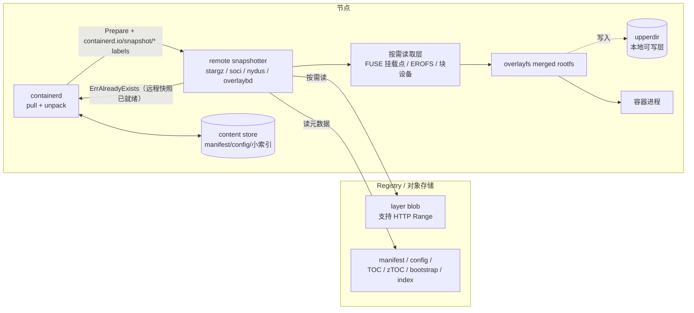
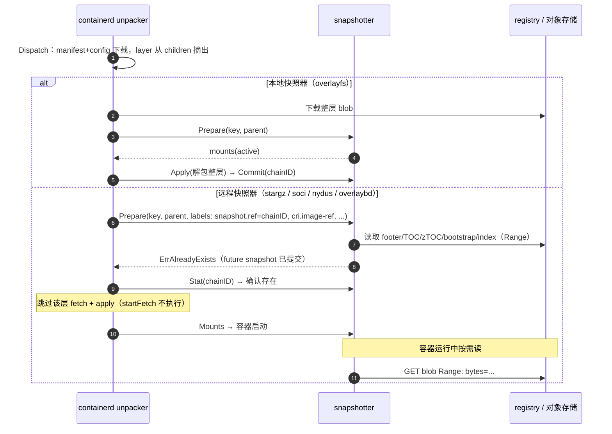

# 镜像懒加载：stargz、Nydus、SOCI 与 OverlayBD

传统拉镜像的流程是"先下载完整 layer，再解包成 rootfs，最后启动容器"。懒加载（lazy pulling / lazy loading）把这个顺序倒过来：**先让容器跑起来，用到哪个文件再去 registry 取那段字节**。

这不是一个镜像格式技巧，而是一整条链路的配合：registry 要支持按字节范围读，镜像层要能随机访问，节点上要有 FUSE / EROFS / 块设备这类"按需取数"的运行时，containerd 侧还要有 remote snapshotter 协议来跳过"下载并解包整层"这一步。本文按"先机制、后各家实现"的顺序讲清楚这条链路，以及 stargz/eStargz、Nydus、SOCI、OverlayBD 四种实现的差异、适用边界和排障方法。

> **引用约定**：代码/格式级论断固定到 2026-11 拉取的 commit，链接形如 `https://github.com/<org>/<repo>/blob/<40位sha>/<path>#Lx-Ly`，行号与本地 checkout 一致；官方文档 URL 直接引用。版本基线：
>
> | 项目 | commit | 本文用途 |
> |---|---|---|
> | containerd | `b7a25261e029d68978bbf290df0a62fc819b3c51` | remote snapshotter 协议、unpack、labels |
> | containerd/stargz-snapshotter | `6ee88d95406f1d6242fd6d12ed4de0492d91d8f5` | eStargz 格式、stargz snapshotter、stargz-store |
> | awslabs/soci-snapshotter | `8b347fe825312441c5d5b357768727175e352ad5` | SOCI index / zTOC / span |
> | dragonflyoss/nydus | `6aa3f8f185cb81e330b64382103d697b47f6c903` | RAFS、nydusd、nydus-image |
> | containerd/nydus-snapshotter | `8a458b9b674fc133e3beb1db306db11ad5097a6f` | K8s 侧部署、fs_driver |
> | containerd/accelerated-container-image | `0806b5ec1b3ce3262b8ab9c9ba499f6bbe8b4ae0` | OverlayBD / TurboOCI |
> | google/crfs | `71d77da419c90be7b05d12e59945ac7a8c94a543` | stargz 前身，仅作背景 |
>
> 兄弟页面：snapshotter 接口本身与本地快照细节见 [镜像快照器snapshotter](./镜像快照器snapshotter.md)；下层联合挂载与层语义见 [OverlayFS与镜像层](./OverlayFS与镜像层.md)；pull/unpack 在整条链路中的位置见 [容器运行时](../Kubernetes/Node_Runtime/容器运行时.md)。

---

## 1. 一分钟版本

**一句话**：懒加载 = 不先把完整 layer 落到本地，而是让 snapshotter 返回一个"远程快照"，容器 rootfs 立刻可挂载，文件内容在首次访问时通过 HTTP Range 从 registry（或对象存储/P2P 网络）按需读取。

它成立需要四个前提，同时也是四种代价：

| 前提 / 代价 | 具体含义 | 不满足的后果 |
|---|---|---|
| **registry 支持 Range** | 能对 blob 做 `Range: bytes=...` 分段读取，即 OCI distribution-spec 的 blob 分段拉取 | 只能退化成整层下载（404/416，或被中间代理抹掉 Range） |
| **镜像格式可随机访问** | 层内部有索引：eStargz 的 TOC、RAFS 的 chunk 索引、SOCI 的 zTOC、OverlayBD 的块索引 | 就算知道文件偏移，也得解压/扫描整层 |
| **运行时支持 FUSE / EROFS / 块设备** | `/dev/fuse`、内核 EROFS 模块、TCMU/configfs/loop 等 | snapshotter 无法挂载，直接回退或启动失败 |
| **能接受冷读放大** | 首读走网络、延迟高于本地盘；需要 prefetch、缓存、索引构建来摊平 | 启动后顺序读全量数据的负载会比传统 pull 更慢 |

全景图（以一次 pull + 启动为单位）：



一句话链路（后文逐段展开）：

```text
registry ──(Range)──> FUSE / EROFS / 块设备 ──> overlayfs lowerdir ──> 容器 rootfs
                          ▲
                    remote snapshotter
                          ▲
              containerd unpacker 的 Prepare
```

---

## 2. 为什么需要懒加载

三个动机，都可以用"拉取时间 × 镜像大小 × 副本数"来理解：

1. **拉取时间占比高**。SOCI 项目 README 引用的 FAST '16 研究结论是：镜像下载占容器启动时间的 76%，而平均只有 6.4% 的数据是容器启动真正需要的（[soci-snapshotter README#L16-L18](https://github.com/awslabs/soci-snapshotter/blob/8b347fe825312441c5d5b357768727175e352ad5/README.md#L16-L18)）；stargz-snapshotter README 也引用了同一个 76% 结论（[stargz-snapshotter README#L16](https://github.com/containerd/stargz-snapshotter/blob/6ee88d95406f1d6242fd6d12ed4de0492d91d8f5/README.md#L16)）。注意这是 2016 年的研究样本，不能直接套到今天的镜像分布上。
2. **大镜像 + 冷节点**。AI/数据类镜像动辄 GB 级，节点本地盘又不一定放得下多副本；完整 pull 既要带宽也要磁盘。
3. **启动风暴**。一次发布/扩容会有大量 Pod 同时拉同一个镜像，registry 带宽被打满。懒加载把"集中下载"摊成"按需读 + 后台预取"，配合 P2P（Dragonfly）或镜像预热可以进一步削峰。

代价同样明确：首次访问文件要等网络；索引构建/镜像转换增加 CI 负担；FUSE 路径有用户态/内核态切换开销；节点上多了一份元数据内存/磁盘开销。这些会在第 8.2 节"什么情况不该用"里集中展开。

---

## 3. containerd 侧机制：remote snapshotter 与 "future snapshot"

各家实现（stargz / SOCI / Nydus / OverlayBD）都复用同一套 containerd 协议。先把这个协议讲清楚，后面四节才不会重复。

### 3.1 普通 pull/unpack 做了什么

containerd 里，镜像内容先进入 content store，再由 snapshotter 逐层解包成 committed snapshot，最后在顶层建 active snapshot 作为容器可写层。官方文档把三步写得很直白：内容加载、逐层 apply（即 unpacking）、创建 active snapshot（[containerd content-flow.md#L20-L23](https://github.com/containerd/containerd/blob/b7a25261e029d68978bbf290df0a62fc819b3c51/docs/content-flow.md#L20-L23)）。对 overlayfs 这类本地 snapshotter，每一层都必须"下载完整 blob → 解压 tar → 写进上层目录"。

### 3.2 remote snapshotter：用 `ErrAlreadyExists` 表达"快照已经存在"

containerd 的 remote snapshotter 机制允许 snapshotter "复用存在于远程的 snapshot"，从而**不拉 layer 就完成 prepare**（[remote-snapshotter.md#L5-L7](https://github.com/containerd/containerd/blob/b7a25261e029d68978bbf290df0a62fc819b3c51/docs/snapshotters/remote-snapshotter.md#L5-L7)）。协议核心只有两条：

1. **Prepare 时带 `containerd.io/snapshot.ref`**：unpacker 调 `Prepare` 时会把目标 chainID 放进这个 label，并合并用户传入的 `containerd.io/snapshot/*` 前缀标签（[remote-snapshotter.md#L92-L94](https://github.com/containerd/containerd/blob/b7a25261e029d68978bbf290df0a62fc819b3c51/docs/snapshotters/remote-snapshotter.md#L92-L94)、[snapshotter.go#L37-L42](https://github.com/containerd/containerd/blob/b7a25261e029d68978bbf290df0a62fc819b3c51/core/snapshots/snapshotter.go#L37-L42)）。
2. **snapshotter 返回 `ErrAlreadyExists`**：表示"这个 chainID 的提交快照已经在远程就绪（即所谓 *future snapshot*）"。containerd 收到后用 `Stat(chainID)` 确认，然后**跳过该层的 fetch 和 apply**（[remote-snapshotter.md#L116-L121](https://github.com/containerd/containerd/blob/b7a25261e029d68978bbf290df0a62fc819b3c51/docs/snapshotters/remote-snapshotter.md#L116-L121)）。

unpacker 里的实际代码就是这段逻辑：

```go
mounts, err = sn.Prepare(ctx, key, parent, opts...)
if err != nil {
    if errdefs.IsAlreadyExists(err) {
        if snInfo, err := sn.Stat(ctx, chainID); err != nil {
            // ...
        } else {
            log.G(ctx).Debugf("snapshot %s with chainID %s already exists, skip extraction of blob %q", ...)
            return nil, nil   // 跳过这一层
        }
    }
}
```

（[containerd core/unpack/unpacker.go#L506-L521](https://github.com/containerd/containerd/blob/b7a25261e029d68978bbf290df0a62fc819b3c51/core/unpack/unpacker.go#L506-L521)）

关键细节：**layer 根本不会进入这次 fetch 的例行路径**。unpacker 的 `Unpack` handler 在拿到 manifest 时把 layer 描述符从 children 里摘掉、只返回非 layer 内容（[unpacker.go#L284](https://github.com/containerd/containerd/blob/b7a25261e029d68978bbf290df0a62fc819b3c51/core/unpack/unpacker.go#L284)），等 config 解析出 diffIDs 后才在 goroutine 里逐层处理；而真正触发下载的 `startFetch(i)` 位于 Prepare 成功之后（[unpacker.go#L602](https://github.com/containerd/containerd/blob/b7a25261e029d68978bbf290df0a62fc819b3c51/core/unpack/unpacker.go#L602)）。所以一旦 Prepare 返回 `ErrAlreadyExists`，这一层就是"零下载"。

### 3.3 标签：snapshotter 怎么知道去哪个 registry 取什么

snapshotter 只拿到 chainID 是不够的，还需要镜像引用、layer digest 等。协议约定：所有快照器专用标签都必须以 `containerd.io/snapshot/` 为前缀（[remote-snapshotter.md#L35-L36](https://github.com/containerd/containerd/blob/b7a25261e029d68978bbf290df0a62fc819b3c51/docs/snapshotters/remote-snapshotter.md#L35-L36)）。两种传递方式：

- `snapshots.WithLabels(...)`：静态标签，随 `WithPullSnapshotter` 传入；
- `WithImageHandlerWrapper(snapshotters.AppendInfoHandlerWrapper(ref))`：动态给每一层 descriptor 追加 annotations（[remote-snapshotter.md#L62-L71](https://github.com/containerd/containerd/blob/b7a25261e029d68978bbf290df0a62fc819b3c51/docs/snapshotters/remote-snapshotter.md#L62-L71)）。containerd 的 CRI 插件、nerdctl、moby 都用这个 wrapper。

wrapper 会写入 `containerd.io/snapshot/cri.image-ref`、`.../cri.layer-digest`、`.../cri.image-layers` 等标签（[pkg/snapshotters/annotations.go#L32-L44](https://github.com/containerd/containerd/blob/b7a25261e029d68978bbf290df0a62fc819b3c51/pkg/snapshotters/annotations.go#L32-L44)），供 remote snapshotter 去 registry 查层。**这也解释了 CRI 里常见的开关**：`disable_snapshot_annotations = false` 必须设置，否则这些 annotations 不会传到 snapshotter。

客户端侧的两个关键选项是 `WithPullUnpack` 和 `WithPullSnapshotter`（[client_opts.go#L161-L166](https://github.com/containerd/containerd/blob/b7a25261e029d68978bbf290df0a62fc819b3c51/client/client_opts.go#L161-L166)、[client_opts.go#L177-L183](https://github.com/containerd/containerd/blob/b7a25261e029d68978bbf290df0a62fc819b3c51/client/client_opts.go#L177-L183)）：

```go
image, err := client.Pull(ctx, ref,
    containerd.WithPullUnpack,
    containerd.WithPullSnapshotter("my-remote-snapshotter"),
)
```

### 3.4 时序对比：普通 unpack vs remote snapshot



### 3.5 那 layer 去哪了：content store 与 lazy store

在 containerd 的 remote snapshotter 路径下，**被远程快照接管的 layer 不会进入 content store**：unpacker 在 Prepare 返回 `ErrAlreadyExists` 后就跳过了这一层的 fetch（见 3.2），content store 里主要留下 manifest/config 和 index 这类小对象。真正按需取数的是 snapshotter 自己：它拿着 registry 凭据，直接对 blob 发 HTTP Range 请求，命中本地缓存则直接返回。

> 实现细节并不完全统一：nydus-snapshotter 还有"在 pull 时转换镜像"之类的模式，所以它的 K8s 部署文档要求 `discard_unpacked_layers = false`、把层保留在 content store 里供后续按需拉取和共享（见 5.4）。判断某个方案是否需要 content store 里的层，以它自己的文档为准。

这和 CRI-O/Podman 的路径不同，后者用的是 **additional layer store**（附加层存储），最典型的是 stargz-store：它把 eStargz 层按 `<mountpoint>/base64(imageref)/<layerdigest>/{diff,info,use}` 的目录结构暴露给容器存储，作为 overlay 的额外层来源（[stargz-snapshotter INSTALL.md#L5-L27](https://github.com/containerd/stargz-snapshotter/blob/6ee88d95406f1d6242fd6d12ed4de0492d91d8f5/docs/INSTALL.md#L5-L27)），配置写在 `/etc/containers/storage.conf` 的 `additionallayerstores` 里（[INSTALL.md#L88-L96](https://github.com/containerd/stargz-snapshotter/blob/6ee88d95406f1d6242fd6d12ed4de0492d91d8f5/docs/INSTALL.md#L88-L96)）。

> 常见误解：stargz-store 不是 containerd 的 content-store 插件。containerd 的 proxy plugin 确实支持 `snapshot`、`content`、`diff` 三种类型（[PLUGINS.md#L60-L63](https://github.com/containerd/containerd/blob/b7a25261e029d68978bbf290df0a62fc819b3c51/docs/PLUGINS.md#L60-L63)），理论上可以写一个"按需取 blob 片段"的 content 代理；但本文涉及的四个项目走的都是 snapshotter 路径，而不是 content-store 代理。

---

## 4. stargz / eStargz

stargz 是 Google CRFS 提出的 "seekable tar.gz"，eStargz 是 containerd 社区在 stargz 基础上扩展的、仍然向后兼容 OCI 镜像的格式。

### 4.1 问题：gzip 流不可 seek

CRFS README 把问题写得很清楚：容器镜像是 tar.gz，tar 本身没有索引，gzip 流也不能 seek；想读 `/var/lib/foo/data` 这 1KB，传统做法要拉几百 GB 的流来解压到那个 entry（[crfs README#L43-L52](https://github.com/google/crfs/blob/71d77da419c90be7b05d12e59945ac7a8c94a543/README.md#L43-L52)）。

解法利用了 gzip 的一个特性：**多个 gzip member 可以拼接成一个合法 gzip 流**。于是把 tar 里每个文件单独压成一个 gzip member，再在末尾放一个"索引"，就同时满足"仍然是合法 tar.gz"和"能按偏移取单文件"（[crfs README#L54-L62](https://github.com/google/crfs/blob/71d77da419c90be7b05d12e59945ac7a8c94a543/README.md#L54-L62)）。

### 4.2 eStargz 的 TOC、footer 与 offset

eStargz 的 blob 结构是：`gzip(tar header + file1)` + `gzip(file2)` + ... + `gzip(TOC tar entry)` + `footer`。每个非空普通文件和每个元数据组件都单独压缩，因此每个文件的 gzip header 位置是已知的；大文件还可以切成多个 gzip member（chunk）（[estargz.md#L36-L54](https://github.com/containerd/stargz-snapshotter/blob/6ee88d95406f1d6242fd6d12ed4de0492d91d8f5/docs/estargz.md#L36-L54)）。

```text
+----------------+----------------+----------------+----------------+---------+
| gzip(tar hdr)  | gzip(file A)   | gzip(file B)   | gzip(TOC)      | footer  |
| file A payload |                |                | stargz.index.json | 51B  |
+----------------+----------------+----------------+----------------+---------+
        ^ offset_A       ^ offset_B       ^ offset_TOC           ^ 记录 offset_TOC
```

- **TOC** 必须是 tar 的最后一个 entry，文件名为 `stargz.index.json`，记录除 TOC 自身外所有 entry 的元数据（[estargz.md#L60-L63](https://github.com/containerd/stargz-snapshotter/blob/6ee88d95406f1d6242fd6d12ed4de0492d91d8f5/docs/estargz.md#L60-L63)）。
- **TOCEntry 的关键字段**：`offset`（该文件/块 gzip header 在 blob 中的偏移）、`chunkOffset`/`chunkSize`（块在解压后文件内的位置/大小）、`chunkDigest`（块内容摘要，用于逐块校验）（[estargz.md#L96-L103](https://github.com/containerd/stargz-snapshotter/blob/6ee88d95406f1d6242fd6d12ed4de0492d91d8f5/docs/estargz.md#L96-L103)、[estargz.md#L163-L180](https://github.com/containerd/stargz-snapshotter/blob/6ee88d95406f1d6242fd6d12ed4de0492d91d8f5/docs/estargz.md#L163-L180)）。
- **footer** 是固定 51 字节的空 gzip member，其 Extra field 里编码了 TOC 的偏移；运行时先读 footer，再读 TOC，再按 TOC 里的 offset 只取需要的区间（[estargz.md#L196-L217](https://github.com/containerd/stargz-snapshotter/blob/6ee88d95406f1d6242fd6d12ed4de0492d91d8f5/docs/estargz.md#L196-L217)）。
- 注意 eStargz 的 footer 与 CRFS 原始 stargz 的 47 字节 footer **不兼容**：eStargz 按 RFC1952 补了 SI1/SI2/LEN 字段（[estargz.md#L219-L222](https://github.com/containerd/stargz-snapshotter/blob/6ee88d95406f1d6242fd6d12ed4de0492d91d8f5/docs/estargz.md#L219-L222)、[crfs stargz.go#L38-L49](https://github.com/google/crfs/blob/71d77da419c90be7b05d12e59945ac7a8c94a543/stargz/stargz.go#L38-L49)）。

### 4.3 stargz-snapshotter 架构

`containerd-stargz-grpc` 是一个 containerd proxy plugin（`type = "snapshot"`），通过 unix socket 注册；它把 eStargz 层从 registry 远程挂载成 FUSE 目录，再把 FUSE 目录作为 overlayfs 的 lowerdir 提供给容器（[overview.md#L12-L14](https://github.com/containerd/stargz-snapshotter/blob/6ee88d95406f1d6242fd6d12ed4de0492d91d8f5/docs/overview.md#L12-L14)、[overview.md#L43-L56](https://github.com/containerd/stargz-snapshotter/blob/6ee88d95406f1d6242fd6d12ed4de0492d91d8f5/docs/overview.md#L43-L56)）；Mounts 返回 `type = "overlay"`、`lowerdir=` 指向各层路径，见 [snapshot/snapshot.go#L653-L660](https://github.com/containerd/stargz-snapshotter/blob/6ee88d95406f1d6242fd6d12ed4de0492d91d8f5/snapshot/snapshot.go#L653-L660)）。

在 snapshotter 的 `Prepare` 里可以看到完整语义：创建 active snapshot → 如果标签里带 `containerd.io/snapshot.ref`，尝试 `prepareRemoteSnapshot` → 成功则自己 `commit` 并返回 `ErrAlreadyExists`，失败则回退到普通解包（[snapshot/snapshot.go#L242-L271](https://github.com/containerd/stargz-snapshotter/blob/6ee88d95406f1d6242fd6d12ed4de0492d91d8f5/snapshot/snapshot.go#L242-L271)）。它用的标签是 `containerd.io/snapshot/remote/stargz.reference`、`.../stargz.digest`、`.../stargz.layers` 等（[fs/source/source.go#L64-L80](https://github.com/containerd/stargz-snapshotter/blob/6ee88d95406f1d6242fd6d12ed4de0492d91d8f5/fs/source/source.go#L64-L80)）。

几个工程细节值得知道：

- **状态目录** `/.stargz-snapshotter` 里有每层的 JSON 元数据，`fetchedPercent` 表示后台预取进度，到 100% 就表示该层已完整落盘（[overview.md#L83-L95](https://github.com/containerd/stargz-snapshotter/blob/6ee88d95406f1d6242fd6d12ed4de0492d91d8f5/docs/overview.md#L83-L95)）。这是排查"到底有没有懒加载成功"最直接的入口。
- **fuse manager**：把 FUSE 文件系统进程从 snapshotter 主进程里拆出去，这样重启 snapshotter 不会导致容器 rootfs 不可用；但 fuse manager 自身重启仍会触发 remount（[overview.md#L120-L140](https://github.com/containerd/stargz-snapshotter/blob/6ee88d95406f1d6242fd6d12ed4de0492d91d8f5/docs/overview.md#L120-L140)）。
- 提供 `metadata_store = "db"` 选项，把每层元数据落盘，缓解大镜像场景下的内存占用（[overview.md](https://github.com/containerd/stargz-snapshotter/blob/6ee88d95406f1d6242fd6d12ed4de0492d91d8f5/docs/overview.md#L320-L330)）。

### 4.4 prefetch：把"入口文件"排到最前面

eStargz 用 tar entry 的**顺序**编码预取提示：把优先文件放在前部，用 `.prefetch.landmark` 标记边界，其余文件放后面；没有优先文件时放 `.no.prefetch.landmark`（[estargz.md#L228-L245](https://github.com/containerd/stargz-snapshotter/blob/6ee88d95406f1d6242fd6d12ed4de0492d91d8f5/docs/estargz.md#L228-L245)）。

`ctr-remote image optimize` 会先按镜像的 entrypoint/env 跑一遍沙箱容器、profile 所有文件访问，把访问到的文件按访问顺序排到前部（[estargz.md#L247-L261](https://github.com/containerd/stargz-snapshotter/blob/6ee88d95406f1d6242fd6d12ed4de0492d91d8f5/docs/estargz.md#L247-L261)）。运行时 snapshotter 用一次 HTTP Range 请求把这段连续区间预取下来，从而把"懒加载的冷读开销"压到接近本地解包。这也是为什么官方 benchmark 里 "estargz-noopt" 的 run 阶段会变慢，而带优化的 "estargz" 能明显缓解（[README.md](https://github.com/containerd/stargz-snapshotter/blob/6ee88d95406f1d6242fd6d12ed4de0492d91d8f5/README.md#L30-L35)）。

### 4.5 接入方式与 zstd:chunked

containerd CRI 侧的最小配置（[overview.md#L43-L56](https://github.com/containerd/stargz-snapshotter/blob/6ee88d95406f1d6242fd6d12ed4de0492d91d8f5/docs/overview.md#L43-L56)）：

```toml
# containerd 2.x：version = 3，CRI 插件 ID 改为 io.containerd.cri.v1.images
version = 3

[proxy_plugins]
  [proxy_plugins.stargz]
    type = "snapshot"
    address = "/run/containerd-stargz-grpc/containerd-stargz-grpc.sock"
  [proxy_plugins.stargz.exports]
    root = "/var/lib/containerd-stargz-grpc/"

[plugins."io.containerd.cri.v1.images"]
  snapshotter = "stargz"
  disable_snapshot_annotations = false
```

> **版本坑**：上面这段路径是 containerd 2.x 的写法（字段位置以 [containerd docs/cri/config.md#L236-L239](https://github.com/containerd/containerd/blob/b7a25261e029d68978bbf290df0a62fc819b3c51/docs/cri/config.md#L236-L239) 为准）。stargz 自己的 `overview.md` 仍写 containerd 1.x 的 `[plugins."io.containerd.grpc.v1.cri".containerd]`；1.x 配置在 2.x 里对应 `version = 2`，而 `version = 3` 下必须换新插件 ID，否则配置不会生效。

Kubernetes 场景还需要给 kubelet 加 `--image-service-endpoint=unix:///run/containerd-stargz-grpc/containerd-stargz-grpc.sock`，让 snapshotter 代理 CRI ImageService 并校验 DiffID（[overview.md#L65](https://github.com/containerd/stargz-snapshotter/blob/6ee88d95406f1d6242fd6d12ed4de0492d91d8f5/docs/overview.md#L65)）。

除了 gzip 的 eStargz，这个版本还支持 **zstd:chunked** 格式（`estargz/zstdchunked`），用 zstd 帧 + 独立 footer 实现可 seek，并把 TOC 位置写进 annotations（[zstdchunked.go#L29-L45](https://github.com/containerd/stargz-snapshotter/blob/6ee88d95406f1d6242fd6d12ed4de0492d91d8f5/estargz/zstdchunked/zstdchunked.go#L29-L45)）。生产上是否使用以官方文档和 nerdctl 的 `image convert` 支持为准。

---

## 5. Nydus

Nydus 来自 Dragonfly 社区，思路和 stargz 不同：不再保留"每层一个 tar.gz"，而是把镜像重构成 **元数据（bootstrap）+ 数据（blob）** 两部分。

### 5.1 RAFS：bootstrap + blob

RAFS 是一个"元数据与数据分离"的文件系统镜像：元数据在 bootstrap（一棵 merkle 树，目录/文件节点 + 子节点 hash），数据在 blob 文件里，按 **1MB** 定长切块，块与块之间做 chunk 级去重（[nydus-design.md#L29-L30](https://github.com/dragonflyoss/nydus/blob/6aa3f8f185cb81e330b64382103d697b47f6c903/docs/nydus-design.md#L29-L30)、[nydus-design.md#L88-L96](https://github.com/dragonflyoss/nydus/blob/6aa3f8f185cb81e330b64382103d697b47f6c903/docs/nydus-design.md#L88-L96)）。块支持 lz4/gzip/zstd 压缩（[nydus-design.md#L98-L101](https://github.com/dragonflyoss/nydus/blob/6aa3f8f185cb81e330b64382103d697b47f6c903/docs/nydus-design.md#L98-L101)），每个块在 chunk info 里都有 digest，读取时可独立校验（[nydus-design.md#L81-L82](https://github.com/dragonflyoss/nydus/blob/6aa3f8f185cb81e330b64382103d697b47f6c903/docs/nydus-design.md#L81-L82)）。

为什么这能同时支持顺序读和随机读：

- 读目录/属性只需要 bootstrap，不需要碰 blob；
- 读文件时按 bootstrap 里的 chunk 索引算出 blob 偏移，发一次 1MB 粒度的 Range 请求；
- blob 内 chunk 连续排列，顺序读时预取器可以把多个后端读请求合并成一个更大的 Range（[prefetch.md#L5-L7](https://github.com/dragonflyoss/nydus/blob/6aa3f8f185cb81e330b64382103d697b47f6c903/docs/prefetch.md#L5-L7)）。

### 5.2 nydus-image 与 nydusify

`nydus-image create` 从 tar 或目录构建 RAFS/Nydus 镜像，有 Native / Zran / Tarfs 三种模式（[nydus-image.md#L23-L30](https://github.com/dragonflyoss/nydus/blob/6aa3f8f185cb81e330b64382103d697b47f6c903/docs/nydus-image.md#L23-L30)）；`nydus-image merge` 可以把多个层的 RAFS 合并成一个，在构建期就应用 OCI/overlayfs 的层覆盖规则，**运行时不再需要 overlayfs**（[nydus-image.md#L160-L162](https://github.com/dragonflyoss/nydus/blob/6aa3f8f185cb81e330b64382103d697b47f6c903/docs/nydus-image.md#L160-L162)）。这个"合并层"是 Nydus 相对其他方案最独特的加速点：容器 rootfs 只需要挂一个文件系统。

`nydusify convert` 负责把 OCI 镜像转成 Nydus 镜像并推送（[nydusify.md#L5-L7](https://github.com/dragonflyoss/nydus/blob/6aa3f8f185cb81e330b64382103d697b47f6c903/docs/nydusify.md#L5-L7)），还可以把 blob 推到 OSS/S3、用 chunk-dict 做跨镜像去重。K8s 侧用 `nydusify convert --merge-platform` 生成带有 nydus alternative manifest 的 OCI index，nydus-snapshotter 侧开启 index detection 后可以透明识别，普通客户端则仍按原 manifest 拉普通镜像（[index_detection.md#L5](https://github.com/containerd/nydus-snapshotter/blob/8a458b9b674fc133e3beb1db306db11ad5097a6f/docs/index_detection.md#L5)）。

### 5.3 nydusd 与 fs_driver

`nydusd` 是用户态守护进程，对外暴露 FUSE 挂载点或 Virtio-FS 挂载点（[nydusd.md#L3](https://github.com/dragonflyoss/nydus/blob/6aa3f8f185cb81e330b64382103d697b47f6c903/docs/nydusd.md#L3)）。nydus-snapshotter 支持四种 fs_driver（[setup_snapshotter_by_daemonset.md#L119](https://github.com/containerd/nydus-snapshotter/blob/8a458b9b674fc133e3beb1db306db11ad5097a6f/docs/setup_snapshotter_by_daemonset.md#L119)）：

| fs_driver | 路径 | 说明 |
|---|---|---|
| `fusedev` | 用户态 FUSE | 默认，最通用，需要 `/dev/fuse` |
| `fscache` | 内核 fscache + FUSE | 利用内核缓存框架 |
| `blockdev` | 块设备 | 镜像块设备场景，要求内核/环境支持 |
| `proxy` | 代理 | 把请求转给外部 nydusd/服务 |

另外还有实验性的 **Tarfs** 子模式：直接用 tar 文件作为数据 blob，并把每层导出成 raw disk image，通过 loopdev 以 **EROFS** 挂载（[tarfs.md#L3-L17](https://github.com/containerd/nydus-snapshotter/blob/8a458b9b674fc133e3beb1db306db11ad5097a6f/docs/tarfs.md#L3-L17)）。这是"内核态 EROFS"路径，和 Rafs v6 的元数据兼容 EROFS 是两回事：

- **tarfs**：实验特性，需要内核启用 EROFS；containerd 的 EROFS 文档标注内核模块要求 **Linux 5.4+**（[containerd erofs.md#L116-L118](https://github.com/containerd/containerd/blob/b7a25261e029d68978bbf290df0a62fc819b3c51/docs/snapshotters/erofs.md#L116-L118)）。nydus 文档本身未写最低内核版本，选型时应以目标发行版内核为准。
- **Rafs v6**：元数据格式与 in-kernel EROFS 兼容（[nydus-design.md#L29-L30](https://github.com/dragonflyoss/nydus/blob/6aa3f8f185cb81e330b64382103d697b47f6c903/docs/nydus-design.md#L29-L30)），但在本文固定的版本里仍标注为进行中。

容器看到的最终挂载由 `nydus-overlayfs` 这个 mount helper 完成：snapshotter 返回 `type = "fuse.nydus-overlayfs"` 的 mount，并把额外参数（nydusd 配置、snapshot 目录等）以 base64 编码塞进 `extraoption`，helper 会解析并过滤掉它，再执行真正的 overlay 挂载（[nydus-overlayfs.md#L3-L20](https://github.com/dragonflyoss/nydus/blob/6aa3f8f185cb81e330b64382103d697b47f6c903/docs/nydus-overlayfs.md#L3-L20)）。Kata 场景则可以把这段信息直接交给 shim 处理。

### 5.4 Kubernetes 部署与 Dragonfly

nydus-snapshotter 平常以 DaemonSet 形式部署（官方提供 Helm chart，可用 `FS_DRIVER` 环境变量选择 fs_driver），containerd 侧把 `snapshotter` 指向 `nydus`。官方文档特别说明两个 CRI 开关的理由：

- `disable_snapshot_annotations = false`：nydus 需要 annotations 里的镜像信息去拉镜像；
- `discard_unpacked_layers = false`：GC 不能在 unpack 后删除层，因为后续按需读取和共享还要用（[run_nydus_in_kubernetes.md#L37-L48](https://github.com/containerd/nydus-snapshotter/blob/8a458b9b674fc133e3beb1db306db11ad5097a6f/docs/run_nydus_in_kubernetes.md#L37-L48)）。

大规模集群里通常把 nydusd 的 registry 请求代理到 Dragonfly：支持 **HTTP proxy 模式**（经 dfdaemon）和 **SDK 模式**（直接走 Dragonfly client，与 scheduler 协调 P2P 任务）两种（[nydus-dragonfly.md#L15-L22](https://github.com/dragonflyoss/nydus/blob/6aa3f8f185cb81e330b64382103d697b47f6c903/docs/nydus-dragonfly.md#L15-L22)）。这是 Nydus 在"多节点、同镜像"场景的核心卖点：懒加载 + P2P 一起解决 registry 带宽瓶颈。

---

## 6. SOCI（Seekable OCI）

SOCI 是 AWS 主导的方案，最大的特点一句话：**镜像不动，额外生成一个索引工件**。

### 6.1 设计要点

SOCI 的目标是让标准 OCI 镜像"无需构建期转换"就能懒加载：不修改原镜像，而是生成一个独立的 **SOCI index** 放在 registry 里，紧挨着镜像（[README.md#L8-L11](https://github.com/awslabs/soci-snapshotter/blob/8b347fe825312441c5d5b357768727175e352ad5/README.md#L8-L11)）。SOCI index 本身是一个 OCI image manifest：

- `subject` 指向被索引的镜像 manifest（[index.md#L29-L36](https://github.com/awslabs/soci-snapshotter/blob/8b347fe825312441c5d5b357768727175e352ad5/docs/index.md#L29-L36)）；
- `layers` 按镜像层顺序排列，每项是一个 zTOC（[index.md#L41-L47](https://github.com/awslabs/soci-snapshotter/blob/8b347fe825312441c5d5b357768727175e352ad5/docs/index.md#L41-L47)）。

**zTOC** = TOC + zInfo：

- TOC 记录每个文件在**解压后 tar** 里的偏移等元数据；
- zInfo 是一组"压缩引擎状态检查点"，每个检查点对应层里一个可独立解压的区间，即 **span**（[index.md#L65-L69](https://github.com/awslabs/soci-snapshotter/blob/8b347fe825312441c5d5b357768727175e352ad5/docs/index.md#L65-L69)、[glossary.md#L24-L25](https://github.com/awslabs/soci-snapshotter/blob/8b347fe825312441c5d5b357768727175e352ad5/docs/glossary.md#L24-L25)）。

运行时，SOCI snapshotter 为每个被索引的层建一个 FUSE 挂载（挂载类型可见为 `fuse.rawBridge`，[getting-started.md#L253-L255](https://github.com/awslabs/soci-snapshotter/blob/8b347fe825312441c5d5b357768727175e352ad5/docs/getting-started.md#L253-L255)），读文件时按"文件 → 解压偏移 → 所在 span → 压缩层偏移"换算后发 Range 请求。span 大小默认 4 MiB（`--span-size`，[cli-usage.md#L37](https://github.com/awslabs/soci-snapshotter/blob/8b347fe825312441c5d5b357768727175e352ad5/docs/cli-usage.md#L37)）。

### 6.2 v1 与 v2：两种索引关联方式

| 版本 | 关联方式 | 优点 | 代价 |
|---|---|---|---|
| **v1** | 独立工件，用 OCI Referrers API 发现（或显式 `--soci-index-digest`） | 不动镜像、可独立增删 | 弱引用：registry 有写权限的人随时能加/删索引，运行时行为可能被外部改变 |
| **v2** | 轻量转换生成 **SOCI-enabled image**，index 打包进新镜像 | 强绑定、可随镜像跨 registry 复制、可走正常发布流程 | 多一个镜像；但 layer 与原始镜像共享，只多几 KB 元数据 |

v2 的"轻量转换"明确写了会复用原镜像的 layer，新增的只是 zTOC 等元数据（[soci-index-manifest-v2.md#L13-L16](https://github.com/awslabs/soci-snapshotter/blob/8b347fe825312441c5d5b357768727175e352ad5/docs/soci-index-manifest-v2.md#L13-L16)）；从 snapshotter v0.10.0 起默认只消费 v2，v1 需要显式打开（[soci-index-manifest-v2.md#L20](https://github.com/awslabs/soci-snapshotter/blob/8b347fe825312441c5d5b357768727175e352ad5/docs/soci-index-manifest-v2.md#L20)）。

配置里的 `pull_modes` 对应这些模式：`soci_v1`（默认关闭）、`soci_v2`（默认开启）、`parallel_pull_unpack`（默认关闭；打开后完全跳过懒加载，走并行下载+解包）（[config.md#L109-L117](https://github.com/awslabs/soci-snapshotter/blob/8b347fe825312441c5d5b357768727175e352ad5/docs/config.md#L109-L117)）。

### 6.3 回退语义：sparse index

SOCI 允许"部分层没有索引"：有 zTOC 的层走 FUSE 懒加载，没有的层在启动时同步下载并解包；整个索引都找不到时，snapshotter 会回退到配置的默认 snapshotter（如 overlayfs）（[pull-modes.md#L3-L13](https://github.com/awslabs/soci-snapshotter/blob/8b347fe825312441c5d5b357768727175e352ad5/docs/pull-modes.md#L3-L13)、[pull-modes.md#L52](https://github.com/awslabs/soci-snapshotter/blob/8b347fe825312441c5d5b357768727175e352ad5/docs/pull-modes.md#L52)）。这一点对"灰度"很重要：即使索引缺失或推送失败，业务也能启动，只是没有加速。

### 6.4 与 estargz 的关键差异

| 维度 | eStargz | SOCI |
|---|---|---|
| 是否改镜像 | 需要把层重新压成 eStargz 并重新 push（digest 变化） | v1 完全不改；v2 生成新镜像但共享 layer 数据 |
| 额外工件 | 无（索引在层内部） | 独立 SOCI index（ztoc 层） |
| 随机读单位 | 文件 / 大文件 chunk（gzip member） | span（默认 4 MiB，按压缩状态切分） |
| index 发现 | 看层格式本身 | v1 靠 Referrers API 或显式 digest；v2 靠镜像内 annotations |
| 兼容性 | 仍是合法 tar.gz，普通运行时也能跑 | 原镜像普通运行时照常跑；索引只有 SOCI snapshotter 用 |

SOCI 的 FUSE 实现在 `snapshot/snapshot.go` 里同样是"先试远程快照、成功则 commit 并返回 `ErrAlreadyExists`、失败回退"（[snapshot/snapshot.go#L373-L374](https://github.com/awslabs/soci-snapshotter/blob/8b347fe825312441c5d5b357768727175e352ad5/snapshot/snapshot.go#L373-L374)、[snapshot/snapshot.go#L414-L424](https://github.com/awslabs/soci-snapshotter/blob/8b347fe825312441c5d5b357768727175e352ad5/snapshot/snapshot.go#L414-L424)）。

prefetch 在 SOCI 里是**实验特性**：把要预取的文件/span 作为独立 JSON artifact 存进索引，启动时并行预取（[prefetch.md#L3-L7](https://github.com/awslabs/soci-snapshotter/blob/8b347fe825312441c5d5b357768727175e352ad5/docs/prefetch.md#L3-L7)）。与 eStargz "把文件排到 blob 前部"的思路不同，SOCI 是把预取清单做成可替换的独立文档，这也是它 `design-docs` 里"工作负载相关的加载顺序优化"的落点。

**Fargate / EKS 集成**：AWS 在 Fargate 上内置了对 SOCI 的支持（受平台版本等条件限制），ECS 文档和 AWS 博客有说明；EKS 上自建节点则按官方 EKS 指南装 SOCI snapshotter。具体支持范围以 [AWS 公告：AWS Fargate Enables Faster Container Startup using Seekable OCI](https://aws.amazon.com/blogs/aws/aws-fargate-enables-faster-container-startup-using-seekable-oci/) 和 [技术博客：Under the hood: Lazy Loading Container Images with Seekable OCI and AWS Fargate](https://aws.amazon.com/blogs/containers/under-the-hood-lazy-loading-container-images-with-seekable-oci-and-aws-fargate/) 为准。

---

## 7. OverlayBD

OverlayBD 是阿里云开源、已捐给 containerd 社区（non-core sub-project）的方案，走的是与前面三家都不同的路线：**把 layer 变成块设备镜像**（[README.md#L31](https://github.com/containerd/accelerated-container-image/blob/0806b5ec1b3ce3262b8ab9c9ba499f6bbe8b4ae0/README.md#L31)）。

### 7.1 tar layer → 块设备镜像

OverlayBD 的核心数据结构是"被修改的数据块 + 块索引"：一个 overlaybd blob 是一组块差异，加上指向原始数据的索引；挂载时只把每层的索引加载进内存，读数据时先查索引，再做一次 Range 读取（[README.md#L117-L121](https://github.com/containerd/accelerated-container-image/blob/0806b5ec1b3ce3262b8ab9c9ba499f6bbe8b4ae0/README.md#L117-L121)）。

为了兼容现有 registry，OverlayBD 定义了一个可 seek 的压缩格式 **Zfile**（带校验信息），再把 Zfile 包在一个只含单个 Zfile 的 tar 里当作 OCI layer 推送（[README.md#L123](https://github.com/containerd/accelerated-container-image/blob/0806b5ec1b3ce3262b8ab9c9ba499f6bbe8b4ae0/README.md#L123)）。I/O 路径是：

```text
应用 → 普通文件系统(ext4/xfs) → loop 设备(TCM_loopback) → 用户态 overlaybd backstore(TCMU)
                                                              ↓ 命中本地缓存 或 HTTP Range 回源
```

（[README.md#L127](https://github.com/containerd/accelerated-container-image/blob/0806b5ec1b3ce3262b8ab9c9ba499f6bbe8b4ae0/README.md#L127)）

镜像转换用 `ctr obdconv`：把 tar layer 转成 overlaybd 格式，可指定目标文件系统（`--fstype`）、压缩算法（lz4/zstd）、压缩块大小（4K~64K 的 2 的幂），还支持用数据库记录"OCI layer → overlaybd layer"映射做跨镜像层去重（[IMAGE_CONVERTOR.md#L8-L33](https://github.com/containerd/accelerated-container-image/blob/0806b5ec1b3ce3262b8ab9c9ba499f6bbe8b4ae0/docs/IMAGE_CONVERTOR.md#L8-L33)）。转换后的镜像再 `ctr i push` 推回 registry。

> **后端说明**：本文固定的这个版本里，OverlayBD 的设备路径是 **TCMU**（通过 configfs 创建 target）而非 ublk；`overlaybd-attacher` 的文档也是按 TCMU 描述的。如果你看到"ublk 后端"的说法，那属于 overlaybd 主仓的更新内容，**以官方文档为准**，本文不展开。

### 7.2 TurboOCI：把"转换"也省掉

TurboOCIv1 是 OverlayBD 对 SOCI 的回应：不转换原镜像，只生成一个很小的 **meta image**（含 ext4 文件系统元数据），体积通常约为原镜像的 3%，放在 registry 里；运行时从原始未修改的 OCI 镜像按需读数据（[TURBO_OCI.md#L3-L11](https://github.com/containerd/accelerated-container-image/blob/0806b5ec1b3ce3262b8ab9c9ba499f6bbe8b4ae0/docs/TURBO_OCI.md#L3-L11)）。它和 overlaybd 格式兼容，同一镜像的不同层可以混用两种格式。

项目自述里把"块设备 vs FUSE"当成与 SOCI 的核心差异（FUSE 有用户态/内核态切换开销、进程重启后不易恢复），并给出了对比数据；这属于**项目方自述**，参考时注意立场与测试条件（[TURBO_OCI.md#L15](https://github.com/containerd/accelerated-container-image/blob/0806b5ec1b3ce3262b8ab9c9ba499f6bbe8b4ae0/docs/TURBO_OCI.md#L15)）。

### 7.3 可写层与 overlayfs

OverlayBD 的另一个差异化能力是**块级可写层**（[WRITABLE.md#L6-L27](https://github.com/containerd/accelerated-container-image/blob/0806b5ec1b3ce3262b8ab9c9ba499f6bbe8b4ae0/docs/WRITABLE.md#L6-L27)）：

- 可写层类型：`append-only`（追加日志式，适合镜像转换/构建）与 `sparse-file`（稀疏文件式，适合容器运行时，文档标注仍在完善）；
- 挂载模式：`dir`（snapshotter 直接返回 bind mount，可当 rootfs 用）与 `dev`（返回可写块设备，由调用方决定何时挂载，也可透传给 VM/virtio-blk）；
- 用法：通过 `containerd.io/snapshot/overlaybd.writable` label 选择模式，或 `--snapshotter-label` 传参（[WRITABLE.md#L30-L37](https://github.com/containerd/accelerated-container-image/blob/0806b5ec1b3ce3262b8ab9c9ba499f6bbe8b4ae0/docs/WRITABLE.md#L30-L37)）。

与 overlayfs 的组合方式：可以像默认 overlayfs 那样用本地目录做 upperdir，也可以把 OverlayBD 的可写块设备当 upper（`rwMode` 支持 `overlayfs`/`dir`/`dev`）。由于输出是块设备，OverlayBD 可以自由选择 ext4/xfs 等文件系统（[MULTI_FS_SUPPORT.md#L3-L9](https://github.com/containerd/accelerated-container-image/blob/0806b5ec1b3ce3262b8ab9c9ba499f6bbe8b4ae0/docs/MULTI_FS_SUPPORT.md#L3-L9)）。

### 7.4 性能数据与适用边界

官方 PERFORMANCE 文档给的 WordPress 冷启动"服务可用时间"：overlaybd 6.433s vs OCI tar 15.341s，**条件是 WordPress 镜像、开启 prefetch、脚本测量"服务可用"而非进程启动**（[PERFORMANCE.md#L30-L40](https://github.com/containerd/accelerated-container-image/blob/0806b5ec1b3ce3262b8ab9c9ba499f6bbe8b4ae0/docs/PERFORMANCE.md#L30-L40)）。TurboOCI 文档里还有一组多镜像对比（同页面有"镜像大小/服务可用时间"表格），引用时必须连带镜像名与测量口径，不要单独摘数字。

OverlayBD 适合：内核支持 target/TCMU（或对应块设备框架）、需要块级快照/可写层、镜像大且对稳定性要求高（AI/HPC）、已经用 BuildKit（官方 README 称 v0.22 起支持 overlaybd 构建，[README.md#L56](https://github.com/containerd/accelerated-container-image/blob/0806b5ec1b3ce3262b8ab9c9ba499f6bbe8b4ae0/README.md#L56)）的场景。不适合：rootless/无特权容器、内核模块不可控的环境，以及"只想要最简单的懒加载"的小团队。

---

## 8. 对比矩阵与选型

### 8.1 矩阵

| 维度 | 传统 pull | stargz / eStargz | Nydus | SOCI v2 | OverlayBD / TurboOCI |
|---|---|---|---|---|---|
| 是否改镜像 / 额外工件 | 否 | 改层格式并重推（digest 变） | 转换出新镜像（bootstrap + blob） | v1 独立 index；v2 新镜像但共享 layer | 转换出新镜像；TurboOCI 只加 meta image |
| 随机读单位 | 整层 | 文件 / 大文件 chunk | 1 MiB chunk | span（默认 4 MiB） | 压缩块（4K~64K 可配） |
| 运行时路径 | 内核文件系统 + 本地解包 | FUSE + overlayfs | fusedev/fscache/blockdev → nydus-overlayfs；tarfs 走 EROFS+loop | 每层 FUSE + overlayfs | TCMU 块设备 → loop → 文件系统 |
| 可写层 | overlayfs upperdir | overlayfs upperdir | overlayfs upperdir | overlayfs upperdir | overlayfs upperdir 或块级 writable |
| registry 要求 | 无 | Range | Range（或 OSS/S3）；P2P 可选 | Range；v1 需 Referrers API | Range |
| rootless / 特权 | 友好 | 需 `/dev/fuse` 与相应权限 | fusedev 需 FUSE；tarfs/blockdev 需内核支持 | 需 `/dev/fuse` | 需内核 target/configfs，通常需特权 |
| 生态与状态 | 基线 | containerd 非核心子项目；BuildKit/nerdctl/Kaniko 支持 | Dragonfly 生态；CNCF 相关项目，云厂商广泛使用 | AWS 生态（ECR/Fargate/EKS）；README 表示希望成为 containerd non-core 项目 | containerd 非核心子项目；阿里云生态；BuildKit 支持 |
| 典型场景 | 小镜像、启动不敏感 | 大镜像 + 入口文件集中；交付流水线可改镜像 | 大规模集群 + P2P；AI/数据镜像；层合并 | 不想重推 layer；AWS 托管环境 | 大镜像 + 块级快照/可写层；虚拟机/安全容器透传 |

### 8.2 什么情况不该用懒加载

- **registry 不支持 Range 或被中间层抹掉**：企业代理、对象存储签名 URL、部分自建 registry 都可能让 Range 失效。上线前先用 `curl -H "Range: bytes=0-1"` 验证。
- **镜像本来就小、pull 只要几秒**：懒加载的索引构建、FUSE 挂载、冷读开销会把收益吃掉。
- **启动后顺序读全量**：编译、数据扫描、模型加载这类"读整个镜像"的负载，懒加载等于把顺序大 I/O 拆成随机小 I/O，通常更慢。
- **节点无法提供 FUSE / EROFS / TCMU**：rootless、gVisor、受限内核、无 `/dev/fuse` 的环境请直接用默认 snapshotter。
- **没有 CI 能力做转换或索引**：stargz/Nydus/OverlayBD 需要改镜像，SOCI v2 也需要额外一步 convert；没有流水线就别硬上。
- **强签名/审计**：转换会改变镜像 digest，可能让签名失效（SOCI v2 共享 layer 能缓解但不能消除新 manifest）。签名体系要一起设计。
- **缓存命中率极低的场景**：每次都是全新节点、镜像只用一次，懒加载的索引开销和冷读可能不如"镜像预热 + P2P 分发"。
- **高密度节点内存敏感**：stargz 默认把元数据放内存，可用 `metadata_store = "db"` 缓解，但要评估磁盘 IO。

---

## 9. 落地与排障

### 9.1 containerd CRI 配置骨架

四种方案都是"proxy plugin 注册 + CRI 选 snapshotter"，差异只在 snapshotter 名和附加开关（以 containerd 2.x 的 `version = 3` 写法为例，字段见 [docs/cri/config.md#L236-L239](https://github.com/containerd/containerd/blob/b7a25261e029d68978bbf290df0a62fc819b3c51/docs/cri/config.md#L236-L239)）：

```toml
version = 3

# 1) 注册 proxy plugin（以 stargz 为例，soci/nydus/overlaybd 同理，换成各自 socket）
[proxy_plugins]
  [proxy_plugins.stargz]
    type = "snapshot"
    address = "/run/containerd-stargz-grpc/containerd-stargz-grpc.sock"
  [proxy_plugins.stargz.exports]
    root = "/var/lib/containerd-stargz-grpc/"

# 2) CRI 选择 snapshotter，并放行 snapshot annotations
[plugins."io.containerd.cri.v1.images"]
  snapshotter = "stargz"          # soci / nydus / overlaybd
  disable_snapshot_annotations = false   # 默认 true，必须显式关掉
  # nydus 额外要求：discard_unpacked_layers = false
```

各家的差异（以官方文档为准）：

| 方案 | snapshotter 名 | 额外要求 |
|---|---|---|
| stargz | `stargz` | kubelet 加 `--image-service-endpoint`（v0.19.0+） |
| SOCI | `soci` | v2 需要 `soci convert` 生成 SOCI-enabled image；v1 需 registry 支持 Referrers API 或显式 `--soci-index-digest` |
| Nydus | `nydus` | `discard_unpacked_layers = false`；DaemonSet + nydusd 配置 |
| OverlayBD | `overlaybd` | overlaybd-tcmu/backstore 服务必须运行；认证要单独配置给 overlaybd |

### 9.2 验证命令

```bash
# containerd 是否识别 snapshotter
ctr plugin ls | grep -E 'stargz|soci|nydus|overlaybd'

# 是否真的懒加载：跑一个镜像后看挂载
mount | grep -E 'fuse|erofs'
# SOCI 典型输出：... type fuse.rawBridge
# Nydus tarfs 典型输出：... type erofs

# stargz：看每层抓取进度（fetchedPercent 到 100 表示已全量缓存）
ls /.stargz-snapshotter/ 2>/dev/null && cat /.stargz-snapshotter/*.json

# 用 nerdctl 指定 snapshotter 拉/跑
nerdctl --snapshotter=stargz run --rm <image>
nerdctl --snapshotter=soci    run --rm <image>
nerdctl --snapshotter=nydus   run --rm <image>

# stargz 转换/优化
ctr-remote image optimize --oci <src-image> <dst-image>
ctr-remote image rpull --snapshotter=stargz <image>

# SOCI 建索引（v2 转换）+ 查看
soci create <image>        # 生成 SOCI index
soci convert <image> <image>-soci
soci index list --ref <image>

# OverlayBD 转换与免下载拉取
ctr obdconv <src-image> <dst-image>
/opt/overlaybd/snapshotter/ctr rpull <overlaybd-image>
```

### 9.3 常见失败对照表

| 现象 | 常见原因 | 排查 / 处理 |
|---|---|---|
| 拉取直接失败，日志有 404/416 | registry 不支持 Range，或代理/签名 URL 剥夺了 Range | `curl -r 0-1` 验证；换 registry 或关闭懒加载 |
| 容器能起但读文件很慢 / 大量重试 | 冷读放大；预取未生效 | 检查镜像是否优化（stargz 用 `ctr-remote image optimize`）、prefetch 配置、缓存目录 |
| `no such device` / `fusermount: not found` | 无 `/dev/fuse` 或缺少 fuse 包 | 安装 fuse、`modprobe fuse`、检查 rootless 权限 |
| SOCI 镜像没加速，日志 `unable to fetch SOCI artifacts` | 索引没推、digest 不匹配、referrers 不可用 | 重新 `soci convert`/push；用 `--soci-index-digest` 显式指定 |
| snapshotter 没拿到镜像信息 | `disable_snapshot_annotations = true`（CRI 默认） | 设为 `false` 并重启 containerd |
| nydus 读取失败 / 层被 GC | `discard_unpacked_layers = true` | 设为 `false`（nydus 官方要求） |
| EROFS 挂载失败 | 内核无 EROFS 模块 | `modprobe erofs`；内核版本要求以发行版文档为准 |
| OverlayBD 容器起不来 | overlaybd-tcmu 未运行、configfs/target 不可用 | `systemctl status overlaybd-tcmu`；检查 `/sys/kernel/config/target` |
| snapshotter 重启后容器 rootfs 不可用 | FUSE 进程随主进程退出 | stargz 开启 fuse manager；或按官方升级/重启流程操作 |
| 私有 registry 鉴权失败 | snapshotter 不共享 containerd 凭据 | 按各家文档单独配置（docker config / CRI keychain / kubeconfig） |

### 9.4 观测

- **SOCI**：开启 `metrics_address` 后 `curl /metrics`，重点关注 `operation_duration_remote_registry_get`、`operation_duration_synchronous_read`、`operation_duration_init_metadata_store`（[debug.md](https://github.com/awslabs/soci-snapshotter/blob/8b347fe825312441c5d5b357768727175e352ad5/docs/debug.md#L74-L80)）。
- **stargz**：`/.stargz-snapshotter/*.json` + `fetchedPercent`，以及 snapshotter 日志里的 `remote-snapshot-prepared`。
- **nydus**：nydusd 自身 metrics 可由 nydus-snapshotter 转成 Prometheus（`metrics.address`），system controller 暴露内部状态（[configure_nydus.md](https://github.com/containerd/nydus-snapshotter/blob/8a458b9b674fc133e3beb1db306db11ad5097a6f/docs/configure_nydus.md#L11-L19)）。
- **OverlayBD**：snapshotter 有 Prometheus metrics（[PROMETHEUS.md](https://github.com/containerd/accelerated-container-image/blob/0806b5ec1b3ce3262b8ab9c9ba499f6bbe8b4ae0/docs/PROMETHEUS.md)）。

---

## 10. 参考

按项目分组，均为官方 docs/README（代码引用见正文，已固定到上表 commit）。

**containerd**
- [Remote Snapshotter](https://github.com/containerd/containerd/blob/b7a25261e029d68978bbf290df0a62fc819b3c51/docs/snapshotters/remote-snapshotter.md)
- [Content Flow](https://github.com/containerd/containerd/blob/b7a25261e029d68978bbf290df0a62fc819b3c51/docs/content-flow.md)
- [Plugins（proxy plugin 类型）](https://github.com/containerd/containerd/blob/b7a25261e029d68978bbf290df0a62fc819b3c51/docs/PLUGINS.md)
- [EROFS Snapshotter](https://github.com/containerd/containerd/blob/b7a25261e029d68978bbf290df0a62fc819b3c51/docs/snapshotters/erofs.md)

**stargz / eStargz**
- [eStargz 格式规范](https://github.com/containerd/stargz-snapshotter/blob/6ee88d95406f1d6242fd6d12ed4de0492d91d8f5/docs/estargz.md)
- [Snapshotter Overview](https://github.com/containerd/stargz-snapshotter/blob/6ee88d95406f1d6242fd6d12ed4de0492d91d8f5/docs/overview.md)
- [Install（含 stargz-store）](https://github.com/containerd/stargz-snapshotter/blob/6ee88d95406f1d6242fd6d12ed4de0492d91d8f5/docs/INSTALL.md)
- [ctr-remote image optimize](https://github.com/containerd/stargz-snapshotter/blob/6ee88d95406f1d6242fd6d12ed4de0492d91d8f5/docs/ctr-remote.md)
- [CRFS（stargz 前身）](https://github.com/google/crfs/blob/71d77da419c90be7b05d12e59945ac7a8c94a543/README.md)

**Nydus**
- [Nydus 设计](https://github.com/dragonflyoss/nydus/blob/6aa3f8f185cb81e330b64382103d697b47f6c903/docs/nydus-design.md)
- [nydus-image](https://github.com/dragonflyoss/nydus/blob/6aa3f8f185cb81e330b64382103d697b47f6c903/docs/nydus-image.md)
- [nydusd](https://github.com/dragonflyoss/nydus/blob/6aa3f8f185cb81e330b64382103d697b47f6c903/docs/nydusd.md)
- [nydusify](https://github.com/dragonflyoss/nydus/blob/6aa3f8f185cb81e330b64382103d697b47f6c903/docs/nydusify.md)
- [Prefetch](https://github.com/dragonflyoss/nydus/blob/6aa3f8f185cb81e330b64382103d697b47f6c903/docs/prefetch.md)
- [nydus-snapshotter tarfs](https://github.com/containerd/nydus-snapshotter/blob/8a458b9b674fc133e3beb1db306db11ad5097a6f/docs/tarfs.md)
- [nydus-snapshotter index detection](https://github.com/containerd/nydus-snapshotter/blob/8a458b9b674fc133e3beb1db306db11ad5097a6f/docs/index_detection.md)
- [DaemonSet 部署](https://github.com/containerd/nydus-snapshotter/blob/8a458b9b674fc133e3beb1db306db11ad5097a6f/docs/setup_snapshotter_by_daemonset.md)

**SOCI**
- [SOCI Index 数据模型](https://github.com/awslabs/soci-snapshotter/blob/8b347fe825312441c5d5b357768727175e352ad5/docs/index.md)
- [Index Manifest v2](https://github.com/awslabs/soci-snapshotter/blob/8b347fe825312441c5d5b357768727175e352ad5/docs/soci-index-manifest-v2.md)
- [Pull modes](https://github.com/awslabs/soci-snapshotter/blob/8b347fe825312441c5d5b357768727175e352ad5/docs/pull-modes.md)
- [Prefetch（实验）](https://github.com/awslabs/soci-snapshotter/blob/8b347fe825312441c5d5b357768727175e352ad5/docs/prefetch.md)
- [Debug](https://github.com/awslabs/soci-snapshotter/blob/8b347fe825312441c5d5b357768727175e352ad5/docs/debug.md)

**OverlayBD**
- [README（overlaybd 格式与 I/O 路径）](https://github.com/containerd/accelerated-container-image/blob/0806b5ec1b3ce3262b8ab9c9ba499f6bbe8b4ae0/README.md)
- [Quickstart](https://github.com/containerd/accelerated-container-image/blob/0806b5ec1b3ce3262b8ab9c9ba499f6bbe8b4ae0/docs/QUICKSTART.md)
- [TurboOCIv1](https://github.com/containerd/accelerated-container-image/blob/0806b5ec1b3ce3262b8ab9c9ba499f6bbe8b4ae0/docs/TURBO_OCI.md)
- [Writable layer](https://github.com/containerd/accelerated-container-image/blob/0806b5ec1b3ce3262b8ab9c9ba499f6bbe8b4ae0/docs/WRITABLE.md)
- [镜像转换](https://github.com/containerd/accelerated-container-image/blob/0806b5ec1b3ce3262b8ab9c9ba499f6bbe8b4ae0/docs/IMAGE_CONVERTOR.md)
