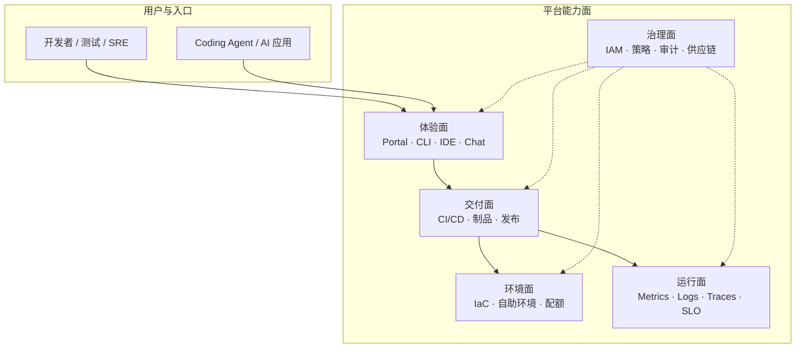

# Agent 时代的 DevOps：从交付流水线到交付系统

> **一句话**：Agent 没有改变 DevOps 的目标——快速、安全、可持续地把价值交付给用户；它改变的是**生产者、平台接口和瓶颈位置**。当代码供给的边际成本趋近于零，**信任**成为新的稀缺资源。

## 1. 问题：当写代码变便宜

AI coding agent 带来的第一波冲击是“产能”：需求到初稿的路径被大幅缩短，样板代码、测试草稿、迁移脚本可以批量生成。但 DORA 2025 的结论给这种乐观加了一个限定词——**AI 是放大器（amplifier）**：

- 90% 的技术从业者在工作中使用 AI，80% 以上自评生产力提升；
- 但 30% 的开发者对 AI 生成的代码信任度很低（little to no trust）；
- 更高的 AI 采用率同时关联**交付吞吐上升**与**交付不稳定性上升**。

原因并不神秘：AI 加速的是“创造”，而软件交付的大部分成本在“验证、集成、运行”。DORA 把这种现象称为**验证税（verification tax）**——写代码省下的时间，被审查、调试、对齐和返工重新花掉。代码生成越快，PR 越大、审查队列越长、变更与事故的关联越难追溯。

因此，Agent 时代 DevOps 的核心矛盾可以概括为：

> **代码供给的边际成本正在趋零，而信任的边际成本没有同步下降。**

平台要做的，不是“再买一个 AI 工具”，而是把**信任的生产工业化**：用可执行的黄金路径、可验证的证据链、可回收的环境、可观测的运行态，把 agent 的产出稳定地转化为可交付的软件。

## 2. 三个粗略分期

| 阶段 | 核心命题 | 主要瓶颈 | 平台形态 |
|---|---|---|---|
| DevOps 1.0 | 打破 Dev/Ops 墙，自动化构建与发布 | 手工操作、环境不一致 | CI/CD 流水线、IaC |
| DevOps 2.0 | 降低认知负荷，自助获取能力 | 工具碎片化、重复造轮子 | 内部开发者平台、黄金路径 |
| DevOps 3.0（Agent 时代） | 人机共同生产，规模化生产信任 | 验证、审查、集成、治理 | Agent-ready 交付系统 |

这不是行业标准分期，而是一个便于讨论的框架。三者的关系是叠加而非替代：没有 1.0 的自动化、2.0 的自助化，3.0 的 agent 只会更快地制造技术债。

## 3. 三个变化

### 3.1 生产者：从“人写代码”到“人机编队”

过去，交付系统的输入是人的时间；现在，输入是“人的判断 + agent 的算力”。这会带来四个连锁反应：

- **PR 供给增加、单 PR 体积增大**：审查者从“写代码的人”变成“审计 agent 的人”，认知负荷向评审端转移；
- **小批量原则更重要**：DORA 建议把 AI 生成的大变更拆成可审查、可测试的小单元，否则个体效率会被集成瓶颈吞掉；
- **测试可信度成为硬约束**：当实现成本下降，测试是唯一能规模化验证意图的手段；
- **“谁会写”让位于“谁会审、谁会定边界”**：团队需要明确哪些路径必须人工复核（认证、支付、数据删除、基础设施），哪些可以自动放行。

**判断**：短期内最值得投资的不是“让 agent 写更多”，而是“让 agent 的产出更容易被验证”——作者侧自检、变更分级、证据包、自动回滚。

### 3.2 平台接口：从“给人用的 UI”到“人机双模”

CNCF Platforms White Paper v1.1 已经把平台用户定义为“人类或 agentic users”。这是一个容易被低估的转向：

- 人类需要门户、CLI、IDE 插件、文档和示例；
- Agent 需要 **API/OpenAPI、MCP、稳定的 CLI、JSON Schema、结构化错误、dry-run、幂等语义、短时身份、审计事件**；
- 两者共享同一套能力与策略，但消费方式不同。平台不应该为 agent 单独造一套“影子系统”，而应该把现有能力**契约化**。

一个 agent-ready 的平台能力，至少要能回答五个问题：

1. 我是谁？能操作哪些资源？（身份与授权）
2. 这个操作会改变什么？能不能先 dry-run？（可预演）
3. 失败了怎么重试？会不会重复创建？（幂等与错误语义）
4. 做完之后凭什么相信它是对的？（证据与验证）
5. 这次操作花了多少钱、留下了什么审计记录？（成本与追溯）

### 3.3 控制点：从“末端门禁”到“内生护栏”

传统交付在流水线末端设“质量门禁 + 人工审批”；Agent 时代更有效的做法是把控制前移、嵌入：

- **策略即代码**：OPA/Kyverno 把“什么能做、什么不能做”变成可测试的代码；
- **默认只读、最小权限**：agent 的默认权限应低于人类，危险操作需要显式提权与审批；
- **沙箱与出口控制**：agent 在隔离容器/微 VM 中执行，网络出口按白名单放行；
- **证据链**：测试报告、SBOM、签名、provenance、eval 结果、审批记录共同构成“可发布”的依据；
- **自动回滚**：发布不是终点，可回滚才是。

GitHub Agentic Workflows 是一个有代表性的实现：用自然语言 Markdown 定义工作流，编译成标准 Actions YAML；agent 默认只读权限，运行在沙箱容器中并受 Agent Workflow Firewall 限制，输出经过 safe outputs 校验，另有 threat detection job 扫描变更。它说明“agent 作为 CI 执行者”已经从演示走向工程化，但前提是**权限、隔离与验证**三件事做到位。

### 3.4 四条理念重构

- **系统观**：优化端到端流动，而不是单点产能。代码生成快了，瓶颈会转移到评审、集成、环境与发布；局部加速可能让全局更慢。
- **证据观**：信任来自可验证的证据，而不是审批层级。门禁的产物应该是一组可追溯的证据，而不是一个签字。
- **契约观**：平台与用户（人类或 agent）之间是契约关系：接口、SLO、配额、错误语义、弃用策略。契约让复用从“复制粘贴”升级为“可组合”。
- **经济观**：token、GPU、环境时长、审查时间都要进入单位成本。AI 的产出不是免费产能，省下的写代码时间可能被验证税吃掉。

## 4. 不变的原则

Agent 时代最容易犯的错误，是把“新工具”当成“新范式”，丢掉 DevOps 几十年积累的基本盘：

- **小批量、频繁集成**：变更越小，验证越便宜，回滚越容易；
- **主干开发 + 短生命周期分支**：减少合并地狱与长期分叉；
- **自动化测试是基础设施**：没有可信测试，AI 只会加速不确定性；
- **可观测性是发布的一部分**：看不到的运行态等于不可运营；
- **你构建，你运行（you build it, you run it）**：所有权清晰，反馈闭环才成立；
- **平台即产品**：平台的成功由用户的使用与结果定义，而不是由功能清单定义；
- **降低认知负荷**：平台的价值是让用户少做选择，而不是多做选择。

## 5. 参考架构：五面一核

**一核**是“能力目录 + 黄金路径 + 度量”：所有能力有 owner、有契约、有 SLO、有成本、有使用数据；黄金路径把能力串成端到端可走通的路；度量决定下一步投资。

| 面 | 回答的问题 | 关键能力 | 详见 |
|---|---|---|---|
| 体验面 | 用户如何发现、申请、使用能力？ | 门户、CLI、IDE、文档、模板、MCP | [平台工程](./platform-as-a-product.md) |
| 交付面 | 变更如何被构建、验证、发布、回滚？ | CI、测试、制品、签名、GitOps、渐进发布 | [CI/CD 与质量保障](./ci-cd-quality-gates.md) |
| 环境面 | 环境如何按需获得、隔离、回收？ | IaC、环境即服务、配额、成本 | [环境即服务](./environment-as-a-service.md) |
| 运行面 | 系统是否健康？坏了如何发现与恢复？ | 可观测性、SLO、事故管理、容灾 | [可观测性与稳定性](./observability-and-sre.md) |
| 治理面 | 谁能在什么条件下做什么？ | 身份、RBAC、策略、审计、供应链安全 | [可观测性与稳定性](./observability-and-sre.md) / [平台落地](./platform-adoption.md) |

## 6. 成熟度模型

| 等级 | 特征 | 接口 | 黄金路径 | 治理 | 度量 |
|---|---|---|---|---|---|
| L0 手工 | 工单、脚本、口头约定 | 无 | 无 | 事后检查 | 无 |
| L1 标准化 | 统一 CI 模板、命名与基线 | CLI/文档 | 有文档，靠人执行 | 规则文档化 | 局部指标 |
| L2 自助化 | 门户/API 申请，自动交付 | Portal + API | 模板化，可一键创建 | 策略即代码 | 采用率、交付时长 |
| L3 产品化 | 平台即产品，有 PM 与路线图 | 多入口一致体验 | 端到端、可观测、可回滚 | 默认安全、例外有期限 | DORA + DevEx + 成本 |
| L4 Agent-ready | 人机双模，证据驱动 | API/MCP 优先 | 可被 agent 发现、执行、验证 | 最小权限 + 审计 + 自动回滚 | 按团队画像分层度量 |

大多数团队卡在 L1→L2：工具已经统一，但申请与交付仍靠人。L2 的关键不是“做一个门户”，而是把**申请、审批、交付、回收**做成一条可观测的自动化链路。

## 7. 八个新的工程问题

1. **Agent 身份与最小权限**：agent 不能共用人类的长期凭证；应使用短时 token、服务身份（如 SPIFFE）、按任务授予 scope，并记录“代表谁执行”。
2. **代码来源与变更归因**：AI 生成的提交需要可识别的标记（commit trailer、PR label、作者身份），否则事故复盘时无法区分“人写的”与“agent 写的”。
3. **CI 作为攻击面**：不可信 PR 的 workflow、`pull_request_target`、缓存投毒、依赖混淆、提示注入（issue/PR 正文里的恶意指令）都需要专门防护。
4. **非确定性产物的可复现性**：LLM 应用的“产物”包括 prompt、模型版本、工具配置、检索索引与评测集；这些必须像代码一样版本化。
5. **评审容量与风险路由**：评审是新的瓶颈。需要按风险分级路由、作者侧 AI 自检、堆叠 PR、审查预算，而不是单纯要求“更快审”。
6. **环境风暴与资源回收**：每个 agent run 都可能申请环境；没有 TTL、配额与回收器，成本会指数级上升。
7. **单位经济性**：token、GPU、构建分钟、环境时长都要进入单位成本模型（每次变更/每个租户/每个请求），否则无法判断 AI 是否真的更便宜。
8. **观测对象扩展**：除了服务指标，还要观测 agent run、tool call、eval 结果、guardrail 事件与 token 成本。

## 8. 度量：四层仪表盘

| 层 | 指标 | 用途 | 常见陷阱 |
|---|---|---|---|
| 交付 | DORA 5：部署频率、变更前置时间、返工率、变更失败率、失败恢复时间 | 判断“快而稳”是否改善 | 只追求部署频率，忽视失败率 |
| 开发者体验 | DX Core 4（Speed / Effectiveness / Quality / Impact）、SPACE、DevEx 调研 | 判断摩擦在哪里 | 用满意度替代客观流动数据 |
| 平台 | 采用率/留存、首次成功时间、申请到交付时延、支持工单下降、自助解决率、单位成本 | 判断平台是否被真正使用 | 用页面访问量、能力数量充数 |
| AI | 建议采纳率、返工率、审查时长、eval 通过率、agent 变更的事故归因、每次变更成本 | 判断 AI 投入是否转化为交付结果 | 用 LOC/PR 数衡量生产力 |

DORA 2025 还给出一个重要的方法论提醒：**按团队画像分层**。它把团队分为 7 类（从“基础薄弱”到“和谐高绩效”），同一套 AI 策略在不同画像上会产生相反效果。把全员平均指标当作改进依据，往往会掩盖真正的约束。

## 9. 阅读地图

| 如果你关心…… | 从这里开始 |
|---|---|
| 如何设计平台、把工程能力沉淀为可复用服务 | [平台工程：把工程能力变成可复用的产品](./platform-as-a-product.md) |
| 如何建设 CI/CD、测试、制品、发布与回滚 | [CI/CD 与自动化质量保障](./ci-cd-quality-gates.md) |
| 如何做环境自助、隔离、回收与成本治理 | [环境即服务](./environment-as-a-service.md) |
| 如何做可观测性、SLO、故障排查、权限审计与容灾 | [可观测性与稳定性](./observability-and-sre.md) |
| 如何推动研发/测试/基础设施协作与规范落地 | [平台落地：协作、规范与效果评估](./platform-adoption.md) |
| 传统 CI/CD 设计原则（Pipeline as Code、效率与可靠性指标） | [DevOps 理念与实践](./devops-thinking.md) |

## 10. 如果只做三件事

1. **把一条黄金路径做到端到端可走通**：从创建仓库到生产发布、观测、回滚，全部有模板、有证据、有 owner。
2. **把环境的创建与回收做成自助服务**：TTL、空闲回收、配额、成本可见，先解决“等环境”和“僵尸资源”。
3. **把 agent 的默认权限降为只读，并为每次变更建立证据链**：身份、沙箱、审计、签名、SBOM、eval 报告、回滚记录。

这三件事的共同点是：它们都在**降低信任的边际成本**，而不是增加代码产量。

## 11. 参考

- [DORA 2025: State of AI-assisted Software Development](https://dora.dev/research/2025/dora-report/)
- [DORA: Balancing AI tensions](https://dora.dev/insights/balancing-ai-tensions/)
- [CNCF Platforms White Paper v1.1](https://cloudnativeplatforms.com/whitepapers/platforms/)
- [GitHub Agentic Workflows (GA)](https://github.blog/changelog/2026-10-28-github-agentic-workflows-generally-available/)
- [OpenTelemetry GenAI Semantic Conventions](https://opentelemetry.io/docs/specs/semconv/gen-ai/)
- [SLSA](https://slsa.dev/) / [Sigstore](https://www.sigstore.dev/)
- [Team Topologies](https://teamtopologies.com/)
- [DX Core 4](https://getdx.com/research/measuring-developer-productivity-with-the-dx-core-4/)
