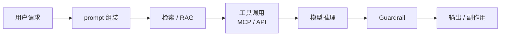

# 可观测性与稳定性：从监控到可运营系统

> 可观测性不是“装一套监控”，而是让团队在未知故障面前**能提出并回答问题**。稳定性不是“不出故障”，而是**故障发生时能快速发现、定位、恢复，并从中学到东西**。

## 1. 可观测性是一项平台能力

把可观测性做成平台能力，意味着：

- **默认开启**：新服务接入黄金路径即带有指标、日志、Trace、Dashboard、告警；
- **标准统一**：信号格式、资源属性、命名规范、采样策略一致；
- **开箱即用**：SLO 模板、告警规则、runbook 模板、部署标记；
- **可组合**：业务团队可以在此基础上扩展，而不是从零搭；
- **可治理**：成本、基数、保留期、访问权限可控。

如果每个团队都自己选一套 Agent、自己定标签、自己写 Dashboard，最终会得到一堆无法关联的数据孤岛。

## 2. 信号与数据模型

### 2.1 信号

| 信号 | 回答的问题 | 典型用途 |
|---|---|---|
| Metrics | 系统整体是否健康？趋势如何？ | SLO、容量、告警 |
| Logs | 具体发生了什么？ | 排错、审计 |
| Traces | 请求在哪个环节慢/错？ | 分布式追踪、依赖分析 |
| Profiles | CPU/内存/锁在做什么？ | 性能瓶颈定位 |
| Events | 变更/部署/扩缩容何时发生？ | 变更关联、复盘 |

**“三支柱”是手段，不是目标**。目标是用最少的信号回答最多的问题。实践中，结构化宽事件（wide events）加上少量高价值指标，往往比“全量日志 + 全量 Trace”更经济。

### 2.2 统一资源属性

至少统一以下属性，才能把不同信号关联起来：

- `service.name`、`service.version`、`service.instance.id`
- `deployment.environment`（dev/staging/prod）
- `k8s.cluster.name`、`k8s.namespace.name`、`k8s.pod.name`
- `git.commit`、`cicd.pipeline.run.id`
- `tenant`、`cost_center`

这些属性应通过 OpenTelemetry Resource 自动注入，而不是让开发者手写。

### 2.3 采集与成本

- **Collector 管道**：receivers → processors → exporters；统一做批处理、脱敏、采样、路由；
- **采样**：头部采样简单但可能丢关键请求；尾部采样按错误/延迟/租户保留更有价值；
- **基数控制**：禁止把用户 ID、URL 全量塞进标签；用 exemplars 连接指标与 Trace；
- **分层存储**：热数据（最近几天）与冷数据（长期归档）分开，保留期按合规要求；
- **成本可见**：按团队/信号类型展示采集与存储成本，避免“可观测性账单失控”。

## 3. AI 应用与 Agent 的可观测性

### 3.1 为什么传统 APM 不够

一个 LLM 请求的链路是：prompt 组装 → 检索 → 工具调用 → 模型推理 → guardrail → 后处理。传统 APM 能看到 HTTP 延迟，但看不到：

- prompt 用了哪个版本？检索到了哪些文档？
- 模型是哪个版本？token 用了多少？成本多少？
- 工具调用是否成功？参数是否合理？
- guardrail 是否命中？命中后如何处理？
- 输出质量是否下降？是模型漂移还是数据漂移？

### 3.2 OpenTelemetry GenAI 语义约定

OTel 的 GenAI semantic conventions 正在成为事实标准（仍处于 development 阶段，落地时需固定版本）：

- `gen_ai.system`、`gen_ai.request.model`、`gen_ai.response.model`
- `gen_ai.operation.name`（chat、embeddings、tool call 等）
- `gen_ai.usage.input_tokens` / `output_tokens`
- `gen_ai.agent.name` / `gen_ai.agent.id` / `gen_ai.agent.version`
- 工具调用与 MCP 相关属性

建议把 agent 的一次运行建模为一条 Trace：



每个 span 记录：输入摘要（脱敏）、输出摘要、token、延迟、错误、成本。完整 prompt/response 是否落盘，要按数据分级与隐私策略决定，默认采样 + 脱敏。

### 3.3 Agent 可观测性

| 观测对象 | 关键字段 | 用途 |
|---|---|---|
| Agent run | run_id、任务、触发者、开始/结束、状态 | 成功率、时长、成本 |
| Step | step_id、类型（思考/工具/审批）、耗时 | 定位卡点 |
| Tool call | 工具名、参数摘要、结果、错误 | 工具可靠性、越权 |
| Model call | 模型、token、延迟、成本、缓存命中 | 成本/性能优化 |
| Guardrail | 规则、命中、处置 | 安全与合规 |
| Approval | 审批人、动作、时间 | 审计 |

这些数据既能用于运营（成本、成功率），也能用于安全（异常工具调用、数据外泄）和产品（哪些任务适合 agent）。

### 3.4 评测与生产的闭环

- 离线 eval 的结果要进入发布证据；
- 在线 eval 对生产流量抽样评分，监控质量漂移；
- 质量分、投诉率、转人工率、token 成本要进入同一张 Dashboard；
- 版本变更（prompt/模型/检索）要打部署标记，便于关联质量变化。

## 4. SLO 与错误预算

### 4.1 从 SLI 到 SLO

- **SLI**：可测量的服务质量指标，如“成功请求占比”“P95 延迟”“首 token 延迟”；
- **SLO**：对 SLI 的目标，如“30 天内 99.9% 的请求成功”；
- **错误预算**：`1 - SLO`，是“允许失败的量”，也是发布与稳定性之间的调节器。

SLO 应该按**用户旅程**定义，而不是按组件定义。用户关心“能否下单”，不关心“订单服务 A 的 CPU”。

### 4.2 多窗口燃烧率告警

不要用“错误率 > 1% 持续 5 分钟”这种拍脑袋阈值。用燃烧率（burn rate）：

```promql
# 示意：1 小时窗口，SLO=99.9%，燃烧率 > 14.4 表示 1 小时消耗 2% 月度预算
(
  sum(rate(http_requests_total{job="checkout",code=~"5.."}[1h]))
  /
  sum(rate(http_requests_total{job="checkout"}[1h]))
) / (1 - 0.999)
```

常见做法是“多窗口、多燃烧率”：短窗口快速告警（如 1h/5m），长窗口慢速告警（如 6h/30m、3d/6h），降低误报与漏报。

### 4.3 错误预算策略

- 预算充足：正常发布，鼓励小步快跑；
- 预算消耗过快：冻结非必要发布，优先修复稳定性；
- 预算耗尽：只允许修复类变更，直到预算恢复；
- 策略要提前约定，而不是事故发生后再争论。

## 5. 性能分析与容量

### 5.1 分析方法

- **USE**（Utilization、Saturation、Errors）：面向资源，适合节点、磁盘、网络、GPU；
- **RED**（Rate、Errors、Duration）：面向服务，适合微服务与 API；
- **尾延迟**：P95/P99 比平均值更能反映用户体验；
- **持续 profiling**：定位 CPU/内存/锁热点，按服务/版本聚合；
- **eBPF**：无侵入获取系统调用、网络、调度延迟；
- **压测**：k6/Locust/JMeter，覆盖峰值、突增、依赖降级。

### 5.2 容量模型

容量评估不是“拍一个副本数”，而是建立可解释的模型：

```
所需容量 = 峰值流量 × 单请求资源消耗 × 安全系数 / 单实例有效容量
```

要考虑：

- 峰值与日常的比值（促销、活动、定时任务）；
- 故障域（一个 AZ 挂掉后，剩余容量是否够）；
- 启动时间与扩容速度（冷启动、镜像拉取、JIT）；
- 依赖容量（数据库、缓存、消息队列、模型配额）；
- 成本约束（预留 vs 按需 vs Spot）。

### 5.3 性能回归

- 在 CI 中跑基准测试（benchmark），对关键路径设阈值；
- 记录每次发布的 P95/P99、吞吐、错误率；
- 对 LLM 应用记录 TTFT、tokens/s、单请求成本；
- 性能回归与功能回归同等重要，不能只看“测试是否通过”。

## 6. 故障排查与事故管理

### 6.1 排查路径

从“症状”出发，而不是从“我怀疑的组件”出发：

1. **影响面**：哪些用户/租户/地域/版本受影响？
2. **时间线**：最近有什么变更（部署、配置、流量、依赖）？
3. **分层**：入口 → 应用 → 依赖 → 数据 → 基础设施 → 云；
4. **信号**：指标 → Trace → 日志 → Profile → 事件；
5. **假设与验证**：每次只验证一个假设，记录证据。

Kubernetes 控制面的事故排查可以参考 [Kubernetes 控制面事故处理手册](../Kubernetes/Control_Plane/控制面事故处理手册.md)，里面有症状→层的决策树与分场景 runbook。

### 6.2 事故管理

| 阶段 | 关键动作 | 产出 |
|---|---|---|
| 发现 | 告警、用户反馈、合成监控 | 事故等级、影响面 |
| 响应 | 指定 IC、拉群、止血优先 | 时间线、决策记录 |
| 沟通 | 对内/对外同步，状态页 | 统一口径 |
| 恢复 | 回滚、切流、扩容、降级 | 恢复确认 |
| 复盘 | 无责复盘、根因、改进项 | 行动项、Owner、期限 |

**止血优先于根因**。事故中最贵的不是“不知道原因”，而是“知道原因但不敢动”。

### 6.3 AI SRE 的边界

AI 可以加速：告警分诊、日志聚类、变更关联、RCA 假设生成、事故总结、复盘草稿。但不能替代：

- 对生产变更的最终决策；
- 对证据的核验；
- 与用户/客户的沟通；
- 责任归属与组织改进。

落地时要求 AI 的每条结论**附带证据链接**（指标、Trace、日志、变更记录），并保留人工确认步骤。否则容易产生“看起来很有道理但错误”的自动化偏见。

## 7. 稳定性工程

### 7.1 韧性模式

- **超时**：所有外部调用都要有超时，且小于上游超时；
- **重试 + 抖动**：只对幂等操作重试，限制次数与总预算；
- **熔断**：依赖持续失败时快速失败，避免雪崩；
- **舱壁**：按租户/依赖隔离资源池；
- **限流/降载**：保护系统不被压垮，优先保核心链路；
- **优雅降级**：非核心功能可关闭，核心功能可用；
- **背压**：队列满时拒绝，而不是无限堆积。

### 7.2 混沌与演练

- 游戏日（Game Day）：定期注入故障，验证告警、runbook、值班能力；
- 混沌工程：在受控环境注入延迟、错误、节点故障；
- 容灾演练：真实的切换/恢复，而不是“文档上写着可以”；
- 回滚演练：验证回滚脚本、数据兼容、依赖顺序。

### 7.3 容灾与恢复

- 明确 RTO/RPO，按业务分级；
- 备份要验证可恢复，定期做 restore drill；
- Kubernetes 控制面灾备参考 [控制面灾备与恢复](../Kubernetes/Control_Plane/控制面灾备与恢复.md)；
- 多可用区/多地域的切换要有明确的决策权与流量切换流程；
- 恢复后要核对数据一致性，而不只是“进程起来了”。

## 8. 权限、审计与恢复

### 8.1 权限

- **最小权限**：默认只读，按角色/命名空间/资源授予；
- **职责分离**：开发、发布、生产变更、审计权限分开；
- **JIT 提权**：临时提升权限，带审批、时限、自动回收；
- **Break-glass**：紧急通道必须有，但必须告警、记录、事后复盘；
- **服务身份**：工作负载使用 SPIFFE/OIDC 等短时身份，避免长期密钥；
- **多租户**：RBAC + 命名空间隔离 + 网络策略 + 配额。

### 8.2 审计

审计日志要回答：**谁、在什么时间、从哪里、对什么资源、做了什么、结果如何、为什么**。

覆盖范围：

- Kubernetes API 审计（[RBAC](../Kubernetes/Fundamentals/rbac.md) 相关变更尤其重要）；
- 云控制面审计（IAM、网络、数据库）；
- CI/CD 审计（谁触发了什么流水线、改了什么配置）；
- Agent 审计（身份、输入、工具调用、输出、成本）；
- 数据访问审计（敏感数据、导出、删除）。

要求：不可篡改（WORM/对象锁）、集中存储、保留期合规、可检索、异常行为告警。

### 8.3 恢复

- 备份策略按数据分级：全量/增量、频率、保留；
- 恢复演练至少每季度一次，记录实际 RTO；
- 关键系统要有“一键恢复”runbook，但必须人工确认；
- 恢复后验证：数据一致性、依赖可用、权限正确、监控恢复。

## 9. 度量

| 指标 | 说明 |
|---|---|
| MTTD | 从故障发生到发现 |
| MTTR | 从发现到恢复 |
| 告警精确率 | 有效告警 / 总告警 |
| SLO 达成率 | 按用户旅程统计 |
| 错误预算燃烧 | 多窗口燃烧率 |
| 事故复发率 | 同类事故再次发生 |
| 复盘行动项关闭率 | 改进是否落地 |
| 容量余量 | 峰值下的 headroom |
| 单位信号成本 | 每服务/每租户的采集与存储成本 |
| 恢复演练成功率 | restore drill 是否通过 |

## 10. 落地清单

- [ ] 统一 OpenTelemetry 接入，资源属性标准化；
- [ ] 为新服务默认生成 Dashboard、告警、SLO 模板；
- [ ] 为 Top 5 用户旅程定义 SLO 与错误预算；
- [ ] 部署标记/变更事件进入可观测平台；
- [ ] LLM 应用接入 GenAI 语义约定与 token/成本指标；
- [ ] Agent run/tool call/guardrail 进入 Trace 与审计；
- [ ] 建立事故分级、IC 制度、无责复盘；
- [ ] 每季度做一次回滚/容灾演练；
- [ ] 审计日志集中、不可篡改、可检索；
- [ ] JIT 提权与 break-glass 流程可审计。

## 11. 参考与相关页面

- [Agent 时代的 DevOps](./agent-era-devops.md)
- [平台工程：把工程能力变成可复用的产品](./platform-as-a-product.md)
- [CI/CD 与自动化质量保障](./ci-cd-quality-gates.md)
- [环境即服务](./environment-as-a-service.md)
- [Kubernetes 控制面高可用方案](../Kubernetes/Control_Plane/控制面高可用方案.md)
- [Kubernetes 控制面灾备与恢复](../Kubernetes/Control_Plane/控制面灾备与恢复.md)
- [Kubernetes 控制面事故处理手册](../Kubernetes/Control_Plane/控制面事故处理手册.md)
- [RBAC](../Kubernetes/Fundamentals/rbac.md)
- [OpenTelemetry GenAI Semantic Conventions](https://opentelemetry.io/docs/specs/semconv/gen-ai/)
- [Google SRE: SLO / Error Budget](https://sre.google/workbook/implementing-slos/)
- [incident.io: What is AI SRE](https://incident.io/blog/what-is-ai-sre-complete-guide-2026)
