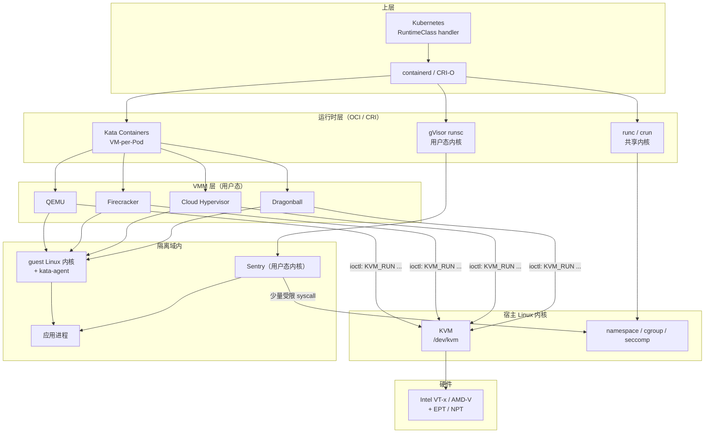
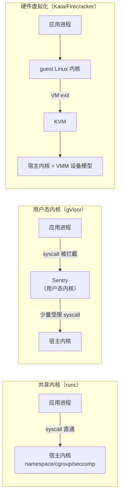
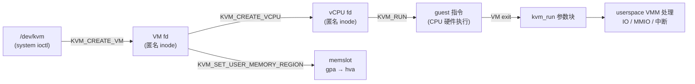
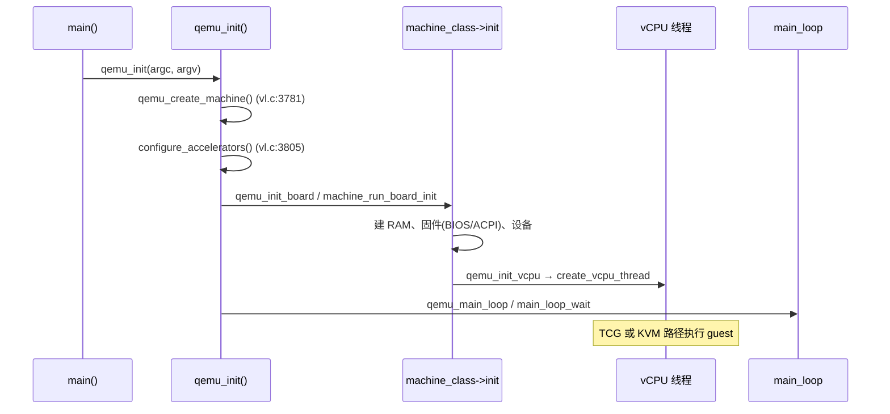
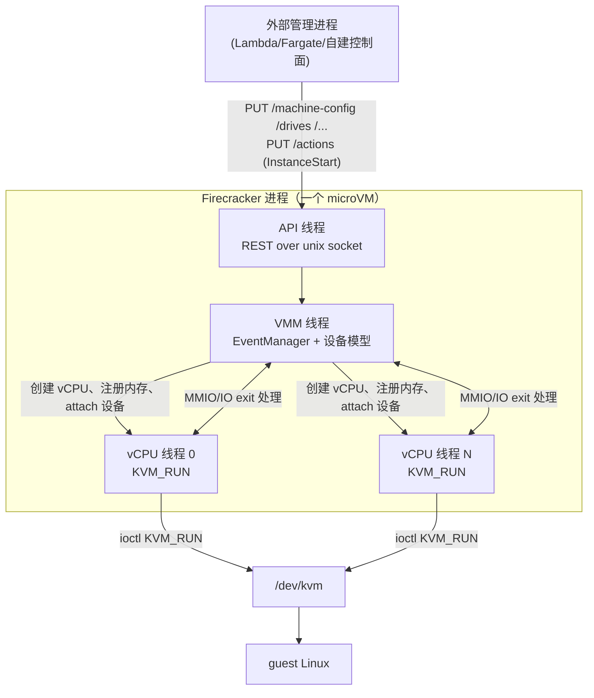
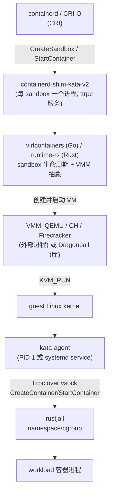
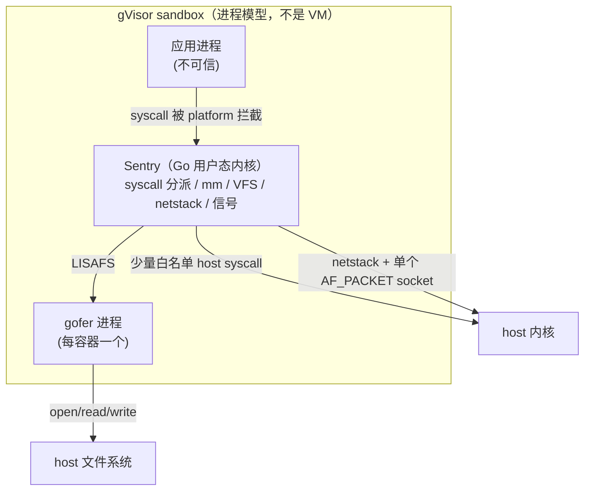
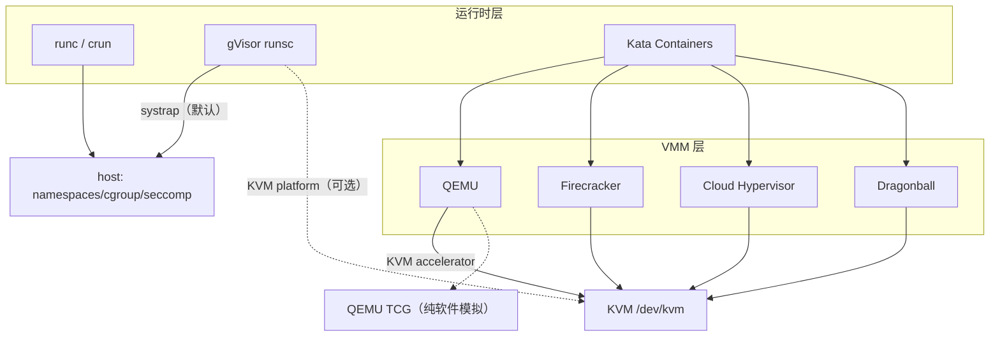
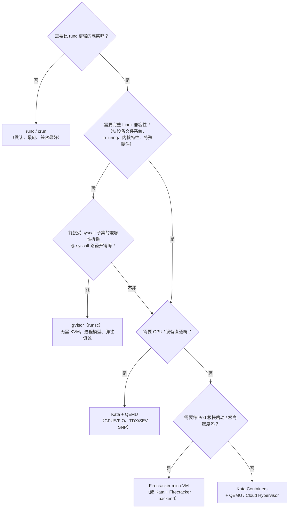
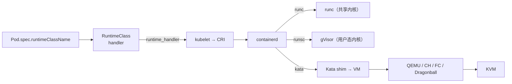

# 沙箱与虚拟化技术全景：KVM、QEMU、Firecracker、Kata、gVisor

这五个词经常被并列提起，但它们**不在同一个层次上**：KVM 是内核里的虚拟化接口，QEMU 和 Firecracker 是用户态的 VMM，Kata 是容器运行时，gVisor 是用户态内核。把这五个东西排成"从硬件到容器"的一条线，很多混淆会自然消失。

本文的重点不是复述官方文档，而是回答四个问题：

1. 每个东西**到底负责哪一层**，它的隔离边界落在 CPU 的哪一级特权上；
2. 它们之间**谁调用谁**，哪些是替代关系、哪些是组合关系；
3. "容器 / 沙箱 / 虚拟机"三个词在**什么语境下才是同义的**；
4. 面对一个具体需求（AI Agent 执行不可信代码、多租户、serverless、GPU 负载）该**怎么选**。

> **引用约定**：本文所有代码/仓库内文档引用都固定到 2026-11-19 拉取的具体 commit，链接形如
> `https://github.com/<org>/<repo>/blob/<commit>/<path>#Lx-Ly`，行号与当时本地 checkout 一致。
> 版本一览：
>
> | 项目 | tag | commit |
> |---|---|---|
> | Linux（KVM） | v7.3 | `c03c1a14507dfaf8b856c2608f9ac216021fc222` |
> | QEMU | v11.1.3 | `005c61c0ef6f6ae615283440b4bb7be51b2c6ddd` |
> | Firecracker | v1.18.0 | `eaf83bb718a559d324613d566eaf776b31a62340` |
> | Kata Containers | 4.4.0 | `f9cbda4d235b345340bf461e4aaba8c89e841d8d` |
> | gVisor | release-20261116.0 | `89cacadae21eca4270a8f7c79281d0426d33ac5f` |
>
> 文末 GitHub 固定链接均用脚本校验过：文件在对应 commit 存在、`#Lx-Ly` 不越界、commit 与本地 checkout 一致。

---

## 0. 先给结论：一张表、一张图

### 0.1 五个东西的定位

| 名字 | 它是什么 | 所在层 | 隔离边界在哪 | 硬件虚拟化由谁提供 | 一句话记忆 |
|---|---|---|---|---|---|
| **KVM** | Linux 内核模块，通过 `/dev/kvm` 暴露虚拟化 API | 宿主内核 | 提供 CPU/内存虚拟化**原语**（VT-x/SVM + EPT/NPT） | 硬件（KVM 使用 VT-x/SVM + EPT/NPT） | 硬件虚拟化的**内核接口** |
| **QEMU** | 通用机器模拟器 + VMM + 设备模型 | 用户态 | 可配合 KVM（硬件边界），也可纯 TCG（软件模拟） | KVM 加速 / TCG 纯软件 | **完整**的机器模拟器 |
| **Firecracker** | 面向 serverless 的极简 VMM（Rust），跑 microVM | 用户态 | KVM 提供的硬件边界 | KVM | 裁到最小的 **QEMU 替代品**（不是 QEMU fork） |
| **Kata Containers** | OCI/CRI 兼容运行时：VMM + guest 内核 + agent | 运行时层 | VM 边界（每个 Pod 一个轻量 VM） | KVM（经 VMM） | 把 **Pod 塞进 VM** |
| **gVisor** | 用户态应用内核 Sentry + OCI runtime `runsc` | 运行时层 | **syscall 拦截**（宿主内核不在容器 syscall 路径上） | 可选 KVM platform；默认不用 | 用 Go 写的**用户态内核** |

三条最容易记错的关系：

- **QEMU ≠ KVM**：KVM 是内核能力，QEMU 是用户态 VMM；QEMU 可以不用 KVM（TCG 纯模拟），KVM 也可以不用 QEMU（Firecracker/Cloud Hypervisor）。
- **Kata ≠ hypervisor**：Kata 是"组装层"，它自己不做 CPU 虚拟化，也不实现 VMM；VMM（QEMU/CH/Firecracker/Dragonball）是可替换组件。
- **gVisor ≠ 虚拟机**：默认平台（systrap）不创建 VM、不需要 `/dev/kvm`；它是用进程 + seccomp 实现的一个"假内核"。

### 0.2 分层全景



**读图要点**：

- 只有最下面的 `KVM → VT-x` 是"虚拟化硬件"；上面所有东西都是软件层。
- 图中三条从应用到宿主的内核路径，正好对应**三种隔离边界**（下一节）：`APP → namespace`（共享内核）、`APP → Sentry → 少量 syscall`（用户态内核）、`APP → guest 内核 → VM exit → KVM`（硬件虚拟化）。
- QEMU/Firecracker/CH/Dragonball 是**平级**的 VMM，Kata 可以选择其中任意一个。

### 0.3 VMM 是什么：一台虚拟机的"用户态操作系统"

> **VMM（Virtual Machine Monitor）是负责创建、启动并运行一台虚拟机的软件层。** 在 KVM 体系里这句话有更具体的含义：**KVM 只在内核提供 CPU/内存虚拟化的原语，把"能启动、有设备、能管理"的一台 VM 拼出来的是 userspace 的 VMM。**

**VMM 的四件事**（这四件缺一不可，也是判断"某东西是不是 VMM"的标准）：

| 职责 | 做什么 | 代码里的落点 |
|---|---|---|
| 1. **管 vCPU** | 为每个 guest CPU 创建 KVM vCPU，起宿主线程跑 `KVM_RUN` 循环，处理每次 VM exit | Firecracker [vcpu.rs#L407-L432](https://github.com/firecracker-microvm/firecracker/blob/eaf83bb718a559d324613d566eaf776b31a62340/src/vmm/src/vstate/vcpu.rs#L407-L432)；QEMU [kvm-all.c#L3445-L3482](https://github.com/qemu/qemu/blob/005c61c0ef6f6ae615283440b4bb7be51b2c6ddd/accel/kvm/kvm-all.c#L3445-L3482) |
| 2. **管内存** | 分配/映射 guest RAM，告诉 KVM"这段 gpa 对应我进程里的哪个 hva"（memslot） | `KVM_SET_USER_MEMORY_REGION` 的 5 字段结构（[kvm.h#L29-L36](https://github.com/torvalds/linux/blob/c03c1a14507dfaf8b856c2608f9ac216021fc222/include/uapi/linux/kvm.h#L29-L36)）；Firecracker [vm.rs#L453-L475](https://github.com/firecracker-microvm/firecracker/blob/eaf83bb718a559d324613d566eaf776b31a62340/src/vmm/src/vstate/vm.rs#L453-L475)；QEMU [kvm-all.c#L380-L411](https://github.com/qemu/qemu/blob/005c61c0ef6f6ae615283440b4bb7be51b2c6ddd/accel/kvm/kvm-all.c#L380-L411) |
| 3. **造虚拟平台** | 设备模型（virtio/legacy/PCI）、中断、固件/ACPI；把 IO/MMIO exit 翻译成设备读写 | QEMU [hw/virtio/virtio.c#L3766](https://github.com/qemu/qemu/blob/005c61c0ef6f6ae615283440b4bb7be51b2c6ddd/hw/virtio/virtio.c#L3766)；Firecracker 设备 attach 顺序 [builder.rs#L242-L303](https://github.com/firecracker-microvm/firecracker/blob/eaf83bb718a559d324613d566eaf776b31a62340/src/vmm/src/builder.rs#L242-L303)；exit 分发 [vmx.c#L6329-L6389](https://github.com/torvalds/linux/blob/c03c1a14507dfaf8b856c2608f9ac216021fc222/arch/x86/kvm/vmx/vmx.c#L6329-L6389) |
| 4. **管生命周期** | 加载内核/固件、启动/暂停/恢复、快照、迁移、对外的管理 API | Firecracker 用 linux-loader 直接引导（[arch/x86_64/mod.rs#L495-L548](https://github.com/firecracker-microvm/firecracker/blob/eaf83bb718a559d324613d566eaf776b31a62340/src/vmm/src/arch/x86_64/mod.rs#L495-L548)）、快照 [persist.rs#L169-L198](https://github.com/firecracker-microvm/firecracker/blob/eaf83bb718a559d324613d566eaf776b31a62340/src/vmm/src/persist.rs#L169-L198)）；QEMU 加载 `bios.bin`（[pc_sysfw.c#L247-L254](https://github.com/qemu/qemu/blob/005c61c0ef6f6ae615283440b4bb7be51b2c6ddd/hw/i386/pc_sysfw.c#L247-L254)） |

把上面四件事写成伪代码，VMM 的主循环其实就是"创建 + 一个 `KVM_RUN` 循环"：

```c
int kvm  = open("/dev/kvm", O_RDWR);
int vm   = ioctl(kvm, KVM_CREATE_VM);
void *ram = mmap(...);                                  /* guest RAM 由 VMM 分配 */
ioctl(vm, KVM_SET_USER_MEMORY_REGION, &(struct kvm_userspace_memory_region){
    .slot = 0, .guest_phys_addr = 0, .memory_size = RAM_SIZE, .userspace_addr = ram });
int vcpu = ioctl(vm, KVM_CREATE_VCPU, 0);
struct kvm_run *run = mmap(vcpu_run_fd, KVM_GET_VCPU_MMAP_SIZE);
for (;;) {
    ioctl(vcpu, KVM_RUN);            /* 进入 guest；返回 = 一次 VM exit */
    switch (run->exit_reason) {
    case KVM_EXIT_IO:   /* 设备模型应答 */ break;
    case KVM_EXIT_MMIO: /* 设备模型应答 */ break;
    case KVM_EXIT_HLT:  /* guest 停机 */   break;
    }
}
```

> 伪代码省略了 vCPU 寄存器初始化、多 vCPU 线程、`kvm_run` 映射大小、信号/暂停处理等；真实实现见 Firecracker [builder.rs#L165-L205](https://github.com/firecracker-microvm/firecracker/blob/eaf83bb718a559d324613d566eaf776b31a62340/src/vmm/src/builder.rs#L165-L205) 与 QEMU `accel/kvm`。

**VMM 与相邻概念的边界**（这是"VMM 是什么"最容易被问混的部分）：

| 概念 | 是什么 | 不是什么 |
|---|---|---|
| **VMM** | 创建/运行 VM 的 userspace 程序：QEMU、Firecracker、Cloud Hypervisor、crosvm、Dragonball | 不是内核模块，不是 ioctl API |
| **Hypervisor** | 虚拟化层的统称：bare-metal 的 Xen/Hyper-V，或内核内的 KVM | 不一定是某个 userspace 程序；KVM 常被叫 hypervisor，但它本身不是产品 |
| **Accelerator** | QEMU 对"CPU 执行后端"的命名（KVM/TCG/Xen/HVF…） | 不是 VM，也不是完整的 VMM |
| **Runtime** | 容器生命周期接口的实现（runc/runsc/kata） | 不直接创建 VM（Kata 内部再调 VMM） |
| **KVM** | 内核里提供 CPU/内存虚拟化原语的接口（`/dev/kvm`） | 不是 VMM；不提供设备模型、固件、磁盘/网络后端 |

一句话记住：**KVM 提供"虚拟化原语"，VMM 把原语组装成"一台机器"，runtime 把这台机器（或进程/用户态内核）包装成"容器"。** 这也解释了为什么同一套 KVM 能长出 QEMU（全功能）、Firecracker（极简）两种形态完全不同的 VMM——差异全在 VMM 这一层。

---

## 1. 为什么这些词总被混在一起

### 1.1 三个被混用的词：沙箱、虚拟化、运行时

| 词 | 真正含义 | 回答的问题 | 例子 |
|---|---|---|---|
| **沙箱（sandbox）** | 一种**隔离效果**的统称 | "这段不可信代码最多能碰到什么？" | gVisor、Kata、Firecracker、seccomp、Wasm |
| **虚拟化（virtualization）** | 一种**实现手段**：用硬件/软件造出虚拟的 CPU、内存、设备 | "怎么造出一台假机器？" | KVM、QEMU、Firecracker |
| **运行时（runtime）** | 一种**接口/生命周期实现** | "怎么创建/启动/停止一个容器？" | runc、runsc、kata-runtime、containerd |

所以「gVisor 是沙箱但不是虚拟机」「Kata 是运行时同时是沙箱」「Firecracker 是 VMM 也是沙箱的底座」这些说法都不矛盾——它们分别在回答不同的问题。

### 1.2 一条历史线：需求是怎么逼出这些技术的

1. **2003：QEMU 诞生**。用纯软件（TCG 动态翻译）模拟一整台机器，能跨架构跑 OS。它证明"VMM + 设备模型"可以完全跑在用户态（[QEMU 官方介绍](https://www.qemu.org/docs/master/about/index.html)）。
2. **2007：KVM 进入 Linux 2.6.20**。把 Intel VT-x / AMD-V 包装成 `/dev/kvm` 的内核 API，QEMU 立刻成为它的用户态搭档——"QEMU/KVM" 组合从此成为 Linux 虚拟化的默认答案（[KVM OLS 2007 论文](https://www.kernel.org/doc/ols/2007/ols2007v1-pages-225-230.pdf)）。
3. **2013：Docker 引爆容器**。namespace + cgroup + 镜像分层让"打包和启动"变得极轻，但**隔离边界是共享的宿主内核**：容器逃逸 = 内核提权。
4. **2015–2018：两条强隔离路线出现**：
   - **硬件虚拟化路线**：Intel Clear Containers（2015）与 Hyper runV 合并为 **Kata Containers**（2017 年底宣布），思路是"每个 Pod 一个轻量 VM"，兼容 OCI/CRI（[Kata 官网](https://katacontainers.io/)）；
   - **用户态内核路线**：Google 开源 **gVisor**（2018），思路是"在用户态重新实现一个 Linux 内核"，把不可信进程的 syscall 全部拦截在 Sentry 里（[gVisor 开源公告](https://cloud.google.com/blog/products/gcp/open-sourcing-gvisor-a-sandboxed-container-runtime)）。
5. **2018：AWS 开源 Firecracker**。把 VMM 裁到只剩 virtio-net/block/vsock + serial，启动时间压到百毫秒级、内存开销压到 MiB 级，用来支撑 Lambda/Fargate 的高密度多租户。2020 年的 NSDI 论文系统总结了这套设计（[NSDI'20](https://www.usenix.org/conference/nsdi20/presentation/agache)）。
6. **2018–2020：Kubernetes 把"选运行时"标准化**。RuntimeClass（1.20 GA）让用户用 `runtimeClassName` 选择 handler，把 runc / runsc / kata 统一到同一个 Pod API 下（[RuntimeClass 文档](https://kubernetes.io/docs/concepts/containers/runtime-class/)；链路细节见 [容器运行时全链路](../Kubernetes/容器运行时.md)）。
7. **2019–至今：组合而不是替代**。Kata 支持 QEMU/Cloud Hypervisor/Firecracker/Dragonball 多个 VMM；Confidential Containers（CoCo）把 Kata + 硬件可信执行环境（TDX/SEV-SNP）组合起来；AI Agent 沙箱（如 [Agent Sandbox](../AI_Infrastructure/agent-sandbox.md)、[Agent Substrate](../AI_Infrastructure/agent-substrate.md)）同时使用 gVisor 和 Kata microVM。

> 说明：上述年份是业界通说；内联链接主要支撑"项目/概念确实存在"，并非逐条考据历史（例如 RuntimeClass 的 GA 版本请以 Kubernetes release note 为准）。

> 一句话：**容器解决了"打包和密度"，虚拟化解决了"隔离边界"，gVisor 提供了第三条路（用户态内核）**。三者不是代际替代，而是按"隔离强度 / 兼容性 / 开销"三角做取舍。

### 1.3 一条判据：隔离边界落在哪个特权级

判断一个技术"强不强"，不要看它叫不叫 sandbox，而要看**不可信代码的 syscall 最终由谁处理**：

- 由**宿主内核**处理 → 共享内核（runc），隔离 = namespace/cgroup/seccomp/LSM；
- 由**用户态内核**处理 → 用户态内核（gVisor），隔离 = Sentry 的 syscall 实现 + 宿主 seccomp；
- 由**guest 内核**处理，宿主只看到 VM exit → 硬件虚拟化（Kata/Firecracker/QEMU），隔离 = CPU 特权级 + EPT。

这个判据贯穿全文。

---

## 2. 三种隔离边界

把所有"容器隔离"技术按边界归类，只有三类（Wasm 等"非 Linux 运行时"不在本文范围）：

| | **共享内核** | **用户态内核** | **硬件虚拟化** |
|---|---|---|---|
| 代表 | runc / crun | gVisor（runsc） | QEMU / Firecracker / Kata |
| 不可信代码的 syscall 由谁处理 | 宿主内核 | Sentry（用户态） | guest 内核 |
| 宿主内核能直接看到什么 | 每个容器 syscall | 只有 Sentry 自己发出的少量 syscall | 只有 KVM 的 VM exit 和 VMM 的 I/O |
| 逃逸需要突破 | 内核漏洞 / 错误配置（capabilities、挂载、设备） | Sentry 的 syscall 实现 + 宿主 seccomp/内核 | guest 内核 → VMM → KVM 的整条链 |
| Linux 兼容性 | 最高 | 中（syscall 子集） | 最高（完整 guest 内核） |
| 启动/内存开销 | 最低 | 中 | 最高（VM 启动 + guest 内存） |



> **注意**：gVisor 的 **KVM platform** 是一个特例——它确实借 KVM 造了一个 VM，但 VM 里跑的是 Sentry 自己（Sentry 同时扮演 guest OS 和 VMM），应用进程仍在 Sentry 的进程模型里。所以它的"边界实质"仍是用户态内核，只是用硬件加速地址空间切换。第 7 节细讲。

---

## 3. KVM：把 CPU 虚拟化能力变成 `/dev/kvm`

### 3.1 它是什么：内核子系统 + 一套 ioctl ABI

KVM（Kernel-based Virtual Machine）是 Linux 内核里的虚拟化子系统，构建产物是 `kvm.ko` + 厂商模块 `kvm-intel.ko`/`kvm-amd.ko`（[arch/x86/kvm/Makefile#L35-L37](https://github.com/torvalds/linux/blob/c03c1a14507dfaf8b856c2608f9ac216021fc222/arch/x86/kvm/Makefile#L35-L37)）。它对外只暴露一个字符设备 `/dev/kvm`（misc 设备，[virt/kvm/kvm_main.c#L5593-L5597](https://github.com/torvalds/linux/blob/c03c1a14507dfaf8b856c2608f9ac216021fc222/virt/kvm/kvm_main.c#L5593-L5597)），所有能力都通过这个 fd 上的 ioctl 协商。

官方 API 文档开篇就把它定义为"一组发往不同文件描述符的 ioctl"（[Documentation/virt/kvm/api.rst#L10-L22](https://github.com/torvalds/linux/blob/c03c1a14507dfaf8b856c2608f9ac216021fc222/Documentation/virt/kvm/api.rst#L10-L22)），并且这个 ABI 自 Linux 2.6.22 起冻结，只允许向后兼容扩展（[api.rst#L90-L98](https://github.com/torvalds/linux/blob/c03c1a14507dfaf8b856c2608f9ac216021fc222/Documentation/virt/kvm/api.rst#L90-L98)）。版本号 `KVM_API_VERSION` 固定为 `12`（[include/uapi/linux/kvm.h#L22](https://github.com/torvalds/linux/blob/c03c1a14507dfaf8b856c2608f9ac216021fc222/include/uapi/linux/kvm.h#L22)），userspace 发现返回的不是 12 就应拒绝运行。

**这句话是理解 KVM 的关键**：KVM 本身不创建"一台虚拟机"，它只提供让 userspace 能创建虚拟机的基础设施。

> **Type-1 / Type-2 的归类**：业界对 KVM 的归类并不一致——它既不是 Xen/Hyper-V 那种直接跑在裸机上的 hypervisor，也不是用户态 VMM，而是宿主 Linux 内核里的模块；配上 QEMU/Firecracker 等 userspace VMM 后才构成完整方案。Kata 文档把 QEMU/KVM 归为 "Type 2"（[virtualization.md#L97-L108](https://github.com/kata-containers/kata-containers/blob/f9cbda4d235b345340bf461e4aaba8c89e841d8d/docs/design/virtualization.md#L97-L108)）。讨论时说明口径即可，不必纠结标签。

### 3.2 对象模型：三类 fd 与两次创建



| fd | 怎么来的 | 上面能做什么 |
|---|---|---|
| `/dev/kvm` | `open("/dev/kvm")` | `KVM_GET_API_VERSION`、`KVM_CREATE_VM`（[kvm.h#L713-L717](https://github.com/torvalds/linux/blob/c03c1a14507dfaf8b856c2608f9ac216021fc222/include/uapi/linux/kvm.h#L713-L717)） |
| VM fd | `KVM_CREATE_VM`，返回匿名 inode（[kvm_main.c#L5528-L5543](https://github.com/torvalds/linux/blob/c03c1a14507dfaf8b856c2608f9ac216021fc222/virt/kvm/kvm_main.c#L5528-L5543)） | `KVM_CREATE_VCPU`、`KVM_SET_USER_MEMORY_REGION`（[kvm.h#L1262-L1274](https://github.com/torvalds/linux/blob/c03c1a14507dfaf8b856c2608f9ac216021fc222/include/uapi/linux/kvm.h#L1262-L1274)）、`KVM_CREATE_IRQCHIP`（[kvm.h#L1283](https://github.com/torvalds/linux/blob/c03c1a14507dfaf8b856c2608f9ac216021fc222/include/uapi/linux/kvm.h#L1283)） |
| vCPU fd | `KVM_CREATE_VCPU`，匿名 inode（[kvm_main.c#L4143-L4149](https://github.com/torvalds/linux/blob/c03c1a14507dfaf8b856c2608f9ac216021fc222/virt/kvm/kvm_main.c#L4143-L4149)） | `KVM_RUN`、`KVM_GET_REGS`/`KVM_SET_REGS` 等（[kvm.h#L1358-L1362](https://github.com/torvalds/linux/blob/c03c1a14507dfaf8b856c2608f9ac216021fc222/include/uapi/linux/kvm.h#L1358-L1362)） |

三条 ioctl 分发路径分别对应三类 fd：`kvm_dev_ioctl()`（[kvm_main.c#L5552-L5585](https://github.com/torvalds/linux/blob/c03c1a14507dfaf8b856c2608f9ac216021fc222/virt/kvm/kvm_main.c#L5552-L5585)）、`kvm_vm_ioctl()`（[#L5177-L5189](https://github.com/torvalds/linux/blob/c03c1a14507dfaf8b856c2608f9ac216021fc222/virt/kvm/kvm_main.c#L5177-L5189)）、`kvm_vcpu_ioctl()`（[#L4435-L4440](https://github.com/torvalds/linux/blob/c03c1a14507dfaf8b856c2608f9ac216021fc222/virt/kvm/kvm_main.c#L4435-L4440)）。

文档里对 `KVM_CREATE_VM` 的说明是整篇最重要的一句话：

> "The new VM has no virtual cpus and no memory."（新建的 VM 没有 vCPU、也没有内存，[api.rst#L158-L159](https://github.com/torvalds/linux/blob/c03c1a14507dfaf8b856c2608f9ac216021fc222/Documentation/virt/kvm/api.rst#L158-L159)）

CPU、内存、设备、固件都要由 userspace 一样样"喂"进去——这就是 VMM 的职责。

### 3.3 guest 内存：memslot 只是把 gpa 指向 VMM 的用户内存

KVM 不分配 guest 内存。它只接受一个 5 字段的契约（[kvm.h#L29-L36](https://github.com/torvalds/linux/blob/c03c1a14507dfaf8b856c2608f9ac216021fc222/include/uapi/linux/kvm.h#L29-L36)）：

```c
struct kvm_userspace_memory_region {
    __u32 slot;            /* slot id（低 16 位）+ address space id（高 16 位） */
    __u32 flags;           /* read-only / dirty log 等 */
    __u64 guest_phys_addr; /* guest 物理地址(gpa) */
    __u64 memory_size;
    __u64 userspace_addr;  /* VMM 进程里的用户地址(hva) */
};
```

内核把它换算成 `base_gfn`/`npages` 并保存 `userspace_addr`（[kvm_main.c#L2070-L2071](https://github.com/torvalds/linux/blob/c03c1a14507dfaf8b856c2608f9ac216021fc222/virt/kvm/kvm_main.c#L2070-L2071)、[#L2108-L2113](https://github.com/torvalds/linux/blob/c03c1a14507dfaf8b856c2608f9ac216021fc222/virt/kvm/kvm_main.c#L2108-L2113)）；slot 低 16 位是 slot id、高 16 位是 address space id（多地址空间时），见 [api.rst#L1390-L1401](https://github.com/torvalds/linux/blob/c03c1a14507dfaf8b856c2608f9ac216021fc222/Documentation/virt/kvm/api.rst#L1390-L1401)。所以 **gpa → hva 的翻译完全由 userspace 定义**：

> "Guest memory (gpa) is part of the user address space of the process that is using kvm. Userspace defines the translation between guest addresses and user addresses (gpa->hva)."（[Documentation/virt/kvm/x86/mmu.rst#L92-L95](https://github.com/torvalds/linux/blob/c03c1a14507dfaf8b856c2608f9ac216021fc222/Documentation/virt/kvm/x86/mmu.rst#L92-L95)）

这也解释了两件事：为什么 KVM 能配合 `mmap`/`userfaultfd` 做内存快照和按需加载；以及为什么"host 内核能访问 guest 内存"——物理上它就是 VMM 进程的匿名页。

### 3.4 执行：`KVM_RUN` 进、VM exit 出

`KVM_RUN` 是"进入 guest"的唯一入口，**返回即代表发生了一次 VM exit**（或出错/被信号打断）。x86 调用链：

1. `kvm_vcpu_ioctl()` 的 `case KVM_RUN` → `kvm_arch_vcpu_ioctl_run()`（[kvm_main.c#L4469-L4509](https://github.com/torvalds/linux/blob/c03c1a14507dfaf8b856c2608f9ac216021fc222/virt/kvm/kvm_main.c#L4469-L4509)）；
2. `kvm_arch_vcpu_ioctl_run()` → `vcpu_run()`（[arch/x86/kvm/x86.c#L8885](https://github.com/torvalds/linux/blob/c03c1a14507dfaf8b856c2608f9ac216021fc222/arch/x86/kvm/x86.c#L8885)、[#L8990](https://github.com/torvalds/linux/blob/c03c1a14507dfaf8b856c2608f9ac216021fc222/arch/x86/kvm/x86.c#L8990)）；
3. `vcpu_run()` 是 `for (;;)` 循环：可运行就 `vcpu_enter_guest()`，否则 `vcpu_block()` 等事件（[x86.c#L8635-L8656](https://github.com/torvalds/linux/blob/c03c1a14507dfaf8b856c2608f9ac216021fc222/arch/x86/kvm/x86.c#L8635-L8656)）；
4. 真正进入 guest 的是厂商 op：`exit_fastpath = kvm_x86_call(vcpu_run)(vcpu, run_flags)`（[x86.c#L8371](https://github.com/torvalds/linux/blob/c03c1a14507dfaf8b856c2608f9ac216021fc222/arch/x86/kvm/x86.c#L8371)）；
5. 从 guest 返回后统一走 `handle_exit`（[x86.c#L8495](https://github.com/torvalds/linux/blob/c03c1a14507dfaf8b856c2608f9ac216021fc222/arch/x86/kvm/x86.c#L8495)）；Intel 上是函数表 `kvm_vmx_exit_handlers[]`（[vmx.c#L6329-L6389](https://github.com/torvalds/linux/blob/c03c1a14507dfaf8b856c2608f9ac216021fc222/arch/x86/kvm/vmx/vmx.c#L6329-L6389)）。

userspace 与内核共享的参数块是 `mmap` vcpu fd 得到的 `struct kvm_run`（[kvm.h#L223-L244](https://github.com/torvalds/linux/blob/c03c1a14507dfaf8b856c2608f9ac216021fc222/include/uapi/linux/kvm.h#L223-L244)），`exit_reason` 及 `io`/`mmio` 联合体由内核写、userspace 读。x86 上这块区域通常是 3 页（`kvm_run` + pio data + coalesced MMIO ring，[kvm_main.c#L5569-L5579](https://github.com/torvalds/linux/blob/c03c1a14507dfaf8b856c2608f9ac216021fc222/virt/kvm/kvm_main.c#L5569-L5579)）。

三种最常见的 exit：

| Exit 原因 | 触发场景 | KVM 内处理 | 最终去向 |
|---|---|---|---|
| `EPT_VIOLATION` | guest 访问的 gpa 在 EPT 里没有翻译/权限不足（缺页、写保护、MMIO 区） | `handle_ept_violation()` → `kvm_mmu_page_fault()`（[vmx.c#L5972-L6003](https://github.com/torvalds/linux/blob/c03c1a14507dfaf8b856c2608f9ac216021fc222/arch/x86/kvm/vmx/vmx.c#L5972-L6003)） | 通常内核内补映射；无 memslot 覆盖时升级为 `KVM_EXIT_MMIO` |
| `EXIT_REASON_IO_INSTRUCTION` | guest 执行 `in`/`out`，且端口不被内核内 io bus 认领 | `handle_io()` → `kvm_fast_pio()`（[vmx.c#L5591-L5609](https://github.com/torvalds/linux/blob/c03c1a14507dfaf8b856c2608f9ac216021fc222/arch/x86/kvm/vmx/vmx.c#L5591-L5609)） | `KVM_EXIT_IO`，设备模型应答（[x86.c#L5374-L5391](https://github.com/torvalds/linux/blob/c03c1a14507dfaf8b856c2608f9ac216021fc222/arch/x86/kvm/x86.c#L5374-L5391)） |
| 无 memslot 的 MMIO 访问 | guest 访问设备 MMIO 区 | `handle_ept_misconfig()` 先试内核内 fast MMIO（[vmx.c#L6005-L6024](https://github.com/torvalds/linux/blob/c03c1a14507dfaf8b856c2608f9ac216021fc222/arch/x86/kvm/vmx/vmx.c#L6005-L6024)） | `KVM_EXIT_MMIO`（[x86.h#L851-L866](https://github.com/torvalds/linux/blob/c03c1a14507dfaf8b856c2608f9ac216021fc222/arch/x86/kvm/x86.h#L851-L866)） |

> 注意：`KVM_EXIT_IO`/`KVM_EXIT_MMIO` 这类操作**要等 userspace 再次 `KVM_RUN` 才算完成**（[api.rst#L6838-L6852](https://github.com/torvalds/linux/blob/c03c1a14507dfaf8b856c2608f9ac216021fc222/Documentation/virt/kvm/api.rst#L6838-L6852)）。GPU、网卡、磁盘的性能在很大程度上就取决于这条"exit → userspace → 再进 guest"的往返。

### 3.5 硬件虚拟化：VMX/SVM、VMCS、EPT/NPT

- **VMX root / non-root**：Intel 上用 VMX 运行 guest，guest 在 **VMX non-root operation** 下直接以硬件速度执行；guest 里的 ring 0 并不是真实最高特权级。
- **VMCS**：保存 guest/host 状态与 exit 控制的控制结构。KVM 把 host 恢复点写进 `HOST_RIP`（[vmx.c#L4495](https://github.com/torvalds/linux/blob/c03c1a14507dfaf8b856c2608f9ac216021fc222/arch/x86/kvm/vmx/vmx.c#L4495)），所以 `vmlaunch`/`vmresume` 之后控制流会"魔法般"在 `vmx_vmexit` 处恢复（[vmenter.S#L89-L114](https://github.com/torvalds/linux/blob/c03c1a14507dfaf8b856c2608f9ac216021fc222/arch/x86/kvm/vmx/vmenter.S#L89-L114)）。
- **EPT（stage-2 地址翻译）**：guest 页表负责 gva→gpa（stage-1），EPT 负责 gpa→hpa（stage-2）。KVM 把 EPT 根页表物理地址构造成 `EPTP` 写进 VMCS（[vmx.c#L3333-L3354](https://github.com/torvalds/linux/blob/c03c1a14507dfaf8b856c2608f9ac216021fc222/arch/x86/kvm/vmx/vmx.c#L3333-L3354)）。这就是"两维分页"（[Documentation/virt/kvm/x86/mmu.rst#L62-L67](https://github.com/torvalds/linux/blob/c03c1a14507dfaf8b856c2608f9ac216021fc222/Documentation/virt/kvm/x86/mmu.rst#L62-L67)）。
- **AMD 对应 SVM + NPT**：`vmrun` 指令进入 guest，控制结构是 VMCB，NPT 默认开启（[svm.c#L135-L140](https://github.com/torvalds/linux/blob/c03c1a14507dfaf8b856c2608f9ac216021fc222/arch/x86/kvm/svm/svm.c#L135-L140)、[svm/vmenter.S#L100-L107](https://github.com/torvalds/linux/blob/c03c1a14507dfaf8b856c2608f9ac216021fc222/arch/x86/kvm/svm/vmenter.S#L100-L107)）。
- **"KVM 只在 exit 时回到 host 内核"的准确含义**：guest 运行期间，该 vCPU 线程在 host 内核里没有执行任何代码；CPU 处于 non-root/guest 模式。发生 VM exit 后，同一个线程、同一个进程才在内核上下文里跑 KVM 的 exit 处理。KVM 确实有指令模拟器（`arch/x86/kvm/emulate.c`），但那是处理 MMIO/PIO/特权指令的补充路径，不是执行 guest 的主方式。

### 3.6 能力边界：KVM 提供什么、不提供什么

| 能力 | KVM（内核） | userspace VMM |
|---|---|---|
| CPU 虚拟化（guest 执行、VM exit） | ✅ VMX/SVM + exit 处理 | 在 exit 后做决策 |
| 内存虚拟化（gpa→hpa） | ✅ memslot + EPT/NPT | 决定 gpa 布局、分配/映射 host 内存 |
| 中断控制器 / 中断注入 | 可选 in-kernel irqchip（[api.rst#L847-L860](https://github.com/torvalds/linux/blob/c03c1a14507dfaf8b856c2608f9ac216021fc222/Documentation/virt/kvm/api.rst#L847-L860)）、`KVM_IRQ_LINE`（[api.rst#L878](https://github.com/torvalds/linux/blob/c03c1a14507dfaf8b856c2608f9ac216021fc222/Documentation/virt/kvm/api.rst#L878)）、APIC | 可选用 split irqchip 或自己建模 |
| 设备模型（磁盘、网卡、显卡、PCI 拓扑…） | ❌（只有极少数内核内加速设备） | ✅ |
| BIOS/UEFI 固件 | ❌ | ✅（SeaBIOS/OVMF 等） |
| 磁盘/网络后端 | ❌ | ✅（文件、块设备、tap、vhost 等） |
| 快照 / 迁移 | 只提供 dirty log 等原语（[api.rst#L354-L376](https://github.com/torvalds/linux/blob/c03c1a14507dfaf8b856c2608f9ac216021fc222/Documentation/virt/kvm/api.rst#L354-L376)） | ✅（迁移协议、快照格式） |

表中的 ❌ 不是猜测：KVM 的 ABI 里没有"磁盘""网卡""固件"这类对象；`KVM_CREATE_VM` 建出的 VM 明确没有 vCPU、没有内存；guest 内存被定义为 VMM 进程的用户内存。内核里只有 `KVM_CREATE_DEVICE` 这类创建内核内设备（中断控制器等）的通道；VFIO 直通是 VMM 配合 VFIO 框架完成的，不属于 KVM 的通用设备模型。

**所以选型时不要把 KVM 当作一个产品**：没有 QEMU/Firecracker/Cloud Hypervisor 这些 VMM，KVM 自己连一台能启动的虚拟机都拼不出来。

---

## 4. QEMU：完整的机器模拟器 / VMM

### 4.1 定位：两种模式，只有一个才是 VMM

QEMU 官方定位是 "generic and open source machine emulator and virtualizer"，并明确区分两种用法（[docs/about/index.rst#L5-L16](https://github.com/qemu/qemu/blob/005c61c0ef6f6ae615283440b4bb7be51b2c6ddd/docs/about/index.rst#L5-L16)）：

- **system emulation（softmmu）**：提供一整台虚拟机的模型（CPU、内存布局、设备、固件），CPU 可以完全软件模拟（TCG），也可以交给 KVM/Xen/HVF 等 hypervisor 执行。**这才是 VMM**，入口在 `system/main.c`（[system/main.c#L69-L71](https://github.com/qemu/qemu/blob/005c61c0ef6f6ae615283440b4bb7be51b2c6ddd/system/main.c#L69-L71)）。
- **user-mode emulation（linux-user/bsd-user）**：只做进程级 CPU + syscall 模拟，用于在一种 CPU 上跑另一种 CPU 的二进制。**它不是 VMM**，入口在 `linux-user/main.c`（[linux-user/main.c#L682](https://github.com/qemu/qemu/blob/005c61c0ef6f6ae615283440b4bb7be51b2c6ddd/linux-user/main.c#L682)），不创建 machine/设备。

### 4.2 两条 CPU 执行路径：TCG 与 KVM accelerator

QEMU 把 hypervisor 抽象为 **accelerator**（KVM、Xen、HVF、WHPX、NVMM…），外加纯用户态的 JIT —— TCG（Tiny Code Generator，[docs/system/introduction.rst#L18-L49](https://github.com/qemu/qemu/blob/005c61c0ef6f6ae615283440b4bb7be51b2c6ddd/docs/system/introduction.rst#L18-L49)）。

**TCG（纯软件）**：

- `tcg_init_machine()` 初始化 TB hash、`tcg_init()`、`tcg_prologue_init()`（[accel/tcg/tcg-all.c#L104-L176](https://github.com/qemu/qemu/blob/005c61c0ef6f6ae615283440b4bb7be51b2c6ddd/accel/tcg/tcg-all.c#L104-L176)）；
- guest 指令先翻译成 TCG 中间操作（[accel/tcg/translator.c#L122-L124](https://github.com/qemu/qemu/blob/005c61c0ef6f6ae615283440b4bb7be51b2c6ddd/accel/tcg/translator.c#L122-L124)），再生成 host 机器码（[tcg/tcg.c#L6562-L6565](https://github.com/qemu/qemu/blob/005c61c0ef6f6ae615283440b4bb7be51b2c6ddd/tcg/tcg.c#L6562-L6565)）；
- `cpu_exec_loop()` 查 TranslationBlock，未命中就现场翻译，随后 `cpu_tb_exec()` 跳入执行（[accel/tcg/cpu-exec.c#L937-L989](https://github.com/qemu/qemu/blob/005c61c0ef6f6ae615283440b4bb7be51b2c6ddd/accel/tcg/cpu-exec.c#L937-L989)）——**每条 guest 指令都由 QEMU 进程内的翻译代码执行**，不经过 VT-x/SVM。

**KVM（CPU 交给内核）**：

- `kvm_init()` 打开 `/dev/kvm`、`do_kvm_create_vm()` 调 `KVM_CREATE_VM`（[accel/kvm/kvm-all.c#L2977](https://github.com/qemu/qemu/blob/005c61c0ef6f6ae615283440b4bb7be51b2c6ddd/accel/kvm/kvm-all.c#L2977)），并把 `address_space_memory`/`address_space_io` 注册到 KVM memory listener（[#L3092-L3095](https://github.com/qemu/qemu/blob/005c61c0ef6f6ae615283440b4bb7be51b2c6ddd/accel/kvm/kvm-all.c#L3092-L3095)）；
- guest 内存区段通过 `KVM_SET_USER_MEMORY_REGION` 注册为 KVM memslot（[kvm-all.c#L380-L411](https://github.com/qemu/qemu/blob/005c61c0ef6f6ae615283440b4bb7be51b2c6ddd/accel/kvm/kvm-all.c#L380-L411)）；
- 每个 vCPU 一个 QEMU 线程，循环调 `kvm_vcpu_ioctl(cpu, KVM_RUN, 0)`；**guest CPU 真正在内核/硬件里跑**，QEMU 线程阻塞在 ioctl 上（[kvm-all.c#L3445-L3482](https://github.com/qemu/qemu/blob/005c61c0ef6f6ae615283440b4bb7be51b2c6ddd/accel/kvm/kvm-all.c#L3445-L3482)）；
- `KVM_EXIT_IO` 经 `kvm_handle_io()` 落到 QEMU 的 `address_space_io`（设备模型）；`KVM_EXIT_MMIO` 用 `address_space_rw(&address_space_memory, ...)` 完成（[kvm-all.c#L3527-L3544](https://github.com/qemu/qemu/blob/005c61c0ef6f6ae615283440b4bb7be51b2c6ddd/accel/kvm/kvm-all.c#L3527-L3544)）。

**分工线**：CPU 执行与内存虚拟化交给 KVM；设备模型、内存布局、固件、生命周期留在 QEMU。

### 4.3 启动路径：先建 machine，再建 accelerator，再 board init

QEMU system 模式的启动顺序可以逐跳读出来（`main → qemu_init → qemu_main_loop`，[system/main.c#L44-L71](https://github.com/qemu/qemu/blob/005c61c0ef6f6ae615283440b4bb7be51b2c6ddd/system/main.c#L44-L71)）：



1. `qemu_init()` 先解析命令行、建主循环、解析内存选项，然后**先创建 machine 对象**（`qemu_create_machine()`，[system/vl.c#L3781](https://github.com/qemu/qemu/blob/005c61c0ef6f6ae615283440b4bb7be51b2c6ddd/system/vl.c#L3781)），再 `configure_accelerators()`（[system/vl.c#L3805-L3806](https://github.com/qemu/qemu/blob/005c61c0ef6f6ae615283440b4bb7be51b2c6ddd/system/vl.c#L3805-L3806)）。
2. 命令行解析结束后调 `qmp_x_exit_preconfig()` → `machine_run_board_init()` → `machine_class->init(machine)`（[system/vl.c#L2814-L2824](https://github.com/qemu/qemu/blob/005c61c0ef6f6ae615283440b4bb7be51b2c6ddd/system/vl.c#L2814-L2824)、[hw/core/machine.c#L1697-L1699](https://github.com/qemu/qemu/blob/005c61c0ef6f6ae615283440b4bb7be51b2c6ddd/hw/core/machine.c#L1697-L1699)）。**RAM、固件、设备都是在 board init 里创建的**：x86 PC 机器在 `pc_init1()` 里先 `x86_cpus_init()` 再 `pc_memory_init()` / `pc_system_firmware_init()`（[hw/i386/pc_piix.c#L187-L225](https://github.com/qemu/qemu/blob/005c61c0ef6f6ae615283440b4bb7be51b2c6ddd/hw/i386/pc_piix.c#L187-L225)）。
3. CPU realize 时 `qemu_init_vcpu()` 由 accelerator 的 `create_vcpu_thread` 创建 vCPU 线程（[system/cpus.c#L712-L734](https://github.com/qemu/qemu/blob/005c61c0ef6f6ae615283440b4bb7be51b2c6ddd/system/cpus.c#L712-L734)）。
4. 未请求 `-S` 时 `qmp_cont()`（[monitor/qmp-cmds.c#L66](https://github.com/qemu/qemu/blob/005c61c0ef6f6ae615283440b4bb7be51b2c6ddd/monitor/qmp-cmds.c#L66)）→ `vm_start()`（[system/cpus.c#L803-L806](https://github.com/qemu/qemu/blob/005c61c0ef6f6ae615283440b4bb7be51b2c6ddd/system/cpus.c#L803-L806)）唤醒 vCPU（autostart 调用在 [system/vl.c#L2849-L2850](https://github.com/qemu/qemu/blob/005c61c0ef6f6ae615283440b4bb7be51b2c6ddd/system/vl.c#L2849-L2850)）；主线程进入 `qemu_main_loop()` 的事件循环（[system/runstate.c#L923-L932](https://github.com/qemu/qemu/blob/005c61c0ef6f6ae615283440b4bb7be51b2c6ddd/system/runstate.c#L923-L932)、[util/main-loop.c#L565-L606](https://github.com/qemu/qemu/blob/005c61c0ef6f6ae615283440b4bb7be51b2c6ddd/util/main-loop.c#L565-L606)）。**主循环不执行 guest 代码**，只做 poll + 定时器；CPU 执行在独立 vCPU 线程里。

### 4.4 设备模型：QOM/qdev、machine type、virtio/vhost、固件

- **qdev**：所有设备都是 QOM 对象；`qdev_realize()` 是"设备生效"的边界（[hw/core/qdev.c#L265-L281](https://github.com/qemu/qemu/blob/005c61c0ef6f6ae615283440b4bb7be51b2c6ddd/hw/core/qdev.c#L265-L281)），`MachineInitPhase` 规定 cold-plug / hot-plug 的时机（[include/hw/core/qdev.h#L1118-L1149](https://github.com/qemu/qemu/blob/005c61c0ef6f6ae615283440b4bb7be51b2c6ddd/include/hw/core/qdev.h#L1118-L1149)）。
- **machine type**：machine 类携带名称与 `compat_props`（[hw/core/machine.c#L1219-L1225](https://github.com/qemu/qemu/blob/005c61c0ef6f6ae615283440b4bb7be51b2c6ddd/hw/core/machine.c#L1219-L1225)），这是 QEMU 跨版本兼容/迁移的关键机制。
- **virtio**：公共实现在 `hw/virtio/virtio.c`（`virtio_init()` / `virtio_add_queue()` / `virtio_device_realize()`，[hw/virtio/virtio.c#L3766](https://github.com/qemu/qemu/blob/005c61c0ef6f6ae615283440b4bb7be51b2c6ddd/hw/virtio/virtio.c#L3766)、[#L2567-L2577](https://github.com/qemu/qemu/blob/005c61c0ef6f6ae615283440b4bb7be51b2c6ddd/hw/virtio/virtio.c#L2567-L2577)、[#L4247-L4282](https://github.com/qemu/qemu/blob/005c61c0ef6f6ae615283440b4bb7be51b2c6ddd/hw/virtio/virtio.c#L4247-L4282)）。
- **vhost / vhost-user**：数据面可以从 QEMU 下沉到内核（vhost）或独立进程（vhost-user）：`vhost_dev_start()` 设置 feature 并把 guest 内存表交给后端（[hw/virtio/vhost.c#L2192-L2215](https://github.com/qemu/qemu/blob/005c61c0ef6f6ae615283440b4bb7be51b2c6ddd/hw/virtio/vhost.c#L2192-L2215)），三种部署形态见 [docs/devel/virtio-backends.rst#L8-L15](https://github.com/qemu/qemu/blob/005c61c0ef6f6ae615283440b4bb7be51b2c6ddd/docs/devel/virtio-backends.rst#L8-L15)。
- **固件/ACPI**：PC 机器默认加载 `bios.bin`（[hw/i386/pc_sysfw.c#L247-L254](https://github.com/qemu/qemu/blob/005c61c0ef6f6ae615283440b4bb7be51b2c6ddd/hw/i386/pc_sysfw.c#L247-L254)），ACPI 的生成在 [hw/i386/acpi-build.c](https://github.com/qemu/qemu/blob/005c61c0ef6f6ae615283440b4bb7be51b2c6ddd/hw/i386/acpi-build.c)，SMBIOS 在 [hw/smbios/](https://github.com/qemu/qemu/blob/005c61c0ef6f6ae615283440b4bb7be51b2c6ddd/hw/smbios/) 下的 smbios.c 等文件。`-kernel` 直接引导时会走 `x86_load_linux()` 绕过固件（[hw/i386/x86-common.c#L643](https://github.com/qemu/qemu/blob/005c61c0ef6f6ae615283440b4bb7be51b2c6ddd/hw/i386/x86-common.c#L643)）——这正是 microVM 式快速启动的路径。

### 4.5 为什么 QEMU "重"：结构性原因

"重"不是某一行代码的问题，而是四个结构性选择叠加：

1. **设备/机器数量大**：`hw/` 下 71 个子目录、1481 个 `.c` 文件、约 81.2 万行（含头文件约 84.8 万行，v11.1.3 统计）；
2. **固件路径完整**：`pc-bios/` 顶层有 73 个文件 + 6 个目录（79 个顶层条目）、`roms/` 管理 14 个固件 submodule；PC 机器默认走 BIOS→ACPI→PCI 枚举；
3. **向后兼容与迁移**：`migration/` 44 个 `.c`、约 3.5 万行；版本化 machine type 提供 6 年（18 个 release）的兼容窗口（[docs/about/deprecated.rst#L14-L25](https://github.com/qemu/qemu/blob/005c61c0ef6f6ae615283440b4bb7be51b2c6ddd/docs/about/deprecated.rst#L14-L25)）；
4. **通用性优先**：同一份 QEMU 要同时支持 TCG 与 KVM/Xen/HVF/WHPX 等多 accelerator、几十个目标架构、HMP/QMP/libvirt 等管理接口。

QEMU 自己也承认 microVM 是一条"裁剪"路线：内建的 `microvm` machine type 文档明说它 "without PCI nor ACPI support, designed for short-lived guests... optimized for both boot time and footprint"（[docs/system/i386/microvm.rst#L7-L10](https://github.com/qemu/qemu/blob/005c61c0ef6f6ae615283440b4bb7be51b2c6ddd/docs/system/i386/microvm.rst#L7-L10)）。

> **数字提醒**：QEMU 官方没有给"启动时间 X ms / 内存开销 Y MiB"的一手数字；常被引用的对比来自 Firecracker NSDI'20 论文（测量基于当时的 QEMU 版本，结论是 microVM 启动明显快于 QEMU），属于二手来源，引用时注意时代差异。

### 4.6 边界：QEMU ≠ KVM，也 ≠ Firecracker

- **QEMU 可以完全不用 KVM**（纯 TCG），此时连硬件虚拟化都不需要；
- **KVM 也可以不配 QEMU**（Firecracker/Cloud Hypervisor/crosvm 直接消费 `/dev/kvm`）；
- QEMU 和 Firecracker 是同一层（用户态 VMM）的不同取舍：**通用/兼容/可迁移 vs 极小/极快/少攻击面**；
- QEMU 是 Kata 的可选 VMM 之一（并且功能覆盖最广，支持 GPU/VFIO 与 TDX/SEV-SNP），但不是唯一选择。

---

## 5. Firecracker：为 serverless 裁剪出来的 microVM

### 5.1 定位：只做一件事的 VMM

Firecracker 是 AWS 开源的 Rust VMM，一个进程只跑一个 microVM。官方设计文档对 microVM 的定义是：

> "Firecracker microVMs combine the security and workload isolation properties of traditional VMs with the speed, agility and resource efficiency enabled by containers."（[docs/design.md#L7-L12](https://github.com/firecracker-microvm/firecracker/blob/eaf83bb718a559d324613d566eaf776b31a62340/docs/design.md#L7-L12)）

官方 FAQ 把它与 QEMU 的关系讲得很直白：它是 "alternative to QEMU … purpose-built for running serverless functions and containers safely and efficiently, and nothing more"（[FAQ.md#L53-L66](https://github.com/firecracker-microvm/firecracker/blob/eaf83bb718a559d324613d566eaf776b31a62340/FAQ.md#L53-L66)）。它由 AWS 为 Lambda/Fargate 的多租户隔离而开发（[README.md#L33-L36](https://github.com/firecracker-microvm/firecracker/blob/eaf83bb718a559d324613d566eaf776b31a62340/README.md#L33-L36)）。

### 5.2 架构与线程模型

> "Each Firecracker process encapsulates one and only one microVM. The process runs the following threads: API, VMM and vCPU(s)."（[docs/design.md#L71-L79](https://github.com/firecracker-microvm/firecracker/blob/eaf83bb718a559d324613d566eaf776b31a62340/docs/design.md#L71-L79)）



- API 线程单独 `spawn`，线程名 `fc_api`（[api_server_adapter.rs#L204-L214](https://github.com/firecracker-microvm/firecracker/blob/eaf83bb718a559d324613d566eaf776b31a62340/src/firecracker/src/api_server_adapter.rs#L204-L214)）；
- VMM 线程即主线程，跑 `EventManager::run()` 事件循环（[api_server_adapter.rs#L54-L85](https://github.com/firecracker-microvm/firecracker/blob/eaf83bb718a559d324613d566eaf776b31a62340/src/firecracker/src/api_server_adapter.rs#L54-L85)）；
- 每个 vCPU 一个线程，状态机 `Paused → Running → Finished`（[vcpu.rs#L217-L237](https://github.com/firecracker-microvm/firecracker/blob/eaf83bb718a559d324613d566eaf776b31a62340/src/vmm/src/vstate/vcpu.rs#L217-L237)），真正的 `KVM_RUN` 是 `self.kvm_vcpu.fd.run()`（[vcpu.rs#L407-L432](https://github.com/firecracker-microvm/firecracker/blob/eaf83bb718a559d324613d566eaf776b31a62340/src/vmm/src/vstate/vcpu.rs#L407-L432)）。

### 5.3 启动流程：先 API 配置，再 `InstanceStart`

Firecracker 不是"命令行拉起虚拟机"，而是：**起进程 → 通过 unix socket 上的 HTTP API 逐条配置 → 发 `InstanceStart`**。

1. `PrebootApiController::build_microvm_from_requests` 用 `from_api.recv()` 逐条处理 `machine-config` / `boot-source` / `drives` / `network-interfaces` / `vsock` 等请求，直到 `built_vmm.is_some()`（[rpc_interface.rs#L375-L442](https://github.com/firecracker-microvm/firecracker/blob/eaf83bb718a559d324613d566eaf776b31a62340/src/vmm/src/rpc_interface.rs#L375-L442)）；
2. `PUT /actions {"action_type": "InstanceStart"}` 被解析成 `VmmAction::StartMicroVm`（[actions.rs#L35-L40](https://github.com/firecracker-microvm/firecracker/blob/eaf83bb718a559d324613d566eaf776b31a62340/src/firecracker/src/api_server/request/actions.rs#L35-L40)）；
3. `start_microvm()` → `build_and_boot_microvm()`：先 `build_microvm_for_boot`，再 `resume_vm()` 让 vCPU 真正进入 `KVM_RUN`（[rpc_interface.rs#L652-L680](https://github.com/firecracker-microvm/firecracker/blob/eaf83bb718a559d324613d566eaf776b31a62340/src/vmm/src/rpc_interface.rs#L652-L680)、[builder.rs#L399-L413](https://github.com/firecracker-microvm/firecracker/blob/eaf83bb718a559d324613d566eaf776b31a62340/src/vmm/src/builder.rs#L399-L413)）；
4. builder 内部顺序：`allocate_guest_memory()` → `Kvm::new` → `KvmVm::new`（`KVM_CREATE_VM`）→ `create_vcpus`（`KVM_CREATE_VCPU`）→ `register_dram_memory_regions`（`KVM_SET_USER_MEMORY_REGION`）→ 依次 attach 设备；vCPU 先以 `Paused` 状态启动（[builder.rs#L165-L205](https://github.com/firecracker-microvm/firecracker/blob/eaf83bb718a559d324613d566eaf776b31a62340/src/vmm/src/builder.rs#L165-L205)、[#L242-L303](https://github.com/firecracker-microvm/firecracker/blob/eaf83bb718a559d324613d566eaf776b31a62340/src/vmm/src/builder.rs#L242-L303)、[#L367-L377](https://github.com/firecracker-microvm/firecracker/blob/eaf83bb718a559d324613d566eaf776b31a62340/src/vmm/src/builder.rs#L367-L377)）。

### 5.4 设备模型与"无 BIOS / 无 PCI / 无 ACPI"的准确说法

Firecracker 默认只暴露极少的设备（[docs/design.md#L101-L114](https://github.com/firecracker-microvm/firecracker/blob/eaf83bb718a559d324613d566eaf776b31a62340/docs/design.md#L101-L114)）：

- **VirtIO net / block / vsock**；
- **serial console**；
- **partial keyboard controller（i8042）**：唯一用途是让 guest 请求 reboot；
- guest 还会看到 KVM 提供的 PIC、IOAPIC、PIT。

FAQ 用 "6 个 emulated devices" 概括基线（virtio-net、virtio-balloon、virtio-block、virtio-vsock、serial、keyboard，[FAQ.md#L60-L66](https://github.com/firecracker-microvm/firecracker/blob/eaf83bb718a559d324613d566eaf776b31a62340/FAQ.md#L60-L66)），但 v1.18.0 还支持可选的 pmem、entropy（virtio-rng）、virtio-mem（memory hotplug）等（[README.md#L104-L120](https://github.com/firecracker-microvm/firecracker/blob/eaf83bb718a559d324613d566eaf776b31a62340/README.md#L104-L120)）；vhost-user block 后端仍是 developer preview（[block-vhost-user.md](https://github.com/firecracker-microvm/firecracker/blob/eaf83bb718a559d324613d566eaf776b31a62340/docs/api_requests/block-vhost-user.md)）。

**必须区分版本的三个说法**：

| 说法 | v1.18.0 事实 | 证据 |
|---|---|---|
| 无 BIOS/固件 | ✅ 成立：没有 firmware/POST，`linux-loader` 直接把 ELF/bzImage 装入 guest memory 并设置入口 | [arch/x86_64/mod.rs#L495-L548](https://github.com/firecracker-microvm/firecracker/blob/eaf83bb718a559d324613d566eaf776b31a62340/src/vmm/src/arch/x86_64/mod.rs#L495-L548) |
| 无 PCI 总线 | ⚠️ 默认成立：默认用 legacy **MMIO** transport 并在 cmdline 注入 `pci=off`；v1.13.0 起可用 `--enable-pci` 切到 PCI | [builder.rs#L242-L244](https://github.com/firecracker-microvm/firecracker/blob/eaf83bb718a559d324613d566eaf776b31a62340/src/vmm/src/builder.rs#L242-L244)、[CHANGELOG.md#L422-L426](https://github.com/firecracker-microvm/firecracker/blob/eaf83bb718a559d324613d566eaf776b31a62340/CHANGELOG.md#L422-L426) |
| 无 ACPI | ❌ 不成立（x86_64）：每次启动都构建 FADT/MADT/MCFG/DSDT/XSDT/RSDP 写进 guest memory | [acpi/mod.rs#L187-L201](https://github.com/firecracker-microvm/firecracker/blob/eaf83bb718a559d324613d566eaf776b31a62340/src/vmm/src/acpi/mod.rs#L187-L201) |

取舍效果：**没有固件/引导器**意味着少一层启动延迟和攻击面（代价是 guest 内核必须能被直接 boot，Firecracker 维护自己的 kernel support policy）；**默认没有 PCI 枚举与热插拔**意味着少一套 config space 攻击面（需要更高吞吐/热插拔时用 `--enable-pci` 换回 PCI transport）。

### 5.5 KVM 使用：全部经 `kvm-ioctls`，自己不虚拟化 CPU

- `KvmFd::new()` 打开 `/dev/kvm`、校验 `KVM_API_VERSION`、逐项 `check_extension_raw`（[kvm.rs#L32-L46](https://github.com/firecracker-microvm/firecracker/blob/eaf83bb718a559d324613d566eaf776b31a62340/src/vmm/src/vstate/kvm.rs#L32-L46)）；
- `KVM_CREATE_VM`（带 EINTR 指数退避重试，[vm.rs#L174-L209](https://github.com/firecracker-microvm/firecracker/blob/eaf83bb718a559d324613d566eaf776b31a62340/src/vmm/src/vstate/vm.rs#L174-L209)）、`KVM_CREATE_VCPU`（[arch/x86_64/vcpu.rs#L175-L188](https://github.com/firecracker-microvm/firecracker/blob/eaf83bb718a559d324613d566eaf776b31a62340/src/vmm/src/arch/x86_64/vcpu.rs#L175-L188)）、`KVM_SET_USER_MEMORY_REGION`（[vm.rs#L453-L475](https://github.com/firecracker-microvm/firecracker/blob/eaf83bb718a559d324613d566eaf776b31a62340/src/vmm/src/vstate/vm.rs#L453-L475)）、`KVM_RUN`；
- guest 内存默认是 `MAP_PRIVATE | MAP_ANONYMOUS`（[memory.rs#L948-L960](https://github.com/firecracker-microvm/firecracker/blob/eaf83bb718a559d324613d566eaf776b31a62340/src/vmm/src/vstate/memory.rs#L948-L960)），这也解释了它的 overcommit 与快照恢复能力。

### 5.6 jailer：VMM 被攻破后的第二道防线

jailer 是一个启动器：以 root 运行，先用特权把隔离环境搭好，再**降权 exec** 真正的 `firecracker` 进程（[docs/design.md#L177-L184](https://github.com/firecracker-microvm/firecracker/blob/eaf83bb718a559d324613d566eaf776b31a62340/docs/design.md#L177-L184)）。执行顺序（[src/jailer/src/env.rs#L655-L792](https://github.com/firecracker-microvm/firecracker/blob/eaf83bb718a559d324613d566eaf776b31a62340/src/jailer/src/env.rs#L655-L792)）：

1. **清空继承环境**：`close_range(3, UINT_MAX)` 关掉除 0/1/2 外的所有 fd，清空环境变量（[main.rs#L257-L287](https://github.com/firecracker-microvm/firecracker/blob/eaf83bb718a559d324613d566eaf776b31a62340/src/jailer/src/main.rs#L257-L287)）——注意这是"全关"式清理，不是 fd 白名单；
2. **拷入可执行文件**：copy（不是 hardlink）到 chroot，避免与其他 Firecracker 进程共享 `.text` 页（[env.rs#L499-L549](https://github.com/firecracker-microvm/firecracker/blob/eaf83bb718a559d324613d566eaf776b31a62340/src/jailer/src/env.rs#L499-L549)）；
3. **可选 netns / rlimit / cgroup**（安装顺序在 [env.rs#L655-L680](https://github.com/firecracker-microvm/firecracker/blob/eaf83bb718a559d324613d566eaf776b31a62340/src/jailer/src/env.rs#L655-L680)，cgroup 配置见 [cgroup.rs#L235-L243](https://github.com/firecracker-microvm/firecracker/blob/eaf83bb718a559d324613d566eaf776b31a62340/src/jailer/src/cgroup.rs#L235-L243)）；
4. **mount namespace + pivot_root**：`unshare(CLONE_NEWNS)` → `MS_SLAVE` → bind mount → `pivot_root` → `umount2(MNT_DETACH)` → `chroot`（[chroot.rs#L19-L101](https://github.com/firecracker-microvm/firecracker/blob/eaf83bb718a559d324613d566eaf776b31a62340/src/jailer/src/chroot.rs#L19-L101)）。比裸 chroot 强，因为旧根已卸载；
5. **造设备节点**：`mknod` `/dev/kvm`、`/dev/net/tun`、`/dev/urandom` 等（[env.rs#L695-L728](https://github.com/firecracker-microvm/firecracker/blob/eaf83bb718a559d324613d566eaf776b31a62340/src/jailer/src/env.rs#L695-L728)），最后 `Command.uid/gid + exec()` 降权（[env.rs#L574-L577](https://github.com/firecracker-microvm/firecracker/blob/eaf83bb718a559d324613d566eaf776b31a62340/src/jailer/src/env.rs#L574-L577)）。

> **重要纠正**：**seccomp 不是 jailer 装的**。seccomp 过滤器由 Firecracker 自己按线程（vmm/api/vcpu）在进入 guest 代码前加载（[vcpu.rs#L217-L226](https://github.com/firecracker-microvm/firecracker/blob/eaf83bb718a559d324613d566eaf776b31a62340/src/vmm/src/vstate/vcpu.rs#L217-L226)、[api_server_adapter.rs#L250-L258](https://github.com/firecracker-microvm/firecracker/blob/eaf83bb718a559d324613d566eaf776b31a62340/src/firecracker/src/api_server_adapter.rs#L250-L258)、[docs/seccomp.md#L5-L12](https://github.com/firecracker-microvm/firecracker/blob/eaf83bb718a559d324613d566eaf776b31a62340/docs/seccomp.md#L5-L12)）。jailer 负责 chroot/namespace/cgroup/rlimit/清 fd/降权；seccomp 负责限制 Firecracker 能调用的宿主 syscall。两者合起来才是"第二道防线"。

### 5.7 快照/恢复：File backend 按需缺页，UFFD 交给用户态

- **两类快照**：`Full`（全量内存 + state）与 `Diff`（只存 dirty pages，仍标 developer preview）（[snapshot-support.md#L203-L215](https://github.com/firecracker-microvm/firecracker/blob/eaf83bb718a559d324613d566eaf776b31a62340/docs/snapshotting/snapshot-support.md#L203-L215)）；
- **创建**：`create_snapshot` 先 `vmm.save_state()` 序列化设备/KVM/vCPU 状态，再 `kvm_vm.snapshot_memory_to_file(...)` 写内存（[persist.rs#L169-L198](https://github.com/firecracker-microvm/firecracker/blob/eaf83bb718a559d324613d566eaf776b31a62340/src/vmm/src/persist.rs#L169-L198)）；dirty 页来自 KVM dirty log 或 `mincore(2)` 近似（[vm.rs#L600-L616](https://github.com/firecracker-microvm/firecracker/blob/eaf83bb718a559d324613d566eaf776b31a62340/src/vmm/src/vstate/vm.rs#L600-L616)）；
- **恢复（File backend）**：内存文件 `MAP_PRIVATE` 映射，缺页时按需从 page cache 拉页、写时 COW——**不是把内存全部拷回 RAM**（[snapshot-support.md#L77-L86](https://github.com/firecracker-microvm/firecracker/blob/eaf83bb718a559d324613d566eaf776b31a62340/docs/snapshotting/snapshot-support.md#L77-L86)）；
- **恢复（UFFD backend）**：把 uffd fd 通过 unix socket 交给用户态 page-fault handler，由它决定预取/分页策略（[persist.rs#L555-L588](https://github.com/firecracker-microvm/firecracker/blob/eaf83bb718a559d324613d566eaf776b31a62340/src/vmm/src/persist.rs#L555-L588)）。

这套能力是"同一个快照可在不同 Firecracker 进程恢复/克隆 microVM"的基础，也是高密度 serverless/agent 预热池的关键机制（仓库文档没有直接写 AWS 内部如何用，引用时需注意）。

### 5.8 关键数字（全部有一手来源）

| 指标 | 数值 | 来源 |
|---|---|---|
| `InstanceStart` → guest `/sbin/init` | **≤ 125 ms** | [SPECIFICATION.md#L37-L42](https://github.com/firecracker-microvm/firecracker/blob/eaf83bb718a559d324613d566eaf776b31a62340/SPECIFICATION.md#L37-L42) |
| VMM 线程内存开销（1 vCPU + 128 MiB guest） | **≤ 5 MiB** | [SPECIFICATION.md#L24-L35](https://github.com/firecracker-microvm/firecracker/blob/eaf83bb718a559d324613d566eaf776b31a62340/SPECIFICATION.md#L24-L35) |
| 进程启动到 API socket 可用 | **8 CPU ms**（wall 6–60ms，典型 ~12ms） | [SPECIFICATION.md#L13-L17](https://github.com/firecracker-microvm/firecracker/blob/eaf83bb718a559d324613d566eaf776b31a62340/SPECIFICATION.md#L13-L17) |
| microVM 创建速率 | **5 个/宿主核/秒**（36 核 = 180/s） | [docs/design.md#L26-L29](https://github.com/firecracker-microvm/firecracker/blob/eaf83bb718a559d324613d566eaf776b31a62340/docs/design.md#L26-L29) |
| 单 microVM vCPU 上限 | **32** | [docs/design.md#L21-L22](https://github.com/firecracker-microvm/firecracker/blob/eaf83bb718a559d324613d566eaf776b31a62340/docs/design.md#L21-L22) |
| 默认配置 | 1 vCPU + 128 MiB | [machine_config.rs#L10](https://github.com/firecracker-microvm/firecracker/blob/eaf83bb718a559d324613d566eaf776b31a62340/src/vmm/src/vmm_config/machine_config.rs#L10)、[#L162-L173](https://github.com/firecracker-microvm/firecracker/blob/eaf83bb718a559d324613d566eaf776b31a62340/src/vmm/src/vmm_config/machine_config.rs#L162-L173) |

注意 125ms 的口径：它是**从收到 `InstanceStart` 到 guest 用户态 `/sbin/init`**，不是"Firecracker 进程启动时间"（后者是 8 CPU ms 到 API 可用）。引用时不要混淆这两个数。

---

## 6. Kata Containers：把容器塞进 VM 的运行时

### 6.1 定位：不是 hypervisor，是 OCI 运行时

Kata 官方定义：

> "Kata Containers is an open source community working to build a secure container runtime with lightweight virtual machines (VM's) that feel and perform like standard Linux containers, but provide stronger workload isolation using hardware virtualization technology as a second layer of defence."（[docs/design/architecture/README.md#L5-L10](https://github.com/kata-containers/kata-containers/blob/f9cbda4d235b345340bf461e4aaba8c89e841d8d/docs/design/architecture/README.md#L5-L10)）

三个关键点：

1. 它是 **OCI 兼容的容器运行时**（containerd shim v2 + 编排层），不是 VMM、不是 hypervisor；
2. 隔离边界是 **VM**：每个 Kubernetes Pod 一台轻量 VM（"Kata Containers represents a Kubelet pod as a VM"，[kubernetes.md#L12](https://github.com/kata-containers/kata-containers/blob/f9cbda4d235b345340bf461e4aaba8c89e841d8d/docs/design/architecture/kubernetes.md#L12)）；
3. 一个 VM 里可以跑**同一 Pod 的多个容器**（shimv2 支持 "several containers per VM"，[README#L79-L87](https://github.com/kata-containers/kata-containers/blob/f9cbda4d235b345340bf461e4aaba8c89e841d8d/docs/design/architecture/README.md#L79-L87)），这正是 Pod 内共享网络/存储语义所需。

它自己不做 CPU 虚拟化，也不实现 VMM；VMM（QEMU/Cloud Hypervisor/Firecracker/Dragonball）是**可替换后端**，真正提供硬件隔离的是 KVM + guest 内核 + VMM。

### 6.2 调用链：从 CRI 到 guest 内的 workload



关键代码证据：

- **shim 入口**：`shimapi.Run(...)`（[src/runtime/cmd/containerd-shim-kata-v2/main.go#L45-L57](https://github.com/kata-containers/kata-containers/blob/f9cbda4d235b345340bf461e4aaba8c89e841d8d/src/runtime/cmd/containerd-shim-kata-v2/main.go#L45-L57)）；4.4.0 默认的 Rust runtime-rs 入口 `ShimExecutor::run` 起 ttrpc `ServiceManager`（[shim_run.rs#L61-L72](https://github.com/kata-containers/kata-containers/blob/f9cbda4d235b345340bf461e4aaba8c89e841d8d/src/runtime-rs/crates/shim/src/shim_run.rs#L61-L72)）；
- **创建 sandbox**：Go 侧 `katautils.CreateSandbox` → `virtcontainers.CreateSandbox`（[katautils/create.go#L121-L133](https://github.com/kata-containers/kata-containers/blob/f9cbda4d235b345340bf461e4aaba8c89e841d8d/src/runtime/pkg/katautils/create.go#L121-L133)、[api.go#L47](https://github.com/kata-containers/kata-containers/blob/f9cbda4d235b345340bf461e4aaba8c89e841d8d/src/runtime/virtcontainers/api.go#L47)）；
- **启动 VM**：Go 侧 `startVM`（[sandbox.go#L1658-L1665](https://github.com/kata-containers/kata-containers/blob/f9cbda4d235b345340bf461e4aaba8c89e841d8d/src/runtime/virtcontainers/sandbox.go#L1658-L1665)）；
- **VMM 实例化**：Go 按类型返回 `qemu{}`/`firecracker{}`/`cloudHypervisor{}`/`stratovirt{}`/`remoteHypervisor{}`（[hypervisor_linux.go#L29-L48](https://github.com/kata-containers/kata-containers/blob/f9cbda4d235b345340bf461e4aaba8c89e841d8d/src/runtime/virtcontainers/hypervisor_linux.go#L29-L48)）；Rust 按 `[runtime] hypervisor_name` 分发到 Dragonball/Qemu/Firecracker/CloudHypervisor/Remote/OpenVmm（[virt_container/src/lib.rs#L245-L316](https://github.com/kata-containers/kata-containers/blob/f9cbda4d235b345340bf461e4aaba8c89e841d8d/src/runtime-rs/crates/runtimes/virt_container/src/lib.rs#L245-L316)）；
- **agent 协议**：ttrpc over vsock/hybrid-vsock；Go 客户端用 `vsock://`/`hvsock://` 地址建 `ttrpc.NewClient`（[client.go#L64-L98](https://github.com/kata-containers/kata-containers/blob/f9cbda4d235b345340bf461e4aaba8c89e841d8d/src/runtime/virtcontainers/pkg/agent/protocols/client/client.go#L64-L98)），Rust 侧解析 `vsock`/`hvsock`/`remote` 三种 scheme（[sock/mod.rs#L32-L45](https://github.com/kata-containers/kata-containers/blob/f9cbda4d235b345340bf461e4aaba8c89e841d8d/src/runtime-rs/crates/agent/src/sock/mod.rs#L32-L45)）；
- **agent API**：`AgentService` 定义 `CreateContainer`/`StartContainer`/`WaitProcess` 以及 `CreateSandbox`/`DestroySandbox` 等（[agent.proto#L21-L68](https://github.com/kata-containers/kata-containers/blob/f9cbda4d235b345340bf461e4aaba8c89e841d8d/src/libs/protocols/protos/agent.proto#L21-L68)）；
- **guest 内容器**：agent 用 `rustjail` 在 guest 内核上创建 namespace/cgroup，随后进入容器 exec 路径（[src/agent/rustjail/src/container.rs#L341-L380](https://github.com/kata-containers/kata-containers/blob/f9cbda4d235b345340bf461e4aaba8c89e841d8d/src/agent/rustjail/src/container.rs#L341-L380)）。

> 注意：**guest 里没有 runc 参与**。Kata 文档说 guest 内的容器环境"equivalent to a container environment created by the `runc` OCI runtime"（[README#L187-L196](https://github.com/kata-containers/kata-containers/blob/f9cbda4d235b345340bf461e4aaba8c89e841d8d/docs/design/architecture/README.md#L187-L196)），但实际由 kata-agent 的 rustjail 实现。Kata 的隔离是"VM 边界 + guest 内 namespace/cgroup"两层叠加。

### 6.3 两套运行时：Go（deprecated）与 runtime-rs（4.4 默认）

| | Go runtime（`src/runtime`） | Rust runtime-rs（`src/runtime-rs`） |
|---|---|---|
| 状态 | 4.0 起 deprecated，仍发布 | **4.4.0 默认 shim**（`defaultShim` 各架构都是 `qemu-runtime-rs`，[values.yaml#L820-L831](https://github.com/kata-containers/kata-containers/blob/f9cbda4d235b345340bf461e4aaba8c89e841d8d/tools/packaging/kata-deploy/helm-chart/kata-deploy/values.yaml#L820-L831)） |
| 结构 | shim + `virtcontainers` 库 | shim + `virt_container` runtime handler + agent/hypervisor/resource crate |
| Dragonball | 只有 mock（[hypervisor_linux.go#L39-L40](https://github.com/kata-containers/kata-containers/blob/f9cbda4d235b345340bf461e4aaba8c89e841d8d/src/runtime/virtcontainers/hypervisor_linux.go#L39-L40)） | 真实支持 |
| 9p 共享 | 支持 | 不支持（用 virtio-fs/nydus/EROFS/block） |

两套实现共用同一个二进制名 `containerd-shim-kata-v2`，通过不同的 `ConfigPath` 选择 VMM（[containerd.rs#L349-L391](https://github.com/kata-containers/kata-containers/blob/f9cbda4d235b345340bf461e4aaba8c89e841d8d/tools/packaging/kata-deploy/binary/src/runtime/containerd.rs#L349-L391)）。

### 6.4 多 VMM 后端

| VMM | 形态 | 定位 |
|---|---|---|
| **QEMU** | 外部进程 | 最成熟；GPU/VFIO、TDX/SEV-SNP、多架构（[virtualization.md#L112-L140](https://github.com/kata-containers/kata-containers/blob/f9cbda4d235b345340bf461e4aaba8c89e841d8d/docs/design/virtualization.md#L112-L140)） |
| **Cloud Hypervisor** | 外部进程 | Rust、现代云负载、按线程 seccomp（[virtualization.md#L179-L200](https://github.com/kata-containers/kata-containers/blob/f9cbda4d235b345340bf461e4aaba8c89e841d8d/docs/design/virtualization.md#L179-L200)） |
| **Firecracker** | 外部进程 | 极简 microVM（AWS Lambda 起源）；无 virtio-fs、无热插拔（[virtualization.md#L202-L226](https://github.com/kata-containers/kata-containers/blob/f9cbda4d235b345340bf461e4aaba8c89e841d8d/docs/design/virtualization.md#L202-L226)） |
| **Dragonball** | 同进程库 | Kata 自研 Rust VMM，面向容器负载、低开销、可 CoCo（[src/dragonball/README.md#L1-L12](https://github.com/kata-containers/kata-containers/blob/f9cbda4d235b345340bf461e4aaba8c89e841d8d/src/dragonball/README.md#L1-L12)） |
| StratoVirt / OpenVMM / Remote | 外部进程/远端 | Go runtime 有 StratoVirt；Rust 有 OpenVMM/Remote（[hypervisor_linux.go#L29-L48](https://github.com/kata-containers/kata-containers/blob/f9cbda4d235b345340bf461e4aaba8c89e841d8d/src/runtime/virtcontainers/hypervisor_linux.go#L29-L48)） |

所有后端都依赖 KVM（官方 virtualization 文档："All supported hypervisors use KVM"，[virtualization.md#L97-L108](https://github.com/kata-containers/kata-containers/blob/f9cbda4d235b345340bf461e4aaba8c89e841d8d/docs/design/virtualization.md#L97-L108)）。

> "默认 VMM"有两个口径：架构文档说 4.0 runtime 的内置 Dragonball 模式是 "default and recommended"（[architecture_4.0/architecture.md#L60-L70](https://github.com/kata-containers/kata-containers/blob/f9cbda4d235b345340bf461e4aaba8c89e841d8d/docs/design/architecture_4.0/architecture.md#L60-L70)），但 4.4.0 发布物的 `defaultShim` 是 `qemu-runtime-rs`。解释时要区分"runtime 的默认设备后端"与"kata-deploy 的默认 RuntimeClass"。

### 6.5 guest 资产：kernel、initrd/rootfs、agent PID 1

- **guest kernel**：Kata 自带一份为 VM 启动优化的 Linux（[guest-assets.md#L8-L15](https://github.com/kata-containers/kata-containers/blob/f9cbda4d235b345340bf461e4aaba8c89e841d8d/docs/design/architecture/guest-assets.md#L8-L15)），4.4.0 使用 `v6.18.62`（[versions.yaml#L210-L218](https://github.com/kata-containers/kata-containers/blob/f9cbda4d235b345340bf461e4aaba8c89e841d8d/versions.yaml#L210-L218)）；
- **initrd vs rootfs image**：两种都支持（[guest-assets.md#L17-L24](https://github.com/kata-containers/kata-containers/blob/f9cbda4d235b345340bf461e4aaba8c89e841d8d/docs/design/architecture/guest-assets.md#L17-L24)）；4.4.0 默认 guest 磁盘从 ext4 改为压缩 EROFS（[docs/releases/4.4.0.md#L62-L75](https://github.com/kata-containers/kata-containers/blob/f9cbda4d235b345340bf461e4aaba8c89e841d8d/docs/releases/4.4.0.md#L62-L75)）；
- **agent 作为 PID 1**：initrd 场景 kernel 直接以 kata-agent 为 init（[guest-assets.md#L101-L108](https://github.com/kata-containers/kata-containers/blob/f9cbda4d235b345340bf461e4aaba8c89e841d8d/docs/design/architecture/guest-assets.md#L101-L108)）；rootfs image 场景 systemd 是 PID 1、agent 作为 service（[guest-assets.md#L57-L66](https://github.com/kata-containers/kata-containers/blob/f9cbda4d235b345340bf461e4aaba8c89e841d8d/docs/design/architecture/guest-assets.md#L57-L66)）。代码里用 `getpid() == 1` 判断 init 模式（[src/agent/src/main.rs#L350-L356](https://github.com/kata-containers/kata-containers/blob/f9cbda4d235b345340bf461e4aaba8c89e841d8d/src/agent/src/main.rs#L350-L356)）；
- **容器 rootfs**：Go runtime 走 virtio-fs 或 9p（`kataShared` tag，[kata_agent.go#L118-L136](https://github.com/kata-containers/kata-containers/blob/f9cbda4d235b345340bf461e4aaba8c89e841d8d/src/runtime/virtcontainers/kata_agent.go#L118-L136)）；runtime-rs 按 mount 类型选择 share-fs（virtio-fs）/block/nydus/EROFS（[rootfs/mod.rs#L80-L150](https://github.com/kata-containers/kata-containers/blob/f9cbda4d235b345340bf461e4aaba8c89e841d8d/src/runtime-rs/crates/resource/src/rootfs/mod.rs#L80-L150)）。

### 6.6 Kubernetes 接线与开销

- RuntimeClass 名字形如 `kata-<shim>`，`handler` 默认等于该名字（[runtimeclasses.yaml#L73-L93](https://github.com/kata-containers/kata-containers/blob/f9cbda4d235b345340bf461e4aaba8c89e841d8d/tools/packaging/kata-deploy/helm-chart/kata-deploy/templates/runtimeclasses.yaml#L73-L93)）；
- kata-deploy 为每个 handler 写 containerd 配置：同一个 shim 二进制 + 不同 `ConfigPath` 指向不同 `configuration-*.toml`，从而同一个二进制支持多种 VMM（[containerd.rs#L349-L391](https://github.com/kata-containers/kata-containers/blob/f9cbda4d235b345340bf461e4aaba8c89e841d8d/tools/packaging/kata-deploy/binary/src/runtime/containerd.rs#L349-L391)）；
- **Pod Overhead 是调度预留**，不是 VM 内存总量：Cloud Hypervisor/Firecracker 类 **130Mi**、QEMU **320Mi**、SEV-SNP/TDX **2048Mi**、NVIDIA GPU 类 **10240Mi**（[runtimeclasses.yaml#L11-L40](https://github.com/kata-containers/kata-containers/blob/f9cbda4d235b345340bf461e4aaba8c89e841d8d/tools/packaging/kata-deploy/helm-chart/kata-deploy/templates/runtimeclasses.yaml#L11-L40)）；guest RAM 默认另有 **2048 MiB**（runtime-rs 的 `DEFMEMSZ := 2048`，[src/runtime-rs/Makefile#L184-L185](https://github.com/kata-containers/kata-containers/blob/f9cbda4d235b345340bf461e4aaba8c89e841d8d/src/runtime-rs/Makefile#L184-L185)）。

> Kata 官方没有给"单 Pod 启动耗时 X ms"的统一 benchmark。能追到的一手数字是模板实验：模板恢复 vs 直接创建 0.6s vs 0.82s（相对对比，不是通用 boot time，[how-to-use-template-in-runtime-rs.md#L103-L105](https://github.com/kata-containers/kata-containers/blob/f9cbda4d235b345340bf461e4aaba8c89e841d8d/docs/how-to/how-to-use-template-in-runtime-rs.md#L103-L105)）。引用时不要把它当绝对基线。

### 6.7 Confidential Containers（CoCo）

Kata 是 CoCo 的 VM 运行时底座，但 CoCo ≠ Kata：

- TEE RuntimeClass：`kata-qemu-snp`（AMD SEV-SNP）、`kata-qemu-tdx`（Intel TDX）、`kata-qemu-se`（IBM SE）（[kata-deploy-runtimeclasses.md#L102-L118](https://github.com/kata-containers/kata-containers/blob/f9cbda4d235b345340bf461e4aaba8c89e841d8d/docs/kata-deploy-runtimeclasses.md#L102-L118)）；4.4 默认 runtime-rs，对应还有 `kata-qemu-snp-runtime-rs` 等变体（[#L110-L118](https://github.com/kata-containers/kata-containers/blob/f9cbda4d235b345340bf461e4aaba8c89e841d8d/docs/kata-deploy-runtimeclasses.md#L110-L118)），选型时以发布物 handler 列表为准；
- agent 从 initdata 设备读 `aa.toml`/`cdh.toml`/`policy.rego`（[src/agent/src/initdata.rs#L24-L38](https://github.com/kata-containers/kata-containers/blob/f9cbda4d235b345340bf461e4aaba8c89e841d8d/src/agent/src/initdata.rs#L24-L38)）；
- genpolicy 从 K8s YAML 生成 OPA/Rego policy 限制 agent API 调用（[src/tools/genpolicy/README.md#L3-L15](https://github.com/kata-containers/kata-containers/blob/f9cbda4d235b345340bf461e4aaba8c89e841d8d/src/tools/genpolicy/README.md#L3-L15)）；
- 概括：**TEE 提供 CPU 侧内存加密与硬件 attestation；Kata 提供 VM 边界、guest agent、initdata 与 policy；完整 attestation 协议与密钥放行由 CoCo 的 AA/CDH 组件完成**。Kata 仓库本身不是完整的 CoCo 控制面。

### 6.8 误区：Kata ≠ hypervisor，VM-per-Pod ≠ VM-per-Container

| 误解 | 事实 |
|---|---|
| "Kata 是 hypervisor/VMM" | 它是 OCI 运行时；VMM 是它的可替换后端 |
| "每个容器一台 VM" | 标准模型是 **VM-per-Pod**，一个 VM 跑同一 Pod 的多个容器 |
| "VM 里跑 runc" | guest 内由 kata-agent 的 rustjail 创建 ns/cgroup；文档只是说效果等价于 runc |
| "320Mi overhead 就是 VM 内存" | overhead 是 shim/virtiofsd/VMM 的宿主预留；guest RAM 默认另算 2048 MiB |
| "guest image = 容器镜像" | guest image 是 VM 的 mini-OS；容器镜像才是 workload |
| "CoCo 就是 Kata" | CoCo = Kata + TEE + attestation/initdata/policy 等组件 |

---

## 7. gVisor：用用户态内核替代内核

### 7.1 定位：不是 VM，不是 syscall 过滤器，是第三种机制

gVisor 官方介绍只有一句话：**"an application kernel that implements a Linux-like interface"**，用内存安全语言（Go）写成、跑在用户态（[g3doc/README.md#L4-L6](https://github.com/google/gvisor/blob/89cacadae21eca4270a8f7c79281d0426d33ac5f/g3doc/README.md#L4-L6)）。它明确把自己与两类技术区分开：

> "gVisor is **not a syscall filter** … nor a wrapper over Linux isolation primitives … gVisor is also **not a VM** in the everyday sense of the term (e.g. VirtualBox, QEMU)."（[g3doc/README.md#L37-L44](https://github.com/google/gvisor/blob/89cacadae21eca4270a8f7c79281d0426d33ac5f/g3doc/README.md#L37-L44)）

架构指南里有一句更关键的：

> "**gVisor never passes through any system call to the host**. Therefore, if a kernel feature isn't reimplemented in gVisor, then the sandboxed workload cannot use it."（[g3doc/architecture_guide/intro_to_gvisor.md#L87-L105](https://github.com/google/gvisor/blob/89cacadae21eca4270a8f7c79281d0426d33ac5f/g3doc/architecture_guide/intro_to_gvisor.md#L87-L105)）

对外，**runsc 实现 OCI runtime 接口**（[runsc/main.go#L18-L19](https://github.com/google/gvisor/blob/89cacadae21eca4270a8f7c79281d0426d33ac5f/runsc/main.go#L18-L19)），所以 Docker/containerd/Kubernetes 可以像选 runc 一样选 runsc——这也是它和 Kata 同处"运行时层"的原因。

### 7.2 一个 sandbox 里有什么：Sentry + gofer + 应用进程



- **Sentry**：Linux 内核的（部分）模拟。包文档写明 "Package kernel provides an emulation of the Linux kernel."（[pkg/sentry/kernel/kernel.go#L15-L16](https://github.com/google/gvisor/blob/89cacadae21eca4270a8f7c79281d0426d33ac5f/pkg/sentry/kernel/kernel.go#L15-L16)）；
- **调度**：Sentry 不实现自己的 CPU 调度器，可调度实体映射成 goroutine，交给 Go runtime（[pkg/sentry/kernel/README.md#L13-L18](https://github.com/google/gvisor/blob/89cacadae21eca4270a8f7c79281d0426d33ac5f/pkg/sentry/kernel/README.md#L13-L18)）；
- **syscall 路径**：platform 把应用线程陷进 Sentry → `Task.run` → `doSyscall`（[task_syscall.go#L209-L213](https://github.com/google/gvisor/blob/89cacadae21eca4270a8f7c79281d0426d33ac5f/pkg/sentry/kernel/task_syscall.go#L209-L213)）→ `executeSyscall` 查 O(1) syscall 表（[syscalls.go#L429-L435](https://github.com/google/gvisor/blob/89cacadae21eca4270a8f7c79281d0426d33ac5f/pkg/sentry/kernel/syscalls.go#L429-L435)），缺失的 syscall 走 `Missing` 回调；
- **mm/VFS**：`pkg/sentry/mm` 提供应用虚拟内存语义（[mm.go#L15-L16](https://github.com/google/gvisor/blob/89cacadae21eca4270a8f7c79281d0426d33ac5f/pkg/sentry/mm/mm.go#L15-L16)），`pkg/sentry/vfs` 是沙箱内自己的 VFS（[vfs.go#L15](https://github.com/google/gvisor/blob/89cacadae21eca4270a8f7c79281d0426d33ac5f/pkg/sentry/vfs/vfs.go#L15)）；`/proc`、`/sys` 也是自己实现的，但只是子集（proc 自称 "a partial in-memory file system for procfs"，[proc/filesystem.go#L15](https://github.com/google/gvisor/blob/89cacadae21eca4270a8f7c79281d0426d33ac5f/pkg/sentry/fsimpl/proc/filesystem.go#L15)）。

**所以和 seccomp 沙箱的分水岭是**：seccomp 是"过滤哪些 syscall 可以进宿主内核"，gVisor 是"应用 syscall 根本不进宿主内核，由 Sentry 重新实现语义"。

### 7.3 三个 platform：systrap（默认）、KVM、ptrace

`Platform` 的核心抽象是执行上下文与地址空间（[pkg/sentry/platform/platform.go#L39-L41](https://github.com/google/gvisor/blob/89cacadae21eca4270a8f7c79281d0426d33ac5f/pkg/sentry/platform/platform.go#L39-L41)）；syscall/缺页拦截由各 platform 自行实现（如 systrap 的 seccomp 规则、KVM 的缺页处理）。runsc 按配置名 `platform.Lookup(conf.Platform)` 选择（[runsc/boot/loader.go#L1237-L1255](https://github.com/google/gvisor/blob/89cacadae21eca4270a8f7c79281d0426d33ac5f/runsc/boot/loader.go#L1237-L1255)）。

| platform | 拦截机制 | 需要 KVM？ | 主要开销 | 官方状态 |
|---|---|---|---|---|
| **systrap**（默认） | seccomp `SECCOMP_RET_TRAP` → `SIGSYS` + 共享内存 stub；新内核用 `PR_SET_SYSCALL_USER_DISPATCH` 快路径；x86 另有 syscall 指令补丁 | 否 | 信号/派发 + Sentry 用户态处理 | 默认、受支持 |
| **KVM** | Sentry 兼作 guest OS + VMM，应用跑 guest ring 3 | 是（`/dev/kvm`） | bare metal 低；nested 高 | 受支持 |
| **ptrace** | `PTRACE_SYSEMU` 逐 syscall 停下 | 否 | 上下文切换最高 | **不再支持**、计划移除 |

**systrap 是默认**，代码和文档双重确认：runsc flag 默认值直接写 `"systrap"`（[runsc/config/flags.go#L109](https://github.com/google/gvisor/blob/89cacadae21eca4270a8f7c79281d0426d33ac5f/runsc/config/flags.go#L109)）；官方文档说 "systrap replaced ptrace as the default gVisor platform in mid-2023"（[g3doc/architecture_guide/platforms.md#L53-L60](https://github.com/google/gvisor/blob/89cacadae21eca4270a8f7c79281d0426d33ac5f/g3doc/architecture_guide/platforms.md#L53-L60)）。

**systrap 的机制细节**：给工作负载线程装 seccomp filter，用户 syscall 命中后触发 `SIGSYS`（或页错误触发信号），信号处理 stub 把请求写进与 Sentry 共享的内存（共享区域见 [syscall_thread.go#L42](https://github.com/google/gvisor/blob/89cacadae21eca4270a8f7c79281d0426d33ac5f/pkg/sentry/platform/systrap/syscall_thread.go#L42)），Sentry 处理后再唤醒 stub（[pkg/sentry/platform/systrap/README.md#L1-L27](https://github.com/google/gvisor/blob/89cacadae21eca4270a8f7c79281d0426d33ac5f/pkg/sentry/platform/systrap/README.md#L1-L27)）。在 Linux 5.11+ 上它优先用 `prctl(PR_SET_SYSCALL_USER_DISPATCH, ON, …)`，比 seccomp 便宜，遇到 `EINVAL` 回落到 seccomp（[systrap/subprocess.go#L299-L316](https://github.com/google/gvisor/blob/89cacadae21eca4270a8f7c79281d0426d33ac5f/pkg/sentry/platform/systrap/subprocess.go#L299-L316)）；x86 上还会把 `syscall` 指令改写成跳板（`--systrap-disable-syscall-patching` 可关）。

**KVM platform 的准确说法**：它让 Sentry 同时扮演 guest OS 和 VMM，应用跑在 guest ring 3；但官方明确说 "there is no virtualized hardware layer -- the sandbox retains a process model"，用 KVM 只是为了**改进地址空间切换的隔离与性能**（[g3doc/architecture_guide/platforms.md#L40-L45](https://github.com/google/gvisor/blob/89cacadae21eca4270a8f7c79281d0426d33ac5f/g3doc/architecture_guide/platforms.md#L40-L45)）。所以：**gVisor 用 KVM ≠ gVisor 是 VM**。在 VM 里跑（nested）时，官方反而说 systrap 常常更快。

### 7.4 文件系统：独立 gofer + LISAFS（不是 9P 直通）

文件访问由一个独立进程 gofer 代理，Sentry 与 gofer 之间用 **LISAFS** 协议：

> "gVisor accesses the filesystem through a file proxy, called the Gofer. The gofer runs as a separate process, that is isolated from the sandbox. Gofer instances communicate with their respective sentry using the LISAFS protocol."（[g3doc/user_guide/filesystem.md#L5-L7](https://github.com/google/gvisor/blob/89cacadae21eca4270a8f7c79281d0426d33ac5f/g3doc/user_guide/filesystem.md#L5-L7)）

**为什么拆进程**：Sentry 被设计成"可能被攻破"的组件，所以它的 mount namespace 尽量空、不直接持有 host 文件资源；由"稍微更可信"的 gofer 在稍高权限的上下文里代为访问——这是最小权限设计，不是性能选择（[g3doc/architecture_guide/security.md#L142-L152](https://github.com/google/gvisor/blob/89cacadae21eca4270a8f7c79281d0426d33ac5f/g3doc/architecture_guide/security.md#L142-L152)）。

代码上，Sentry 侧的文件系统类型名还叫 `"9p"`（兼容历史），但实际 client 是 `lisafs.NewClient(sock)`（[pkg/sentry/fsimpl/gofer/gofer.go#L76-L77](https://github.com/google/gvisor/blob/89cacadae21eca4270a8f7c79281d0426d33ac5f/pkg/sentry/fsimpl/gofer/gofer.go#L76-L77)、[#L736](https://github.com/google/gvisor/blob/89cacadae21eca4270a8f7c79281d0426d33ac5f/pkg/sentry/fsimpl/gofer/gofer.go#L736)）；LISAFS 的 README 说 9P2000.L 太"话痨"，所以换成了自定义的 FD-based 协议（[pkg/lisafs/README.md#L5-L16](https://github.com/google/gvisor/blob/89cacadae21eca4270a8f7c79281d0426d33ac5f/pkg/lisafs/README.md#L5-L16)）。默认开启的 **directfs** 进一步让 gofer 把 host FD "捐赠"给 sandbox，用 `openat` 等 FD-based syscall 直接操作，减少往返（[g3doc/user_guide/filesystem.md#L72-L88](https://github.com/google/gvisor/blob/89cacadae21eca4270a8f7c79281d0426d33ac5f/g3doc/user_guide/filesystem.md#L72-L88)）。

### 7.5 网络：netstack + 一个 AF_PACKET socket

TCP 连接状态、控制消息、组包全部在 Sentry 内实现（[g3doc/user_guide/networking.md#L5-L9](https://github.com/google/gvisor/blob/89cacadae21eca4270a8f7c79281d0426d33ac5f/g3doc/user_guide/networking.md#L5-L9)），代码主体在 `pkg/tcpip/stack`。与 host 的接线**不是 tun**：

> "The sentry … is initialized with a single `AF_PACKET` socket. … gVisor ingresses and egresses all non-loopback traffic across that socket."（[g3doc/architecture_guide/networking.md#L29-L33](https://github.com/google/gvisor/blob/89cacadae21eca4270a8f7c79281d0426d33ac5f/g3doc/architecture_guide/networking.md#L29-L33)）

host 侧由 runsc 在带 veth 的 netns 里创建 `AF_PACKET` socket 并把 FD 交给 sandbox（[runsc/sandbox/network.go#L790-L796](https://github.com/google/gvisor/blob/89cacadae21eca4270a8f7c79281d0426d33ac5f/runsc/sandbox/network.go#L790-L796)），sandbox 内用 `fdbased` link endpoint 把它变成 netstack 的 NIC（[pkg/tcpip/link/fdbased/endpoint.go#L18-L21](https://github.com/google/gvisor/blob/89cacadae21eca4270a8f7c79281d0426d33ac5f/pkg/tcpip/link/fdbased/endpoint.go#L18-L21)）。`--network=host` 会切到 hostinet、直接使用 host 网络栈，官方明确说这会降低隔离（[g3doc/user_guide/networking.md#L23-L27](https://github.com/google/gvisor/blob/89cacadae21eca4270a8f7c79281d0426d33ac5f/g3doc/user_guide/networking.md#L23-L27)）。

### 7.6 host 侧防线：给 Sentry 自己套 seccomp 白名单

这是 gVisor 的第二层防御：即使应用 syscall 被 Sentry 接管，**Sentry 自己**对 host 的 syscall 也要被显式枚举。

- runsc 给 Sentry 装 seccomp filter："Package filter installs seccomp filters to prevent prohibited syscalls in case it's compromised."（[runsc/boot/filter/filter.go#L15-L16](https://github.com/google/gvisor/blob/89cacadae21eca4270a8f7c79281d0426d33ac5f/runsc/boot/filter/filter.go#L15-L16)）；
- 规则是白名单：`allowedSyscalls` 只包含 `futex`、`clock_gettime`、`epoll_*`、`read/write`、`mmap` 等基础 syscall，**没有 `execve`、`connect`、`socket`（除非 host 网络）、`openat`（除非 directfs）**（[runsc/boot/filter/config/config_main.go#L25-L26](https://github.com/google/gvisor/blob/89cacadae21eca4270a8f7c79281d0426d33ac5f/runsc/boot/filter/config/config_main.go#L25-L26)）；
- 违规默认杀进程：`RET_KILL_PROCESS`（[pkg/seccomp/seccomp.go#L44-L48](https://github.com/google/gvisor/blob/89cacadae21eca4270a8f7c79281d0426d33ac5f/pkg/seccomp/seccomp.go#L44-L48)）；
- 开启 host 网络或 nvproxy 会放宽 filter，官方会打印 warning（"host networking enabled: syscall filters less restrictive!"，[runsc/boot/filter/config/config.go#L101-L121](https://github.com/google/gvisor/blob/89cacadae21eca4270a8f7c79281d0426d33ac5f/runsc/boot/filter/config/config.go#L101-L121)）。

设计原则三条："No system call is passed through directly to the host"、"Only common, universal functionality is implemented"、"The host surface exposed to the Sentry is minimized"（[g3doc/architecture_guide/security.md#L184-L197](https://github.com/google/gvisor/blob/89cacadae21eca4270a8f7c79281d0426d33ac5f/g3doc/architecture_guide/security.md#L184-L197)）。

### 7.7 兼容性与 GPU：能跑什么、跑不了什么

gVisor 只实现 Linux syscall ABI 的子集。官方明确的缺口（[g3doc/user_guide/compatibility.md#L40-L70](https://github.com/google/gvisor/blob/89cacadae21eca4270a8f7c79281d0426d33ac5f/g3doc/user_guide/compatibility.md#L40-L70)）：

- in-sandbox cgroups 只能记账，不能在 sandbox 内对进程间做资源限额（要靠 host cgroup 限制整个 sandbox）；
- 不能在沙箱内挂载块设备文件系统（fat32/ext3/ext4 等），只能 host 挂好再暴露；
- `iptables` 部分支持；`io_uring` 默认关闭，开启也只支持基础 I/O；
- 自定义硬件设备文件一般不支持，**例外只有 NVIDIA GPU（nvproxy）与 TPU**；
- 沙箱内不能再用 KVM。

GPU 通过 **nvproxy** 实现：在沙箱内代理 NVIDIA 驱动的 ioctl 到 host 驱动（[pkg/sentry/devices/nvproxy/nvproxy.go#L15-L19](https://github.com/google/gvisor/blob/89cacadae21eca4270a8f7c79281d0426d33ac5f/pkg/sentry/devices/nvproxy/nvproxy.go#L15-L19)），需要 `--nvproxy`，且只支持选定的 NVIDIA 开源驱动版本（[g3doc/user_guide/gpu.md#L11-L21](https://github.com/google/gvisor/blob/89cacadae21eca4270a8f7c79281d0426d33ac5f/g3doc/user_guide/gpu.md#L11-L21)）。注意路径是 `pkg/sentry/devices/nvproxy`，不是 `pkg/nvproxy`。

### 7.8 性能：官方数字都来自 ptrace，引用时必须带限定

gVisor 官方 Performance Guide 明确写着："Except where specified, all tests below are conducted with the `ptrace` platform"（[g3doc/architecture_guide/performance.md#L58-L64](https://github.com/google/gvisor/blob/89cacadae21eca4270a8f7c79281d0426d33ac5f/g3doc/architecture_guide/performance.md#L58-L64)），而 ptrace 已经**不是默认、官方不再支持**。所以下面这些数字是"ptrace 时代"的基线：

| 指标 | 数值 | 来源 |
|---|---|---|
| 单次 syscall（runc） | **1939 ns** | [website/performance/syscall.csv#L2](https://github.com/google/gvisor/blob/89cacadae21eca4270a8f7c79281d0426d33ac5f/website/performance/syscall.csv#L2) |
| 单次 syscall（runsc + ptrace） | **38219 ns**（≈19.7× runc） | [syscall.csv#L3](https://github.com/google/gvisor/blob/89cacadae21eca4270a8f7c79281d0426d33ac5f/website/performance/syscall.csv#L3) |
| 单次 syscall（runsc + KVM） | **763 ns**（≈0.39× runc） | [syscall.csv#L4](https://github.com/google/gvisor/blob/89cacadae21eca4270a8f7c79281d0426d33ac5f/website/performance/syscall.csv#L4) |
| Docker 启动 empty 容器（runc / runsc） | 1193.11 / 1144.18 ms | [startup.csv#L2](https://github.com/google/gvisor/blob/89cacadae21eca4270a8f7c79281d0426d33ac5f/website/performance/startup.csv#L2)、[#L5](https://github.com/google/gvisor/blob/89cacadae21eca4270a8f7c79281d0426d33ac5f/website/performance/startup.csv#L5) |
| redis `PING_INLINE` 吞吐（runc / runsc） | 30525 / 14529 req/s（≈0.48×） | [redis.csv#L2](https://github.com/google/gvisor/blob/89cacadae21eca4270a8f7c79281d0426d33ac5f/website/performance/redis.csv#L2)、[#L19](https://github.com/google/gvisor/blob/89cacadae21eca4270a8f7c79281d0426d33ac5f/website/performance/redis.csv#L19) |

官方定性结论更有价值：raw 内存访问**无额外开销**（[performance.md#L66-L70](https://github.com/google/gvisor/blob/89cacadae21eca4270a8f7c79281d0426d33ac5f/g3doc/architecture_guide/performance.md#L66-L70)），syscall 与 VFS/网络存在**结构性开销**（[performance.md#L27-L33](https://github.com/google/gvisor/blob/89cacadae21eca4270a8f7c79281d0426d33ac5f/g3doc/architecture_guide/performance.md#L27-L33)）。**systrap 没有官方同口径数字**，不要拿上面 ptrace 的 38219 ns 当作当前默认配置的开销。

---

## 8. 横向对比与选型

### 8.1 一张对比矩阵

| | **runc / crun** | **gVisor（runsc）** | **Kata Containers** | **Firecracker** | **QEMU** |
|---|---|---|---|---|---|
| 层次 | OCI runtime | OCI runtime | OCI runtime + VMM 编排 | VMM | VMM / 模拟器 |
| 隔离边界 | 宿主内核 namespace/cgroup/seccomp/LSM | Sentry 用户态内核（syscall 拦截） | 硬件虚拟化（VM）+ guest 内核 | 硬件虚拟化（VM） | 硬件虚拟化或 TCG |
| 需要 KVM | 否 | 否（KVM 是可选 platform） | 是（通过 VMM） | 是 | 否（KVM 加速或 TCG） |
| guest 内核 | 无（共享宿主内核） | 无（Sentry 模拟 Linux） | 完整 Linux | 完整 Linux | 完整 Linux |
| 兼容性 | 完整 Linux | syscall 子集（io_uring/块设备/自定义设备有缺口） | 接近完整 Linux（受 VM 设备/镜像约束） | 完整 Linux（受极简设备约束） | 最完整 |
| 冷启动开销 | 极低（进程 + ns） | 进程启动 + Sentry 初始化 | VM boot + guest kernel | **≤125 ms**（InstanceStart → init） | 无官方数字；完整固件/设备路径更慢 |
| 内存开销 | 极低 | 进程模型，弹性 | Pod Overhead **130 MiB**（CH/FC/Dragonball）/**320 MiB**（QEMU），调度预留 + guest RAM 默认 **2 GiB** | VMM **≤5 MiB** + guest RAM | 无官方数字；设备/固件更多 |
| 主要攻击面 | 宿主内核 + 容器配置 | Sentry + host 最小接口 | guest 内核 + VMM + host | guest 内核 + 极简 VMM + jailer | guest 内核 + 全功能 VMM |
| K8s 接入 | 默认 handler | RuntimeClass → runsc | RuntimeClass → kata shim | 通常经 Kata/firecracker-containerd | 通常经 Kata 或自建 |
| 典型场景 | 可信业务、通用 | 不可信代码、AI Agent、多租户但无需完整内核 | 多租户、需要完整 Linux、CoCo | serverless、高密度、短生命周期 | 通用虚拟化、GPU/设备直通、开发测试 |

> 数字口径：Firecracker 的 125ms/5MiB 来自其 SPECIFICATION（[#L37-L42](https://github.com/firecracker-microvm/firecracker/blob/eaf83bb718a559d324613d566eaf776b31a62340/SPECIFICATION.md#L37-L42)、[#L24-L35](https://github.com/firecracker-microvm/firecracker/blob/eaf83bb718a559d324613d566eaf776b31a62340/SPECIFICATION.md#L24-L35)）；Kata 的 overhead 是 RuntimeClass 的调度预留（[runtimeclasses.yaml#L11-L40](https://github.com/kata-containers/kata-containers/blob/f9cbda4d235b345340bf461e4aaba8c89e841d8d/tools/packaging/kata-deploy/helm-chart/kata-deploy/templates/runtimeclasses.yaml#L11-L40)），不是 VM 实际占用；gVisor 的 syscall 开销见 7.8 的 ptrace 限定；QEMU 没有官方启动时间数字。

### 8.2 组合关系：谁调用谁



关键点：

- **Kata 复用 VMM，而不是自己实现 VMM**；Firecracker 是 Kata 的一个可选后端，QEMU 是功能最全的后端；
- **gVisor 默认走宿主内核的 seccomp/信号**（systrap），KVM platform 只是可选的加速/隔离手段；
- **在本文讨论的 VMM 中，QEMU 是唯一有成熟纯软件 CPU 执行路径（TCG）的**，也是设备模型/固件最完整的；
- **KVM 是所有硬件虚拟化路线的公共底座**。
- **Cloud Hypervisor 与 Firecracker 同属 rust-vmm 谱系**：CH 更接近功能完整的现代云 VMM（UEFI/PCI/热插拔、CPU/内存热插拔），Firecracker 则刻意裁剪到最小设备集（[CH 官方文档](https://www.cloudhypervisor.org/) 与 [Firecracker FAQ#L53-L66](https://github.com/firecracker-microvm/firecracker/blob/eaf83bb718a559d324613d566eaf776b31a62340/FAQ.md#L53-L66)）。

### 8.3 选型决策树



配套建议：

- **AI Agent / 不可信代码执行**：优先 gVisor（无需 KVM、进程模型、可 snapshot/restore），或 Kata microVM（需要完整内核时）；两者都常见于 Agent 沙箱平台（见 [Agent Sandbox](../AI_Infrastructure/agent-sandbox.md)、[Agent Substrate](../AI_Infrastructure/agent-substrate.md)）。
- **Serverless / 高密度短生命周期**：Firecracker（或 Kata + Firecracker）的启动/密度数字最硬；如果 workload 能用 syscall 子集且不想依赖嵌套虚拟化，gVisor 也是有力选项。
- **需要 GPU**：Kata + QEMU（VFIO/GPU 直通）最成熟；gVisor 有 nvproxy，但只支持选定驱动/GPU，且会放宽 host seccomp。
- **需要机密计算**：Kata + QEMU + TDX/SEV-SNP（CoCo），不是 gVisor/Firecracker 的原生能力。
- **别为了"安全"直接选最重的**：隔离强度要和威胁模型匹配；VM 路线的攻击面还包括 VMM/设备模型，配置错误一样会出问题。

### 8.4 接到 Kubernetes：一层 RuntimeClass，四种实现



RuntimeClass 只负责**选 handler**，不提供隔离；handler 指向什么运行时，才决定隔离边界。完整的 CRI/containerd/shim 调用链见 [容器运行时全链路：OCI、CRI、containerd、shim 与 RuntimeClass](../Kubernetes/容器运行时.md)。

---

## 9. 常见误解合集

下面这些问题在讨论中最容易出现，逐条给一句话纠正（细节见对应章节）：

1. **"KVM 是一个虚拟机软件 / 可以直接跑 VM"** → KVM 是内核模块 + `/dev/kvm` ioctl，只提供 CPU/内存虚拟化原语；没有 VMM 连一台能启动的 VM 都拼不出来（第 3 节）。
2. **"QEMU 就是 KVM / QEMU 是内核模块"** → 反了。QEMU 是用户态 VMM，可用 KVM 加速，也可纯 TCG；KVM 也可不配 QEMU（Firecracker/CH/crosvm）（第 4 节）。
3. **"Firecracker 是 QEMU 的 fork"** → 不是。它源自 Chromium OS 的 crosvm/rust-vmm 路线（[FAQ.md#L11-L21](https://github.com/firecracker-microvm/firecracker/blob/eaf83bb718a559d324613d566eaf776b31a62340/FAQ.md#L11-L21)），Rust 实现；与 QEMU 是同类不同取舍（第 5 节）。
4. **"Firecracker 没有 PCI/ACPI"** → 默认走 MMIO 且 cmdline 带 `pci=off`，但 v1.13.0 起可用 `--enable-pci`；x86_64 上 ACPI 表一直构建。"没有 BIOS/固件"才成立（第 5.4 节）。
5. **"jailer 提供 seccomp"** → seccomp 是 Firecracker 自己按线程在进入 guest 前加载的；jailer 负责 chroot/namespace/cgroup/rlimit/清 fd/降权（第 5.6 节）。
6. **"Kata 是 hypervisor / VMM"** → Kata 是 OCI 运行时；VMM 是它的可替换后端，真正提供硬件隔离的是 KVM + guest 内核（第 6 节）。
7. **"每个容器一台 VM"** → Kata 的标准模型是 **VM-per-Pod**，一个 VM 跑同一 Pod 的多个容器；guest 内再由 agent 用 ns/cgroup 隔离容器（第 6.1 节）。
8. **"VM 里跑的是 runc"** → guest 内没有 runc 参与；kata-agent 用 rustjail 直接创建 ns/cgroup 并 exec workload，"等价于 runc"只是效果描述（第 6.2 节）。
9. **"gVisor 是 VM / 必须开 KVM"** → 默认 platform 是 systrap，不需要虚拟化支持；KVM 只是三个 platform 之一（第 7.3 节）。
10. **"gVisor 就是一个 seccomp 沙箱"** → seccomp 在 gVisor 里只是拦截手段和 host 侧第二层防线；应用 syscall 的语义由 Sentry 的 Go 实现决定（第 7.2/7.6 节）。
11. **"gVisor 完全兼容 Linux"** → 只实现 syscall 子集：io_uring 默认关、块设备文件系统不能挂、/proc 与 /sys 部分实现、自定义设备仅 GPU/TPU（第 7.7 节）。
12. **"microVM 没有内核 / 就是容器"** → microVM 是设备极简的 VM，有独立 guest 内核；它只是启动快、设备少（第 5 节）。
13. **"用了 VM 就一定安全"** → VM 边界更强，但攻击面还包括 VMM/设备模型（virtio）、固件和配置；需要纵深防御（jailer、seccomp、最小设备）（第 5.6 节）。
14. **"RuntimeClass 会提供隔离"** → 它只选择 handler + 调度约束 + 开销声明；隔离来自 handler 指向的运行时（第 8.4 节）。
15. **"官方性能数字可以直接引用"** → gVisor 官方性能页用的是 ptrace（已非默认），Firecracker 125ms 是 InstanceStart→init 而非进程启动时间，Kata 没有通用 boot time 数字；引用时必须带口径（第 5.8/6.6/7.8 节）。

---

## 10. 名词速查

### 10.1 虚拟化基础

| 名词 | 含义 | 常见误解 |
|---|---|---|
| **host / guest** | 宿主（跑 VMM 的机器）/ 客户机（VM 里的系统） | "guest 就是容器"——不是，guest 是完整内核 |
| **VMM / hypervisor** | 创建并运行 VM 的软件层（见 §0.3） | 常把 KVM 当成 VMM；KVM 只是内核 API，QEMU/Firecracker 才是 VMM |
| **vCPU** | 虚拟 CPU，一个宿主线程 + 一个 KVM vCPU fd | 不是"一个核"，vCPU 与宿主线程的映射由 VMM 决定 |
| **VT-x / AMD-V** | Intel / AMD 的硬件虚拟化扩展 | 没有它也能用 QEMU（TCG），只是纯软件模拟 |
| **VMX root / non-root** | CPU 的两种运行模式：宿主在 root，guest 在 non-root | guest 内的 ring0 在 non-root 下没有真实特权 |
| **VMCS** | 保存 VM 进出状态的控制结构（x86） | 不是内存页表 |
| **VM exit** | guest 执行到需要 VMM 处理的操作时，CPU 切回 root 模式 | "VM exit 就是中断"——不准确，是受控的特权切换 |
| **EPT / NPT** | 第二代地址翻译（stage-2），把 guest 物理地址映射到宿主物理地址 | 和 guest 自己的页表（stage-1）是两层 |
| **TCG** | QEMU 的动态二进制翻译器（纯软件模拟 CPU） | "TCG 等于模拟器全部"——TCG 只负责 CPU 指令 |
| **microVM** | 设备模型极简、启动快、内存小的 VM | "microVM 是容器"——不是，它有独立 guest 内核 |
| **virtio** | 半虚拟化 I/O 标准（guest 驱动 ↔ 宿主后端） | 不是直通；直通是 VFIO/device assignment |
| **vhost / vhost-user** | 把 virtio 后端从 QEMU 进程搬到内核或独立进程 | "virtio 一定要 QEMU"——vhost-user 可完全脱离 QEMU |
| **vsock** | 宿主与 guest 之间的 socket（不经过 IP 网络） | 只适合控制面/小数据，不等同于网络设备 |
| **MMIO / PIO** | 内存映射 I/O / 端口 I/O，guest 访问设备的方式 | 都会触发 VM exit（除非硬件加速） |
| **快照 / 恢复** | 保存 VM 或进程的内存+设备状态，之后恢复 | gVisor 的快照是进程检查点，Firecracker 的快照是 VM 状态 |
| **UFFD** | `userfaultfd`，按需缺页加载，常用于快照恢复时懒加载内存 | 不是快照格式本身 |
| **seccomp** | 用 BPF 限制进程能调用的宿主 syscall | 它是过滤器，不是隔离内核；gVisor 的 systrap 用它来拦截 |
| **jailer** | Firecracker 的启动器：chroot/namespace/cgroup/rlimit/清继承 fd/降权（seccomp 由 Firecracker 自己装） | 不是 VMM 的一部分，是 VMM 的"笼子" |

### 10.2 容器与运行时

| 名词 | 含义 | 与本文的关系 |
|---|---|---|
| **OCI runtime-spec** | 容器 bundle/config.json 与生命周期契约 | runc/runsc/kata 都实现它 |
| **CRI** | kubelet ↔ 运行时的 gRPC 接口 | 选 RuntimeClass handler 后走到这里 |
| **PodSandbox** | CRI 的 Pod 级资源载体抽象 | 可以是 pause 容器（runc）、Sentry（gVisor）或 VM（Kata） |
| **RuntimeClass / handler** | K8s 里"选运行时"的 API 与字符串 | 只做选择，不提供隔离 |
| **shim** | containerd 的伴生进程，持有任务、转发 I/O | runsc/kata 各有自己的 shim |
| **ttrpc** | containerd 与 shim 之间的轻量 RPC | Kata agent 也用 ttrpc over vsock |
| **runsc** | gVisor 的 OCI runtime 入口 | 内部启动 Sentry |
| **kata-runtime / kata-agent** | 宿主侧运行时入口 / guest 内代理进程 | 二者通过 vsock 通信 |

### 10.3 gVisor 专有

| 名词 | 含义 |
|---|---|
| **Sentry** | gVisor 的用户态内核，实现 Linux syscall 表面 |
| **platform** | Sentry 运行/拦截 syscall 的机制：`systrap`（默认）、`ptrace`、`KVM` |
| **gofer** | 独立进程，代 Sentry 访问宿主文件系统（LISAFS；文件系统类型名仍兼容叫 9p） |
| **LISafs** | gVisor 自己设计的轻量文件系统协议（gofer ↔ Sentry） |
| **netstack** | gVisor 用户态 TCP/IP 协议栈 |
| **nvproxy** | 让 gVisor 沙箱使用 NVIDIA GPU 的代理层 |

---

## 11. 参考

### 11.1 版本锚点（本文所有代码链接均指向这些 commit）

| 项目 | tag | commit |
|---|---|---|
| Linux（KVM） | v7.3 | `c03c1a14507dfaf8b856c2608f9ac216021fc222` |
| QEMU | v11.1.3 | `005c61c0ef6f6ae615283440b4bb7be51b2c6ddd` |
| Firecracker | v1.18.0 | `eaf83bb718a559d324613d566eaf776b31a62340` |
| Kata Containers | 4.4.0 | `f9cbda4d235b345340bf461e4aaba8c89e841d8d` |
| gVisor | release-20261116.0 | `89cacadae21eca4270a8f7c79281d0426d33ac5f` |

拉取日期均为 2026-11-19。校验方式：

```bash
python3 .repos/verify-links.py src/docs/Cloud_Native/Virtualization/沙箱与虚拟化技术全景.md
# files=1 pinned_github_links=N verified=N bad=0
```

脚本检查三件事：本地 checkout 的 `HEAD` 与链接中的 40 位 sha 一致；文件在该 commit 存在；`#Lx-Ly` 行号在文件范围内。

### 11.2 官方文档

**KVM / Linux**

- KVM 文档入口：<https://docs.kernel.org/virt/kvm/index.html>
- *The Definitive KVM API Documentation*：<https://docs.kernel.org/virt/kvm/api.html>
- x86 MMU（EPT/NPT、gpa→hva 模型）：<https://docs.kernel.org/virt/kvm/x86/mmu.html>
- KVM 项目主页：<https://www.linux-kvm.org/page/Main_Page>

**QEMU**

- About QEMU（system vs user-mode）：<https://www.qemu.org/docs/master/about/index.html>
- System Emulation Introduction（accelerator、virtio/vhost、QMP）：<https://www.qemu.org/docs/master/system/introduction.html>
- Device Emulation：<https://www.qemu.org/docs/master/system/device-emulation.html>
- `microvm` machine type：<https://www.qemu.org/docs/master/system/i386/microvm.html>
- TCG internals：<https://www.qemu.org/docs/master/devel/tcg.html>

**Firecracker**

- 项目官网：<https://firecracker-microvm.github.io>
- 代码仓库与 `docs/design.md`、`SPECIFICATION.md`、`docs/jailer.md`、`docs/snapshotting/`：<https://github.com/firecracker-microvm/firecracker>
- API 定义（OpenAPI）：<https://github.com/firecracker-microvm/firecracker/blob/eaf83bb718a559d324613d566eaf776b31a62340/src/firecracker/swagger/firecracker.yaml>

**Kata Containers**

- 项目官网：<https://katacontainers.io/>
- 文档站：<https://kata-containers.github.io/kata-containers/>
- 架构文档（4.4.0 已拆分为目录）：[docs/design/architecture/](https://github.com/kata-containers/kata-containers/tree/main/docs/design/architecture)、[docs/design/virtualization.md](https://github.com/kata-containers/kata-containers/blob/f9cbda4d235b345340bf461e4aaba8c89e841d8d/docs/design/virtualization.md)、[docs/hypervisors.md](https://github.com/kata-containers/kata-containers/blob/f9cbda4d235b345340bf461e4aaba8c89e841d8d/docs/hypervisors.md)

**gVisor**

- 项目官网与架构指南：<https://gvisor.dev/docs/architecture_guide/>
- Security Model：<https://gvisor.dev/docs/architecture_guide/security/>
- Platform Guide：<https://gvisor.dev/docs/architecture_guide/platforms/>
- Performance Guide：<https://gvisor.dev/docs/architecture_guide/performance/>
- Compatibility：<https://gvisor.dev/docs/user_guide/compatibility/>
- GPU（nvproxy）：<https://gvisor.dev/docs/user_guide/gpu/>

### 11.3 论文与第三方评估

- A. Kivity et al., *KVM: the Linux Virtual Machine Monitor*, Linux Symposium (OLS) 2007：<https://www.kernel.org/doc/ols/2007/ols2007v1-pages-225-230.pdf>
- A. Agache et al., *Firecracker: Lightweight Virtualization for Serverless Applications*, NSDI 2020：<https://www.usenix.org/conference/nsdi20/presentation/agache>
- M. Ben-Yehuda et al., *The Turtles Project: Design and Implementation of Nested Virtualization*, OSDI 2010：<https://www.usenix.org/events/osdi10/tech/full_papers/Ben-Yehuda.pdf>
- Young et al., *The True Cost of Containing: A gVisor Case Study*, HotCloud 2019：<https://www.usenix.org/system/files/hotcloud19-paper-young.pdf>
- Anjali, Caraza-Harter, Swift, *Blending Containers and Virtual Machines: A Study of Firecracker and gVisor*, VEE 2020：<https://dblp.org/rec/conf/vee/AnjaliCS20.html>

### 11.4 本 wiki 相关页面

- [容器运行时全链路：OCI、CRI、containerd、shim 与 RuntimeClass](../Kubernetes/容器运行时.md)——runc/runsc/kata 如何被 kubelet/containerd 选中并拉起；
- [容器知识备忘录](../Linux_Container/容器知识备忘录.md)——namespace、cgroup、UnionFS 这些"共享内核"隔离的底座；
- [Agent Sandbox](../AI_Infrastructure/agent-sandbox.md)——gVisor/Kata 作为 Agent 沙箱运行时的实践；
- [Agent Substrate](../AI_Infrastructure/agent-substrate.md)——gVisor 与 Kata + Cloud Hypervisor microVM 的高密度组合、快照/恢复；
- [CNI 详解](../Kubernetes/cni详解.md)——容器网络命名空间与 veth/bridge，可与 gVisor netstack、Kata vsock 对照阅读。
