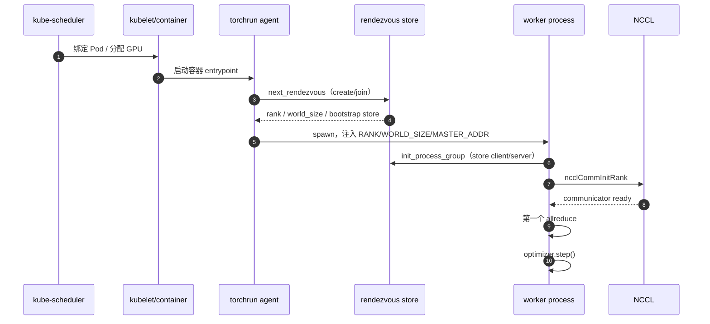

# 训练启动与通信：rank、rendezvous 与第一个 collective

> **结论先行**：训练启动不是「容器起来了」，而是三层 membership 依次对齐：Pod 被调度（L1）、进程加入同一个
> rendezvous 并拿到 rank/world size（L2）、NCCL communicator 建好且首个 collective 成功（L3）。
> 三层各有独立的超时和失败文本；把「Pod Running」当成「训练已启动」，是误判 MTTR 的主要原因。

本页以 PyTorch/torchrun 为主干（代码级），对照 TensorFlow 的 `TF_CONFIG` 与 MPI 的静态进程模型，最后下沉到
NCCL 的 bootstrap/transport/异步错误。所有行号对应 2026-11-23 的快照；PyTorch 当前 main 的 NCCL 后端已重构为
`nccl2/`，与 2.4–2.8 的行为有差异，文中会标注。

> 专题导航：[总纲](../../Cloud_Native/AI_Infrastructure/Distributed_Training/overview.md) · [工作负载建模](../../Cloud_Native/AI_Infrastructure/Distributed_Training/workload-modeling.md) · [启动通信](./startup-communication.md) · [故障自愈](../../Cloud_Native/AI_Infrastructure/Distributed_Training/failure-self-healing.md) · [Checkpoint](../../Cloud_Native/AI_Infrastructure/Distributed_Training/checkpoint-preemption.md) · [RL](../../Cloud_Native/AI_Infrastructure/Distributed_Training/rl-post-training.md)

## 一、三种角色模型

| 维度 | PyTorch / torchrun | TensorFlow / MWMS | MPI / MPIJob |
|---|---|---|---|
| 角色 | 单一 `WorkerSpec.role`；rank 由 agent 分配 | `chief`/`worker`/`ps`/`evaluator` | `Launcher` + `Worker`，应用层无角色 |
| leader | rank 0（同时是 store server） | chief（显式 `Chief`，否则 worker 0） | `mpirun` 的 rank 0；launcher 只是驱动者 |
| rank 来源 | agent 的 `_assign_worker_ranks()` | 每个 task 自报 `TF_CONFIG.task.type/index` | hostfile + slots 顺序，进程只被告知 `OMPI_COMM_WORLD_RANK`/`PMI_RANK` |
| membership | 动态 rendezvous（CAS + keep-alive + round） | 静态：所有 task 读同一份 `cluster` | 静态：`MPI_Init` 时固定 `MPI_COMM_WORLD` |
| 弹性 | `--nnodes=MIN:MAX`，re-rendezvous 后全员换 rank | 无内建弹性，靠 K8s 重建 Pod/TFJob | 无，扩缩 = 新建 MPIJob |
| 重启 | agent 重启整个 worker group | Pod 级重启，集群暂停后重新加入 | Pod 级重启；launcher 的 mpirun 会话断开即整轮失败 |
| checkpoint owner | 训练脚本自己定（通常 rank 0） | chief 写正式目录，非 chief 写临时目录 | 应用自己定，MPI 层不管 |
| 集合通信 | NCCL（GPU）/Gloo（CPU） | RING（gRPC）/NCCL | Open MPI BTL/UCX、Intel/MPICH 各自实现 |

一个容易忽略的点：**「角色」与「rank」不是同一件事**。TF 的 chief 是应用层角色，MPI 的 rank 0 是运行时分配的，
PyTorch 的 rank 0 既是运行时 leader、又常被训练脚本当成 checkpoint owner。编排层如果把这三者混为一个字段，
恢复时就会出错。

## 二、PyTorch 路径

### 2.1 torchrun 到底做了什么

`torchrun` 是一个**进程管理器 + rendezvous 客户端**，不是训练框架的一部分。它做四件事：

1. 解析 `--nnodes`、`--nproc-per-node`、`--rdzv-backend`、`--rdzv-endpoint`、`--max-restarts` 等参数。
2. 创建 `LocalElasticAgent`，为每个节点启动一个 agent 进程。
3. 通过 rendezvous 拿到本轮的 `(store, rank, world_size, bootstrap_store_info)`。
4. 为每个 worker 组装环境变量并 fork/spawn；监控 worker 状态，失败或成员变化时重启 worker group。

关键默认值（代码确认）：

- `--nnodes` 默认 `"1:1"`，格式是 `MIN:MAX`；`MIN != MAX` 即弹性区间。
- `--nproc-per-node` 默认 `"1"`，可为 `auto/cpu/gpu/xpu/int`；它决定 `LOCAL_WORLD_SIZE`，也是唯一被限制为
  「全作业同构」的量。
- `--rdzv-backend` 默认 `"static"`（用 `--master-addr/--master-port/--node-rank`，不支持弹性）；
  `c10d` 是推荐后端；`--max-restarts` 默认 **0**（不自动重启）。
- `--standalone` 强制 `c10d` + `localhost:0` + 随机 UUID，并忽略显式 rdzv 参数；`static` 且未给 endpoint/master-port
  且 `nnodes` 上限为 1 时，也会降级到 `c10d localhost:0`。
- `MASTER_PORT` 的最终兜底是 29500，只对 `static` 有意义；`c10d` 的端口在 rdzv endpoint 里。

Agent 把 rendezvous 结果变成 worker 环境变量：`RANK`、`GROUP_RANK`、`ROLE_RANK`、`ROLE_NAME`、`LOCAL_WORLD_SIZE`、
`WORLD_SIZE`、`GROUP_WORLD_SIZE`、`ROLE_WORLD_SIZE`、`MASTER_ADDR`、`MASTER_PORT`、`TORCHELASTIC_RESTART_COUNT`、
`TORCHELASTIC_MAX_RESTARTS`、`TORCHELASTIC_RUN_ID`、`TORCHELASTIC_USE_AGENT_STORE`。`LOCAL_RANK` 单独写：
`virtual_local_rank=True` 时每个 worker 只看到自己那张卡（`CUDA_VISIBLE_DEVICES` 收窄为单卡、`LOCAL_RANK=0`）。

两个反直觉点：

- `TORCHELASTIC_RESTART_COUNT` 是**已用掉的次数**，不是剩余次数（`restart_count = max_restarts - remaining_restarts`）。
- torchrun 会给 worker 注入 `TORCH_NCCL_ASYNC_ERROR_HANDLING=1`（若用户没设）；而 PyTorch 库层默认是 **3**
  （`SkipCleanUp`）。这会影响 NCCL 出错时是杀进程还是只清理 communicator，排查时不要假设两者一致。

### 2.2 rendezvous：成员协商与 quorum

Rendezvous 的接口契约是：`next_rendezvous()` 阻塞直到本轮成形/被关闭/超时；`num_nodes_waiting()` 返回「到晚了、
在等下一轮」的节点数；`set_closed()` 的传播是最终一致的，不能当同步原语。

`RendezvousInfo` 携带四样东西：控制面 `store`、组内 `rank`、`world_size`、`bootstrap_store_info`。
`RendezvousStoreInfo.build()` 由 rank 0 选一个空闲端口/地址并写入 store 的 `MASTER_ADDR`/`MASTER_PORT` 两个 key，
其余 rank 从 store 读。这解释了一个常见困惑：**`--rdzv-endpoint` 只指定 rendezvous 服务器，不一定是训练进程的
master 地址**；后者是 rank 0 在 rendezvous 后写进 store 的。

c10d 后端的落地细节：

- TCPStore 端点默认端口 **29400**，`read_timeout` 默认 60s。
- 状态 key 是 `"torch.rendezvous." + run_id`，值是 pickle 后的整份 `_RendezvousState`。因为 store 的 `get` 会阻塞，
  实现先 `compare_set(key, "", "Y2FuaW1hZGFt")` 塞一个哨兵值，读到哨兵即视作 None。
- 写入用 `compare_set(key, token, new_state)` 做 CAS；store 的 `compare_set` 不返回「是否成功」，实现用
  「本地状态与远端状态逐字节比较」来推断。

关于 `TryCreate`/`Join`：当前 dynamic rendezvous **没有**名为 `TryCreate` 的函数。create 语义由第一次
`compare_set`（从空值到哨兵）承担；join 语义由 `_RendezvousJoinOp` 返回的 action 表达：
`ADD_TO_PARTICIPANTS` → `ADD_TO_WAIT_LIST`/`ADD_TO_REDUNDANCY_LIST` → `MARK_RENDEZVOUS_COMPLETE`。
`try_create_rendezvous()` 这个名字只保留在 etcd legacy handler 里。

轮次完成条件是理解「启动慢」的关键：

- 参与数达到 `max_nodes` → 立即完成。
- 否则等到 `min_nodes` 后再等 `last_call`（默认 30s）才封轮。
- 所以 `--nnodes=4:8` 在只有 4 个节点时会稳定地多等 30s，这不是 hang。
- keep-alive 默认 5s 一次、最多 3 次失败；约 15s 收不到心跳就把节点从 participants/wait_list 剔除。
- 失败表现：连不上 rdzv store → `RendezvousConnectionError`；等人超时 → `RendezvousTimeoutError`；
  作业已关闭 → `RendezvousClosedError`；状态反序列化失败 → `RendezvousStateError`。

re-rendezvous 的能力边界：torchrun 的做法是**杀掉全部本地 worker，重新走一次 `next_rendezvous()`，用新
rank/world size 重新启动进程**。而训练脚本里的 `init_method="env://"` 本身是一次性的——`_env_rendezvous_handler`
在 yield 之后直接 `raise RuntimeError("Unable to perform re-rendezvous using env:// method")`。
**弹性来自 agent，不来自 process group**。这也是为什么「在训练脚本里自己调 init_process_group」无法获得弹性。

### 2.3 init_process_group：默认不做全员 barrier

两种初始化方式：显式 `store+rank+world_size`，或 `init_method`（默认 `env://`）；两者互斥。

`env://` 硬性要求 `RANK`、`WORLD_SIZE`、`MASTER_ADDR`、`MASTER_PORT`，缺任何一个都直接抛
`env:// rendezvous: environment variable X expected, but not set`；store 由 rank 0 做 server、其余做 client。

几个关键语义：

- **默认 timeout**：非 NCCL 30 分钟（`kProcessGroupDefaultTimeout = 30*60*1000ms`），NCCL 10 分钟
  （`kProcessGroupNCCLDefaultTimeout = 10*60*1000ms`）。
- **store-based barrier 默认不执行**：只有 `TORCH_DIST_INIT_BARRIER=1` 时才走 `_store_based_barrier`。也就是说
  `init_process_group` 可能在其他 rank 还没到齐时就返回；真正的全员同步发生在第一个 collective 或显式 `barrier()`。
  这是「初始化看起来很快，但第一个 allreduce 卡住」的常见原因。
- **backend 选择**：显式 `backend` 优先；只给 `device_id` 则查 `Backend.default_device_backend_map`
  （cuda→nccl、cpu→gloo、xpu→xccl）；两者都没有则懒初始化。也支持 `"cpu:gloo,cuda:nccl"` 多后端字符串。
- **`device_id` 会立即建 NCCL communicator**（`ncclCommInit*`，而非懒建），子组尽量用 `ncclCommSplit`。
  「想尽早暴露 NCCL 初始化错误」正是它的用途。
- **`new_group` 的关键约束**：所有 world rank 都必须调用（即使不是成员），且调用顺序必须一致；非成员返回
  `NON_GROUP_MEMBER`；`device_id` 同样触发 eager init。

store 前缀是三层叠加：`PrefixStore("default_pg", store)` → `PrefixStore(f"{group_name}/", ...)` →
`PrefixStore(f"{device}/", ...)`。所以「同一个 store、多个 group、多个 backend」不会撞 key；排查时 store 里看到的
key 长成 `default_pg/<group>/cuda/...`。

### 2.4 NCCL communicator 初始化

PyTorch 当前 main 的 NCCL 后端已重构到 `nccl2/`（后端名 `nccl`，另有 `nccl-legacy`）。构造时读两个关键开关：
`TORCH_NCCL_ASYNC_ERROR_HANDLING`（默认 `SkipCleanUp`=3）与 `TORCH_NCCL_BLOCKING_WAIT`（默认 false）。

uniqueId 的传播（代码确认，取代老的 `_broadcastUniqueId` 路径）：

1. `NCCLBootstrap` 按 `TORCH_NCCL_RANKS_PER_ROOT`（默认 128）把 rank 分块。
2. 块首 rank 调 `ncclGetUniqueId()`，把 128 字节写入 `PrefixStore(group_name)` 下的 key
   `nccl_storekey_<generation>`。
3. 其余 rank `store->wait(keys, timeout)` 后 `multiGet`。
4. 块数 >1 时走 `ncclCommInitRankScalable`（多 root 的 uniqueId 数组），否则 `ncclCommInitRankConfig`。

这句 `store->wait(keys, timeout_)` 的 timeout 就是 process group 的 timeout（NCCL 默认 10 分钟）：
**root 卡住 → 其他 rank 在 comm init 里静默等 10 分钟**，然后报 `Failed to initialize NCCL communicator`。
`createNcclComm` 失败时还会 `commAbort` 一次，避免半成品 communicator 泄漏。

未显式给 device 时，device 由 `rank % device_count` 推断——多进程共享 GPU 或 `CUDA_VISIBLE_DEVICES` 配错时，
这一步会静默把多个 rank 绑到同一张卡上，随后 NCCL 才报错或死锁。

watchdog：`!blocking_wait_` 时启动 `timeout_thread_`；线程每 1s 醒一次，先 `checkWorkQueue()`（`garbageCollect`
判定 work 超时/出错），再 `commGetAsyncError()` 探测 communicator 级异步错误，命中后 `handleWatchdogFailure()`
按 async error 模式决定 abort comm / 杀进程。

`TORCH_NCCL_ENABLE_MONITORING`（默认 1）与 `TORCH_NCCL_HEARTBEAT_TIMEOUT_SEC`（默认 480s）在文档里被标为
**nccl-legacy only**；当前 `nccl` 后端没有独立 heartbeat 线程，唯一轮询者是上面的 1s watchdog。
`TORCH_NCCL_BLOCKING_WAIT` / `TORCH_NCCL_ASYNC_ERROR_HANDLING` 在本 commit **都没有**标注 deprecated；
`BLOCKING_WAIT` 默认 0，`ASYNC_ERROR_HANDLING` 默认 3、torchrun 注入 1。不同版本行为不同，不要写死。

### 2.5 第一个 step 的时序

| # | 窗口 | 发生什么 | 典型失败与日志 |
|---|---|---|---|
| 1 | 调度 | 控制器建 Pod，gang/队列准入，设备插件分配 GPU | `Pending`、`FailedScheduling`、镜像拉取失败 |
| 2 | 容器启动 | entrypoint 起 torchrun/mpirun/python | 命令拼错、依赖缺失、`CUDA_VISIBLE_DEVICES` 与 `LOCAL_RANK` 不一致 |
| 3 | DNS/Service | worker 通过 headless Service 互相解析 | `Name or service not known`；mpirun `ConnectionAttempts=10` 后放弃 |
| 4 | rdzv store | rank 0 的 TCPStore（或 `--rdzv-endpoint` 指定的节点）被连接 | `RendezvousConnectionError`；端口 29500/29400 被占；endpoint 写错 |
| 5 | rdzv 成形 | 节点加入、等 `min_nodes`、`last_call` 30s 后封轮、分配 rank/world size | `RendezvousTimeoutError`（join 默认 600s）；`nnodes` 上限小于实际 Pod 数 → 多出的节点在 wait_list 空转 |
| 6 | 环境注入 | `RANK/WORLD_SIZE/MASTER_ADDR/MASTER_PORT` 写入子进程 | 手工 `python train.py` 绕过 torchrun → `env:// rendezvous: environment variable RANK expected, but not set` |
| 7 | init_process_group | 建 store client/server、`PrefixStore`、选 backend、可选 store barrier | 默认无 barrier，故通常很快返回；`TORCH_DIST_INIT_BARRIER=1` 时缺 rank 报 `Timed out initializing process group in store based barrier on rank ...` |
| 8 | NCCL comm init | root 发 uniqueId → store → 各 rank `ncclCommInitRank*` → bootstrap 环 → proxy 地址 all-gather | root 卡住则全员等满 PG timeout（NCCL 默认 10min）；`Failed to initialize NCCL communicator`；`NCCL_DEBUG=INFO` 卡在 `Bootstrap`/`NET/IB` |
| 9 | 首个 allreduce | 第一次 `all_reduce` 入队、建连、kernel 执行、`work.wait()` | 参数/调用次数不匹配 → 有的 rank 在等上一个 op，watchdog 超时后 `NCCL operation timed out` 并杀进程 |
| 10 | optimizer step | 反传完成 + 梯度 allreduce 完成，第一次 `optimizer.step()` | 前面任一窗口的延迟都表现为「step 0 时间异常长」；NCCL 被 abort 后异常可能在下一处 collective 才抛出 |

两个容易归因错误的点：

- 窗口 8 的「卡住」不是死锁而是 timeout：`store->wait(keys, timeout)` 的 timeout 就是 PG timeout，job 会先安静
  10 分钟再统一报错。把 `init_process_group(timeout=...)` 调小可以显著缩短 MTTR。
- 窗口 9 的 mismatch 在 NCCL 层没有「谁错了」的信息：NCCL 只能报本 rank 超时/异步错误，定位要靠
  `TORCH_NCCL_TRACE_BUFFER_SIZE`/Flight Recorder 或 `TORCH_NCCL_DESYNC_DEBUG`（nccl-legacy）。

## 三、TensorFlow 路径

`TF_CONFIG` 是一个 JSON 字符串，只有两个顶层字段：`cluster`（全集群一致）与 `task`（每进程不同）。
`cluster` 是 `job 名 -> [host:port, ...]` 的字典；`task` 是 `{"type": ..., "index": ...}`。合法 role 为
`chief`/`worker`/`ps`/`evaluator`，只有 ParameterServerStrategy 才应该有 `ps`。

职责划分：

- `worker` 干实际训练，worker 0 常常兼任 `chief`。
- `chief` 额外负责存 checkpoint、写 TensorBoard summary。
- `ps` 只为参数服务器策略提供参数存储。
- `evaluator` 算评估指标。
- 「index 0 被指定为 chief」不是约定，而是 `tf.distribute.Strategy` 的实现方式；如果显式定义了 `Chief`，
  则以 `Chief` 为准。

`MultiWorkerMirroredStrategy` 的建组方式：每个 worker 跑同一份程序，`TFConfigClusterResolver` 从 `TF_CONFIG`
读 `task_type`/`task_id` 与各 task 地址；strategy 用 `cluster_resolver.num_accelerators()` 决定用几张卡，
所有 worker 的卡数必须一致，否则行为未定义。它有两套集合通信实现：`CommunicationImplementation.RING`
（基于 RPC/gRPC，CPU/GPU 都支持）与 `CommunicationImplementation.NCCL`（仅 GPU）。

一个反直觉但很重要的点：**所有 `tf.distribute` 与非 `tf.distribute` API 都可能内部发起 collective，包括
checkpoint/save**（读 `ON_READ` 变量会触发 all-reduce）。因此不能只让一个 task 跑训练循环；官方建议每个 worker
跑完全相同的程序，并明确说「按 task_type/task_id 分派是 error-prone 的」。这也是 chief checkpoint 的实际做法：
chief 写到正式 model dir，非 chief 写到临时目录后删除；「只有 chief 那份才是权威」，但所有 worker 都必须参与
save 的 collective。

TF 没有 torchrun 式内建弹性：文档描述的是「某个 worker 被打断，整个集群暂停直到它重启，其他 worker 也会重启并
重新加入集群，然后各自从上次 checkpoint 恢复」。K8s 上这件事由 Training Operator（v1）的 TFJob 承担：
`restartPolicy`（Always/OnFailure/ExitCode/Never）按副本类型配置，chief/worker/ps 的退出码决定是否重拉；
`cleanPodPolicy` 决定作业结束后删哪些 Pod。官方教程把容错恢复指向 `BackupAndRestore`，而不是 `ModelCheckpoint`。

TFJob（legacy v1）如何把这些角色落到 K8s 对象上：

- `TFReplicaSpecs` 的 key 是 `Chief`/`Worker`/`PS`/`Evaluator`/`Master`；`Chief` 与 `Master` 语义等价，`Master`
  只是为兼容旧配置保留。**如果有 `Chief`，它就是 chief；否则 worker:0 是 chief**。
- `PS` 只在 ParameterServerStrategy 下使用；`Evaluator` 只做评估，不参与训练循环。
- Operator 按 `rtype/index` 生成 `TF_CONFIG`，并只注入名为 `tensorflow` 的默认容器；`cluster` 里包含所有角色的地址。
  所以「容器里没有 TF_CONFIG」通常不是 TF 的问题，而是副本类型/容器名不匹配。
- 每个 replica 的 `restartPolicy` 独立：PS 可以 `Always`，chief/worker 用 `OnFailure`；`successPolicy: AllWorkers`
  是 v1 的成功条件（不是 JobSet 的 All/Any），语义是「所有 worker 成功」。
- 没有 re-rendezvous：Pod 重启后从 checkpoint 恢复，整个集群会暂停/重启；不要把 torchrun 的 elastic 语义套到 TFJob 上。

## 四、MPI 路径

MPIJob 的进程模型是 launcher + worker 两组 Pod：

- worker 默认只跑 `sshd -De`，负责被 rsh 进去起 rank。
- launcher 是一个普通 `batchv1.Job`，用户在它的 `command` 里自己写 `mpirun`/`mpiexec`。
- hostfile 由 operator 生成：OpenMPI 是 `<pod>.<job>.<ns>.svc[.<clusterDomain>] slots=N`，Intel MPI/MPICH 是
  `<host>:N`；每行 slots 取 `spec.slotsPerWorker`（默认 1）。`runLauncherAsWorker=true` 时 launcher 自己也会出现在
  hostfile 第一行。
- launcher 侧环境变量决定 mpirun 去哪找 hostfile：OpenMPI 用 `OMPI_MCA_orte_default_hostfile`、
  `OMPI_MCA_orte_keep_fqdn_hostnames=true`、`OMPI_MCA_plm_rsh_args=-o ConnectionAttempts=10`；Intel 用
  `I_MPI_HYDRA_HOST_FILE`，MPICH 用 `HYDRA_HOST_FILE`。
- `-np` 不是 operator 注入的：示例里由用户写 `mpirun -np 2 ...`。rank 总数由 `-np`（显式）或「所有 slots 之和」
  （隐式）决定，与 `Worker.replicas * slotsPerWorker` 不一致时，要么少起 rank，要么撞上 oversubscribe 限制。
- rank 相关环境变量来自 MPI 运行时：OpenMPI 提供 `OMPI_COMM_WORLD_RANK/SIZE/LOCAL_RANK/LOCAL_SIZE/NODE_RANK`；
  MPICH 的 PMI 常见 `PMI_RANK`/`PMI_SIZE`，PMIx 体系是 `PMIX_RANK`。

为什么 MPI 不能像 torchrun 那样 re-rendezvous：

- `MPI_Init` 的 world model 是「在一个 MPI 进程生命周期内至多初始化一次」，`MPI_COMM_WORLD` 的成员在 `MPI_Init`
  时就固定。
- 唯一的「加人」途径是 `MPI_Comm_spawn`：子进程有自己的 `MPI_COMM_WORLD`，父进程通过 intercommunicator 通信；
  这是「新增一个组」，不是「把现有 `MPI_COMM_WORLD` 扩容」。
- 因此 MPIJob 的「重启」只能是 Kubernetes 语义：launcher Job 失败 → `BackoffLimit`/`restartPolicy` 决定重拉；
  worker 挂掉 → 该 Pod 按 `restartPolicy` 重建，但 launcher 侧的 mpirun 会话已经断了，整轮 rank 映射要重来。
- `launcherCreationPolicy: WaitForWorkersReady` 的存在就是为了先让 worker 全部 Ready 再起 launcher，避免
  「launcher 先到、worker 没 DNS」。

## 五、NCCL 内部：bootstrap、拓扑与异步错误

bootstrap 由 uniqueId 承载：`ncclBootstrapHandle` 只有三个字段——`magic`、监听地址 `addr`、`nRanks`，
它被塞进 128 字节的 `ncclUniqueId`。`ncclGetUniqueId` 在非 `NCCL_COMM_ID` 模式下随机生成 magic、填入本机
bootstrap 网卡地址，然后 `bootstrapCreateRoot()` **当场 listen**（后台线程 accept）。所以 uniqueId 里带的是
「第一个 root 的 IP:port」。

bootstrap 的连接建立不是「全员连 root」：每个 rank 先建自己的 listen socket，把自己的联系方式发给所属 root，
root 回给它「环上的下一个 peer」，随后两两 `socketRingConnect`；最后通过这个环 all-gather 所有 rank 的 proxy
地址与 P2P 地址。所以 bootstrap 阶段任何一个 rank 不可达，表现都是「连接 root 超时/收到残缺环」，而不是一条明确的
「rank N 挂了」。

拓扑与算法：init 时先 `ncclTopoComputePaths`，再分别搜索 ring（`NCCL_TOPO_PATTERN_RING`）与 balanced tree
（`NCCL_TOPO_PATTERN_BALANCED_TREE`），可选 collnet/nvls；`comm->nChannels = min(tree, ring)`，然后通过
`bootstrapAllGather` 把各 rank 的 graph 信息对齐，再按 channel 建连。

P2P 选择：`ncclTopoCheckP2p` 先看 `hostHash`（不同主机直接不 P2P），再看 `shmDev`（同一个 `/dev/shm` 才能用
CUDA IPC/shm 传输）；然后比较 PCI 路径类型与 `NCCL_P2P_LEVEL`（默认 `PATH_PXB`），用户可用
`NCCL_P2P_DISABLE`/`NCCL_P2P_LEVEL` 覆盖。跨 Pod 但同机、且没共享 IPC namespace 时，`shmDev` 不同 →
**同机流量也会退回网络**，这是 K8s 上「明明同机却只有 socket 带宽」的根因之一。

传输与 proxy：节点内优先 NVLink/CUDA P2P，其次 shm（POSIX shm + CUDA IPC），节点间走 net 插件（IB verbs /
socket）；需要网络参与时由 proxy 进度线程推进，proxy 的并发度也是常见调优点。

collective 的异步语义：`ncclAllReduce` 这类带 stream 的函数只要把操作「压到 stream 上」就返回 `ncclSuccess`，
之后的错误只能通过 `ncclCommGetAsyncError` 观测；一旦 communicator 出错，已入队操作的完成性和正确性都不再有任何
保证，正确做法是 `ncclCommAbort` 后重建。

常用诊断/调优变量：

| 变量 | 用途 |
|---|---|
| `NCCL_DEBUG=INFO` | 打印初始化、拓扑、明确的告警 |
| `NCCL_DEBUG_SUBSYS=COLL` / `GRAPH` / `NET` | 逐 collective / 拓扑 / 网络调试 |
| `NCCL_SOCKET_IFNAME` | bootstrap 网卡不对时最常改的一个 |
| `NCCL_IB_DISABLE`、`NCCL_IB_HCA` | 禁用 IB / 指定 HCA |
| `NCCL_P2P_DISABLE`、`NCCL_P2P_LEVEL` | 禁用/限制 P2P |
| `NCCL_ALGO`、`NCCL_PROTO` | 强制算法/协议 |
| `NCCL_TOPO_DUMP_FILE` | 导出拓扑图，供离线分析 |
| `TORCH_NCCL_TRACE_BUFFER_SIZE` | Flight Recorder，记录 collective 序列 |

## 六、把超时设在正确的层

启动慢/卡住时，先确认「卡在哪一层」，再调对应的超时；只调大 K8s 的 `activeDeadlineSeconds` 会把问题拖长：

| 层 | 超时/参数 | 默认值 | 调小的影响 |
|---|---|---|---|
| Pod 调度 | Kueue `waitForPodsReady`、Volcano `scheduleTimeoutSeconds` | 依配置 | 更快失败，但可能误杀慢启动 |
| rendezvous | `RendezvousTimeout.join`（`--rdzv-conf`） | 600s | 更快报 `RendezvousTimeoutError` |
| rdzv store | TCPStore `read_timeout` | 60s | 更快暴露网络/端口问题 |
| process group | `init_process_group(timeout=...)` | NCCL 10min / 其他 30min | 更快暴露缺 rank/NCCL 初始化失败 |
| NCCL watchdog | 同上（PG timeout） | 10min | 更快 abort，但可能误杀慢节点 |
| 作业 | `activeDeadlineSeconds` | 无 | 兜底，不能替代上面几层 |

一个实用原则：**把「成员到齐」的超时设得比「单次 collective」短**。例如 rendezvous join 2–5 分钟、
PG/NCCL 10–20 分钟、作业 deadline 数小时。这样缺一个 rank 时，几分钟内就会失败并进入重试，而不是安静地等
半小时。

## 七、跨框架对照与失败窗口

| 维度 | PyTorch / torchrun | TensorFlow / MWMS + TFJob (v1) | MPI / MPIJob |
|---|---|---|---|
| 角色 | 单一 role，rank 由 agent 分配 | chief/worker/ps/evaluator | Launcher + Worker |
| leader | rank 0（store server） | chief（显式或 worker 0） | mpirun rank 0 |
| membership | 动态 rendezvous | 静态 TF_CONFIG | 静态 MPI_COMM_WORLD |
| 弹性 | 支持 `nnodes=MIN:MAX` | 不支持，靠重建 Pod | 不支持 |
| 重启 | agent 重启 worker group | Pod 级重启，从 checkpoint 恢复 | launcher 会话断开即整轮失败 |
| checkpoint | 脚本自己定 | chief 写正式目录 | 应用自己定 |
| 集合通信 | NCCL/Gloo | RING/NCCL | Open MPI/Intel/MPICH |

## 八、证据

### PyTorch / torchrun

- [torchrun 参数默认值（nnodes/nproc/rdzv/max-restarts）](https://github.com/pytorch/pytorch/blob/02e06c707ee33f8bbad64652dc8f695729a92766/torch/distributed/run.py#L486-L560)
- [static 与 c10d 的差异、standalone 降级](https://github.com/pytorch/pytorch/blob/02e06c707ee33f8bbad64652dc8f695729a92766/torch/distributed/run.py#L1099-L1128)
- [agent 把 rendezvous 结果转成环境变量](https://github.com/pytorch/pytorch/blob/02e06c707ee33f8bbad64652dc8f695729a92766/torch/distributed/elastic/agent/server/api.py#L524-L583)
- [LOCAL_RANK/virtual_local_rank 与 TORCH_NCCL_ASYNC_ERROR_HANDLING 注入](https://github.com/pytorch/pytorch/blob/02e06c707ee33f8bbad64652dc8f695729a92766/torch/distributed/elastic/agent/server/local_elastic_agent.py#L435-L545)
- [监控循环：失败重启 vs 成员变化不计数](https://github.com/pytorch/pytorch/blob/02e06c707ee33f8bbad64652dc8f695729a92766/torch/distributed/elastic/agent/server/api.py#L946-L973)
- [RendezvousHandler 契约（next_rendezvous/num_nodes_waiting）](https://github.com/pytorch/pytorch/blob/02e06c707ee33f8bbad64652dc8f695729a92766/torch/distributed/elastic/rendezvous/api.py#L145-L231)
- [RendezvousStoreInfo：MASTER_ADDR/PORT 写入 store](https://github.com/pytorch/pytorch/blob/02e06c707ee33f8bbad64652dc8f695729a92766/torch/distributed/elastic/rendezvous/api.py#L63-L145)
- [c10d rendezvous store key 与 CAS](https://github.com/pytorch/pytorch/blob/02e06c707ee33f8bbad64652dc8f695729a92766/torch/distributed/elastic/rendezvous/c10d_rendezvous_backend.py#L31-L108)
- [quorum：max_nodes 立即完成 / min_nodes + last_call](https://github.com/pytorch/pytorch/blob/02e06c707ee33f8bbad64652dc8f695729a92766/torch/distributed/elastic/rendezvous/dynamic_rendezvous.py#L768-L772)
- [keep-alive 5s×3 与节点剔除](https://github.com/pytorch/pytorch/blob/02e06c707ee33f8bbad64652dc8f695729a92766/torch/distributed/elastic/rendezvous/dynamic_rendezvous.py#L495-L510)
- [env:// 不能 re-rendezvous](https://github.com/pytorch/pytorch/blob/02e06c707ee33f8bbad64652dc8f695729a92766/torch/distributed/rendezvous.py#L290-L297)
- [init_process_group 的两种初始化与 device_id 说明](https://github.com/pytorch/pytorch/blob/02e06c707ee33f8bbad64652dc8f695729a92766/torch/distributed/distributed_c10d.py#L2292-L2360)
- [store-based barrier 默认关闭](https://github.com/pytorch/pytorch/blob/02e06c707ee33f8bbad64652dc8f695729a92766/torch/distributed/distributed_c10d.py#L1952-L1957)
- [默认 timeout：PG 30min / NCCL 10min](https://github.com/pytorch/pytorch/blob/02e06c707ee33f8bbad64652dc8f695729a92766/torch/csrc/distributed/c10d/ProcessGroup.hpp#L25-L26)
- [NCCL uniqueId 经 store 传播（nccl2）](https://github.com/pytorch/pytorch/blob/02e06c707ee33f8bbad64652dc8f695729a92766/torch/csrc/distributed/c10d/nccl2/NCCLBootstrap.cpp#L58-L90)
- [NCCL comm init 的 store->wait 与失败处理](https://github.com/pytorch/pytorch/blob/02e06c707ee33f8bbad64652dc8f695729a92766/torch/csrc/distributed/c10d/nccl2/NCCLBootstrap.cpp#L229-L256)
- [watchdog 线程](https://github.com/pytorch/pytorch/blob/02e06c707ee33f8bbad64652dc8f695729a92766/torch/csrc/distributed/c10d/nccl2/ProcessGroupNCCLUtils.cpp#L335-L410)
- [NCCL 环境变量文档（nccl-legacy only 标注）](https://github.com/pytorch/pytorch/blob/02e06c707ee33f8bbad64652dc8f695729a92766/docs/source/torch_nccl_environment_variables.md)

### TensorFlow

- [分布式训练指南：TF_CONFIG 与角色](https://www.tensorflow.org/guide/distributed_training#setting_up_the_tf_config_environment_variable)
- [TFJob 角色常量与 chief/worker 0 语义](https://github.com/kubeflow/training-operator/blob/4445c12aa62e4345b0c2c6ac9b215a70eca46ed7/pkg/apis/kubeflow.org/v1/tensorflow_types.go#L93-L120)
- [TF_CONFIG 生成（cluster/task）](https://github.com/kubeflow/training-operator/blob/4445c12aa62e4345b0c2c6ac9b215a70eca46ed7/pkg/controller.v1/tensorflow/tensorflow.go#L85-L130)
- [TFJob 只向默认容器注入 TF_CONFIG](https://github.com/kubeflow/training-operator/blob/4445c12aa62e4345b0c2c6ac9b215a70eca46ed7/pkg/controller.v1/tensorflow/tfjob_controller.go#L554-L585)
- [MultiWorkerMirroredStrategy API：RING/NCCL 与「所有 worker 跑同一程序」](https://www.tensorflow.org/api_docs/python/tf/distribute/MultiWorkerMirroredStrategy)
- [Keras 多 worker checkpoint：chief 写正式目录](https://www.tensorflow.org/tutorials/distribute/multi_worker_with_keras)

### MPI

- [MPIJob worker 默认 sshd](https://github.com/kubeflow/mpi-operator/blob/a057ca529cb7c3b831207d8bbd37f18136057e0f/pkg/controller/mpi_job_controller.go#L1532-L1536)
- [launcher 是 batchv1.Job](https://github.com/kubeflow/mpi-operator/blob/a057ca529cb7c3b831207d8bbd37f18136057e0f/pkg/controller/mpi_job_controller.go#L1558-L1585)
- [hostfile 生成与 slots](https://github.com/kubeflow/mpi-operator/blob/a057ca529cb7c3b831207d8bbd37f18136057e0f/pkg/controller/mpi_job_controller.go#L1335-L1379)
- [launcher 的 hostfile 环境变量](https://github.com/kubeflow/mpi-operator/blob/a057ca529cb7c3b831207d8bbd37f18136057e0f/pkg/controller/mpi_job_controller.go#L181-L215)
- [LauncherCreationPolicy](https://github.com/kubeflow/mpi-operator/blob/a057ca529cb7c3b831207d8bbd37f18136057e0f/pkg/apis/kubeflow/v2beta1/types.go#L155-L165)
- [Open MPI MPI_Init 手册（world 只初始化一次）](https://docs.open-mpi.org/en/main/man-openmpi/man3/MPI_Init.3.html)
- [Open MPI MPI_Comm_spawn 手册](https://docs.open-mpi.org/en/main/man-openmpi/man3/MPI_Comm_spawn.3.html)

### NCCL

- [bootstrap handle 与 uniqueId](https://github.com/NVIDIA/nccl/blob/ad2d192c1f279aefcaf340f67e07880b65a1116b/src/include/bootstrap.h#L14-L20)
- [bootstrap root 与环连接](https://github.com/NVIDIA/nccl/blob/ad2d192c1f279aefcaf340f67e07880b65a1116b/src/bootstrap.cc#L799-L900)
- [拓扑与算法选择](https://github.com/NVIDIA/nccl/blob/ad2d192c1f279aefcaf340f67e07880b65a1116b/src/init.cc#L1481-L1515)
- [P2P 的 hostHash/shmDev 约束](https://github.com/NVIDIA/nccl/blob/ad2d192c1f279aefcaf340f67e07880b65a1116b/src/graph/paths.cc#L320-L400)
- [collective 异步错误语义](https://github.com/NVIDIA/nccl/blob/ad2d192c1f279aefcaf340f67e07880b65a1116b/docs/userguide/source/api/comms.rst#L233-L252)

## 相关页面

- [专题总纲](../../Cloud_Native/AI_Infrastructure/Distributed_Training/overview.md)
- [工作负载建模](../../Cloud_Native/AI_Infrastructure/Distributed_Training/workload-modeling.md)
- [训练失败与自愈](../../Cloud_Native/AI_Infrastructure/Distributed_Training/failure-self-healing.md)
- [Checkpoint 与抢占恢复](../../Cloud_Native/AI_Infrastructure/Distributed_Training/checkpoint-preemption.md)
- [RL 后训练与业务接入](../../Cloud_Native/AI_Infrastructure/Distributed_Training/rl-post-training.md)
- [Open MPI 架构](../../Machine_Learning/High_Performance_Computing/ompi架构介绍.md)
