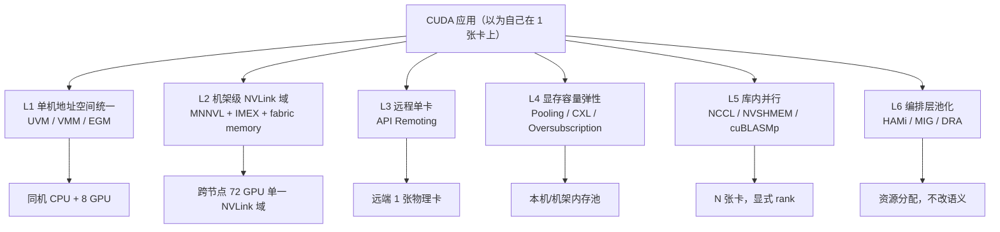
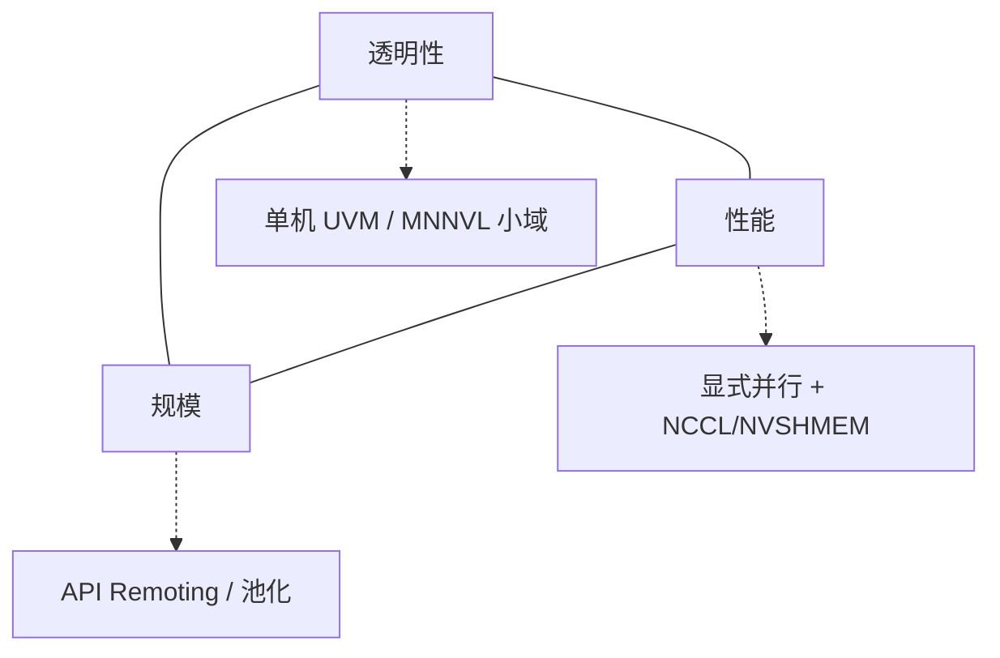
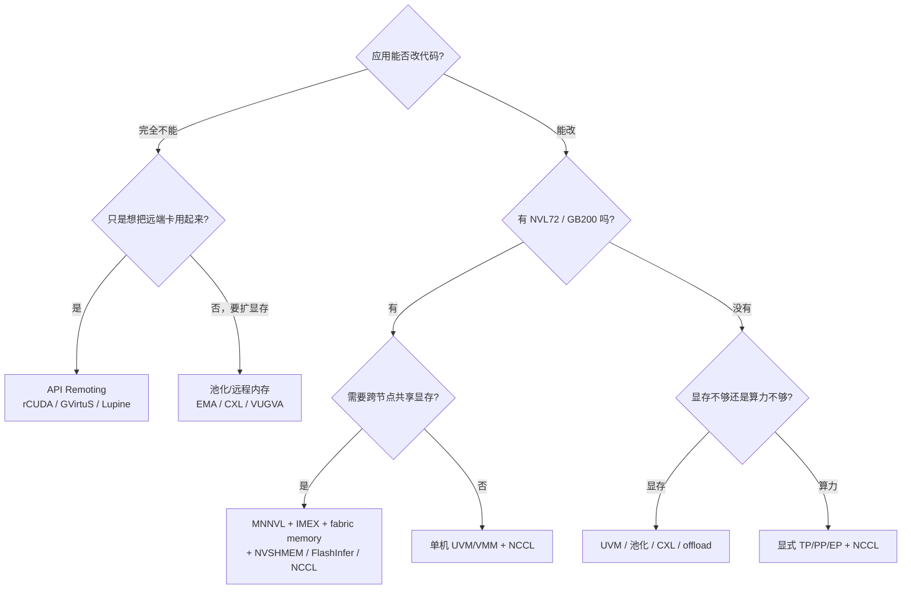

# GPU 算力/显存池化：从 CUDA 单卡视角到跨节点透明调度

> **结论先行**：生产环境里不存在一个「任意 CUDA 程序零改动、跨节点把 N 张卡当成 1 张卡」的通用系统。
> 能真正做到透明的是**地址空间与显存容量**（UVM、VMM + fabric memory、CXL 内存池）；**算力**的跨卡扩展
> 必须显式切分 kernel——要么由通信库（NCCL/NVSHMEM）承担，要么由框架（TP/PP/EP）承担。
> 所谓「底层 Runtime 按最优拓扑分配算力和显存」，在 2026 年最接近的实现是
> **MNNVL（Multi-Node NVLink）+ IMEX + `CU_MEM_HANDLE_TYPE_FABRIC`** 构成的机架级单一内存 fabric，
> 它把 72 张 GPU 的显存映射进同一套虚拟地址空间，但每张卡仍然要各自 launch kernel。
> CUDA 13 系列新增的 Compute Fabric Transport（logical endpoint）进一步把远端访问从「映射地址」推进到
> 「带完成状态、可重试的 fabric 操作」，但仍然是显式编程，不是自动透明。

本文把「应用视角单卡」拆成可验证的五个契约，再按透明性光谱盘点六类方案，最后给出选型判断。

## 一、「单卡视角」到底意味着什么

一个 CUDA 应用「认为自己在一张卡上」，实际上依赖五个契约。任何分布式方案，只要打破了其中一条，应用就会感知到。

| # | 契约 | 应用侧的可见形式 | 跨节点时谁最容易打破它 |
|---|---|---|---|
| 1 | **单设备枚举** | `cudaGetDeviceCount()` 返回 1；一个 primary context | 所有方案；通常要用 rank/环境变量伪装 |
| 2 | **单一虚拟地址空间** | 任意指针在 kernel 内可直接解引用（UVA） | MNNVL 可以做到；PCIe/网络方案要靠显式拷贝 |
| 3 | **容量与带宽语义** | `cudaMemGetInfo()` 看到聚合容量；访问延迟接近 HBM | 池化/远端内存只能做到「容量像、延迟不像」 |
| 4 | **单设备执行模型** | 一次 kernel launch 覆盖整个 grid；stream/event 单设备语义 | **没有任何方案能完全做到跨节点** |
| 5 | **单故障域** | 一张卡/一个进程，挂了只影响自己 | MNNVL 的一个 partition/clique 故障会带走整个域 |

第 4 条是关键。CUDA 运行时**没有**「把一个 grid 自动切到 N 张卡」的 API：`<<<grid, block>>>` 的 grid 只在一个 device 上执行。
Compute Capability 9.0（Hopper）引入的 Thread Block Cluster 看上去像「分布式」，但它只是把最多 8 个 block 协同调度到**同一张 GPU 的一个 GPC**，
共享的是单卡内的 shared memory（DSMEM），不是跨卡内存。这一点经常被误解，先排除。

## 二、透明性光谱：六种「单卡视角」



| 层级 | 「单卡」的真实含义 | 代表实现 | 应用改动 | 跨节点 |
|---|---|---|---|---|
| **L1 地址空间统一** | 一个 OS 实例内的所有 CPU/GPU 共享地址空间 | CUDA UVM、VMM、EGM、HMM | 零/少量（换 allocator） | ❌（单机） |
| **L2 机架级 NVLink 域** | 72 张卡的显存映射进同一 VA；或经 logical endpoint 访问 | MNNVL + IMEX + fabric memory / CFT + multicast | 需按 rank 映射/启动；库可隐藏 | ✅（NVLink 域内） |
| **L3 远程单卡** | 应用看到 1 张卡，实际是网络另一端的 1 张卡 | rCUDA、GVirtuS、Bitfusion、HAMi Lupine | 零（`LD_PRELOAD`/拦截） | ✅（但不聚合） |
| **L4 容量弹性** | 显存不够时借用本机/机架/池化内存 | EMA、Memory Harvesting、VUGVA、CXL pool | 零/少量 | 部分（CXL 可跨节点） |
| **L5 库内并行** | 应用不改，但库把计算切到 N 卡 | NCCL、NVSHMEM、cuBLASMp/cuFFTMp、TRT-LLM | 改库调用/并行配置 | ✅ |
| **L6 编排池化** | 调度器把 Pod/Job 放到拓扑最优的卡组 | HAMi、MIG、MPS、K8s DRA、Slurm | 零（改 YAML/脚本） | ✅（放置层） |

> 这张表最重要的一行是 L2 与 L5 的分工：**L2 让「内存」看起来是一张卡的，L5 让「计算」看起来是一张卡的**。
> 两者组合，才是 NVIDIA 在 NVL72 上宣传的「rack-scale single GPU」的实际工程含义。

## 三、硬件底座：拓扑决定「最优」

### 3.1 互联层次

「最优拓扑」不是抽象概念，它由物理链路决定。GPU 访问不同位置内存的带宽/延迟差一个到两个数量级：

| 介质 | 典型带宽（单向） | 延迟量级 | 作用域 | 能否被 GPU load/store |
|---|---|---|---|---|
| HBM3/HBM3e | 3–8 TB/s | 百 ns | 单卡 | ✅ |
| NVLink 4（H100） | 450 GB/s（双向 900 GB/s） | ~1 µs | 单机 8 卡 | ✅ |
| NVLink 5（B200） | 900 GB/s（双向 1.8 TB/s） | ~1 µs | 机架 72 卡 | ✅ |
| NVSwitch | 全互联，聚合 130 TB/s（NVL72） | ~1–2 µs | 机架 | ✅（经 fabric） |
| NVLink-C2C（Grace） | 450 GB/s（双向 900 GB/s） | ~数百 ns | CPU↔GPU | ✅（硬件一致） |
| PCIe 5.0 x16 | 64 GB/s | 数 µs | 单机 | ✅（P2P，需 ACS/IOMMU 配合） |
| PCIe 6.0 x16 | 128 GB/s | 数 µs | 单机 | ✅ |
| CXL 2.0 / 3.0 | 2.0：32 GT/s/lane；3.0：64 GT/s/lane；支持池化/共享 | 数百 ns–µs | 机架 | ✅（取决于设备类型） |
| InfiniBand NDR/XDR | 400/800 Gb/s | 数 µs | 集群 | ❌（需 RDMA/GPUDirect） |

> 数值是量级参考，具体型号有差异。关键结论：**跨节点 NVLink 的带宽仍是本卡 HBM 的 1/4–1/5，延迟高一个数量级**；
> 所以「透明远端内存」永远不可能和本地 HBM 同性能，只能靠预取/局部性把差距藏起来。

### 3.2 NVL72 解剖

NVIDIA GB200 NVL72 是目前最典型的「机架即一个 NVLink 域」：

- 18 个 compute tray，每个 tray 2 颗 Grace CPU + 4 颗 Blackwell GPU → **72 GPU / 36 Grace**
- 9 个 NVLink switch tray，第五代 NVLink
- 13.4 TB HBM3e，576 TB/s 聚合 HBM 带宽；30.2 TB「total fast memory」（HBM + LPDDR5X）
- 每 GPU 1.8 TB/s GPU-to-GPU 带宽，聚合 130 TB/s
- **默认是一个 72 GPU 的单一 NVLink Partition**；管理员可切成多个 User Partition（最多 72 个单卡 partition）

这意味着：在默认配置下，72 张卡的显存**在硬件上属于同一个 NVLink memory fabric**，任意两张卡之间都可以互相映射内存，
不需要经过 CPU 或网卡。这正是「底层按拓扑分配显存」的物理基础。

### 3.3 拓扑怎么被发现

| 层面 | 工具/API | 用途 |
|---|---|---|
| 系统 | `nvidia-smi topo -m` | 打印 GPU 间/GPU-NIC 的 NVLink/PCIe/NUMA 关系 |
| 系统 | `nvidia-smi nvlink -s` | 查看 NVLink 链路状态与速率 |
| CUDA | `cudaDeviceGetP2PAttribute` | 查询 P2P 能力/带宽（`cudaDevP2PAttrPerformanceRank`） |
| CUDA | `cuDeviceGetAttribute(CU_DEVICE_ATTRIBUTE_HANDLE_TYPE_FABRIC_SUPPORTED)` | 是否支持 fabric memory |
| CUDA | `cuDeviceGetAttribute(CU_DEVICE_ATTRIBUTE_MULTICAST_SUPPORTED)` | 是否支持 multicast object |
| NVML | `nvmlDeviceGetTopologyCommonAncestor` | 两张卡最近的公共祖先（NVSwitch/PCIe 桥/NUMA） |
| 通信库 | NCCL topology detection / `NCCL_TOPO_DUMP_FILE` | 生成拓扑图，选 ring/tree/NVLS |
| K8s | `nvidia.com/gpu.clique` | DRA 节点标签，保证同一 NVLink clique |
| Linux | `numactl -H`、`/sys/class/drm` | NUMA/PCIe 亲和性 |

### 3.4 「最优拓扑」的三层决策

很多方案宣称「自动按最优拓扑分配」，拆开看是三层不同的决策：

1. **硬边界（谁和谁能互通）**
   - NVLink Partition：把 72 卡切成若干隔离域；跨 partition 不能走 NVLink。
   - IMEX domain / ComputeDomain：决定哪些节点/GPU 能互相 import 显存。
   - MIG：把一张卡切成若干实例，实例间没有 NVLink 关系。

2. **软放置（数据/进程放哪）**
   - rank → GPU 的映射（`CUDA_VISIBLE_DEVICES`、`local_rank`、MPI rankfile）。
   - 显存放在哪个 device（VMM `CUmemAllocationProp.location`、UVM first-touch、`cudaMemAdvise`）。
   - NUMA/PCIe 亲和性（GPU 与 NIC、CPU 内存节点）。

3. **运行时（走哪条路）**
   - NCCL 选 ring/tree/NVLS/collnet；NVSHMEM 选 NVLink/IB transport；UVM 决定迁移/预取策略。
   - 这一步才是「按拓扑优化」的核心，也是最容易被「透明层」掩盖的部分。

> 所以「底层 SDK 自动分配」通常只覆盖第 2、3 层；第 1 层是管理员/调度器显式划的边界。
> 没有硬边界，拓扑最优无从谈起；有了硬边界，跨边界仍然要显式编程。

## 四、方案 A：单机地址空间统一（UVM / VMM / EGM）

### 4.1 CUDA Unified Memory（UVM）

UVM 是 CUDA 最接近「单卡视角」的官方机制：

- `cudaMallocManaged()` / `__managed__` / 系统分配内存（`malloc`、`new`、`mmap`）统一到一个地址空间。
- 所有 CPU 和 GPU 可以**并发**访问同一块内存；物理页在访问时按页错误迁移。
- `cudaMemAdvise` 提供 `SetPreferredLocation`、`SetReadMostly`、`SetAccessedBy` 等提示；
  `cudaMemPrefetchAsync` 可显式预取，避免首次访问的页错误抖动。
- 在 full UVM 系统上（Grace Hopper、Power9+Volta、开启 HMM 的 Linux），系统分配的内存也自动统一。

**系统要求**（容易踩坑）：

- compute capability ≥ 7.5
- Linux HMM：6.1.24+ / 6.2.11+ / 6.3+
- CUDA driver ≥ 535，且安装 **Open Kernel Modules**
- `pageableMemoryAccess` / `concurrentManagedAccess` 属性可用于运行时探测

```cpp
float *p;
cudaMallocManaged(&p, N * sizeof(float));
cudaMemAdvise(p, N * sizeof(float), cudaMemAdviseSetPreferredLocation, dev);
cudaMemAdvise(p, N * sizeof(float), cudaMemAdviseSetAccessedBy, peer_dev);
cudaMemPrefetchAsync(p, N * sizeof(float), dev, stream);
```

**边界**：

- 只在**单个 OS 实例**内有效。跨节点没有页错误转发机制，CUDA 本身不提供跨节点 UVM。
- 页错误粒度是 4 KB/2 MB，不是 warp 粒度；一个 miss 会 stall 整个 SM 的 warp，远端延迟又是 HBM 的 10 倍以上，
  访问模式不好时会出现严重抖动（thrashing）。
- 不提供跨节点的缓存一致性/原子性语义；多卡并发写同一页需要应用自己保证。

### 4.2 CUDA Virtual Memory Management（VMM）

VMM 是「把多张卡的物理内存拼进同一段虚拟地址」的底层原语。CUDA 10.2 引入，核心是把 VA 与物理分配解耦：

```cpp
CUdeviceptr va;
cuMemAddressReserve(&va, size, 0, 0, 0);          // 保留一段 VA

CUmemAllocationProp prop = {};
prop.type = CU_MEM_ALLOCATION_TYPE_PINNED;
prop.location.type = CU_MEM_LOCATION_TYPE_DEVICE;
prop.location.id = dev;
CUmemGenericAllocationHandle h;
cuMemCreate(&h, size, &prop, 0);                   // 在指定 device 上分配物理页

cuMemMap(va, size, 0, h, 0);                       // 映射到 VA
CUmemAccessDesc desc = {};
desc.location = {CU_MEM_LOCATION_TYPE_DEVICE, dev};
desc.flags = CU_MEM_ACCESS_FLAGS_PROT_READWRITE;
cuMemSetAccess(va, size, &desc, 1);                // 授予访问权限
```

关键能力：

- 把**不同 device** 的物理分配映射到同一段连续 VA（`cuMemMap` 多次，不同 offset）。
- 通过 `cuMemExportToShareableHandle` / `cuMemImportFromShareableHandle` 在进程间共享（POSIX FD / Win32 / **FABRIC**）。
- 支持 virtual aliasing：同一物理页映射到多个 VA。
- 支持 compressible memory（`CU_MEM_ALLOCATION_COMP_GENERIC`）等内存属性。

VMM 本身不提供迁移/页错误；它只提供「地址空间怎么拼」。页迁移要么由 UVM/HMM 做，要么由用户态池化系统自己做。
**它是所有「显存池化/跨节点共享」方案的共同底座**。

### 4.3 Extended GPU Memory（EGM）

EGM 利用 NVLink-C2C，让 GPU 线程直接访问 CPU 附加内存：

- 分配时把 `CUmemAllocationProp.location` 设为 `CU_MEM_LOCATION_TYPE_HOST_NUMA`，`id` 填 NUMA node。
- 访问走 NVLink-C2C，而不是 PCIe；带宽/延迟接近 GPU 侧。
- 当前支持单节点单卡、单节点多卡、多节点多卡三类拓扑；跨节点时配合 `CU_MEM_HANDLE_TYPE_FABRIC` 走 fabric handle。
- 注意：用 cgroup 限制设备会阻断 EGM 路由，应该用 `CUDA_VISIBLE_DEVICES`。

EGM 的意义：把「显存」的边界从 HBM 扩展到整机的 LPDDR5X/HBM 组合（例如 GH200 的 480 GB LPDDR5X + 96/144 GB HBM3/HBM3e）。
跨节点场景下它依赖 fabric handle，仍属于「显式映射」，不是自动页迁移。

### 4.4 单机方案的工程评价

| 维度 | 评价 |
|---|---|
| 透明性 | 高：换 allocator 即可，`cudaMallocManaged` 与 `cudaMalloc` 语法几乎一致 |
| 性能 | 取决于访问局部性；预取/advise 做得好可接近显式拷贝，做得差会抖动 |
| 规模 | 单机 8 卡（HGX）或单机 Grace-Hopper 超片 |
| 适用 | 原型、内存超订阅、CPU-GPU 共享数据结构、单机多卡不规则访问 |
| 不适用 | 跨节点、强性能一致性要求、频繁随机访问大远端数据集 |

## 五、方案 B：跨节点 NVLink 域（MNNVL / IMEX / fabric memory）

这是目前唯一能在**硬件层面**把「跨节点显存」做成单一地址空间的官方方案，也是 NVL72 的核心卖点。

### 5.1 MNNVL 与 IMEX

MNNVL 把 NVLink 从「单机 8 卡」扩展到「机架 72 卡」：

- 18 个 compute tray（2 Grace + 4 Blackwell）通过 9 个 NVLink switch tray 全互联。
- **Fabric Manager（FM）** 配置 NVSwitch，把所有参与 GPU 组成**单一 memory fabric**。
- **NVLSM**（NVLink Subnet Manager）发现拓扑、分配 LID、计算并下发 NVSwitch 转发表。
- 默认一个 72 GPU 的 **Default Partition**；管理员可以创建 User Partition 做多租户隔离。

**IMEX（Internode Memory Exchange）** 是跨 OS domain 的关键：

- 它是一种**带访问控制的内存映射服务**，本身不传数据；管理面走 TCP/gRPC，数据面走 NVLink。
- 导出侧：CUDA 进程 `cuMemCreate` 得到 shareable handle，建立 **VA → PA → Fabric Address（FA）** 映射。
- 导入侧：通过 MPI/NCCL 拿到 handle，驱动导入并建立 **VA → FA** 映射；GPU 访问时由内存系统识别
  「foreign GPU」，生成 NVLink 包直接访问对端 HBM。
- 每个 compute node 通过一个逻辑字符设备 `/dev/nvidia-caps-imex-channels/channelN` 参与；没有权限就不能共享。
- 单机/单进程不需要 IMEX。

> 这就是「应用以为在访问本地显存，实际访问的是另一台机器 HBM」的硬件机制。关键是：**它是显式映射的**，
> 不是自动页迁移——你必须先拿到 handle、import、map，才能解引用。

### 5.2 Fabric Memory（CUDA 12.4+）

CUDA 12.4 引入 `CU_MEM_HANDLE_TYPE_FABRIC`，把 VMM 的 shareable handle 扩展到跨节点：

```cpp
// 导出侧
prop.requestedHandleTypes = CU_MEM_HANDLE_TYPE_FABRIC;
cuMemCreate(&h, size, &prop, 0);
CUmemFabricHandle fh;
cuMemExportToShareableHandle(&fh, h, CU_MEM_HANDLE_TYPE_FABRIC, 0);
// 通过 MPI/NCCL 把 fh 发给其他 rank

// 导入侧
CUmemGenericAllocationHandle peer_h;
cuMemImportFromShareableHandle(&peer_h, &fh, CU_MEM_HANDLE_TYPE_FABRIC);
cuMemMap(va_for_peer, size, 0, peer_h, 0);
cuMemSetAccess(va_for_peer, size, &desc, 1);
```

前提：

- 设备支持 `CU_DEVICE_ATTRIBUTE_HANDLE_TYPE_FABRIC_SUPPORTED`
- 节点上运行 `nvidia-imex` 服务，进程有 IMEX channel 权限
- 所有 rank 在同一个 NVLink domain / IMEX domain

Fabric handle 是**不透明字节**，任何在同一 NVLink 域内的 rank 都能 import，不依赖 OS 的 FD 传递机制。
这是它相对 POSIX FD 的关键优势：POSIX FD 只能同机，fabric handle 可以跨机。

### 5.3 Compute Fabric Transport（CUDA 13 系列）

Fabric memory 是**地址中心（address-centric）**的：peer 的物理内存被映射进本地 VA，kernel 用普通 load/store 访问。
这在超大 fabric 上有两个硬伤：

1. 虚拟地址没有错误通道：远端 load/store 要么返回数据，要么触发内存错误/杀进程，kernel 无法重试或改道。
2. 地址只能命名内存：非内存资源无法通过映射访问。

CUDA 13 系列引入 **Compute Fabric Transport（CFT）**，改用**资源中心（resource-centric）**模型：

- 应用创建 **logical endpoint**：一个 32 位 `logical endpoint id` + 64 位 offset 命名的传输对象，不要求 peer 映射本地 VA。
- endpoint 的 backing memory 可以由 owner 重新绑定（扩容/替换），peer 不需要重新 import；只需在 rebind 期间同步。
- 对 endpoint 发起异步 **put / get / red / pullred / atom**，每个操作都有显式完成状态；失败可重试、改道或走 fallback。
- 提供 **counted operation**：数据到达时递增目的端字节计数器，接收方可轮询计数器，省掉单独完成消息。
- 支持 unicast 与 multicast endpoint；multicast endpoint 的每个成员绑定自己的 replica。
- 需要 NVLink fabric + IMEX daemon/channel；endpoint 通过 fabric IPC handle 共享。

```cpp
// 生命周期（伪代码，参数顺序以 Driver API 文档为准）
cuLogicalEndpointIdReserve(&baseId, n, 0);
cuLogicalEndpointCreate(&le, &prop, baseId + rank);   // unicast/multicast
cuLogicalEndpointExport(&h, le, CU_LOGICAL_ENDPOINT_IPC_HANDLE_TYPE_FABRIC, 0);
// peer: cuLogicalEndpointImport(&peerLe, &h, ...);
cuLogicalEndpointBindMem(le, 0, memHandle, 0, size, 0);
// kernel: cuda::ptx::fabric_try_put(...) + 完成等待/状态检查
```

定位：CFT 主要面向 **NCCL/NVSHMEM 这类通信库的作者**；普通应用应优先用这些库的设备端 API。
它不代表「单卡透明」，而是把「跨节点内存/资源访问」做得更可编程、更可恢复——这是从「共享地址空间」走向
「可编程 fabric」的一步。

### 5.4 Multicast 与 NVLink SHARP

除了「点对点映射」，MNNVL 还提供**多播对象**，把「一份数据写到所有副本」或「从所有副本规约」交给交换机做：

```cpp
CUmemGenericAllocationHandle mc;
CUmemAllocationProp mcProp = {};
mcProp.numDevices = N;
mcProp.handleTypes = CU_MEM_HANDLE_TYPE_FABRIC;
cuMulticastCreate(&mc, &mcProp);
cuMulticastAddDevice(mc, dev_i);                  // 所有设备先加入
cuMulticastBindMem(mc, 0, h_i, 0, size, 0);       // 每个设备绑定自己的物理页
// kernel 内用 multimem.ld_reduce / multimem.st 等 PTX 指令
```

- 需要 NVSwitch + NVLink SHARP；`CU_DEVICE_ATTRIBUTE_MULTICAST_SUPPORTED` 查询。
- `multimem` PTX 指令让一条 load/store 在 fabric 内完成广播/规约，避免 N 次点对点拷贝。
- 这是 NCCL/NVSHMEM 内部实现 all-reduce/broadcast 的底层能力之一。

### 5.5 对称内存：把「单卡视角」封装进库

裸写 fabric handle 太底层。实际生产里，应用接触的是**对称内存（symmetric memory）**：

- 每个 rank 分配同样大小的 buffer，并把所有 peer 的 buffer 映射进自己的 VA。
- kernel 里用普通 load/store 访问 peer 内存（`ptr + i * stride`），不需要 `cudaMemcpyPeer`。
- 典型实现：FlashInfer 的 `MnnvlMemory` / `SymmDeviceMemory`、NCCL 2.27+ 的 symmetric memory、NVSHMEM 的 symmetric heap。

FlashInfer 的选择逻辑很能说明工程复杂度：

```text
choose_mnnvl_handle_type(comm, dev_id)
  ├─ 单机：所有 GPU 支持 FABRIC → FABRIC；否则 POSIX FD
  └─ 多机：所有 GPU 支持 FABRIC 且 NVML fabric cluster UUID 非零且一致 → FABRIC
           否则报错（POSIX FD 不能跨机）
```

分配流程：每个 rank `cuMemCreate` → 导出 handle → allgather 交换 → 每个 rank import 所有 peer → 映射到
`start + i * rank_stride`。启用 multicast 时，rank 0 创建 multicast object 并广播 handle，每个 rank import 并绑定自己的 buffer。

**这就是「应用视角单卡」在库层的实现**：应用拿到一个 `[group_size, size]` 的 tensor，第 i 行就是 rank i 的显存；
kernel 里按行读写即可，底层是跨机 NVLink。

### 5.6 NCCL 与 NVSHMEM 的分工

| 库 | 抽象 | 谁发起 | 典型用途 | 是否「透明」 |
|---|---|---|---|---|
| **NCCL** | collective（all-reduce/all-gather/...） | host 或 device | 训练梯度同步、TP/PP 通信 | 应用不改集合语义，但要按 rank 调用 |
| **NVSHMEM** | PGAS（symmetric heap + put/get/atomic） | host 或 GPU kernel | 细粒度、GPU 发起的通信；cuBLASMp/cuFFTMp 底座 | 需要显式 `nvshmem_put/get` |
| **NCCL symmetric memory** | 对称 buffer + 低延迟 kernel | device | NVL72 内 all-reduce/all-to-all | 库内透明，应用配置即可 |
| **NVSHMEM multicast** | multicast object + multimem | device | in-network 广播/规约 | 库内透明 |

NVSHMEM 的定位最值得注意：它把「集群中多个 GPU 的内存聚合到一个 PGAS」，提供 `nvshmem_malloc` 的对称堆，
允许 CUDA kernel 线程直接 `nvshmem_put/get/atomic`。这已经是「分布式共享内存」的编程模型，但**仍然要求应用显式调用通信原语**，
不是自动把单卡程序变成多卡。

### 5.7 跨节点方案的工程评价

| 维度 | 评价 |
|---|---|
| 透明性 | 内存地址空间透明；执行模型不透明（每 rank 各自 launch） |
| 性能 | 跨卡 NVLink 带宽约为本地 HBM 的 1/4–1/5；适合近邻通信、KV cache 传输、all-to-all |
| 规模 | 单个 NVLink 域 72 GPU（NVL72）；跨域仍需 IB/RoCE |
| 适用 | LLM 推理的 KV cache 共享、MoE all-to-all、TP/EP、机架内参数服务器 |
| 不适用 | 跨机架/跨数据中心、需要缓存一致性的任意指针访问、强故障隔离 |
| 运维复杂度 | 高：Fabric Manager、NVLSM、IMEX、partition、clique、驱动版本都要对齐 |

## 六、方案 C：API Remoting（远程单卡）

如果目标只是「让没有 GPU 的节点用上远端的卡」，而不是扩展显存/算力，API remoting 是最直接的方案。

### 6.1 原理

拦截 CUDA Runtime/Driver API（`LD_PRELOAD`、`dlsym`、`cuGetProcAddress`），把调用序列化后经网络发到远端 server，
server 在真实 GPU 上执行并回传结果。应用看到的仍然是 1 张卡，只是这张卡在另一台机器上。

### 6.2 代表实现

| 系统 | 机制 | 传输 | 特点 | 状态 |
|---|---|---|---|---|
| **rCUDA** | 拦截 CUDA Runtime API，client/server | InfiniBand / RoCE | 应用零改动；支持 remote GPU 池；公开白皮书基线 CUDA 8.0 | 学术/研究为主 |
| **GVirtuS** | frontend/backend 插件框架 | TCP 或 InfiniBand RDMA | 开源；CUDA 10.2+；可插件化扩展 cuBLAS/cuDNN | 活跃开源 |
| **vCUDA / mrCUDA** | API remoting + 迁移/回退 | 网络 | 支持 live migration、remote→local 迁移 | 学术 |
| **VMware Bitfusion** | GPU 网络池化，vSphere 集成 | 网络 | 企业级；把远端 GPU 切片给 VM | EOA 2023-05，EOL 2025-05 |
| **HAMi Lupine** | K8s 原生 remote GPU；client 可为纯 CPU 节点 | 网络 | v2.11.0+；session relay；与 HAMi 调度集成 | 活跃 |

### 6.3 评价

- **优点**：应用零改动；可以把 GPU 集中到资源池，提高利用率；适合 CPU-only 边缘节点、突发推理、开发调试。
- **缺点**：
  - 每次 kernel launch 都有网络 RTT；小 kernel、频繁同步的场景会被放大。
  - 数据传输要显式/隐式拷贝，除非用 GPUDirect RDMA。
  - **不扩展显存容量，也不扩展算力**：仍然是 1 张物理卡。
  - 故障域变成「网络 + 远端进程」，延迟抖动大。
- **适用**：远程开发、轻量推理、GPU 池化接入；**不适用**大模型训练/高吞吐推理。

## 七、方案 D：显存池化与弹性借用（只解决容量）

这类方案的目标不是「把算力分散」，而是「让显存不够的 GPU 借用别人的空闲显存」。算力仍在本地。

### 7.1 问题背景

多卡服务器上，静态切分会导致「一张卡 OOM、另一张卡闲置」。LLM 推理的 KV cache、训练 checkpoint、
MoE 的 expert 参数都有很强的动态性，固定分区利用率低。

### 7.2 EMA：单机多卡弹性借还

EMA（arXiv 2609.27040，2026）让同一台服务器内的 GPU 互相借还显存，形成一个弹性池：

- **borrower**：预取（prefetch）隐藏远端访问成本，使远端与本地内存「性能不可区分」。
- **lender**：借出的内存可随时回收，保证自己的性能不低于静态分区。
- 结果：单用户吞吐 +52%，达到 2 倍容量系统的 96%，延迟接近本地基线。

关键设计是「性能透明」而不是「地址透明」：它不要求应用改代码，但通过预取/回收策略保证 SLA。

### 7.3 Memory Harvesting 与 oversubscription

- **Memory Harvesting**（USENIX ATC'22）：层次化 UVM，把空闲 GPU 的显存「收割」给需要的人；
  通过 UVM 的页迁移在多卡间搬数据。
- **GPUswap**（VEE'15）：透明换出 GPU 显存到 host，支持超额订阅。
- **NVMe paging**：把显存页换到本地 SSD，容量更大但延迟高一个数量级，适合冷数据。

这类方案的共同点：**依赖页错误/换页机制**，性能取决于访问局部性和预取策略；不适合随机访问的大工作集。

### 7.4 VUGVA：CUDA 拦截 + P2P 虚拟分页

VUGVA（Zenodo 2026，preprint）针对**非 NVLink** 的多卡集群：

- 在用户态拦截 CUDA runtime，统一多张卡的 VRAM 到一个虚拟地址空间。
- 用 NUMA-aware 的 P2P 虚拟分页，把页放到「最优」的卡上。
- 宣称达到 NVLink 方案 85% 的性能、<15% 的成本。

这是「用软件弥补硬件拓扑」的典型思路：没有 NVLink，就用 PCIe P2P + 页迁移模拟；代价是延迟和 CPU 开销。

### 7.5 CXL 内存池

CXL 把内存从「主板插槽」变成「可池化/可共享的 fabric 资源」：

- CXL 2.0 支持单主机内存扩展；CXL 3.0 支持多主机共享、端口路由（PBR）、非树形拓扑。
- GPU 通过 CXL/PCIe 访问共享内存池，获得 load/store 语义，不需要 RDMA 的显式 send/recv。
- **Beluga**（SIGMOD'26，arXiv 2511.20172）：GPU 经 CXL switch 直接访问大规模内存池，用于 KV cache；
  相比 RDMA 方案 TTFT 降低 89.6%，vLLM 吞吐提升 7.35 倍。
- **Pond**（ASPLOS'23）等则从云平台角度研究 CXL 内存池的分配/隔离。

CXL 的优势是「容量大、可共享、load/store」；劣势是带宽/延迟介于本地 DRAM 和网络之间，且 GPU 对 CXL 的支持
仍在演进（多数 GPU 通过 PCIe/CXL.io 访问，不是原生 CXL.mem 设备）。

### 7.6 池化方案的工程评价

| 维度 | 评价 |
|---|---|
| 透明性 | 高（应用通常无感），但性能不透明 |
| 扩展目标 | 显存**容量**，不是算力 |
| 性能 | 取决于预取/局部性；CXL 优于 RDMA，NVLink 优于 CXL，本地 HBM 最好 |
| 适用 | KV cache 扩容、显存超订阅、多租户显存碎片整理 |
| 不适用 | 需要稳定低延迟的随机访问、跨节点强一致共享 |

## 八、方案 E：库/框架层的「伪透明」

生产环境里，最接近「应用不改、自动多卡」的其实是**库和框架**，而不是 CUDA runtime。

### 8.1 多卡数学库

- **cuBLASMp / cuFFTMp / cuSOLVERMp**：NVIDIA HPC SDK 里的多卡/多节点库，基于 NVSHMEM。
  应用调用的是「分布式 GEMM/FFT」API，库内部按拓扑切分数据、走 NVLink/IB。
- 这类库的「透明」是**API 级**的：应用仍然要知道自己在做分布式计算，只是不用手写通信。

### 8.2 推理/训练框架

- **TensorRT-LLM / FlashInfer / vLLM**：TP/PP/EP 并行、KV cache 管理、NIXL 传输。
- **DeepSpeed ZeRO / FSDP**：参数/梯度/优化器状态切分，显存不够时 offload 到 CPU/NVMe。
- **TRANSIT**（arXiv 2610.07593）：多节点 LLM 训练的透明 scale-in，通过 UVM oversubscription + 零拷贝，
  最多少用 50% GPU、保留 >90% 吞吐。

这些系统的「单卡视角」是**框架给的**，不是 CUDA 给的：
应用写的是单卡模型代码，框架通过 sharding/collective 把它变成多卡执行。代价是应用必须接受框架的并行策略。

### 8.3 边界

| 说法 | 是否成立 |
|---|---|
| 「应用代码不用改」 | 多数成立（换库/换配置） |
| 「并行策略不用改」 | 不成立：TP/PP/EP 的切分方式、batch、序列长度都会影响性能 |
| 「CUDA runtime 自动切 kernel」 | 不成立：切分发生在框架/库层 |
| 「拓扑自动最优」 | 部分成立：库会做 topology detection，但需要正确的 rank/placement 输入 |

## 九、方案 F：编排层（K8s / Slurm）

编排层不改变 CUDA 语义，但它决定「哪些卡放在一起」，从而决定上层方案能不能用。

### 9.1 Kubernetes

| 机制 | 作用 | 局限 |
|---|---|---|
| **Device Plugin**（`nvidia.com/gpu`） | 整数卡分配 | 看不到显存/算力/拓扑 |
| **DRA**（`resource.k8s.io`） | 结构化设备属性、claim、cel 约束 | 需要 1.34+；生态仍在演进 |
| **MIG** | 一张卡切多个实例（A100/H100 最多 7 个） | 实例间无 NVLink；显存固定 |
| **MPS** | 多进程共享一张卡 | 无内存隔离；不适合多租户 |
| **HAMi** | vGPU 切分（显存 MiB + 算力百分比） | 单卡内；不跨节点聚合 |
| **ComputeDomain**（NVIDIA DRA） | 创建 IMEX domain，跨节点 MNNVL | 需要 GB200/GB300 NVL72；每节点一个活跃 domain |
| **`nvidia.com/gpu.clique`** | 保证 Pod 落在同一 NVLink clique | 只保证拓扑，不保证性能 |
| **LWS / DisaggregatedSet** | 多机多卡 gang scheduling + 自动 ComputeDomain | 需要 KEP-1259 / 新版 LWS |

`ComputeDomain` 的工作方式（driver-managed 模式）：

1. 创建 `ComputeDomain` CR（`resource.nvidia.com/v1beta1`），声明参与节点数。
2. `compute-domain-controller` 为每个 domain 创建 `nvidia-imex` DaemonSet 和 `ResourceClaimTemplate`。
3. 每个 daemon 发布 IP、clique membership、ready 状态到 `ComputeDomainClique`。
4. 业务 Pod 通过 `resourceClaims` 申请 IMEX channel；kubelet plugin 注入
   `/dev/nvidia-caps-imex-channels/channelN`。
5. Pod 内的 CUDA 进程即可用 fabric handle 跨节点 import 显存。

关键约束：**IMEX channel 只连接同一物理 NVLink clique 内的 GPU**；driver-managed 模式下**每节点最多一个活跃 ComputeDomain**。
所以调度器必须把同一 domain 的 Pod 放到同一 clique，且不同 domain 不共享节点。

### 9.2 Slurm

- GRES（`--gpus`、`--gpus-per-node`、`--gpus-per-task`）做卡级分配。
- `topology/` 插件 + `--constraint` + `--gres-flags=enforce-bindings` 做拓扑约束。
- 在 NVL72 上，Slurm 可以与 IMEX 配合，在 job 运行时动态切分 NVLink Default Partition。
- 缺点：Slurm 只负责「分配」，不负责「聚合显存/算力」；跨节点通信仍靠 MPI/NCCL/NVSHMEM。

### 9.3 编排层能做什么、不能做什么

- **能**：把「需要 NVLink 的 Pod」放到同一 clique；把「需要大显存的 Pod」放到有空闲显存的节点；
  用 MIG/HAMi 做单卡切分；用 DRA 表达设备属性。
- **不能**：把多张卡的显存合成一张给应用；自动切 kernel；替代 NCCL/NVSHMEM。

## 十、横向对比矩阵

| 方案 | 代表实现 | 应用改动 | 地址空间 | 跨节点 | 显存容量扩展 | 算力扩展 | 性能代价 | 成熟度 |
|---|---|---|---|---|---|---|---|---|
| 单机 UVM | `cudaMallocManaged` | 换 allocator | 统一 | ❌ | ✅（到 host） | ❌ | 中（页错误） | 高 |
| 单机 VMM + P2P | `cuMemCreate/Map` | 中 | 统一 | ❌ | ✅（多卡拼接） | ❌ | 低 | 高 |
| EGM | `HOST_NUMA` 分配 | 中 | 统一 | ❌ | ✅（CPU 内存） | ❌ | 低 | 中 |
| MNNVL fabric memory | `CU_MEM_HANDLE_TYPE_FABRIC` | 高（按 rank 映射） | 统一 | ✅（72 GPU） | ✅ | 部分（库） | 中 | 中（新） |
| CFT logical endpoint | `cuLogicalEndpoint*` + `fabric_try_*` | 高（改 kernel） | 资源中心 | ✅ | ✅ | 部分（库） | 低 | 新（CUDA 13.x） |
| NVSHMEM | symmetric heap | 高（改 kernel） | PGAS | ✅ | ✅ | ✅（需显式） | 低 | 高 |
| NCCL | collective | 中 | 不共享 | ✅ | ❌ | ✅ | 低 | 高 |
| rCUDA/GVirtuS | API remoting | 零 | 远端单卡 | ✅ | ❌ | ❌ | 高（RTT） | 中 |
| Bitfusion | GPU 池化 | 零 | 远端单卡 | ✅ | ❌ | ❌ | 高 | EOL |
| HAMi Lupine | 远程 GPU | 零 | 远端单卡 | ✅ | ❌ | ❌ | 高 | 中 |
| EMA | 借还显存 | 零 | 本地/peer | ❌ | ✅ | ❌ | 中 | 研究 |
| Memory Harvesting | 层次 UVM | 零 | 统一 | ❌ | ✅ | ❌ | 中 | 研究 |
| VUGVA | runtime 拦截 + 分页 | 零 | 统一 | 部分（非 NVLink） | ✅ | ❌ | 中高 | preprint |
| CXL pool（Beluga） | CXL switch | 低 | 共享池 | ✅ | ✅ | ❌ | 中 | 中 |
| GPUswap / NVMe | 换页 | 零 | 统一 | ❌ | ✅ | ❌ | 高 | 中 |
| HAMi / MIG / MPS | 单卡切分 | 零 | 单卡 | ❌ | ❌ | ❌ | 低 | 高 |
| DRA ComputeDomain | IMEX 编排 | 零 | 统一 | ✅ | ✅ | 部分 | 中 | 中 |

> 「算力扩展」一列只有 NVSHMEM/NCCL/框架是 ✅，因为它们真的把计算切到了多卡；
> 其他方案要么只扩容量，要么只是远程用卡。

## 十一、为什么「完全透明」做不到

### 11.1 页错误粒度与 GPU 执行模型不匹配

UVM 的迁移单位是页（4 KB/2 MB），而 GPU 以 warp/SM 为单位执行。一个页错误会阻塞整个 warp，
如果访问模式是随机的，SM 会频繁停顿。远端内存延迟又是 HBM 的 10 倍以上，靠预取只能缓解，不能消除。

### 11.2 跨节点没有缓存一致性

Fabric memory 给你的是「可映射的远端内存」，不是 cache-coherent NUMA：

- 普通 load/store 的可见性需要 `fence`/`nvshmem_fence`/signal 操作保证。
- 原子操作的语义/范围有限，不能假设和本地 HBM 一样。
- CUDA 13 的 CFT 之所以要给每个 fabric 操作单独的完成状态，正是因为远端访问不是普通 load/store，
  失败会以「操作失败」而非「内存值」的形式出现。
- 多卡并发写同一 cache line 需要应用自己避免 false sharing。

### 11.3 kernel 不会自动切分

CUDA runtime 没有「把一个 grid 切到 N 张卡」的 API。跨卡执行要么：

- 库把问题切好，每张卡 launch 一个 kernel（NCCL/NVSHMEM/cuBLASMp）；
- 框架把模型切好，每张卡跑一部分（TP/PP/EP）；
- 编译器/DSL 生成多卡代码（XLA、Triton 分布式等）。

这三条都需要「知道问题怎么切」，而这不是 runtime 能自动推断的。

### 11.4 故障域无法隐藏

单卡视角要求「N 张卡同生共死」。实际上：

- 一个 NVLink partition 的链路/交换机故障会影响整个域。
- 一张卡掉线，fabric handle 失效，所有 import 过它的进程都要处理错误。
- IMEX channel 权限/daemon 故障会让跨节点映射失败。

要维持「单卡」语义，需要 checkpoint/restart、rank 重配置、fault-tolerant collective，这些都不是透明的。

### 11.5 多租户与安全是反向需求

IMEX 的访问控制、NVLink partition、MIG、cgroup 都是「划边界」；而「透明聚合」是「拆边界」。
两者在安全模型上天然冲突。生产多租户场景不会允许任意进程 import 别人的显存。

### 11.6 生态惯性

cuBLAS/cuDNN/cuFFT 等主力库默认单卡；要扩展需要 cuBLASMp/cuFFTMp 这类显式多卡库。
大量存量 CUDA 代码假设 `cudaGetDeviceCount()==1`、假设指针可直接解引用，迁移成本高。

### 11.7 「透明性 / 性能 / 规模」不可能三角



- 要**透明 + 性能**：把规模限制在单机/单域（UVM、MNNVL）。
- 要**透明 + 规模**：接受远程单卡/池化的性能损失（API remoting、CXL）。
- 要**性能 + 规模**：接受显式并行（NCCL/NVSHMEM/TP/PP）。

三者最多取二，这是当前硬件与软件栈的硬约束。

## 十二、选型决策树



补充判断：

- **要极致吞吐**：不要追求透明，直接上 TP/PP/EP + NCCL/NVSHMEM/cuBLASMp。
- **要快速验证/远程开发**：API remoting 最省事。
- **要多租户隔离**：MIG/HAMi + DRA；MNNVL 用 ComputeDomain 划分 IMEX domain。
- **要跨机架**：NVLink 域之外只能走 IB/RoCE + NCCL/NVSHMEM；没有透明方案。

## 十三、关键 API / 命令速查

### 13.1 拓扑

```bash
nvidia-smi topo -m                 # GPU/NIC/NUMA 拓扑矩阵
nvidia-smi nvlink -s               # NVLink 链路状态
nvidia-smi nvlink -c               # NVLink 能力
nvidia-smi -q | grep -i fabric     # fabric 状态
```

### 13.2 UVM

```cpp
cudaMallocManaged(&p, bytes);
cudaMemAdvise(p, bytes, cudaMemAdviseSetPreferredLocation, dev);
cudaMemAdvise(p, bytes, cudaMemAdviseSetAccessedBy, peer);
cudaMemPrefetchAsync(p, bytes, dev, stream);
cudaMemAdvise(p, bytes, cudaMemAdviseUnsetPreferredLocation, dev);
```

### 13.3 VMM

```cpp
cuMemGetAllocationGranularity(&gran, &prop, CU_MEM_ALLOC_GRANULARITY_MINIMUM);
cuMemAddressReserve(&va, size, 0, 0, 0);
cuMemCreate(&h, size, &prop, 0);
cuMemMap(va, size, 0, h, 0);
cuMemSetAccess(va, size, &desc, 1);
cuMemUnmap(va, size);
cuMemRelease(h);
cuMemAddressFree(va, size);
```

### 13.4 Fabric / multicast

```cpp
prop.requestedHandleTypes = CU_MEM_HANDLE_TYPE_FABRIC;
cuMemExportToShareableHandle(&fh, h, CU_MEM_HANDLE_TYPE_FABRIC, 0);
cuMemImportFromShareableHandle(&peer_h, &fh, CU_MEM_HANDLE_TYPE_FABRIC);

cuMulticastCreate(&mc, &mcProp);
cuMulticastAddDevice(&mc, dev);
cuMulticastBindMem(mc, 0, h, 0, size, 0);
```

### 13.5 NVSHMEM

```cpp
nvshmem_init();
p = nvshmem_malloc(bytes);          // symmetric heap
nvshmem_putmem(peer_p, local_p, bytes, pe);
nvshmem_quiet();
nvshmem_free(p);
nvshmem_finalize();
```

### 13.6 设备属性

```cpp
cuDeviceGetAttribute(&v, CU_DEVICE_ATTRIBUTE_HANDLE_TYPE_FABRIC_SUPPORTED, dev);
cuDeviceGetAttribute(&v, CU_DEVICE_ATTRIBUTE_MULTICAST_SUPPORTED, dev);
cuDeviceGetAttribute(&v, CU_DEVICE_ATTRIBUTE_VIRTUAL_MEMORY_MANAGEMENT_SUPPORTED, dev);
```

## 十四、术语表

| 术语 | 含义 |
|---|---|
| **UVA** | Unified Virtual Addressing，CPU/GPU 共享的虚拟地址空间 |
| **UVM** | Unified Memory，页错误驱动迁移的统一内存 |
| **HMM** | Heterogeneous Memory Management，Linux 内核的异构内存框架 |
| **VMM** | CUDA Virtual Memory Management，VA 与物理分配解耦的 API |
| **P2P** | Peer-to-Peer，GPU 间直接访问（NVLink/PCIe） |
| **EGM** | Extended GPU Memory，GPU 经 NVLink-C2C 访问 CPU 内存 |
| **MNNVL** | Multi-Node NVLink，跨节点 NVLink 域 |
| **IMEX** | Internode Memory Exchange，跨 OS domain 的 GPU 内存映射服务 |
| **FA** | Fabric Address，NVLink fabric 内的物理地址 |
| **SHARP** | Scalable Hierarchical Aggregation and Reduction Protocol，交换机内规约 |
| **PGAS** | Partitioned Global Address Space，分区全局地址空间 |
| **DSMEM** | Distributed Shared Memory，线程块簇内共享内存（单卡） |
| **MIG** | Multi-Instance GPU，单卡硬件切分 |
| **MPS** | Multi-Process Service，多进程共享单卡 |
| **DRA** | Dynamic Resource Allocation，K8s 动态资源分配 |
| **ComputeDomain** | NVIDIA DRA 的 MNNVL/IMEX domain CRD |
| **CXL** | Compute Express Link，内存/缓存一致性互连 |
| **CFT** | Compute Fabric Transport，CUDA 13.x 的资源中心 fabric 传输模型 |
| **Logical endpoint** | 32 位 id + offset 命名的 fabric 传输对象，不绑定本地 VA |
| **KV cache** | LLM 推理的键值缓存 |

## 十五、参考

### NVIDIA 官方

- [CUDA Unified Memory](https://docs.nvidia.com/cuda/cuda-programming-guide/04-special-topics/unified-memory.html)
- [CUDA Virtual Memory Management](https://docs.nvidia.com/cuda/cuda-programming-guide/04-special-topics/virtual-memory-management.html)
- [CUDA Extended GPU Memory](https://docs.nvidia.com/cuda/cuda-programming-guide/04-special-topics/extended-gpu-memory.html)
- [CUDA Compute Fabric Transport](https://docs.nvidia.com/cuda/cuda-programming-guide/04-special-topics/compute-fabric-transport.html)
- [MNNVL User Guide](https://docs.nvidia.com/multi-node-nvlink-systems/mnnvl-user-guide/overview.html)
- [IMEX Service for NVLink Networks](https://docs.nvidia.com/multi-node-nvlink-systems/imex-guide/overview.html)
- [NVLink Partition Guide](https://docs.nvidia.com/multi-node-nvlink-systems/partition-guide.pdf)
- [NVIDIA Mission Control: High-Speed Fabric Management](https://docs.nvidia.com/mission-control/docs/systems-administration-guide/2.0.0/high-speed-fabric-management.html)
- [DGX GB200 规格](https://www.nvidia.com/en-us/data-center/dgx-gb200/)
- [NVSHMEM 文档](https://docs.nvidia.com/nvshmem/api/introduction.html)
- [NCCL 2.27: Symmetric Memory](https://developer.nvidia.com/blog/enabling-fast-inference-and-resilient-training-with-nccl-2-27/)
- [NVLink Fusion](https://www.nvidia.com/en-us/data-center/nvlink-fusion/)

### Kubernetes / 编排

- [DRA Driver for NVIDIA GPUs: ComputeDomains](https://dra-driver-nvidia-gpu.sigs.k8s.io/docs/concepts/compute-domains/)
- [KEP-1259: Automatic ComputeDomain Lifecycle Management for MNNVL](https://github.com/kubernetes-sigs/lws/blob/main/keps/1259-auto-compute-domain/README.md)

### 开源实现

- [FlashInfer: Symmetric Memory over NVLink](https://github.com/flashinfer-ai/flashinfer/blob/main/docs/design_docs/symmetric_memory.md)
- [GVirtuS](https://github.com/gvirtus/GVirtuS)
- [rCUDA](http://rcuda.net/)
- [HAMi: Remote GPU with Lupine](https://project-hami.io/docs/next/userguide/nvidia-device/remote-gpu)

### 论文 / 研究

- [EMA: Elastic and Performance Transparent Memory Across GPUs (arXiv 2609.27040)](https://arxiv.org/abs/2609.27040)
- [Beluga: A CXL-Based Memory Architecture for LLM KVCache (arXiv 2511.20172)](https://arxiv.org/abs/2511.20172)
- [TRANSIT: Transparent Scale-in for Multi-Node LLM Training (arXiv 2610.07593)](https://arxiv.org/abs/2610.07593)
- [Memory Harvesting in Multi-GPU Systems with Hierarchical UVM (ATC'22)](https://dblp.org/rec/conf/usenix/ChoiKJAJKA22.html)
- [GPUswap: Enabling Oversubscription of GPU Memory through Transparent Swapping (VEE'15)](https://doi.org/10.1145/2731186.2731192)
- [VUGVA: Virtual Unified GPU VRAM Architecture (preprint)](https://zenodo.org/records/21549808)

### 其他厂商 / 内核

- [Linux HMM](https://docs.kernel.org/mm/hmm.html)
- [ROCm HIP Unified Memory](https://rocm.docs.amd.com/projects/HIP/en/latest/how-to/hip_runtime_api/memory_management/unified_memory.html)
- [AMD MI300A APU](https://instinct.docs.amd.com/projects/amdgpu-docs/en/docs-30.10/gpu-partitioning/mi300a/index.html)
- [Intel oneAPI USM](https://www.intel.com/content/www/us/en/docs/oneapi/optimization-guide-gpu/2024-0/unified-shared-memory-allocations.html)
- [VMware Bitfusion EOA](https://knowledge.broadcom.com/external/article/322267/end-of-availability-eoa-for-vsphere-bitf.html)

## 相关页面

- [HAMi：Kubernetes 异构 AI 算力虚拟化与调度](../../Cloud_Native/AI_Infrastructure/hami.md)
- [HAMi-core：容器内 CUDA 劫持与资源隔离](../../Cloud_Native/AI_Infrastructure/hami-core.md)
- [Slurm](./slurm.md)
- [Open MPI 架构](./ompi架构介绍.md)
