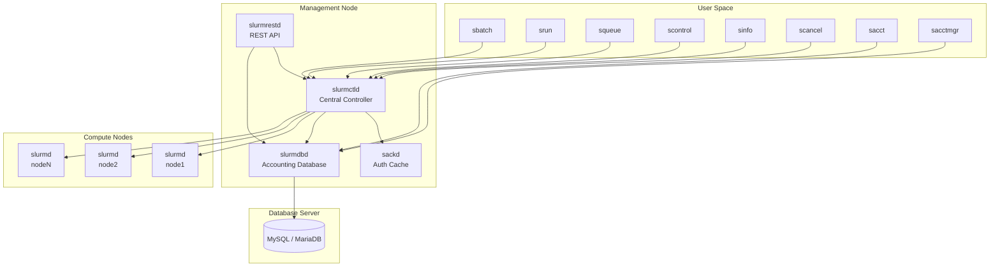
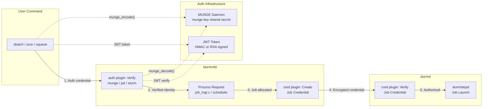
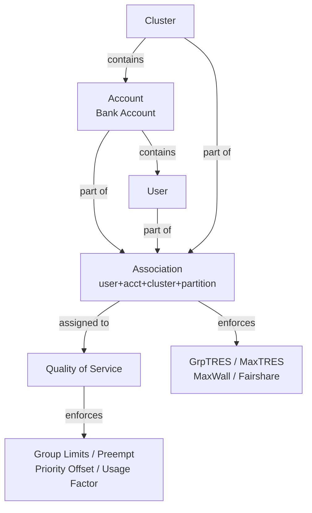
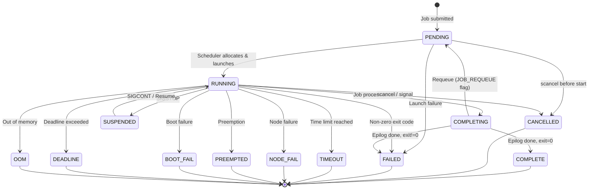
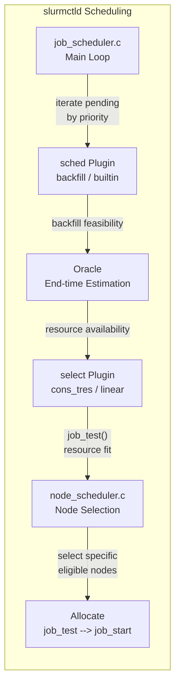

# Slurm: HPC 集群工作负载管理器

## What is Slurm

[Slurm](https://slurm.schedmd.com/)（Simple Linux Utility for Resource Management）是一个开源的集群资源管理和作业调度系统，是全球顶级超算和 HPC 集群的首选工作负载管理器。

Slurm 常与 [Open MPI](../High_Performance_Computing/ompi架构介绍.md) 搭配使用于 HPC 场景，负责资源分配和作业调度。

Slurm 提供三个核心功能：
1. **资源分配** — 为用户分配计算节点的独占/非独占访问权限（按时间段）
2. **作业框架** — 提供在已分配节点上启动、执行和监控作业（通常是并行作业）的完整框架
3. **队列仲裁** — 通过管理待处理作业队列来仲裁资源冲突

项目起源于 Lawrence Livermore National Laboratory (LLNL)，现由 SchedMD LLC 维护。仅在 Linux 下测试运行。语言为 C（附带 Perl、Lua、Python 用于扩展/测试），采用 GPLv2+ 许可证。

## 核心概念

### 作业（Job）

一个 **job** = 一次**资源分配请求** + 在分配的资源上运行的程序。它是 Slurm 中资源分配和调度的基本单位。

**示例**：在共享 HPC 集群上训练模型，编写脚本 `train.sh`：

```bash
#!/bin/bash
#SBATCH --nodes=2           # 要2个节点
#SBATCH --ntasks-per-node=4 # 每节点4个进程 (共8个GPU)
#SBATCH --gpus=8            # 总共8块GPU
#SBATCH --time=02:00:00     # 跑2小时
#SBATCH --mem=32G           # 每节点32GB内存

python train_model.py --epochs 100
```

提交：`sbatch train.sh`。Slurm 在集群中找到符合条件的节点，分配给你独占使用 2 小时，然后在上面执行脚本。从提交到运行结束，这一整个过程就是一个 job。

关键理解：Slurm 调度的是**"谁、什么时候、在哪台机器上、用多少资源"**，而不是"哪个进程跑哪个 CPU 核心"——那是 Linux 内核调度器的事。

### 作业步（Job Step）

一个 job 可以包含多个 **step**，每个 step 是 job 资源分配内的一组进程。Step 之间共享同一个 job 已分配的资源，不会重新排队。

**场景 1：在 batch 脚本内**（最常见）：

```bash
#!/bin/bash
#SBATCH --nodes=2
#SBATCH --gpus=8

# Step 0: 训练，用完所有8个GPU
srun python train.py

# Step 1: 评估，只用单节点单GPU
srun --nodes=1 --ntasks=1 python eval.py
```

`train.py` 和 `eval.py` 是两个独立的 step，在 `sacct` 中显示为 `1234.0` 和 `1234.1`。

**场景 2：交互式**（`salloc`）：

```bash
$ salloc --nodes=2 --gpus=8 --time=02:00:00
salloc: Granted job allocation 1234

$ srun python train.py       # Step 1234.0
$ srun --gpus=2 python debug.py  # Step 1234.1
$ exit                        # 释放整个 job
```

Job、step、进程的层级关系：

```
Job #1234 (一次 sbatch 提交)
├── Step 0: python train.py    ← srun 启动
├── Step 1: python eval.py     ← 共享同一分配
└── Step 2: bash cleanup.sh
```

### 文件分发

**Slurm 不会自动上传脚本到计算节点。** 脚本必须已经存在于所有计算节点的**相同路径**下。

HPC 集群通过**共享文件系统**解决此问题：

```
管理节点                      计算节点
/home/user/train.sh   ←NFS→   /home/user/train.sh (同一文件)
/data/dataset/         ←Lustre→ /data/dataset/
```

`sbatch` 只把脚本路径发给 slurmctld，slurmd 直接去本地路径执行——中间没有文件传输。

如果没有共享文件系统，可以用 `sbcast` 手动广播：

```bash
#!/bin/bash
#SBATCH --nodes=4
sbcast train.py /tmp/train.py
srun python /tmp/train.py
```

与 K8s 的对比：K8s 把容器镜像分发到所有节点，Slurm 假设你有 POSIX 共享存储。这是 HPC 领域的特征——超算中心天然就有 Lustre/GPFS/NFS。

### 资源限制机制

Slurm 通过 **Linux cgroups**（v1 或 v2）限制进程资源，有专门的插件体系：

| 插件 | 功能 |
|---|---|
| **cgroup/v2（或 v1）** | 核心约束：`memory.max`（硬内存上限）、`cpu.max`（CPU 带宽）、`cpuset`（核心绑定） |
| **task/cgroup** | 将作业进程放入正确的 cgroup |
| **proctrack/cgroup** | 通过 cgroup 追踪作业所有进程 |
| **jobacct_gather/cgroup** | 采集资源使用统计（用于计费和公平共享） |
| **SPANK + pam_slurm_adopt** | 确保 SSH 登录等外部进程也归入正确 cgroup |

流程：slurmctld 决定分配 → slurmd 创建 cgroup 并设限 → slurmstepd 在约束内启动进程 → jobacct_gather 采集用量。

### 与 Kueue 的对比

Slurm 和 [Kueue](../../Cloud_Native/Kubernetes/Scheduling/kueue.md) 都是作业级调度器，但设计哲学不同：

| | Slurm | Kueue |
|---|---|---|
| **运行环境** | HPC 集群（裸金属） | Kubernetes 集群 |
| **资源模型** | 节点/CPU/内存/GPU | 与 K8s 资源模型对齐（ResourceFlavor） |
| **Job Step** | 共享 job 已分配的资源，不重新排队 | 不支持 step 概念，每个 Workload 独立排队 |
| **文件分发** | 依赖共享文件系统（NFS/Lustre） | 容器镜像分发 |
| **抢占** | 支持（QOS/partition 级别） | 支持（Cohort 内公平共享/层级抢占） |

## 架构

### 核心 Daemon

Slurm 采用多 daemon 分布式架构：

| Daemon | 功能 |
|---|---|
| **slurmctld** | 中央控制器——Slurm 的大脑。管理作业、节点、分区、预留和调度决策。每个集群一个（含热备），代码量约 85k 行 C |
| **slurmd** | 节点 daemon——运行在每个计算节点上。执行和监控作业，管理 prolog/epilog，本地资源管控 |
| **slurmdbd** | 数据库 daemon——将计费和作业历史数据存入 MySQL，作为集中式计费层 |
| **slurmrestd** | REST API daemon——提供 RESTful HTTP API（OpenAPI），支持 JSON/YAML 序列化 |
| **slurmstepd** | 作业步 daemon——每个作业步在计算节点上启动，管理 I/O、cgroup 和信号传递 |
| **sackd** | 认证缓存 daemon——缓存认证凭证以减少认证开销 |

**系统拓扑：**



### 常用用户命令

| 命令 | 功能 |
|---|---|
| `sbatch` | 提交批处理作业脚本 |
| `srun` | 提交并启动作业步（交互式或在分配内） |
| `salloc` | 为交互式会话分配资源 |
| `scancel` | 取消作业或作业步 |
| `squeue` | 查看作业队列状态 |
| `sinfo` | 查看节点和分区状态 |
| `scontrol` | 管理控制接口（作业/节点/分区/预留管理） |
| `sacct` | 查看已完成作业的计费数据 |
| `sacctmgr` | 管理计费数据库（账户、用户、QOS） |

### 插件架构

Slurm 的核心架构模式是**可加载插件系统**。约 40 种插件类型，每种有多个实现。插件接口定义在 `src/interfaces/`，实现位于 `src/plugins/<type>/<implementation>/`。

关键插件类别：

| 插件类型 | 功能 | 主要实现 |
|---|---|---|
| **sched** (调度器) | 作业调度算法 | `backfill`（保守回填，约 5k LOC）、`builtin` |
| **select** (资源选择) | 资源到作业的匹配 | `cons_tres`（可消耗 TRES，约 11.5k LOC）、`linear`（整节点） |
| **priority** (优先级) | 作业优先级计算 | `multifactor`（多因子加权）、`basic` |
| **auth** (认证) | 认证机制 | `munge`、`jwt` |
| **gres** (通用资源) | 通用资源管理 | `gpu`、`mps`、`nic`、`shard` |
| **topology** (拓扑) | 网络拓扑感知 | `block`、`flat`、`ring`、`tree`、`torus3d` |
| **mpi** (MPI 启动) | 并行作业启动 | `pmi2`、`pmix`、`cray_shasta` |
| **accounting_storage** (计费) | 计费数据持久化 | `mysql`、`slurmdbd` |
| **jobcomp** (作业完成) | 作业完成日志 | `filetxt`、`elasticsearch`、`kafka`、`lua`、`mysql` |

### 认证流程



### 计费数据模型



## Job 生命周期

Slurm 中 job 有 12 种基础状态，加 15 种 state flag 进行细化标记。

**基础状态转换：**



**常用 State Flags：**
- `COMPLETING` — job 已结束，正在执行 epilog
- `STOPPED` / `REQUEUE` — job 被停止/重新排队
- `PREEMPT_IN_PROGRESS` — 抢占进行中
- `LAUNCH_FAILED` — 启动失败
- `SUSPEND_IN_PROGRESS` — 挂起进行中

短状态码：`PD`(PENDING), `R`(RUNNING), `CG`(COMPLETING), `CD`(COMPLETED), `CA`(CANCELLED), `F`(FAILED), `TO`(TIMEOUT), `NF`(NODE_FAIL), `PR`(PREEMPTED), `BF`(BOOT_FAIL), `DL`(DEADLINE), `OOM`(OOM), `S`(SUSPENDED)

## 核心调度算法

**调度流程概览：**



### 1. 多因子优先级计算

**Source:** `priority/multifactor/priority_multifactor.c` (~2,318 lines), `fair_tree.c` (~440 lines)

**精确公式：**

```
Priority = (Weight_Age × Age_factor)
         + (Weight_Assoc × Assoc_factor)
         + (Weight_FS × FS_factor)
         + (Weight_JS × JS_factor)
         + (Weight_Part × Part_factor)
         + (Weight_QOS × QOS_factor)
         + (Weight_TRES × TRES_factors[])
         + Site_factor
         - (Nice_offset - NICE_OFFSET)
```

所有权重通过 `slurm.conf` 配置，所有因子归一化到 [0.0, 1.0]。最终优先级为 32 位无符号整数，范围 [1, 2³²-1]，0 保留给 HOLD 作业。

**各因子计算方式：**

| 因子 | 计算方式 |
|---|---|
| **Age** | `Age_factor = min(1.0, (now - accrue_time) / PriorityMaxAge)`，线性增长，7 天后饱和 |
| **Fair-share** | `FS_factor = 2^(-((usage_efctv / shares_norm) / damp_factor))`，使用越少值越接近 1.0 |
| **Job Size** | `JS_factor = (min_nodes/total_nodes + cpu_cnt/cluster_cpus) / 2`，支持 favor_large / favor_small |
| **Partition** | `Part_factor = part_ptr→norm_priority` |
| **QOS** | `QOS_factor = qos_ptr→usage→norm_priority` |
| **TRES** | `Σ (job.tres_req_cnt[i] / part.tres_cnt[i]) × weight_tres[i]` |

**Fair Tree 模式**（`PriorityFlags=FAIR_TREE`）：

使用 `LF = shares_norm / usage_efctv`（Level Fairshare）替代默认公式：
- LF > 1.0 → 低使用率，应得更高优先级
- LF < 1.0 → 过度使用，优先级降低
- `SLURMDB_FS_USE_PARENT` 用户：LF = INFINITY（账户内最高优先级）
- 从根到叶逐层排序，同级按 LF 排序，用户优先于账户

**衰减与计费循环**（`_decay_thread()`，每 5 分钟运行）：

```
decay_factor = 1 - (0.693 / priority_decay_hl)   // 半衰期公式
loop:
    sleep(PriorityCalcPeriod)
    real_decay = pow(decay_factor, time_since_last_ran)
    usage_raw *= real_decay                        // 指数衰减历史用量
    for each running job j:
        usage_raw += (now - last_ran) × j.cpus_allocated  // 计入新用量
    recalculate_fairshare_for_all()
    recalculate_priorities_for_all_pending_jobs()
```

### 2. 保守回填 (Backfill)

**Source:** `sched/backfill/backfill.c` (~4,918 lines), `oracle.c` (~200 lines)

核心思想：按优先级降序遍历待处理作业，如果低优先级作业可以在当前空闲资源上立即启动，且不会延迟任何高优先级作业的预计开始时间，则立即启动它。

**关键数据结构：**

- **`node_space_map_t`** — 回填的核心抽象。一个时间切片链表，每个切片描述该时间段内的资源可用性（可用节点位图、许可证可用性、拓扑碎片化评分）
- **`bf_slot_t`** — Oracle 用于拓扑优化的候选放置槽位
- **`job_queue_rec_t`** — 回填测试的排序作业队列条目

**调度伪代码：**

```
algorithm BackfillScheduler:
    now = current_time
    job_queue = build_job_queue(sort_by_priority)

    // Phase 1-3: 初始化 node_space，为 running jobs 和 reservations 预留空间
    node_space[0] = { begin=now, end=now+backfill_window, avail_bitmap=all_available }
    for each running_job:  reserve_in_node_space(runner)
    for each reservation:  reserve_in_node_space(resv)

    // Phase 4: 按优先级遍历待处理作业
    while (job = job_queue.pop()) is not NULL:
        if max_test_count_reached or time_window_expired: break
        if not job_runnable_now(job): continue

        time_limit = min(job.time_limit, part.max_time)
        later_start = now  // 最早可延迟开始时间

    TRY_LATER:
        // 确定资源可用性约束
        avail_bitmap = node_space[0].avail_bitmap
        start_res = max(later_start, earliest_reservation_time(job))
        应用 reservation 约束并过滤节点
        avail_bitmap &= part.node_bitmap & up_node_bitmap - job.exc_nodes

        // 时间切片遍历
        for each time_slice in node_space (按时间顺序):
            if time_slice.end_time <= start_res: continue
            if time_slice.begin_time > job_end_time: break
            avail_bitmap &= time_slice.avail_bitmap

        if bit_count(avail_bitmap) < min_nodes:
            goto SKIP_OR_TRY_LATER

        // Phase 5: 关键测试 — job 能放入吗？
        rc = _try_sched(job, avail_bitmap, min_nodes, max_nodes)

        if rc == SUCCESS and job.start_time <= now:
            _start_job(job)  // 立即启动（回填成功！）
            allocate_in_node_space(job)
        else if rc == SUCCESS and job.start_time > now:
            // 可以稍后运行 → 创建回填预留，阻塞这些资源
            add_reservation(job, node_space, start_time, end_time)
        else:
        SKIP_OR_TRY_LATER:
            if later_start: goto TRY_LATER  // 在更晚时间重试
```

**"是否会延迟"测试的本质：**
并非显式检查，而是从算法结构中自然产生：
1. 按优先级降序迭代，高优先级先处理
2. 高优先级作业不能立即启动时，为其在 node_space 中创建回填预留
3. 低优先级作业的资源可用性位图与 node_space 各时间切片相交——如果高优先级的预留占用了所需节点，低优先级要么等待（`later_start`），要么跳过
4. `_try_sched()` → `select_g_job_test()` → `_future_run_test()` 模拟逐个移除运行作业来找到最早开始时间

**时间复杂度：** O(J × (S×N + N×R))，其中 J=待测试作业数，S=时间切片数，N=节点数，R=被模拟的运行作业数。实际受 `bf_max_job_test`（默认 100）和 `bf_max_time` 限制。

**Oracle 拓扑优化**（`bf_topopt_enable` 启用）：
评估多个候选节点集（`bf_slot_t[]`），选择碎片化最小的方案，而非简单的 first-fit。

### 3. CONsumable TRES 选择算法

**Source:** `select/cons_tres/job_test.c` (~4,084 lines)

**`job_test()` 三种模式：**

| 模式 | 功能 |
|---|---|
| `SELECT_MODE_WILL_RUN` | 判断 job 何时可以运行，调用 `_future_run_test()` 模拟作业完成时间 |
| `SELECT_MODE_TEST_ONLY` | 快速可行性检查 |
| `SELECT_MODE_RUN_NOW` | 实际分配资源并启动作业 |

**`_future_run_test()` 伪代码：**

```
algorithm _future_run_test(job, node_bitmap, ...):
    future_part = duplicate(partition_resources)
    future_usage = duplicate(node_usage)
    cr_job_list = build_sorted_job_list(running_jobs, sort_by_end_time)

    // 先检查是否可以通过抢占立即运行
    if preemptee_candidates:
        if _job_test(job, ALL_nodes, WILL_RUN, future) == SUCCESS:
            job.start_time = now; return SUCCESS

    // 逐个模拟移除运行作业，直到 job 能放下
    while more_jobs and not timed_out:
        batch = [jobs ending close together]
        remove_job_resources(batch, future_part, future_usage)

        if _job_test(job, node_bitmap, WILL_RUN, future) == SUCCESS:
            job.start_time = last_relevant_job.end_time
            return SUCCESS

    return FAILURE
```

**节点选择策略**（拓扑感知 best-fit）：

1. **逐节点资源检查**（`_can_job_run_on_node()`）：
   - 检查 GRES 可用性（GPU 等）
   - 检查 CPU 核心分配（通过位图）
   - 检查内存（每核/每节点模式）
   - 过滤不可用的 GRES（剩余核心数不足的 GPU 被排除）

2. **淘汰不足节点**：资源不够的节点从候选集中移除

3. **拓扑评估**（`topology_g_eval_nodes()`）：剩余节点由拓扑插件评估，考虑交换机连通性、NUMA 拓扑。单节点按 `sched_weight`（编码 GPU 亲和性）排序后按 best-first 选择；多节点由拓扑插件构建交换机感知的节点组，优先同叶交换机的节点

**异构资源处理：**
- GPU 亲和性：`sched_weight` 编码 GPU 邻近度，更多相邻 GPU 的节点得分更高（`sched_weight |= (0xff - near_gpu_cnt)`）
- `GRES_ENFORCE_BIND`：核心选择受限于已分配 GPU 附近的 CPU
- 整节点 vs 共享：`WHOLE_NODE_REQUIRED` 时以独占模式测试

### 4. 抢占算法

**Source:** `preempt/partition_prio/preempt_partition_prio.c`, `preempt/qos/preempt_qos.c`

两种抢占插件（`PreemptType` 配置）：

| 插件 | 决策依据 |
|---|---|
| **`partition_prio`** | 基于 partition 的 `priority_tier`（高层级可抢占低层级）。可选附加 `PREEMPT_MODE_PRIORITY` |
| **`qos`** | 基于 QOS 的抢占关系列表（QOS 对象有 `preempt` 列表）。可选 `PREEMPT_MODE_WITHIN` 允许同 QOS 抢占 |

**抢占优先级排序**（选择最适宜抢占的作业）：
```
preempt_prio = (priority_tier_or_qos) << 16 | node_count
```
- 高 16 位：partition priority_tier 或 QOS priority（越高越先被抢占）
- 低 16 位：node_count（作业越大越先被抢占）
- 设计理由：抢占**少量大作业**而非**大量小作业**（最小化被影响的作业数）

**抢占模式（对被抢占作业的处理）：**

| Mode | 效果 |
|---|---|
| `CANCEL` | 取消被抢占作业 → `JOB_PREEMPTED` 状态 |
| `CHECKPOINT` | 检查点保存后重新排队 |
| `REQUEUE` | 重新排队到 PENDING 状态 |
| `SUSPEND` | 挂起（SIGSTOP），保留分配，稍后可恢复 |
| `GANG` | Gang 调度——多个作业通过时间切片轮换共享节点，被抢占作业挂起后在时间片结束时恢复 |

**抢占触发路径：**

1. **主调度器**：`sort_job_queue2()` 调用 `preempt_g_job_preempt_check()` 排序，如果抢占可行，抢占者优先出现在队列前
2. **回填调度器**：`_try_sched()` 调用 `slurm_find_preemptable_jobs()` 识别可抢占作业，传递给 `select_g_job_test()` 的 `preemptee_candidates`。如果移除这些作业能释放足够资源，在启动作业前执行抢占

**Gang 调度**（`gang.c`）：
- `PreemptMode=GANG` 时，多个作业在相同节点上时间切片
- Gang 调度器周期性旋转，向运行作业发 SIGSTOP，向挂起作业发 SIGCONT
- `PreemptExemptTime` 提供新启动作业的免抢占保护期

## 关键依赖

| 依赖 | 用途 |
|---|---|
| **MUNGE** | 认证凭据服务 |
| **MySQL/MariaDB** | 计费数据库后端 |
| **hwloc** | 硬件拓扑发现（CPU、NUMA、缓存层级） |
| **Lua** | 可脚本化的作业提交过滤器 |
| **PMIx / UCX** | 并行作业启动和高性能通信 |
| **NVML / RSMI / oneAPI** | GPU 管理（NVIDIA / AMD / Intel） |
| **libjwt** | JWT 认证 |
| **cgroup** | 资源容器（cgroup v1/v2） |

## 项目状态

- **当前版本**: 26.11.0-0rc1（预发布）
- **发布模式**: YY.MM 版本方案，每年两次大版本（4-5 月和 10-11 月）
- **构建系统**: GNU Autotools，RPM/DEB 分包（约 20 个子包）
- **测试框架**: Pytest（集成测试）、Expect（遗留集成测试）、Check（C 单元测试）
- **代码量**: slurmctld 约 85k 行，单文件最大约 19.8k 行，总计约 3,300+ 次提交（2026 年）

## 参考

- [Slurm 官方文档](https://slurm.schedmd.com/)
- [Slurm GitHub](https://github.com/SchedMD/slurm)